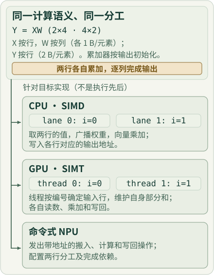
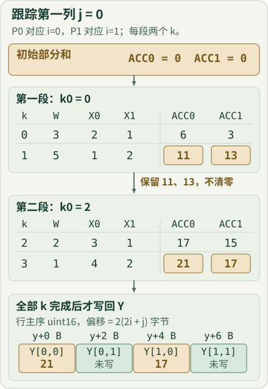
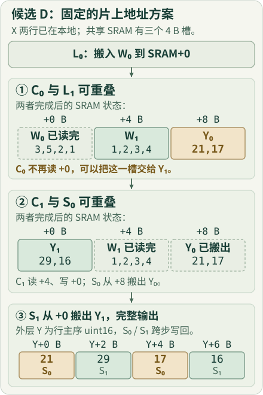

# 分块方案确定后，怎样生成可执行的矩阵乘法内核？

[C05](../03-mapping-and-planning/c05-cost-model-and-search.md#plan-output) 已经为一项小型矩阵乘法选好了执行方案：两个计算单元各负责一行输入，两轮依次计算两个输出列，提前装入下一列权重，并为中间数据分配好片上地址。

但这份方案还不能直接交给芯片执行。设备需要知道每个执行者要访问哪些地址、循环多少次、什么时候清零累加器，以及怎样将结果交给下一项工作。

**算子内核（Kernel）**是实现一项或一组计算的可执行例程。编译器可以根据已有方案生成内核，也可以将计算降低为调用符合要求的内核库。本篇追踪同一组矩阵乘法，看看计划如何变成代码。

## 代码生成阶段已经知道什么？ {#fixed-plan}

沿用 [C01](../03-mapping-and-planning/c01-tensor-mapping.md) 和 [计算微架构 D01](../../microarchitecture-v2/04-compute-arrays/d01-macs-and-array-data-paths.md) 的小矩阵。X 有两行四列，W 有四行两列，结果 Y 有两行两列。

| X 的行 | W 的列 | Y 的行 |
| --- | --- | --- |
| 第 0 行：(2,1,3,4) | 第 0 列：(3,5,2,1) | 第 0 行：(21,29) |
| 第 1 行：(1,2,1,2) | 第 1 列：(1,2,3,4) | 第 1 行：(17,16) |

设 X 的形状为 (M,K)，W 的形状为 (K,N)。计算规则是：

**Y[i,j] = Σₖ X[i,k] × W[k,j]**，其中 k 从 0 遍历到 K−1。

这里 M=2，K=4，N=2。每个输出需要四次乘加，整个矩阵需要 16 次乘加。i、j 决定输出的位置，k 决定逐步加进这个输出的乘积。

先取 C01 的按行分工：P0 负责 i=0，P1 负责 i=1。两者同时处理同一列 j。每个计算单元依次处理 k=0,1,2,3，并在本地保留这个输出的部分和。

为了观察跨分块的累加，下面将同样的四步 k 细分成两个长度为 2 的循环块。两个块仍由同一个执行者按原顺序处理，不改变分工和归约顺序。

按 [D01](d01-lowering-and-bufferization.md) 的方法，先约定输入输出缓冲区。从 [C02](../03-mapping-and-planning/c02-layout-and-dataflow-planning.md) 继承输入布局；本篇明确选择行主序 Y 作为输出接口。

| 对象 | 实际存储格式 | 字节偏移（从各自起始地址算起） |
| --- | --- | --- |
| X | 行主序，uint8 槽 | i × K + k |
| W | 列主序，uint8 槽 | j × K + k |
| Y | 行主序，uint16 槽 | 2 × (i × N + j) |

X、W 元素仍取 0–15，每个元素占一个字节，没有把两个 4-bit 值压进同一字节。K=4 时最大的和为 4×15×15=900，uint16 足够保存。以下标量与线程例程使用 uint32 累加以便表达。

假设三个缓冲区互不重叠、容量充足、满足所用操作的对齐要求，输入计算期间不变。函数可以直接写 Y，不需要返回整张逻辑张量。[A03](../01-foundations/a03-tensor-representation.md#stride-and-address) 已解释布局与步长怎样决定地址。

<figure markdown="1">

[](assets/d05-plan-to-kernels.svg)

<figcaption>分工、布局与资源方案已确定。不同目标补充的执行细节不同，但都要产生同一组结果。NPU 还采用 C05 已经选定的片上驻留、搬运与地址方案。</figcaption>

</figure>

## 怎样将分块变成循环和地址？ {#loops-and-addresses}

先不考虑并行，用普通 C 写出可执行的标量实现。用 i 循环依次模拟 P0、P1，j 决定当前列，k0 依次取 0 和 2，每块再遍历两个 k。

```c
#include <stdint.h>

void matmul_2x4x2(const uint8_t *x, const uint8_t *w,
                  uint16_t *y) {
    for (int j = 0; j < 2; ++j) {
        for (int i = 0; i < 2; ++i) {
            uint32_t acc = 0;
            for (int k0 = 0; k0 < 4; k0 += 2) {
                for (int kk = 0; kk < 2; ++kk) {
                    int k = k0 + kk;
                    acc += (uint32_t)x[i * 4 + k]
                                    * w[j * 4 + k];
                }
            }
            y[i * 2 + j] = (uint16_t)acc;
        }
    }
}
```

这段代码保留了按列轮次处理的顺序，但两个执行者被串行模拟。实际生成并行代码时，i 可以成为两个向量 lane 或线程的索引。

重点观察 acc 的作用域。它在整个 k0 循环之前清零，而不是每进入一块就清零。对于第一个输出 Y[0,0]，第一块算出 11，第二块在这个 11 上继续加 3×2 和 4×1，得到 21。

如果在 k0=2 时重新清零，就只会得到 10。如果每块都把 acc 写回同一个 Y 位置，也需要防止后一次写入丢掉先前的部分和。

<figure markdown="1">

[](assets/d05-accumulator-states.svg)

<figcaption>两段 k 循环之间保留各自的部分和。右侧写入的是完整归约结果，并非两块各自的部分和。</figcaption>

</figure>

再跟踪第二行第一列的最后一次乘加。假设 x、w、y 的软件可见起始字节地址分别为 1000、2000、3000。

| 操作 | 地址或数值 |
| --- | --- |
| 计算 i=1、j=0、k=3 时 X 的地址 | 1000 + 1×4 + 3 = 1007 |
| 从 X 读出 | 2 |
| 计算 W 的地址 | 2000 + 0×4 + 3 = 2003 |
| 从 W 读出 | 1 |
| 更新部分和 | 15 + 2×1 = 17 |
| 保存 Y[1,0] | 3000 + 2×(1×2+0) = 3004，写入 uint16 值 17 |

C 中 y 是 uint16 指针，因此 `y[i*2+j]` 的下标已经按元素类型换算成字节地址，无需再乘一次 2。四个结果最终按 (21,29,17,16) 的顺序存放。

这里的 Lowering 把块的范围和索引表达式变成实际控制流和访存，把归约变成有明确生存范围的部分和。循环可以继续 Lowering 成目标指令；固定长度的循环也可以展开成重复的运算和固定偏移。

MLIR 的 `linalg.matmul` 等操作可以表达这种结构化计算。其 `convert-linalg-to-loops` Pass 在缓冲区语义下生成 SCF 循环。这是一种具体的降低实现，不要求所有编译器采用同样的 IR 或转换顺序。

[MLIR：Linalg Matmul](https://mlir.llvm.org/docs/Dialects/Linalg/#linalgmatmul-linalgmatmulop) · [convert-linalg-to-loops](https://mlir.llvm.org/docs/Passes/#-convert-linalg-to-loops)

## 如果用一条向量操作计算两个输出？ {#simd-kernel}

假设目标 CPU 支持向量运算。已选分工是两个执行者沿 i 维处理同一列，编译器可以把 i 对应的两个独立部分和组织成一个向量。

在 j=0、k=0 时，需要 X[0,0]=2、X[1,0]=1，而两者乘的都是 W[0,0]=3。将两个 X 放进两个有效 lane，把 W 复制到这两个 lane：

```text
for j in 0..1:
    acc = [0, 0]                      # 两个宽累加 lane
    for k0 in (0, 2):
        for kk in 0..1:
            k = k0 + kk
            vx = load2_strided_u8(x + k, stride=4)
            vw = broadcast_u8(load_u8(w + 4*j + k))
            acc = mac_widen_u32(acc, vx, vw)
    store2_strided_u16(y + 2*j, narrow(acc), stride=4)
```

以上是教学中的向量操作，地址和 stride 都以字节计。前两次向量乘加将 acc 从 [0,0] 变为 [6,3]，再变为 [11,13]。最终 acc=[21,17]，两个 lane 分别保存一个完整输出。

这里要保留原来的布局。X 的两个输入隔 4 B，不是连续两个字节；Y 的两个输出起始位置也隔 4 B。因此目标需要支持相应的跨步访问，或者用多次标量访问和向量组装实现。

向量加宽也必须匹配算术契约。若把乘积和部分和都留在 uint8 lane，某些合法输入会溢出。本例用足够宽的累加器，并在确认结果可表示后转为 uint16。

真实向量 ISA 的元素宽度和有效 lane 数量各不相同。例如 RISC-V V 支持跨步访存及扩大到两倍元素位宽的整数乘加。因此教学中的 uint8 到 uint32 乘加可能需要先扩展或组合多条指令。

本例只有两个有效 lane，不意味着物理向量单元恰好只有两个 lane。

如果选定方案所需的 lane 数多于目标指令一次能表达的有效 lane 数，代码还需按目标的向量长度拆分执行，保持 lane 到逻辑索引的对应关系。

[RISC-V V 规范：Vector Loads and Stores、Vector Integer Widening Multiply-Add](https://docs.riscv.org/reference/isa/v20260120/unpriv/v-st-ext.html) · [计算微架构 C01：标量、SIMD 与向量执行](../../microarchitecture-v2/03-parallel-execution/c01-scalar-simd-and-vector-execution.md)

## 如果把两行交给 GPU 的两个线程？ {#simt-kernel}

前面的 SIMD 写法用一个向量显式描述两个 lane。采用 SIMT 编程模型时，可以生成单个线程的程序，用线程索引确定它负责哪一行。多个线程分别执行这段程序。

下面是 CUDA C++ 实现的核心。它保持每个线程负责一行、依次处理全部列的分工，并接受 M、K、N 作为参数。K 每两步为一块。输入值仍为 0–15，并要求 K≤291，使 uint16 输出足够表示最大和。

```cuda
__global__ void matmul_rows(const uint8_t *x,
                            const uint8_t *w,
                            uint16_t *y,
                            int M, int K, int N) {
    int i = blockIdx.x * blockDim.x + threadIdx.x;
    if (i >= M) return;

    for (int j = 0; j < N; ++j) {
        uint32_t acc = 0;
        for (int k0 = 0; k0 < K; k0 += 2) {
            for (int kk = 0; kk < 2 && k0 + kk < K; ++kk) {
                int k = k0 + kk;
                acc += (uint32_t)x[i * K + k]
                                * w[j * K + k];
            }
        }
        y[i * N + j] = (uint16_t)acc;
    }
}
```

本例假设正整数维度与索引计算均可由 int 表示，包括尾块无效线程的 i。按照每组两行的教学分工，可以为每个线程块指定两个线程，启动足够多的线程块来覆盖所有 M 行。

```cuda
// 假设设备缓冲区及调用所需的运行环境已就绪。
matmul_rows<<<(M-1)/2+1, 2>>>(x, w, y, M, K, N);
```

对于 M=2，线程 i=0 写第 0 行，线程 i=1 写第 1 行。若还有多出来的线程，它们在访问缓冲区之前返回。这里的启动配置只用来对应 C01 的分工，不是实际 GPU 的性能建议。

相比标量实现，i 不再由每个执行者内部的循环控制，而由线程号产生。每个线程的 acc 仍是自己的局部状态。同一 Warp 内的线程怎样发射指令，由 GPU 实现；这两个线程也不意味着对应两个固定物理计算单元。

这个简单内核没有显式共享内存或线程间同步。虽然两个线程读取同一个 W 元素，源码仍表达各自读取，不能据此断定片外存储只读取一次。

如果已选方案规定一个线程组合作装入 X、W 的 Tile，就需要生成用于搬运的线程索引、写共享存储的地址、消费者读取 Tile 的条件及必要同步。不能把上面的提前返回直接照搬进需要全体线程参与同步的实现。

若目标还提供矩阵乘加指令（例如支持相应类型的 Tensor Core 指令），编译器可以将符合要求的分块降低成这样的指令或内置函数。但必须匹配目标规定的输入类型、Tile 形状、lane 中元素分布以及累加器格式，不能仅把任意两条标量运算改名为矩阵指令。

[CUDA 编程指南：Writing SIMT Kernels](https://docs.nvidia.com/cuda/cuda-programming-guide/02-basics/writing-cuda-kernels.html) · [计算微架构 C02：SIMT 与 Warp](../../microarchitecture-v2/03-parallel-execution/c02-simt-and-warp-scheduling.md)

## 分块尺寸不能整除实际形状怎么办？ {#boundary}

上一段 CUDA 代码为什么要检查 `i >= M` 和 `k0 + kk < K`？因为分工及分块使用的尺寸，不一定刚好覆盖所有有效位置。

例如仍按每组两个执行者分配 i，将 X 增加第三行 (1,1,1,1)。此时 M=3，第二组的逻辑行号为 2 和 3。i=2 有效，可以算出 (11,10)；i=3 已超出输入与输出的行范围。

如果不加检查，第二个执行者会读取不存在的 X 行，并尝试写到 Y 之外。在 CUDA 示例里，用线程号产生的 i 先进行判断；在向量内核里，可以按实际有效 lane 数量执行，或用掩码限制访问。

再假设 K=5，仍按两步分块。k0=4 时末块只有 k=4 一项，不能读取 k=5。生成代码可以使用较短的末块、带掩码的访存，或先构造安全的填充区。

| 处理方式 | 必须满足的条件 |
| --- | --- |
| 缩短循环 | 只访问实际存在的元素，末块使用 min(块尾, K) 作为结束位置 |
| 掩码（Mask） | 无效 lane 的读取或写入真正被阻止，而不是越界读完再丢弃 |
| 填充（Padding） | 额外存储已分配且填充值满足计算语义，如归约中的零贡献；无效输出不写入原结果区 |

如果采用 C01 中的另一种按列分工，N=3、每组两列，也会遇到同样的问题：最后一组只有 j=2 有效，j=3 必须屏蔽。原例增加 W 第三列 (1,1,1,1) 可得到第三列结果 (10,6)。

所以生成固定形状的专用内核，可以省去已知不需要的分支。但它要附带形状、布局和类型等适用条件；通用内核则需要根据实际形状计算边界。怎样选择版本属于 C/F，怎样实现已选的 Guard 或尾块属于这里。

## 如果目标是提供搬运和阵列命令的 NPU？ {#npu-kernel}

回到 C05 的候选 D。现在目标不是 CUDA，而是假设有两个显式编程的计算单元、两行 X 的本地存储、支持 W 广播的共享 SRAM 和一台 DMA 的教学 NPU。

C03 原例的外层 Y 为列主序。这里保留 C05 的计算分工与片上地址，但适配本篇选用的行主序输出接口。因此写回命令的目的地址需要变化。

X 已经装入两个单元各自的本地四个字节槽中。候选 D 已分配共享 SRAM 的 12 B：偏移 0 先给 W₀、再给 Y₁；偏移 4 给 W₁；偏移 8 给 Y₀。

编译器不必重新计算这些地址。它需要将每项计划中的计算与搬运转换成目标支持的操作，并补全参数。

为便于说明，设目标提供三类抽象命令：LOAD 搬入连续权重，COMPUTE 在给定权重槽上计算两个点积，STORE 将片上结果搬到指定的目标布局。以下是命令参数的教学表示，不是任何实际 NPU 的 ISA。

| 命令 | 参数 | 完成后才能做什么 |
| --- | --- | --- |
| L₀ | LOAD W+0 → SRAM+0，4 B | C₀ 读取 W₀；L₁ 使用 DMA |
| L₁ | LOAD W+4 → SRAM+4，4 B | C₁ 读取 W₁；S₀ 使用 DMA |
| C₀ | COMPUTE SRAM+0 → SRAM+8 | S₀ 读取 Y₀；C₁ 复用 SRAM+0 |
| C₁ | COMPUTE SRAM+4 → SRAM+0 | S₁ 读取 Y₁ |
| S₀ | STORE SRAM+8 → Y+0、Y+4，各 2 B | S₁ 使用 DMA |
| S₁ | STORE SRAM+0 → Y+2、Y+6，各 2 B | 交付完整 Y |

COMPUTE 要表达每个单元的输入位置、四次乘加、累加器清零，以及两个 uint16 结果的保存位置。若目标只有更基础的指令，编译器还需把 COMPUTE 展开为读取本地 X、广播 W、乘加和交付结果的操作序列。

<figure markdown="1">

[](assets/d05-npu-commands.svg)

<figcaption>地址来自 C05 的已选方案。L₁ 与 C₀、S₀ 与 C₁ 可以重叠；每一项仍须等待其真实依赖完成，包括对应数据对消费者可见。</figcaption>

</figure>

例如 C₀、L₁ 都依赖 L₀ 完成，可以在具备所需并行访问条件时一起执行。C₁ 要等 C₀ 和 L₁ 完成，才能安全地覆盖偏移 0 并读取第二列权重。S₀ 要等 C₀ 和 L₁ 完成。

生成端可以把这些关系写进命令等待条件或目标规定的执行顺序。不能只写“第 6 拍开始 C₁”：如果前一次读取未结束，重新使用同一地址仍会破坏计算。

还需要注意结果布局。SRAM 中 Y₀ 连续保存 21、17，但行主序的外层 Y 中这两个元素相隔 4 B。S₀ 可以使用支持跨步目的地址的搬运操作；若没有该能力，则需分别搬运两个有效元素。

C05 的 12 拍来自教学服务时间。若实际跨步搬运及命令开销改变了这些条件，耗时就需要重新评估。这里实现的是依赖与地址方案，并未证明在真实目标上仍为 12 拍。

具体硬件接口会有差异。例如 Gemmini 提供主存与片上 Scratchpad/Accumulator 之间的搬运与矩阵计算指令，有自己的地址、步长和累加语义。并非所有 NPU 都采用这样的命令或存储结构。

[Gemmini：ISA](https://github.com/ucb-bar/gemmini#isa) · [计算微架构 D02：驻留与数据复用](../../microarchitecture-v2/04-compute-arrays/d02-stationary-dataflows-and-reuse.md)

## 为什么有时不需要生成新的内核？ {#kernel-library}

矩阵乘法是常见计算，很多平台已经提供实现。编译器也可以生成一次**内核库调用**，将形状、布局、数据类型及缓冲区传给已有例程，而不是重新生成循环体。

例如常见的 GEMM 接口表达 C = α op(A) op(B) + β C。当 α=1、β=0 时，只需产生矩阵乘积；不需要将 Y 的旧值作为计算输入。

我们用原算例的相同数值说明一次调用，但**改用 FP32 的 X、W、Y 三个独立缓冲区**，仍保持 X 行主序、W 列主序、Y 行主序。不能把之前的 uint8/uint16 缓冲区直接传给 FP32 接口。

以 cuBLAS 的 `cublasSgemm` 为例，其矩阵参数按列主序解释。X 的行主序存储在该接口眼中恰好是列主序的 Xᵀ，Y 的目标存储也是列主序的 Yᵀ。

因此可以利用 Yᵀ = Wᵀ Xᵀ：第一项读取 W 并指定转置，第二项直接读取按列主序解释的 X，计算出的 N×M 列主序结果就有原来 M×N 行主序 Y 的存储顺序。

```c
// 假设 handle、设备缓冲区及主机指针模式已准备好。
float alpha = 1.0f, beta = 0.0f;
cublasSgemm(handle, CUBLAS_OP_T, CUBLAS_OP_N,
            N, M, K, &alpha,
            W, K, X, K, &beta, Y, N);
```

这里 W、X 在库调用前都按 K 行的列主序矩阵解释，故两者的 leading dimension 均为 K。输出按 N 行的列主序矩阵解释，leading dimension 为 N。这组小整数在 FP32 下可以精确得到相同结果。

无需复制即可适配此例的布局，不代表所有布局都能用一个转置标志实现。若已选内核要求不同的分组、对齐或 Packing 格式，生成端就必须实现必要的转换，或使用另一个匹配的实现。

选定库调用仍然需要生成符合接口的参数、必要的数据转换及可调用产物。库内部采用哪种机器指令或分块方案，由具体库及目标条件决定，不能从一次 GEMM 调用推断必定使用 Tensor Core。

[cuBLAS：`cublas<t>gemm`](https://docs.nvidia.com/cuda/cublas/index.html#cublas-t-gemm)

## 同一个矩阵乘法，为什么需要多种内核？ {#inference-shapes}

回到模型推理。假设线性层将 K 维输入投影成 N 维结果，M 表示本次算子实际处理的 Token 行数，不必等于请求数。Prefill 可从同一个请求取得许多行；普通 Decode 通常每个被选请求贡献一行。

当 M=1 时是矩阵与单行向量的乘积，这也可以用 GEMM 表达，或采用专门的 GEMV 类实现。当 M 增大，同一份 W 可以用于更多输入行，所以适合的实现形式可能发生变化。

例如 K=N=4096，输入和输出均为 FP16。按一次乘加计 2 FLOP，各输入只读一次、输出只写一次（忽略缓存和工作区），可得到下面的逻辑工作量。

| Token 行数 M | 算术工作量 | 理想逻辑字节数 |
| ---: | ---: | ---: |
| 1 | 33.6 MFLOP | 33.6 MB |
| 32 | 1.07 GFLOP | 34.1 MB |

逻辑字节数按 2(MK+KN+MN) 计算，使用十进制 MB 单位。这是解释权重复用机会的预算，不是测得的访存量。实际内核还受 Tile、对齐、资源和数据类型等条件影响。

同一语义可生成固定形状版本、处理尾块的通用版本或库调用。无论哪一种，核心职责都是把所选执行方案转化为正确的索引、循环、运算、搬运、同步及目标契约。

## 接下来怎样真正减少中间数据搬运？ {#next}

这篇中，每个完整点积只在归约结束后写入 Y。如果接下来还有激活函数或逐元素加法，那么在写 Y 之前，累加器中的数是否可以直接用于下一次计算？

下一篇 [D06：两个算子已经决定融合，怎样真正减少中间数据搬运？](d06-fused-kernels.md) 将在已经决定融合的前提下，继续追踪这样的中间结果：它能留在哪里，怎样生成融合循环与 Epilogue，遇到跨元素归约时又需要怎样的协作。

低精度格式与目标输入转换见 [D08：低精度数据怎样变成设备可以直接处理的输入？](d08-low-precision-kernels.md)。若希望了解内核代码如何成为设备可接收的产物，可以按需阅读 [D04：生成的代码怎样成为可加载、可调用的程序？](d04-executable-artifacts.md)；实际加载和任务提交见 [F01](../06-execution-runtime/f01-module-loading-and-dispatch.md)。

[返回专题阅读顺序](README.md#计划阅读顺序)
