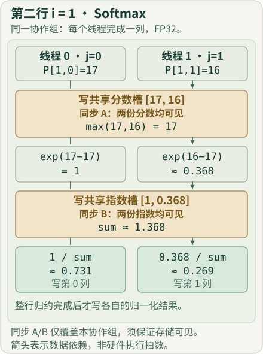

# 两个算子已经决定融合，怎样真正减少中间数据搬运？

在 [D05](d05-matrix-multiplication-kernels.md) 中，两个计算单元逐步累加，得到矩阵乘法的结果。为了交给后续计算，每个完整点积最后都被写到输出缓冲区。

如果接下来只是给每个结果加一个偏置，再执行 ReLU，为什么一定要先将这些数写到外层存储，再读回来呢？能不能趁完整点积还在计算单元手边时，直接做完后续运算？

**融合内核（Fused Kernel）**是在一个内核中实现原本由多项操作表达的计算。代码生成阶段要做的，是改变中间值的产生、保存和使用方式，同时满足原程序对数值与输出的要求。

[B06](../02-frontend-and-optimization/b06-legal-transformation.md#fusion-and-decomposition) 已说明哪些融合改写合法，[C05](../03-mapping-and-planning/c05-cost-model-and-search.md) 介绍了怎样选择执行方案。这里假设融合与分工方案已经确定，重点跟踪生成的代码及数据所在的位置。

## 原来的两次计算，中间搬运了什么？ {#materialization}

沿用 D05 的 X 与 W：形状分别为 (2,4) 和 (4,2)。X 按行存储、W 按列存储，每个输入元素用 uint8 槽保存 0–15 的整数。为了区分最终模型输出，这次把 D05 的矩阵乘法结果记为 P，仍为行主序 uint16。

| X 的行 | W 的列 | P 的行 |
| --- | --- | --- |
| 第 0 行：(2,1,3,4) | 第 0 列：(3,5,2,1) | 第 0 行：(21,29) |
| 第 1 行：(1,2,1,2) | 第 1 列：(1,2,3,4) | 第 1 行：(17,16) |

接上 B06 已介绍的 BiasRelu 组合操作。这次取两个 int32 偏置 b = (−20, −15)，按列相加。加法在 int32 中执行，ReLU 将小于 0 的数变为 0，最终结果用 uint16 交付。

| 输出位置 | 矩阵乘法 P | 加偏置后的值 | ReLU 后的 Y |
| --- | ---: | ---: | ---: |
| [0,0] | 21 | 1 | 1 |
| [0,1] | 29 | 14 | 14 |
| [1,0] | 17 | −3 | 0 |
| [1,1] | 16 | 1 | 1 |

假设所有输入只读且与输出不重叠；在原计算中 P 只供 BiasRelu 使用。K=4，因此点积最大为 900，本例固定的偏置和转换均在各自类型的表示范围内。

如果使用两个独立内核，第一个内核计算 P，写入四个 uint16 元素。等 P 对第二个内核可读后，第二个内核逐个读回 P，执行偏置和 ReLU，再写 Y。

这里把一个逻辑张量建立为能够被后续操作读取的存储对象，称为**物化（Materialization）**。P 的逻辑值仍然由矩阵乘法决定，但它现在还需要一块能够容纳四个数的缓冲区。

只统计 P 的有效数据，在两个内核的外层缓冲区接口处，写 P 需要 8 B，读 P 再需要 8 B，一共 16 B。Y 的最终写入和偏置读取另计。

注意，这里的外层存储是相对于内核的局部存储而言。如果是 GPU，外层缓冲区可能在显存地址空间中，但缓存可能命中。16 B 是这组逻辑中间读写的有效字节数，不是测得的 HBM 流量。

<figure markdown="1">

[![两内核实现需写P的四个uint16元素再读回，总计16B中间读写；融合后在产生P[1,0]=17时直接加偏置−20得到−3、经ReLU得到0，仅将Y写出。](assets/d06-epilogue-dataflow.svg)](assets/d06-epilogue-dataflow.svg)

<figcaption>两个实现交付相同的 Y。融合可以移除 P 的独立外层缓冲区，而不是移除 P 的计算。最终写入 Y 的 8 B 在两种方案中都存在。</figcaption>

</figure>

## 怎样把 BiasRelu 接到点积的末尾？ {#epilogue}

先观察 D05 的 P[1,0]。计算单元 P1 在 k 的两个循环块中，累加器依次从 0 变为 3、13、15、17。原来的代码将 17 转成 uint16 后写 P[1,0]。

后继操作恰好只需要这一个 P 元素和 b[0]。所以在整个 k 归约结束时，就具备生成 Y[1,0] 所需的全部数据，不需要等待其他三个输出。

仍保留 D05 的 j、i、k 循环及存储布局。以下 C 例程使用相同的定宽整数语义，在每次完整点积之后直接实现 BiasRelu。

```c
#include <stdint.h>

void matmul_bias_relu(const uint8_t *x,
                      const uint8_t *w,
                      const int32_t *b,
                      uint16_t *y) {
    for (int j = 0; j < 2; ++j) {
        for (int i = 0; i < 2; ++i) {
            uint32_t acc = 0;
            for (int k0 = 0; k0 < 4; k0 += 2) {
                for (int kk = 0; kk < 2; ++kk) {
                    int k = k0 + kk;
                    acc += (uint32_t)x[i * 4 + k]
                                    * w[j * 4 + k];
                }
            }
            // 保留矩阵乘法的 uint16 结果语义
            uint16_t p = (uint16_t)acc;
            int32_t z = (int32_t)p + b[j];
            y[i * 2 + j] = (uint16_t)(z > 0 ? z : 0);
        }
    }
}
```

假设调用时 b 为上述固定偏置。以前，点积结束后执行的是 `store(P, i, j, p)`；现在去掉这次存储，将 p 直接作为后两项操作的输入，最后的 store 指向 Y。计算 p 仍然是必要的。

这种接在矩阵乘法主归约之后、写出结果之前的处理，通常称为 **Epilogue**。它可以包括偏置、残差加法、激活函数、类型转换等取决于输入与累加结果的操作。

代码中为什么要等到 k 循环全部结束？例如 P1 的第一块只完成 13。如果先给 13 加 −20，再执行 ReLU，得到 0；第二块还有 4 需要累加，若直接加到 0 就得到了错误的 4。

正确的执行顺序是先得到 17，再加偏置 −20 得到 −3，最后 ReLU 得到 0。即使多个计算单元各负责一段 k，Epilogue 也要在它们的部分和完成必要的归并之后执行。

类似地，原程序如果规定矩阵乘法要先舍入成 FP16，再做加法，融合后的实现仍要满足这一数值契约。把偏置直接加到 FP32 累加器、最后只舍入一次，可能得到不同的值。是否允许改变由 B06 的数值语义决定。

[CUTLASS：Efficient GEMM / Epilogue](https://docs.nvidia.com/cutlass/latest/media/docs/cpp/efficient_gemm.html#epilogue) · [cuBLASLt：Epilogue 模式](https://docs.nvidia.com/cuda/cublas/#cublasltepilogue-t)

## 融合后，中间值真的一直在寄存器里吗？ {#residency}

上面的 C 源码只使用了局部变量 p，并不意味着编译后的 p 一定占据某个物理寄存器。它只是表达 p 不需要作为独立的外层张量交给第二个内核。

在目标支持相应指令、资源充足的情况下，生成的代码可以在寄存器中直接完成偏置、比较和选择。例如在 D05 的 SIMD 实现中，两 lane 累加器完成第 0 列后为 [21,17]。

对每个 lane 保留原矩阵乘法的结果值，加入广播的 −20，得到 [1,−3]；然后按 lane 选出与 0 的较大值 [1,0]，最后按行主序的目的地址写出两个 uint16。

在 SIMT 的按行分工中，每个线程拥有自己计算的部分和，本例也可直接执行相同的逐元素处理。若目标的矩阵乘加指令将结果按某种布局分散到线程，Epilogue 还可能需要显式交换或重排，再完成最终存储。

以 CUTLASS 为例，其 GEMM Epilogue 可以借助共享内存交换线程的寄存器结果，以便按合适的布局写回。它仍有片上读写，但可以无需先将整张 P 交给另一个独立内核。

NPU 也取决于具体能力。D05 的 NPU 在累加后将一列结果交到 SRAM，再由 DMA 写回外层 Y。现在假设已经选定一个允许后续向量处理读取这些片上结果的融合方案。

| 目标支持的路径 | 代码生成需要做到什么 |
| --- | --- |
| 累加器可直接送入后处理单元 | 在完整点积后下发偏置、激活等目标操作，保存最终 Y |
| 后处理单元只能读取共享 SRAM | 先写片上 P，等待数据可见，后处理读 P 并写片上 Y，再搬出 Y |
| 后继只能从外层取得输入 | 必须保留相应的写出和读取，不能仅靠融合标签消除搬运 |

表中第二种路径的 P 仍有实际存储位置。生成的命令必须等计算完成后才允许后处理读取，并保证覆盖或复用槽之前没有尚未结束的读任务。

因此，能省掉的是哪个层级之间的读写，要随着数据路径逐层确认。若发生寄存器溢出（Spill）、布局重排或额外复制，还应计入相应的存储访问。

[计算微架构 D02：驻留与数据复用](../../microarchitecture-v2/04-compute-arrays/d02-stationary-dataflows-and-reuse.md) · [计算微架构 F02：任务控制与同步](../../microarchitecture-v2/06-resource-cooperation/f02-task-control-and-synchronization.md)

## 如果后继需要一整行，而不只需要一个元素？ {#reduction}

前面的 BiasRelu 可以在任意一个输出产生时立即处理它。现在换一项后继：不是加偏置和 ReLU，而是对矩阵乘法结果的每一行做 Softmax。P 的 uint16 值先按数值转换为 FP32，输出也为 FP32。

Softmax 的作用是将一组分数转换成和为 1 的非负权重。对于有限的分数，通常先找出最大值 m，计算每项 exp(p−m)，对这些项求和 l，再用每一项除以 l。

减去同一个最大值，数学上不改变 Softmax 的比例，却让最大的指数输入为 0，避免直接对很大的正分数求指数产生溢出。这里使用浮点近似值说明计算过程。

观察 P 的第 1 行：(17,16)。先只得到第 0 列的 17 时，还无法确定其归一化权重。第二列可能比 17 大，也可能比它小，因此最大值和分母都取决于尚未完成的结果。

两列都得到以后，这一行的计算状态如下：

| 阶段 | 第 0 列 | 第 1 列 | 整行共享的量 |
| --- | ---: | ---: | --- |
| 原始分数 | 17 | 16 | — |
| 求最大值 | | | m=17 |
| 指数 exp(p−m) | 1 | ≈0.367879 | — |
| 指数求和 | | | l≈1.367879 |
| 除以 l | ≈0.731059 | ≈0.268941 | 权重之和≈1 |

求最大值和求和都属于**归约（Reduction）**：多项输入共同确定少量结果。这里的归约轴是列 j；与矩阵乘法内部沿 k 的点积归约不同。

如果按 D05 的列轮次执行，在第一轮结束时 P[1,0] 已经是 17，却不能马上写出它的 Softmax。也不能像前面的 ReLU 一样，将它的独立状态处理完后直接丢弃。

假设 C 专题已选择整行保留的方案：两个线程各负责一行，每个线程先生成该行全部 P 元素，再求行统计量和输出。对于这个只有两列的例子，线程可以在局部状态中保留两个完整点积。

```text
# 每个执行者负责一行 i，两个局部槽
scores[0] = dot(X[i,:], W[:,0])
scores[1] = dot(X[i,:], W[:,1])
m = max(scores[0], scores[1])
e0 = exp(float(scores[0]) - m)
e1 = exp(float(scores[1]) - m)
l = e0 + e1
store(Y[i,0], e0 / l)
store(Y[i,1], e1 / l)
```

这里的 dot 是 D05 的完整 k 归约，返回原来的 uint16 值；m 按 FP32 数值处理。两列的分数都留在局部状态，第二个算子无需从外层重读 P。

与先前只需保留一个点积的实现不同，在第一个点积完成后还要为它保留空间，直到这一行的另一个点积也可用。N 更大时，这个额外需求也可能更大。

[算法与模型：Attention 与 Transformer](../../workload/01-foundation-model-components/attention-and-transformer.md) · [Triton：Fused Softmax](https://triton-lang.org/main/getting-started/tutorials/02-fused-softmax.html) · [计算微架构 G01：局部数据通路与归约](../../microarchitecture-v2/07-specialized-compute/g01-specialized-functions-and-reduction.md#local-data-path)

## 如果同一行的分数来自不同线程？ {#cooperation}

现在再观察另一种已选的分工：同一行两个有效列分别由一个线程计算。两个线程处在同一个可协作的线程块中。我们仍以 [17,16] 为例说明怎样生成行归约。

在各线程计算完自己的分数后，谁也不能靠自己的一个数得出整行最大值。它们需要将局部数据交给能够共同参与归约的执行者。

假设采用两个线程的教学 CUDA 块。线程号 j 为 0 或 1，块号 i 对应一行；两个线程都有效。用两个各含两个 FP32 元素的共享数组交换数据。

```text
# 每个线程执行，j = 0 或 1
shared float score[2], e[2]
score[j] = float(dot(X[i,:], W[:,j]))
block_barrier()

m = max(score[0], score[1])
e[j] = exp(score[j] - m)
block_barrier()

l = e[0] + e[1]
store(Y[i,j], e[j] / l)
```

第一次屏障使两个分数对块内消费者可见，随后各线程读取两项并求同一个 m。第二次屏障使两项指数都可读，随后各线程读取两项并求 l。这里额外重复了少量统计运算，以便清楚追踪每个读取的数据。

<figure markdown="1">

[](assets/d06-row-reduction.svg)

<figcaption>每次归约都要得到该行的全部参与项。图中的同步与数据交换限于同一个协作组，不代表不同线程块之间自动同步。</figcaption>

</figure>

在 CUDA 中，可以使用 `__syncthreads()` 实现本例的块内屏障与相应的内存可见性。真实内核还可以采用 Warp 归约或其他集体操作，但要遵守指令所规定的参与者及同步条件。

如果线程组有多出来的尾部位置，就不能简单照搬 D05 中越界线程提前返回的写法。对于需要块内屏障的实现，应让参与屏障的线程满足一致的控制流，并对无效列采用安全的掩码。

当所有有效分数有限且一行至少有一个有效位置时，可令无效列在最大值归约中没有贡献（如以负无穷参与），在指数求和中贡献 0；无效位置不写输出。全掩码行、NaN 等情况需按原算子的语义单独处理。

普通块内屏障不能保证另一个线程块已经完成。若同一行的数据分散在多个不能直接协作的块中，生成端必须实现既定的跨组归并方案，例如分阶段写出部分统计量并在后续内核归并。

归并后的统计量仍不足以单独生成各个输出：还需保存或重新计算相应分数或指数，并使它们按整行统计量归一化。基于不同局部最大值的指数和也不能直接相加。

即使这些阶段源自同一个融合区域，也可能需要多个内核或额外中间缓冲。不能把所有算子组合成一个图节点，就当作所有数据都能通过局部通信直接取得。

[CUDA 编程指南：Thread Block Synchronization Functions](https://docs.nvidia.com/cuda/cuda-programming-guide/05-appendices/cpp-language-extensions.html#thread-block-synchronization-functions) · [计算微架构 C02：SIMT 与 Warp 调度](../../microarchitecture-v2/03-parallel-execution/c02-simt-and-warp-scheduling.md)

## 其他常见算子需要保留怎样的中间状态？ {#other-operators}

在模型中还会遇到残差加法、RoPE 和归一化。可以沿用刚才的方法，不必先把每个算子的公式重新推一遍，而是观察一个输出要读哪些输入。

| 后继操作 | 形成一个输出所需的数据 | 生成融合代码时要保留的条件 |
| --- | --- | --- |
| 残差加法 | 当前结果和残差张量的对应元素 | 两项数据可同时取得；保留额外输入读 |
| RoPE | 旋转的一对通道元素、对应位置的系数 | 成对元素与系数可读；若分属不同执行者，需要交换 |
| RMSNorm | 行内有效元素的平方和、元素本身及缩放参数 | 行统计量归约完成后还可取得各元素 |
| LayerNorm | 行内均值、方差、元素本身及所需仿射参数 | 生成满足数值契约的统计量归约和归一化操作 |

例如残差加法中，即使生产者的结果不再写出，残差本身仍需要读取。对两个长度 n、元素大小 p B 的独立输入向量，单独执行加法至少有 2np B 输入数据和 np B 输出数据的逻辑访问（假设各访问一次）。

若生产者的结果直接进入加法，则可能去掉该输入的外层读取及生产者相应的中间写出；另一输入和最终输出的访问仍存在。RoPE 与归一化同样要具体追踪依赖的元素与统计量。

数学含义及模型使用场景见[算法与模型：Attention 与 Transformer](../../workload/01-foundation-model-components/attention-and-transformer.md)。这里关心的是为了形成最终输出，代码需要保留、读取和交换哪些数据。

## 为什么决定融合后，仍然不能保证更快？ {#resource-constraints}

回到开头的矩阵乘法与 BiasRelu。如果独立执行这两个内核，原 P 的写入和读取共 16 B，融合实现可以去掉这两项逻辑访问，并把两次内核启动减少为一次。

但如果 P 同时还有一个不能融合的外部消费者，就必须保留原先要求的 P。融合后的内核可以在生成最终 Y 的同时，把每个 P 另行写出。此时只省去 BiasRelu 对 P 的那次 8 B 读取；P 的写出仍必需。

这也是为什么 [B06](../02-frontend-and-optimization/b06-legal-transformation.md#fusion-and-decomposition) 要追踪中间值的全部使用关系。生成端不能因为一个后继已经融合，就删掉另一个消费者需要的值。

另一方面，增加后处理或行归约的代码，可能让更多值同时存活。以前算完一列就能复用局部累加空间，现在还要保存该行的分数、统计量或额外输入。

例如沿用[计算微架构 C03](../../microarchitecture-v2/03-parallel-execution/c03-gpu-resources-and-execution-efficiency.md) 的教学单元：寄存器容量 120 个 32 位位置，每块按 12 个逻辑位置计。假设其他资源不变且允许驻留两块。

| 假设生成后的寄存器需求 | 每块需要的 RF 位置 | 最多同时驻留的块数 |
| --- | ---: | ---: |
| 每位置 4 个 | 48 | 2 |
| 每位置 6 个 | 72 | 1 |

这里的寄存器数是给定的教学假设，并非从本篇源码变量个数得到的真实编译结果。当片上需求增加，可能减少驻留的线程块、影响延迟隐藏，也可能导致额外的暂存或读写。

实际还有共享存储容量、同步开销、目标指令能力以及数据布局约束。成熟矩阵乘法库未必提供所需的任意后处理；为了使用一个融合内核，可能失去原本高效的库实现，或者增加一次布局转换。

某些库已经提供常用的 Epilogue，例如 cuBLASLt 支持满足其类型与布局条件的偏置与 ReLU 模式。若已选方案采用这样的库函数，代码生成可以直接生成调用参数；不能把该接口当成通用任意融合机制。

所以要区分三个问题：原图的独立内核启动是否减少，在哪个存储层级少了哪些读写，实际生成的代码占用多少资源并执行多长时间。前两个可以从实现追踪，真实性能仍需测量。

[CUDA Best Practices Guide：Occupancy](https://docs.nvidia.com/cuda/cuda-c-best-practices-guide/index.html#occupancy) · [TensorRT：性能优化与层融合](https://docs.nvidia.com/deeplearning/tensorrt/latest/performance/optimization.html)

## 当整行中间结果放不下时，还能避免物化吗？ {#next}

这篇从逐元素 Epilogue 走到行归约。只要所需数据在合适的局部范围内同时可用，就有机会不建立完整的外层中间张量。但较大的归约维度可能无法一次保留全部分数。

Attention 恰好有这样的问题：每个 Query 需要对许多 Key 产生分数，进行 Softmax，再计算 Value 的加权和。怎样让每次 Tile 的分数在片上参与计算，而不用先将完整分数矩阵写入显存？

下一篇 [D07：Attention 为什么可以不将完整的分数矩阵写入显存？](d07-attention-kernels.md) 将引入分块执行与在线 Softmax，追踪最大值、分母及输出累加状态如何随分块更新。它是 D06 的深化阅读。

[返回专题阅读顺序](README.md#计划阅读顺序)
