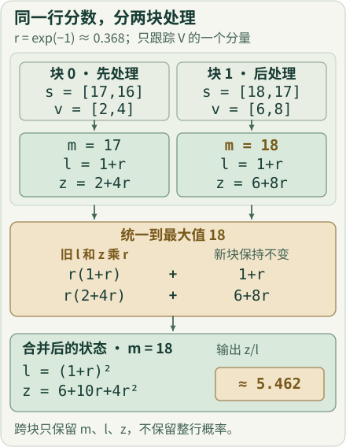
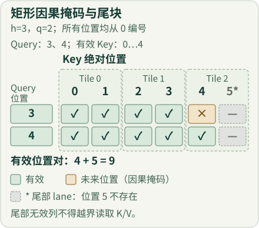
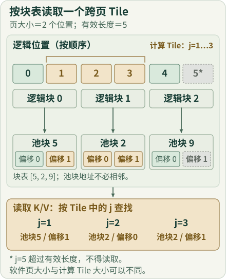

# Attention 为什么可以不将完整的分数矩阵写入显存？

在 [D06](d06-fused-kernels.md#reduction) 中，我们融合了矩阵乘法与逐行 Softmax。当一行有两个分数时，可以把它们都留在局部存储，求出最大值和指数和，再交付整行概率。

如果一行有几千甚至几十万个分数，局部存储放不下怎么办？在 Attention 中，这样的分数还有许多行。先将它们全部写入显存、再读回来计算，可能产生大量中间数据搬运。

标准 Attention 最终需要的是每个 Query 对 Value 的加权结果，而不是所有注意力概率。只要能在分块计算过程中保留正确的归一化状态，就可以让新产生的分数直接参与加权和，并在片上释放已经使用完的分数。

本篇从 D06 的两个分数继续推导，解释这样的内核怎样实现。Attention 的数学目标、连接模式与模型设计见[算法与模型：Attention 与 Transformer](../../workload/01-foundation-model-components/attention-and-transformer.md)。

## Attention 内核究竟需要计算和交付什么？ {#attention-operation}

先只考虑推理中一条序列的一个注意力头，不使用 Dropout。设 Q 有 Nq 个查询行，K、V 各有 Nk 个键值位置，Q 与 K 的每行宽度为 d，V 的每行宽度为 dv。普通 Transformer 的单头算例常取 dv=d。

对于查询行 i，依次与所有允许的 K 行做点积，然后按模型规定缩放。记已缩放的分数为 sᵢⱼ。标准缩放点积 Attention 的一个常见规则是：

**sᵢⱼ = (Q[i,:] · K[j,:]) / √d**

若模型还规定位置相关的分数偏置，要在相应位置加入。掩码则决定哪些键位置 j 可以参与这一行的计算。

将这行的有效分数做 Softmax，得到概率 pᵢⱼ。输出行 O[i,:] 是这些概率对相应 V 行的加权和。

**O[i,:] = Σⱼ pᵢⱼ × V[j,:]**

一个直接的实现可以调用两个矩阵乘法内核，中间再调用一个 Softmax 内核。

| 计算 | 输入 | 交付对象 |
| --- | --- | --- |
| QKᵀ 与缩放、掩码 | Q、K、其他所需参数 | Nq×Nk 分数矩阵 S |
| 逐行 Softmax | S | Nq×Nk 概率矩阵 P |
| PV | P、V | Nq×dv 输出矩阵 O |

如果 S、P 都作为独立缓冲区传递，每项中间结果要写出、再读取。注意力的结果 O 却没有要求保留 S、P；本篇假设它们没有其他消费者。

这便创造了融合的机会。但与 D06 的 BiasRelu 不同，每个概率依赖整行分数。不能只算出一小块的 Softmax 就把它当作整行的概率。

## 为什么分别做每一块的 Softmax 会错？ {#block-normalization}

沿用 [D05](d05-matrix-multiplication-kernels.md) 的长度为 4 的点积和 D06 第二行的两个分数 (17,16)。将 D05 的 X 第 1 行 (1,2,1,2) 的各项乘 2，作为 Q 的一行 (2,4,2,4)。d=4 时，缩放恰好抵消这次乘 2。

取 D05 的 W 的两列为前两个键向量，再增加两个键。这里只跟踪 V 的一个分量；其余分量可按照同样的权重计算。

| 键位置 j | K[j,:] | 缩放后的分数 s | V 的一个分量 v |
| ---: | --- | ---: | ---: |
| 0 | (3,5,2,1) | 17 | 2 |
| 1 | (1,2,3,4) | 16 | 4 |
| 2 | (2,5,2,2) | 18 | 6 |
| 3 | (3,4,2,2) | 17 | 8 |

例如第 0 项的点积是 34，除以 √4=2 后得到 17。假设这四项均有效，暂不考虑因果掩码。输入可由 FP32 精确表示；这里采用实数关系与小数近似，实际内核遵守目标浮点契约。

分块方案已选定，每次处理两个键位置。首块为 (17,16)，后块为 (18,17)。设 r=exp(−1)，约为 0.367879。

若只观察首块，D06 已经求出两个概率约为 0.731059 和 0.268941。对应加权结果为 (2+4r)/(1+r)，约为 2.538。但加入后两项后，原来这两个概率都要发生变化。

真正的整行最大值为 18，因此四项指数权重分别是 (r,r²,1,r)。要除以的不是首块的 1+r，而是四项之和 (1+r)²。

| 参与范围 | 最大值 | 指数和（按该范围最大值缩放） |
| --- | ---: | ---: |
| 首块 0、1 | 17 | 1+r |
| 后块 2、3 | 18 | 1+r |
| 整行 0–3 | 18 | 1+2r+r² |

两个块各自归一化后的概率和都是 1，把它们直接拼接就会得到总和 2。简单平均两个块的加权结果也不正确，因为块之间原本在整行中占据的权重不同。

正确的整行加权结果是：

**o = (2r+4r²+6+8r) / (1+2r+r²) ≈ 5.462117**

现在的问题是：能否在看到后块之前，就把首块变成少量可以继续归并的状态，不再保留首块的两个分数？

## 处理完一块之后，需要记住哪些量？ {#online-softmax}

回到首块。它的最大分数为 17。按 D06 的稳定 Softmax 写法，用所有有效分数减去最大值后求指数，可以避免直接对大的正分数求指数。

对于已经处理的一组有效位置，保留三项状态：

| 状态 | 表示什么 | 首块结束时 |
| --- | --- | --- |
| m | 目前的最大分数 | 17 |
| ℓ | 按 m 缩放后的指数和 | 1+r |
| z | 按 m 缩放后的未归一化加权和 | 2+4r |

ℓ 包含每个已处理位置的 exp(s−m)，而 z 把同样的指数权重乘上 V 后求和。若 V 有 dv 个分量，z 就是一条 dv 维向量；m、ℓ 是每查询行的两个标量。

于是已处理范围的 Attention 输出为 z/ℓ。我们暂时不做这个除法，继续保留分子与分母。

现在读入后块 (18,17)。它的局部最大值为 18，超过旧的 m=17。必须将旧块的指数权重换到以 18 为基准的表示。

例如旧的首项权重 exp(17−17)=1，现在应变成 exp(17−18)=r。第二项原为 r，现在应变成 r²。两项都乘上同一个因子 r。

因此旧 ℓ 乘 r，就能得到首块按新最大值表示的指数和；旧 z 也乘 r，就能得到按新最大值表示的加权和。无须返回去逐个修改旧的分数。

| 更新步骤 | 指数和 ℓ | 加权和 z（跟踪一个分量） |
| --- | --- | --- |
| 首块局部状态 | 1+r | 2+4r |
| 将旧状态的基准改为 18 | r+r² | 2r+4r² |
| 后块贡献，基准也是 18 | 1+r | 6+8r |
| 相加 | 1+2r+r² | 6+10r+4r² |

<figure markdown="1">

[](assets/d07-online-softmax.svg)

<figcaption>旧块的全部指数贡献都乘相同的缩放因子。调整了指数和与加权和之后，旧分数不必重新读入。</figcaption>

</figure>

把该过程推广到任意非空新块。令新块局部状态为 mᵦ、ℓᵦ、zᵦ，则先取新的共同最大值 m′，再把两份状态变换到这个共同基准：

**m′ = max(m, mᵦ)**

**ℓ′ = exp(m−m′) × ℓ + exp(mᵦ−m′) × ℓᵦ**

**z′ = exp(m−m′) × z + exp(mᵦ−m′) × zᵦ**

如果新块还不曾单独归约，也可以直接按 m′ 计算它的指数与加权和，结果在实数算术中相同。

这样的逐块更新称为**在线 Softmax** 的一种应用。它在线维护稳定归一化所需的最大值与分母；Attention 还同时累积未归一化的加权分子。处理完所有有效位置后，再计算 O=z/ℓ。

需要区分两种输出契约。若后继只需要 Attention 的加权输出，就可以仅保留这些累计状态。若还要求交付每个位置的 Softmax 概率，只有 m、ℓ、z 并不能恢复所有原分数，仍需保存或重新计算相应信息。

[Online Normalizer Calculation for Softmax（2018）](https://arxiv.org/abs/1805.02867) · [FlashAttention 原论文（2022）](https://arxiv.org/html/2205.14135)

## 怎样把这次更新变成分块 Attention 内核？ {#tiled-kernel}

现在回到完整的 Q、K、V 缓冲区。假设编译阶段已经选定查询 Tile 大小 Bq、键值 Tile 大小 Bk，以及各线程或计算单元的分工。

一种实现以查询 Tile 为单位保留状态。选中 Bq 行 Q 后，每次读入 Bk 行 K 和相应 V，在片上生成这一小块分数。每行分别更新自己的 m、ℓ、z。

| 局部数据对象 | 所需形状或状态 |
| --- | --- |
| 当前 Q Tile | Bq×d |
| 当前 K、V Tile | Bk×d、Bk×dv |
| 当前分数 Tile | Bq×Bk（也可进一步切分） |
| 每个 Query 的在线状态 | m、ℓ 两个标量与 dv 维 z |

下面是教学内核的核心流程。它假设有效分数均有限，执行者能互相取得所需的值；具体计算、读写和同步再按目标编程模型降低。这里不限定必须用 GPU。

```text
for query_tile in Q:
    load query_tile
    initialize m=-inf, l=0, z=0 for each valid query
    for kv_tile in K,V:
        load only in-range K,V elements
        S = scaled_dot(query_tile, K_tile) + required_score_bias
        for each valid query row:
            active = in_range_and_mask_allowed(row, kv_tile)
            if no active key: continue
            mb = max(S[row, active])
            w = exp(S[row, active] - mb)
            lb = sum(w)
            zb = weighted_sum(w, V_tile[active])
            if l == 0:
                m, l, z = mb, lb, zb
            else:
                t = max(m, mb)
                l = exp(m-t)*l + exp(mb-t)*lb
                z = exp(m-t)*z + exp(mb-t)*zb
                m = t
    for each valid query row:
        if l > 0: store O[row] = z/l
        else: store O[row] according to empty-row contract
```

这里没有分数偏置时 required_score_bias 为 0。若固定宽度指令需要完整 Tile，尾部应使用已准备好的安全填充值，或者用较短的有效形状计算。伪代码中的 continue 指跳过一行的状态更新，并不允许需要参加集体同步的线程提前退出。

每一轮的分数与指数只描述当前 Tile。局部计算结束后可以复用它们的空间来处理下一块 K/V，而 m、ℓ、z 必须跨这些轮次保持有效。

生成端需要实现 QKᵀ、逐行最大值与求和、指数、局部 PV 加权乘加、状态缩放及最终存储。在 GPU 上，这些可组合为矩阵指令、向量操作及线程集体归约；在有计算阵列与专用函数单元的 NPU 上，也可形成相应命令。

与 D06 类似，如果多线程共同处理一行，需要在局部数据可读后才能归约，并按照目标同步范围更新该行状态。两个独立查询行可以保有互不干涉的状态。

这是一种教学执行次序。实际 FlashAttention 实现的 Tile 顺序、状态的存储层级、Warp 或线程块的划分各有差异。例如 FlashAttention-2 改进了并行工作划分与片上通信。

此例中不需要保存完整的 Nq×Nk 中间矩阵。对当前 Bq 行，持续保留的统计和加权状态只有 Bq×(dv+2) 个标量；还要给当前 Tile、指令及其他必要数据留出资源。若局部状态本身溢出，可能再次引入外层访问。

[FlashAttention-2 原论文](https://arxiv.org/abs/2307.08691) · [计算微架构 G01：局部数据通路与归约](../../microarchitecture-v2/07-specialized-compute/g01-specialized-functions-and-reduction.md#local-data-path)

## 因果掩码与最后一个 Tile 怎样处理？ {#causal-mask}

前面的四项分数都有效，才能直接求出四项的指数和。对于因果 Attention，每个查询只能读取不晚于自身的相应键位置（包括自身）。判断依据是逻辑 Token 位置，而非数据放在哪个存储槽。

例如已有 h=3 个历史位置，现在追加 q=2 个连续位置。可用 K、V 共有 5 行，绝对位置为 0–4；查询对应这轮新增的两个位置 3、4。分数矩阵只有 2×5，而不是 5×5。

| Query 绝对位置 | 允许的 Key 绝对位置 | 有效位置对数 |
| ---: | --- | ---: |
| 3 | 0、1、2、3 | 4 |
| 4 | 0、1、2、3、4 | 5 |

<figure markdown="1">

[](assets/d07-causal-mask.svg)

<figcaption>左上两个查询行号不能直接用于判断因果关系。先确定绝对位置，再判断每项是否有效；最后一个 Tile 还需处理形状尾部。</figcaption>

</figure>

因此假设追加 q 个连续位置，完整因果 Attention、无其他屏蔽，允许参与的查询—键对数为：

**qh + q(q+1)/2**

本例是 2×3+2×3/2=9。完整 Prefill 对应 h=0，普通单 Token Decode 对应 q=1。混合批中应按每条序列各自的 h、q 计数，再相加。

这是数学掩码允许的工作量。内核可能跳过完全无效的 Tile，也可能对部分无效 Tile 执行额外的运算，最后屏蔽其中的结果。

若 Q 恰好是 K 序列最后 Nq 个连续位置，0-based 局部索引 i、j 下，因果条件可写为 j ≤ Nk−Nq+i。但这需要上述对齐条件，不能把所有非方阵 Attention 的接口都解释为这种掩码规则。

例如 FlashAttention 2.1 的 causal 选项采用右下角对齐，而 PyTorch SDPA 的 is_causal 在非方阵中采用左上角对齐。生成端须按原图语义与实际接口生成正确的掩码和位置参数。

最后一个键值 Tile 可能不足 Bk 项。只有有效地址才可读；掩码禁止参与计算的分数在求最大值时不应有贡献，在指数和与加权和中应贡献 0。

若一行的一个 Tile 没有任何有效键，应保持旧状态不变，而不是计算 exp(−∞−(−∞))。第一块有有效键时直接建立状态；所有块结束后仍为空的行，则根据算子接口规定处理输出，例如某些实现返回全零行。

上述最大值稳定化关系假设有效分数有限。NaN、正无穷等特殊值也必须服从所用算子的数值契约。数学等价不保证改变浮点归约顺序后逐位一致。

与 D06 相同，如果原 IR 规定 S 或 P 的中间类型、舍入或量化，融合内核仍须满足相应的数值契约，不能仅因它们不再物化就删除必要转换。

[FlashAttention：v2.1 非方阵因果对齐](https://github.com/Dao-AILab/flash-attention#21-change-behavior-of-causal-flag) · [PyTorch SDPA 接口](https://docs.pytorch.org/docs/stable/generated/torch.nn.functional.scaled_dot_product_attention.html)

## 不写分数矩阵，减少的是哪些开销？ {#io-complexity}

先看完整 Prefill 的一层单头算例。令 Nq=Nk=2048，S、P 若分别以 FP16 存储，每份都有 2048×2048 个元素，每元素 2 B。

| 中间对象 | 若完整物化的容量 | 写出一次、读回一次的逻辑字节 |
| --- | ---: | ---: |
| S | 8 MiB | 16 MiB |
| P | 8 MiB | 16 MiB |
| 合计逻辑读写 | — | 32 MiB |

两份缓冲的峰值占用还取决于生命周期和复用方式。若采用分块在线方案，目标是省去这两份完整外层矩阵的写读。仍需访问 Q、K、V、最终 O，并可能需要其他工作区。

以上是对独立物化方案的逻辑字节预算，而非真实 HBM 流量。缓存是否命中、K/V 是否被多个查询 Tile 重复读取、是否发生额外重排等，都影响实际访问。

原始 FlashAttention 论文给出了更明确的理论分析。在其单头 N×d 的 Q、K、V、O 模型中，以 Mₑ 表示片上 SRAM 可容纳的**标量元素数**，而不是字节数。在 d≤Mₑ≤Nd 的条件下，论文比较：

| 实现 | 论文模型中的 HBM 元素访问量 |
| --- | --- |
| 标准物化方式 | Θ(Nd+N²) |
| FlashAttention Algorithm 1 | Θ(N²d²/Mₑ) |

该模型说明分块复用和容量怎样影响外层访问量，并未声称片上容量任意小时都一定获得收益。实际可用容量与各对象的存储格式有关；只有按统一元素宽度 p B 计时，字节容量 Mᵦ 才能直接除以 p 转为 Mₑ。

虽然不物化完整分数，标准全 Attention 仍须处理允许的查询—键对。QKᵀ 与 PV 的主要算术规模在完整稠密条件下仍为 Θ(N²d)（dv=d）。这与稀疏 Attention 通过减少连接改变计算范围是两类机制。

[FlashAttention 原论文：第 3.2 节，Theorem 2](https://arxiv.org/pdf/2205.14135) · [算法与模型：Attention 效率](../../workload/01-foundation-model-components/attention-variants-and-efficiency.md)

## 为什么 Decode 内核还需要沿 KV 维度拆分？ {#prefill-and-decode}

[G02](../07-model-execution/g02-prefill-and-decode.md) 已区分 Prefill 与普通单 Token Decode。对于请求 A，8 个输入位置的完整 Prefill 有 8 个查询行；下一次普通 Decode 则产生 1 个新查询，对应 9 个可见 KV 位置。

因此一个请求、单头、完整 Prefill 的 S 是 8×8；该次 Decode 是 1×9。上下文长到 N 时，完整 Prefill 的中间分数是平方级，普通单 Token Decode 只有一行。不能把两者都称为同样的 N² 中间矩阵问题。

对于完整 Prefill，许多查询行可以分给不同的查询 Tile，让不同执行组计算它们各自的输出。已经允许的 K/V 位置仍要按需读取。

对于长上下文、少量请求的 Decode，查询行很少。如果只沿请求、查询头及查询行分配工作，可能没有足够多的独立 Tile 让设备并行。即使已经避免了分数物化，还可能需要另一种并行分工。

假设 C 已选择**沿 KV 轴拆分（split-KV）**。不同执行组独立处理同一查询的一段历史键值，各段生成局部 mᵦ、ℓᵦ、zᵦ。之后由另一个归并阶段计算整行状态。

回到本文四项算例。如果两个块分别由两个独立组完成，各自产生：

| 分组 | 局部最大值 | 局部分母 | 局部加权和 |
| --- | ---: | --- | --- |
| 组 0：位置 0、1 | 17 | 1+r | 2+4r |
| 组 1：位置 2、3 | 18 | 1+r | 6+8r |

归并时取 m=18，两组分别乘 exp(17−18)=r 和 exp(18−18)=1，再把两份分母及分子相加。最后的除法仍得到 5.462117，而不是把两个局部结果简单平均。

推广至多个非空分组，先求所有局部 mᵦ 的最大值 m，再求 Σᵦ exp(mᵦ−m)ℓᵦ 和 Σᵦ exp(mᵦ−m)zᵦ。局部空分组不参与归并。

有的实现保存局部已归一化输出 Oᵦ 与 LogSumExp（LSEᵦ=mᵦ+ln ℓᵦ）。稳定求得全局 LSE=ln Σᵦ exp(LSEᵦ)，再按 exp(LSEᵦ−LSE) 对 Oᵦ 加权，与归并上述状态在实数算术中等价。Flash-Decoding 的技术说明采用这种形式。

这种分工需要生成部分结果的地址、跨组完成条件，以及最终归并的内核。它会增加中间状态读写、归约或启动开销。当已有足够并行工作或上下文很短时，未必有收益。

实际并行度也受查询头与 KV 头的对应关系影响。GQA 的多个查询头可以共享同一组 KV，但每个查询仍有自己的在线状态。不同请求的共享前缀也只是提供存储共享机会，并不意味着多个不同 Q 的计算可以省掉。

[Flash-Decoding 官方技术说明](https://pytorch.org/blog/flash-decoding/) · [算法与模型：GQA](../../workload/01-foundation-model-components/attention-variants-and-efficiency.md)

## KV 不连续存放时，内核怎样读取一个 Tile？ {#paged-kv-access}

到这里都假设代码能按逻辑位置 j 直接找到 K[j,:] 与 V[j,:]。但模型执行过程中，历史 KV 可能保存在多个不连续的缓冲块中。

例如延续已有 5 个有效位置的序列，假设运行时给每个软件 KV 块分配 2 个位置。逻辑块编号 0、1、2 对应实际存储池的三个块槽 5、2、9。

| 逻辑块 | 包含的有效逻辑位置 | 块表中的物理块槽 |
| ---: | --- | ---: |
| 0 | 0、1 | 5 |
| 1 | 2、3 | 2 |
| 2 | 4 | 9 |

这里的物理块槽是存储池中的位置编号，不是操作系统提供的物理内存地址。已假定运行时完成分配、绑定和数据就绪交接。

生成的代码先从逻辑 Token 位置 j 求出逻辑块号 j//2 与块内偏移 j%2，再按块表查到槽号，随后依据目标数据布局计算实际 K、V 访问地址。

<figure markdown="1">

[](assets/d07-paged-kv-read.svg)

<figcaption>块表保存的是数据所在的位置。逻辑顺序由 Token 位置决定，不能按物理槽号排序；计算 Tile 可以跨越软件 KV 块。</figcaption>

</figure>

例如采用教学布局：单头，每行 d=4，FP16 元素，块内紧密连续的行。每个 K 或 V 块占 16 B，行步长为 8 B。假设 K 与 V 分别使用同样块号及独立基地址。

| 计算所需的逻辑位置 | 物理块槽 | 块内位置 | 相对 K 或 V 基地址的字节偏移 |
| ---: | ---: | ---: | ---: |
| 1 | 5 | 1 | 5×16+1×8=88 |
| 2 | 2 | 0 | 2×16+0×8=32 |
| 3 | 2 | 1 | 2×16+1×8=40 |

假设选定的计算范围正好包含这三个连续逻辑位置，就要通过两个物理块读取所需的 KV。代码可以逐页获取数据，或将这里的逻辑范围拆成多个页内访问，用相同的在线状态完成计算。

真实目标的 K、V 布局可以不同，并且还要计算层、头、通道的偏移。块表访问、跨块读取方式和数据格式处理属于内核实现。内核必须先检查实际有效长度：位置 5 虽然落在已分配块的空间中，却不是有效 KV，不允许参与计算。

**软件 KV 块大小与计算 Tile 大小是不同的参数。** 软件块描述分配和引用的单位，Tile 描述一次计算的工作范围。它们既可以对齐，也可以采用不同的大小。

PagedAttention 论文展示了将逻辑 KV 块映射到不连续存储的方式。由谁申请块、共享前缀、更新块表、回收或迁移数据，则归 G 专题管理；本文只负责说明已给定块表怎样进入读取与计算。

[PagedAttention 原论文](https://arxiv.org/abs/2309.06180) · [旧版推理运行时：分页 KV Cache](../../inference-runtime/04-state-and-memory/06-paged-kv-cache.md)

## 从完整矩阵到一小段可复用的状态 {#next}

D05 将矩阵乘法分块降低为计算与存储操作，D06 将后续逐元素计算和归约接到局部结果之后。本篇继续把 Attention 的两个矩阵乘法与 Softmax 组合起来，使分数 Tile 被产生、消费，然后释放。

关键不在于采用了某个内核名称，而在于保留了正确的局部状态、缩放基准、有效位置与数据访问关系。

验证时需要与参考实现核对不同查询长度、KV 长度、掩码、分页映射及浮点误差，再测工作区、时间和实际流量。性能验证归 K 专题；这里关心的是执行代码怎样实现原计算语义。

AI 内核实现的另一个分支是低精度数据：即使分块与在线状态都正确，不同元素格式还需要相应的解码、缩放、累加与写入操作。[D08：低精度数据怎样变成设备可以直接处理的输入？](d08-low-precision-kernels.md) 将回到 D05 的矩阵乘法，专门追踪低精度输入路径。

[返回专题阅读顺序](README.md#计划阅读顺序)
