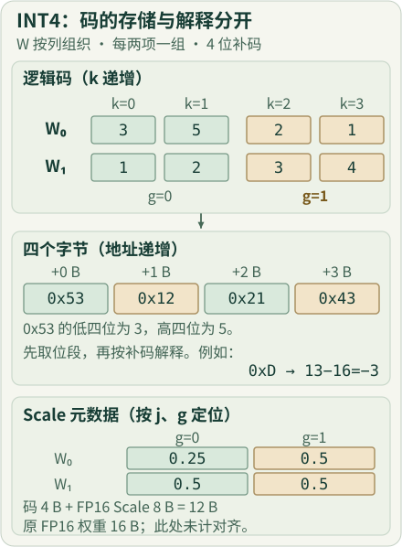
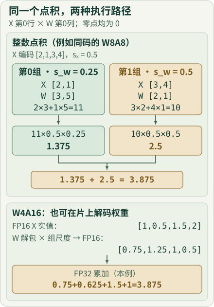
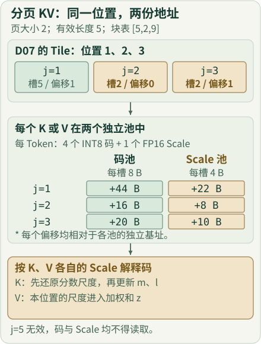

# 低精度数据怎样变成设备可以直接处理的输入？

在 [D05](d05-matrix-multiplication-kernels.md) 中，X 和 W 的元素值可以用四位整数表示，但每个元素仍然占一个字节。生成的内核根据行号、列号和归约索引直接读取这些字节，再用更宽的累加器求完整点积。

如果真的用四位存储一个权重，同一个字节中就能放两个权重。读取这个字节时，计算单元怎样找到需要的数？如果压缩后的整数还带有缩放参数，它又怎样恢复出模型需要的数值？

低精度内核不仅要安排读写和乘加，还要实现**存储编码、计算格式、累加格式和输出格式之间的转换**。数据更少不代表设备一定能直接用这种存储格式计算。

本篇沿 D05 的小矩阵解释这些转换。量化方案、校准以及执行方案均假设已经确定；这里关注代码生成怎样实现这些契约，而不是重新选择量化算法或搜索映射。

## 同一个四位整数，为什么可能表示不同的数？ {#quantization-contract}

先区分数值与编码。假设一个权重原来的值是 x，用整数 q 表示它，约定有一个正的尺度 s（Scale）与整数零点 z（Zero Point）。

以常见仿射量化为例，量化（Quantization，Q）将 x 映射到目标整数范围，反量化（Dequantization，DQ）则从编码得到近似数值：

**q = clamp(round(x/s) + z, qmin, qmax)**

**x̂ = s × (q−z)**

其中 round 与 clamp 分别按接口约定进行舍入和限制范围。比如 ONNX 的 QuantizeLinear 使用最近偶数舍入（RNE）；INT4 的范围为 −8 至 7，UINT4 为 0 至 15。

| 原值 x | 假设 s=0.25、z=0，INT4 | 反量化后的 x̂ |
| ---: | --- | ---: |
| 0.76 | round(3.04)=3 | 0.75 |
| 2 | round(8)=8，饱和到 7 | 1.75 |

反量化得到的是编码表示的值，并不能保证恢复量化之前的原值。量化误差、离群值处理和尺度怎样选择，属于量化算法及质量验证的范围。

在本篇中，s 一律表示解码时乘上的尺度。有的接口传递的是其倒数，代码生成要遵循实际接口。零点为 0 是本篇主要算例的条件，并非所有量化格式的要求。

Q 与 DQ 可以是 IR 中明确的操作，也可以作为其他操作的数值契约。例如已保存量化权重时，编译器不必每次执行 Q，但必须知道使用过程中 DQ 的语义。

[ONNX：QuantizeLinear](https://onnx.ai/onnx/operators/onnx__QuantizeLinear.html) · [DequantizeLinear](https://onnx.ai/onnx/operators/onnx__DequantizeLinear.html)

## 怎样在一个字节中找到两个不同权重？ {#packing}

继续使用 D05 的 X 和 W 的整数编码。X 有两行四列，W 有四行两列。我们先保留这些编码值，给它们增加尺度，之后数值含义会发生变化。

| X 编码的行 | W 编码的列 |
| --- | --- |
| 第 0 行：(2,1,3,4) | 第 0 列：(3,5,2,1) |
| 第 1 行：(1,2,1,2) | 第 1 列：(1,2,3,4) |

W 采用有符号 INT4。本例的所有权重编码恰好都在 0–7 之间。约定 W 仍按列组织，每两个连续 k 的编码合成一个字节；较小 k 放低四位，较大 k 放高四位。

这个把多个低位宽元素放入较宽存储单元的过程称为 **Packing（打包）**。在上述约定下，W 第一列的 3、5 变成一个字节 0x53，2、1 变成另一个字节 0x12。

| W 的列 | k=0、1 所在字节 | k=2、3 所在字节 |
| --- | --- | --- |
| 第 0 列 | 0x53 | 0x12 |
| 第 1 列 | 0x21 | 0x43 |

第一列只占 2 B，因此从 W 的起始地址 b 开始，第 j 列中第 k 个权重所在的字节地址为 b+j×2+⌊k/2⌋。

k=1 时需要第 0 字节的高四位，右移 4 位再与 0xF 做按位与，取出 5。k=2 时则读取第 1 字节的低四位，取出 2。

若读取的四位编码为 0xD，它作为无符号整数是 13；但在四位二补码约定下，它代表 −3。生成的代码要进行符号扩展或按等价规则解码，不能误将它作为正数使用。

<figure markdown="1">

[](assets/d08-packed-weights.svg)

<figcaption>一个字节的低四位和高四位分别保存一个编码；Scale 存在独立的元数据区。图中布局是已选的教学契约，并非所有 INT4 内核的布局。</figcaption>

</figure>

对于 K 为奇数的情况，若仍采用逐列独立打包，每列的紧密字节步长变为 ⌈K/2⌉。最后一个字节可能只有一个有效编码，生成端必须按有效形状屏蔽另一个槽。

若为了向量或矩阵指令的对齐而添加更多填充，则实际列步长可能比这个值更大。若填充槽实际参与乘加，应使其解码为零（仿射量化时零对应 q=z），并满足归约和修正项的语义。

ONNX 的四位张量存储规则也将前一个元素放在低四位。但实际内核可以采用交错、转置或按硬件 Tile 重排后的专用布局，不能只知道 INT4 就假定地址规则相同。

[ONNX：4-bit integer types / packing](https://onnx.ai/onnx/technical/int4.html) · [A03：形状、布局与地址](../01-foundations/a03-tensor-representation.md#stride-and-address)

## Scale 为什么也成为了内核的输入？ {#group-scales}

现在给 W 的编码确定反量化规则。实际量化方案可能为整个张量使用一个 Scale，也可能给每列、每个 K 方向的分组或其他多维 Tile 分配不同尺度。

本例选择沿 K 每两个元素为一组，每列分别有两组，共四个 FP16 Scale。零点都为 0，保存在契约中，不需要额外为每组存零点。

| W 的列 | 第 0 组 s（k=0、1） | 第 1 组 s（k=2、3） | 解码后的 W 列 |
| --- | ---: | ---: | --- |
| 第 0 列 | 0.25 | 0.5 | (0.75,1.25,1,0.5) |
| 第 1 列 | 0.5 | 0.5 | (0.5,1,1.5,2) |

W 编码第 0 列的前两个值 3、5 依次代表 0.75、1.25，而后两个值采用另一个 Scale。只进行解包还不能获得这个矩阵。

假设 Scale 也按列及组编号 g 连续存放，g=⌊k/2⌋，每个 Scale 占 2 B。它的字节偏移为 2×(j×2+g)。生成代码须同时求出编码地址和 Scale 地址。

看看这两份数组的容量。本篇只计算有效载荷与 Scale，不包含文件头、对齐、布局索引或其他元数据。

| 存储方案 | W 数据 | Scale | 合计 |
| --- | ---: | ---: | ---: |
| 解码后直接存 FP16 W | 16 B | 0 | 16 B |
| 相同量化契约，每个 INT4 编码使用一字节槽 | 8 B | 8 B | 16 B |
| 相同量化契约，两个编码打包为一字节 | 4 B | 8 B | 12 B |

虽然编码从 FP16 的 16 bit 变成 4 bit，小矩阵的总有效字节并未变成四分之一，因为这里每两个权重就要附带一个 Scale。

若每 G 个完整权重共用一个 FP16 Scale，且不额外保存零点，理想有效载荷约为每元素 (0.5+2/G) B。例如 G=128 时约为 0.516 B，尾组和对齐还要另计。

运行时还需得到编译产物所需的类型、分组、步长和布局信息。Scale 是参与数值计算的输入，不能把它当作可任意省略的文件附加信息。

## 如果设备只支持高精度乘法，怎样使用低比特权重？ {#weight-only-kernel}

现在约定 X 为 FP16 激活。为了便于与 D05 对照，X 的实际数值取原编码的 0.5 倍，第一行为 (1,0.5,1.5,2)，第二行为 (0.5,1,0.5,1)。这些值和 W 解码出的数都可以由 FP16 精确表示。

这样一来，权重为四位编码、激活采用 16 位格式，可称为 W4A16。本例的具体执行方案是在片上把 W 解包及反量化为 FP16，用支持该格式的计算操作并以 FP32 累加。

跟踪第 0 行、第 0 列。先从 0x53 解出 3 和 5，分别乘 0.25，得到 0.75 和 1.25。与两个激活相乘，第一段点积为 1×0.75+0.5×1.25=1.375。

第二个字节解出 2、1，乘 0.5 得 1、0.5。第二段点积为 1.5×1+2×0.5=2.5。两段继续在同一累加器中相加，最终为 3.875。

一种简单的实现会先将整个 W 解码为 FP16 矩阵，写到外层缓冲区，然后让现有 GEMM 读取。它仍可节省原始权重存储，却额外建立了展开后的临时矩阵。

按照 [D06](d06-fused-kernels.md#residency) 的融合思路，如果已有可支持的片上解包路径，可以给每个 W Tile 生成解包和 Scale 应用，再直接送给矩阵计算，不必让展开后的完整矩阵经过外层存储。

下面用 C 复现其中的索引和数值关系。为了让示例在普通 CPU 上容易执行，用 float 数组承载本例的精确 FP16 数值。它不是 GPU 的 FP16 指令代码，实际的转换和乘加由目标实现选择。

```c
#include <stdint.h>

void w4a16_example(const float *x, const uint8_t *packed,
                   const float *scale, float *y) {
    for (int j = 0; j < 2; ++j) {
        for (int i = 0; i < 2; ++i) {
            float acc = 0.0f;
            for (int g = 0; g < 2; ++g) {
                uint8_t byte = packed[j*2 + g];
                float s = scale[j*2 + g];
                for (int kk = 0; kk < 2; ++kk) {
                    int k = 2*g + kk;
                    int nibble = (byte >> (4*kk)) & 15;
                    int code = nibble < 8 ? nibble : nibble - 16;
                    float w = s * code;
                    acc += x[i*4 + k] * w;
                }
            }
            y[i*2 + j] = acc;
        }
    }
}
```

| 输出行 | 第 0 列 | 第 1 列 |
| --- | ---: | ---: |
| 第 0 行 | 3.875 | 7.25 |
| 第 1 行 | 2.625 | 4 |

每组先读一次打包字节和 Scale，再依次解出两个值。代码保留了 D05 的两个 k 循环块和完整点积。在实际 GPU 中，解包、格式转换、向量重排、Scale 广播及矩阵指令可能各有具体要求；若采用 FP16 解码，还需遵守该格式的舍入规则。

对于提供专用解码路径的 NPU，转换可能发生在搬运时或进入计算阵列之前。编译器要生成目标所需的输入格式及配置，而不是强行生成这段 CPU 循环。

TensorRT 的 INT4 Weight-Only Quantization 就是一类具体例子：以低比特方式保存权重，在 GEMM 内部解码后使用更高精度计算。W4A16 标签本身并不能证明设备实际执行四位乘法。

[TensorRT：Weight-Only Quantization](https://docs.nvidia.com/deeplearning/tensorrt/10.x.x/inference-library/work-quantized-types.html#weight-only-quantization) · [MARLIN：FP16 × INT4 GEMM](https://arxiv.org/abs/2408.11743)

## 权重和激活都量化时，尺度能否在累加结束后再乘？ {#integer-dot}

继续用同一矩阵。这次不是直接以 FP16 交付 X，而是让它也用整数表示：X 的编码仍为 D05 的整数，采用 INT8，尺度 sx=0.5、零点为 0。

本例的存储契约仍是 W4A8；如果把权重也用八位编码存储，才是 W8A8。若目标支持 INT8 输入与 INT32 累加，可把四位权重编码符号扩展为 INT8 再使用对应指令。也可以在目标支持匹配的低位宽组合时使用其原生计算路径，具体取决于 ISA 和布局。

对第 0 行、第 0 列，D05 的两段整数点积仍然是 11 和 10。如果先不应用尺度，整个整数累加为 21。

但是实际的乘积不仅是编码的乘积。对于每个编码乘积，两个输入的尺度也要相乘。由于 W 的两组尺度不同，应分别为两段点积应用尺度。

| K 分组 | 整数点积 | 对该分组使用的乘积尺度 | 还原后的贡献 |
| --- | ---: | ---: | ---: |
| k=0、1 | 2×3+1×5=11 | 0.5×0.25=0.125 | 1.375 |
| k=2、3 | 3×2+4×1=10 | 0.5×0.5=0.25 | 2.5 |

这样只需在每组整数归约结束后应用相应尺度，再累加到最终结果 3.875。如果先把 11 和 10 直接合成 21，再取第一组的尺度乘一次，只会得到 2.625。

<figure markdown="1">

[](assets/d08-grouped-dot.svg)

<figcaption>只有尺度在归约范围内保持相同，才可以从那段求和中提取同一个乘积尺度。不同分组的整数部分和需要保留各自的尺度信息。</figcaption>

</figure>

更一般地，若两输入的尺度在整个归约轴 K 上保持不变，可以先求完整整数点积，再乘 sx×sw。如果任一尺度随 k 的分组变化，就需要分段应用，或在乘加前逐项转换成实际数值。

对于非零零点，目标的普通整数点积可能只计算原始编码的乘积。直接把这个结果乘尺度仍然不正确，因为每项实际数值应当先减去各自零点。

对同一分组内固定的 zx、zw，令 G 为该组实际参与所列求和的元素数。真正需要的整数部分和可写为：

**Σ(qx−zx)(qw−zw) = Σ(qx qw) − zw Σqx − zx Σqw + G zx zw**

公式展开说明了生成端可以采用逐项减零点，或生成点积及零点修正项等实现。若尾部填充参与这些求和，G 也要计入相同的填充项，且它们应表示实际零；若已屏蔽则不计入。

例如 qx=3、zx=1、qw=5、zw=2，原始编码相乘为 15，实际去除零点后的乘积是 2×3=6。这时不能用尺度去弥补漏掉的零点操作。

一种原生整数点积指令是 PTX 的 dp4a：用四对八位整数计算乘加并累入 32 位值。PTX 还提供特定数据类型和 Tile 形状的矩阵指令。实际代码生成必须满足目标架构、寄存器分布与操作数契约。

低位输入也不意味着可以使用同样窄的累加器。例如有符号 INT8 的两个输入都取 −128 时，单项乘积已经是 16,384；K 很大时，INT32 的范围也需要核查。

[PTX ISA：dp4a](https://docs.nvidia.com/cuda/parallel-thread-execution/#integer-arithmetic-instructions-dp4a) · [矩阵乘加指令 MMA](https://docs.nvidia.com/cuda/parallel-thread-execution/#warp-level-matrix-instructions-mma)

## 为什么最后还需要做格式转换？ {#mixed-precision}

前面的两条计算路径分别使用较宽的浮点累加或整数累加。输入格式较窄，可降低某些存储与计算成本，但累加器还要容纳多项乘积并保留所需精度。

[计算微架构 A04](../../microarchitecture-v2/01-foundations/a04-floating-point-and-low-precision.md#mixed-precision) 已用相同的 D05 乘积说明，小位宽浮点格式反复舍入可能改变点积结果。这里的编译器需要为目标算子确定相应的输入与累加类型。

例如 W8A8 的整数实现可以使用 INT32 计算完整分组的部分和，而 FP16 输入的矩阵计算可能使用 FP32 累加。不论软件称它为什么格式，指令和中间结果的具体精度都须符合执行契约。

完成计算后，最终输出格式还要匹配消费者。如果后继需要 FP16 或 BF16，就按对应舍入规则转换后写入；如果后继需要整数编码，还要执行重新量化（Requantization）。

继续用本例第 0 列的两个输出。假设后继需要 INT8，输出 Scale 为 0.25，零点为 0，舍入使用 RNE，超出 INT8 表示范围时按约定钳位。

| 累加结果 | 除以输出 Scale | 返回的整数编码 |
| ---: | ---: | ---: |
| 3.875 | 15.5 | 16（偶数） |
| 2.625 | 10.5 | 10（偶数） |

完整点积的 Scale 应用、偏置、激活与输出转换都可能成为 [D06](d06-fused-kernels.md#epilogue) 所说的 Epilogue。生成端仍须保持算子规定的转换顺序，例如是否先舍入再相加。

若把输出提前转换为较低精度，再继续使用它作为累加值，就可能失去原本应保留的数据。因此混合精度并不是任意选择一种宽格式，而是明确各阶段的数值和类型边界。

## FP8 也需要像 INT8 一样减零点吗？ {#floating-low-precision}

前面以整数仿射量化解释 Scale。但低精度输入不全是整数。例如 FP8 的位模式包含符号、指数和有效数字：[计算微架构 A04](../../microarchitecture-v2/01-foundations/a04-floating-point-and-low-precision.md) 已介绍 E4M3、E5M2 的范围和表示差异。

因此不能将 FP8 的字节直接作为一个普通 INT8 整数再乘尺度。有的浮点低精度契约不含额外 Scale；有的契约先按规定的浮点编码解释数值，再应用共享 Scale。

例如已保存的 E4M3 编码代表数值 1.5，共享 Scale 为 8，则这一约定下表示实际数值 12。Scale 的粒度可能是整个张量、一个通道或一个块。

OCP MXFP8 的一个具体例子是 32 个浮点编码共享一个 E8M0 尺度，元素本身仍有各自的指数。它与仿射整数格式的数值解释规则不同。

代码生成需要按目标接口实现相应格式的转换、特殊值、饱和模式、Scale 应用以及数组布局。实际累加类型取决于指令或库的契约，而不是从 8 位输入这个事实唯一确定。

[OCP OFP8 规范](https://www.opencompute.org/documents/ocp-8-bit-floating-point-specification-ofp8-revision-1-0-2023-12-01-pdf-1) · [OCP MX Formats v1.0](https://www.opencompute.org/documents/ocp-microscaling-formats-mx-v1.0-spec-final-pdf/) · [NVIDIA Transformer Engine：FP8 Current Scaling](https://docs.nvidia.com/deeplearning/transformer-engine/features/low_precision_training/fp8_current_scaling/fp8_current_scaling.html)

## 激活为什么可能需要在执行期间量化？ {#activation-quantization}

权重通常可以在模型加载前完成量化及布局预转换。但激活随输入变化。如果已选方案要求动态确定本轮 Scale，执行代码还需读取相应激活，计算统计量，再进行 Q。

例如选择对当前一行激活做对称 INT8 量化，约定使用 −127 至 127、零点为 0、FP32 Scale。代码要先求这一行的最大绝对值 amax，再由选定的规则得到 Scale。这里假定规则为 s=amax/127。

在 D05 衍生的 FP16 激活第 0 行 (1,0.5,1.5,2) 中，amax=2，s=2/127。按理想除法与 RNE，四项量化编码为 (64,32,95,127)。对于全零行，本例约定 s=1、编码全为 0，避免除以零。

如果原方案采用预先给定的尺度，则可以直接使用该参数，不必再计算这个统计量。两者是不同的执行契约。

动态量化不能只在代码中写一个低位类型转换就结束。生成端还须处理统计量的数据就绪、分组与尾部，特别是全零输入、特殊值及舍入的接口规则。

如果前一算子刚产生这些激活，Q 有机会成为它的后处理。但若需要的统计量来自多个执行者，就要像 D06 的行归约一样安排局部保存、交换或分阶段处理。

不同模型的权重量化方法，例如 AWQ、GPTQ，以及面向权重与激活共同量化的 SmoothQuant，会产生不同的转换条件和数据契约。执行端要使用匹配的尺度、布局和内核，不能只凭方法名称判断输入格式。

[AWQ](https://arxiv.org/abs/2306.00978) · [GPTQ](https://arxiv.org/abs/2210.17323) · [SmoothQuant](https://proceedings.mlr.press/v202/xiao23c.html)

## KV 采用低精度后，Attention 内核还要读什么？ {#quantized-kv}

回到 [D07](d07-attention-kernels.md#paged-kv-access) 的分页 KV 算例：有 5 个有效位置，每个软件块容纳两个位置，逻辑块 0、1、2 映射到存储池中的槽 5、2、9。

原来每个 K 或 V 行有 4 个 FP16 元素，占 8 B。现在假设已选格式为 INT8 编码，每个元素占 1 B；每行 K 或 V 分别有一个独立的 FP16 Scale，零点为 0。

为了观察地址变化，采用紧密连续、无对齐填充的教学布局。K、V 使用相同的块编号，但各有独立的编码池与 Scale 池。每个编码块占 8 B，每个 Scale 块占 4 B。

| Token 位置 | 物理槽 / 块内位置 | 编码池字节偏移 | Scale 池字节偏移 |
| ---: | --- | ---: | ---: |
| 1 | 5 / 1 | 5×8+1×4=44 | 5×4+1×2=22 |
| 2 | 2 / 0 | 2×8=16 | 2×4=8 |
| 3 | 2 / 1 | 2×8+1×4=20 | 2×4+1×2=10 |

<figure markdown="1">

[](assets/d08-kv-format.svg)

<figcaption>K 与 V 各自有数据及 Scale 地址，图中偏移均相对于对应池的起始地址。计算 Tile 仍可跨软件块，不能仅将原 FP16 地址步长简单折半而忽略元数据。</figcaption>

</figure>

对于这个算例，每个 K 或 V 行的编码载荷减半（8 B→4 B），但再计入 2 B Scale 后共 6 B。实际存储还要按分组方式、零点、对齐、块容量等因素统计。[G04](../07-model-execution/g04-model-state-and-memory-budget.md) 负责完整容量预算。

注意力内核不仅要读到这些编码，还要恢复分数与 Value 的数值含义。继续沿用 D07 的 Q=(2,4,2,4) 及前两个 K 的整数值，原始缩放点积分数分别为 17、16。

假设这里这些 K 的整数值是编码，第 0 项 K 的 Scale 为 0.5，第 1 项为 1。包含 1/√d 的正确分数就分别为 8.5、16。原来较大的第 0 项，现在反而更小。

这说明如果 Scale 随 Token 改变，不能用未还原的分数进行最大值归约，再试图在 Softmax 之后统一乘一次尺度。要先得到符合契约的有效分数，再按 D07 更新 m、ℓ。

V 同样如此。如果每个位置的 V 使用独立尺度，该尺度必须作用于相应位置的加权贡献。不能在所有 z 的贡献相加后才随意选择其中一个位置的 Scale。

低精度 KV 可以在读入 Tile 后解码为计算格式，也可能与低精度 Q、K、V 的原生计算路径结合。生成代码还需要在新 K/V 写入时完成规定的 Q、Packing 与 Scale 保存，供之后的读取者使用。

例如 vLLM 的量化 KV Cache 支持特定后端、格式和 Scale 粒度；某些 FP8 Attention 后端同时量化 Q。不能将某一种解码路径推广为所有框架或芯片的行为。

[vLLM：Quantized KV Cache](https://docs.vllm.ai/en/v0.22.0/features/quantization/quantized_kvcache/)

## 数据变少后，为什么仍要检查完整执行路径？ {#execution-path}

旧版推理运行时已经区分了三类低精度对象。它们影响的存储对象和转换位置并不相同。

| 对象 | 主要影响 | 内核生成需要关注的操作 |
| --- | --- | --- |
| 权重 | 常驻及读取载荷 | 预排布、解包、Scale、反量化或原生计算 |
| 激活 | 临时张量与计算格式 | 静态或动态 Q、归约、零点、宽累加与输出转换 |
| KV | 历史状态与 Attention 访问 | 读写格式、块表、Scale 地址及分数/加权和的正确还原 |

因此权重采用 W4A16，并不意味着激活和 KV 也是四位。三类对象要分别按照实际布局与生命周期计算容量、流量和资源占用。

减少外层读取载荷可能带来收益，但解包、Scale 应用、布局转换和额外工作区也消耗资源。展开后的片上数据与元数据须按实际存储层级计量。如果目标没有匹配内核，可能需要展开格式或回退到其他实现。

是否更快还取决于算子形状、实际带宽与计算能力、资源占用和转换开销。量化也会改变数值，因此要以固定的模型、数据、量化产物及执行配置同时验证任务质量与性能。具体方法归 K 专题。

## 从程序语义到设备执行产物 {#next}

至此，D 专题两条路线已经闭合。D01 从张量语义降低到显式访问；D02–D04 解释目标指令、有限寄存器及可加载产物；D05–D08 则追踪分块、融合、Attention 与低精度内核如何落实为可执行操作。

编译端交付的不只是指令序列：还需要满足数据类型、布局、参数、资源及数值契约。产物能够执行，还要依靠设备驱动和运行时准备内存、绑定资源并按依赖提交实际任务。

若想继续沿设备执行路线阅读，可以进入[设备驱动与底层资源管理](../05-device-driver/README.md)及[通用执行运行时](../06-execution-runtime/README.md)。已有设备接口知识的读者也可按需进入模型执行路线。

[返回专题阅读顺序](README.md#计划阅读顺序)
