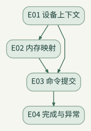

# 设备驱动与底层资源管理

应用程序需要先取得设备资源，再让设备能够访问输入并接收命令。驱动、固件和硬件在这一过程承担不同职责。

## 贯穿算例与阅读边界

同一个主机到设备的向量加法：打开设备、建立内存映射、准备命令、提交、观察完成或错误，再释放资源。

关注软件怎样使用 MMIO、DMA、地址映射和中断接口，而非 PCIe、IOMMU 或 DMA 引擎内部实现。不要求先学习完整编译器。

## 知识关系

<figure class="micro-v2-map" markdown="1">

<figcaption>图中实线表示本专题内的主要前置关系，虚线表示按场景参考；跨专题先修知识见下表。 点击可查看大图。</figcaption>
</figure>

## 阅读顺序 {#计划阅读顺序}

本专题规划 4 篇正文。E01 初稿已完成；其余未发布的条目为阅读计划，标题与范围可在编写时根据认知目标调整。

| 编号 | 文章（暂定标题） | 读完应理解什么 | 主要前置知识 | 状态 |
| --- | --- | --- | --- | --- |
| E01 | [应用程序怎样找到并获得计算设备的使用权？](e01-device-context-and-driver.md) | 用户态与内核态、驱动与固件、设备发现、初始化、上下文、所有权和隔离。 | A04；参考 A05 | 已发布 |
| E02 | 计算设备怎样访问一块由软件分配的内存？ | 主机与设备地址、内存申请、Pin、Map、DMA 映射、访问权限与可见性。 | E01、存储与互连接口 | 未发布 |
| E03 | 驱动怎样告诉设备有一项工作需要执行？ | 命令缓冲区、描述符、命令队列、Doorbell、提交顺序、设备接纳。 | E01、E02、A05 | 未发布 |
| E04 | 设备完成任务或发生错误后，驱动怎样归还资源？ | 完成队列、中断、轮询、Fence、错误报告、复位、清理与可见性。 | E03 | 未发布 |

## 从哪里来，接下来往哪读

主要衔接：[软件执行共同基础](../01-foundations/README.md)。

硬件机制参考[计算微架构](../../microarchitecture-v2/README.md)、[存储系统](../../storage/README.md)和[芯片与系统互连](../../interconnect/README.md)。

后续方向：[通用执行运行时](../06-execution-runtime/README.md)。

更多阅读路线见[编译器与运行时系统系列首页](../README.md)。
