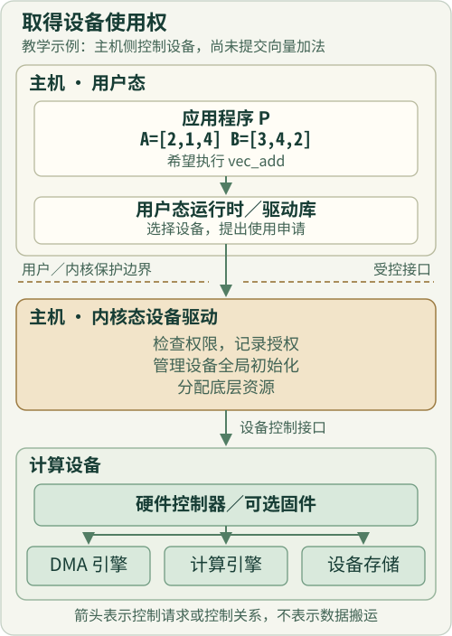
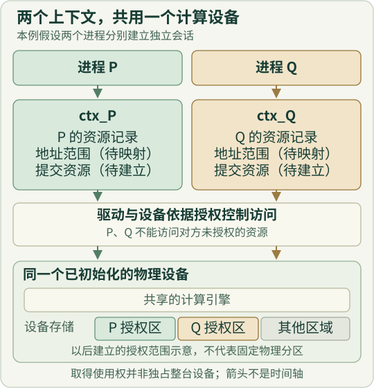

# 应用程序怎样找到并获得计算设备的使用权？

[A04](../01-foundations/a04-execution-contract.md) 解释了软件怎样描述一项设备工作，[A05](../01-foundations/a05-task-and-resource-lifecycle.md) 则说明了任务从接纳到完成的状态变化。两篇文章都假设软件已经取得了使用设备所需的资源。

现在把观察时点提前：一台服务器刚装好计算加速卡，应用程序希望用它做一次向量加法。程序怎样知道这张卡存在？如果另一个程序也想使用它，谁决定两个程序分别能够使用哪些资源？

**设备驱动（Device Driver）**是连接系统软件和设备控制接口的软件。它让系统能够识别、控制和管理设备，并按约定向应用程序提供使用设备的能力。驱动还需要维护设备及使用者的状态，避免彼此不受约束地使用同一套硬件资源。

## 应用程序已经有了输入，为什么还不能直接使用设备？ {#control-path}

沿用 A04、A05 中的教学系统：主机和设备拥有独立存储区，设备中有搬运引擎和可编程计算引擎，一次计算需要搬入输入、执行 Kernel，再写回结果。

假设主机运行 Linux，并通过 PCIe 连接这张卡。进程 P 中已经保存 A = [2, 1, 4]、B = [3, 4, 2]，准备计算 Y = [5, 5, 6]。每组都是 3 个 int32 元素，占 12 B。我们已有适合设备的 `vec_add` 实现，但还没有为这次执行准备设备资源。

如果 CPU 自己完成向量加法，可以执行读取数据、加法和写回的指令。对于独立加速卡，CPU 则需要使用该卡提供的控制接口，使设备知道有哪些工作需要执行。

例如，设备可能提供一组控制寄存器，允许软件配置设备和启动工作。这些寄存器可通过内存映射 I/O（MMIO）访问。写入一段映射到设备的地址，可能改变设备的控制状态，而不是写入普通内存中的一个变量。

但是，如果所有进程都可以任意修改这些寄存器，一个进程就可能在另一个进程计算时停止整个设备，或者错误地覆盖它的资源。问题不仅是软件能否发出控制请求，还在于谁有权发出哪种请求。

操作系统利用 CPU 提供的权限机制，将应用程序执行时的**用户态（User Mode）**与系统内核执行时的**内核态（Kernel Mode）**区分开。普通应用只能访问系统允许的资源；内核可以建立和管理设备访问权限。

具体到 MMIO，CPU 需要通过允许的地址映射才能访问设备寄存器。普通应用的地址空间默认没有整张卡的寄存器映射。系统可以按授权开放部分控制资源，让用户态软件直接执行相应操作。

应用程序可以通过受控的系统调用进入内核，请求相关操作。内核检查请求、调用设备驱动，再返回结果或失败原因。这样，应用不必直接掌握整张卡的控制权，也能使用设备。

<figure markdown="1">

<figcaption>本图表示教学系统中的控制路径，不是 A、B 的数据搬运路径。在已经建立授权的系统中，部分后续操作也可以由用户态直接完成。</figcaption>
</figure>

这里需要区分用户态运行时或驱动库与内核态驱动。前者为应用组织设备使用请求，后者在本例中负责系统资源及权限管理。两者的接口和职责划分由具体软件栈决定。设备驱动也不一定全部运行在内核态。

[片上总线：MMIO、Cache 与中断](../../interconnect/BUS/04-microarchitecture-integration/mmio-cache-interrupt-view.md) · [Linux Compute Accelerator Subsystem](https://docs.kernel.org/accel/introduction.html) · [Linux VFIO](https://docs.kernel.org/driver-api/vfio.html)

## 操作系统怎样知道这台机器上有哪些计算设备？ {#device-discovery}

假设主机装了两张加速卡，分别称为 D0 和 D1。应用不能只凭 `vec_add` 判断应该通过哪个地址控制哪张卡。系统需要先建立设备与控制接口之间的对应关系。

在 PCIe 系统中，平台固件及操作系统可以通过配置空间发现设备功能，读取厂商标识、设备标识等信息，并为设备的地址窗口等资源建立配置。这个过程称为**枚举（Enumeration）**。

例如，系统发现两张卡，即使其厂商和设备标识相同，也能通过各自的 PCIe 位置区分对应的 Function。系统于是能分别记录 D0、D1 及它们的控制资源。

但厂商标识、设备标识只能帮助软件识别设备。要控制设备，还需要理解它的控制寄存器、初始化步骤及命令格式。设备驱动由此提供面向这一类设备的实现。

以 Linux 为例，PCI 子系统将发现的设备与驱动声明支持的设备信息进行匹配。匹配后调用驱动的探测入口（Probe），由驱动检查设备并进行必要的初始化。探测成功，驱动才成功绑定该设备。

这也解释了为什么操作系统可能已经列出某张加速卡，但应用仍然无法使用它：可能缺少兼容驱动，也可能驱动探测或初始化失败。

对于集成在 SoC 内的加速器，设备的位置、寄存器范围等资源也可能直接来自平台描述，而不是 PCIe 枚举。发现方式不同，仍然需要找到适用的设备控制实现。

[PCIe：配置空间、BAR 与设备发现](../../interconnect/PCIE/03-configuration-enumeration-addressing/config-space-bar-capability.md) · [Linux Driver Binding](https://docs.kernel.org/driver-api/driver-model/binding.html) · [Linux Platform Devices and Drivers](https://docs.kernel.org/driver-api/driver-model/platform.html)

## 驱动找到了设备，为什么还需要初始化？ {#device-initialization}

假设系统已找到 D0，并选择了理解其控制接口的驱动。此时驱动仍不能假设所有引擎都已停止旧工作、控制数据已经有效，或者设备已经可以接收任务。

驱动需要根据硬件定义建立一个已知的、可以开始工作的状态。观察本例中可能要完成的工作：

| 初始化工作 | 要解决的问题 |
| --- | --- |
| 启用设备，按需要检查或复位状态 | 设备是否处于可控状态？ |
| 申请、映射设备的控制寄存器 | 驱动怎样访问正确的控制接口？ |
| 建立 DMA 访问条件 | 设备能够使用什么范围的 DMA 地址？ |
| 准备供驱动和设备使用的控制区 | 双方怎样引用必要的控制信息？ |
| 准备通知机制并初始化设备引擎 | 驱动怎样控制设备并获知后续状态？ |

这是针对 Linux PCIe 设备的典型职责，而不是所有设备必须遵循的固定顺序。驱动根据设备和平台实际需要安排步骤。此时为设备建立的全局控制资源，与后面为一次向量加法分配的 A、B、Y 存储区不同。

设备级初始化可以在启动、插入设备或者首次使用时完成。已经初始化的设备接纳新应用时，通常不需要重新初始化整张卡；应用的访问授权和会话建立是另外的过程。

[Linux PCI Driver Guide：Device Initialization](https://docs.kernel.org/PCI/pci.html)

### 驱动和固件分别在哪里工作？ {#firmware}

有些加速器内部还有一个可编程控制处理器，负责接收请求、配置计算引擎及管理设备内的资源。在这种设备中，运行于控制处理器的软件称为**固件（Firmware）**。

驱动运行在主机侧，它可能需要取得固件镜像，按设备规定的方式完成加载，并等待设备报告控制服务已经就绪。固件运行在设备侧，处理设备内部的工作；它与计算 `vec_add` 的 Kernel 是不同用途的软件。

例如，AMD XDNA NPU 的片上微控制器运行 NPU 固件，负责设备命令处理、阵列配置和工作上下文管理。主机侧 `amdxdna` 驱动负责与其交互，并为应用组织资源。

有些设备在上电时已经具备所需固件，也有设备直接由硬件状态机实现控制功能。因此不能要求每个驱动都加载独立固件，也不能认为每个任务都必须经过固件处理。

[Linux Firmware API](https://docs.kernel.org/driver-api/firmware/request_firmware.html) · [AMD NPU：Hardware Description 与 Boot Flow](https://docs.kernel.org/accel/amdxdna/amdnpu.html)

## 设备已经就绪，应用程序怎样申请使用它？ {#device-access}

现在 D0 已经可以为应用提供服务。但应用 P 仍然只拥有自己的主机程序和输入数据。它需要先向设备软件接口提出使用请求。

假设本例中的驱动提供一个可由 Linux 应用打开的设备文件。用户态库可以列出候选设备，查询其支持的计算类型和资源能力，再选择支持本次计算的 D0。有些能力需要在打开设备后查询，具体顺序由接口决定。

应用尝试打开设备文件时，系统检查它是否具备访问权限。成功后得到一个文件描述符（File Descriptor），即进程用来引用这个已打开文件的编号。通过这个引用，应用可以向驱动提出该接口允许的请求。

例如 Linux 的计算加速器子系统提供 `/dev/accel/accel*` 设备节点；支持 DRM Render Node 的 GPU 则可以通过相应的渲染设备接口授予非特权应用有限的设备访问能力。具体路径、允许的操作和权限规则取决于驱动。

打开成功只是取得了一个访问入口。应用不能因此直接执行所有设备管理操作。驱动仍可根据接口和调用者的授权限制它能申请的资源及执行的操作。

[Linux Compute Accelerator Subsystem](https://docs.kernel.org/accel/introduction.html) · [DRM Render Nodes](https://docs.kernel.org/6.11/gpu/drm-uapi.html#render-nodes)

## 为什么多个应用使用同一张卡，还需要设备上下文？ {#device-context}

设进程 P 希望在 D0 上进行本次向量加法。另一个进程 Q 也打开了 D0，准备自己的计算。驱动需要区分两者接下来提出的内存申请、命令提交和完成查询分别属于谁。

如果仅有 D0 这个设备标识，驱动就无法仅凭它判断某一块存储区是 P 还是 Q 申请的，也无法仅凭它确定某项工作引用的资源属于谁。

在本例中，为两次独立使用分别建立一个逻辑对象 ctx_P 和 ctx_Q，称为**设备上下文（Device Context）**。上下文为设备使用者关联其授权、资源和工作状态，使后续请求可以在明确的作用范围内处理。

<figure markdown="1">

<figcaption>这是两个独立会话的逻辑授权示意，不表示已经分配了 Buffer，也不表示设备存储被永久划为两个物理分区。地址范围与提交资源将在后续使用时按需要建立。</figcaption>
</figure>

本例中，驱动或设备管理软件需要为 ctx_P 管理的主要信息如下。这些信息可以记录在多个软件对象中，也可以部分保存在设备侧，不要求实现为一份固定格式的数据结构。

| 信息 | 后续有什么用途？ |
| --- | --- |
| 所关联的设备及上下文身份 | 确定后续请求的设备和使用范围 |
| 资源记录和访问权限 | 确定哪些资源允许被本上下文使用 |
| 可用的设备地址空间或访问范围 | 为 E02 的存储区建立访问条件 |
| 提交与完成相关的资源 | 为 E03 的任务提交和 E04 的状态查询建立关联 |

有些资源在建立上下文时就准备好，有些在第一次申请内存或提交任务时才分配。应用通常取得一个上下文句柄（Handle），后续操作可以用它引用相应上下文。句柄是接口中的对象引用，不是设备存储地址。

实际平台不一定要求应用显式打开设备文件，再单独创建上下文。例如 CUDA Driver API 提供显式上下文管理；CUDA Runtime API 可以按需使用或创建进程中的每设备 Primary Context。一个进程中的多个库也可能共享该上下文。

设备上下文不等同于进程或某条硬件队列。在其他实现中，类似的管理关系也可能由打开的设备文件、会话或其他对象维护。

[CUDA 12.4：Driver API 与 Runtime API 的上下文管理](https://docs.nvidia.com/cuda/archive/12.4.0/cuda-driver-api/driver-vs-runtime-api.html)

## 上下文怎样帮助两个程序安全地共享设备？ {#ownership-and-isolation}

假设下一篇中，P 为其向量加法申请了存储区 d_A、d_B、d_Y。Q 也会申请自己的存储区。即使同一物理设备负责执行两者的工作，也要保证 Q 未获授权时不能访问 P 的数据。

驱动需要记录哪些资源引用属于哪个上下文，在申请、引用和释放资源时检查权限。比如，P 在申请 d_A 后获得相应资源的使用权；Q 不能仅凭自己也有 D0 的使用权，就获得这段存储的写权限。

但只在主机软件中记录资源归属还不够。设备自己能够发起内存访问，因此还需要保证设备的访问受到相应的限制。在支持隔离的系统中，可以为不同上下文建立受保护的设备地址空间，并结合设备的访问检查及系统的 DMA 地址保护约束访问。

例如，IOMMU 可以根据设备请求的身份及映射限制对主机内存的访问。但如果两个上下文的请求在该机制中使用同一个无法区分的身份，仅靠这一层检查就无法区分两者。还需要设备侧地址空间、可区分的请求身份或其他受信任的约束机制。

资源也可以在接口允许时显式授权给多个上下文使用。因此这里说的**资源所有权**是可追踪的持有与访问权，不一定是永久独占。物理计算引擎可以被轮流使用，也可以按设备支持的方式并行共享。

这种隔离约束的是访问权限，不自动保证两个应用取得相同的计算速度。如何分配执行时间或计算资源属于设备和调度层进一步需要解决的问题。

[PCIe：IOMMU 的地址翻译与设备隔离](../../interconnect/PCIE/03-configuration-enumeration-addressing/iommu-address-translation-device-isolation.md) · [计算微架构：多个计算单元怎样协作](../../microarchitecture-v2/06-resource-cooperation/f03-multiple-compute-units.md)

## 现在可以开始向量加法了吗？ {#summary}

回到最初的程序 P。我们现在可以区分几项不同的条件：

| 阶段 | 已经确定的事实 |
| --- | --- |
| 系统发现 D0 | 知道设备存在以及怎样标识它 |
| 驱动准备好 D0 | 设备具备本例所需的底层控制能力 |
| P 获得访问授权 | P 可以通过接口提出允许的请求 |
| 建立 ctx_P | 后续资源申请及工作可以关联到 P 的这次使用 |

本例中的 A、B 仍然只在主机内存，设备存储区 d_A、d_B、d_Y 还没有为本次工作分配。ctx_P 已经准备好，但 `vec_add` 所需的代码入口、地址和命令尚未绑定到本次任务，更没有开始搬运或计算。

[A05](../01-foundations/a05-task-and-resource-lifecycle.md#ownership-and-lifecycle) 跟踪的是一项工作对资源的使用期限。本篇进一步建立了资源由哪个上下文取得和管理的认识。两种所有权需要共同考虑：即使上下文提出释放资源，也必须确认曾经引用它的工作不会再访问它。

接下来，[E02：计算设备怎样访问一块由软件分配的内存？](e02-device-memory-mapping.md) 将沿着 ctx_P 继续追踪 A、B、Y：软件怎样准备存储区，建立设备可使用的地址和权限，让设备真正获得访问数据的能力。
