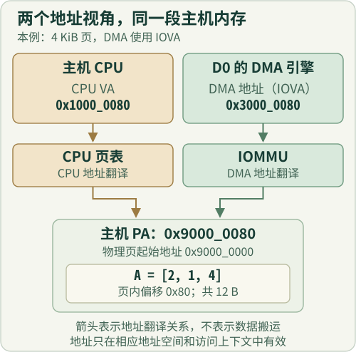
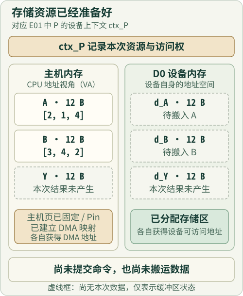
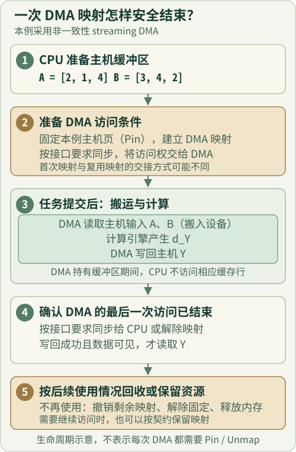

# 计算设备怎样访问一块由软件分配的内存？

[E01](e01-device-context-and-driver.md) 中，进程 P 已经取得加速卡 D0 的使用权，并建立设备上下文 ctx_P。主机内存中已有输入 A = [2, 1, 4]、B = [3, 4, 2]。接下来能否直接把 A、B 的指针交给设备，让它执行向量加法？

我们需要为设备准备能够访问的存储区。**内存映射（Memory Mapping）**建立地址与目标存储资源之间的关系，使某个访问者能够在相应的地址空间和权限下访问这块资源。获得一段地址、分配实际存储空间、建立映射及真正搬运数据，是不同的事情。

本篇继续使用 A04、A05 和 E01 的教学系统：Linux 主机通过 PCIe 连接独立加速卡，主机与设备各有存储区，需要显式搬入输入、执行计算和写回结果。我们将跟踪三组数据怎样成为设备可以引用的资源。

## 为什么 CPU 能用的地址，不一定能直接交给 DMA 引擎？ {#address-spaces}

A、B 各有 3 个 int32 元素，占 12 B。假设应用 P 还申请了同样大小的主机结果区 Y。现在 CPU 可以通过各自的指针读写这些存储区，但 Y 尚没有本次计算的结果。

先观察 A。假设它的起始地址为 `0x1000_0080`。这是程序 P 的**虚拟地址（Virtual Address，VA）**。CPU 执行读取 A[0] 的指令时，依据当前地址空间的页表找到对应的物理地址。

假设主机使用 4 KiB 页，其中包含 A 的虚拟页 `0x1000_0000` 映射到物理页 `0x9000_0000`。A 的起始地址距离页首 `0x80` 字节，因此其主机**物理地址（Physical Address，PA）**是 `0x9000_0080`。

CPU 页表建立的是 CPU 访问路径。设备的 DMA（Direct Memory Access，直接内存访问）引擎可以自行发出读写请求，搬运数据时不需要 CPU 为每个数据项执行读写指令。但这样的请求不会默认使用 P 的 CPU 页表。

假设本例启用了用于设备地址翻译的 IOMMU（输入输出内存管理单元），且设备访问主机内存时经过它，不使用中转缓冲区。软件为 A 建立 DMA 映射，使设备使用 `0x3000_0080` 就能访问同一物理位置。这个地址称为 DMA 地址，在本例中也称为 I/O 虚拟地址（IOVA）。

<figure markdown="1">

<figcaption>三种地址均为构造数值。图中两条路径指向同一主机存储区，页内偏移均为 0x80。箭头表示地址翻译和访问关系，不表示数据已经被搬入设备。</figcaption>
</figure>

| 地址 | 在本例中的值 | 谁使用？ |
| --- | --- | --- |
| CPU 虚拟地址 | 0x1000_0080 | 进程 P 的 CPU 指令 |
| 主机物理地址 | 0x9000_0080 | 主机物理地址空间 |
| DMA 地址（本例为 IOVA） | 0x3000_0080 | D0 的 DMA 引擎访问主机内存 |

这些地址的数值在部分平台上可能相同，但软件不能依靠这个现象推断地址可以互换。即使没有 IOMMU，平台的地址转换和设备的寻址能力也可能使 DMA 地址不同于主机物理地址。

[存储系统：第一次读，从哪个地址出发？](../../storage/README.md#first-load) · [PCIe：配置、BAR 与 DMA 地址视角](../../interconnect/PCIE/03-configuration-enumeration-addressing/mmio-config-dma-address-view.md) · [Linux DMA 指南：CPU and DMA Addresses](https://docs.kernel.org/core-api/dma-api-howto.html#cpu-and-dma-addresses)

## 主机软件已经分配了内存，为什么还要固定页面？ {#pin-pages}

A 已经存在于程序 P 的内存中。假设驱动取得了对应的物理页，并准备让设备在稍后读取它。只记下这一时刻的物理地址，是否足以保证稍后还能读到原来的 A？

操作系统管理物理内存。合法的虚拟地址范围可能尚未分配实际物理页，也可能在使用期间经历页面迁移、回收或映射变化。普通虚拟地址的存在，不能保证某个物理页可以一直供设备访问。

而本例中的普通 DMA 引擎按已经准备好的 DMA 地址访问内存，没有与主机缺页及页面迁移协同的能力。如果访问还在进行时，原物理页已经被归还给系统，设备的请求就无法再保证访问原来的数据。

因此，对于本例中希望直接交给 DMA 的普通用户内存，驱动要按操作系统的接口保持相应页面有效，并限制其在 DMA 使用期间被迁移或回收。这种固定页面的操作通常称为 **Pin**。

Pin 解决的是实际存储页的稳定性问题。它既不产生设备可用的 DMA 地址，也不自动使多个物理页连续，更不代表 CPU 与设备可以同时随意改写数据。地址映射和数据交接还需要另外处理。

固定用户页时，驱动还要确认应用具备相应的访问权限。例如 Y 是设备写入的结果区，需要以允许写入的方式取得页面。

本例为 A、B、Y 各自准备一整个独立的 4 KiB 主机页，每组有效数据仅占 12 B，不与其他对象共享需要维护的缓存行。实际分配、固定及映射的粒度可以大于数据长度。

实际系统不要求所有普通内存访问都先 Pin。例如，驱动可以分配已经满足 DMA 条件的缓冲区，复制用户数据到其中，再让设备搬运。支持设备缺页和地址失效协同的系统，也可以按另一套契约管理可分页内存。

[存储系统：虚拟地址与物理存储](../../storage/01-memory-hierarchy/02-access-paths/numa-multi-channel-multi-socket.md) · [Linux Pin User Pages](https://docs.kernel.org/core-api/pin_user_pages.html) · [Linux Shared Virtual Addressing](https://docs.kernel.org/arch/x86/sva.html)

## 页面已经准备好，怎样获得设备可用的地址？ {#dma-mapping}

回到 A 所在的物理页。现在驱动已经能够在需要期间持有这页内存。下一步是为 D0 建立访问这块存储区的条件，让驱动取得 DMA 引擎应该使用的地址。

驱动向系统的 DMA 映射接口提供目标设备、需要访问的存储区、长度和数据方向等信息。系统根据设备的寻址能力及平台映射机制，建立相应访问路径，返回可供设备使用的 DMA 地址。这一步称为 **DMA Mapping**。

为满足本例非一致性 DMA 的缓存维护和对齐要求，我们为每个主机页建立覆盖整页的映射。假设 DMA 接口为 A 所在的页返回 DMA 基址 `0x3000_0000`，IOMMU 将其映射到主机物理页 `0x9000_0000`。

设备访问 A[0] 时，使用映射基址加上数据偏移 `0x80`，即 `0x3000_0080`。A[1] 的地址为 `0x3000_0084`。实际搬运的长度是 12 B，而后续同步和撤销映射按整页映射及对应方向处理。

| 主机缓冲区 | CPU 虚拟地址 | 主机物理地址 | DMA 地址（IOVA） | 有效长度 |
| --- | --- | --- | --- | ---: |
| A | 0x1000_0080 | 0x9000_0080 | 0x3000_0080 | 12 B |
| B | 0x1000_1080 | 0x9100_0080 | 0x3000_1080 | 12 B |
| Y | 0x1000_2080 | 0x9200_0080 | 0x3000_2080 | 12 B |

表中三组地址是本教学例的假设，不是驱动应该自行计算的地址。驱动应使用系统返回的映射结果，并检查映射是否成功。例如，平台可能无法为某个设备分配满足其 DMA 地址范围要求的映射。

实际缓冲区可能跨越多个物理页。连续 CPU 虚拟地址不意味着对应的物理页连续，映射接口可能返回多个可供 DMA 使用的连续地址段（Scatter-Gather）。本例只涉及单页中的 12 B，因此每组只需要一个 DMA 地址段。

### 为什么还需要指定数据方向和访问权限？ {#dma-direction}

以后设备搬入 A 和 B 时，会读取主机内存；写回 Y 时，会写入主机内存。Linux 流式 DMA 映射以设备为参照规定数据方向：A、B 使用从主机到设备的方向，Y 使用从设备到主机的方向。

方向信息帮助平台建立适当的映射及缓存交接条件。在支持的实现中，它还可以参与访问权限设置。但方向参数本身不能被理解为所有设备都必然提供对应的硬件读写保护。

ctx_P 中还需要记录资源属于谁、允许使用的范围和用途。IOMMU 可约束设备的主机内存访问；设备侧地址空间和驱动的资源检查则按具体实现共同约束上下文之间的访问。

本例只授权任务使用每组 12 B 有效数据。实际地址翻译及保护可能以整页为粒度，不能将搬运长度等同于硬件权限粒度。资源使用范围与底层映射粒度需分别满足约束。

[Linux DMA API](https://docs.kernel.org/core-api/dma-api.html) · [Linux DMA 指南：DMA Direction](https://docs.kernel.org/core-api/dma-api-howto.html#dma-direction) · [PCIe：IOMMU 与设备隔离](../../interconnect/PCIE/03-configuration-enumeration-addressing/iommu-address-translation-device-isolation.md)

## 设备已经能够访问主机数据，为什么还要分配设备内存？ {#device-memory}

本例中，计算引擎使用设备本地存储区中的数据。因此，A 和 B 即使已经有了主机 DMA 地址，还需要为搬入后的数据和计算结果分别准备设备上的空间。

软件通过 ctx_P 申请设备资源。驱动及设备管理软件分配本地存储，建立计算引擎能够使用的地址，并关联到 ctx_P 的资源记录与访问权限。我们继续用 d_A、d_B、d_Y 表示这三个设备 Buffer。

| 设备 Buffer | 设备可访问起始地址 | 有效数据大小 | 用途 |
| --- | --- | ---: | --- |
| d_A | 0x1000 | 12 B | 搬入 A，供计算任务读取 |
| d_B | 0x2000 | 12 B | 搬入 B，供计算任务读取 |
| d_Y | 0x3000 | 12 B | 保存计算结果，供写回任务读取 |

这些地址属于设备侧地址空间。在本教学模型中，假设 DMA 引擎与计算引擎共享这一侧的本地地址视图。实际设备的两种引擎也可能需要不同的地址表示，软件应遵循相应执行接口。

在有设备 MMU 的实现中，这些地址可以是设备虚拟地址，由设备页表将其转换到相应存储位置。在另一些设备中，软件使用受约束的设备本地地址或资源引用。CPU 不能默认通过这些数值直接访问设备存储。

具体分配接口还可能把创建存储、地址保留、映射和授权合并为一次调用。CUDA 的低层虚拟内存管理接口则将它们分开，便于独立管理每一类资源。关键是明确软件已经建立了哪些条件。

<figure markdown="1">

<figcaption>本图回到内存准备结束的时刻。分配和地址映射建立了访问能力，并没有执行 A 到 d_A、B 到 d_B 的实际数据搬运。12 B 是每组有效数据大小，不代表真实分配粒度。</figcaption>
</figure>

到这里，驱动已经能够引用主机存储区和设备存储区。它们是两组不同的存储资源，ctx_P 负责关联这些资源。本次计算仍尚未执行，不能因为已经取得 d_A 的地址就认为其中保存了 [2, 1, 4]。

本例假设地址映射直接指向目标页，不发生数据复制。实际 DMA API 可能因设备寻址限制使用中转缓冲区；运行时也可能帮应用先复制数据到合适的主机内存。不能把所有实现的映射过程都理解为绝对没有辅助搬运。

[CUDA Driver API：Virtual Memory Management](https://docs.nvidia.com/cuda/cuda-driver-api/cuda_driver_api/group__CUDA__VA.html) · [CUDA API Synchronization Behavior：Pageable Memory 与 Staging](https://docs.nvidia.com/cuda/cuda-runtime-api/api-sync-behavior.html)

## 地址已经正确，为什么还要考虑数据可见性？ {#visibility}

假设 A 的第一个元素刚刚由 CPU 从 0 改为 2。CPU 自己已经可以读取 2，但它可能只更新了一份 CPU 缓存中的数据，尚未使新值对 DMA 引擎可见。

如果设备与 CPU 不保证硬件缓存一致性，DMA 引擎通过正确的地址访问同一物理内存时，也可能读到旧值。映射正确解决了“在哪里访问”的问题，尚不能回答“现在能读到哪个值”。

本篇使用 Linux 的**流式 DMA 映射（Streaming DMA Mapping）**作为数据缓冲区的教学接口，假设设备与 CPU 的相关访问不具备硬件一致性。CPU 在交接前写好 A、B，通过新建映射或对保留映射进行所需同步，使输入数据满足设备访问条件。

在映射已交给设备使用期间，CPU 不再访问相应映射范围。等设备不再访问，软件按照接口完成所需的同步或解除映射，再将使用权交还 CPU。

反过来看结果 Y：W 写回后，CPU 中可能仍有先前缓存的旧值。只有 W 成功写回、设备结束访问，并且完成该接口要求的数据交接后，CPU 才能读取本次结果。同步操作可能包括相应的缓存维护。

<figure markdown="1">

<figcaption>这是对一次映射使用及交接过程的预览，不表示本篇已经提交任务。实际同步位置取决于映射类型和接口；保留映射也可以多次交接使用权。</figcaption>
</figure>

有些平台为 DMA 提供一致性内存（Coherent DMA Memory），使 CPU 和设备无需显式执行缓存维护即可获得相应的一致性保证。这类内存常用于需要共享的控制数据，例如命令或完成队列。

但一致性不是任务完成或操作顺序的保证。CPU 仍需按照接口规定发布工作，设备也要正确报告何时停止访问及何时产生结果。

[A05](../01-foundations/a05-task-and-resource-lifecycle.md#completion-and-visibility) 已经区分了执行结束与可见性，驱动需要利用平台的内存接口落实这些约定。

[PCIe：主机缓冲区、DMA 映射与可见性](../../interconnect/PCIE/04-data-path-dma-interrupts/host-memory-pinned-buffer-visibility.md) · [Linux DMA 指南：Types of DMA Mappings](https://docs.kernel.org/core-api/dma-api-howto.html#types-of-dma-mappings)

## 如果不再使用这些地址，软件能立即释放内存吗？ {#mapping-lifetime}

假设将来 L_A 已经使用 A 的 DMA 地址完成搬入。如果还有一项设备工作持有该映射并可能继续读取 A，软件不能提前撤销映射或释放对应的主机页。

需要判断的不只是当前函数是否返回，更重要的是哪一项工作仍可能使用这个地址。映射可以保留，用于后续合法访问；也可以在所有相关访问结束且满足交接条件后撤销，不需要每次计算都重新映射。

如果决定归还主机资源，本例需要先确认相关设备访问已经结束，再按接口要求完成数据交接并撤销 DMA 映射（包括必要的失效处理）。最终解除页面固定；在没有其他持有者时，软件才可释放存储。

对于一次性的流式映射，解除映射可以完成接口规定的同步；若保留映射供下一次 DMA 使用，并在两次之间交给 CPU 访问，则按契约执行相应的 CPU/设备同步操作。对被设备写入的用户页，解除固定时还应按系统要求维护脏页状态。

其中解除映射、解除 Pin、释放存储是不同操作。映射解除后，普通应用仍可以访问其有效的主机缓冲区；也可以在以后重新建立新的映射。设备本地 Buffer 同样要等相关访问及资源引用结束，才能撤销设备地址和归还存储。

例如 d_Y 在 C 计算结束后仍可能被 W 读取，不能马上释放。Y 在 W 成功交接后可以由 CPU 读取，也不代表这块主机存储已经没有消费者。如何在失败、取消或者复位情况下确认安全释放，是 E04 将解决的问题。

[A05：所有权与资源生命周期](../01-foundations/a05-task-and-resource-lifecycle.md#ownership-and-lifecycle) · [Linux DMA 指南：Using Streaming DMA Mappings](https://docs.kernel.org/core-api/dma-api-howto.html#using-streaming-dma-mappings)

## 所有计算设备都需要显式搬入和写回吗？ {#other-memory-models}

本篇的模型要求主机与设备各有独立存储区。但有的设备可以直接读写已经授权的主机内存，有的系统支持 CPU 和设备共享虚拟地址，也有运行环境负责在不同存储位置之间迁移数据。

例如 CUDA Unified Memory 在受支持的系统中可以由运行环境管理数据位置；具有共享虚拟地址和缺页处理能力的设备也可以使用相应的应用虚拟地址。在这些路径中，应用可能不再显式申请 d_A 或提交本例中的搬入任务。

仍然需要区分三类条件：访问者能否通过合法的地址找到存储；存储是否在访问期间保持有效；生产者的数据何时能被消费者观察到。统一地址空间不等于所有数据都位于同一物理存储，也不自动保证应用的同步关系正确。

[CUDA Programming Guide：Unified and System Memory](https://docs.nvidia.com/cuda/cuda-programming-guide/02-basics/understanding-memory.html) · [Linux SVA](https://docs.kernel.org/arch/x86/sva.html#background)

## 回到向量加法：现在软件已经准备好了什么？ {#summary}

沿用 [A05](../01-foundations/a05-task-and-resource-lifecycle.md) 的四项工作。就各 Buffer 的地址、长度与用途而言，软件已经取得了构造这些工作所需的信息。

| 待执行任务 | 读写位置（本例的地址视角） | 有效数据 |
| --- | --- | --- |
| L_A：搬入 A | 主机 DMA 地址 0x3000_0080 → 设备 d_A（0x1000） | 12 B |
| L_B：搬入 B | 主机 DMA 地址 0x3000_1080 → 设备 d_B（0x2000） | 12 B |
| C：执行 vec_add | 读 d_A、d_B → 写 d_Y（0x3000） | 3 个 int32 元素 |
| W：写回 Y | 设备 d_Y（0x3000）→ 主机 DMA 地址 0x3000_2080 | 12 B |

本表只描述后续工作将引用的资源与访问方向，地址按任务接口中对应的地址空间理解。这些任务还没有提交，设备也还没有开始搬运。ctx_P 已经关联本次内存资源，但代码入口、任务参数和完成状态仍需按执行契约建立。

接下来，[E03：驱动怎样告诉设备有一项工作需要执行？](e03-command-submission.md) 将沿着这四项工作研究：驱动怎样描述它们，怎样把命令交给设备，并区分软件提交成功与设备真正接纳工作。
