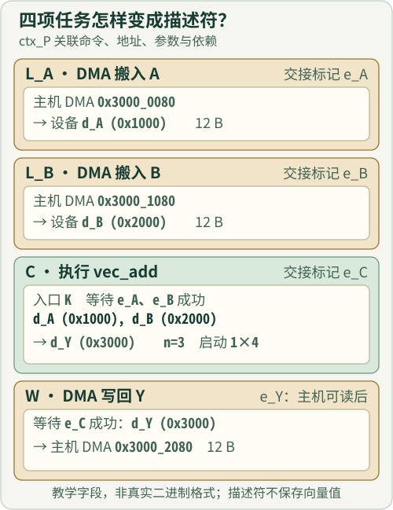
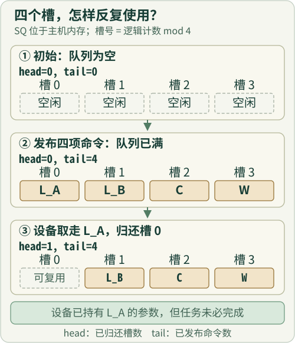
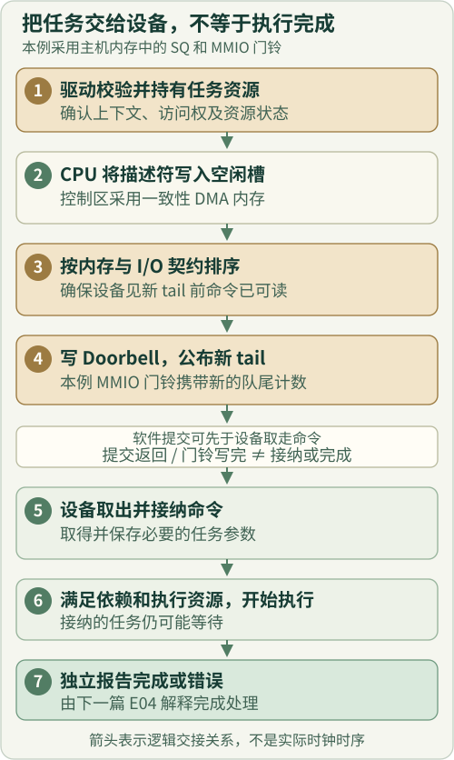

# 驱动怎样告诉设备有一项工作需要执行？

[E01](e01-device-context-and-driver.md) 中，进程 P 获得了计算设备 D0 的使用权，建立了设备上下文 ctx_P。[E02](e02-device-memory-mapping.md) 又准备了向量加法所需的主机和设备存储区。现在软件已经知道数据的位置，但设备还没有开始搬运和计算。

**命令提交（Command Submission）**就是软件按照设备的接口约定描述一项工作，将所需信息交给设备，并通知设备有工作需要处理。提交的对象可以是数据搬运命令，也可以是一次计算内核执行。

下面仍以 Linux 主机和 PCIe 加速卡为教学模型，从一项搬运命令出发，逐步跟踪命令如何进入队列、如何对设备可见，以及软件和设备之间怎样交接工作。本篇不深入引擎内部的执行电路。

## 设备已经能访问 A，为什么它仍然不知道要做什么？ {#command-description}

回到向量加法。主机有 A = [2, 1, 4]、B = [3, 4, 2]，希望得到 Y = [5, 5, 6]。每组是 3 个 int32 元素，共 12 B。E02 中的软件已经为这几组数据准备了地址和访问权限。

对于 DMA 引擎，能够读取 A 的主机 DMA 地址，与需要将 A 搬到设备上的 d_A 是不同的信息。设备不能只根据一个有效的地址，就知道要读取多少字节，也不能判断读出的数据需要写到哪里。

因此软件需要把这一项工作描述出来。针对 L_A，源是 E02 中 A 的 DMA 地址 `0x3000_0080`，目标是设备本地 Buffer d_A 的地址 `0x1000`，要搬运 12 B。

这些信息以设备能够解释的格式组织起来，可以成为一条**命令（Command）**。记录操作类型、地址、长度等命令参数的结构，常被称为**描述符（Descriptor）**。

假设本例中已经准备好与计算任务匹配的 `vec_add` 代码及执行入口 K。软件根据执行契约准备调用参数和执行规模。接下来四项工作可以用下面的逻辑信息描述：

| 任务标识 | 操作与参数 | 需要满足的条件 |
| --- | --- | --- |
| L_A | DMA 搬入：主机 `0x3000_0080` → 设备 `0x1000`，12 B | 主机 A 已交给设备访问 |
| L_B | DMA 搬入：主机 `0x3000_1080` → 设备 `0x2000`，12 B | 主机 B 已交给设备访问 |
| C | 调用 K：d_A = `0x1000`、d_B = `0x2000`、d_Y = `0x3000`，n = 3 | e_A、e_B 均满足 |
| W | DMA 写回：设备 `0x3000` → 主机 `0x3000_2080`，12 B | e_C 满足，主机 Y 已交给设备访问 |

这里使用 A05 的成功交接标记：e_A、e_B 表示输入已经对 C 可读，e_C 表示 d_Y 已可供 W 读取。软件会另外跟踪最终 Y 对主机可用的标记 e_Y。本例假设设备提交接口可以表达前面三个设备侧依赖条件。

C 还采用 [A04](../01-foundations/a04-execution-contract.md#kernel) 中的执行规模：1 个 Block、4 个逻辑线程。n = 3 控制有效元素数。

[F01](../06-execution-runtime/f01-module-loading-and-dispatch.md) 进一步解释了入口与参数的准备。这里的 K 是按设备接口解析的执行入口，不要求与用户态获得的入口句柄数值相同。

<figure markdown="1">

<figcaption>这些字段是用于追踪执行语义的教学表示，不是某款芯片实际的二进制描述符。地址含义与 E02 相同：主机侧使用 DMA 地址，设备侧使用本地可访问地址。</figcaption>
</figure>

注意，描述符中的地址用来引用真正的输入、输出空间。描述符本身不是 A、B 或 Y，也不是 `vec_add` 的全部机器指令。它告诉设备本次工作如何使用已经准备好的代码和数据。

具体接口也可以把一批命令放在一段命令缓冲区（Command Buffer）中，再由队列项引用它。设备按约定读取其中的命令记录。这里为便于观察，假设每个队列项可以直接保存一项工作所需的信息。

[计算微架构：DMA 任务与地址生成](../../microarchitecture-v2/05-data-movement/e01-dma-task-and-address-generation.md#task-state) · [Level Zero：Core Programming Guide](https://oneapi-src.github.io/level-zero-spec/level-zero/latest/core/PROG.html)

## 驱动为什么不能收到请求就直接交给设备？ {#submission-checks}

应用通过运行时或驱动接口提出工作请求。软件可以知道需要搬入 A，但底层设备只能解释它支持的命令格式和资源引用。因此请求可能还需要转换成真正适用于设备的描述符。

沿用 ctx_P。驱动在为 L_A 准备命令时，要确认它使用的主机 DMA 映射和设备 Buffer 均属于允许的资源范围。有效的地址和有效的访问权限必须同时成立，不能只检查地址是否为非零。

| 需要检查或保证的事情 | 本例中的含义 |
| --- | --- |
| 使用的是正确设备和上下文 | D0、ctx_P，以及与其关联的提交资源 |
| 资源引用合法且仍有效 | 主机 A 的 DMA 映射和 d_A 有效，满足访问权限 |
| 工作参数符合执行契约 | 源与目标地址正确，长度为 12 B；C 的入口、参数和执行规模兼容 |
| 工作状态可以持续追踪 | 为每项工作保留可辨认的标识及必要资源引用 |

这些条件可能由应用、运行时、驱动和设备按接口共同保证，不要求驱动能够静态验证任意 Kernel 中的全部读写。本例中的驱动负责验证可检查的资源引用，并将资源使用情况与提交记录关联。

本例用 L_A、L_B、C、W 作为任务标识；实际接口通常还需要让这些标识在对应队列或上下文的在途工作中可区分，以便随后找到对应状态。

驱动还要避免工作已经被接纳、相关 Buffer 却被提前释放。如果提交使用了 A 的 DMA 映射，就需要按契约保留相应的资源引用，直到不再有工作使用它。对于独立的命令缓冲区、代码入口等资源，同样需要管理有效期。

如果出现无法满足的资源条件，软件可以在提交前拒绝这一请求，或者等待接口允许的条件满足。如果已经向调用方接纳请求，就需要保留它并负责推进或按契约报告失败，不能只丢弃请求。

## 为什么需要在软件和设备之间建立一条队列？ {#submission-queue}

假设设备每次只能接收一项工作，主机也必须等它取得参数后才能提供下一项。这会使主机与设备频繁交互，并无法利用已经准备好的多项工作。

我们可以为软件和设备准备一段双方都能访问的控制内存。软件将待处理的命令放入其中，由设备在能够接收工作时取走。这样的存储结构称为**提交队列（Submission Queue，SQ）**。

本例假设 SQ 位于主机内存中，驱动建立了供设备访问的 DMA 映射。与 E02 中用于搬运 A、B、Y 的流式映射不同，假设 SQ 使用一致性 DMA 内存，以便双方共享控制信息。设备初始化或建立上下文时可以准备相关队列资源。

一条 SQ 不需要只保存一个命令。现在假设 ctx_P 有一条包含 4 个槽的 SQ，每个槽可以放一项描述符。驱动是本例的逻辑生产者，设备是消费者；如果有多个主机线程提交，驱动先对同一队列的操作进行串行化。

软件和设备需要依据接口知道哪些槽可以写入、哪些槽已经发布，以及哪些槽已归还。为此采用两个逻辑计数：

| 计数 | 本例的含义 |
| --- | --- |
| tail（队尾） | 软件累计发布的命令数量 |
| head（队首） | 设备累计归还的描述符槽数量，按约定对软件可见 |

物理槽号为相应计数除以 4 的余数。初始 head = tail = 0。假设驱动准备连续发布 L_A、L_B、C、W 四项工作，从槽 0 写到槽 3。发布完成后 tail = 4，而 head 仍为 0。

<figure markdown="1">

<figcaption>本例用不断增加的逻辑计数区分空和满，实际槽号循环使用。图中 head 表示设备已按接口归还且软件能够观察到的槽位，而不是已成功完成的任务数量。</figcaption>
</figure>

此时 tail − head = 4，四个槽都已经发布，软件不能再写入第五个命令。虽然下一次待写槽号又回到 0，但它还保存着设备可能需要读取的 L_A。

假设设备完整取得 L_A 的描述符，将必要的参数与任务状态保存在设备可继续处理的位置，并承诺不再读取原槽。它按接口归还槽 0，软件观察到 head = 1。此时队列有一个可用槽，即使 L_A 还没有完成搬运。

这样，软件可以在硬件处理前面工作时继续准备后面的工作。但队列容量有限，设备未归还足够多的槽位时，后续提交必须等待、留在软件自己的待提交队列中，或按接口返回资源不足。这是提交路径上的反压。

真实队列也可能采用有限位宽的指针、有效位或回绕标记，并有不同的容量限制。例如 NVMe 的队列接口规定软件通过 Doorbell 交付队尾位置，并从完成记录中获得提交队列的消费进度。不能直接将本例的计数规则用于其他设备。

[计算微架构：命令队列](../../microarchitecture-v2/05-data-movement/e02-outstanding-requests-and-completion.md#command-queue) · [NVMe Base Specification 2.1：Queueing Model](https://nvmexpress.org/wp-content/uploads/NVM-Express-Base-Specification-Revision-2.1-2024.08.05-Ratified.pdf)

## 描述符已经写入队列，设备怎样知道有新工作？ {#doorbell-and-publication}

现在软件已将 L_A、L_B、C、W 的参数填入对应槽位。设备不应在软件还未发布这些命令时，将准备中的槽位当成可执行工作。需要一个明确的交接机制。

本例采用**门铃（Doorbell）**。它是设备提供的通知接口，例如一个由驱动通过 MMIO 写入的控制寄存器。本例由驱动记录 tail，先准备完整的描述符，再将新的 tail 值 4 写入门铃。这次写入是向设备发布四项命令的动作；设备观察到新值后，才知道发布到了哪个位置。

门铃只需要携带设备接口约定的通知信息，不需要传递所有的源地址、目标地址及计算参数。设备观察到新的 tail 后，可以从先前未取走的位置继续读取队列项。

一次门铃写可以通知多项已经准备好的工作。因此软件可以在适当条件下批量发布，以减少逐项通知的次数。但批量准备可能增加某项工作的等待时间；具体取舍取决于提交接口和运行需求。

其他设备也可能在共享内存保存生产者指针，由门铃提供提示，或者让设备主动轮询、使用硬件命令接口或固件消息。门铃并非所有设备都必须使用的机制。

[PCIe：从提交队列到完成通知](../../interconnect/PCIE/04-data-path-dma-interrupts/queues-doorbells-completions-msix.md) · [片上总线：Doorbell 与 Completion Flow](../../interconnect/BUS/04-microarchitecture-integration/doorbell-completion-interrupt-flow.md)

### 为什么填写描述符和通知设备的顺序很重要？ {#memory-ordering}

假设软件先填好 L_A 的源地址，但尚未使目标地址和长度对设备可见。如果此时设备已经观察到新 tail，就可能读取到不完整的工作描述。因此，软件不能只关注命令字段写对没有，还必须保证设备在正确的时刻看到完整信息。

即使 SQ 使用一致性 DMA 内存，也不能由此假定不同字段的写入与 MMIO 通知必然按照软件期待的次序被设备观察到。一致性解决数据的缓存可见性问题，内存次序还要由提交契约保证。

在本例中，驱动先写完整描述符，按平台规定的内存与 I/O 排序规则，保证设备观察到新 tail 前可以读取完整命令；然后写入 Doorbell 公布新 tail。设备只消费已发布的槽位，并遵守相应的读取契约。

Linux 内核文档中的 DMA 描述符示例就区分了描述符内容的写入与所有权字段的发布，并使用适当的 DMA 内存屏障和有序 MMIO 访问进行交接。DMA 屏障本身不能替代 MMIO 所需的排序规则。

另外，E02 中 A、B 的流式 DMA 映射及数据交接仍然需要满足。把控制命令发布正确，并不能替代对输入数据的同步。同样，写入 Doorbell 不代表设备已经执行任何一笔数据搬运。

[Linux Memory Barriers：DMA Barriers and Kernel I/O Barrier Effects](https://docs.kernel.org/core-api/wrappers/memory-barriers.html) · [Linux Bus-Independent Device Accesses](https://docs.kernel.org/driver-api/device-io.html)

## 软件已经通知设备，设备是否已经接纳了任务？ {#device-acceptance}

假设驱动已写完 Doorbell，提交函数也返回了成功。本例对 PCIe Memory BAR 中门铃的 Memory Write 是 Posted Write，即发送方不等待该写请求的 Completion TLP。CPU 写门铃返回时，写请求可能尚未到达设备，更不能证明设备已经取走描述符。

设备观察到新 tail 之后，还要有能力取得对应的描述符，按设备接口解释或检查它，并保存执行所需的状态。本例约定，当设备已承担处理该项工作的责任时，称该命令被设备接纳。

如果设备内部没有空间接收更多任务，它可以暂时不消耗后续队列项。如果存在不满足接口的命令，则设备还可能报告错误。接纳与成功计算是不同的阶段，设备也不一定提供单独的接纳通知。

<figure markdown="1">

<figcaption>这是本例的逻辑交接路径，不代表真实耗时。软件提交成功可以早于设备接纳；设备接纳又可以早于任务真正开始执行。</figcaption>
</figure>

观察 L_A，可以区分以下状态：

| 状态 | 软件能够据此确认什么？ |
| --- | --- |
| 软件接口已接纳请求 | 软件承担继续处理或报告失败的责任 |
| 描述符已发布 | 软件完成发布；设备可能尚未观察到门铃或取得描述符 |
| 设备已接纳 | 设备承担处理该命令的责任；本例保存了必要的参数与状态 |
| 执行中 | 工作已具备开始条件，并已进入执行 |
| 成功完成或失败 | 需要按完成接口取得具体状态及相应保证 |

这些状态不是所有接口都能直接观察到的独立枚举。在本例中，软件可以通过 head 的受约束更新知道描述符槽已归还，但不能把 head 的变化当作工作已成功结束。

如果采用异步提交接口，主机可以在软件接纳请求后继续准备其他工作。若接口只保证请求尚在软件队列中，设备甚至还没有收到门铃。要根据接口的返回语义判断软件观察到的是哪一层交接。

[Linux Device I/O：Posted PCI Writes](https://docs.kernel.org/driver-api/device-io.html) · [A05：任务状态](../01-foundations/a05-task-and-resource-lifecycle.md#task-states)

## 四项命令按顺序发布，计算为什么仍要等输入？ {#submission-order-and-dependencies}

回到四项工作。假设设备先取走 L_A、L_B，再取走 C 和 W。即使描述符按照这个顺序被读取，也不能由此推出 L_A 和 L_B 已经搬完。设备可能将取出的命令保存在内部等待执行。

所以本例为 C 约定 e_A 和 e_B 都满足才允许使用 d_A、d_B，为 W 约定 e_C 满足才允许读取 d_Y。设备控制器在获得相应执行资源后，按这些依赖条件推进工作。如果前置工作失败，不能当成成功数据交接。

这也允许软件在两个输入尚未搬完时就提前提交 C。它只是提前描述了后续工作及条件，并没有提前消费数据。本例并不保证 L_A 和 L_B 会并行执行。

另一种接口可能保证某个命令序列按规定的顺序执行并完成必要的数据交接，软件可以利用这种顺序契约表达依赖。有些接口则需要运行时单独控制提交时机，或显式组织同步对象。

关键是：**命令发布顺序、命令取走顺序与数据依赖的满足不是一回事。** 各种 Stream、Event 及任务依赖的上层组织方式见 [F02](../06-execution-runtime/f02-asynchronous-execution.md)。本篇的 SQ 是底层提交资源，不等于运行时的逻辑 Stream。

[A05：同步](../01-foundations/a05-task-and-resource-lifecycle.md#synchronization) · [计算微架构：任务控制与同步](../../microarchitecture-v2/06-resource-cooperation/f02-task-control-and-synchronization.md)

## 每一次提交都需要进入内核吗？ {#submission-interfaces}

本篇采用内核驱动管理 SQ、填写命令并通知设备的路径。这种方式便于集中维护系统资源和请求状态，但提交接口不只有这一种实现。

有些设备可以在系统建立访问授权和隔离条件后，将特定的提交资源交给用户态软件。用户态运行时或驱动库可以按规定发布命令，不必每次通知设备都再次经过内核调用。资源管理、控制权限与硬件执行边界仍需要遵守接口契约。

例如，支持用户态队列的 AMD GPU 可以让用户态驱动填写队列，再由固件处理其中的命令。E01 介绍的 AMD XDNA NPU 则可由主机侧驱动通过 mailbox 向设备侧固件交付工作。两者的控制接口并不相同。

[AMD GPU：User Mode Queues](https://docs.kernel.org/gpu/amdgpu/userq.html) · [AMD GPU：Ring Buffer 与 Indirect Buffer](https://docs.kernel.org/next/gpu/amdgpu/ring-buffer.html) · [AMD XDNA NPU：High Level Use Flow](https://docs.kernel.org/accel/amdxdna/amdnpu.html#high-level-use-flow)

## 回到向量加法：现在软件已经知道什么？ {#summary}

E01 让软件取得 D0 的使用权，E02 为 A、B、Y 和设备侧存储建立设备可访问的资源。本篇则用具体的命令描述、队列及通知，连接了软件的工作请求与设备的接纳过程。

本例中，四项任务可以全部提前发布。即使驱动已经返回提交成功，A、B 也不一定已搬入，C 不一定开始，Y 更不一定可以读取。即使设备归还了某个描述符槽，相关内存资源也可能仍被后续工作引用。

接下来，[设备驱动与底层资源管理](README.md) 的 E04 将继续研究：设备怎样报告完成或失败，驱动怎样找到对应的工作，怎样让 CPU 取得正确的结果，以及在什么条件下才能安全归还资源。
