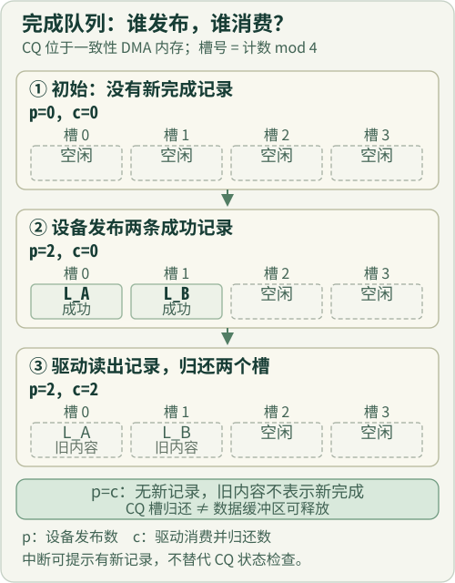
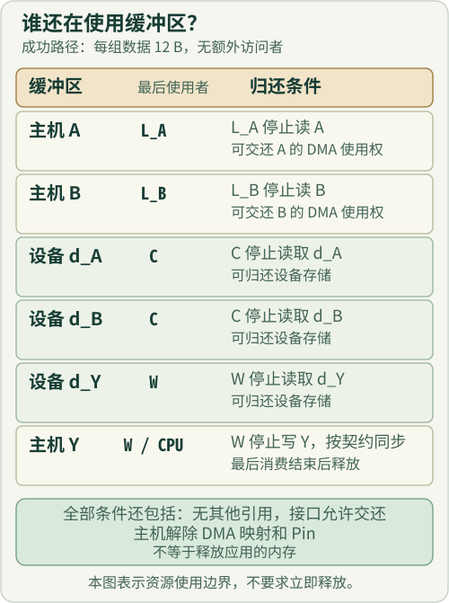
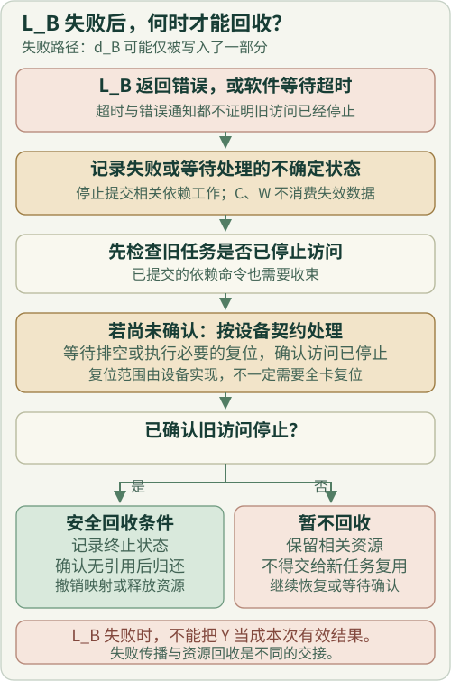

# 设备完成任务或发生错误后，驱动怎样归还资源？

[E03](e03-command-submission.md) 中，驱动将向量加法的搬入、计算和写回命令放入提交队列，再通过 Doorbell 通知设备。即使提交函数早已返回成功，设备也可能仍在执行这些工作。

软件接下来需要知道哪些任务已经结束、是否成功，以及哪些资源不再被设备访问。**完成处理（Completion Handling）**负责取得并解释这些状态，向等待者报告结果，并根据实际访问及引用关系归还相应资源。

本篇沿用 E01–E03 的 Linux 主机和 PCIe 教学加速卡 D0，继续追踪同一次向量加法。先走正常完成路径，再改变一个条件，观察输入搬运失败时怎样处理任务和资源。

## 设备已经取走命令，为什么还要报告完成？ {#completion-record}

回顾 E03：ctx_P 的四槽提交队列 SQ 保存了四项工作 L_A、L_B、C、W。设备取得命令并归还描述符槽后，软件可以再次使用该槽。但这不意味着命令对应的任务已经完成。

现在假设设备已经取走所有四项描述符。此时 SQ 可以为空，可是 C 可能仍在等待 d_B。驱动仅凭 SQ 的 head 和 tail 无法判断 C 是否已经执行，更无法知道 W 的结果能否读取。

因此，设备需要另外报告任务结束的状态。本例让设备为每项需要报告的工作产生一条**完成记录（Completion Queue Entry，CQE）**，其逻辑内容包括：

| 信息 | 驱动用它做什么？ |
| --- | --- |
| 任务标识 | 找到 L_A、L_B、C 或 W 对应的软件记录 |
| 结束状态 | 区分成功、失败和接口定义的其他结束原因 |
| 必要的补充信息 | 按接口需要报告错误原因、传输信息等 |

任务标识需要在相关队列及上下文的在途工作中足以区分各项任务。如果多个队列共享同一完成接口，记录还需要适当的来源标识或对应关系。

完成记录不是 Y 的三个整数，也不是原来的命令本体。驱动借助任务标识关联 E03 中保存的资源引用，并根据状态所提供的保证推进后续处理。

本教学模型假设正常的成功 CQE 表示对应任务已经成功执行、结束自身的相关访问。L_A、L_B、C 的成功还保证本次输出对约定的设备侧消费者可读。W 的成功表示 12 B 写回达到接口规定的完成观察点，且相关访问已结束，不再有影响本次 Y 的在途写入。主机仍需进行 E02 中的数据交接。

不同设备对完成状态的定义不同。有的使用状态寄存器，有的在内存中写任务状态，或者使用设备事件、信号对象等接口。本例采用独立的完成队列。

[计算微架构：DMA 任务完成](../../microarchitecture-v2/05-data-movement/e02-outstanding-requests-and-completion.md#task-completion) · [A05：任务完成与可见性](../01-foundations/a05-task-and-resource-lifecycle.md#completion-and-visibility)

## 驱动怎样取走设备报告的完成记录？ {#completion-queue}

假设与 E03 的 SQ 类似，驱动给 D0 准备了主机内存中的一条四槽**完成队列（Completion Queue，CQ）**。本例也使用一致性 DMA 内存作为控制区，但生产者和消费者的角色恰好与 SQ 相反。

| 队列 | 生产者 | 消费者 | 交接的对象 |
| --- | --- | --- | --- |
| SQ | 驱动 | 设备 | 命令描述符 |
| CQ | 设备 | 驱动 | 完成记录 |

用两个不断增加的逻辑计数管理 CQ：p 表示设备累计发布的完成记录数，c 表示驱动累计已归还的完成槽数。槽号取计数除以 4 的余数。设备与软件按接口观察对方公布的进度。

现在假设 L_A、L_B 已成功结束。设备先将各自的任务标识和成功状态写入槽 0、槽 1，再按照接口规定的顺序发布这些记录，使软件观察到 p = 2。

驱动此时看到有两条未消费的记录。它在确认发布状态后，按照共享内存的读取顺序取得完整内容，找到对应的任务记录，将结果保存到软件状态中，再把 c 更新为 2 并告知设备。

<figure markdown="1">

<figcaption>p 和 c 是本例的逻辑计数，分别统计已发布与已归还的完成槽。CQ 槽可以复用，仍不代表任务相关的数据存储已经无人引用。</figcaption>
</figure>

在本例中，p − c 表示未归还的完成槽数量，范围为 0 到 4。p − c = 4 时 CQ 已满，设备不能覆盖未消费记录，需要保留待报告的状态，或按照具体接口等待可用空间。

为什么需要公布消费进度？如果设备不知道驱动已经读完记录，就不能安全覆盖这些槽。驱动处理完成记录后还要进行这一交接；否则 CQ 填满以后可能阻止设备继续报告状态，甚至影响更多任务的执行。

CQ 槽归还后，旧字节可能仍然在内存中。设备下一次使用这个槽时，驱动必须有办法知道它是否属于新一轮发布的记录。本例用逻辑计数区分；实际设备也可采用有效位、所有权位或回绕时变化的 phase 标记。

例如 E03 提到的 NVMe 规范，使用 CQE 的 Phase Tag 判断是否出现了新的完成记录，并由主机通过 Completion Queue Head Doorbell 公布已经消费的槽位。本文只借用其生产、消费关系，不规定实际设备格式。

[Linux Memory Barriers：DMA Barriers](https://docs.kernel.org/core-api/wrappers/memory-barriers.html) · [PCIe：从提交队列到完成通知](../../interconnect/PCIE/04-data-path-dma-interrupts/queues-doorbells-completions-msix.md) · [NVMe Base Specification 2.1：Queueing Model](https://nvmexpress.org/wp-content/uploads/NVM-Express-Base-Specification-Revision-2.1-2024.08.05-Ratified.pdf)

## 驱动是否必须不停读取完成队列？ {#completion-notification}

在设备发布新的 CQE 之前，驱动无法从 CQ 中获得这项任务的状态。如果每隔一小段时间检查一次队列，就可能及时发现新增记录。这种方式称为**轮询（Polling）**。

但当工作尚未结束或者当前没有任务时，持续轮询会占用 CPU 时间。另一种方式是让 CPU 执行其他工作，等设备有新的状态需要处理时，再通过**中断（Interrupt）**通知 CPU。

在本例的 PCIe 设备中，D0 可以通过 MSI-X 机制发送中断消息。操作系统调用对应的中断处理程序，驱动随后检查完成队列，或安排适合的后续软件处理。

本例约定设备先写好 CQE 并发布，再发送相应的完成通知。驱动仍需遵守共享内存的读取次序。中断本身并不携带本次 Y 的数值，也不能代替对完成状态的检查。

| 观察方式 | 主要特点 |
| --- | --- |
| 轮询 CQ | 持续检查可减少等待通知的延迟，但会消耗 CPU 时间 |
| 中断通知 | 不需要持续轮询，但要承担通知、处理及唤醒开销 |
| 混合或合并通知 | 短时轮询后等待，或积累多条记录再通知，在开销与延迟之间取舍 |

例如 L_A、L_B 可能在一次中断处理前都已发布，因此一次中断可以对应两条完成记录。驱动应根据 CQ 的实际状态消费记录，而不是根据中断次数推断完成任务数量。

从轮询转入睡眠等待时，还要确保状态变化不会在检查队列与进入等待之间被错过。这要求设备的通知规则和软件的等待机制配合，使完成状态可以被可靠地再次检查。

[Linux MSI Driver Guide](https://docs.kernel.org/PCI/msi-howto.html) · [片上总线：Doorbell、Completion 与 Interrupt Flow](../../interconnect/BUS/04-microarchitecture-integration/doorbell-completion-interrupt-flow.md)

## 写回任务显示成功，主机现在就能读取 Y 吗？ {#output-visibility}

回到 A = [2, 1, 4]、B = [3, 4, 2]。设备已经完成 L_A、L_B 和 C，设备 d_Y 中保存 [5, 5, 6]。如果主机此时收到 C 的成功记录，能否读取 Y？

不能。d_Y 与主机 Y 是不同的存储区，要等 W 将 12 B 数据从设备地址 `0x3000` 写到主机 DMA 地址 `0x3000_2080`。

而且，即使 W 的成功 CQE 已经传给驱动，由于 E02 的教学系统采用非一致性流式 DMA 映射，CPU 仍然可能保留旧的缓存内容。CQ 自身采用一致性内存，并不改变 Y 的缓存及所有权交接条件。

驱动确认 W 成功而且不再访问 Y 后，需要按照该映射的约定将 Y 的使用权交还 CPU。若保留映射，执行规定的 CPU 同步；若使用一次性映射，解除映射可以完成该接口所需的同步。

<figure markdown="1">

[![W 将 d_Y 的 12 B 写回主机 Y，设备按契约确认成功及访问结束后发布 CQE，驱动通过中断提示或轮询取得状态，再按 E02 的流式映射契约完成 CPU 交接，最后 Y=[5,5,6] 才对主机可读。](assets/e04-completion-path.svg)](assets/e04-completion-path.svg)

<figcaption>这是本例的成功交接路径，不是实际时钟时序。任务结束、CQE 发布、通知、驱动处理和结果可读是不同的观察点。</figcaption>
</figure>

此时 A05 的 e_Y 才满足本例的含义：W 已成功交接且主机可以读取本次 Y。对于 e_A、e_B 与 e_C，设备侧后继工作可以在相应交接满足后继续推进，不要求主机先消费那些 CQE。

[E02：数据可见性](e02-device-memory-mapping.md#visibility) · [Linux DMA 指南：Using Streaming DMA Mappings](https://docs.kernel.org/core-api/dma-api-howto.html#using-streaming-dma-mappings)

### 驱动怎样让上层软件等待这项工作？ {#fence}

使用设备的应用程序通常不需要直接解析 CQ 中的记录。驱动可以保留各项工作的状态，让上层软件查询，或者在需要的条件尚未满足时等待相应对象。

一些系统提供 **Fence（栅栏或围栏）** 这样的同步对象，用来表示某项工作或一组工作的完成进度。它可以被等待，并在达到对应状态时发出信号。

在 Linux 图形驱动所用的 dma-fence 接口中，软件可以查询异步工作的 Fence 状态，区分未发出信号、无错误完成和带错误结束。等待结束不能一律理解为任务成功。

不同接口的 Fence 可能有不同的同步范围与内存保证。本例如果为 W 提供一个承诺主机结果可用的等待对象，驱动不能仅在读到 W 的 CQE 时就宣告成功；它还要完成主机 Y 的交接，再报告 e_Y 满足。

Fence 不是缓存维护操作本身。作为资源释放依据的同步对象也必须满足它承诺的访问终止条件；如果接口允许提前报告错误，驱动应另外追踪仍可能发生的访问。上层如何用这些对象组织任务，见 [F02](../06-execution-runtime/f02-asynchronous-execution.md)。

[Linux dma-buf：dma-fence](https://docs.kernel.org/driver-api/dma-buf.html)

## 六个缓冲区什么时候可以归还？ {#resource-reclamation}

假设四项任务全部成功结束。驱动在 E03 中已经为每项工作持有相应的资源引用。现在应当逐项判断哪些资源不再被使用，而不是一看到任意完成记录就释放整个 ctx_P。

例如 L_A 完成并按契约交接 d_A 后，主机 A 已经不再用于本次搬入，可以按条件归还它的 DMA 使用权。然而 d_A 还要供 C 读取，不能与主机 A 一起归还。

<figure markdown="1">

<figcaption>假设没有其他工作或资源引用。图中记录最后访问条件，不表示必须在这些时刻立即释放。主机映射及 Pin 的生命周期也可以和实际存储的生命周期不同。</figcaption>
</figure>

| 资源 | 本例中最早允许归还的条件 |
| --- | --- |
| 主机 A、B 的 DMA 使用权 | 相应 L_A、L_B 不再读，按映射契约交还 |
| d_A、d_B | C 已结束对相应输入的最后访问 |
| d_Y | W 已结束对输出的最后访问 |
| 主机 Y 的 DMA 使用权 | W 不再写入，按映射契约交还 |
| 主机 Y 的实际存储 | 主机及其他使用者也结束使用 |

以上条件仍要求没有其他持有引用的工作，且实际接口允许归还。例如 d_A 中的新数据已经可读，与 C 是否读完它是两个不同的状态。

对于主机 A、B、Y，如果决定释放相关 DMA 资源，应遵循 E02 的顺序：确认设备不再访问，按规定完成同步和撤销映射，再解除页面固定。对设备写入过的用户页还需按系统规定维护脏页状态。

本例的主机缓冲区各占独立的 4 KiB 页，因此解除映射按相应整页映射和方向处理，并不是只撤销 12 B 的任务数据。解除 Pin 或取消映射后，应用仍可能持有对应的主机内存。

类似地，SQ 描述符槽在设备按契约取走并归还后可复用；独立的命令缓冲区、内核入口和数据存储需要等各自最后一次访问结束。CQ 槽在驱动保存状态并交还后可复用，也不是释放这些任务资源的充分条件。

[A05：所有权与生命周期](../01-foundations/a05-task-and-resource-lifecycle.md#ownership-and-lifecycle) · [E02：映射的生命周期](e02-device-memory-mapping.md#mapping-lifetime)

## 如果 L_B 搬运失败，驱动应该怎么办？ {#error-handling}

现在改变一个条件：L_A 成功，而 L_B 在搬运过程中遇到错误。假设设备只写入了 B 的一部分数据到 d_B。此时 d_B 中可能同时保存本次数据和之前留下的旧值。

若接口返回失败 CQE，驱动可以确认 L_B 的工作失败，但不能将 d_B 视为完整的新输入。e_B 的成功交接条件没有满足，因此 C、W 不能继续按照成功路径使用本次数据。

而 E03 中 C、W 已经被提前发布。驱动及设备需要按接口规定收束这些依赖工作的状态，例如取消尚未开始的任务，或使它们报告依赖失败。已经接纳的工作仍可能持有 Buffer 引用，需要分别处理。

不应假设错误报告必然保证设备所有相关访问已经停止。真实接口可能保证单条失败记录已经结束该任务，也可能只报告某个故障，需要进一步终止和确认剩余工作。

还有一种现象：主机长时间没有看到完成记录，等待超时。它可能仅仅是没有观察到状态，也可能是设备、通信或通知路径出现问题。超时只说明在期限内未观察到预期条件，不证明设备已经停止访问。

| 现象 | 不能直接推出什么？ |
| --- | --- |
| L_B 报告失败 | 不能推出整个向量任务的资源都已安全可释放 |
| 发出任务取消请求 | 不能推出设备已经处理取消，或在途访问已结束 |
| 等待超时 | 不能推出任务一定未执行，或者不会再执行 |
| 禁止设备产生中断 | 不能推出数据搬运引擎已经停止 |

例如 Linux DMA Engine 为 slave DMA 提供的异步终止接口可以在 DMA 或相关回调尚未完全收束时返回；还需要按该接口确认终止完成，才能释放相关资源。终止也可能丢弃未完成的传输数据，不能作为成功交接。

[Linux DMA Engine API：Further APIs](https://docs.kernel.org/driver-api/dmaengine/client.html#further-apis) · [A05：失败与取消](../01-foundations/a05-task-and-resource-lifecycle.md#failure-and-cancellation)

## 设备不再正常响应时，怎样安全恢复并回收资源？ {#reset-and-recovery}

如果设备能够正常报告 L_B 失败，并按契约确认相关访问已终止，驱动可以结束受影响的工作，不必复位整张卡。但如果设备不能正常推进或提供可靠的状态，就需要更进一步的恢复机制。

驱动首先要停止向受影响的范围接纳或发布新工作，明确哪些已经提交的工作仍有可能访问资源。根据设备提供的控制接口，可以尝试停止相关队列或引擎，并等待必要的在途访问收束。

如果无法通过正常控制路径恢复，可能需要**设备复位（Reset）**。复位将某个硬件范围恢复到规定的初始状态。其范围可能是某个引擎、设备功能或整个设备，具体保证由硬件、固件和平台接口共同规定。

<figure markdown="1">

<figcaption>一种异常收束的教学路径。失败报告或发出复位请求不等于访问终止。能否继续恢复、是否需要复位及其范围均取决于实际设备。</figcaption>
</figure>

这里最重要的是确认旧的设备访问及相关软件处理不会再引用准备归还的资源。例如，仍在途的 DMA 或尚未结束的完成处理，都需要按照接口收束。若平台或设备尚不能提供安全保证，就不能复用这些资源。

之后驱动可以根据实际状态报告失败，归还没有剩余使用者的资源，并让等待者结束等待。如果错误已经报告给应用，也仍需保留未能安全回收的部分，直到满足相应条件。

恢复到可用状态时，驱动可能需要重新初始化队列、通知机制及其他设备状态，重新建立有效的资源引用。还应区分恢复前后的任务和完成记录，确保旧状态不会被误认为新工作的结果。

如果已经发生了部分写入，重新执行某项任务可能产生额外的可观察行为。是否能够重试需要根据任务语义、已知执行状态及接口保证判断，不能默认所有受影响的任务都可以直接重放。

Linux 的 PCI Error Recovery 提供了一个实际的恢复流程，区分错误通知、I/O 恢复或复位、设备重新配置及恢复正常操作等阶段。它也允许某些设备最终无法恢复。这不是所有加速器的固定处理顺序。

[Linux PCI Error Recovery](https://docs.kernel.org/PCI/pci-error-recovery.html) · [Linux PCI Driver Guide：PCI Device Shutdown](https://docs.kernel.org/PCI/pci.html#pci-device-shutdown)

## 任务都结束了，怎样结束这次设备使用？ {#close-context}

回到 E01 中共享 D0 的两个进程 P 和 Q。P 完成向量加法后，可以继续复用 ctx_P 已建立的设备资源，也可以结束自己的设备使用。

如果要关闭 ctx_P，驱动需要停止该上下文的新请求，处理或终止余下工作，确认队列、映射、控制内存、设备及软件处理不再使用需要销毁的资源，再按各资源的引用关系归还它们。

P 的上下文销毁并不表示需要关闭整个 D0，也不应因此释放 Q 仍持有的资源。如果故障必须复位更大范围的硬件，驱动还需处理该范围内受影响的其他上下文。

这与 E01 的资源所有权一致：应用取得的是约定范围内的设备使用权，而不是对整张卡的永久独占。底层资源可以在满足安全条件后被归还，随后用于其他工作。

## 从设备使用权到资源归还 {#summary}

至此，我们完成了一次从主机向量加法到设备执行的完整过程。四篇文章分别建立了不同的观察条件：

| 文章 | 解决的问题 |
| --- | --- |
| [E01](e01-device-context-and-driver.md) | 系统怎样识别设备，应用怎样取得设备资源和使用权？ |
| [E02](e02-device-memory-mapping.md) | 怎样分配、固定和映射存储，使设备具备正确的访问条件？ |
| [E03](e03-command-submission.md) | 怎样构造命令，发布到设备并区分接纳和执行？ |
| E04 | 怎样取得成功或错误状态，进行数据交接和安全回收？ |

后续 [通用执行运行时](../06-execution-runtime/README.md) 将在这些底层接口之上组织可执行内核、任务依赖以及动态资源的复用。具体的动态分配和内存池机制见 [F03](../06-execution-runtime/f03-runtime-buffer-management.md)。

运行时需要依据驱动实际提供的提交、完成与访问保证来管理任务，而不是猜测设备什么时候可能已经处理完毕。

[返回设备驱动与底层资源管理专题导读](README.md)
