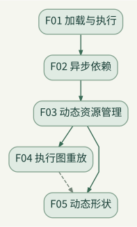

# 通用执行运行时

设备驱动提供底层控制能力，运行时把它组织成可加载、可提交和可同步的计算任务。程序调用返回与设备真正完成工作可能是不同的时刻。

## 贯穿算例与阅读边界

沿用 A04/A05 与 E 共用的向量加法和搬入、计算、写回任务，引入多份可复用的 Buffer、多项在途工作、依赖事件和安全复用，再比较任务图重放与动态形状。

F01–F03 为模型执行的主要基础。F04、F05 分别深入重放和变体选择。JIT 本身仍属编译，运行时负责触发、选择与缓存。

## 知识关系

<figure class="micro-v2-map" markdown="1">

<figcaption>图中实线表示本专题内的主要前置关系，虚线表示按场景参考；跨专题先修知识见下表。 点击可查看大图。</figcaption>
</figure>

## 阅读顺序 {#计划阅读顺序}

本专题规划的 5 篇正文均已完成初稿并发布。F01–F03 是通用执行主线，F04、F05 可按需要深入阅读。

| 编号 | 文章（暂定标题） | 读完应理解什么 | 主要前置知识 | 状态 |
| --- | --- | --- | --- | --- |
| F01 | [设备已经准备好了，运行时怎样启动第一次计算？](f01-module-loading-and-dispatch.md) | Module Load、执行上下文、Kernel Dispatch、参数绑定、资源准备。 | A04、E01/E03 的接口；D04 按需 | 已发布 |
| F02 | [提交任务的函数已经返回，为什么不能马上读取计算结果？](f02-asynchronous-execution.md) | Stream、Event、Fence、异步执行、依赖及可见性、搬运计算编排。 | F01、A05、E04 的完成语义 | 已发布 |
| F03 | [两项任务需要使用同一块 Buffer，什么时候才能安全复用？](f03-runtime-buffer-management.md) | 动态分配、内存池、碎片、所有权、延迟释放、异步资源回收。 | F02 | 已发布 |
| F04 | [多次执行相同的任务序列，怎样减少每轮提交开销？](f04-execution-graphs-and-replay.md) | 任务图、执行图捕获、Replay、动态 DAG、重放约束及重建。 | F02、F03 | 已发布 |
| F05 | [实际输入形状发生变化，运行时怎样找到可以执行的程序？](f05-dynamic-shapes-and-specialization.md) | Shape Guard、分桶、变体选择、JIT 触发、编译缓存、Fallback。 | A03、F01、F03；按需 F04 | 已发布 |

## 从哪里来，接下来往哪读

主要衔接：[软件执行共同基础](../01-foundations/README.md)、[设备驱动与底层资源管理](../05-device-driver/README.md)。

硬件机制参考[计算微架构](../../microarchitecture-v2/README.md)、[存储系统](../../storage/README.md)和[芯片与系统互连](../../interconnect/README.md)。

后续方向：[模型执行与生成控制](../07-model-execution/README.md)、[分布式执行与通信编排](../09-distributed-execution/README.md)、[性能分析、建模与验证](../11-performance/README.md)。

更多阅读路线见[编译器与运行时系统系列首页](../README.md)。
