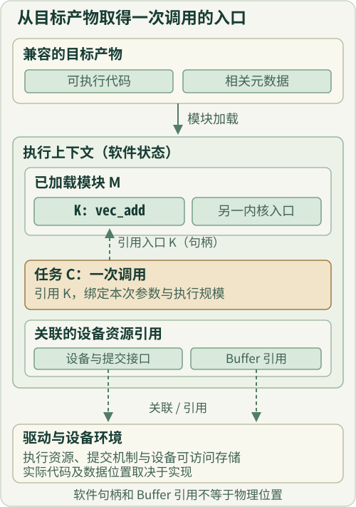
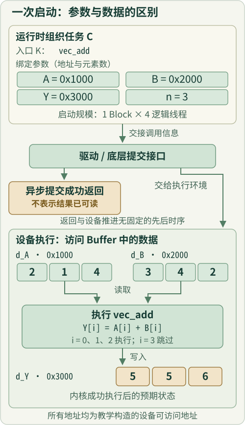

# 设备已经准备好了，运行时怎样启动第一次计算？

在 [A04](../01-foundations/a04-execution-contract.md) 中，我们写出一个向量加法 Kernel，并用三个设备地址和元素数量发起一次调用。假设驱动已经取得设备的使用权，编译器也交付了对应的可执行代码，接下来软件还需要做什么？

**执行运行时（Execution Runtime）**负责将可执行的计算实现与本次实际使用的设备、数据和资源结合起来，并将工作交给设备执行。它让同一份计算实现可以为多次不同的调用服务。这是一组软件职责，不一定由独立于应用和驱动的运行时库承担。

本篇追踪第一次向量加法调用，从加载代码到提交任务。为了先看清这条路径，假设输入数据已经在设备上，不需要等待搬入；之后再恢复 A05 中的搬入、计算和写回任务。

## 设备和代码都有了，还缺少什么？ {#before-first-dispatch}

沿用 A04 的例子。A、B 各有三个 int32 元素，分别为 [2, 1, 4] 和 [3, 4, 2]，希望计算出 Y = [5, 5, 6]。三组数据各占 12 B。

沿用 [E01](../05-device-driver/e01-device-context-and-driver.md#device-context) 的教学设备 D0：进程 P 已获得使用权，驱动建立了设备上下文 ctx_P。再假设已准备好设备能够访问的三个缓冲区，输入已对计算任务可见，输出区已预留。

三个缓冲区互不重叠。表中的地址是为教学构造的设备可访问地址，不是实际设备的物理地址。

| 缓冲区 | 起始地址 | 本次使用的字节数 | 用途 |
| --- | --- | ---: | --- |
| d_A | 0x1000 | 12 | 读 A |
| d_B | 0x2000 | 12 | 读 B |
| d_Y | 0x3000 | 12 | 写 Y |

编译产物中包含 `vec_add` 的目标代码。它规定怎样根据元素索引读取数据、相加和写回，但编译这份代码时，还不知道本次 Buffer 将分配在哪些地址。

现在设备已可使用，数据已就绪，可执行文件也已存在。内核尚未执行，输出区中的内容还不是本次结果。我们需要让设备取得合适的代码，并告诉它本次执行应使用哪些参数。

## 怎样从可执行文件取得可以调用的入口？ {#module-load}

假设编译器交付的文件还包含另一个 Kernel。运行时要使用其中的 `vec_add`，首先需要在驱动已经建立的目标设备环境中加载合适的产物，再获得这个 Kernel 的入口。

将一组可执行代码及相关信息加载到运行环境中的过程，常称为**模块加载（Module Load）**。模块可以包含多个可调用的入口，也可能包含常量、资源需求和其他元数据。

加载机制需要处理当前设备与产物格式的兼容性，并按实现要求准备代码及相关运行资源。某些产物还需要链接或重定位；若只提供了待编译的中间代码，也可能触发 JIT。这里假设已交付兼容的目标代码。

加载成功后，运行时可以根据名称或其他标识取得 `vec_add` 的入口句柄。句柄是供软件接口使用的引用，不要求它就是设备的指令地址。也不要求所有代码在取得模块句柄时都已搬入设备存储。

例如 CUDA Driver API 可以用 `cuModuleLoad` 加载模块，用 `cuModuleGetFunction` 获得内核入口；采用 Lazy Loading 时，部分加载工作可能延后到真正需要某个内核时。

[CUDA Driver API：Module Management](https://docs.nvidia.com/cuda/cuda-driver-api/cuda_driver_api/group__CUDA__MODULE.html) · [CUDA Programming Guide：Lazy Loading](https://docs.nvidia.com/cuda/cuda-programming-guide/04-special-topics/lazy-loading.html)

## 为什么还需要知道在哪个执行环境中调用？ {#execution-context}

假设进程 P 也获得了 E01 中另一块设备 D1 的使用权。两块设备上都可以存在名为 `vec_add` 的实现，但在第一块设备的运行环境中取得的入口和地址，不一定能直接用于第二块设备。

设备上下文 ctx_P 为 P 的这次使用关联资源与访问权限。运行时还需要保存本次执行所关联的设备、已加载的模块、可用的提交接口及其他运行状态。

这里将运行时用于组织这些状态的逻辑环境称为**执行上下文（Execution Context）**。它让后续调用知道使用哪个设备环境、从哪里查找已加载的入口、在哪个有效的地址访问范围内引用 Buffer。

<figure markdown="1">

<figcaption>逻辑关系示意：同一上下文可维护多份已加载产物并组织多次任务。框内对象是软件引用和状态，不表示代码、数据或队列在硬件上必须放在同一个存储区。</figcaption>
</figure>

不同接口中的 Context 对象管理的范围并不相同。有的驱动直接公开上下文、模块和队列；有的运行时在内部维护这些状态，调用者只提供设备或执行对象。本篇不假设运行时上下文与驱动上下文一一对应。

例如 CUDA 的 Context 关联特定设备，而 Level Zero 的 Context 可以管理多个设备相关的对象。运行时需要保证用于本次调用的入口、提交接口和资源之间满足实际接口的访问约束。

[CUDA Driver API：Context Management](https://docs.nvidia.com/cuda/cuda-driver-api/cuda_driver_api/group__CUDA__CTX.html) · [Level Zero Core Programming Guide](https://oneapi-src.github.io/level-zero-spec/level-zero/latest/core/PROG.html)

## 取得入口之后，Kernel 怎样知道这次读写哪三块数据？ {#parameter-binding}

回到 `vec_add`。它每次都完成同一种计算，但可以处理不同的数据。运行时需要依据这份内核的调用约定，把本次的实际参数与内核所接受的参数对应起来。这个过程称为**参数绑定（Parameter Binding）**。

假设内核使用 A04 中相同的签名：`vec_add(A, B, Y, n)`，三个参数是设备地址，n 是元素数。在本例中，运行时准备以下四个值。

| 内核参数 | 本次绑定的值 | 设备执行时的用途 |
| --- | --- | --- |
| A | 0x1000 | 第一个输入的基址 |
| B | 0x2000 | 第二个输入的基址 |
| Y | 0x3000 | 输出的基址 |
| n | 3 | 有效元素数量 |

绑定时需要传递的是 Buffer 地址（或接口支持的资源引用），而不是把整数 2、1、4 填进参数 A。后者已存放在 d_A 中，Kernel 真正执行时才按照 A[i] 去读这些数据。

[A04 的 ABI](../01-foundations/a04-execution-contract.md#abi) 已说明分别编译的程序怎样约定参数位置。设备 Kernel 同样需要遵守相应的参数类型、大小、排列和对齐约定，否则相同的一组参数信息也可能被错误解释。

以 CUDA Driver API 的 `cuLaunchKernel` 为例，调用者可以提供指向主机侧参数值的指针数组；启动接口从这些位置取得参数值，使用编译产物提供的参数布局传递给设备。这里主机指针所指的参数值可以是设备地址。

其他接口也可以让软件逐项设置参数，或者填写包含 Buffer 引用的描述符。重要的是设备最终使用的参数语义与内核约定一致，而不是某个固定的二进制参数结构。

[CUDA Driver API：Execution Control](https://docs.nvidia.com/cuda/cuda-driver-api/cuda_driver_api/group__CUDA__EXEC.html)

## 参数都准备好了，为什么还要描述执行规模和资源？ {#resource-preparation}

在 A04 的 CUDA 线程模型中，n = 3 只确定有效元素数，不能唯一确定启动配置。内核的代码负责根据索引处理元素，运行时承接调用者或执行计划给出的并行规模。

本例仍使用一个 Block、每个 Block 四个逻辑线程。第四个线程的索引为 3，不满足 i < n，因此不会进行加法及读写。这个规模仅用于教学，不是推荐的硬件配置。

参数地址也需要对应足够的有效空间。例如 n = 3 时，三个连续 int32 元素需要 12 B。如果输出空间只有 8 B，仅把 n 绑定为 3 并不会让 Kernel 自动取得额外 4 B。

一次调用的资源准备可以包括以下工作：

| 需要满足的条件 | 本例中的准备 |
| --- | --- |
| 输入与输出满足内核约束 | 连续 int32、适当对齐，输入可读，输出可写，各占至少 12 B 且互不重叠 |
| 执行规模合法且覆盖有效元素 | 1 Block × 4 逻辑线程 |
| 额外工作空间 | 本例不需要调用者另行提供临时 Buffer；其他实现可能需要 |
| 后续执行期间资源有效 | 保留此次使用的内核入口、Buffer 和必要运行资源 |

运行时应按照已知执行契约组织并检查这些条件。有些条件由上层调用者保证，有些由驱动或启动接口校验；不能假设运行时一定能够检查任意设备指针的实际有效范围和所有访问。

例如 GPU 的寄存器和片上共享存储也会限制内核能否启动。编译产物和启动参数提供相关资源需求；实际硬件资源的取得和分配由目标的执行机制处理。运行时不必亲自为每个线程分配硬件寄存器。

如果多个实现都适用于本次任务，可以根据编译产物和约定的条件选择其中一个。本篇假设实现已经选定；如何比较静态执行方案见 [C 专题](../03-mapping-and-planning/README.md)，实际形状与可执行变体的匹配留给 F05。

## 这些信息怎样变成一次设备工作？ {#kernel-dispatch}

有了入口、参数和执行条件，现在可以组织任务 C。这里将发起一次具体 Kernel 执行的操作称为 **Kernel Dispatch**（也常称 Kernel Launch）。

运行时可以把这次调用及其资源引用交给下层提交接口。设备驱动、固件及硬件按目标的接口约定，将其转换或解释为可以执行的命令，再由设备推进执行。

<figure markdown="1">

<figcaption>本图追踪一次调用的参数及设备的数据访问。向下交接表示逻辑控制路径，不规定真实命令格式和硬件时序；图下半部的数据是任务成功执行后的预期状态。</figcaption>
</figure>

在 CUDA 的一次 `cuLaunchKernel` 调用中，软件可将函数入口、并行规模、参数及执行所用的流一并指定。Level Zero 则允许把参数绑定后的 Kernel 启动操作追加到普通命令列表，再将列表提交给队列。

后者尤其说明，准备一次 Launch 与真正向设备提交工作可以是不同的步骤。有些设备使用描述符及命令队列；另一些设备可以使用不同的提交机制。[设备驱动专题](../05-device-driver/README.md) 负责深入这些接口。

如果设备不需要加载可编程内核，例如只支持内建搬运功能的引擎，调用时可以直接准备操作类型和相应参数。即使没有 Module Load 这一步，仍要满足设备访问及任务提交契约。

[Level Zero：Command Lists](https://oneapi-src.github.io/level-zero-spec/level-zero/latest/core/PROG.html) · [计算微架构 E01：DMA 任务描述](../../microarchitecture-v2/05-data-movement/e01-dma-task-and-address-generation.md#task-state)

## 下一次计算还需要重新加载整个模块吗？ {#reuse-and-startup}

假设下一次计算仍使用 `vec_add`，但是分配了另外三个设备缓冲区。只要现有模块和入口仍然有效、内核约束仍然满足，就可以复用已经加载的实现，只为下一次调用绑定新的地址、元素数量和执行规模。

这使得首次调用和后续调用可能具有不同的开销。首次需要的模块加载、运行资源初始化等工作，可以在后续调用之间复用；延迟加载也可能将部分开销推迟到真正使用内核时。

注意，保留模块并不意味着已提交的任务也可以重复使用。下一次调用是另一项工作；旧 Buffer 是否能覆盖、内核入口是否能销毁，取决于先前工作是否还在引用这些资源。

## 提交返回之后，这次计算到了哪里？ {#next}

沿用 [A05](../01-foundations/a05-task-and-resource-lifecycle.md) 的观察边界，加载成功只说明该加载接口所承诺的状态已经建立，不能说明任何一次向量计算已经执行。

若本例的异步提交接口报告它已接纳任务 C，我们知道所调用的软件接口已接受这项工作。设备可能尚未接纳命令，或正在等待执行资源。即使 C 已经开始执行，也不能只凭提交函数返回就认定 d_Y 已经写好。

加载、入口查找和参数准备可能失败；提交也可能报告错误。而已接纳的任务还可能在后续执行中失败。错误返回和资源回收的保证必须依据实际接口，不能将失败简单当作所有在途访问都已停止。

本篇的输入已事先就绪。如果恢复 A05 中的两项搬入任务 L_A、L_B 以及写回任务 W，我们又需要解决一个问题：主机能否一次提交这些工作而不必等待每项完成，同时确保 C 读到正确输入、W 读到正确结果？

接下来在 [通用执行运行时](README.md#计划阅读顺序) 的 F02 中，沿着这四项任务研究异步提交、任务依赖、同步与结果可见性。

[CUDA Driver API：API Synchronization Behavior](https://docs.nvidia.com/cuda/cuda-driver-api/api-sync-behavior.html) · [OpenCL API：Event Objects](https://registry.khronos.org/OpenCL/specs/unified/html/OpenCL_API.html#event-objects)
