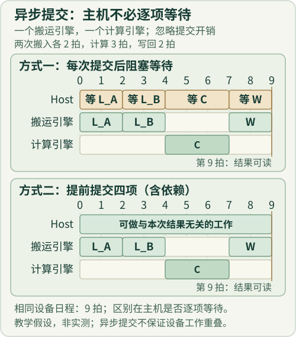
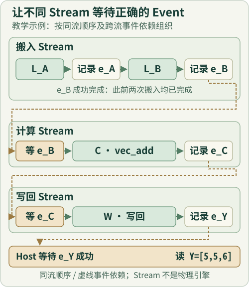

# 提交任务的函数已经返回，为什么不能马上读取计算结果？

在 [F01](f01-module-loading-and-dispatch.md) 中，我们加载了包含 `vec_add` 的模块，准备好参数，再将一次计算任务交给设备。为了先看清 Kernel Dispatch 的过程，当时假设输入已经在设备上。

现在恢复 [A05](../01-foundations/a05-task-and-resource-lifecycle.md) 的完整执行过程：输入先从主机搬入设备，计算完成后再写回结果。如果主机已经提交了这些任务，是否可以立即使用结果？

**异步执行（Asynchronous Execution）**将主机发起工作与工作完成分开。运行时可以在前一项工作还没有结束时准备或提交后续工作，但必须使实际执行满足数据依赖及资源约束。Stream、Event、Fence 等机制可用于表达和观察这些约束。

本篇研究软件怎样组织这组任务，而不是设备内部怎样调度指令或传输请求。

## 为什么主机原本需要等四次？ {#blocking-execution}

沿用 F01：A = [2, 1, 4]、B = [3, 4, 2]，期望得到 Y = [5, 5, 6]。三组数据均为连续 int32，每组 12 B。主机与设备存储分离。

假设设备已有内核入口 K 和三个互不重叠的缓冲区 d_A、d_B、d_Y，地址分别为 0x1000、0x2000、0x3000。主机输入 A、B 已就绪，直到搬入任务不再读取它们且接口允许归还使用权才可改动。主机结果区 Y 已分配，但尚无本次结果。

[E02](../05-device-driver/e02-device-memory-mapping.md#summary) 已建立这些输入和输出的访问地址及映射。这里只假设用于本次搬运的内存及交接条件均已准备好，不重新讨论 Pin 和 Map。

按照 A05 的命名，将工作拆成四项：

| 任务 | 读 | 写 |
| --- | --- | --- |
| L_A：搬入 A | 主机 A | d_A |
| L_B：搬入 B | 主机 B | d_B |
| C：调用 vec_add | d_A、d_B | d_Y |
| W：写回结果 | d_Y | 主机 Y |

最容易想到的执行方式是，主机提交 L_A，等待搬入结束；再提交 L_B，等待搬入结束；然后提交 C，等结果可以供 W 读取；最后提交 W 并等待新数据对主机可读。

这样可以实现正确计算。问题是，主机在每项任务执行期间都无法利用当前等待的线程准备其他工作。即使主机早已知道下一项任务的参数，也要等上一项工作结束才能提交。

## 如果把四项任务提前提交，主机还能做什么？ {#asynchronous-submission}

先构造一个简单的教学时间模型：一个搬运引擎，一次只能处理一项搬运任务；一个独立的计算引擎。L_A、L_B、W 各需 2 拍，C 需 3 拍。不计主机提交、通知及同步开销；成功完成的任务输出已对规定的消费者可读。

在刚才逐次等待的方式下，设备按 L_A、L_B、C、W 的顺序运行，总计 2 + 2 + 3 + 2 = 9 拍。

如果运行时能够事先表达这些依赖，就可以提前提交四项工作，而无需等待每项结束再提交下一项。设备仍按照同样的依赖执行。主机则可以利用等待期间准备其他输入或处理无关的工作。

<figure markdown="1">

[](assets/f02-sequential-vs-async.svg)

<figcaption>在本例的理想模型中，设备完成时间都是 9 拍。异步执行首先改变的是主机与设备的协作方式，并未消除这一次加法内部的数据依赖。提交及其他开销未计入。</figcaption>
</figure>

注意，主机是否可以提前返回与设备能否同时执行多项任务是两个问题。真实异步接口仍可能因资源不足、内部同步等条件暂时阻塞；异步也不保证所有已提交的设备任务实际重叠。

[CUDA Programming Guide：Asynchronous Execution](https://docs.nvidia.com/cuda/cuda-programming-guide/02-basics/asynchronous-execution.html) · [CUDA Runtime API：Synchronization Behavior](https://docs.nvidia.com/cuda/cuda-runtime-api/api-sync-behavior.html)

## 怎样让设备知道四项工作不能任意交换？ {#stream-order}

假设主机按 L_A、L_B、C、W 的顺序调用提交接口，但这些工作交给互相独立的执行队列，且没有额外的依赖约束。C 可能在 L_B 完成之前读取 d_B，W 也可能在 C 更新 d_Y 前读取旧值。

例如旧 d_B 中保存 [0, 0, 0]。若 d_A 已更新而 C 提前读取了旧 d_B，便可能得到 [2, 1, 4]。仅凭主机调用的先后顺序，不能证明设备按照所需顺序访问数据。

一种解决办法是让软件把四项工作放进同一个提供顺序保证的逻辑队列。在 CUDA 中，**流（Stream）**是用于组织一系列操作的逻辑执行序列。同一流中的操作按其顺序语义推进，使后面的操作能够使用前面操作产生的结果。

在同一个流中依次提交 L_A、L_B、C、W，就能满足这个算例的全部依赖。主机可以在真正需要读取 Y 时再等待相应工作完成。

这里使用的是 CUDA 流的顺序语义。其他接口可能提供有序命令队列、无序命令队列或显式任务依赖等机制。一个 Stream 也不等于一个硬件引擎或物理命令队列。

例如 OpenCL 支持配置为 in-order 或 out-of-order 的命令队列；后者不能用入队先后顺序替代实际的依赖约束。

[CUDA Programming Guide：Streams](https://docs.nvidia.com/cuda/cuda-programming-guide/02-basics/asynchronous-execution.html) · [OpenCL API：Out-of-Order Execution](https://registry.khronos.org/OpenCL/specs/unified/html/OpenCL_API.html#out-of-order-execution-of-kernels-and-memory-object-commands)

## 搬运与计算位于不同的流，怎样建立依赖？ {#stream-events}

单个有序流对于上述四项工作足够。但当设备上还要执行其他独立任务时，把所有工作放入同一条严格有序的序列，可能引入不必要的等待。

现在建立三个逻辑流：搬入流 S_in、计算流 S_compute、写回流 S_out。它们没有默认的相互顺序保证。我们需要表达的仍然是 A05 中的依赖：C 需要等待 L_A 与 L_B，W 需要等待 C，主机需要等待 W。

**事件（Event）**可以作为工作进度的同步标记。以 CUDA 为例，将事件记录操作放在某条流中的某个位置，就可以引用该位置之前已经提交的工作。另一条流可以等待这个事件，约束之后提交的操作。

在搬入流的 L_A 之后记录 e_A，在 L_B 之后记录 e_B。由于 L_A 和 L_B 同在一个有序流，e_B 对应的工作范围已经包含 L_A，因此只需要让计算流等待 e_B。

随后在 C 之后记录 e_C，让写回流等待 e_C。最后在 W 之后记录 e_Y，供主机确认写回完成。

<figure markdown="1">

[](assets/f02-stream-dependencies.svg)

<figcaption>箭头表示由流内顺序和跨流事件建立的约束，不表示真实耗时或硬件连接。e_B 涵盖同一搬入流此前的两项搬运工作。</figcaption>
</figure>

以 CUDA 的接口为例，下面的教学伪代码表示主机提交的先后顺序。假设设备上下文、Stream、事件、内存及内核入口均已准备好。各流为显式创建的非阻塞流，相互之间没有额外的隐式同步；使用适合异步复制的主机内存。

```text
L_A 提交到 S_in
record(e_A, S_in)
L_B 提交到 S_in
record(e_B, S_in)

wait(S_compute, e_B)
C 提交到 S_compute
record(e_C, S_compute)

wait(S_out, e_C)
W 提交到 S_out
record(e_Y, S_out)

主机做其他不依赖本次 Y 的工作
host_wait(e_Y)
确认同步成功后读取 Y
```

这里的 record、wait、host_wait 只表达接口语义，不是实际 API。CUDA 分别提供 `cudaEventRecord`、`cudaStreamWaitEvent` 和 `cudaEventSynchronize` 等操作来完成对应的工作。

注意，调用 record 不等于事件所关联的操作已经完成。调用 wait 也不是要求主机停下来等待：它建立的是目标流后续工作对事件的依赖。在依赖语义上，最后的主机等待要求当前线程在条件尚未满足时等待。这不意味着其他 API 调用永远不会阻塞。

真实接口还有事件的使用规则。例如 CUDA 支持重新记录同一个事件，等候方关联的是调用等待接口时所记录的工作范围，不能把尚未记录的事件当作未来工作的完成通知。本例假设每项标记只使用一次。

CUDA 的 legacy default stream 还有额外的隐式同步规则，与其他显式流的关系受流创建方式影响。本例不使用默认流，以突出明确的依赖关系。

[CUDA Runtime API：Event Management](https://docs.nvidia.com/cuda/cuda-runtime-api/cuda_runtime_api/group__CUDART__EVENT.html) · [Stream Management](https://docs.nvidia.com/cuda/cuda-runtime-api/cuda_runtime_api/group__CUDART__STREAM.html)

## 计算流已经完成，为什么主机还是不能读 Y？ {#completion-and-visibility}

假设 e_C 已满足本例的交接条件。C 的结果已经能够供 W 读取，但新结果还在 d_Y 中。主机的 Y 与 d_Y 是不同的存储区，即使主机知道 C 已结束，也不能据此读取本次 Y。

需要等待 W 成功结束，并满足主机可读的条件。对于本例的 CUDA 异步设备到主机复制，等候记录在复制之后的 e_Y 成功完成，才可以读取相应的主机结果区。

如果主机只在乎此结果，不必等待整个设备上其他无关工作结束。也可以等待写回流中已提交的工作，或使用更大范围的同步接口；不同方式等待的工作范围不同。

有些执行接口还提供称为 **Fence（栅栏或围栏）** 的同步对象。例如 Vulkan 的 Fence 可以让主机等待相关设备提交完成。它与 CUDA 的 Event 并非必然具有相同的用法和保证。

关键是区分执行顺序与数据可见性。以 Vulkan 为例，执行依赖约束操作的先后，内存依赖还规定前面的写入如何对后面的访问可见。仅等待 Fence 处于已发信号状态，并不自动让任意设备写入对主机可读。还需覆盖有关访问的内存依赖；对于非一致性的映射内存，还需按规范完成必要的缓存维护。

这与 [A05](../01-foundations/a05-task-and-resource-lifecycle.md#completion-and-visibility) 的判断一致：需要知道是哪项工作、哪段数据、哪个消费者以及哪种同步范围。

设备使用共享存储时也要遵守相应的内存语义，不是所有系统都需要 W 这样的显式搬运。

例如 [E02](../05-device-driver/e02-device-memory-mapping.md#visibility) 的非一致性 DMA 教学系统，W 写回后还需要按映射接口的约定交还 Y 的使用权，CPU 才能读取。底层完成通知由 E 专题主讲。

[Vulkan：Synchronization Dependencies](https://docs.vulkan.org/spec/latest/chapters/synchronization.html#synchronization-dependencies) · [Fences](https://docs.vulkan.org/spec/latest/chapters/synchronization.html#synchronization-fences)

## 有三条流，为什么一次加法仍然需要 9 拍？ {#overlap}

回到 9 拍的教学模型。C 必须等本次 A 和 B 都搬完，W 又必须等 C 产生结果。将四项工作放入三条流，只改变依赖的表达方式，不能在这一次计算中凭空增加独立工作。

现在让主机准备两组向量加法。第一组仍是原来的 A、B，第二组使用 A₂ = [1, 4, 1]、B₂ = [2, 6, 3]，结果应为 [3, 10, 4]。两组各有独立的主机及设备 Buffer，内存容量足够。假设共享存储与互连不会阻止搬运和计算重叠。

第二组搬运不必等第一组计算结束。假设每项搬入和写回仍需 2 拍，每项计算仍需 3 拍；两组共享一个串行搬运引擎和一个独立的计算引擎。

在 S_in 中依次安排第一组和第二组的搬入及各自的事件；S_compute 依次安排两组的等待、计算和事件；S_out 依次安排两组的等待和写回。下面是一种满足依赖及资源限制的执行日程，区间右端为完成时刻。

| 资源 | 第一组任务区间（拍） | 第二组任务区间（拍） |
| --- | --- | --- |
| 搬运引擎：搬入 A | 0–2 | 4–6 |
| 搬运引擎：搬入 B | 2–4 | 6–8 |
| 计算引擎：C | 4–7 | 8–11 |
| 搬运引擎：W | 8–10 | 11–13 |

第 4 到第 7 拍，设备可以在 C₁ 执行期间搬入第二组数据。第一组计算在第 7 拍结束，但搬运引擎还在处理 L_B₂，要等到第 8 拍才可以执行 W₁。

第 8 到第 10 拍，搬运引擎写回第一组结果，同时计算引擎处理 C₂。第 11 拍 C₂ 完成后，再写回第二组。两组工作至第 13 拍结束，而不是完全串行的 18 拍。

这是一种可能的设备日程，不是运行时必须安排出的时间表，也不是整个系统的实测结果。在本例中，第一组的结果反而从第 9 拍延迟到第 10 拍。缩短整组工作时间与缩短单项任务延迟并不等价。

运行时需要表达实际任务和依赖；它可以等到事件满足后再提交某些任务，也可以将等待条件提前交给支持该功能的执行接口。底层系统再依据实际资源与就绪状态推进工作，不要求有一个集中式调度器。

即使依赖允许并发，真实设备仍可能因为搬运引擎数量、共享端口、带宽及其他资源约束而无法重叠。CUDA 中要支持主机与设备之间的异步复制与计算重叠，还需适合的页锁定主机内存及设备能力。

[C03：静态执行规划与实际就绪条件](../03-mapping-and-planning/c03-static-execution-planning.md#plan-and-readiness) · [计算微架构 F01：搬运与计算重叠](../../microarchitecture-v2/06-resource-cooperation/f01-overlap-and-buffer-reuse.md) · [CUDA Programming Guide：Asynchronous Execution](https://docs.nvidia.com/cuda/cuda-programming-guide/02-basics/asynchronous-execution.html)

## 如果搬运失败，或者主机不再需要结果呢？ {#failure-and-cancellation}

前面的时间线均假设工作执行成功。若 L_B 失败，C 就没有取得正确输入的保证。运行时不能只看一项工作是否已经停止，还需要确认生产者是否成功提供所需数据。

例如 OpenCL 事件用 CL_COMPLETE 表示成功完成，负状态表示异常终止；依赖命令指定等待列表中的事件成功完成后才可以执行。CUDA 的某些异步错误可能在后续查询或同步接口返回，而不在最初的提交调用中报告。

具体错误怎样传播、哪些工作会终止以及设备能否继续使用，取决于接口和失败类型。不要假定每个平台都提供精确到单个任务的错误报告。

如果主机在 C 已提交后取消这次工作，设备可能仍然访问 d_A、d_B 或 d_Y。主机放弃结果，并不表示相关访问已经停止。等待后续状态，确认没有在途访问且满足回收条件，才能安全归还资源。

[OpenCL API：Event Objects](https://registry.khronos.org/OpenCL/specs/unified/html/OpenCL_API.html#event-objects) · [CUDA Programming Guide：Asynchronous Error Handling](https://docs.nvidia.com/cuda/cuda-programming-guide/02-basics/asynchronous-execution.html)

## 从结果可读，到资源可以复用 {#next}

回到 F01 的第一次计算：运行时不仅需要准备入口和参数，还要将计算放进正确的任务依赖关系；每次同步都要明确它能够证明哪个阶段已完成，以及哪些数据可以使用。

假设前面两组向量加法不再各自拥有一套独立 Buffer，只有一块 d_Y 可供两个计算任务写入。即使 C₁ 已完成，W₁ 可能仍在读取旧结果，此时 C₂ 能否开始写入同一地址？

这个问题将引出 [通用执行运行时](README.md#计划阅读顺序) 的 F03：运行时怎样管理有限的动态 Buffer，按实际使用期限安全回收和复用空间。
