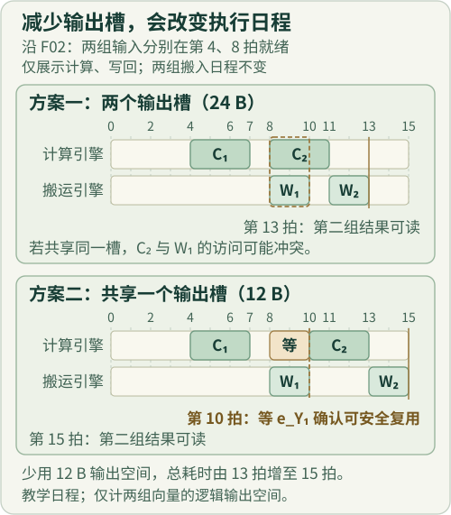
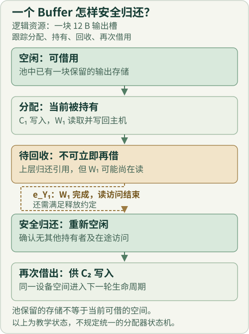

# 两项任务需要使用同一块 Buffer，什么时候才能安全复用？

在 [F02](f02-asynchronous-execution.md) 中，我们让搬运引擎和计算引擎并行工作。两组向量加法分别使用独立的输入、输出 Buffer，因此第一组正在写回时，第二组可以开始计算。

如果设备只剩下一块输出 Buffer，第二组还能立即开始吗？软件怎样决定是等待上一组工作结束，还是为第二组寻找另一块空间？

**运行时内存管理**负责根据实际执行需求分配存储资源，跟踪它们被哪些工作持有，并在满足安全条件后归还或复用空间。内存池（Memory Pool）则可以让多次分配共享一批已经取得的存储资源。

本篇沿用已有的执行模型，研究实际运行中的分配与回收。不讨论设备地址映射的建立过程，也不提前研究模型 KV Cache 的专门管理机制。

## 第一组已经算完，为什么第二组不能立即写入同一块 Buffer？ {#reuse-conflict}

沿用 F01、F02 的两组向量加法。每组输入、输出各包含 3 个 int32 元素，每份数据占 12 B。第一组和第二组的计算分别称为 C₁ 和 C₂，写回分别称为 W₁ 和 W₂。

| 工作 | 输入 A | 输入 B | 预期结果 |
| --- | --- | --- | --- |
| 第一组 | [2, 1, 4] | [3, 4, 2] | [5, 5, 6] |
| 第二组 | [1, 4, 1] | [2, 6, 3] | [3, 10, 4] |

先保留 F02 的四块独立输入 Buffer，只把原来的两块设备输出 Buffer 合并为一块 d_Y，其设备可访问地址仍为 0x3000。两组主机结果区保持独立。

F02 的执行日程中，C₁ 在第 7 拍完成，W₁ 在第 8 至第 10 拍读取第一组输出；C₂ 原本在第 8 拍开始。如果仍然沿用这个日程，W₁ 和 C₂ 现在会访问同一块 d_Y。

例如 C₂ 先覆盖了 d_Y[0]，而 W₁ 尚未读走第一组的这个元素。W₁ 就可能把 3 而不是 5 写入第一组主机结果区。即使第一组的计算完全正确，主机仍可能得到错误的结果。

C₁ 完成只说明它已经生产了第一组结果。还要确认 W₁ 不再需要这份数据，才能让下一组工作覆盖 d_Y。这里出现了一个新的依赖：旧数据的读者 W₁ 必须交还空间，新的写者 C₂ 才能开始使用它。

## 等到什么时候，C₂ 才能安全使用原来的地址？ {#resource-dependency}

继续使用 F02 的教学条件：一个串行搬运引擎和一个独立计算引擎，搬入与写回各需 2 拍，计算需 3 拍。不考虑额外提交、同步开销，并假设任务在整个约定执行区间内可能使用相应的 Buffer。

我们不知道 W₁ 最后一次读取 d_Y 究竟发生在哪一拍。因此选择一个可观察的安全边界：W₁ 成功结束，并按接口约定交还对 d_Y 的使用权。

沿用 F02 的事件记录方式，在 W₁ 之后记录第一组写回事件 e_Y1。可以让 C₂ 所在的计算流等待这个事件，再使用 d_Y。前提是该事件确实保证 W₁ 不会再读取它，而且不存在其他访问者。

<figure markdown="1">

[](assets/f03-output-buffer-reuse.svg)

<figcaption>两组输入仍在第 4、8 拍就绪。图中只画计算与写回阶段；搬入任务、引擎和时间假设继承 F02。共享输出槽的日程是本例的一种合法日程，不代表所有分配和调度方式中的最优解。</figcaption>
</figure>

| 资源准备方式 | 输出空间 | 两组设备数据空间 | 两组工作完成时刻 |
| --- | ---: | ---: | ---: |
| 两块独立输出 Buffer | 24 B | 72 B | 第 13 拍 |
| 一块共享输出 Buffer | 12 B | 60 B | 第 15 拍 |

表中仅计示例中四份独立输入及预留的输出有效数据，不包含实际分配粒度、对齐、代码和其他工作空间。两组的主机缓冲区也不计入设备空间。这不是动态分配情况下的最小内存预算。

原来两组加法没有彼此的数据生产与消费关系。现在，因为它们引用重叠的存储范围，运行时额外建立了 W₁ 到 C₂ 的先后关系。这是一项由资源复用引入的先读后写（WAR）依赖，而不是模型计算本身的数据流。

如果第一组的主机结果 Y₁ 已经过独立的写回并满足主机可读条件，即使主机还在使用 Y₁，也不妨碍设备 d_Y 的安全复用。两个地址对应的是不同的存储资源。

[C04：静态 Buffer 生命周期与分配](../03-mapping-and-planning/c04-static-buffer-allocation.md) · [计算微架构 F01：缓冲区生命周期](../../microarchitecture-v2/06-resource-cooperation/f01-overlap-and-buffer-reuse.md#buffer-lifetime)

## 如果运行前还不知道有几项任务，怎样决定 Buffer 放在哪里？ {#dynamic-allocation}

C04 研究了已知任务、生命周期和执行方案时，编译器怎样安排 Buffer 的静态地址偏移。但运行时可能在第一组已经提交后，才收到第二组工作。

假设现在需要为 C₂ 绑定输出地址。运行时知道它需要至少 12 B，满足内核的布局、对齐和写权限要求；但它还必须根据当前实际占用情况决定具体使用哪一段存储。

运行时的分配器（Allocator）可以维护可供申请的存储范围和已分配记录，将一段满足条件的空间交给调用者。这类根据实际申请及释放情况进行的分配，称为动态内存分配。

如果第 8 拍只有一块尚被 W₁ 使用的输出槽，分配器可以怎样处理第二次申请？

- 有其他足够大的可用空间时，分配另一块，并保持 F02 的重叠执行。
- 空间不足时，可以将这次工作留待资源就绪后再推进，或者在明确的依赖保证下提前安排复用。
- 如果无法取得空间或满足相应约束，按接口报告分配失败，让上层调整执行计划或选择其他方案。

实际运行时也可能只动态分配一整块工作区，再按照编译器给出的静态偏移安排其中的数据。动态分配与静态 Buffer 规划可以协作，不要求每个中间值都单独分配。

[E02](../05-device-driver/e02-device-memory-mapping.md) 已经说明，分配、建立设备可访问地址及真正读写是不同的工作。分配器可以通过驱动或其他下层接口获得可用存储，本篇只跟踪其中的使用权。

## 为什么有了释放函数，还需要等待设备上的工作？ {#ownership-and-last-use}

考虑第一组 d_Y。运行时分配它，并将地址交给 C₁ 和 W₁。假设主机已经把两项任务提交完，不再需要保留自己的局部变量，就能立刻让分配器把这块空间交给其他工作吗？

不能。W₁ 可能尚未开始读取 d_Y；即使主机已经丢掉变量或调用释放接口，设备仍可能通过先前记录的地址访问这块存储。

[A05](../01-foundations/a05-task-and-resource-lifecycle.md#ownership-and-lifecycle) 中的所有权关系在这里变成实际的分配管理问题：运行时要知道哪些对象和工作仍持有对某段资源的合法使用权。

| 持有者 | 为什么需要 d_Y？ | 何时可以归还相关使用权？ |
| --- | --- | --- |
| 调用方 | 为计算和写回组织任务 | 不再将旧 Buffer 用于后续工作时 |
| C₁ | 写入第一组结果 | 本次写访问已结束且完成交接 |
| W₁ | 读取第一组结果 | 最后一次读访问已结束且允许归还 |

这些使用权可以通过资源句柄、引用计数、执行记录或其他机制管理。比如每项被接纳的工作保留必要资源引用，结束后归还相应引用。共享对象则可能还有其他持有者。

引用计数仅在所有相关持有者都被正确登记时才有意义。如果软件只计算主机变量的引用，没有跟踪已经提交的设备工作，那么主机引用归零仍不足以证明设备停止访问。

有些接口直接提供这种生命周期保证。例如 OpenCL 的 `clReleaseMemObject` 减少内存对象的引用计数，真正删除对象还需等待使用它的相关已入队命令结束；Buffer 的子对象也必须满足相应释放条件。

注意，这里跟踪的是相同存储范围而不只是变量名称。如果两个 Tensor 视图引用同一段 Buffer，其中一个对象销毁后仍需检查另一个视图及其在途访问。分配器也不能假设不同句柄一定引用互不重叠的物理存储。

[OpenCL API：clReleaseMemObject](https://registry.khronos.org/OpenCL/specs/unified/refpages/man/html/clReleaseMemObject.html) · [A03：共享视图](../01-foundations/a03-tensor-representation.md#transpose-view)

## 怎样既归还空间，又避免每次释放都等待整个设备？ {#deferred-reclaim}

如果每次主机释放 Buffer 时，都必须阻塞直到设备的全部任务结束，F02 中异步执行所带来的主机工作机会就会减少。实际上，我们通常只需要等待与这块 Buffer 相关的工作。

可以将归还请求与实际回收分开：调用方停止为旧 Buffer 提交新的用途；运行时保留旧分配记录，直到剩余的持有者和在途访问满足归还条件，再把空间变成可用资源。

假设本例中主机不再持有 d_Y，W₁ 仍在读取它。运行时将这块 Buffer 标记为待回收，并记录证明 W₁ 已结束访问的事件。只有事件满足约定且没有其他持有者，空间才进入可自由分配的集合。

<figure markdown="1">

[](assets/f03-pool-lifecycle.svg)

<figcaption>图中是用于理解延迟释放的一种状态模型，不要求所有分配器使用相同的枚举或集中式回收线程。归还池不等于释放底层物理存储。</figcaption>
</figure>

回收还可以采用流有序的方式。软件可以提前在执行序列中安排释放及下一次分配，让设备实际访问的先后关系满足安全条件，而不是等主机亲眼观察到每个事件才继续提交。

以 CUDA 的流有序内存分配接口为例，`cudaMallocAsync` 和 `cudaFreeAsync` 将分配与释放对应到指定流中的顺序位置。取得地址后，其他流要等分配生效才能访问；释放执行前，也必须保证先前所有合法访问已经结束。

例如以下是教学伪代码，省略 F02 中已经建立的搬入、计算、写回依赖，假定第一组的输出已由兼容的流有序分配接口分配，并满足首次访问所需的顺序；其他持有者均已归还使用权。

```text
在计算流提交 C₁，记录 e_C1
在写回流等待 e_C1，提交 W₁，记录 e_Y1

在计算流等待 e_Y1
在计算流安排释放旧输出分配
在计算流安排分配 12 B 新输出
在计算流使用新分配执行 C₂
```

分配调用可能提前返回一个地址，实际使用仍必须遵守流的顺序约束。旧分配的指针在释放调用之后不得再用于新提交的工作；即使软件收到一模一样的地址值，新旧分配也是不同的使用期限。

CUDA 内存池可以根据已有依赖、已完成的释放或允许的内部依赖安排复用，但不保证新分配一定取得原地址，也不能替调用方修补遗漏的跨流依赖。

PyTorch 的原生 CUDA caching allocator 同样需要跟踪 Tensor 的使用流。例如在 Tensor 释放前调用 `record_stream`，可以告知分配器某个额外流会使用它，帮助避免提前复用。它不能替代 F02 中生产者与消费者之间的数据依赖。

[CUDA Programming Guide：Stream-Ordered Memory Allocator](https://docs.nvidia.com/cuda/cuda-programming-guide/04-special-topics/stream-ordered-memory-allocation.html) · [PyTorch：Tensor.record_stream](https://docs.pytorch.org/docs/stable/generated/torch.Tensor.record_stream.html)

## 为什么释放之后，设备仍然可能显示占用了原来的内存？ {#memory-pool}

假设连续执行一百组向量加法。每组结束后都向底层归还存储，下一组再重新申请。即使一次只需要 12 B 输出空间，反复取得和释放底层内存仍可能产生管理开销。

一种做法是，运行时先向底层取得一批较大的可用存储，再按实际申请切分出小块。释放小块时，只要满足归还条件，就把它交还给分配器，供后续使用，而不必立即归还整批底层存储。

这里的内存池由保留的存储资源及其分配管理记录构成。它不是另一种物理存储器；一个池可以包含多个底层存储区，不必由一段连续物理内存构成。

为了观察分配器保留的 48 B 空间，可以用下面三个集合记录这一教学模型的某个瞬间。假设空间不重叠，不计其他开销。

| 集合 | 大小 | 当前含义 |
| --- | ---: | --- |
| 正在使用 | 12 B | 仍有上层使用者或分配记录 |
| 待回收 | 12 B | 已请求归还，仍需等待相关工作或持有者结束 |
| 可自由分配 | 24 B | 没有前次访问阻碍，可供申请 |
| 合计保留 | 48 B | 池占用的底层存储 |

待回收空间不是可自由分配空间。若分配器后来确认这 12 B 安全归还，则可自由分配量变为 36 B，但总保留量仍可能是 48 B。

这也解释了为什么程序已释放部分对象，设备的内存使用统计不一定马上下降。空闲块可能仍留在池中，等待新的分配；池可以根据策略尝试向底层归还空闲存储。

例如 PyTorch 提供 allocated 和 reserved 等内存统计，CUDA 的流有序内存池也区分使用量和保留量。具体统计口径由实现决定；两者的差值不能简单地理解为全部可以立即释放，或全部都是内存泄漏。

[CUDA Programming Guide：Memory Pool](https://docs.nvidia.com/cuda/cuda-programming-guide/04-special-topics/stream-ordered-memory-allocation.html) · [PyTorch：Memory Stats](https://docs.pytorch.org/docs/stable/generated/torch.cuda.memory.memory_stats.html)

## 为什么池中还有 24 B 空闲，却放不下一个 20 B 的申请？ {#fragmentation}

假设一个简化的内存池保留了连续的 48 B 地址范围。其中有四个大小均为 12 B 的分配，依次位于偏移 0、12、24、36。此例要求申请的空间在该池内连续，起始位置按 4 B 对齐。

第一个和第三个分配已经安全归还，第二个和第四个仍在使用。于是池中共有 24 B 空闲，但被在用的空间隔成了两段各 12 B 的空闲区。

此时如果有新的工作需要连续 20 B，无论从哪一段空闲区开始，都不能满足要求。

<figure markdown="1">

[](assets/f03-pool-fragmentation.svg)

<figcaption>这是可以分割及合并相邻空闲区的简化地址池，不代表所有真实分配器，也不要求虚拟地址在物理内存上连续。区间端点用字节偏移表示。</figcaption>
</figure>

这种空闲空间被分散的现象称为**外部碎片**。如果第二个分配也满足归还条件，分配器可以合并相邻的空闲区，形成从偏移 0 到 36 的连续范围，再满足 20 B 请求。

还有另一类开销。假设为减少分配记录及处理不同大小申请的复杂度，分配器把每个 12 B 请求放入一个 16 B 大小的块，每块便有 4 B 未被当前对象使用。这种块内部的浪费称为**内部碎片**。

实际分配器可以按大小组织空闲块，拆分大块、合并可相邻回收的区域，或者借助下层虚拟内存接口调整映射。按固定大小分组便于复用，但不同大小的申请可能产生额外空间浪费。

如果不能找到满足大小、对齐、权限及生命周期条件的空间，就需要根据实际实现决定扩充池、等待安全归还、调整分配策略或报告失败。不能只以总空闲字节数决定分配一定成功。

[Operating Systems: Three Easy Pieces，Free-Space Management](https://pages.cs.wisc.edu/~remzi/OSTEP/vm-freespace.pdf)

## 如果工作被取消或执行失败，怎样处理待回收空间？ {#failure-and-resource-lifetime}

假设第一组的调用方已经不再需要 Y₁，发出取消请求。此时 C₁ 可能还在执行，W₁ 也可能已经被设备接纳。取消上层工作与设备停止访问不是同一件事。

停止为旧工作创建新的任务，并等待下层接口确认相关访问已经停止，才能决定 Buffer 是否可安全归还。若完成状态报告失败，不能将输出当作有效数据；也不能只因错误返回就认定所有在途访问都已停止。

对于错误的上下文或设备，可能需要底层提供清理、取消完成或复位等契约。只有取得足以证明相关访问已结束的保证后，运行时才能重新交付存储；不得盲目等待只在成功时才会出现的事件。

运行时还要把完成通知与对应的任务或分配代次关联起来。例如 d_Y 已归还并交给新任务后，迟到或重复处理的旧通知不能再次释放这次新分配。这与 F02 中区分 Event 记录代次的原因一致。

[E03](../05-device-driver/e03-command-submission.md#submission-queue) 还区分了队列槽位的归还和任务本身的完成。即使驱动已经可以复用命令队列的原槽，任务引用的 Buffer 仍应按照自身的生命周期管理。

## 回到一次完整的运行时执行 {#next}

至此，F01–F03 已经建立通用执行运行时的共同主线。

| 要解决的问题 | 运行时需要知道什么？ |
| --- | --- |
| F01：怎样发起一次工作？ | 可执行入口、参数、访问条件与所需资源 |
| F02：怎样保证真实执行正确？ | 数据依赖、实际完成状态及可见性 |
| F03：怎样复用有限的资源？ | 所有持有者、在途访问及安全归还条件 |

后续模型执行可以在这套机制上组织长期保存的权重和请求状态。本篇不提前展开模型状态布局、逻辑分页或缓存共享策略。

接下来，如果连续执行的任务不仅使用类似的 Buffer，而且每轮都有相同的搬运、计算和依赖关系，是否可以减少每轮重新提交的控制开销？这将引出 [F04：多次执行相同的任务序列，怎样减少每轮提交开销？](f04-execution-graphs-and-replay.md)。
