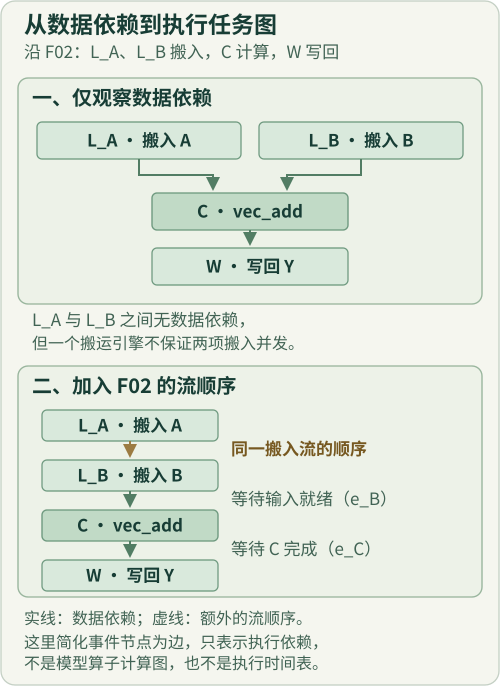
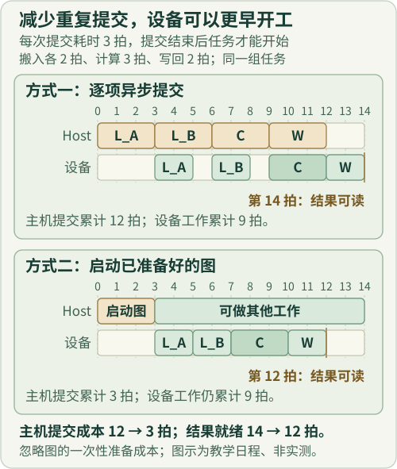

# 多次执行相同的任务序列，怎样减少每轮提交开销？

[F01](f01-module-loading-and-dispatch.md) 让运行时复用已经加载的 Kernel，[F02](f02-asynchronous-execution.md) 使用 Stream 和 Event 组织任务，[F03](f03-runtime-buffer-management.md) 则让不同任务安全复用 Buffer。

现在假设同一种计算需要反复执行一百轮。每轮的输入数值不同，但搬入、计算、写回和依赖关系都相同。内核和存储可以复用，为什么主机还要每轮重新提交这些工作？

**执行图（Execution Graph）**将一组具体执行操作及其依赖关系表示为可供运行时处理的图。某些执行接口允许将这份图准备成可重复启动的对象，之后通过图重放（Graph Replay）减少重复的主机组织与提交工作。

本篇不讨论怎样生成 Kernel，也不讨论怎样选择新的计算实现。我们从已经存在的搬运和计算任务出发。

## 如果工作完全一样，主机每一轮还要做什么？ {#repeated-submissions}

沿用 F02 的向量加法。第一轮输入 A = [2, 1, 4]、B = [3, 4, 2]，结果为 [5, 5, 6]。三组设备 Buffer 各有 12 B 有效数据，内核入口仍为 F01 中已加载的 K。

每轮需要完成四项工作：

| 任务 | 本次操作 |
| --- | --- |
| L_A | 从主机搬入 A，写 d_A |
| L_B | 从主机搬入 B，写 d_B |
| C | 使用 K 执行 vec_add，写 d_Y |
| W | 从 d_Y 写回主机 Y |

在 F02 中，主机可以将这些操作提前提交到相应 Stream，并通过 Event 建立依赖。主机不用逐项等待，但每轮仍要准备任务参数、发起搬运和内核调用，以及组织这些工作之间的同步关系。

如果每轮都使用相同的内核、地址、执行规模和依赖关系，那些重复提交的信息中，有相当一部分可以被保留下来。需要改变的可能只有输入 Buffer 内的数据。

## 哪些任务和依赖关系可以记录下来？ {#task-graph}

我们首先不讨论任何具体 API，只将四项任务及其关系整理出来。

C 要在两次搬入的数据均可用后才能开始；W 要在 C 的结果可供读取后才能开始。可以用节点表示任务，用有向边表示后继工作所依赖的条件。

这里的关系没有从后续任务回到前序任务的环，因此可表示为**有向无环图（Directed Acyclic Graph，DAG）**。按照边的方向推进，可以使后继工作在所需条件满足后执行。

<figure markdown="1">

[](assets/f04-task-graph.svg)

<figcaption>上方表示本次向量加法的任务数据依赖，下方表示继承 F02 流内顺序和跨流依赖的执行关系。事件相关操作简化成边，实际图的节点形式取决于接口。图中没有指定执行时刻。</figcaption>
</figure>

F02 将两项搬入放入同一个保证顺序的流，所以如果忠实记录这一方案，还应保留 L_A 到 L_B 的顺序约束。两者之间并没有数据依赖；显式建图时也可以采用只保留必要依赖的另一种合法方案。

没有依赖的节点也不保证同时执行。例如本例只有一个串行搬运引擎。即使图中没有 L_A 到 L_B 的边，实际资源仍可能要求两项搬入依次执行。

每个任务节点需要关联已有的执行信息。例如 C 引用内核入口 K、三个 Buffer 地址、元素数量 3 以及本次的启动配置。L_A、L_B 和 W 则关联搬运的源地址、目的地址和长度。

因此，这份图已经包含比 [B03](../02-frontend-and-optimization/b03-graph-capture.md) 的模型计算图更具体的执行信息。B03 主要记录程序要计算什么、值之间有什么关系；本篇的图描述已经选定实现后需要发起哪些工作。

[计算机程序的表示与依赖：A02](../01-foundations/a02-program-representation.md#dataflow) · [C03：静态执行规划](../03-mapping-and-planning/c03-static-execution-planning.md)

## 怎样让运行时以后只提交一次图？ {#capture-and-instantiation}

实际接口可以有不同的构图方式。一种方式是由软件显式描述所需的任务节点、每项参数以及节点之间的依赖。另一种方式是从已有的任务提交代码中记录工作序列。

以 CUDA Graph 为例，后者称为 Stream Capture（流捕获）。让一个流进入捕获状态，再按合法的方式发起复制和内核等操作。捕获期间，属于该捕获图的设备工作被记录下来，而不是照常执行一遍。

假设四项操作都放入一条有序流，主机 Buffer 满足异步复制要求，所用操作均支持捕获，且捕获期间不进行主机同步。下面只用教学伪代码表示阶段与顺序，省略内存准备、错误检查及 API 参数。

```text
开始捕获 S
提交 L_A、L_B、C、W 到 S
结束捕获，得到图 G

实例化 G，得到可执行图 G_exec
启动 G_exec 到 S
在 S 中记录本轮完成事件
```

其中构图和实例化通常只需要在准备阶段完成，随后可按需要重复启动 G_exec。它们承担的职责不同：

| 阶段 | 建立的对象或工作 |
| --- | --- |
| 定义 / 捕获 | 记录任务、参数和依赖关系 |
| 实例化（Instantiation） | 验证图并进行实现所需的准备，产生可执行图 |
| 重放（Replay） | 提交可执行图，发起一次新的实际执行 |

实例化不代表四项任务均已执行完，也不要求所有实现都把整份图存放进设备内存。可执行图是已经过相应准备、可以被启动的对象。

捕获也不意味着记录普通主机程序的所有行为。例如主机在捕获期间执行的一次条件判断，通常已在当时完成，不会因为图被重放就自动重新进行同样的主机判断。

CUDA 还支持跨流捕获。有实际依赖的支流需要按捕获接口的规则进入同一图，并在结束前汇回最初的捕获流；不能将 F02 的三个流任意同时进入捕获而期望自动获得正确的图。

预先准备任务并重复提交的思想也用于其他执行接口。例如 Level Zero 的普通命令列表允许准备后重复提交，调用方需要遵守重执行与同步约束。这种命令列表不一定具有 CUDA Graph 的图结构。

[CUDA Programming Guide：CUDA Graphs](https://docs.nvidia.com/cuda/cuda-programming-guide/04-special-topics/cuda-graphs.html) · [Level Zero Core Programming Guide](https://oneapi-src.github.io/level-zero-spec/level-zero/latest/core/PROG.html)

## 主机少提交三次，设备会快多少？ {#submission-overhead}

沿用 F02 的单组教学模型：搬入各需 2 拍，计算需 3 拍，写回需 2 拍，总设备服务时间为 9 拍。之前我们没有计入主机提交的开销。

现在假设主机线程串行提交每项任务都需要 3 拍。只有对应的提交操作结束，设备执行方才取得该项任务；设备仍根据依赖及资源条件执行，不必等主机提交下一项工作。

如果按 L_A、L_B、C、W 逐项提交，主机的累计提交工作是 12 拍。然而设备已在第 3 拍开始 L_A，其他工作可以与主机的剩余提交过程重叠。

再假设已经准备好了可执行图，一次启动图也需要 3 拍。启动操作结束后，本轮四项任务均可按图推进。下面对比两种日程。

<figure markdown="1">

[](assets/f04-submit-overhead.svg)

<figcaption>仅为教学时间模型。假设每次提交均耗时 3 拍、提交结束才可推进对应工作，设备服务时间不变，不计图的准备、其他同步和通知开销。图启动次数不等于实际底层命令数量。</figcaption>
</figure>

在这个例子中，图启动减少了 9 拍主机提交工作，却只使整轮设备完成时刻从第 14 拍提前到第 12 拍。原因是原来的大部分主机提交时间与设备执行时间已经重叠。

如果一轮有 100 个很短的内核，每个内核的主机提交工作都是 3 μs，累计主机提交量就是 300 μs。但关键路径上增加的时间不一定是 300 μs。

例如假设这 100 个内核在同一条有序流中执行，主机每隔 3 μs 交付一个任务，第一个任务在 3 μs 时可用，设备顺序执行。忽略其他开销，可以比较两种情况：

| 单个 Kernel 执行时间 | 累计主机提交时间 | 所有 Kernel 执行完成时刻 |
| --- | ---: | ---: |
| 1 μs | 300 μs | 301 μs |
| 5 μs | 300 μs | 503 μs |

前一种情况中，设备可能等待下一个提交的任务；后一种情况则在第一次提交后一直有工作可做。减少主机提交开销可以减轻主机负担，却未必按同样的量缩短设备执行路径。

构图、实例化和其他准备也需要成本。假设一次性准备图需要额外的主机工作 P，逐项提交每轮为 12 拍，图启动每轮为 3 拍。仅比较该部分主机工作时，重复 N 轮需满足 P + 3N ＜ 12N 才能取得累计收益。

例如假设 P = 18 拍，重复两轮恰好抵平，第三轮才产生累计提交工作上的节省。实际工程还要计入参数更新、数据准备、图占用的资源及真实的设备执行时间。

[C03：执行计划与实际就绪条件](../03-mapping-and-planning/c03-static-execution-planning.md#plan-and-readiness) · [NVIDIA：CUDA Graph 启动性能的实测及适用条件](https://developer.nvidia.com/blog/constant-time-launch-for-straight-line-cuda-graphs-and-other-performance-enhancements/)

## 输入数值变了，为什么仍可以重放同一张图？ {#replay-and-buffer-lifetime}

假设在第一轮使用 F01 建立的三个设备地址：d_A = 0x1000、d_B = 0x2000、d_Y = 0x3000。主机输入和结果区也已准备好，各区有效数据为 12 B。

第一轮的输入为 [2, 1, 4] 与 [3, 4, 2]。当所有相关访问已经安全结束，主机把同一输入存储区的内容改为第二轮的 [1, 4, 1] 与 [2, 6, 3]。

此时搬运操作使用的地址仍然相同，C 仍引用入口 K 并处理三个元素，写回长度也没有变化。可以启动同一份图，让设备实际读取新的输入。

| 重放轮次 | 输入 A | 输入 B | 本次结果 Y |
| --- | --- | --- | --- |
| 第一轮 | [2, 1, 4] | [3, 4, 2] | [5, 5, 6] |
| 第二轮 | [1, 4, 1] | [2, 6, 3] | [3, 10, 4] |

执行图复用的是任务及其组织方式，不是第一轮的计算结果。设备仍要进行两次输入搬运、一次加法和一次写回。

图保存的 Buffer 引用必须继续有效。上一轮搬运仍在读取主机输入时，不能直接改写下一轮的输入；W 或其他消费者仍在读取 d_Y 时，也不能提前覆盖输出。复用同一批地址意味着仍须满足 F03 的资源依赖。

例如本例可以在每次图启动后记录一个新的完成事件，确认工作成功完成、数据交接且所需使用权已归还，再准备下一轮数据。在不同 Buffer 上运行多个实例时，也必须分别跟踪其访问及所有权。

在 CUDA 中，启动图仍具有相应的流执行语义，同一个可执行图的多次执行不会同时进行。不同可执行图或不同请求并不能因此自动安全并发；仍应考虑相互之间的资源依赖。

[PyTorch CUDA Graphs](https://docs.pytorch.org/docs/stable/notes/cuda.html#cuda-graphs) 的普通捕获重放模式常用固定地址的 Tensor，将新数据复制到已经准备好的输入区再重放，并维持相关存储的生命周期。

[CUDA Runtime API：Graph Management](https://docs.nvidia.com/cuda/cuda-runtime-api/cuda_runtime_api/group__CUDART__GRAPH.html) · [E04：资源回收条件](../05-device-driver/e04-completion-and-error-handling.md#resource-reclamation)

## 如果地址或任务发生变化，只能重新捕获吗？ {#update-or-rebuild}

刚才的例子没有改变任务参数。实际运行时中，第二轮可能使用另外一块输出 Buffer，或者需要改变复制长度和内核启动参数。

能否继续使用原来的可执行图，取决于已有图的表达能力和执行接口允许怎样更新它。可以将变化分成三类：

| 变化 | 可能的处理方式 |
| --- | --- |
| 数据内容变化，执行要求不变 | 填入新数据，按原参数重放 |
| 地址或参数变化，相关节点仍兼容 | 按约定更新受支持的节点参数 |
| 操作类型、依赖或其他条件改变，原图不再兼容 | 选择其他已准备图、构图并重新实例化，或普通提交 |

例如 CUDA 提供节点参数更新接口以及可执行图更新接口。某些参数可以在满足约束时被替换；图的整体更新也要求相应的拓扑和节点兼容条件。

因此，固定地址是普通捕获重放的一种常见条件，而不是所有执行图都必须永远使用同一个地址。若需要修改参数或销毁图，仍要遵循接口规定，并确保在途工作使用的资源不会提前失效。

更新也有开销。若每一轮变化都要求大量更新或重新构建，就可能抵消重放带来的收益。采用哪种方式应根据实际变化范围、复用频率和成本判断。

[CUDA Runtime API：Graph Management](https://docs.nvidia.com/cuda/cuda-runtime-api/cuda_runtime_api/group__CUDART__GRAPH.html)

## 有些任务要等运行时才能确定，还能使用执行图吗？ {#dynamic-task-graphs}

假设现在向量加法有两种用途：有时主机需要读取结果，因此需要 W；有时下一项工作会直接在设备上消费 d_Y，不需要先写回主机。

这时两种工作都包含 L_A、L_B 和 C，但后继任务不同。如果在提交前已经知道结果的消费者，运行时可以选择适合该用途的已准备图，也可以为本轮工作构建合适的任务图。

另一种情况是，只有前一项工作的结果可用后，运行时才能确定需要哪些后续任务。可以先执行一个已知的公共部分，等条件满足后，再根据实际结果生成或提交相应的后继任务。

这样就引出了**动态任务图**：负责组织实际工作的软件可以在运行期间根据已知信息形成新的节点和依赖，而不要求所有任务及路径都在开始前确定。能够先确定的子图仍可能复用。

动态任务图与重放同一份可执行图并不矛盾，但不能将未知的后续工作直接当作已经捕获的任务。也不能因为某一轮取了某条路径，就无条件在下一轮重放同样的全部任务。

一些图接口也提供条件节点等受支持的控制能力，可以表达特定的设备端条件执行。它们有具体约束，不等同于可以把任意主机程序及动态控制流直接捕获进图。

[Taskflow：Asynchronous Tasking with Dependencies](https://taskflow.github.io/taskflow/DependentAsyncTasking.html) 展示了动态形成带依赖任务的一种实现；[CUDA Graphs：Conditional Graph Nodes](https://docs.nvidia.com/cuda/cuda-programming-guide/04-special-topics/cuda-graphs.html#conditional-graph-nodes) 则提供特定设备端条件节点的例子。

## 回到最初的问题：重放优化的是哪一部分工作？ {#next}

算子融合与执行图重放解决的是不同的问题。融合可以减少需要启动的 Kernel 数量，可能减少中间数据访问；图重放则组织已有的实际任务，减少每轮重复组织和提交这些操作的成本。两种方法可以结合。

[C03](../03-mapping-and-planning/c03-static-execution-planning.md) 选择资源映射及执行计划，E03/E04 负责底层提交与完成机制，F04 则利用具体接口复用任务描述和执行组织。图本身不能保证一定按预计时间执行，也不能绕过 F02、F03 的依赖和资源约束。

到这里，我们已经知道怎样让相同的一组执行工作重复使用。如果下一轮不只是改变三个元素的数值，而是输入变成五个元素，原来的 Kernel、内存预算、启动规模和执行图还能使用吗？

接下来在 [F05：实际输入形状发生变化，运行时怎样找到可以执行的程序？](f05-dynamic-shapes-and-specialization.md) 中研究实际形状的检查、可执行变体选择和回退，以及运行时何时需要触发新的编译。
