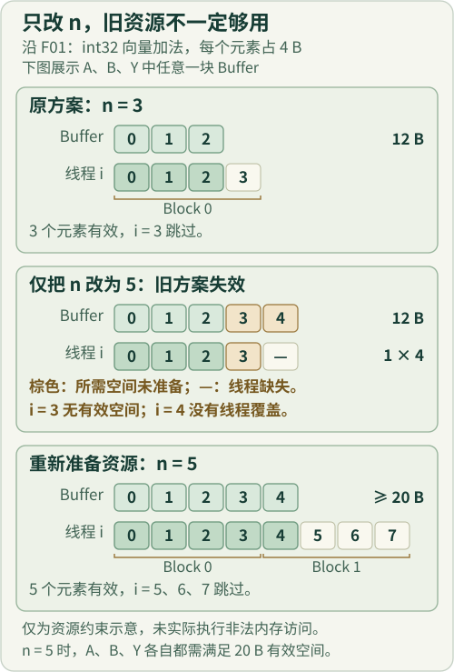
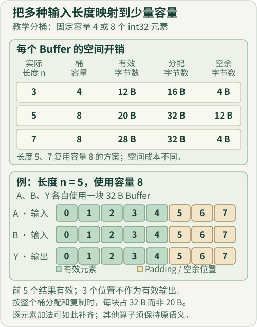
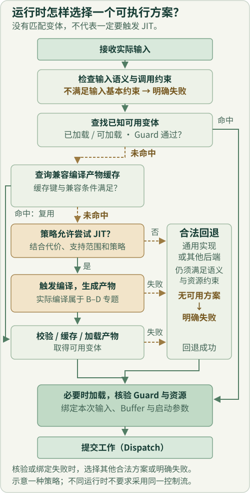

# 实际输入形状发生变化，运行时怎样找到可以执行的程序？

在 [F04](f04-execution-graphs-and-replay.md) 中，我们为三个元素的向量加法建立了一张可重放的执行图。每一轮可以改变输入数据，而不改变 Buffer 地址、搬运长度和内核启动规模。

但如果下一轮的输入变成五个元素，原来的执行方案还能直接使用吗？运行时需要改变参数、寻找另外一个版本，还是要求编译器重新生成代码？

**动态形状（Dynamic Shape）**指程序的部分张量维度需要到运行时才能确定。执行运行时要根据实际输入检查已有产物的适用条件，选择可执行的版本，再准备符合该版本要求的资源。

本篇沿用 F01–F04 的向量加法，解释形状变化对这条执行路径的影响。编译器怎样分析程序并生成专用代码，仍由 B、C、D 专题主讲。

## 三个元素变成五个，原来的调用还能直接使用吗？ {#shape-change}

沿用 F01 中的 `vec_add`，每个逻辑 CUDA 线程处理一个元素。我们假设两个输入都是等长的连续 int32 向量，不进行广播，结果也在 int32 的表示范围内。

| 输入形状 | A | B | 正确的 Y |
| --- | --- | --- | --- |
| (3,) | [2, 1, 4] | [3, 4, 2] | [5, 5, 6] |
| (5,) | [2, 1, 4, 1, 5] | [3, 4, 2, 2, 1] | [5, 5, 6, 3, 6] |

之前的三元素执行方案，为 d_A、d_B、d_Y 各准备了 12 B 有效数据空间。Kernel 参数 n 为 3，启动一个 Block，每个 Block 有四个线程。索引 i = 3 的线程因不满足 i < n 而跳过。

现在直接重放原来的三元素任务序列，搬运和计算仍然只涉及三个元素。如果只把 n 改为 5，原来的 Buffer 不能容纳五个 int32 元素，四个逻辑线程也无法覆盖索引 i = 4。

<figure markdown="1">

<figcaption>这只是检查执行条件的教学示意，不真的发起错误的内存访问。线程数量表示软件可见启动规模，不表示物理计算单元数量。</figcaption>
</figure>

如果使用 A04 中接受运行时参数 n 的 Kernel，就可以为每组数据重新准备至少 20 B 的有效空间，将搬运长度和 n 分别改为 20 B 和 5，并启动两个 Block、每块四个线程。

设备将产生 8 个逻辑线程，其索引为 0–7。其中 0–4 执行有效计算，5–7 跳过。只要目标设备与 Kernel 约束允许，这个方案并不需要重新生成 Kernel。

三组有效数据的空间由 36 B 增加到 60 B，不计分配粒度、工作区及其他资源。F03 已说明，如果旧 Buffer 仍被在途任务使用，就不能简单扩大、覆盖或归还它们。

[张量形状与实际存储：A03](../01-foundations/a03-tensor-representation.md#dynamic-shape) · [F01：执行规模与资源准备](f01-module-loading-and-dispatch.md#resource-preparation)

## 怎样判断一个执行版本可以接受哪些输入？ {#shape-guards}

前面的例子说明：输入维度改变，并不总是意味着需要编译。但如果编译器曾经利用 n = 3 来消除循环、写死访问位置或安排固定缓冲区，这个版本就未必能执行五元素的加法。

[B03](../02-frontend-and-optimization/b03-graph-capture.md#shape-guards) 中已经介绍了 Guard：编译器可以为一个专门化的执行路径附上适用条件。运行时根据实际输入判断这些条件是否成立。

**Shape Guard（形状守卫）**是对实际输入形状的条件检查，例如 n = 3、1 ≤ n ≤ 8 或多个维度之间的关系。只有满足相应条件，才能使用依赖这些假设的执行产物。

本例中先要区分两个问题：

| 要判断的事情 | 本例中的条件 |
| --- | --- |
| 输入是否合法 | A、B 都是一维等长向量，符合本程序的类型和运算约定 |
| 某个执行版本是否适用 | 实际 n 落在其支持范围，满足该版本要求的类型、布局及目标设备约束 |

例如 A、B 都有五个元素，依然是本程序的合法输入；一个只支持 n = 3 的版本却不能使用。该版本的 Guard 失败，不等于程序本身遇到了非法输入。

除形状外，一个版本的完整适用条件还可能涉及数据类型、Stride、设备能力、代码版本，以及某些程序状态。实际 Buffer 是否足够、地址是否可访问、依赖是否满足，则需继续按 F01–F03 的执行契约检查。

[C05](../03-mapping-and-planning/c05-cost-model-and-search.md#shape-specialization) 讨论了利用形状为已知规格生成专门化计划。F05 关注怎样利用这些计划的适用条件组织实际执行。

## 如果已经有多个实现，运行时如何选择？ {#executable-variants}

假设编译阶段或者执行后端已经提供两种执行版本。这里的版本可以包含内核代码和相关参数约定，也可以包含用于组织搬运、计算、资源使用的完整计划。

| 版本 | 教学实现 | 适用形状 |
| --- | --- | --- |
| V3 | 为三元素专门化的实现，固定该次工作规模 | n = 3 |
| Vdyn | 采用接受 n 参数且包含边界检查的通用 Kernel，按 n 调整启动配置和搬运长度 | 1 ≤ n ≤ 8 |

两者都是这个程序的可执行变体（Executable Variant）。这里假设它们满足前面相同的类型和布局约束。V3 是另外构造的专用版本，不是说 F01 的原始 `vec_add` 源码已经把 n 写死为 3。

若 n = 3，两个版本都可以使用。运行时还可以依据已有测量、资源预算或预定策略选择一个；合法并不等于最快。若 n = 5，则 V3 的 Guard 不满足，而 Vdyn 可以继续工作。

因此，输入形状改变时，检查并复用已有的兼容版本应当是我们可以考虑的路径。动态 Kernel 的存在可以减少为每个长度单独生成一个版本的需要。

例如 TensorRT 的 Optimization Profile 在构建阶段定义可接受的最小和最大输入尺寸（MIN、MAX），以及优化所针对的尺寸（OPT）。运行时选择适用的 Profile，再设置执行上下文的实际输入维度和资源。

OPT 不是唯一合法的尺寸，范围也不是网络的全部约束，多个输入之间还可能存在关系。有的输出维度取决于实际数据，这时还需要按接口确定空间上界或利用运行时输出分配机制。

[TensorRT：Dynamic Shapes — Core Concepts](https://docs.nvidia.com/deeplearning/tensorrt/latest/inference-library/dynamic-shapes-basics.html)

## 为什么还会为几个不同形状准备同一种容量？ {#shape-bucketing}

回到向量加法。假设程序经常收到长度为 3、5、7 的输入。可以分别运行对应长度，也可以为了复用部分固定执行配置，将它们归入少量预先准备的容量组。

例如建立容量为 4 和 8 的两个版本。将 n = 3 归入容量 4，将 n = 5、7 归入容量 8。这样的归类称为**形状分桶（Shape Bucketing）**。

现在必须分别记录三个量：本次真实元素数 n、为该桶准备的容量以及实际采用的执行规模。容量是可提供的位置数，并不是输入凭空增加了数据。

<figure markdown="1">

<figcaption>假设使用固定容量的 Buffer，且每个元素为 4 B。空余字节数是单个 Buffer 的容量差额，并不表示所有分桶实现都会处理这些空余位置。</figcaption>
</figure>

如果希望使用固定的八元素执行方案，运行时可以为长度 5 的输入补三个零元素（Padding），为每个 Buffer 准备 32 B，完成八个位置的逐元素加法，再仅取前五个输出。

本例各位置之间没有计算依赖，所以这种填充不会改变前五个有效结果。若每个 Buffer 按全桶容量分配，则三组共需 96 B，而五元素方案的有效数据是 60 B。

若两项搬入和一项写回都采用固定的 32 B 长度，那么还会多搬运 36 B 数据。若 Kernel 和搬运接口支持实际长度，分桶也可以只预留空间、限制启动配置，而不必搬运和计算所有填充位置。

对于其他计算，是否能填充还需要证明有效输出的语义保持不变。例如归约或 Attention 可能受额外位置影响，不能直接把 Padding 当作真实数据。

旧版动态形状例中的 21、29、31 个位置统一进入容量 32 的桶，也是相同的取舍：容量合计 96 个位置，有效位置为 81，空余 15。模型批次如何组成及布局选择留给后续专题。

## 使用了同一种桶，能否直接重放同一张图？ {#bucket-and-graph-replay}

[F04](f04-execution-graphs-and-replay.md) 已经说明，普通捕获重放常依赖已经记录的操作、地址及参数。

如果容量 8 的图记录了固定长度的搬入、八元素的计算和写回，且对应存储区稳定，那么 n = 5、7 都可以利用前述适用的填充方式在同一张图上执行。

但如果图中已经按值记录了 n = 3，主机只改变一个名为 n 的变量，并不能让图中的 Kernel 自动得到新的实参。要保留真实长度，可根据接口更新允许更新的节点参数，或设计从有效的存储位置读取长度的 Kernel。

即使已经找到了兼容的编译产物，执行图也可能因 Buffer 地址或操作参数改变而不能直接重放。运行时可以更新图、选择其他已准备图、重新捕获，或者改为普通提交。

例如 vLLM 的 CUDA Graph 支持根据执行模式和工作描述选择可用的图，并在适用条件下利用填充。这是具体推理框架的实现，而不是所有加速器都必须采用的机制。

[vLLM：CUDA Graphs 设计](https://docs.vllm.ai/en/stable/design/cuda_graphs/) · [TensorRT：CUDA Graphs 与执行上下文](https://docs.nvidia.com/deeplearning/tensorrt/latest/performance/optimization.html)

## 如果没有符合条件的可执行版本，必须重新编译吗？ {#jit-and-fallback}

假设运行时收到长度为 9 的输入。前面构造的两个版本均不适用：V3 只支持 3，Vdyn 的支持范围到 8。现在不能将它继续交给这些版本。

如果另外有支持长度 9 的通用实现，或者允许采用其他合法后端，运行时可以选择这些路径继续完成原程序所要求的计算。这称为回退（Fallback）。

如果没有合适的现成版本，也可以根据策略请求编译器为新的输入条件生成一个执行产物。这种在实际运行时按需要触发的编译称为即时编译（Just-in-Time Compilation，JIT）。

JIT 触发只是调用编译流程的机会。编译器仍要按照 B、C、D 专题中的机制分析程序、选择合法方案并生成目标代码；运行时等待或获取产物后，再按照 F01 的接口加载、绑定和提交。

例如 PyTorch 的 `torch.compile` 会根据 Guard 判断已有编译版本是否可用。形状变化可能触发新的编译，也可能被已有的动态版本覆盖；其重编译限制及回退行为取决于配置和具体实现。

选择 JIT 是否值得，还取决于首次编译开销、未来重复执行次数及新版本的运行收益。无法编译、无法回退或输入本身非法时，应当按照接口明确报告，而不是使用已经确认不适用的版本。

[PyTorch：torch.compile](https://docs.pytorch.org/docs/stable/generated/torch.compile.html) · [Dealing with Recompilations](https://docs.pytorch.org/docs/stable/user_guide/torch_compiler/compile/programming_model.recompilation.html)

## 怎样避免下一次遇到相同输入时再次编译？ {#compilation-cache}

假设这次 JIT 已经为长度 9 生成了一个新版本，接下来主机又收到长度为 9 的合法输入。只要该版本及其适用条件仍然相容，就可以避免重复编译。

一种方法是保存已经生成的编译产物及相应的兼容信息。后续先查找符合条件的产物，再加载或复用它，只有确实缺少可用产物且策略允许时才触发编译。

但不能只用 n 作为缓存键。例如 n = 9 的 int32 加法与 n = 9 的浮点加法，或者为不同目标生成的机器代码，不一定适合相互替换。

缓存需要覆盖影响产物语义、兼容性及代码生成的因素。以下是教学示意，不是某个框架固定的键格式：

| 信息 | 为什么需要考虑？ |
| --- | --- |
| 程序、IR 或模型版本 | 不同计算程序可能生成不同产物 |
| 类型、布局、专门化维度或范围 | 决定哪些输入可以使用该产物 |
| 目标架构及相关软件版本 | 影响机器代码、运行接口兼容性 |
| 编译选项 | 影响优化、数值语义和代码实现 |

例如 JAX 的持久编译缓存会考虑未优化的 HLO、jaxlib 版本、相关 XLA 配置和设备等因素。不同编译器所需的信息有所不同，命中后仍需满足实际运行条件。

还要区分可序列化的编译文件、当前设备上下文中已加载的入口以及 F04 的可执行图。文件缓存命中并不证明该入口已经加载，入口可用也不证明某张图具备重放条件。

这里缓存的是可执行产物，不是输入向量、计算结果或模型的 KV Cache。缓存命中之后，设备仍然需要执行本次计算。

[JAX：JIT and caching](https://docs.jax.dev/en/latest/201/jit.html#jit-and-caching) · [JAX：Persistent compilation cache](https://docs.jax.dev/en/latest/persistent_compilation_cache.html#how-it-works) · [D04：可加载产物与入口](../04-code-generation/d04-executable-artifacts.md)

## 回到运行时：一次实际输入怎样走完整条路径？ {#variant-selection}

将上面的机制放在一起。对一个已经明确实际形状的输入，运行时需要先判断程序的输入语义是否满足，再查找合法可用的变体，最后准备该版本所需要的任务参数及资源。

<figure markdown="1">

<figcaption>这是一个教学决策流程。已有变体、持久产物缓存、JIT 和回退的查询顺序及策略因实现而异。执行前仍需满足入口、参数、依赖、资源和生命周期契约。</figcaption>
</figure>

对于新版本，旧版本可能仍有正在进行的工作。即使运行时已经为新形状准备好入口和 Buffer，也必须按照 F02、F03 的条件保留旧工作所需的资源，直到可以安全回收。

例如 [G01](../07-model-execution/g01-model-loading-and-execution.md) 已说明，模型实例完成权重加载，并不意味着任何输入规格均被预热或可以执行。

运行时可以复用模型权重和既有上下文，为实际形状选择兼容的执行版本，不要求每次变化都重新加载整个模型。

## F 专题回顾 {#next}

| 本专题建立的认知 | 作用 |
| --- | --- |
| [F01](f01-module-loading-and-dispatch.md) | 将可执行入口与本次参数、资源绑定 |
| [F02](f02-asynchronous-execution.md) | 使用执行依赖和完成语义组织真实任务 |
| [F03](f03-runtime-buffer-management.md) | 跟踪并安全复用有限的执行资源 |
| [F04](f04-execution-graphs-and-replay.md) | 在必要条件下复用任务描述与执行组织 |
| F05 | 根据实际输入检查、选择或准备兼容的执行产物 |

通用执行运行时处理的是一项或多项计算如何在设备上正确执行。它为模型运行时提供执行能力，但不决定一个自回归请求下一步应该生成什么，或者多个请求怎样组成一批。

接下来进入 [G：模型执行与生成控制](../07-model-execution/README.md)，了解怎样在这套执行机制基础上加载模型、维护模型及请求状态，组织单个请求的计算与生成过程。
