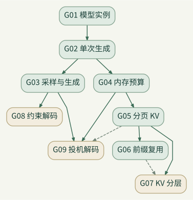

# 模型执行与生成控制

模型运行时组织权重、激活和持续存在的状态，并调用执行后端。对自回归模型来说，一次计算还需要决定下一个 Token，才能推进请求。

## 贯穿算例与阅读边界

先跟踪单请求 A（8 个输入 Token，最多输出 4 个），区分 Prefill、Decode、采样与 KV 更新时间；再用每块 4 个 Token 的逻辑缓存讨论内存预算、共享和回收。

G01 建立共享模型资源与请求实例的认知。G02 区分已生成 Token 与已计算位置，之后分出 G03 的生成控制和 G04–G06 的状态管理两条路线。G07–G09 为按需深化，不是 H 的统一前置。模型数学归算法与模型，内核实现归 D。

## 知识关系

<figure class="micro-v2-map" markdown="1">

<figcaption>图中实线表示本专题内的主要前置关系，虚线表示按场景参考；跨专题先修知识见下表。 点击可查看大图。</figcaption>
</figure>

## 阅读顺序 {#计划阅读顺序}

本专题规划 9 篇正文，其中 3 篇为深化或案例。 未发布条目为阅读计划，标题与范围可在编写时根据认知目标调整。

| 编号 | 文章（暂定标题） | 读完应理解什么 | 主要前置知识 | 状态 |
| --- | --- | --- | --- | --- |
| G01 | [模型文件怎样变成可以反复执行的模型实例？](g01-model-loading-and-execution.md) | 权重准备、模型加载、后端交接、实例与请求区别、冷启动；CNN、扩散、SSM、LLM 的执行差异。 | F01、F02；F03 按需 | 已发布 |
| G02 | [生成一个 Token 之前，模型到底执行了哪些工作？](g02-prefill-and-decode.md) | 单请求执行、Prefill、Decode、自回归依赖、KV 状态实际更新时点及阶段计算量。 | G01、模型基础 | 已发布 |
| G03 | [模型给出一组 Logits，怎样决定下一个 Token？](g03-sampling-and-generation.md) | Logits 处理顺序、采样、RNG、停止条件、生成状态、增量解码与输出边界。 | G02 | 已发布 |
| G04 | [权重已经装进显存，为什么请求增加后仍然可能溢出？](g04-model-state-and-memory-budget.md) | Weight、Activation、Workspace、KV 内存预算、GQA/MLA/SSM 等状态差异、KV 精度和元数据。 | G01、G02 | 已发布 |
| G05 | 序列不断变长，KV 怎样保存在不连续的缓存块中？ | 逻辑块表、分配与回收、分页、块大小取舍、不同层的缓存池、引用计数、Copy-on-Write。 | G04、F03 | 未发布 |
| G06 | 两个请求的开头相同，哪些计算和状态可以复用？ | Prefix Cache、Hash/Radix、缓存身份、共享、命中率、淘汰、缓存污染。 | G05 | 未发布 |
| G07 | 显存放不下全部 KV，应该搬走还是重新计算？ | 分层存储、活跃状态卸载、冷前缀、迁移、预取、恢复、传输与重算代价。 | G05、F02；按需 G06 | 未发布 |
| G08 | 怎样让模型生成符合指定格式的文本？ | 约束解码、语法状态、Token 边界、Mask、允许集合、输出验证。 | G03 | 未发布 |
| G09 | [一次生成多个候选 Token，怎样验证并提交正确的结果？](g09-speculative-decoding.md) | 投机解码、Draft/Verify、接受与拒绝、状态提交与回滚、接受率与成本。 | G03、G04；分页场景参考 G05 | 已发布 |

## 从哪里来，接下来往哪读

主要衔接：[通用执行运行时](../06-execution-runtime/README.md)。

模型计算原理参考[算法与模型](../../workload/README.md)。重构期间也可查阅[旧版推理运行时](../../inference-runtime/README.md)。

后续方向：[请求调度与批处理](../08-request-scheduling/README.md)、[分布式执行与通信编排](../09-distributed-execution/README.md)、[推理服务系统](../10-serving/README.md)、[性能分析、建模与验证](../11-performance/README.md)。

更多阅读路线见[编译器与运行时系统系列首页](../README.md)。
