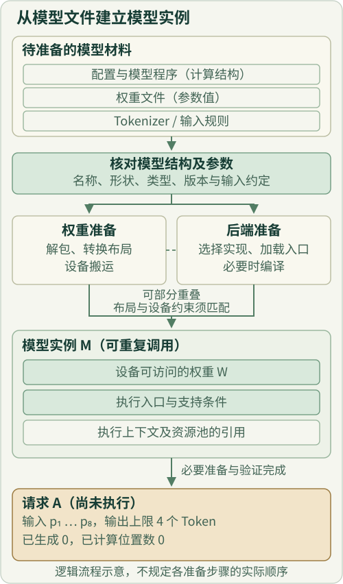
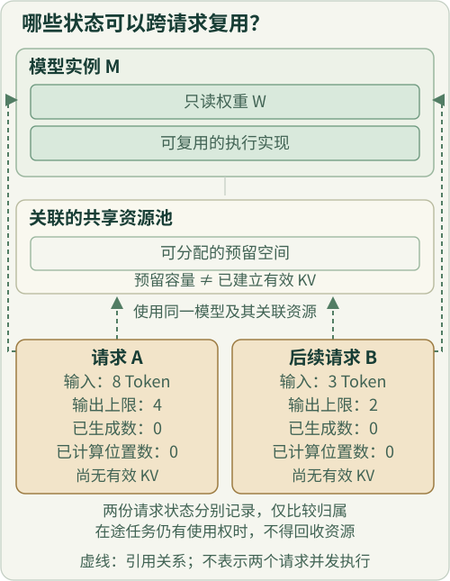

# 模型文件怎样变成可以反复执行的模型实例？

下载一个语言模型后，目录里可能有几十 GB 的权重文件和几份配置文件。第一次使用时，推理程序往往要准备很久。等模型能够回答问题后，再发一个请求，通常不需要重新加载整份权重。

在 [F01](../06-execution-runtime/f01-module-loading-and-dispatch.md) 中，运行时已经能够加载一个向量加法 Kernel，绑定实际参数，并交给设备执行。但一个模型包含许多算子，还有训练得到的参数。我们需要把它们组织起来，才能反复执行整个模型。

**模型运行时（Model Runtime）**在通用执行运行时之上组织模型计算，准备模型参数和执行实现，并管理每次推理所需的状态。准备好的这组长期存在的执行资源，我们称为**模型实例（Model Instance）**。

本篇追踪一个文本模型 M，从文件到可执行实例，再到第一个请求 A。先了解哪些东西只需要准备一次，哪些东西每个请求都要重新建立。

## 只有一份权重文件，为什么还不能执行模型？ {#model-artifacts}

权重是训练得到的数值。例如 Transformer 中的一个线性投影可能使用形状为 4096×4096 的权重矩阵。知道这些数值放在哪里，还不足以知道它们应该参与哪项计算。

执行模型至少需要知道以下几类信息。

| 信息 | 用途 | 文本模型的例子 |
| --- | --- | --- |
| 模型结构及计算程序 | 确定各项计算、连接方式和模型参数的含义 | 层数、Attention 类型、矩阵形状、前向计算 |
| 权重及其他常量 | 提供计算实际读取的数值 | 各层投影矩阵、归一化参数 |
| 输入与输出规则 | 确定怎样把外部输入转换为模型输入，并解释输出 | Tokenizer、词表、聊天模板、特殊 Token |
| 执行配置 | 确定本次部署的目标及约束 | 设备、精度、并行布局、支持的输入范围 |

这些信息可以来自不同文件、模型程序和部署配置，也可以有一部分已经封装在编译好的引擎中。不要求每个模型都具有相同的目录结构。

以 safetensors 权重格式为例，文件头记录张量名称、数据类型、形状及数据范围。加载器能据此找到某个矩阵的字节，但仍需要模型程序或计算图来确定什么时候使用它。

权重也可能分散在多个文件中，索引记录每个参数所在的文件。文件分片是存储方式的选择，不代表这些权重必须分布在不同设备上。

例如模型程序要求某个投影的权重形状为 4096×4096，而文件中对应名称的张量形状为 4096×2048。如果没有与模型匹配的显式转换，不能把后者直接绑定给前者。加载时需要检查名称、形状、数据类型和模型版本等是否相容。

[Safetensors：Metadata Parsing](https://huggingface.co/docs/safetensors/en/metadata_parsing) · [A03：张量表示与存储布局](../01-foundations/a03-tensor-representation.md) · [B03：模型导入](../02-frontend-and-optimization/b03-graph-capture.md#model-import)

## 怎样把文件中的权重变成 Kernel 可以读取的数据？ {#weight-preparation}

沿用上面的一个投影矩阵。假设文件以连续的 BF16 保存 4096×4096 个元素，每个元素占 2 B。它的有效权重数据占用：

**4096 × 4096 × 2 B = 33,554,432 B = 32 MiB。**

但 [F01](../06-execution-runtime/f01-module-loading-and-dispatch.md#parameter-binding) 中的 Kernel 需要的是执行时可访问的资源引用及符合约定的数据布局，而不是模型文件名。

加载器可以读取或映射文件中的张量，在主机或设备上完成必要的精度转换、解包和布局重排，再使目标设备获得合法的访问引用。已有布局满足要求时，可以省掉相应转换。

取得可访问的地址也不代表数据已经搬运完成。只有在真实计算开始前满足相应的数据依赖与可见性条件，Kernel 才能正确使用权重。某些系统还支持按需搬入或共享存储。

例如目标 Kernel 要求这个矩阵按若干小块连续排列。模型运行时可以选择一个匹配这种布局的实现，并准备对应的权重 Buffer。只修改张量的布局描述、却不转换数据，可能让 Kernel 读错元素。

低比特权重还可能携带 Scale 等辅助数据。文件中的紧凑编码不一定等于 Kernel 直接读取的布局，也不一定需要先将全部权重展开为高精度。这里关注运行时准备的最终数据是否满足接口，具体实现归 D 专题。

例如 vLLM v0.10.2 的模型加载器先建立模型对象、加载参数，再执行针对这些参数的加载后处理。这是一种实现方式，不要求所有框架都先在主机保存整份权重。

若模型由多个设备共同执行，每块设备还可能只获取自己需要的权重分片，或者保存部分重复参数。本篇先假设 M 由一个设备上的模型实例执行，跨设备布局和交接留给 I 专题。

[执行加载源码：vLLM v0.10.2 BaseModelLoader](https://docs.vllm.ai/en/v0.10.2/api/vllm/model_executor/model_loader/base_loader.html) · [E02：设备内存映射](../05-device-driver/e02-device-memory-mapping.md)

## 有了权重，怎样确定执行哪份代码？ {#execution-backend}

假设我们已经知道模型中的计算，并准备好了数值。现在要选择能够在目标设备上执行这些计算的实现。**执行后端（Execution Backend）**提供或生成这些实现，并暴露运行时可以调用的接口。

后端可能提供一个个 Kernel，也可能提供可以整体调用的子图或模型引擎。它需要与模型运算的语义、实际张量布局和数据类型相容。模型运行时负责组织这些调用，并准备每次实际使用的参数和资源。

常见的组织方式并不相同。

| 方式 | 怎样取得实现 | 实例 |
| --- | --- | --- |
| 按算子或子图分配后端 | 查询后端支持的计算范围，把相应计算交给它 | ONNX Runtime Execution Provider |
| 使用编译好的模型引擎 | 为目标、精度和输入范围构建或加载可执行引擎，再建立执行环境 | TensorRT |
| 模型执行器直接组织计算 | 根据模型程序和配置，调用选定的矩阵乘法、Attention 等实现 | LLM 专用执行器 |

它们也可以混合使用。例如模型执行器可以将部分计算交给已经编译的子图。模型运行时不需要重新完成 B、C、D 中的全部编译工作，但需要找到满足本次执行契约的实现。例如 TensorRT 的引擎可在部署前构建并序列化，执行时再反序列化。

[D04](../04-code-generation/d04-executable-artifacts.md) 解释了代码产物的加载条件。代码与权重作为不同种类的资源，可以封装在一起，也可以分别加载。

设想模型依次执行子图 S1、S2、S3。S1 与 S3 在加速器上，只有 CPU 后端支持 S2。若两个后端通过显式拷贝交接数据，S1 的结果要搬到主机，S2 的结果又要搬回设备，消费者还必须等待各自的输入就绪。

即使 S2 的计算量很小，这两个边界的搬运与等待也可能影响整条路径。某个算子不受支持时，系统可能选择其他实现、转换图或报告失败，并非所有后端都能自动回退。

[ONNX Runtime：Execution Providers](https://onnxruntime.ai/docs/execution-providers/) · [TensorRT 10.x：Capabilities](https://docs.nvidia.com/deeplearning/tensorrt/10.x.x/architecture/capabilities.html)

## 加载完成时，模型实例究竟保存了什么？ {#model-instance}

权重和执行实现彼此有约束，因此选择后端与准备权重往往需要协同进行。满足这些约束后，运行时可以保存对应的执行入口、权重资源引用及执行环境，形成 M。

<figure markdown="1">

<figcaption>从模型资料到一个已准备的模型实例。框和箭头表示软件对象、准备工作及约束关系，不规定具体进程和存储位置，也不规定各步骤必须完全串行执行。</figcaption>

</figure>

模型实例需要保留能够反复使用的资源。以 M 为例：

- 模型身份及结构描述，输入、输出和支持范围。
- 已准备好的权重 W 及其他常量的访问引用。
- 可调用的模型程序、Kernel 或子图入口，以及与它们相容的执行契约。
- 用于组织设备工作的执行上下文，以及按需准备的内存池、工作区、历史状态存储等资源。

回顾 F01，设备上下文 ctx_P 关联设备及访问环境；执行上下文帮助上层使用已经加载的代码和资源。模型实例 M 则在这些通用能力之上增加模型结构、权重身份及执行规则。一个设备上下文可以服务多个模型实例，一个模型实例也可能使用多个执行上下文。

运行库还可以动态准备执行实现。例如某个输入形状首次出现时才进行编译或加载。TensorRT 的优化 Profile 则规定引擎可接受的一组输入维度范围。如果超出范围，已有产物就未必能用。

因此，“权重加载完成”“某个形状能执行”和“实例已经准备好接受某类请求”是不同的判断。后端能够加载，不足以证明任意输入都可执行。

[TensorRT：Working with Dynamic Shapes](https://docs.nvidia.com/deeplearning/tensorrt/10.x.x/inference-library/work-dynamic-shapes.html) · [F01：执行上下文](../06-execution-runtime/f01-module-loading-and-dispatch.md#execution-context)

## 为什么模型准备好了，还要为每个请求建立状态？ {#request-instance}

现在模型实例 M 已准备好。本专题的主例使用一个普通的、具有因果 Attention 的自回归文本模型。先不使用前缀复用或投机解码，并假设一个请求只生成一条序列。

第一个请求 A 包含一段文本。经过约定的输入处理规则后，得到 8 个 Token，记为 p1 至 p8。用户要求最多输出 4 个 Token；这 4 个 Token 还没有生成。

为处理 A，运行时需要维护一个**请求实例**。它引用 M，并记录输入、生成限制、已生成的序列和后续计算所需的状态。下面是 A 尚未执行模型计算时的逻辑状态。

| 对象 | 初始状态 |
| --- | --- |
| 所使用的模型 | M，引用已经准备好的 W |
| 输入 Token | p1、p2、…、p8 |
| 输出上限 | 4 个 Token |
| 已生成 Token 数 | 0 |
| 已完成模型计算并拥有有效历史状态的位置数 | 0 |

此时已经有 8 个输入 Token，但还没有计算它们对应的历史状态。KV Cache（Key/Value 缓存）保存已计算位置的 Attention Key 和 Value，供后续位置使用。

因此 A 尚未建立有效 KV；即使启动时已经预留缓存池，也不能把池中的空间当作计算完成的数据。

如果稍后同一个模型收到另一个请求 B，B 也可以引用 W，而不需要为它重新加载一份权重。但 B 的输入、生成长度及历史状态需要独立记录。

<figure markdown="1">

<figcaption>模型资源与请求状态的归属。本图只比较两个请求引用的对象，不表示它们同时执行。共享池只是为状态提供存储，逻辑状态仍按各自的请求或序列追踪。</figcaption>

</figure>

权重、只读常量和执行实现一般可以复用。临时激活、工作区可以在不冲突时由执行系统复用。历史状态、已生成 Token、采样状态和停止条件则要与实际生成序列关联，不能直接混合。

例如 vLLM v0.10.2 的 CachedRequestState 分别记录输入 Token、输出 Token、已计算 Token 数、缓存块及采样状态。这里的模型实例和请求实例是职责上的抽象，不要求各框架都使用同名对象。

[vLLM v0.10.2：CachedRequestState 源码](https://docs.vllm.ai/en/v0.10.2/api/vllm/v1/worker/gpu_input_batch.html)

一个请求也可能要求生成多个候选答案。此时一个请求实例可以关联多条生成序列，每条序列都有自己的生成进度和可变后缀状态。后续文章在需要时再扩展这一层关系。

[F03](../06-execution-runtime/f03-runtime-buffer-management.md) 已经建立了资源复用的安全条件。即使 A 在逻辑上结束，也要等待使用其状态的在途工作结束并解除相关引用，才能把对应空间交给其他工作。请求结束也不需要释放仍服务于 M 的权重。

### 为什么还要记录模型身份？

假设 M 装载了一组 LoRA 适配器参数。即使基础权重相同，使用不同的适配器也可能产生不同的历史状态和输出。因此，请求还需要关联实际使用的模型版本、适配器等影响计算的配置。

如果请求执行了一半，直接用新权重继续计算，却保留旧权重产生的 KV，就可能让历史状态和后续计算对应不同模型。状态复用必须保持计算身份相容，不能只根据输入文字相同作出判断。G06 将进一步解释前缀缓存身份。

## 所有模型都需要像文本生成一样反复执行吗？ {#model-types}

模型实例提供的是模型计算的执行能力。但要完成一次请求，需要调用几次模型、每次如何取得输入，取决于任务和模型的计算关系。

| 任务示例 | 模型运行时怎样组织工作？ | 请求中需要跨次调用保留什么？ |
| --- | --- | --- |
| CNN 图像分类 | 对输入图像执行一次前向，返回分类结果 | 通常没有跨次前向的模型历史状态 |
| Latent 扩散图像生成 | 根据当前 latent、条件和时间步反复运行去噪网络，再由采样过程更新 latent | 当前 latent、条件、时间步及具体采样器的历史 |
| 纯 SSM 自回归生成（如 Mamba） | 处理输入序列，生成时使用并更新递推状态 | 每层有限大小的递推状态，Mamba 还包含短卷积状态 |
| 因果 Attention 自回归文本生成 | 处理输入后，根据前一次生成的 Token 继续调用模型 | 已生成序列及历史 KV 等状态 |

这里的区别来自计算依赖，而不是模型名称。例如 Transformer 也可以用于一次前向的分类任务；扩散模型可以使用 Transformer 作为去噪网络。混合 Attention 与 SSM 的模型还可能同时需要两类状态。

纯 SSM 的递推状态在模型结构和序列数固定时，可以不随序列长度线性增长，但 Token 历史和输出记录仍可能增长。Attention 模型的 KV 也受窗口、结构、压缩方式和实现影响。G04 再讨论各自的内存预算。

这些任务可以使用相同的通用执行运行时提交和同步设备工作，但模型运行时要根据任务语义选择不同的执行顺序、输入以及持续状态。

模型原理见算法与模型系列：

- [CNN](../../workload/01-foundation-model-components/cnn-backbone.md)
- [扩散模型](../../workload/generative-models/diffusion-models.md)
- [Mamba 与 SSM](../../workload/01-foundation-model-components/mamba-and-ssm.md)
- [自回归生成](../../workload/generative-models/autoregressive-generation.md)

## 第一次执行为什么还可能比后续执行慢？ {#cold-start}

回到开始的问题。M 从尚未准备到可以接收请求，需要花费时间进行文件读取、反序列化、权重转换、搬运、后端初始化、资源分配等工作。

有些后端还需要为实际输入触发编译、构建执行计划或捕获可重放的任务图。这些工作可以发生在启动阶段，也可以推迟到首次遇到某种输入时。已有的兼容产物缓存有机会减少重复准备。

这些成本不能无条件直接相加。比如某部分权重正在搬入设备时，主机可能已经读取下一部分权重；但如果一个 Kernel 需要转换后才能读取的数据，它必须等对应数据满足可见性和访问契约。

启动期间的内存需求也可能高于稳态需求。仍以 32 MiB 的 BF16 矩阵为例，若源布局和目标布局在同一设备上各占 32 MiB，转换过程中两份都存在，则仅这两份有效数据就需要 64 MiB。释放源布局后，目标布局只剩 32 MiB。

这只是特定转换方案的教学算例，不包含对齐、临时空间和其他权重。如果分块转换或在主机准备目标布局，设备峰值可能不同。稳态的权重大小不能直接代替启动时的容量检查。权重已经驻留在显存时，后续请求通常不必重新读取权重文件、重排及搬入；计算单元仍需要按实现读取所需权重。驻留容量和每轮读取流量是不同的量。

为了减少准备工作进入真实请求的关键路径，运行时可以先用代表性输入执行一次或多次模型，这称为**预热（Warm-up）**。预热可以触发延迟加载、编译或资源初始化，也可用于检查准备的执行路径是否能够完成。

预热验证过的输入不一定覆盖所有形状、精度或功能。缓存编译产物时也要保证目标设备、软件版本、影响代码的形状、精度和布局等条件相容。[F04](../06-execution-runtime/f04-execution-graphs-and-replay.md) 已解释如何重放执行图；动态形状的变体选择留给 F05。

对在线服务，可以在约定的代表性执行成功并完成资源准备后，将实例标记为相应范围内可接收请求。仅仅进程已经启动或端口已开启，不能证明模型已经可以提供推理。离线推理同样需要模型执行就绪，但不需要在线路由。

[TensorRT：Optimizing Performance（Shape/Profile 切换开销）](https://docs.nvidia.com/deeplearning/tensorrt/latest/performance/optimization.html)

## 从模型实例到第一个 Token

现在我们已经有模型 M、可反复读取的权重 W、可以调用的计算实现，以及尚未开始计算的请求 A。

接下来运行时需要决定哪些 Token 要交给模型，准备输入和历史状态的资源，调用后端，并依照 [F02](../06-execution-runtime/f02-asynchronous-execution.md) 的依赖与完成语义取得可用结果。这个过程可能调用许多 Kernel，但这些 Kernel 不需要知道整个请求的生成目标。

当 A 已经结束、旧状态可安全回收时，M 仍可接受新请求。我们不必重新加载整套权重，这就是模型实例可以反复用于不同请求的原因。

本篇止于 A 的 8 个输入、0 个已生成 Token 和 0 个已完成计算的位置。为什么处理完输入后可以生成第一个 Token？第一个新 Token 被选择时，它自己的 KV 是否已经建立？下一篇 G02 将沿着 A 的计算进度逐步回答。

## 参考资料与继续阅读

- [通用执行运行时](../06-execution-runtime/README.md)：模块加载、参数绑定、异步交接与资源生命周期。
- [算法与模型：Attention 与 Transformer](../../workload/01-foundation-model-components/attention-and-transformer.md)：模型中计算的实际含义。
- [Diffusers v0.34.0：Understanding pipelines, models and schedulers](https://huggingface.co/docs/diffusers/v0.34.0/en/using-diffusers/write_own_pipeline)：以去噪循环说明扩散模型程序和采样过程的分工。
- [Mamba 原始论文](https://arxiv.org/abs/2312.00752)：选择性状态空间模型的递推推理。
- [回到 G 专题导读](README.md)：继续单请求执行与生成控制，或进入模型状态管理路线。
