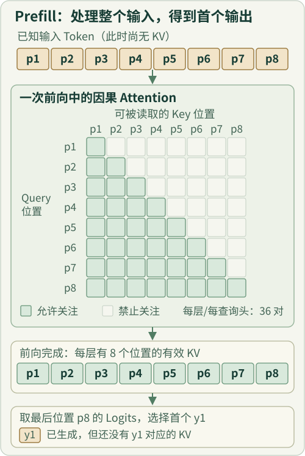
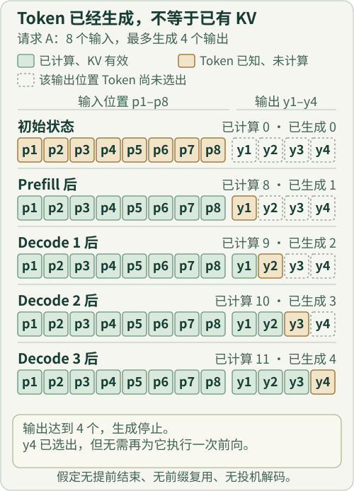
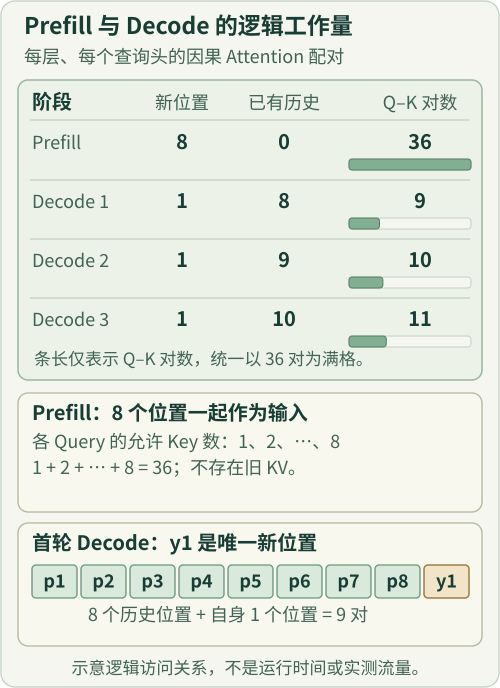

# 生成一个 Token 之前，模型到底执行了哪些工作？

向一个语言模型发送一段文字，往往需要等一段时间才能看到第一个 Token。之后，模型又会逐步生成后续 Token。为什么第一次计算要处理整段输入，而之后每轮通常只输入一个新 Token？

在 [G01](g01-model-loading-and-execution.md) 中，模型实例 M 已经准备好权重 W 和计算实现。请求 A 已有 8 个输入 Token，但还没有执行模型计算。

对于普通的自回归文本生成，运行时先处理已知的输入序列，建立历史状态并获得预测下一个 Token 的分数。这一阶段称为 **Prefill（提示处理）**。之后，将刚生成的 Token 送入模型，复用已有历史状态，逐步生成后续内容，这一阶段称为 **Decode（增量生成）**。

本篇沿着 A 的 Token 和 KV 状态变化，解释这两个阶段怎样衔接、为什么每轮计算量不同。这里采用全因果 Attention 的 decoder-only 模型，不启用前缀复用、分块 Prefill 或投机解码。

## 输入已经有 8 个 Token，模型怎样给出第 9 个？ {#next-token}

沿用 G01 的请求 A：输入 Token 依次为 p1 至 p8，最多生成 4 个 Token。记未来的四个输出为 y1 至 y4，假设未遇到其他停止条件，最终恰好生成四个。

初始时，运行时只知道 p1 至 p8 的 Token ID。y1 至 y4 的符号只是为尚未确定的输出预留名称，它们的实际值还不知道。

根据[语言模型的计算路径](../../workload/language-and-multimodal/language-models.md)，Token ID 先经过 Embedding 查表得到隐藏向量，再经过多个 Transformer 层，最后由词表投影得到一组分数。

这组分数称为 **Logits**。一个位置的 Logits 为词表中的每个候选 Token 提供一个分数。例如位置 8 的向量产生的 Logits，对应读取 p1 至 p8 后预测的下一个 Token。

注意，位置 8 的输出分数用于选择位置 9 的 Token，而不是重新选择 p8。运行时根据生成规则从这些分数中选出 y1，再将其追加到请求的序列。如何选择由 [G03](g03-sampling-and-generation.md) 解释。

这是自回归生成的基本依赖：要产生 y2，模型需要把 y1 作为新的输入进行计算；要产生 y3，则需要先知道 y2 的值。

[算法与模型：自回归生成](../../workload/generative-models/autoregressive-generation.md)

## 为什么已知的 8 个位置可以在一次前向中计算？ {#prefill}

如果每个位置都只能读取自己和之前的 Token，是否意味着运行时必须先单独执行 p1，再执行 p2，直到 p8？

p1 至 p8 与还未确定的 y1 至 y4 有一个关键区别：它们的 Token ID 在计算开始前已经全部知道。运行时可以一次把这八个位置的输入交给模型。

回顾 [Attention 与 Transformer](../../workload/01-foundation-model-components/attention-and-transformer.md)，每层对输入隐藏向量做 Q、K、V 投影。一个 Query（Q）通过对应位置允许读取的 Key（K）计算权重，再对 Value（V）进行加权求和。

因果 Attention 对每个位置限制可见范围：位置 1 只读取自己，位置 2 可以读取位置 1 和 2，依次类推。位置 8 可以读取所有八个位置。

同一层的八个输入向量已由 Embedding 或上一层提供，便可计算本层所需的 Q、K、V。因果掩码限制哪些位置参与每个 Query 的计算，不要求在这一层内逐个完成 p1 至 p8 的 Attention。

每一层仍须满足前后层之间的数据依赖。利用矩阵乘法、分块以及并行执行，设备可以在一次模型前向中处理多个位置，不需要让主机分别提交八次完整的模型前向。

<figure markdown="1">

<figcaption>Prefill 的逻辑计算与状态交接。可见关系按每个 Attention 层的一个查询头表示；图中没有要求内核物化分数矩阵，也没有规定真实设备运算的先后顺序。</figcaption>

</figure>

假设本次只需要生成下一个 Token，不要求返回提示中各位置的分数。最终只需要位置 8 的词表 Logits；具体实现可以省掉其他位置的词表投影。但是，为建立历史状态，各提示位置仍要完成必要的层内计算。

例如 vLLM v0.10.2 的 GPUModelRunner 普通生成路径先选择请求末位置的隐藏向量，再计算词表 Logits。[源码](https://docs.vllm.ai/en/v0.10.2/api/vllm/v1/worker/gpu_model_runner.html)

## 为什么生成第二个 Token 时，不必再计算 p1 至 p8？ {#why-cache}

选择出 y1 后，已知序列变成 p1 至 p8、y1，共 9 个 Token。最直接的做法是将全部九个 Token 再送入模型，得到位置 9 的 Logits，再选择 y2。

但查看前八个位置的因果依赖，可以发现一个重复计算问题。新增的 y1 位于位置 9，而位置 1 至 8 都不能读取这个位置。

在模型参数、位置机制与历史可见范围等条件保持一致时，追加一个 Token 不会改变之前各位置的数学计算结果。这个关系从 Embedding 开始，逐层成立：每个旧位置的隐藏向量仍只依赖相同的输入和历史位置。这里讨论数学语义，不要求不同内核的浮点结果逐位相同。

因此，如果保存了各 Attention 层中前八个位置所需的 K 和 V，计算 y1 时便无需再计算这些旧位置的投影、Attention 和 MLP。保存这类状态的机制就是 G01 中的 **KV Cache**。

注意，每层的 K、V 来自该层自己的输入隐藏向量。不同层需要各自对应的历史状态；只保存最后一层的 K、V，不能代替前面层的缓存。旧位置的 Q 通常无需保存，因为之后只需要使用新位置的 Q。

新位置仍须执行整个模型。在每个 Attention 层内，它计算自己的 Q、K、V；用自己的 Q 与前八个位置及当前位置的 K 做注意力计算，再使用相应的 V。本轮也须建立并保留新位置的 K、V，供后续使用。

这里的“保存”指本轮完成后获得有效、能够供后续执行使用的状态。不要求先把所有新 K、V 写入显存，再重新从显存读出它们。内核可以直接使用计算得到的当前 K、V。

因此，缓存省掉了对历史位置的重复计算，却没有省掉新 Query 对历史位置的注意力读取。采用全注意力时，历史越长，每个新位置需要参与计算的历史位置也越多。

[Transformers v4.57.0：Caching](https://huggingface.co/docs/transformers/v4.57.0/en/cache_explanation) · [算法与模型：Attention 效率](../../workload/01-foundation-model-components/attention-variants-and-efficiency.md)

## 四个输出 Token 怎样依次产生？ {#generation-progress}

现在可以跟踪请求 A 的整个执行过程。为了避免混淆，运行时至少需要知道三种数量。

| 数量 | 含义 |
| --- | --- |
| 已知 Token 数 | 输入 Token 加上已经选出的输出 Token |
| 已生成 Token 数 | 已经选出的输出 Token 数 |
| 已计算位置数 | 已完成必要模型计算，并建立有效历史 KV 的连续前缀长度 |

这里跟踪普通、无复用的全注意力增量执行，并在每轮计算及所需的状态写入完成、Token 选择结束后观察这些数量。它们不是缓存分配容量，也不是用户已经收到的文本长度。

<figure markdown="1">

<figcaption>除初始状态外，每行表示一次模型前向及 Token 选择完成后的逻辑状态，不表示内核实际写入各层 KV 的瞬间。颜色区分已有有效 KV 的位置、已知但未计算的 Token，以及尚未选择的输出。</figcaption>

</figure>

按每轮实际交给模型的输入来观察：

| 本轮 | 本轮输入 | 计算前已有 KV 位置数 | 计算后有效 KV 位置数 | 选择出的 Token |
| --- | --- | ---: | ---: | --- |
| Prefill | p1 至 p8 | 0 | 8 | y1 |
| Decode 1 | y1 | 8 | 9 | y2 |
| Decode 2 | y2 | 9 | 10 | y3 |
| Decode 3 | y3 | 10 | 11 | y4 |

注意 Decode 1 的输入只有 y1，但其位置是整个序列的第 9 个位置。运行时仍需要提供正确的位置及历史 KV 的访问条件，不能把它当作一条从头开始的长度为 1 的序列。

生成 y4 后，已经达到输出上限，运行时可以停止安排新的模型前向。此时共有 12 个已知 Token，其中 4 个是生成结果，但只建立了 11 个位置的历史 KV。

这解释了为什么四个生成 Token 只需要一次完整 Prefill 和三次普通 Decode。第一个输出由 Prefill 产生；最后一个输出被选出后，不必为了结束请求而再计算它。

如果需要继续使用包括 y4 在内的完整历史状态，就要让 y4 再参与必要的模型计算，或者采用其他确实能建立其对应状态的方式。不能仅因为序列中已有 y4，便宣称其 KV 已就绪。

在 [vLLM v0.10.2 的 CachedRequestState](https://docs.vllm.ai/en/v0.10.2/api/vllm/v1/worker/gpu_input_batch.html) 源码中，num_computed_tokens 与 output_token_ids 分别记录相关进度，也保留了 prompt_token_ids。具体实现会有额外的调度及缓存状态，但这一职责区分与上面的例子一致。

### 一轮执行怎样与通用运行时交接？

模型运行时为本轮确定待计算的 Token、位置、历史状态的访问引用及新增状态的资源。随后调用 G01 中已准备好的模型执行实现。

一次模型前向可能包含许多 Kernel 和设备任务。前向调用已提交，不等于本轮的 Logits 或 KV 已可使用。根据 [F02](../06-execution-runtime/f02-asynchronous-execution.md)，Logits 的消费者及下一轮需要等待各自依赖的结果就绪。

生成规则可以在主机或设备侧运行。图中的流程只表达数据和状态依赖，不要求每轮都复制整份 Logits 到主机，或在每项任务之后等待整个设备。

A 结束后，运行时应在满足 [F03](../06-execution-runtime/f03-runtime-buffer-management.md) 的资源生命周期条件时回收不再保留的状态。已停止生成和资源已经可以安全复用，也是不同事件。

## 两个阶段的计算量究竟有什么区别？ {#stage-work}

A 的每轮前向都使用相同的模型权重。但是 Prefill 处理八个新位置，普通 Decode 每次只处理一个新位置。这会改变线性层的计算形状，也会改变 Attention 中新 Query 与历史状态的关系。

### 先看投影和 MLP

若一个线性层的输入隐藏宽度为 d，输出宽度为 e，则本例的 Prefill 输入矩阵为 [8,d]，普通 Decode 为 [1,d]。它们使用同样的 [d,e] 权重矩阵。

在稠密线性层中，每个新位置需要大致相同的乘加工作。因此，对相同的投影和 MLP，Prefill 的这部分有效工作量是单轮 Decode 的八倍。

这不代表完成 Prefill 需要八倍时间。多行输入能够提供更大的并行执行规模，并提供同一份权重为多个位置服务的机会。数据流和具体内核的选择会影响实现效果。

[D05：不同输入形状的内核](../04-code-generation/d05-matrix-multiplication-kernels.md#inference-shapes)

### 再看 Attention

一个有效位置对表示一处 Query 及其允许读取的一处 Key。对于每层的一个查询头，Prefill 中 p1 至 p8 分别有 1 至 8 个可见位置，因此：

**1 + 2 + … + 8 = 36 个有效位置对。**

Decode 1 则只有位置 9 产生的新 Query，但它需要读取位置 1 至 9（含自己），因此本轮有 9 个位置对。Decode 2 和 Decode 3 分别为 10 和 11 个。

<figure markdown="1">

<figcaption>两类工作量的计数口径不同。有效位置对按单层、单查询头计算，包含当前 Query 自身位置；它们不是执行时间，也不是内存接口的实际读写次数。</figcaption>

</figure>

现在比较有缓存和没有缓存的执行。如果没有缓存，每轮都从序列开头开始计算全部已知位置。为比较工作量，固定相同的输出序列，仍按四次前向和有效因果位置对计数：

| 采用的方式 | 四轮处理位置数（含重复计算） | 四轮 Attention 有效位置对数（每层每查询头） |
| --- | --- | --- |
| 每轮重算完整前缀 | 8 + 9 + 10 + 11 = 38 | 36 + 45 + 55 + 66 = 202 |
| 复用旧 KV | 8 + 1 + 1 + 1 = 11 | 36 + 9 + 10 + 11 = 66 |

这表明缓存不仅减少了线性层对历史位置的重复计算，也减少了旧 Query 的重复注意力计算。新 Query 需要的历史读取和注意力计算仍然存在。

有效位置对描述模型语义上的计算范围。若内核计算完整矩阵后屏蔽将来的位置，或者引入 Padding，实际执行的乘加数可能更大。不能直接从这些计数得出真实执行时间。

### 将位置数换算成实际计算项

沿用[算法与模型：Transformer 工作负载](../../workload/06-chip-workload-analysis/transformer-workload.md)中的教学层：隐藏宽度 64，4 个查询头、2 个 KV 头，每头 16 维，FFN 为 64→128→64，权重和 KV 为 FP16。

每处理一个位置，投影与 FFN 共需 57,344 FLOP；每个有效位置对跨四个查询头的 QK 点积及 AV 加权求和共需 256 FLOP。按照 1 MAC = 2 FLOP 计，忽略词表投影、归一化、位置处理、Softmax 等开销。

| 一层、单请求 | Prefill | Decode 1 | Decode 2 | Decode 3 |
| --- | ---: | ---: | ---: | ---: |
| 本轮输入隐藏矩阵 | [8,64] | [1,64] | [1,64] | [1,64] |
| 投影与 FFN（FLOP） | 458,752 | 57,344 | 57,344 | 57,344 |
| 有效 Attention 矩阵乘（FLOP） | 9,216 | 2,304 | 2,560 | 2,816 |
| 上述计算项合计（FLOP） | 467,968 | 59,648 | 59,904 | 60,160 |

四次前向的这些计算项共计 647,680 FLOP。这只是上述教学层的有效工作量，不是整个模型 M 的参数规格，更不是硬件计数器的实测结果。

对 K、V 头维度相等的标准全注意力层，每个有效位置对每查询头的两项矩阵乘约需 4 × 头维度 FLOP。结合各轮位置对数、查询头数和层数，即可按对应结构估算这部分计算量。GQA 的 KV 头数影响状态规模，不应替代查询头数来计算 Query 的注意力工作量。

## 为什么不能只看计算量来判断运行速度？ {#data-movement}

假设上述教学层的 56 KiB 投影和 FFN 权重每轮从某一存储边界外完整读取一次。Prefill 可以让这些权重参与八个位置的计算；Decode 每轮只有一个位置使用这些权重。

在只考虑这些线性层的理想权重读取时，Prefill 每次读入的相同权重承担更多乘加工作，而低并发 Decode 更难摊薄重复的权重读取成本。

同时，Decode 需要读取先前建立的 KV。仍以上述教学层为例，每个位置保存的 K 和 V 有效数据为：

**2 × 2 个 KV 头 × 16 元素/头 × 2 B/元素 = 128 B。**

第一次 Decode 使用八份历史状态，而第九个位置的 K、V 是本轮刚计算出来的数据。在假设已有状态各读一次、当前数据直接使用、每个新位置各写一次的条件下，可以构造以下逻辑持久 KV 读写量。

| 一层、单请求 | Prefill | Decode 1 | Decode 2 | Decode 3 |
| --- | ---: | ---: | ---: | ---: |
| 读取已有 KV（B） | 0 | 1,024 | 1,152 | 1,280 |
| 追加新 KV（B） | 1,024 | 128 | 128 | 128 |

例如 Decode 1 的 9 个有效位置对中，包含 8 个历史 KV 位置与 1 个当前位置。它们对应不同的统计边界。Prefill 的旧 KV 读取量为零，也不代表本轮 Attention 不需要读取或搬运数据。

这些字节不是实际 HBM 流量。内核可能将当前数据留在片上、复用多个 Query 所需的同一 KV 头、重复读取某些块，或采用其他数据搬运方式。例如 FlashAttention 改变存储层级间的数据交换，但不改变稠密 Attention 的数学目标。

[FlashAttention 原始论文](https://arxiv.org/abs/2205.14135)

因此，在较长输入的 Prefill 中，线性层往往能够充分利用并行计算；低并发的 Decode 则常面临较弱的权重复用及历史状态读取压力。这解释了一些系统中 Prefill 偏计算受限、Decode 偏带宽受限的现象。

但短提示、较大的并发、不同模型结构、精度、输入形状、内核实现、启动及通信开销都可能改变瓶颈。需要在同一观察边界下比较工作量、数据流量与实际资源能力，不能仅根据阶段名称判断某个阶段的瓶颈。

[存储系统：计算和带宽瓶颈](../../storage/01-memory-hierarchy/03-performance/memory-bound-vs-compute-bound.md) · [Splitwise 论文](https://arxiv.org/html/2311.18677v2) 的阶段特性分析

同样，模型前向的时间不能直接等同于用户看到的首 Token 延迟或相邻 Token 间隔。输入准备、排队、采样及输出过程都可能产生额外等待；这些性能估算和服务指标留给 K 专题。

## 接下来怎样推进这个请求？

从请求 A 可以看出，模型运行时既要组织计算，还要维护已知序列和对应的历史状态。每一轮都会产生下一次执行所需的信息，而这正是自回归生成不能简单一次计算完所有未知输出的原因。

接下来有两条阅读路线：

- [G03：模型给出一组 Logits，怎样决定下一个 Token？](g03-sampling-and-generation.md) 继续研究运行时如何完成选择、停止和增量解码。
- **G04：权重已经装进显存，为什么请求增加后仍然可能溢出？** 从本篇只计算有效历史位置，进一步区分权重、激活、工作区及模型状态的容量和生命周期。

## 参考资料与继续阅读

- [PagedAttention 原始论文 §2.2](https://arxiv.org/html/2309.06180v1#S2.SS2)：提示处理产生首个输出及历史状态、增量执行复用历史。
- [Transformers v4.57.0：Caching](https://huggingface.co/docs/transformers/v4.57.0/en/cache_explanation)：逐层 KV Cache 和仅输入新 Token 的示例。
- [vLLM v0.10.2：GPU input batch 源码](https://docs.vllm.ai/en/v0.10.2/api/vllm/v1/worker/gpu_input_batch.html)：模型运行时中的请求、Token 和已计算位置记录。
- [算法与模型：Transformer 工作负载](../../workload/06-chip-workload-analysis/transformer-workload.md)：阶段计算量、KV 头数与逻辑流量。
- [回到 G 专题导读](README.md)。
