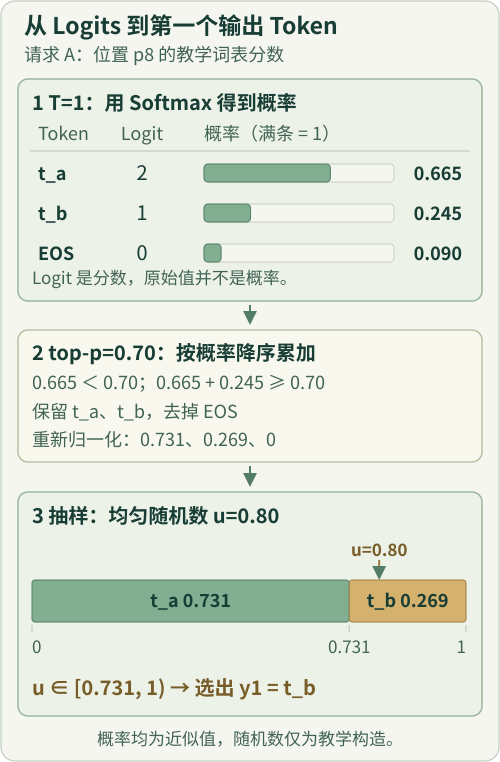
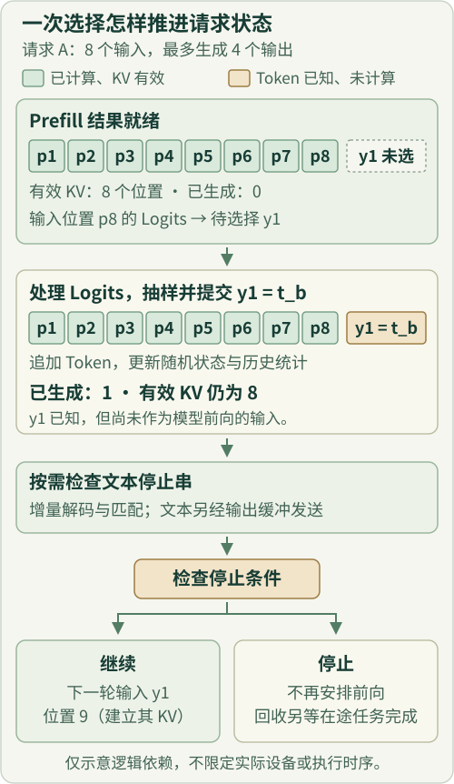
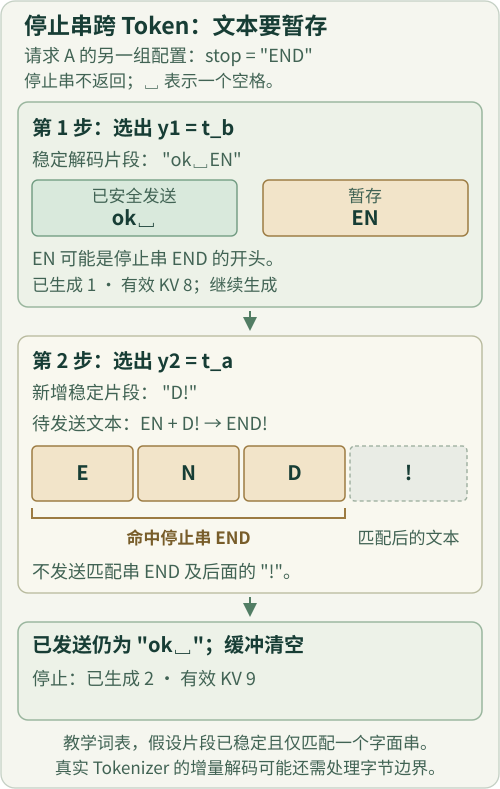

# 模型给出一组 Logits，怎样决定下一个 Token？

在 [G02](g02-prefill-and-decode.md) 中，请求 A 的 Prefill 完成后，模型已经建立 8 个位置的 KV，并给出了用于预测第一个输出 Token 的 Logits。但此时第一个输出 Token 还没有被选择。

同一段输入，有时得到相同的回答，有时却产生不同的结果。原因之一是模型运行时可以采用不同的规则，从模型给出的分数中选择下一个 Token。

**生成控制**负责根据生成配置、当前序列及模型的 Logits 决定下一步输出，更新请求状态，并判断请求是否应该继续。它还需要将选出的 Token 转为可以返回给用户的文本。

本篇继续跟踪 A（8 个输入 Token，最多生成 4 个），研究普通单序列生成。先从第一次 Token 选择开始，再看之后每轮如何重复这个过程。暂不讨论多候选搜索、约束解码和投机解码的内部机制。

## 同一组 Logits，为什么可以选择不同的 Token？ {#logits-to-probabilities}

模型的词表为每个 Token 定义一个 ID。一次用于生成的词表投影输出一组 Logits，其中每项分数对应一个候选 ID。Logits 越大，通常表示模型在当前上下文中更倾向于选择该候选。

沿用[算法与模型：语言模型](../../workload/language-and-multimodal/language-models.md)的教学算例，为 A 构造一个只有三个候选的词表。用 t_a、t_b 和 EOS 表示它们，避免与请求 A、B 混淆。EOS 是表示序列结束的特殊 Token。

假设 Prefill 给出以下分数：

| 候选 | 模型 Logits |
| --- | ---: |
| t_a | 2 |
| t_b | 1 |
| EOS | 0 |

一种方法是直接选择分数最高的 t_a。这称为**贪心解码（Greedy Decoding）**。若多个候选分数相同，实现还需要定义如何选择其中一个。

另一种方法是按照候选的概率随机选择。Logits 不是概率，可以为负值，也不要求总和等于 1。因此，需要将它们转换成一个概率分布。

例如使用 Softmax。若温度（Temperature）为 T，且 T > 0，令 m 为当前有效候选的最大 Logit，候选 i 的概率为：

**pᵢ = exp((zᵢ − m) / T) / Σⱼ exp((zⱼ − m) / T)**

其中 zᵢ 是候选 i 的分数，求和覆盖当前有效候选。减去最大分数不改变数学上的概率，可以降低指数运算溢出的风险。

在 T = 1 时，三个候选的概率分别约为 0.665、0.245、0.090。现在若按这个概率分布采样，t_b 和 EOS 也有机会被选到。该分布描述下一 Token 的选择概率，不代表文本内容为事实的概率。

温度可以改变分布的集中程度（下表取近似值）。

| 温度 | t_a | t_b | EOS |
| ---: | ---: | ---: | ---: |
| 0.5 | 0.867 | 0.117 | 0.016 |
| 1 | 0.665 | 0.245 | 0.090 |
| 2 | 0.506 | 0.307 | 0.186 |

对于非相等的有限分数，降低正温度可以使概率更集中于高分候选；提高温度则使概率更分散。正温度缩放不改变原有分数的大小顺序。

贪心解码是一条不同的选择路径。某些接口用 temperature=0 表示贪心，但实际应进入选择最大有效分数的分支，不能把 0 代入上面的除法公式。温度变化也不能直接保证回答质量变化。

## 为什么还需要限制参与采样的候选？ {#candidate-filtering}

假设 A 不希望采样到一些低分候选，可以在抽样前先缩小参与采样的候选集合。常见的两种方法为 Top-k 和 Top-p。

- **Top-k**：例如 k=2，保留分数最高的两个候选。
- **Top-p**（也称 Nucleus Sampling）：将概率从高到低排序，保留累计概率达到阈值 p 所需的最小前缀。

以 T=1、Top-p=0.70 为例，t_a 的概率约为 0.665，尚未达到 0.70。再加入 t_b，累计概率约为 0.910，已经达到阈值，因此保留 t_a 和 t_b。

EOS 不参与这次采样。剩余概率总和不足 1，需重新归一化，即把每个保留项的概率除以保留项的概率总和。

| 候选 | 截断之前 | 截断之后的采样概率 |
| --- | ---: | ---: |
| t_a | 0.665 | 0.731 |
| t_b | 0.245 | 0.269 |
| EOS | 0.090 | 0 |

本例中 Top-k=2 与 Top-p=0.70 的结果恰好相同，其他分布未必如此。Top-k 用候选数控制范围；Top-p 用概率质量控制范围。并列分数、阈值刚好相等和最少保留候选数需要由具体实现明确。

例如 vLLM v0.10.2 的 PyTorch 回退实现会去掉严格低于第 k 大分数的候选，因此分数并列时可能保留超过 k 项；同时启用 Top-k 与 Top-p 时，该路径先做 Top-k，再按剩余项的概率执行 Top-p。

[Top-p 原始论文](https://arxiv.org/abs/1904.09751) · [vLLM v0.10.2：TopKTopPSampler](https://docs.vllm.ai/en/v0.10.2/api/vllm/v1/sample/ops/topk_topp_sampler.html)

### 处理顺序为什么也是生成配置的一部分？

生成控制还可以根据请求历史调整概率。例如对已经出现过的 Token 施加重复惩罚，按出现次数调整分数，或禁止某些 Token 序列。具体使用的历史范围、惩罚公式和处理时点取决于实现。

这些操作常通过修改 Logits 或候选集合实现。被明确禁止的候选可以被掩蔽，使其不参与最终选择。但各项操作的顺序不一定能随意交换。

继续用 A 的原始分数 [2,1,0]：

| 两种处理顺序（Top-p=0.70） | 结果 |
| --- | --- |
| 先取 T=0.5 的分布，再 Top-p | t_a 的概率已达 0.867，只保留 t_a |
| 先在 T=1 时 Top-p，再对保留项施加 T=0.5 并归一化 | t_a、t_b 都保留，概率约为 0.881、0.119 |

虽然两种顺序都设置了温度 0.5 和 Top-p=0.70，最终允许的候选不同。相同参数名称并不保证相同的采样语义。

再假设 t_a 在本轮被硬性禁止。如果先 Top-k=1、再禁止 t_a，就可能没有任何候选；如果先禁止 t_a、再 Top-k=1，就会保留 t_b。

因此，生成控制需要定义处理顺序、边界处理以及空候选时的行为。如果所有候选都不合法，不能继续声称按约束产生了结果。应按接口明确报告失败或采用事先定义且不违反硬性约束的处理策略。

例如 vLLM v0.10.2 的 Sampler 会先处理允许列表、禁止词及相关 Logits 处理，再执行相应惩罚与贪心或随机采样路径；其随机路径还处理温度和候选截断。这是具体版本中的实现方式，不是通用接口必须采用的顺序。

[vLLM v0.10.2：Sampler 源码](https://docs.vllm.ai/en/v0.10.2/api/vllm/v1/sample/sampler.html)

G08 将解释如何根据指定语法不断改变允许集合，[G09](g09-speculative-decoding.md) 则需要明确目标模型最终实际使用的是哪个采样分布。

## 候选已经确定，怎样按概率选出一个具体 Token？ {#sampling}

回到 A 的第一次选择。假设本轮没有其他 Logits 处理，T=1、Top-p=0.70，最终两项的概率约为 0.731 和 0.269。

一种直观的抽样方法是把区间 [0,1) 按候选的概率长度分成两段，然后从该区间均匀生成一个随机数 u。u 落入哪一段，就选择那一段对应的 Token。

假设本轮取到 u=0.80，它落入 t_b 对应的区间，于是选择 t_b 作为 y1。

<figure markdown="1">

<figcaption>从分数到一次实际选择的教学示意。概率显示为近似值，抽样区间使用未舍入的概率确定边界。实际采样器可以采用其他等价算法。</figcaption>

</figure>

同样的分数和采样配置，如果另一次随机数落入 t_a 的区间，就会得到不同的 y1。不同的 y1 会成为下一轮不同的模型输入，因此后续 Logits 也可能不同。

### 为什么随机状态也需要与请求关联？

计算设备通常使用伪随机数生成器（RNG）产生抽样所需的随机值。给定初始化种子（Seed），生成器按其算法产生随机序列。运行时还需要知道随机数已经消耗到哪里。

因此，对需要独立控制随机性的生成序列，需要维护与它关联的随机状态。这可以是独立的生成器，也可以是随机算法使用的种子、计数器等状态。并不要求所有实现将它保存在同一位置。

如果 A 已生成一个 Token，现在暂停后再从初始 Seed 开始取随机数，就未必从之前的随机序列位置继续。一次采样消耗的随机数数量也取决于算法，不一定正好为一个。贪心路径则可以不消耗采样随机数。

例如 vLLM v0.10.2 对指定 Seed 的相应随机采样请求建立独立的生成器，使用该 Seed 初始化。具体实现还会根据执行路径组织随机数访问。

相同 Seed 不是跨设备、软件版本、批组成和执行顺序的逐 Token 复现保证。共享随机数流的消耗顺序可能改变，浮点归约及临界候选也可能受到执行形状影响。

如果希望复现，应记录模型版本、输入、生成配置、随机状态相关设置以及软件、内核和批执行条件。贪心输出相同、抽样分布相同和每个随机结果相同，是不同的验证目标。

[vLLM v0.10.2：GPUModelRunner 源码](https://docs.vllm.ai/en/v0.10.2/api/vllm/v1/worker/gpu_model_runner.html) · [Reproducibility](https://docs.vllm.ai/en/v0.10.2/usage/reproducibility.html)

## 选择了 y1 之后，请求状态怎样变化？ {#generation-state}

G02 的 Prefill 已让 A 拥有八个位置的有效 KV。现在采样器选出了 y1=t_b，运行时需要将这个结果正式记录到请求的生成序列中。

<figure markdown="1">

<figcaption>一轮生成控制的逻辑事件与状态。本图不规定 Logits 处理和采样一定由主机完成，也不规定所有设备任务必须全局同步。文本输出是另一条有自身状态的路径。</figcaption>

</figure>

| 请求 A 的状态 | Prefill 完成，尚未选择 | y1 已选出并提交 |
| --- | --- | --- |
| 已知 Token | p1…p8 | p1…p8、y1 |
| 已生成 Token 数 | 0 | 1 |
| 已计算位置数 | 8 | 8 |
| 本轮选择所需的随机状态 | 选择前 | 按实际采样更新 |
| 下一轮待计算的输入 | 尚未确定 | 若继续，则为 y1 |

此处的“提交”指选出的 Token 正式进入请求的生成序列，不是通用运行时中的任务提交。只有执行下一轮 Decode，才会计算 y1 对应的模型状态。

G01 的请求实例需要保存的不仅是 KV 和 Token 列表，还包括生成配置、历史相关的统计、随机状态、停止与解码状态。在一个请求产生多条候选序列时，这些可变状态也要按实际序列维护。

这些状态是真正决定“下一轮怎样生成”的输入。只恢复 KV，而丢失已经选出的最后一个 Token、随机状态或停止状态，无法无条件保证恢复原来的生成过程。跨设备交接和服务级恢复留给 I、J 专题。

[F02](../06-execution-runtime/f02-asynchronous-execution.md) 已说明，消费者必须等待其输入就绪。采样可以在设备侧运行，也可以用主机取得可用结果后完成，无须把每次词表 Logits 都复制到主机。下一轮执行仍须满足选择结果及历史 KV 的依赖。

## 怎样判断 A 不应该继续生成？ {#stopping}

如果没有任何结束条件，运行时可以反复执行“模型前向、选择 Token、更新状态”的过程。但请求需要某种规则来决定什么时候结束。

常见的条件包括：

| 条件 | 需要观察的信息 |
| --- | --- |
| EOS 或指定停止 Token ID | 本轮选出的 Token |
| 输出长度上限 | 已生成 Token 数，以及配置的长度限制 |
| 停止字符串 | 生成文本中是否出现指定字符串 |
| 外部取消、截止时间、执行错误 | 请求和在途任务的状态 |

例如 A 配置最多生成 4 个 Token。在 G02 的基线中没有更早的停止条件，选出 y4 后就会达到上限。此时已计算位置数仍为 11，不需要再计算 y4 才能停止。

如果更早选到 EOS，则可能提前结束。在本文算例中，已经提交的 Token ID 即计入已生成数，包括可能被隐藏的停止 Token；具体服务的返回 Token 和计费口径另有定义。

运行时应记录明确的结束原因。若同一次更新命中多个条件，也需要明确优先规则。达到长度上限，不能保证文本已经形成完整句子，更不能保证结构化输出符合完整语法。

停止时不再为已结束的请求安排新的前向，不表示此前提交的任务立即结束。外部取消或错误可能发生在设备工作执行期间；晚到的结果需要依据请求状态处理。资源安全回收继续遵守 [F03](../06-execution-runtime/f03-runtime-buffer-management.md)，具体的服务故障与取消流程留给 J 专题。

[Transformers v4.57.0：GenerationConfig](https://huggingface.co/docs/transformers/v4.57.0/en/main_classes/text_generation) · [vLLM v0.10.2：SamplingParams](https://docs.vllm.ai/en/v0.10.2/api/vllm/sampling_params.html)

## 为什么选出一个 Token 后，不一定能立即将它显示出来？ {#incremental-detokenization}

模型运行时得到的是 Token ID。用户需要的是文本，因此还需用与模型匹配的分词器规则把 Token 序列转换回文本，这称为 **Detokenization（反分词）**。

一个 Token 可能对应一个文字、多个字符、空格或一部分字节。有些特殊 Token 不应直接作为文本显示。Token 的边界与一个可返回的字符串片段的边界并不总是相同。

例如在一种允许字节片段的分词表示中，UTF-8 字符“你”的三个字节可以分在两个 Token 内：E4 BD 与 A0。当只得到前两个字节时，还无法构造完整字符；直到得到第三个字节，才能组成“你”。

因此，不能认为分别解码每个 Token 再拼接文本就一定正确。运行时需要随序列保留解码所需的信息，确认新的文本前缀稳定且可以发送。具体处理依赖分词器的编码与解码规则。

例如 vLLM v0.10.2 的[增量解码辅助代码](https://docs.vllm.ai/en/v0.10.2/api/vllm/transformers_utils/detokenizer_utils.html)会在某些尚未形成完整文本的情况下等待更多 Token。

流式输出还需要知道哪些文本已发送，哪些文本仍在缓冲。两个 Token 可以合成一次可见输出，一个 Token 也可能带来多个字符。用户看到的文本片段数、字符数和模型生成 Token 数，是不同的计数。

## 如果停止字符串刚好跨过两个 Token 呢？ {#stop-buffer}

沿用 A 的两个候选。现在构造一种替代停止配置：停止字符串为 END，匹配到时结束，并且返回内容不包含停止串及之后的文本。其他条件不变。

仅为解释文本边界，假设在本次教学解码中，t_b 对应文本片段 “ok EN”，t_a 对应 “D!”。这里假设两个片段都已是稳定解码结果，不要求实际分词器存在这两个 Token。

Prefill 后我们已经选出 y1=t_b，增量解码得到 “ok EN”。此时尚未出现完整的 END，但最后两个字符 EN 可能是停止串的开头。

运行时可以先发送确定不会被后续停止匹配改变的 “ok ”，将 EN 暂存。下一轮 Decode 消费 y1，并假设本轮从新的 Logits 选择 y2=t_a。

新解码片段 “D!” 和之前暂存的 EN 拼在一起，得到 “END!”。此时检测到 END，按照本例配置停止并丢弃 END 及后面的感叹号。不应将此前已发送的文本重新发送，也不应让停止串泄露给用户。

<figure markdown="1">

<figcaption>教学例采用单个停止字符串、匹配后排除停止串的输出规则。两次解码片段均已稳定。图中缓冲与发送表示逻辑文本状态，不规定网络传输的具体时刻。此处不是 G02 中输出恰好四个 Token 的基线。</figcaption>

</figure>

在这个替代运行中，生成已经提交了 y1、y2 两个 Token，只有九个位置具有有效 KV。第二个 Token 即使没有文字被发送，也已经被选择；停止串匹配不需要重新编造或修改 Token ID。

如果没有出现完整停止串就正常结束，未发送的稳定文本应按约定的结束策略处理。例如长度达到上限时，原本为检测停止串而暂存的 EN 可以按协议作为未匹配文本返回。

实际系统可能暂缓发送固定的尾部长度，也可能跟踪哪些后缀符合停止串的前缀。例如 vLLM v0.10.2 的增量解码器在排除停止串的模式下，会暂缓发送最长停止串长度减一的尾部字符（若当前可用文本更短，则暂缓已有部分），用于跨 Token 检查。

已经发送的文本无法在普通追加式输出流中撤回。停止判定与缓冲更新共同确定下一个可安全发送的片段。这也是为什么模型连续产生 Token，客户端仍可能暂时没有新文本可见。

[vLLM v0.10.2：Detokenizer 源码](https://docs.vllm.ai/en/v0.10.2/api/vllm/v1/engine/detokenizer.html) · [OutputProcessor 源码](https://docs.vllm.ai/en/v0.10.2/api/vllm/v1/engine/output_processor.html)

## 从一次选择回到完整请求

现在我们有了 G02 没有展开的另一半执行逻辑。每轮模型计算给出下一 Token 的分数；生成控制依据配置和序列状态处理分数、选择 Token 并提交。只在需要继续时，才为序列安排下一轮模型计算。

对 A 而言，选择 y1 后，模型计算进度和生成进度并不同步增长，文本输出进度又可以落在两者之后。对于后续各轮，运行时必须分别观察这些状态。

本篇建立的普通生成循环和最终采样分布，将作为 G08 约束解码与 [G09 投机解码](g09-speculative-decoding.md)的前置知识。现在回到另一条阅读路线，[G04](g04-model-state-and-memory-budget.md) 将解释当权重已经加载、请求的状态不断积累时，设备为什么还可能缺少存储空间。

## 参考资料与继续阅读

- [算法与模型：自回归生成](../../workload/generative-models/autoregressive-generation.md)：模型条件概率与逐 Token 依赖。
- [Transformers v4.57.0：Generation](https://huggingface.co/docs/transformers/v4.57.0/en/main_classes/text_generation)：生成配置及停止条件。
- [vLLM v0.10.2：SamplingParams](https://docs.vllm.ai/en/v0.10.2/api/vllm/sampling_params.html)：生成策略的一种具体接口。
- [回到 G 专题导读](README.md)。
