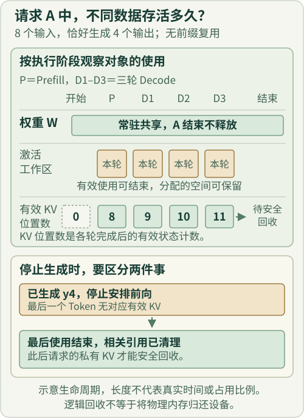
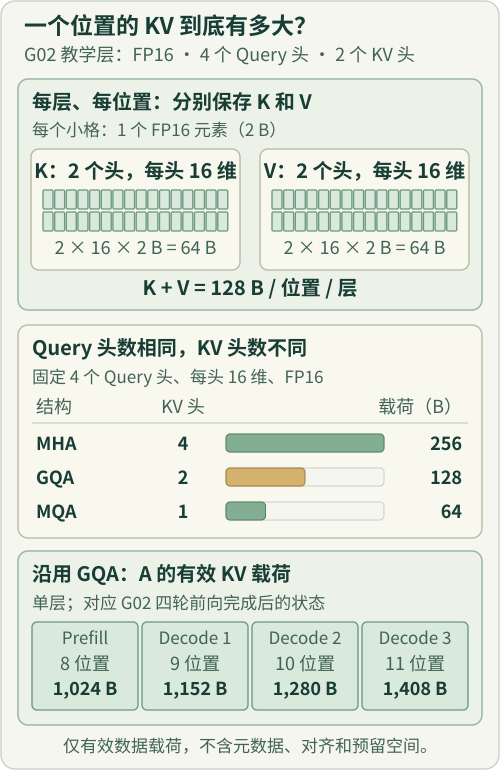
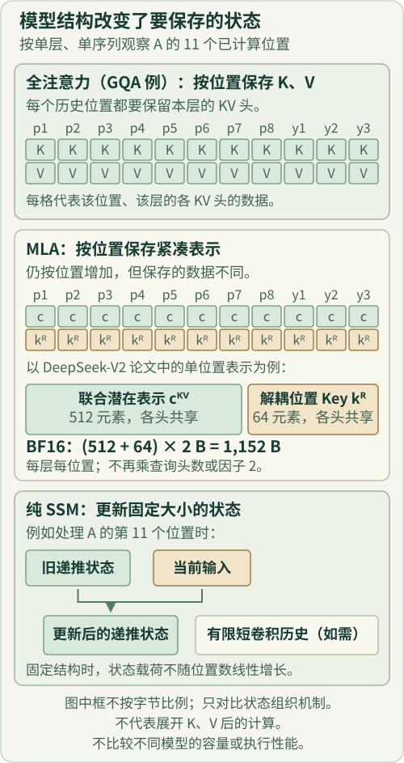
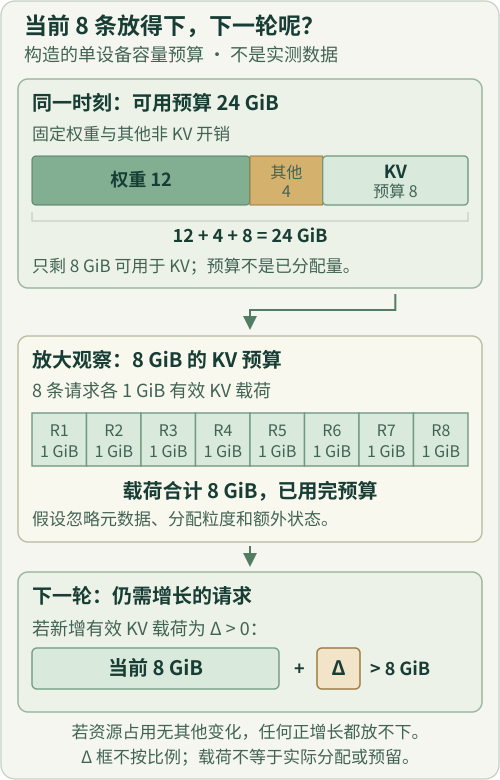

# 权重已经装进显存，为什么请求增加后仍然可能溢出？

在 [G01](g01-model-loading-and-execution.md) 中，模型 M 已经完成权重准备。无论接下来执行请求 A 还是请求 B，同一模型实例都可以复用这份权重。

但是，[G02](g02-prefill-and-decode.md) 的请求 A 在生成过程中还需要保存不断增长的 KV。多个请求即使使用同一份权重，也需要各自的执行数据和历史状态。

**内存预算（Memory Budget）**要回答的是：在给定模型、执行计划及请求状态的条件下，各项工作同时需要占用多少存储空间，这些空间能否被设备提供。

本篇先追踪 A 的不同数据何时产生、何时可以回收，再计算 KV 有效载荷，最后将它放回整个设备的内存预算。这里先讨论单设备的容量，不展开跨设备切分、分页分配和请求调度。

## 一次模型执行结束后，为什么有些数据还不能释放？ {#model-state-lifetime}

回到 G01–G03 的基本例子。A 有 8 个输入 Token，最多生成 4 个 Token。仍假定采用全因果 Attention、不启用前缀复用、分块 Prefill 和投机解码，并恰好达到输出上限。

模型运行时依次提交完整 Prefill 和三次 Decode。在此过程中，需要区分几类数据。

| 对象 | 为什么存在？ | 何时可以不再保留？ |
| --- | --- | --- |
| 权重（Weight）及常量 | 提供模型各项计算需要的参数 | 模型实例退出且不再被使用 |
| 激活（Activation） | 一项计算产生的 Tensor，需要供同层或后续计算使用 | 最后一个消费者结束访问 |
| 工作区（Workspace） | 某个计算实现额外需要的临时空间，例如部分归约结果 | 相关任务及实现不再需要该空间 |
| KV Cache | 保存已计算位置各层的历史状态，供之后的 Decode 读取 | 状态不再需要且相关访问结束 |
| 生成状态 | 记录 Token、位置、随机状态、停止和文本解码进度 | 响应、恢复等约定用途完成 |

激活与工作区可能处于设备显存或片上存储。它们的大小也取决于实际内核和执行计划。例如分块、融合可以避免某些中间结果写入显存。预算中只计所观察的存储范围。本文讨论设备显存（如 HBM），不是计算单元附近的片上 SRAM；驻留容量也不同于每轮实际读写流量。

KV 与大多数临时激活不同。完成 Prefill 后，模型的中间结果可以在满足使用条件时回收，但八个位置的 KV 仍要为 Decode 服务。因此，后续模型调用必须使用与 A 相容的历史状态。

<figure markdown="1">

<figcaption>逻辑生命周期示意。各段不表示实际耗时或存储比例；临时数据不再使用，不代表其底层存储立即释放。模型权重仍可为后续请求服务。</figcaption>

</figure>

请求达到结束条件时，不代表所有设备访问已经结束。按照 [F02](../06-execution-runtime/f02-asynchronous-execution.md) 和 [F03](../06-execution-runtime/f03-runtime-buffer-management.md)，仍需确认在途使用与其他引用，再归还不需要保留的空间。

[计算微架构：缓冲区复用](../../microarchitecture-v2/06-resource-cooperation/f01-overlap-and-buffer-reuse.md) · [D07：分块 Attention](../04-code-generation/d07-attention-kernels.md)

## 多计算一个位置，KV Cache 要增加多少数据？ {#kv-per-position}

G02 已经建立一个用于手算的 Attention 层：隐藏宽度为 64，具有 4 个查询头、2 个 KV 头，每头维度为 16，KV 采用 FP16，每个元素占 2 B。

这个层使用 GQA（Grouped-Query Attention）。每组查询头使用同一组 K、V。虽然四个查询头各自进行 Attention 计算，但这里只需要保存两组 K 和两组 V。

一个有效位置在这个层的 KV 数据量为：

**K：2 × 16 × 2 B = 64 B**

**V：2 × 16 × 2 B = 64 B**

合计为 **128 B/位置/层**。

<figure markdown="1">

<figcaption>只统计一层、一个有效位置的 K/V 数据，不含 Scale 等附加数据和分配粒度。对照中的 MHA、GQA 和 MQA 使用相同的查询头数与头维度，是三种结构，不是同一个已训练模型的随意切换。</figcaption>

</figure>

继续沿着 A 的生成过程，观察这一层已经建立的 KV 有效载荷，即已经计算并需要保留的 K/V 数值占多少字节。

| 阶段 | 已知 Token 数 | 已生成 Token 数 | 有效 KV 位置数 | 本层有效载荷 |
| --- | ---: | ---: | ---: | ---: |
| 初始 | 8 | 0 | 0 | 0 B |
| Prefill 后 | 9 | 1 | 8 | 1,024 B |
| Decode 1 后 | 10 | 2 | 9 | 1,152 B |
| Decode 2 后 | 11 | 3 | 10 | 1,280 B |
| Decode 3 后 | 12 | 4 | 11 | 1,408 B |

这里不是按已知 Token 数计量。y4 已经被选出，但本例的模型尚未为它执行前向。因此最后只保存了 11 个位置的有效 KV。

如果模型有 L 个结构相同的全注意力层，并且在本设备上保存各层完整的 K、V，那么每增加一个有效位置，都需要为每个层分别保存数据。

| 符号 | 含义 |
| --- | --- |
| L | 注意力层数 |
| h_kv | KV 头数 |
| d_h | 每个 KV 头的维度，假设 K 与 V 相同 |
| p_kv | 每个 K/V 元素的存储字节数 |
| k_kv | 一个位置在全部 L 层的 KV 有效载荷 |

当各层使用相同的布局，且 K 与 V 具有相同存储精度时：

**k_kv = 2 × L × h_kv × d_h × p_kv（B/位置）**

其中因子 2 来自 K 和 V。若 K、V 的维度或精度不同，应分别计算后再相加。

假设多条生成序列分别有 nᵢ 个已计算并保留的位置，没有前缀共享或额外复制，则它们在该设备的 KV 有效载荷为：

**K_payload = k_kv × Σᵢ nᵢ**

这说明权重不会因为使用同一实例的请求变多而重复加载，但保存的历史状态会随序列数及有效历史长度增长。查询头数并不能代替 KV 头数计算 GQA 的缓存容量。

[算法与模型：Attention 效率](../../workload/01-foundation-model-components/attention-variants-and-efficiency.md) · [GQA 原始论文](https://arxiv.org/abs/2305.13245)

## 计算出了有效载荷，就知道实际分配了多少空间吗？ {#payload-and-allocation}

假设为 A 的上述教学层一次性预留了 12 个位置的 KV 存储，以容纳输入及最多四个输出位置。忽略对齐和附加数据时，它需要 12 × 128 B = 1,536 B。

Prefill 后，有效载荷是 1,024 B；最后一次 Decode 结束后，有效载荷是 1,408 B。但这段预留区仍占 1,536 B。有效载荷的增长并没有让设备已分配的容量同步增加。

进一步假设四条请求各预留 8,192 个位置，而当前各只保存 1,024 个位置。单看这些预留区，有效载荷占比为 4 × 1,024 / (4 × 8,192) = 12.5%。其余空间可能已经保留，却尚未保存有效数据。

这两种例子体现了存储预算与逻辑状态的区别。为了理解实际内存占用，至少需要区分以下几种数量：

- 有效载荷：实际需要保存的模型状态数据。
- 已用分配空间：包括有效数据和分配粒度、对齐及必要的附加数据。
- 池内的空闲空间：已由运行时保留，但可以分配给新工作。
- 待回收空间：不再安排新的使用，却仍需要等待在途访问或引用解除。

如果运行时预先取得一整个 KV 池，那么某个请求新增一个位置，可能只是让池内的空闲空间变成已用空间。请求结束后返回池，也不一定将显存归还给下层分配器。

这正是 [F03 的内存池](../06-execution-runtime/f03-runtime-buffer-management.md) 在模型运行时中的体现。设备的显存使用量没有变化，不代表还有足够的空闲 KV 空间；已停止生成的请求也未必已经归还其状态空间。

块尾部、前缀共享与引用计数会进一步改变实际分配量，分别留给 G05、G06。

## 为什么不能用同一条 KV 公式估算所有模型？ {#different-model-states}

前面的公式依据特定缓存布局得到。要应用到另一种模型，首先要确定每层真正保存了什么状态，以及需要保留多长时间。

### 从 MHA、GQA 到 MQA

标准 MHA 通常为每个查询头建立一组 K、V；GQA 让一组查询头共用 K、V；MQA 则让多个查询头使用同一组 K、V。

假设仍使用 G02 的教学配置，其余条件保持不变，仅对比三种模型结构。

| 结构 | 查询头数 | KV 头数 | 单层每位置 KV 有效载荷 |
| --- | ---: | ---: | ---: |
| MHA | 4 | 4 | 256 B |
| GQA | 4 | 2 | 128 B |
| MQA | 4 | 1 | 64 B |

减少 KV 头数可以减少需要保存的历史状态，但查询头仍各自进行相应的注意力计算。这些结构需要各自匹配的模型参数；不能把已有 MHA 权重任意合并后就认为结果不变。

### MLA 为什么不用保存完整的各头 K、V？

多头潜在注意力（Multi-Head Latent Attention，MLA）采用另一种模型结构。和 GQA 通过共享 KV 头减少缓存不同，MLA 可以将用于得到 K、V 的信息投影为较短的共享表示。

以 DeepSeek-V2 论文介绍的结构为例，每层、每个历史位置产生一个联合压缩向量 c^KV。K 的内容部分与 V 可以根据这个向量，通过各自学习得到的变换产生。

模型还需要考虑位置编码。它使用一个与内容部分解耦的位置 Key，记为 k^R（各查询头共用），并将它与 c^KV 一起保存。后续计算可以使用这两种状态，内核不必把所有展开后的 K、V 都保存在缓存中。

采用论文中的紧凑缓存表示时，设压缩向量维度为 d_c，位置 Key 维度为 d_R，两者分别占 p_c 和 p_R 字节/元素，则每层每位置的有效载荷为：

**k_MLA = d_c × p_c + d_R × p_R**

DeepSeek-V2 原论文中，d_c = 512，d_R = 64。假设两部分均为 BF16，则每层每位置是 (512 + 64) × 2 B = 1,152 B。对论文中的 60 层，就是 69,120 B，即 67.5 KiB/位置。

这是联合压缩向量和位置 Key 的载荷，不应该再乘查询头数或套用普通 K、V 的因子 2。

实际占用仍取决于执行后端的缓存表示。例如 vLLM v0.10.2 的 MLA 后端将压缩向量与位置 Key 写入同一缓存，也存在使用展开表示的执行路径。不同 MLA 模型的压缩维度和存储精度也可能不同。

[DeepSeek-V2 原论文 §2.1、§3.1](https://arxiv.org/html/2405.04434v5) · [vLLM v0.10.2：KV Cache Interface](https://docs.vllm.ai/en/v0.10.2/api/vllm/v1/kv_cache_interface.html) · [MLA 后端](https://docs.vllm.ai/en/v0.10.2/api/vllm/v1/attention/backends/mla/common.html) · [模型执行器](https://docs.vllm.ai/en/v0.10.2/api/vllm/model_executor/models/deepseek_v2.html)

### 窗口 Attention 和 SSM 要保存多少历史？

全注意力通常需要保留整个有效历史。滑动窗口 Attention 则只允许读取规定窗口内的位置。对这类层，旧位置离开可见范围后，运行时可以按算法与安全条件回收不再需要的数据。

仍以 A 为例，假设某层窗口宽度为 4，包含当前查询位置。若需要继续计算位置 12，它只读取位置 9 至 11 的旧 K/V 与本轮位置 12 的 K/V。此前保留的更早位置可在满足安全条件时淘汰。

因此该层不必永久保留全部 11 个历史位置，但其他全注意力层可能仍需要全部历史。实际缓存还可能为了分块、在途使用、预留或附加状态占用更大的空间，不能把算法可见范围直接写成物理分配量。

而 [SSM（状态空间模型）](../../workload/01-foundation-model-components/mamba-and-ssm.md) 使用递推状态组织计算。处理一个新位置时，它根据旧递推状态和当前输入获得新状态。固定模型结构下，纯 SSM 可以只维护固定大小的递推状态，不需要为每个历史位置保存完整 K、V。

实际 Mamba 模块通常还包含短卷积，需要保留有限宽度的卷积历史。以 vLLM v0.10.2 中 Mamba-1 的状态形状为例，在单序列、单设备（不切分）的条件下：

| 状态 | 元素数 |
| --- | ---: |
| 卷积历史 | 中间通道数 D × (卷积核宽度 − 1) |
| 递推状态 | 中间通道数 D × 状态维度 N |

若 D=256、卷积核宽度为 4、N=16，两种状态均假定为 FP16，则递推状态为 8 KiB，卷积历史为 1.5 KiB。合计 9.5 KiB/层/序列，是这个特定布局的教学载荷，不随已处理位置数线性增长。

实际实现的卷积历史槽数、布局或精度可以不同，应按真实 Tensor 形状计数。整段输入处理的临时激活、输出 Token 记录及额外快照仍可能增长，不能理解为 SSM 的全部内存恒定。

[Mamba 原论文](https://arxiv.org/html/2312.00752v2) · [vLLM v0.10.2：Mamba State Shape Calculator](https://docs.vllm.ai/en/v0.10.2/api/vllm/model_executor/layers/mamba/mamba_utils.html) · [SSM 工作负载](../../workload/06-chip-workload-analysis/ssm-workload.md)

<figure markdown="1">

<figcaption>不同模型所保留的历史状态。三个结构的模型尺寸、精度和计算方式可以不同，因此本图仅比较状态的组织与增长方式，不比较实际容量大小或执行性能。</figcaption>

</figure>

### 混合模型怎样建立总的状态预算？

模型可以同时包含全注意力、窗口 Attention 和递推层。对于按位置保存状态的层 l，令 k_l 为每位置的有效数据字节数，nᵢ,ₗ 为序列 i 在该层实际保留的位置数。

不共享且不复制时，这些层的有效载荷为：

**K_payload = Σᵢ Σₗ nᵢ,ₗ × k_l**

定长递推层则直接按其状态 Tensor 的元素数及精度计量，并加到模型状态预算中。不同精度、不同缓存组、不同设备上的状态需要分别核对。如果多个序列复用同一份共享状态，应按实际存储的唯一数据计一次，而不是按引用次数重复计量。

[Transformer 的缓存策略](https://huggingface.co/docs/transformers/v4.57.0/en/kv_cache) · [vLLM v0.10.2：Hybrid KV Cache Manager](https://docs.vllm.ai/en/v0.10.2/design/hybrid_kv_cache_manager.html)

## 减小 KV 精度，能否让设备服务更多请求？ {#kv-precision}

权重、激活和 KV 可以采用不同精度。将权重编码为低比特可以减少模型常驻数据，但不能直接减少请求历史状态；改变 KV 存储精度则会改变每个位置的状态容量。

例如一个具有 80 个同构全注意力层、8 个 KV 头、每头维度 128 的模型，若采用 16 bit KV，其每位置有效载荷为：

**2 × 80 × 8 × 128 × 2 B = 327,680 B = 320 KiB。**

保存 8,192 个位置需要 2.5 GiB。这里统计整个模型的一条序列、无额外复制与共享的有效数据，不假设该模型的全部权重可以装入某一特定设备。

现在比较 16 bit 与 8 bit 的 KV 编码。如果同一结构只改变 KV 元素的存储字节数，且每条序列均保存 4,096 个位置，则有：

| KV 编码 | 每位置有效载荷 | 每条序列有效载荷 | 10 GiB 预算的载荷上限 |
| --- | ---: | ---: | ---: |
| 16 bit | 320 KiB | 1.25 GiB | 8 条 |
| 8 bit | 160 KiB | 0.625 GiB | 16 条 |

这个例子仅计算载荷能够放多少条序列。实际低精度存储还可能需要 Scale、Zero Point、分组信息、对齐、元数据以及转换工作区。它们的存储粒度和长度可能与 KV 不同。

例如 vLLM v0.10.2 支持 FP8 KV Cache，并对 K、V 使用相应缩放参数。使用何种量化方式、是否需要额外转换以及能否由匹配内核高效执行，必须结合具体版本和设备。

更低精度也可能改变后续生成结果。需要固定模型版本、量化规则、内核、输入和生成配置，检查目标任务质量及长上下文、结构化输出等实际用例；同时测量显存峰值、延迟、吞吐及失败率。

缓存数据读写量减少，也不能直接推断 Token 间隔或服务并发必然按同样的比例改善。内核的低精度实现由 D 专题展开，整体性能测量留给 K 专题。

[vLLM v0.10.2：Quantized KV Cache](https://docs.vllm.ai/en/v0.10.2/features/quantization/quantized_kvcache.html)

## 给一台设备留出多少空间才合理？ {#device-budget}

现在把请求状态的大小放回整个设备中。到目前为止，我们已经知道权重参数需要常驻，临时数据有各自的生命周期，而模型历史状态可能随请求而增长。

但为什么有时 KV 还有空闲位置，一次 Prefill 仍可能遇到内存不足？

因为执行本身还需要显存。某些工作区随本轮 Token 数、形状和内核变化。运行时也可能为多个执行形状准备固定地址的 Buffer，以便利用 [F04](../06-execution-runtime/f04-execution-graphs-and-replay.md) 的图重放和 [F05](../06-execution-runtime/f05-dynamic-shapes-and-specialization.md) 中的不同变体。

对设备 r，在同一时刻 t，可以把实际占用的设备内存分为以下互不重叠的类别。

| 符号 | 占用来源 |
| --- | --- |
| Wᵣ(t) | 权重、适配器与常量 |
| Kᵣ(t) | 模型历史状态及其专用池，包括实际保留的空间 |
| Aᵣ(t) | 激活、临时工作区 |
| Gᵣ(t) | 已准备的执行图相关固定资源 |
| Cᵣ(t) | 通信与传输缓冲区 |
| Oᵣ(t) | 其余资源、元数据、分配保留与相关运行时开销 |

统一按 byte 计，设备上的总占用为：

**Mᵣ(t) = Wᵣ(t) + Kᵣ(t) + Aᵣ(t) + Gᵣ(t) + Cᵣ(t) + Oᵣ(t)**

若某一图使用的 Buffer 已经计入 Aᵣ 或某个池，就不能再次计入 Gᵣ。若 KV 专用池已包含元数据，也不能再次计入 Oᵣ。类别是分析用的分工，不一定与框架显示的统计项一一对应。

在所承诺的执行范围内，记该设备的可用预算为 Bᵣ，需要满足 **maxₜ Mᵣ(t) ≤ Bᵣ**。各类别可能在不同时间达到峰值，因此不能简单将各自的独立峰值相加后当成真实峰值。

### 一个容量刚好装下却不能继续生成的例子

另构造一台设备的预算，不使用前述 80 层模型的权重大小。假设在观察的执行阶段，可用内存预算为 24 GiB，权重占 12 GiB，其他非 KV 的同时占用合计为 4 GiB。

则该阶段能够留给 KV 的预算为：

**24 GiB − 12 GiB − 4 GiB = 8 GiB。**

<figure markdown="1">

<figcaption>忽略附加数据、分配粒度和额外空间的理想预算。24 GiB 是给本例使用的可用预算，并非某款设备的标称容量；该示例与前面的 80 层模型并非同一配置。</figcaption>

</figure>

假设八条请求当前每条拥有 1 GiB 的 KV 有效载荷，并且均还需要生成。即使忽略所有附加开销，它们也已经用完 8 GiB 的空间。任意一条若要新增一个有效 KV 位置，且没有释放或其他复用，就没有空间保存新状态。

因此“当前请求全部可以装下”不足以证明“下一轮能够继续”。实际运行时还需要检查本轮新分配量、临时执行需求与可以安全回收的容量。

这只是容量约束，不是要求引擎始终按最大输出长度预留。何时接纳请求、何时等待、何时允许受控超额承诺，以及如何恢复，留给 H 专题。

设备标称容量也不等于进程能够使用的预算。应明确哪些驱动、其他进程或保留资源已从可用预算中扣除，避免在 Oᵣ 中再扣一次。

对于多设备，即使总容量充足，某个 Rank 仍可能因参数复制、切分不均或局部状态耗尽而无法执行。必须首先满足每个设备的约束。主机的请求队列、分词数据、文本缓冲、加载和卸载状态也需要独立预算。

## 怎样确定实际运行中的内存需求？ {#measuring-memory}

计算量、Tensor 有效数据及静态估算能够帮助我们检查模型，但不能替代实际的内存观测。分配器可能预留空间，内核可能有临时工作区，执行图还可能持有固定 Buffer。

例如 PyTorch 2.7 的 CUDA 缓存分配器提供以下统计。

| 统计项 | 表示什么 |
| --- | --- |
| memory_allocated | 当前 Tensor 占用的该分配器所统计的显存 |
| memory_reserved | 该缓存分配器管理的总显存量，包含已分配部分 |
| max_memory_allocated / max_memory_reserved | 相应统计在记录范围内的峰值 |

不能把 allocated 和 reserved 相加，因为两者的范围存在包含关系。设备总使用量还可能包括不由该分配器管理的直接分配、上下文和其他进程。若要比较两组数字，需要先统一计量边界。

另一个例子是 vLLM v0.10.2 的 GPU Worker。它可以通过运行代表性模型工作，估计非 KV 内存开销，并据此推算 KV 池的剩余预算。但该版本的初始内存分析未包含之后的 CUDA Graph 捕获开销，需要进一步结合相关资源及余量检查。

[PyTorch 2.7：CUDA Memory Management](https://docs.pytorch.org/docs/2.7/notes/cuda.html#memory-management) · [vLLM v0.10.2：GPU Worker](https://docs.vllm.ai/en/v0.10.2/api/vllm/v1/worker/gpu_worker.html)

在构建或验证内存预算时，可以按如下顺序记录：

1. 模型加载和预热阶段的峰值，包括转换产生的中间数据。
2. 不同 Token 数、请求形状下的执行临时占用和固定资源。
3. 各模型状态池的总保留量、已用量、空闲量和待回收量。
4. 触发峰值的请求组成、长度和实际分配记录，以及设备和主机的对应统计。

预热只能覆盖所测试的执行条件。总预算足够也不保证每次分配都能成功：空间可能尚不能安全归还，也可能不满足所需的连续范围、对齐或池内分配条件。

## 接下来怎样管理不断增长的状态？

现在已经知道一个请求需要保存多少 KV 数据，也知道这些数据为什么会在有效载荷之外占用额外空间。

回到 A。如果每个请求的完整 KV 空间都按最大长度提前分配，会保留尚未使用的容量；而逐渐扩大一个连续存储区，则可能遇到相邻空间不足的问题。

[G05：序列不断变长，KV 怎样保存在不连续的缓存块中？](g05-paged-kv-cache.md) 将从这个问题出发，解释如何把序列的逻辑位置映射到可按需分配的缓存块，使序列增长不必依赖一整段足够大的连续空间。

如果希望继续研究生成控制，可以先读 [G09：一次生成多个候选 Token，怎样验证并提交正确的结果？](g09-speculative-decoding.md)，观察候选状态带来的临时内存及提交、回滚条件。

## 来源与继续阅读

- [G02：生成一个 Token 之前，模型到底执行了哪些工作？](g02-prefill-and-decode.md)：有效 KV 位置与执行阶段。
- [算法与模型：Transformer 工作负载](../../workload/06-chip-workload-analysis/transformer-workload.md)：教学层与工作量、KV 载荷的计算。
- [存储系统](../../storage/README.md)：片上存储、DRAM 与 HBM 的物理容量和数据路径。
- [通用运行时内存管理：F03](../06-execution-runtime/f03-runtime-buffer-management.md)：分配、池、碎片和延迟回收。
- [回到 G 专题导读](README.md)。
