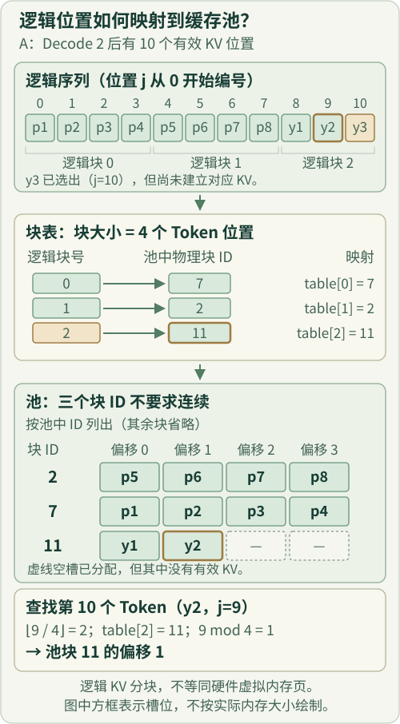
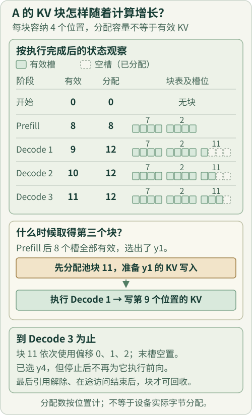
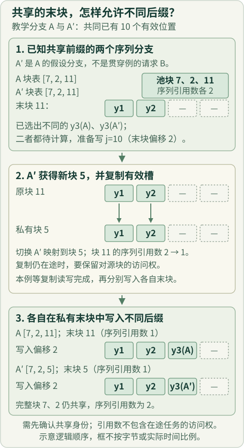

# 序列不断变长，KV 怎样保存在不连续的缓存块中？

在 [G04](g04-model-state-and-memory-budget.md) 中，请求 A 每计算一个新位置，都需要为它保留新的 KV。请求何时结束却不一定能提前知道。

如果为每条请求按最大长度预留一段连续的空间，空间可能长期闲置。如果只分配当前需要的大小，序列变长时，原来的存储区域后面又可能已经被其他请求占用。

**分页 KV（Paged KV Cache）**将序列的历史状态划分为可独立分配的块。运行时维护逻辑位置到存储块的映射，让序列可以在不连续的存储空间中增长，而不必每次都移动整个历史。

本篇沿用 A（8 个输入 Token，最多生成 4 个），从位置映射入手，理解块分配、共享、回收及其容量代价。这里讨论模型运行时的软件缓存组织，不讨论硬件页表的设计。

## 为什么增加一个位置，可能需要移动整段 KV？ {#contiguous-growth}

沿用 G04 的教学层：4 个查询头、2 个 KV 头，每头维度 16，K/V 均为 FP16。每个已计算位置在该层的有效 KV 为 128 B。

A 完成 Prefill 后，已保存 p1…p8 共 8 个位置的 KV，并选出了第一个输出 y1。假设为这层已经计算的历史分配了一段紧密连续的 1,024 B 缓冲区。

下一轮 Decode 需要消费 y1，追加 128 B。如果这段缓冲区后面没有可用空间，就不能直接扩大原分配。

一种办法是申请一段更大的连续区域，把旧 KV 复制过去，再在新区域末尾写入新增状态。但历史越长，可能需要移动的数据就越多。

另一种办法是在 Prefill 前就按最大长度分配 12 个位置，即 1,536 B。它可以容纳所有已知和未来输出的位置，但其中部分容量可能永远不会使用。G04 已说明，本例最终只计算至 11 个位置。

问题在于：模型需要的是逻辑上前后相邻的历史位置，并不要求这些位置的数据在显存地址空间中也拼成一整段。只要能找到正确的数据，Attention 就可以取得所需历史。

## 逻辑连续的序列怎样映射到不同的块？ {#block-mapping}

假设我们改变 KV 的组织方式，每块可以保存 4 个连续的逻辑位置。先准备一个由同样大小的存储块组成的池，运行时按需从中取得空闲块。

从序列的角度观察，位置 j 从 0 开始编号。例如 p1 的 j=0，p8 的 j=7，y1 的 j=8。这样便能通过整除和取余获得块内位置。

定义：

- **逻辑块（Logical Block）**：序列按位置顺序划分出的第几个块。
- **物理块（Physical Block）**：KV 缓存池中的一项实际分配单元，以池内编号标识。
- **块表（Block Table）**：记录某条序列的逻辑块号对应哪个物理块号。

这里的物理块是运行时对所管理存储的称呼。它不一定对应硬件中的一个物理页，也不是 DRAM 的行、片上 Cache Line 或计算 Tile。

仍然使用 A。假设 Prefill 时从池中获得编号 7 和 2 的块。随后 Decode 消费 y1 时再获得编号 11 的块。到 Decode 2 完成时，已经计算了 p1…p8、y1、y2，共 10 个位置。

此时 A 的块表是 [7, 2, 11]：

| 逻辑块号 | 可容纳的逻辑位置 j | 物理块号 | 当前有效位置 |
| ---: | --- | ---: | --- |
| 0 | 0–3 | 7 | 0–3 |
| 1 | 4–7 | 2 | 4–7 |
| 2 | 8–11 | 11 | 8、9 |

三个块在表中的顺序表达序列顺序，物理块号本身不表示 Token 的先后。第三块的容量为 4 个位置，但目前只有两个合法的历史 KV。

<figure markdown="1">

<figcaption>每块四个位置的教学映射。图中块号是软件池内编号，不是硬件物理页号或内存地址。已知但未计算的 y3 不属于有效历史 KV。</figcaption>

</figure>

若每块容量为 b 个位置，则根据逻辑位置 j：

**逻辑块号 = ⌊j / b⌋**

**块内偏移 = j mod b**

**物理块号 = 块表[逻辑块号]**

例如读取 j=9，也就是序列中第 10 个位置 y2 的 KV。由于 b=4：

- 逻辑块号为 2，表项块表[2] 的值为 11。
- 块内偏移为 1，因此从物理块 11 的第二个槽取得对应数据。

例如 vLLM v0.10.2 的 BlockTable 在单设备的普通路径中，将块号乘以块大小，再加上块内偏移，得到缓存槽索引。本例为 11 × 4 + 1 = 45。这是槽索引，不是字节地址。

接下来还需要按照张量布局，把物理块号、块内偏移、层号、头号等转换成实际的 K/V 字节地址。具体地址计算和跨块的 Attention 读取已经在 [D07](../04-code-generation/d07-attention-kernels.md#paged-kv-access) 中讲过。

有效长度也必须一起传给执行器。例如 j=10 虽然能映射到块 11 的偏移 2，却尚未建立有效 KV。不能把未写入的旧数据当成 A 的历史参与 Attention。

因此，块表只说明存储放在哪里，有效长度和实际完成状态才说明其中哪些数据可以使用。

## 序列变长时，运行时究竟怎样分配块？ {#allocation-and-growth}

现在从 A 尚未执行 Prefill 的状态重新跟踪。为便于观察，假设只在本轮需要位置时申请块，没有额外预留、共享或其他候选状态。

每块包含 4 个位置，所以在该教学层中，每个块容纳 4 × 128 B = 512 B 的 KV 有效数据。不计对齐、量化元数据和块表自身的内存。

执行 Prefill 前，需要为 8 个输入位置准备两个空闲块。取得块 7、2 并建立映射后，再把输入和相应的资源交给执行器。

Prefill 完成后，块 7、2 中的八个位置都成为有效 KV。这时 y1 已被选出，却没有 y1 的有效 KV。选择 Token 本身不会使缓存自动写入。

开始 Decode 1 前，运行时发现逻辑位置 j=8 已经超出前两个块的容量。因此先从池中取得块 11，更新块表，再执行本轮模型计算。

Decode 2 和 Decode 3 仍然在块 11 中追加状态，不需要再申请一个新块。与 Prefill 相比，Decode 1 的块容量增加了 512 B，而有效载荷只增加了 128 B。

<figure markdown="1">

<figcaption>教学分配策略只为本轮需要的位置分配空间。申请在模型执行前，表中的有效 KV 则在计算和交接完成后增长；实际引擎可以另行预留增长空间。</figcaption>

</figure>

| 阶段结束时（回收之前） | 块表 | 分配位置数 | 有效位置数 | 该层有效载荷 | 该层块容量 |
| --- | --- | ---: | ---: | ---: | ---: |
| 初始 | [] | 0 | 0 | 0 B | 0 B |
| Prefill | [7, 2] | 8 | 8 | 1,024 B | 1,024 B |
| Decode 1 | [7, 2, 11] | 12 | 9 | 1,152 B | 1,536 B |
| Decode 2 | [7, 2, 11] | 12 | 10 | 1,280 B | 1,536 B |
| Decode 3 | [7, 2, 11] | 12 | 11 | 1,408 B | 1,536 B |

注意：如果全部池空间已经预分配到显存，表中的块容量是池内归属 A 的容量，而不是设备显存用量的新增值。这与 G04 中的有效载荷和保留容量的区别一致。

块 11 的最后一个槽在本次生成中没有写入 y4 的 KV。它只是分配余量。分页优化提高了按需分配的灵活性，并不保证每个已分配位置都有有效数据。

### 分配、计算和回收怎样衔接？

结合 F02、F03，运行时需要为每轮工作维护以下条件。

| 阶段 | 管理器和执行器的职责 |
| --- | --- |
| 申请 | 计算本轮将写入哪些位置；从相应池取得需要的块 |
| 建立映射 | 更新块表及写入位置，并保持入口与资源引用有效 |
| 执行 | 确保块表、输入、所需历史 KV 和写入空间满足访问条件 |
| 完成 | 依据实际执行结果确认新增历史状态可供后续读取 |
| 回收 | 不再需要的引用解除，相关设备访问结束后归还空间 |

例如计算尚未完成时，运行时可能已经安排下一轮任务，但后继实际读取新增 KV 必须依赖对应的写入完成和可见性条件。

如果某个步骤取得不了足够的块，就不能让任务访问尚未取得使用权的空间。也可以提前安排带安全依赖的后继任务，但真正的访问仍需要满足资源约束。等待、抢占、重新计算等策略由调度器决定；部分分配的清理也要遵循资源所有权约定。

在 [vLLM v0.10.2 的 KVCacheManager](https://docs.vllm.ai/en/v0.10.2/api/vllm/v1/core/kv_cache_manager.html) 中，allocate_slots 根据请求现有和新增位置等信息安排缓存块，空间不足时可以返回失败。它是具体框架的分配实现，不是所有运行时的固定 API。

[vLLM v0.10.2：Block Table](https://docs.vllm.ai/en/v0.10.2/api/vllm/v1/worker/block_table.html) · [F02：异步执行](../06-execution-runtime/f02-asynchronous-execution.md)

## 不同模型层是不是都使用同一张块表？ {#cache-groups}

前面一直按一层观察 A。但在真实 Transformer 中，每个历史位置通常在多个 Attention 层分别保存一份状态。每次向序列添加位置，各层的状态都需要存储空间。

假设所有 Attention 层采用相同的 KV 布局和保留策略。一种实现方式是共享逻辑块分配结构：A 的一个块表项关联各层中相同编号的块槽，但每层有自己对应的 K/V 数据。

例如教学层有 512 B/块，若同类的 L 层都为这个块保存完整数据，则每个跨层分配单元的有效元素容量为 L × 512 B。块表项并不代表所有层都读取同一份 K/V。

G04 已解释窗口 Attention、MLA、SSM 等状态在数量和增长方式上的区别。如果某些层只保留较短窗口，另一些层保留全部历史，它们取得和释放存储的需求就可能不同。

因此可以将具有相近缓存规格和分配行为的层组织成**缓存组（Cache Group）**，分别管理其状态范围。不同实现可能使用独立池，或使用一个池中的不同组及存储映射。

vLLM v0.10.2 的混合 KV 管理设计就考虑了多种 Attention 层的保留需求，并在单一内存池中按其约定的统一块字节大小及组规则进行分配。不能把“所有层都使用一张表”当作分页 KV 的定义。

[vLLM v0.10.2：Hybrid KV Cache Manager](https://docs.vllm.ai/en/v0.10.2/design/hybrid_kv_cache_manager.html)

如果一个池还有空闲空间，另一个池却缺少适合其状态规格的块，整台设备的总空闲字节数并不能说明当前分配一定成功。这也是 G04 中逐池核算的重要原因。

## 两条序列能不能共同引用同一个块？ {#sharing}

假设不是每条序列的所有历史状态都必须独立保存。例如，一个请求需要从同一段已经计算好的前缀生成两个不同的候选。

如果两条序列拥有相同的模型与前缀身份，而且对应状态已经正确建立，就可以让两份块表指向同一个池块。它们不必各自再保存一份相同的 K/V。

这里使用一个单独的分支例：从 A 的 Decode 2 完成时的 10 个有效位置，分出序列 A 和 A′。A′ 不是 G01 中另一个独立的请求 B。

两条序列共享 p1…p8、y1、y2 对应的历史。已经建立的共享块不变。假设两条分支现在分别选择出了不同的下一 Token y3ᴬ 和 y3ᴬ′，它们都尚未被模型消费。

| 逻辑块 | A 的映射 | A′ 的映射 | 池块的引用计数 |
| ---: | ---: | ---: | ---: |
| 0 | 7 | 7 | 2 |
| 1 | 2 | 2 | 2 |
| 2 | 11 | 11 | 2 |

**引用计数（Reference Count）**可以用来记录多少逻辑映射仍持有这个块。例如块 7 同时被 A 和 A′ 引用，计数为 2。

完整的前两个块只需要被读取，可以继续共享。同一份数据可以通过两条序列各自的块表访问。两条序列结束的时刻也可以不同。

但第三个块尚未写满。两条序列接下来都要向逻辑位置 j=10 写入自己的状态。如果继续使用相同的物理块 11，就会覆盖同一个槽，造成错误的历史。

### 为什么共享了前缀，追加前还需要复制？

一种解决办法是**写时复制（Copy-on-Write，COW）**：共享的数据保持不变，某条分支需要修改共享块时，先为该分支建立一份私有的可写副本。

<figure markdown="1">

<figcaption>允许共享未满块的一种教学机制。图中的副本只需保留原块的有效历史；真实实现可能复制整个块或采取其他方式。这里只说明分配和所有权，不讨论如何查找匹配前缀。</figcaption>

</figure>

一次可能的操作过程如下：

1. A′ 从空闲池取得块 5，作为它的私有尾块。
2. 将块 11 中已有效且对复制任务可见的两个位置复制到块 5，为新状态留出空间。
3. A′ 将逻辑块 2 映射到块 5，解除指向块 11 的映射引用，保证后续执行等待复制完成。
4. 依照复制完成及其他在途访问的依赖条件，A 保留块 11，A′ 使用块 5，各自按照自己的 Token 和历史写入偏移 2。

块 7、2 仍各有两个映射引用；块 11 的映射引用由 2 减为 1，块 5 则由 A′ 持有。

对于教学层，两个有效位置的复制载荷为 2 × 128 B = 256 B。复制和新块的取得都需要资源。如果有多层共用分配结构，就要准备对应各层的数据。

执行中的内核和复制任务也可能持有对原块的访问权。因此即使某条块表已改写，也不能据此认定原块已经安全可覆盖。需按 F02/F03 保证复制的数据一致性、访问结束及写入顺序。

在本例两条分支均完成对 j=10 的计算后，两个完整块共享，两个尾块各自独立，共占四个物理块。每条序列逻辑上都有 11 个有效位置，但物理上只需保存 8 + 3 + 3 = 14 个位置的数据。

| 只统计这一教学层 | 两份独立存储 | 共享完整前缀块 |
| --- | ---: | ---: |
| 物理块数 | 6 | 4 |
| 块容量 | 3,072 B | 2,048 B |
| 实际保存的有效载荷（共享块只计一次） | 2,816 B | 1,792 B |

这里比较的是两条分支具有相同的有效前缀，且都已完成第 11 个位置的计算时的容量，不含复制中间资源和其他开销。

共享历史状态的容量收益也不等于只执行一次后续 Attention。两条分支的 Query 可能不同，仍要进行相应计算；真实读流量还取决于内核的数据复用方式。

[PagedAttention 原论文 §4](https://arxiv.org/html/2309.06180v1) 展示了共享物理块、引用计数与写时复制。例如 [vLLM v0.10.2 的自动前缀缓存](https://docs.vllm.ai/en/v0.10.2/design/prefix_caching.html) 只缓存完整块。不要将早期论文的多采样分支 COW 当作该版本跨独立请求复用半满块的实现。前缀身份、查找、缓存命中和淘汰留给 G06。

## 请求结束后，为什么引用计数为零还不一定能立即使用？ {#reclamation}

如果序列 A 结束，运行时可以解除 A 的块表引用。假设 A′ 仍在执行，那么完整的块 7、2 仍需要保留；A 的尾块 11 则可能不再有序列引用。

但块表引用是逻辑状态，设备可能仍然在读取旧块，或者某项历史复制仍未完成。因此需要结合任务的访问生命周期来确定块是否可以交给其他工作。

一种教学状态划分是：

| 状态 | 含义 |
| --- | --- |
| 正被引用 | 有逻辑持有者，或正在准备使用 |
| 待回收 | 不再为旧持有者安排新工作，但仍有在途访问或其他限制 |
| 可再分配 | 相关访问已经结束，且满足池的归还条件 |

例如某次 Decode 对旧历史的最后一次读取结束后，才能保证新任务不会覆盖正在读取的数据。失效的 KV 字节可以仍留在内存中，下一次分配只需确保新的有效数据被正确建立。

具体框架可以用引用计数、执行计划、完成事件等方式实现这一约束。引用计数如果只包含块表中的逻辑引用，就不能单独证明设备已经结束访问。

某些缓存管理器还会让没有活跃请求引用的块保留缓存身份，以便后续命中。此时“没有活跃引用”“数据仍可复用”和“允许按照淘汰规则重新分配”也要区分，G06 会进一步解释。

[vLLM v0.10.2：BlockPool](https://docs.vllm.ai/en/v0.10.2/api/vllm/v1/core/block_pool.html) · [F03：延迟回收](../06-execution-runtime/f03-runtime-buffer-management.md#deferred-reclaim)

[G09](g09-speculative-decoding.md) 已经讨论过投机验证的回滚。候选被拒绝后，可以缩回有效位置范围，归还不再需要的完整块；如果无效位置与仍有效的数据位于同一块，该块仍然需要保留。

## 块划分得越小，显存就越省吗？ {#block-size}

回到单请求、没有共享和额外预留的条件。设当前需要保留 n 个有效位置，每个块可保存 b 个位置，则最少需要：

**块数 = ⌈n / b⌉**

**分配位置数 = b × ⌈n / b⌉**

对于 n>0，末块未使用的位置数等于分配位置数减 n，范围为 0 到 b−1。

沿用 A 最后 11 个有效位置：

| 块容量 b（位置/块） | 块数 | 分配位置数 | 末块空置位置 |
| ---: | ---: | ---: | ---: |
| 1 | 11 | 11 | 0 |
| 2 | 6 | 12 | 1 |
| 4 | 3 | 12 | 1 |
| 8 | 2 | 16 | 5 |

这些都是教学比较，不代表目标框架支持表中所有配置。较小块使分配和复制粒度更细，却需要更多的块表项及管理操作。

例如假设块表每项用一个 32 bit 块号，不计其他元数据，b=1 时 A 需要 44 B 的有效表项数据，b=4 时则需要 12 B。实际开销还包括表的预留容量、设备侧副本、引用统计和缓存组数量。

如果序列保留 1,500 个位置，每块容纳 16 个位置，则需 94 块，共 1,504 个位置。有效载荷占分配容量比例为 1,500 / 1,504 ≈ 99.73%。这是该长度下按已分配块计的有效载荷比例（空置比例约 0.27%），不能当成整台设备的显存利用率。

块越大，复制一个共享尾块的潜在数据量及末块空置上限可能越大。块越小，管理和寻址次数也可能增加，实际 Attention 内核可能有布局及并行粒度方面的要求。

固定大小的池块能减少同规格 KV 分配之间的外部碎片，但不会消除所有内存浪费。池的保留空间、跨池容量限制、工作区、量化元数据和待回收状态仍要纳入 G04 的预算。

## 软件 KV 分页和硬件内存分页是什么关系？ {#different-addressing}

在 [E02](../05-device-driver/e02-device-memory-mapping.md) 中，已经了解过虚拟地址和物理地址的转换，以及设备地址映射的含义。

KV 块表是在这个基础之上的模型运行时数据结构。它的输入是序列的逻辑位置，通过池块号和块内布局得到内核可以访问的地址。硬件或驱动提供的地址翻译机制则负责解释这个地址对应的存储和访问权限。

两者的分配单位、职责和有效性条件不同。一个软件 KV 块可能跨多个硬件页，多个软件块也可能位于同一硬件页内，具体取决于实际布局与映射方式。

因此，运行时采用软件块表的分页方案，并不意味着它要求硬件具有一种专门的 KV 页表。也不意味着软件块的大小必须和硬件页大小一致。

还有其他实现路线。例如 [vAttention 原论文](https://arxiv.org/abs/2405.04437) 讨论先保留连续虚拟地址范围，再通过设备虚拟内存接口按需映射底层存储，让 KV 在虚拟地址空间中保持连续，从而减少对特定分页 Attention 内核的依赖。

这里保留虚拟地址范围不等于立即分配全部显存。这些方案解决的共同问题是怎样为变化的历史状态提供可用存储，但其映射和执行方式不同。连续批处理也不必与某个特定的分页内核绑定。

## 接下来怎样复用已经计算过的历史？

现在，状态管理器能够在序列增长时建立映射，并在安全条件下回收或共享这些块。

但前面假设两条分支已经知道它们拥有相同的历史状态。在实际系统中，独立请求到达时，运行时怎样知道它的前缀是否与已保存的数据相容？已经没有活跃请求引用的数据，是不是值得继续保留？

G06 将从这些问题出发，解释前缀缓存的身份、查找及复用机制。

## 来源与继续阅读

- [PagedAttention 原始论文](https://arxiv.org/abs/2309.06180)：逻辑块、物理块、分配、引用与写时复制。
- [vAttention 原始论文](https://arxiv.org/abs/2405.04437)：通过虚拟内存管理支持动态 KV 分配的另一种路线。
- [vLLM v0.10.2：KV Cache Manager](https://docs.vllm.ai/en/v0.10.2/api/vllm/v1/core/kv_cache_manager.html) 与 [BlockPool](https://docs.vllm.ai/en/v0.10.2/api/vllm/v1/core/block_pool.html)：具体版本的软件缓存管理实例。
- [G04：权重与模型状态预算](g04-model-state-and-memory-budget.md)：有效载荷、实际分配和整机预算。
- [D07：Attention 的分页 KV 访问](../04-code-generation/d07-attention-kernels.md#paged-kv-access)：内核如何使用块表。
- [回到 G 专题导读](README.md)。
