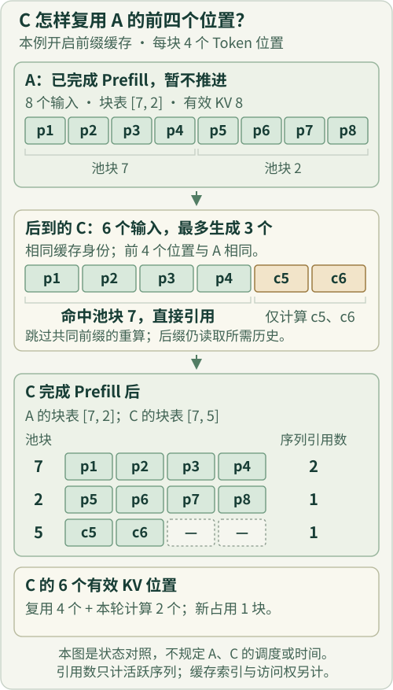
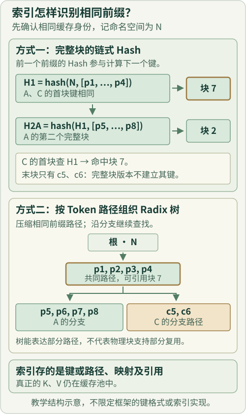
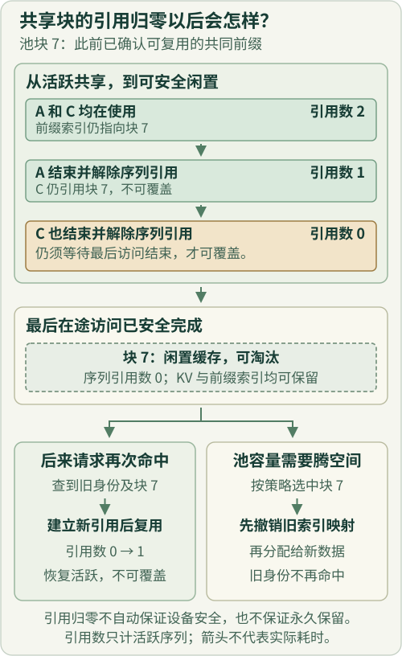

# 两个请求的开头相同，哪些计算和状态可以复用？

许多语言模型请求包含相同的系统提示、对话历史或文档内容。如果每收到一个请求，都重新计算整段已出现过的输入，模型可能反复完成相同的 Prefill 工作。

在 [G05](g05-paged-kv-cache.md) 中，已经知道两条序列可以让各自的块表引用同一份历史 KV。但对于先后到达的独立请求，运行时怎样知道它们可以共享哪些数据？

**前缀缓存（Prefix Cache）**保存已经建立、允许被后续请求复用的模型历史状态，并维护能够查找到这些状态的身份信息。新请求如果命中相容的前缀，就可以避免重新计算这部分位置，并从仍需处理的输入继续执行。

本篇沿用 G01–G05 的模型 M 和缓存池，首次引入另一个具有公共前缀的独立请求。先建立复用的正确性，再解释查找、命中率和淘汰。不讨论跨设备传输。

## 已经计算过的前缀，为什么可以提供给另一个请求？ {#why-reuse}

沿用 A 的 8 个输入 Token p1…p8，以及每个 KV 块容纳 4 个位置的教学配置。A 完成 Prefill 后，有效历史覆盖这八个输入位置，块表为 [7, 2]。

现在改变 G02 中不使用前缀缓存的条件，开启前缀复用。假设较晚到达的请求 C 有 6 个输入 Token，输出上限为 3，仍与贯穿系列的请求长度一致。它的输入为：

**p1，p2，p3，p4，c5，c6。**

前四个 Token 与 A 相同，后两个不同。先假定它们使用的模型、位置及其他影响计算的条件都一致，A 的前四个位置的历史状态已经正确建立且仍可复用。

回顾 [G02](g02-prefill-and-decode.md) 的因果 Attention：旧位置只依赖自己和更早的位置。p1 至 p4 的计算不依赖 p5 至 p8，因此将后续输入改成 c5、c6，并不会改变前四个位置在各层需要建立的数学状态。

这不仅适用于 A 自身的下一轮 Decode。另一个具有相同计算前缀的请求，也可以复用这些已经存在的 K/V，而不用再次为前四个位置执行投影、Attention 和 MLP。

但是，C 的 c5、c6 仍须执行模型计算。它们的 Query 还需要读取前四个位置的历史状态；复用状态不等于省掉这些新 Query 的 Attention。

<figure markdown="1">

<figcaption>在这组开启前缀缓存的教学条件下，C 只需新增两个输入位置的计算。A 的历史仍保留在观察时点；本图不规定实际的多请求调度顺序。</figcaption>

</figure>

完成 C 的 Prefill 后，它的已计算位置数为 6，其中 4 个直接复用，2 个是本次计算建立的。运行时可以根据末位置 c6 的 Logits 选择 C 的第一个输出。这个输出本身仍未建立 KV。

## 为什么只有文字相同还不足以共享 KV？ {#cache-identity}

前面的推导以“相同计算条件”为前提。如果只比较用户输入的显示文字，有可能将两个不同的计算过程误认为同一个前缀。

例如，两个请求可以使用相同文字，但经不同聊天模板或分词规则处理后，得到不同的 Token ID 序列。相反，两个请求的 Token ID 相同，也可能因为使用不同模型参数而产生不同 KV。

因此，运行时需要识别**缓存身份（Cache Identity）**，也就是保证历史状态可被正确使用的条件。下面列出一些重要因素。

| 需要核对的条件 | 为什么会影响复用？ |
| --- | --- |
| 实际输入 Token 序列 | 决定模型各位置的输入；系统提示、聊天模板和分词的结果需计入 |
| 模型版本与适配器 | 权重不同可能产生不同的 K/V，包括 LoRA 等适配器 |
| 位置及 Attention 语义 | 不同位置编码、起始位置、可见范围或掩码可能改变状态 |
| 多模态输入或其他模型输入 | 相同的占位 Token 可能对应不同图像或输入特征 |
| 状态格式和执行契约 | 状态必须与消费它的模型实现、精度、布局等要求相容 |
| 复用范围与隔离域 | 即使计算结果相同，也可能不允许两个请求共享缓存 |

不要求把表中每一项都放进同一个哈希键。例如同一模型实例的专用缓存池可以天然限定模型版本；如果位置语义由相同的完整 Token 前缀和模型配置唯一决定，也可以由这些条件间接保证。

生成控制的温度、Top-p 等参数本身通常不改变已经确定输入前缀的模型 KV。它们改变未来选出的 Token。选出不同 Token 后，后续计算的前缀才发生变化。

以本例为例，C 的前四个 Token 可以复用块 7。但如果 C 与 A 使用不同 LoRA 权重，即使 Token ID 完全一致，也不能直接断定它们对应的状态相同。

对于多租户服务，可以通过限定复用域、隔离缓存池或在缓存身份中加入隔离信息，让缓存只在允许的请求范围内共享。计算相容性和访问权限是两项不同的条件。

[G01：模型身份与请求实例](g01-model-loading-and-execution.md#request-instance) · [vLLM v0.10.2：Automatic Prefix Caching](https://docs.vllm.ai/en/v0.10.2/design/prefix_caching.html)

## 怎样从已有状态中找到最长的可用前缀？ {#prefix-lookup}

假设现在缓存池已经存放了很多请求的历史。管理器需要用 C 的输入查找它可以复用多少个连续的前缀位置，而不是仅仅寻找包含相同 Token 的任意缓存块。

### 为什么哈希块时还要记录前序块的身份？

以 G05 的固定四位置块为例。最简单的做法似乎是为每块中的 Token 计算一个哈希值，然后用哈希值查找池中的块。

但如果只计算当前块 Token 的哈希，就可能出错：两个请求的第二块包含相同的四个 Token，而第一块不同。第二块中每个位置都可能通过 Attention 使用前面的内容，所以它们的 KV 可能不同。

一种常见设计是分块哈希，将前序哈希一并纳入当前块的身份。例如把同一复用域中的初始身份记为 H0（图中命名空间 N 对应的初始身份）：

- H1 = Hash(H0, [p1, p2, p3, p4])
- H2A = Hash(H1, [p5, p6, p7, p8])

这样，从第二块的身份可以关联到完整的前缀历史。缓存管理器将哈希身份映射到实际存储块。遇到不同的前序身份，就不会把当前块内容相同直接视为可复用。

以完整块作为索引粒度时，C 的第一块能够得到与 A 相同的 H1，而 c5、c6 不满一块，不会在此机制中形成完整块的查找项。

vLLM v0.10.2 的自动前缀缓存采用包含前序块哈希、当前 Token 及有关额外身份信息的设计，并只缓存完整块。这里的 H0 是用于教学的复用域表示，不要求真实实现一定使用同一形式的初始哈希。

哈希只是查找和身份比较的方法，并不是数学上绝对无碰撞的证明。实现需要选择合适的哈希及身份校验机制，并满足自身的隔离条件。

### Radix tree 怎样组织共享前缀？

另一种索引方式是压缩前缀树（Radix Tree）。例如从根节点出发，先经过 p1…p4 的公共路径，再分别走向 A 的 p5…p8 和 C 的 c5、c6。

普通前缀树可以为每个 Token 建立一段边。Radix Tree 可将不发生分岔的一连串 Token 合并在一条边上。查找时依照新输入沿树向前比较，遇到差异时停止或拆分路径。

<figure markdown="1">

<figcaption>两种索引组织方式的教学对比。树路径以 Token 序列为单位说明最长公共前缀；实际 Radix 实现可以采用不同缓存粒度。索引节点和物理 KV 存储块不是一一对应的硬件对象。</figcaption>

</figure>

例如在 A 的完整输入路径已经存在时，C 沿该路径匹配到第四个 Token，第五个不匹配。管理器可以在公共前缀处形成分支，让新路径引用相应的状态。

SGLang 的 RadixAttention 原论文使用 Radix Tree 来管理 Token 序列与相应 KV 状态的映射，并在请求到达时进行前缀匹配。它展示了这种索引如何支持公共历史、分支生成及保留策略。

分块哈希和 Radix Tree 不要求采用完全相同的分配规则。实际可复用长度还取决于块粒度、缓存是否驻留、数据是否有效，以及所有必要层的状态是否齐备。

在 G04 的混合模型中，窗口 Attention 或递推状态还可能有不同的复用条件。本篇的计算例只针对各层都需要完整前缀的全因果 Attention，不将它直接推广到所有状态结构。

[SGLang 原论文 §3](https://arxiv.org/html/2312.07104v2) · [vLLM v0.10.2：前缀缓存设计](https://docs.vllm.ai/en/v0.10.2/design/prefix_caching.html)

## 找到前缀之后，怎样让新请求从那里继续？ {#reuse-execution}

沿用 A/C 的例子。假设缓存管理器通过查询确定 C 前四个位置的状态可以复用。此时仍需要把查找结果转换成真正可以执行的模型工作。

一种典型的过程如下：

1. 根据已准备的输入与复用域，查找最长相容且有效的前缀。
2. 取得所需缓存状态的使用权，防止命中块在执行期间被淘汰或覆盖。
3. 建立 C 的块表 [7, 5]，其中 7 为共享块，5 为新增的私有块。
4. 将剩余输入 c5、c6 及正确的位置和历史状态交给执行器。
5. 状态写入成功后，推进 C 的有效历史及生成状态；按策略登记新产生的可复用前缀。

运行时必须保证查找、取得引用和实际分配之间的关系正确。如果刚查到某个块却没有固定使用权，之后它可能被重新分配，此时旧的查找结果已不再有效。

新请求还需要单独维护 G03 建立的生成配置、随机状态、停止条件和输出进度。共享 KV 并不意味着两个请求应该共享后续选择出的 Token。

前缀还必须属于可复用的有效序列状态。例如 [G09](g09-speculative-decoding.md) 中尚未接受的候选 Token 不能因为已经计算出 KV 就作为正式前缀登记；否则回滚后可能保留不应提交的状态。

在支持完整块缓存的机制中，C 最后两位置所在的块 5 仍不满。它可以为 C 的后续计算提供有效历史，但尚不能作为可复用的完整块登记到索引。

### 输入全部命中时，是否可以完全不执行 Prefill？

假设后来还有一个新请求，输入恰好等于 A 的八个输入 Token，且其输入历史 KV 全部存在。

KV Cache 保存的是各层 Attention 所需的历史 K/V，不一定保存末位置用于选择第一个输出的 Logits。因此仅仅有八个位置的 KV，并不保证运行时已经拥有下一 Token 所需的分数。

如果没有缓存足够的输出状态，就需要重新建立末位置的预测结果。一种方式是从前缀末尾重新计算所需位置，并避免覆盖仍被其他请求使用的缓存。

例如 vLLM v0.10.2 的 KVCacheManager 在查找命中时对于这类新请求，将最长可用命中长度限制为输入总长度减一；单个全 Attention 缓存组再按块大小向下取整。这可能导致最后一个块需要重新计算。

对本篇的教学块大小 4 而言，输入长度为 8 时，虽然查找所需状态的完整前缀可能已有八个位置，按这套规则实际可跳过的前缀只有前四个位置。其余四个位置需要执行。如果同时需要输入各位置的 Logits 等附加结果，复用条件还可能进一步受限。

因此统计“命中长度”时，应说明是找到了多少相容状态，还是实际省掉了多少输入位置的计算。本篇后续使用后一种口径。

[vLLM v0.10.2：KVCacheManager.get_computed_blocks](https://docs.vllm.ai/en/v0.10.2/api/vllm/v1/core/kv_cache_manager.html)

## 命中四个位置，究竟省掉了多少工作？ {#reuse-benefits}

现在用相同的 A/C 计算范围，分别观察模型工作量和存储容量。首先假设 C 正常执行六个输入位置的完整 Prefill，没有前缀复用。

按照 G02 的计数方法，一层中投影与 MLP 的这部分计算量与新处理位置数成正比。每个查询头的全因果 Attention 有效位置对为 1 + 2 + … + 6 = 21。

启用前缀复用后，C 只计算 c5、c6。它们对应第五和第六个位置，所以每个查询头的有效 Attention 位置对为 5 + 6 = 11。

| C 的这次 Prefill | 不复用 | 复用四位置前缀 |
| --- | ---: | ---: |
| 新执行的位置数 | 6 | 2 |
| 每层每查询头的有效 Attention 位置对 | 21 | 11 |
| 结束时有效历史位置数 | 6 | 6 |

线性层对新位置的工作量变为原来的三分之一，但 Attention 的有效位置对变为 11/21。不能用未命中 Token 比例直接估算整个 Prefill 的时间。

这里计算的是语义上的有效位置对，不是实际内核执行的乘加次数或 HBM 读写字节数。后缀查询仍须访问它所依赖的共享历史状态。

### 共享状态是否等于节约同样比例的实际显存？

沿用 G04、G05 的教学层：每位置 128 B，一个四位置块的元素容量为 512 B。假设仍在同一观察时刻保留 A 的 8 个和 C 的 6 个有效历史位置。

如果各自独立分配，A 需要两块，C 也需要两块。开启复用后，它们有一块公共前缀，只需要三个不同的物理块。

| 单层计量 | 分开保存 | 共享前缀块 7 |
| --- | ---: | ---: |
| 两请求的逻辑有效位置合计 | 14 | 14 |
| 实际保存的有效位置（共享块只计一次） | 14 | 10 |
| 实际保存的 KV 有效载荷 | 1,792 B | 1,280 B |
| 不同物理块数 | 4 | 3 |
| 池内归属的块容量 | 2,048 B | 1,536 B |

表中省掉的是一份历史数据及一块池容量，不包含索引、元数据、其他执行资源或未归属的空闲池。预分配的池本身不一定变小。

共享 KV 与共享后续 Attention 计算也是不同的概念。即使两个请求的历史内容相同，它们的新 Query 仍可能不同，不能把同一页的数据读取一次就当成已经完成两个请求的 Attention。

前缀缓存对普通 Decode 的直接作用，是复用历史状态本身，而不是取消新 Query 对历史的读取。它也可能通过减少重复状态、改变批组成或带来额外的硬件缓存复用，间接影响 Decode 的性能。

## 怎样解释缓存命中率？ {#hit-rate}

例如 C 的六个输入位置中有四个实际不需要重新计算，可以说这次输入的 Token 加权命中比例为 4/6，约 66.67%。

但如果同时统计缓存初始为空时的 A 和后到的 C，A 的八个输入没有命中，结果就不同了。

| 请求 | 输入位置数 | 实际复用位置数 |
| --- | ---: | ---: |
| A | 8 | 0 |
| C | 6 | 4 |
| 合计 | 14 | 4 |

令第 i 个请求的输入长度为 sᵢ，实际跳过重复前缀计算的位置数为 cᵢ，则：

**Token 加权命中率 = Σᵢ cᵢ / Σᵢ sᵢ**

如果定义请求命中为“至少复用一个位置”，则：

**请求命中率 = 满足 cᵢ > 0 的请求数 / 全部请求数**

因此，在这两次输入处理的观察范围内，Token 加权命中率是 4/14 ≈ 28.57%，请求命中率是 1/2 = 50%。这两个比例回答不同的问题，也不表示有一半的请求完全命中。

又如一个输入有 2,050 个位置，实际复用前 2,000 个。Token 命中比例约为 97.56%，但剩余 50 个位置及其对前缀的 Attention 仍需计算。

不同框架可能记录查找命中长度、实际跳过的位置数、各缓存层的命中、是否包含已生成 Token 等不同指标。比较时需要核对分子、分母、统计窗口和重算末位置的规则。

## 请求已经结束，为什么还要保留它的前缀？ {#cache-lifecycle}

在 G05 中，逻辑引用已经解除且设备访问安全结束的块，可以归还给空闲池。前缀缓存希望在该条件成立时，让一部分仍有效的数据继续保留身份。

回到公共块 7。A 和 C 正在使用它时，有两个逻辑引用。A 结束后，C 仍可能读取它，所以不能将其分配给无关请求。

等 C 也结束且所有相关访问安全完成后，块 7 可以没有活跃请求引用，却仍含有可复用的状态。这样，另一个相容请求到来时，运行时不需要重新计算该前缀。

但是，如果再没有足够空间存放新请求需要的状态，保留的缓存就可能需要被淘汰。

<figure markdown="1">

<figcaption>缓存生命周期的教学示意。“没有活跃请求引用”不代表可以忽略设备访问；“可重新分配”也不代表必须立刻删除仍可命中的身份。</figcaption>

</figure>

例如 vLLM v0.10.2 的 BlockPool 可以将没有活跃逻辑引用的块放回可重新分配的队列，同时保留其缓存索引。再次命中时取得引用；若该块要交给另一份新数据，则先移除旧缓存映射。

[F03](../06-execution-runtime/f03-runtime-buffer-management.md) 的安全复用条件仍然成立。一个框架可以通过其调度和完成机制满足这些约束，但不能仅凭逻辑引用数字为零，就推断设备已停止所有访问。

[vLLM v0.10.2：BlockPool](https://docs.vllm.ai/en/v0.10.2/api/vllm/v1/core/block_pool.html)

### 为什么保留新缓存，可能反而降低后续命中率？

假设池中大部分可重新分配的块都曾被请求使用。新请求到来时，需要选择哪些不再有活跃引用的缓存让出空间。

一种策略是优先淘汰最久未使用的数据，这称为 LRU（Least Recently Used）。树结构还可以优先淘汰不再被后续路径依赖的叶节点，保留公共前缀。

例如 SGLang 原论文描述了优先淘汰最近最少使用的叶节点的策略。vLLM v0.10.2 的分块索引实现采用空闲块队列，并在分配时移除被选中块的原有缓存身份。它们属于具体策略，而不是 Prefix Cache 的定义。

如果大量只使用一次的长输入占据缓存，可能在下一次热门公共提示到达之前挤走原来的高复用前缀。这类现象称为缓存污染。新保留的数据是否值得占用容量，取决于其未来复用机会及保留代价。

因此可以选择并非所有已经建立的历史都进入可复用索引，例如优先保留常见前缀，或者为不同用途分配独立的缓存配额。

缓存命中率因此不是模型的固定属性。输入重复程度、到达顺序、容量、缓存粒度、复用域、保留及淘汰策略都会改变它。

[H01](../08-request-scheduling/h01-continuous-batching.md) 已经说明请求组成与执行形状的区别。选择先处理哪条请求也会影响前缀是否还能命中；在服务级，多副本路由同样会改变复用机会。缓存感知的调度和路由不能只考虑命中，还需考虑排队与公平性。

### 引擎的前缀缓存和 API 的 Prompt Caching 是不是一回事？

API 可以向用户提供输入缓存计费、保留时间或缓存控制等产品能力。用户看到的缓存计费比例取决于服务接口和合同，不一定等于某台设备实际共享的 KV 块比例。

不要把某个服务的最低匹配长度、缓存保留期或价格当作模型运行时的机制常数。它们与具体部署、产品承诺以及版本有关。

例如 [OpenAI 的 Prompt Caching 文档](https://developers.openai.com/api/docs/guides/prompt-caching) 描述的是其 API 的缓存资格、使用统计和保留规则。

对于运行时，应记录输入前缀的复用位置数、实际执行工作、物理块与池占用、查找和等待时间，以及首 Token 延迟与后续输出指标，才能判断实际收益。

## 接下来怎样让更多历史状态得以保留？

现在，我们已经把“两个请求的开头相同”转化成一个明确的执行问题：先确认缓存身份，再查找相容前缀，取得状态的使用权，最后只推进剩余工作。

如果设备中的缓存必须在容量压力下不断淘汰，是否可以将暂时不需要的历史放到更大的存储空间，而在需要时搬回？对于已经暂停的活跃请求，又应选择迁移状态还是重新计算？

[G07](g07-tiered-kv-cache.md) 将继续解释 KV 的分层存储、迁移与恢复成本。

## 来源与继续阅读

- [G05：分页 KV Cache](g05-paged-kv-cache.md)：块表、引用计数和写时复制。
- [SGLang 原论文](https://arxiv.org/abs/2312.07104)：RadixAttention、前缀复用和缓存管理。
- [vLLM v0.10.2：Automatic Prefix Caching](https://docs.vllm.ai/en/v0.10.2/design/prefix_caching.html)：分块哈希、完整块和隔离域。
- [vLLM v0.10.2：KV Cache Manager](https://docs.vllm.ai/en/v0.10.2/api/vllm/v1/core/kv_cache_manager.html) 、[FullAttentionManager](https://docs.vllm.ai/en/v0.10.2/api/vllm/v1/core/single_type_kv_cache_manager.html) 与 [BlockPool](https://docs.vllm.ai/en/v0.10.2/api/vllm/v1/core/block_pool.html)：可用命中长度、块粒度、分配、引用及缓存淘汰。
- [回到 G 专题导读](README.md)。
