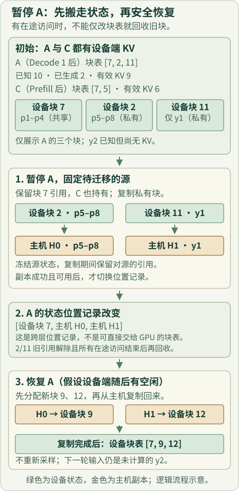
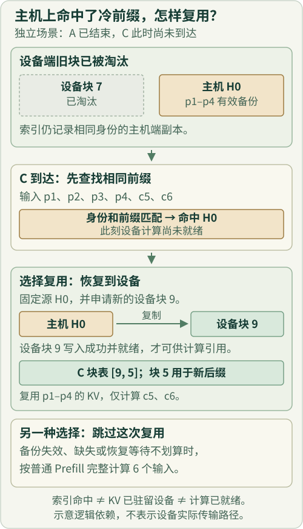
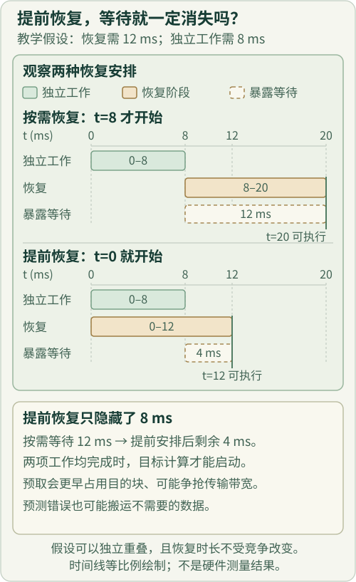

# 显存放不下全部 KV，应该搬走还是重新计算？

一个语言模型正在生成回答。如果它的历史状态占满显存，运行时面临两个选择：让其他请求等待，或者暂时腾出一部分 KV 存储空间。即使请求的生成进度不能丢失，它的 KV 也不一定要一直放在设备上。

**KV 分层存储（Tiered KV Cache）**将模型状态保存在不同的存储位置，需要时再将状态恢复到执行所需的位置。它可以利用主机内存或其他容量较大的存储空间，减少对设备内存的长期占用。

另一种选择是丢弃部分历史 KV，在需要时根据已经确定的 Token 重新计算。本篇沿用 G04–G06 的请求、块表与缓存身份，比较这两种恢复路径，也解释如何将搬运的一部分等待隐藏在计算之后。

何时暂停哪条请求、何时准入新请求是 H 专题的问题。这里先假设运行时已经作出了暂停决定，只研究怎样安全地保存和恢复模型状态。

## 哪些 KV 可以离开设备内存？ {#tiered-state}

回顾 [G04](g04-model-state-and-memory-budget.md)：权重留在设备上，不代表设备还能够容纳不断增长的 KV。回顾 [G06](g06-prefix-cache.md)：已经没有请求使用的历史前缀也可能具有复用价值。

这两种状态都可以考虑放到容量较大的存储层，但必须区分它们的用途。

| 需要保存的对象 | 为什么移出设备？ | 何时再次使用？ |
| --- | --- | --- |
| 暂停请求的历史 KV | 为其他计算释放容量 | 该请求继续生成之前 |
| 已结束请求的闲置前缀 | 在有限显存之外保留复用机会 | 后续请求命中时 |
| 正在执行的请求的部分层状态 | 降低同一时刻所需的设备驻留容量 | 相应层下次执行之前 |

前两种用途是本文的主线。第三种可以按层或其他访问粒度安排搬运，数据访问模式与暂停后恢复整个请求不同，后文会再对比。

假设执行后端仍使用 G05 的设备 KV 池，内核只能通过设备侧有效的块表读取历史。主机内存是后备位置，而不是内核可以直接读取的同一组池块。

一些系统会使用映射、远端访问或其他执行方式，不要求所有实现都经过同一条复制路径。无论采用哪种方式，消费者必须获得符合其访问契约且已经就绪的状态。

[存储系统：局部性、工作集与数据搬运](../../storage/01-memory-hierarchy/01-system-basics/locality-working-set-data-movement.md) 已建立容量与访问代价的取舍。本篇关注的是运行时如何利用模型状态的身份和可重建性来管理这些存储层。

## 暂停请求 A 后，怎样腾出它占用的 KV？ {#active-offload}

### 先确认哪些物理块真的能够归还

沿用 [G02](g02-prefill-and-decode.md) 的 A：8 个输入 Token，最多生成 4 个。现在 A 已完成第 1 轮 Decode，选出 y2，但还没有计算 y2 对应的位置。

按照 G05 每块 4 个位置的教学配置，A 的设备块表是 [7, 2, 11]。块 11 只有第九个位置（y1）已经建立 KV。

此时再引入 G06 的 C：输入为 p1…p4、c5、c6，它已经完成 Prefill，块表为 [7, 5]。A 与 C 共同使用块 7。假设这一时刻池中已无空闲块，这里只观察两条请求，不规定其他请求的调度。

| 设备池块 | 有效历史 | 序列引用 |
| --- | --- | --- |
| 7 | p1…p4 | A、C |
| 2 | p5…p8 | A |
| 11 | y1（其余 3 个位置未使用） | A |
| 5 | c5、c6（其余 2 个位置未使用） | C |

如果运行时暂停 A，为它保存全部历史后，是否能够立即回收三块设备内存？

不能。虽然 A 不再执行，C 仍需要读取块 7。只有没有其他使用者、相关访问也已经安全结束的物理块，才能被重新分配。暂停一个请求不等于它的所有逻辑块都变成空闲块。

在这个例子中，选择保留共享块 7 的两个引用，仅将 A 独有的块 2、11 移到主机内存。这样可为设备池腾出两个块，而 C 的历史保持不变。

### 怎样知道复制已经完成，可以重新分配源块？

假设为块 2、11 分别取得主机位置 H0、H1。它们是教学中的后备存储位置标识，不是设备物理块号。

运行时需要先确保源数据完整且不会在复制过程中被覆盖。对于还可能追加的块 11，可以等待当前轮写入完成，冻结它的有效范围，再开始复制。

<figure markdown="1">

<figcaption>一次主动迁移与恢复的教学示意。A 暂停时已知 10 个 Token、已生成 2 个，但已计算历史只有 9 个位置。恢复所需的块号可以与迁移前不同。</figcaption>

</figure>

将 G05 的块所有权与 [F02](../06-execution-runtime/f02-asynchronous-execution.md) 的完成事件结合起来，可以得到以下过程：

1. 固定源块的使用权，等待产生当前有效 KV 的写入完成，并分配后备存储。
2. 启动复制；必要时记录有效长度、数据格式及副本版本。
3. 确认复制成功且目标可用，将 A 的相应历史位置关联到有效后备副本。
4. 确认源块已无其他持有者，所有相关设备访问安全结束后，将块 2、11 归还设备池。

**复制完成与源块可以回收，是两个不同的条件。** 即使目标已经有一份正确副本，也必须等源上的最后一次访问结束。

复制期间两端的存储需要同时存在。设备要保留原始数据，主机要有可写缓冲区。如果使用额外的中转或格式转换缓冲区，还需考虑临时容量。

复制失败时不能将失败的目标当作有效副本，也不能在尚有访问的情况下直接回收源。可以保留源重试，或者明确改用重新计算恢复的路径。取消请求时，也要等待满足 [F03](../06-execution-runtime/f03-runtime-buffer-management.md) 的安全归还条件。

### 为什么迁移两块，传输量不一定等于有效 KV 的大小？

沿用 G04 教学层每个位置 128 B、每块 4 个位置的配置。A 迁移的位置是 p5…p8 和 y1，共 5 个。

| 单层计量 | 字节数 |
| --- | ---: |
| 迁移部分的有效 KV 载荷 | 5 × 128 = 640 B |
| 两个固定池块的容量 | 2 × 4 × 128 = 1,024 B |

如果执行整块复制，忽略其他元数据和布局变化，单向传输量是 1,024 B。如果将有效位置紧凑地存放到主机，则可只传输 640 B 的 KV 元素，但还需要相应的索引或布局恢复操作。

这里释放的是两块设备池的可分配容量，不一定让底层已经预分配的显存变少。主机侧也有独立的容量预算，不能将同一份已复制数据只在一个层级计费。

如果某块以前已经建立过内容相同且仍有效的后备副本，本次腾出设备空间可能不需要再写一遍。但对仍在变化的尾块，旧备份可能已不能代表最新状态。

## 请求 A 恢复时，必须回到原来的块号吗？ {#restore}

现在 A 的历史有三部分：设备上的块 7，以及主机上的 H0、H1。运行时仍保留这九个位置的有效历史，但其中只有前四个位置驻留在设备上。

在教学状态记录中，可以将三个逻辑块的位置表示为 [设备 7, 主机 H0, 主机 H1]，并记录各自的有效长度。

此时跨层的位置记录不能直接作为原来的设备块表交给 Attention 内核。必须先准备内核需要的可读数据和地址。

假设随后设备出现空闲块 9、12。运行时先为 A 固定块 7，并保留 H0、H1 的读取权，再把后备数据复制到新分配的设备块。源和目标均需受相应完成事件约束。

恢复成功后，A 的设备块表变为 [7, 9, 12]。新的逻辑块到物理块映射与旧块表不同，但它们对应的是同样的位置和历史数据。

A 仍然已知 10 个 Token，已生成 2 个，历史覆盖 9 个位置。它的生成配置、已经消耗的随机状态、正式输出与停止条件等请求状态也必须保留。迁移没有产生新的 Token，不应从历史位置重新采样。

接下来正常执行的是 y2 对应的第十个位置。它需要读取所需的旧历史，建立新的 KV，产生选择 y3 所需的 Logits。只有这轮真正完成后，计算进度才能继续推进。

上述过程假定块 7 仍相容并保持设备驻留。如果恢复前它也被迁走或失效，就需要重新取得它或者重建相应历史。已经记录过有效历史，不等于下一轮计算所需的数据此刻都已经就绪。

## 如果不保存 A 的私有 KV，能否只在恢复时重新计算？ {#recompute}

KV 是模型前向计算建立的状态。对于本篇的确定输入与全因果 Attention 模型，如果保留相容的模型及原始输入，甚至可以不将块 2、11 写出到主机。

假设在安全解除访问后，运行时直接丢弃这两个私有块。它仍然保留已经确认的 Token p1…p8、y1、y2，以及 G03 所建立的生成状态。

恢复时，如果块 7 仍可用，运行时可以把 p5…p8、y1 当成已经确定的五个输入位置重新前向计算，并重新建立对应历史。无需逐个位置重新选择已经生成的 Token。

每层每个查询头需要处理的有效因果 Attention 位置对是：

**5 + 6 + 7 + 8 + 9 = 35。**

如果块 7 也不可用，则恢复前九个历史位置需要完整执行九个位置，位置对是 1 + 2 + … + 9 = 45。使用不同可复用前缀的恢复成本并不相同。

更一般地，设已经有 h 个可用前缀位置，连续缺失的后续历史有 m 个位置。对全因果 Attention，每层每查询头需要重新处理的有效位置对为：

**h × m + m × (m + 1) / 2。**

这个量没有包含投影、MLP 等工作，也不等于内核实际执行的乘加次数。重算和正常 Prefill 类似，可以利用已经确定的输入进行并行计算。

这里重建的是 A 已经成功建立过的历史状态。恢复完成前不应宣告所有缺失 KV 已经有效。也可以将重算与下一轮本来就需要执行的 y2 合并，但要区分重建工作与新推进的生成工作。

重算时需要保证 G06 的模型版本、适配器、输入特征、位置和 Attention 语义等条件相容。不同执行形状或浮点运算顺序不一定产生逐位相同的结果；不能把重新计算历史当成任何模型都可无条件恢复的机制。

[PagedAttention 原论文 §4.5、§7.3](https://arxiv.org/html/2309.06180v1) 讨论了 CPU RAM 交换和重算两条恢复路径，以及块大小对有效传输带宽的影响。

vLLM v0.10.2 的 V0 支持交换和重算；V1 的常规抢占路径释放请求的 KV 块并重置计算进度，恢复时再检查可复用状态及补算。不应把 V0 的 CPU 交换策略当作全部版本的统一行为。

## 闲置的前缀为什么也值得放到主机内存？ {#cold-prefix}

回到 G06 的缓存身份。请求结束后，没有活跃请求使用的前缀可以被淘汰，因为它不再是原请求继续计算的必要条件。但是，未来仍有可能收到相同的输入前缀。

考虑另一条时间线：A 已经结束，而 C 尚未到达。假设 p1…p4 的有效历史已经备份到主机位置 H0（此例独立于前面的活跃卸载），原设备块 7 已被重新分配。

当 C 到来时，按照 G06 的身份比较，运行时发现主机中仍有相同的四位置前缀。但 Attention 内核所需的设备 KV 还没有就绪。

<figure markdown="1">

<figcaption>冷前缀的索引命中不等于设备命中。这里假设已匹配的四位置历史都成功到达设备，C 才能跳过对应计算。</figcaption>

</figure>

假设设备有可用块 9 和 5。运行时固定主机副本的读取权，将其恢复到块 9，然后让 C 的块表引用该有效前缀以及新的后缀块 5。此时 C 只需计算 c5、c6。

如果后备副本失效，或者等待和传输的代价太高，也可以直接计算 C 的完整六位置输入。对于冷前缀，这是缓存未被利用；对于暂停的活跃请求，则需要保证原有请求能够恢复或明确结束。

因此，**命中缓存身份、找到可用的后备数据、得到内核可读状态、实际免去计算**是不同的事件。统计缓存收益时，必须区分这些事件。

例如 SGLang v0.5.5 的 HiCache 将前缀缓存扩展到设备、主机内存及可选的后备存储。它支持不同写入策略，以在提前建立副本的机会和写出开销之间取舍。

该版本 HiRadixCache 在检查写出完成事件后解除相应的保护，并为已备份的节点提供设备淘汰路径。这是前面所讲复制就绪与安全回收约束的一种具体实现。

[SGLang v0.5.5：HiCache 设计](https://github.com/sgl-project/sglang/blob/v0.5.5/docs/advanced_features/hicache_design.md) · [HiRadixCache 源码](https://github.com/sgl-project/sglang/blob/v0.5.5/python/sglang/srt/mem_cache/hiradix_cache.py)

缓存身份与状态位置应分开维护。一份前缀可能在多个存储层都有有效副本；设备块被重新分配时，不能让旧索引继续指向其新内容。主机备份同样可能过期或被淘汰。

## 搬走再搬回来，和重算相比哪个更快？ {#cost-comparison}

迁移减少了重新执行模型的工作，但需要通过其他存储路径读写数据。比较时必须先确定需要恢复的实际范围，以及后备副本是否已经存在。

设恢复路径需要传输 D 字节，路径的有效载荷带宽为 BW_eff（B/s）；不考虑与独立工作重叠，单次恢复的粗略时间可表示为：

**T_restore ≈ α + D / BW_eff + T_layout + T_wait。**

| 项 | 含义 |
| --- | --- |
| α | 提交、连接、协议等固定成本 |
| D | 实际需要传输的字节数（含选定布局、填充及必要数据） |
| BW_eff | 当前路径的有效载荷带宽，不是链路标称速率 |
| T_layout | 额外的格式或布局转换时间 |
| T_wait | 等待目标空间、传输资源等的额外时间 |

这是将各成本近似串行相加的估算。各项的统计范围要避免重叠；实际存在并行时，需要分析关键路径。

### 一个带单位的估算

使用 G04 中与教学单层独立的模型配置：全部 80 层每位置 KV 载荷为 320 KiB。假设缺失历史有 2,000 个位置，并按有效载荷无额外填充传输。

**D = 320 KiB × 2,000 = 625 MiB = 655,360,000 B。**

假设某条路径的有效带宽为 64 GB/s（每秒 64 × 10⁹ B），仅单向传输项为：

**655,360,000 B / (64 × 10⁹ B/s) = 10.24 ms。**

如果没有已有后备副本，还需要先写出一次。假设两个方向有效带宽相同且互不重叠，单纯写出与读回的传输项合计是 20.48 ms，不包括其他开销。

以下人为设定三个时间用于比较，并非真实 GPU 测量：恢复已有副本共 12 ms，首次卸载也需 12 ms，针对同样缺失状态重新计算需 18 ms。

| 同一缺失状态的恢复方式 | 额外串行工作耗时 |
| --- | ---: |
| 已有有效备份，直接恢复 | 12 ms |
| 必须首次卸载再恢复 | 12 + 12 = 24 ms |
| 不写出，重新计算 | 18 ms |

有备份时恢复更省时间；若必须先写出，串行总耗时反而可能更大。这里比较的是暂停和恢复额外引入的工作，写出与读回发生在不同时间，并不意味着它们都会计入同一次恢复等待。

还需要判断重算究竟能跳过多少前缀、工作在哪里执行、会占用哪些计算与内存带宽，以及迁移和重算何时能开始。相比只用传输峰值或理论算力，实际负载下的端到端时间更有意义。

### 如果后备状态存放在 SSD 上呢？

主机内存可以继续连接容量更大的后备存储，例如 SSD，或者其他机器上的内存。对于经过多个存储层的路径，需要按真实经过的各段估算数据搬运、等待和缓冲成本。

假设必须先完整将数据从 SSD 读到主机内存，再写入设备，传输时间至少包括这两段各自的传输项。如果按块流水，则稳态可重叠，但首块仍要经过两段，并受较慢路径及共享资源约束。

[芯片与系统互连：GPU / 加速器与主机链路](../../interconnect/PCIE/06-workloads-case-studies/gpu-accelerator-host-link.md) 与 [存储系统：有效带宽和峰值带宽](../../storage/01-memory-hierarchy/03-performance/effective-bandwidth-vs-peak.md) 进一步解释路径代价。

SSD 容量增加，不等于设备显存带宽增加。执行后端究竟恢复整段历史、分块或分层读取，还是采用重算，将决定有多少后备数据处在一轮 Decode 的关键路径上。

[Mooncake 原论文](https://www.usenix.org/conference/fast25/presentation/qin) 讨论了围绕 KV 组织共享存储与执行的一种系统。它也涉及 Prefill/Decode 分离，但状态的存储位置改变，与计算阶段在不同执行者之间的交接，是不同的问题。

## 能否在 A 需要 KV 之前就开始搬入？ {#prefetch}

前面的 12 ms 恢复时间不一定全部暴露在请求等待中。如果可以预测 A 很快会恢复，并且目标内存、传输资源已经可用，就可以提前发起恢复。这称为**预取（Prefetch）**。

例如，在另一项独立工作开始时（t = 0），运行时就知道 A 在 8 ms 后可能需要这些状态。假设完整恢复需要 12 ms，且这项独立工作与复制可以充分并发。

<figure markdown="1">

<figcaption>构造的时间线。恢复需要 12 ms，提前 8 ms 发起可隐藏 8 ms 等待，但仍有 4 ms 暴露在关键路径中。这不是实际测得的延迟。</figcaption>

</figure>

如果到 t = 8 ms 才开始恢复，则需到 t = 20 ms 才能执行 A。如果从 t = 0 就预取，到 t = 12 ms 两项工作均就绪，A 可提前 8 ms 开始。

如果恢复与独立工作共享带宽或执行资源，它们的耗时可能相互影响；只有真的允许并行，提前量才会转换成延迟收益。

### 为什么不把所有可能使用的前缀都提前搬上来？

假设 A 提前恢复了两块，却因为其他条件没有按预期开始执行。这两块会占用有限的设备池，搬运也会消耗带宽。失败的预测甚至可能挤走当前其他工作需要的状态。

因此，保留与预取决策需要综合状态的复用机会、即将使用时间、恢复开销、实际容量和在途数据量。近期频繁使用的状态常适合留在设备；较少使用的前缀可以放在成本较低的层级，但不是固定规则。

提前写出与延迟写出也有类似取舍。早些建立有效后备副本，可能使之后淘汰设备副本更快；然而许多状态从未再次被访问，写出这些数据就会增加无用流量。

在分层缓存中，除了 G06 的 Token 命中率，还应记录各层命中和实际免计算的位置数、搬入搬出字节、无用预取、在途字节、等待时间及设备占用。对于已经产生部分输出的请求，暂停和恢复还可能增大相邻输出之间的时间间隔（ITL）。

### 如果单个请求的全部历史都放不下怎么办？

前面的机制假设恢复时能够重新容纳执行所需的历史。如果一条请求本身就需要超过设备 KV 池总容量的状态，仅仅反复暂停并恢复整个请求可能无法使下一轮执行。

一种不同的执行设计是按层恢复、执行 Attention 后再移出相应层的 KV。例如 Transformers v4.57.0 的 Cache Offloading 在当前层计算过程中预取下一层的缓存，并将用完的缓存移回 CPU。

这种方式可以让不同层轮流使用设备容量，却可能在每次前向中反复搬运大量历史，预取也会占用额外缓冲区。它与为了腾出资源而暂停整个请求的卸载机制不同。

这仍要求当前层、在途预取状态、权重及工作区等同时占用的资源能够满足容量限制。如果单层状态也放不下，还需采用更细粒度的执行和数据访问方案。

[FlexGen 论文（ICML 2023）](https://proceedings.mlr.press/v202/sheng23a/sheng23a.pdf) 对设备、主机、磁盘间的张量放置和搬运计算重叠进行了系统研究，针对的是偏高吞吐、延迟不敏感的场景。

最终能用何种访问粒度，仍受模型结构、Attention 内核和执行契约限制。G04 的 MLA、窗口 Attention、SSM 或混合结构保存的状态不同，迁移时必须按实际状态及重建依赖确定传输量和恢复条件。

## 怎样选择迁移还是重新计算？

现在回到最初的问题。对于一个暂时不能继续的请求，运行时可以在安全完成后释放设备块，同时保留相容的后备历史，或者保留足够的输入和生成状态以便重算。

对于闲置前缀，还可以不再为它保留任何 KV，未来命中失败时重新执行所需的输入。是否选择保留，取决于收益预期，而不仅是可以放下多少数据。

G07 解释的是迁移和恢复的状态契约、代价与就绪条件。使用这些机制时，H 专题负责多请求之间的容量准入、抢占和恢复次序，I 专题负责不同执行者之间的状态交接，J 专题负责服务级请求与故障处理。

## 来源与继续阅读

- [G04：模型状态与内存预算](g04-model-state-and-memory-budget.md)、[G05：分页 KV](g05-paged-kv-cache.md)、[G06：前缀缓存](g06-prefix-cache.md)。
- [PagedAttention 原论文](https://arxiv.org/html/2309.06180v1)：交换与重算；[vLLM v0.10.2：Metrics](https://docs.vllm.ai/en/v0.10.2/design/metrics.html#kv-cache-offloading)、[V0 Scheduler](https://docs.vllm.ai/en/v0.10.2/api/vllm/core/scheduler.html)、[V1 Scheduler](https://docs.vllm.ai/en/v0.10.2/api/vllm/v1/core/sched/scheduler.html)：具体版本的抢占及恢复机制。
- [SGLang v0.5.5：HiCache 设计](https://github.com/sgl-project/sglang/blob/v0.5.5/docs/advanced_features/hicache_design.md)：分层前缀缓存、预取与写入策略。
- [Transformers v4.57.0：Cache Offloading](https://huggingface.co/docs/transformers/v4.57.0/en/kv_cache#cache-offloading)、[FlexGen](https://proceedings.mlr.press/v202/sheng23a/sheng23a.pdf)：不同访问粒度的卸载和重叠。
- [Mooncake（FAST 2025）](https://www.usenix.org/conference/fast25/presentation/qin)：KV 中心化存储与服务架构。
- [请求调度与批处理](../08-request-scheduling/README.md) · [分布式执行与通信编排](../09-distributed-execution/README.md)。
- [回到 G 专题导读](README.md)。
