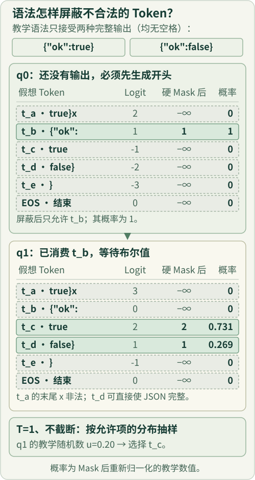
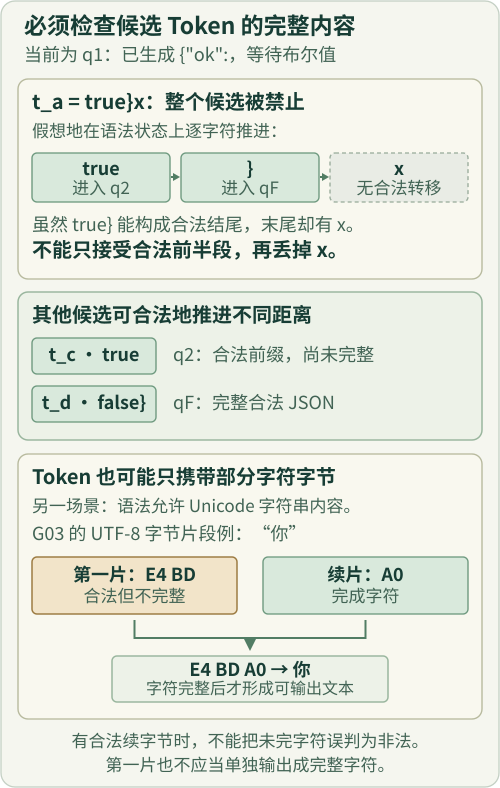
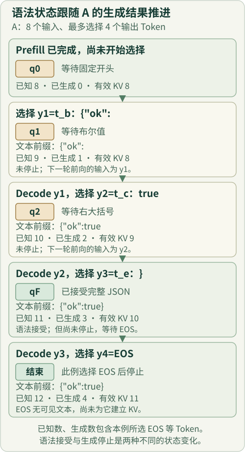

# 怎样让模型生成符合指定格式的文本？

假设一个程序调用语言模型，希望得到 JSON 对象，再读取其中的字段。如果模型回复“结果如下”，最后才附上一个 JSON 对象，人可以理解，但直接解析整段文本的程序可能失败。

提示词可以让模型更倾向于生成指定格式，却不能单独保证每次采样的结果都符合格式。回顾 [G03](g03-sampling-and-generation.md)：模型只给出各个 Token 的分数，最终选择由生成控制决定。

**约束解码（Constrained Decoding）**在选择下一个 Token 之前，先根据已经生成的内容和指定语法判断哪些候选能够继续形成合法输出，再让模型在允许的候选中选择。

本篇仍跟踪 A 的执行过程。从一个只允许两种 JSON 文本的例子出发，解释语法状态、候选掩码、Token 边界以及完成一次合法输出的条件。

## 为什么需要在每一轮选择前检查格式？ {#why-constrain}

假设调用者只接受以下两个完整输出之一：

- `{"ok":true}`
- `{"ok":false}`

这是教学中的简化格式，大小写、字段名固定，不允许额外空白及其他内容，并非完整 JSON 语法。

继续使用 G03 的请求 A，输入 8 个 Token，输出上限 4。为了说明格式约束，构造另一种假想词表，保留 t_a、t_b 和 EOS 的标识，增加 t_c、t_d、t_e。假设普通 Token 对应的片段可直接拼接。

| Token | 追加的文本片段 | 第一次选择的 Logit |
| --- | --- | ---: |
| t_a | `true}x` | 2 |
| t_b | `{"ok":` | 1 |
| t_c | `true` | -1 |
| t_d | `false}` | -2 |
| t_e | `}` | -3 |
| EOS | 无普通文本 | 0 |

这不是某个真实模型的词表和输出分数。G03 的三项分数 [2, 1, 0] 被保留，用以观察约束的作用。

A 的 Prefill 已完成，但还没有生成任何 Token。如果按普通贪心解码，分数最高的是 t_a，生成文本以 true}x 开始。此时已经无法通过继续追加内容形成两个指定输出中的任何一个。

如果此时才发现格式错误，继续生成不会修复这个开头。运行时要么放弃输出重新尝试，要么提前阻止这次选择。约束解码采用的是后者。

在本例的空输出状态下，只有 t_b 可以成为合法输出的开头。EOS 也不能被允许，因为空文本还没有形成完整结果。

## “接下来允许什么”为什么会随生成内容改变？ {#grammar-state}

如果每次选择都只允许 t_b，那么生成的内容只会反复出现对象开头。允许集合必须随着已经确定的文本而变化。

可以让一个语法解析器记录当前解析到哪里。例如把 A 的几个关键状态记为 q0、q1、q2、qF：

| 状态 | 当前文本示例 | 允许的下一步 |
| --- | --- | --- |
| q0 | 空文本 | 生成对象开头 t_b |
| q1 | `{"ok":` | 生成 true（t_c）或 false}（t_d） |
| q2 | `{"ok":true` | 生成右花括号 t_e |
| qF | `{"ok":true}` 或 `{"ok":false}` | 本例只允许 EOS |

qF 是**接受状态（Accepting State）**，表示已经形成格式允许的完整文本。上述状态是本词表在 Token 边界上的教学表示，不能直接作为任意 JSON 的字符解析器。

例如在 q1，t_c 只产生 true，还缺少右花括号，因此推进到 q2。t_d 包含 false 和右花括号，能够直接推进到 qF。解析器不要求一轮只能消费一个语法符号。

更一般地，设目标语言 L 是格式允许的全部完整文本，当前已提交的输出字节序列为 s（可包含尚未完整的 Unicode 字符），候选普通 Token v 将追加字节序列 b(v)。

如果 s 与 b(v) 拼接后仍是 L 中某个完整文本的前缀，那么该候选在字节语法上可被允许。已经完整的文本也是自身的前缀。

因此，约束解码的目标是让每次正式追加后的内容仍处于**可继续为合法结果的前缀集合**中，而不是要求每个中间结果已经能作为完整 JSON 解析。

这里的前缀是指输出约束覆盖的部分，通常不包括输入提示词。如果约束作用于已存在的输出前缀，初始解析状态也需要包含这部分内容。

想达到完整结果，还必须有与分词器词表相容的后续 Token，并有足够的生成预算。不能把语法上可补全，直接理解成一定能在剩余的 Token 上限内结束。

## 怎样把语法状态转化为真正参与采样的候选？ {#token-mask}

解析器知道某些内容可以追加，但模型输出的仍是一整组按词表 ID 排列的 Logits。运行时需要把语法规则转换成可应用于这些分数的掩码。

一种表示就是用与词表 ID 对齐的数组，每个位置记录该 Token 是否允许。这称为 **Token Mask（Token 掩码）**。例如允许项记为 1，禁止项记为 0。

将禁止的 Logit 屏蔽为负无穷（−∞），再按照 G03 的方法选择，可以让这些候选不参与 Softmax 概率分配或贪心选择。前提是还存在至少一个有有效分数的允许候选。

<figure markdown="1">

[](assets/g08-grammar-mask.svg)

<figcaption>在两轮选择中，硬性语法约束先决定允许集合。第二轮的模型分数是独立构造的新 Logits；图中假设 T=1、不进行候选截断。</figcaption>

</figure>

第一次选择只剩 t_b，因此在本例的概率采样中，它归一化后的概率为 1。无论 t_a 的原始分数比它高多少，都不会被选择。

这里的 Mask 修改的是下一 Token 的有效分数，不是 Attention 的可见位置。即使某个 Token 被语法唯一确定，后续模型计算仍需建立对应历史状态。

选择 y1=t_b 后，语法状态变为 q1。下一轮模型执行消费 y1，输出一组新的 Logits。假设 t_a、t_c 和 t_d 的分数分别为 3、2、1，t_b、t_e、EOS 的分数分别是 0、−1、0。

此时 t_a 的末尾 x 会让输出非法，因此即使分数最高，也需要被屏蔽。只有 t_c 和 t_d 可以进入选择。温度 T=1，不进行 Top-k 或 Top-p 截断时，两者的采样概率约为：

| 候选 | 原始 Logit | 是否允许 | 掩码后概率 |
| --- | ---: | --- | ---: |
| t_a | 3 | 否 | 0 |
| t_c | 2 | 是 | 0.731 |
| t_d | 1 | 是 | 0.269 |

G03 的归一化方法仍然适用，例如在按上述两个候选顺序划分的抽样区间中，教学随机数 u=0.20 会选中 t_c，作为 y2。

硬约束与普通 Top-k、Top-p 不同。前者要求生成结果符合指定规则，后者主要根据分数或概率缩小候选范围。

假设设置 k=1。如果先对原始分数取最高项 t_a，再做语法屏蔽，这一轮可能没有候选。若先根据语法屏蔽，再取最高有效分数，则会保留 t_c。

因此应在硬约束允许的集合内执行本例的候选截断和采样。其他禁止列表、重复惩罚和生成规则还需要明确组合顺序。若所有候选都被排除，必须明确处理不可继续的状态，不能任意放开语法约束再声称输出合法。

## 为什么一个 Token 的开头合法还不够？ {#token-boundaries}

在刚才的 q1 状态中，候选 t_a 对应 true}x。它的前几个字符其实都是合法的：

- 读完 true 后，还可以期待一个右花括号。
- 读完 true} 后，已经形成完整对象。
- 继续读 x，便不再符合本例允许的格式。

如果只检查 Token 的开头，或者遇到接受状态就停止检查剩余字节，可能错误地允许整个 t_a。真正被选择的是一个完整 Token，不能把其中的非法后缀当作不存在。

类似地，当语法在 `"count":` 后需要一个非负整数且后面必须有其他字段时，候选 `12,` 可以同时完成数字与逗号的匹配，并推进到等待下一个字段的状态。

<figure markdown="1">

[](assets/g08-token-boundaries.svg)

<figcaption>Token 边界可以跨越多个语法元素，也可以落在一个 UTF-8 字符内部。判定下一 Token 时需要检查整个可追加片段，并维护连续的解析状态。</figcaption>

</figure>

回顾 G03 的 UTF-8 算例，字符“你”可以对应先后出现的字节片段 E4 BD 和 A0。如果语法正在允许一个普通 Unicode 字符串，第一段字节可能是合法字符的开始，只是还不完整。

若后续字节确实能形成允许的字符，就不应该因为单独解码第一段无法显示为文字而立即排除它。当然，非法 UTF-8 字节组合和违反字符串语法的序列仍需要被排除。

因此约束引擎需要与模型的分词器和反分词规则相容。并非所有分词器都适合用“单独解码每个 Token 得到一个固定字符串，再直接拼接”的方式处理。

[XGrammar 原论文 §2–3](https://arxiv.org/html/2411.15100v1) 采用字节级的语法状态匹配，处理不规则 Token 边界及不完整 UTF-8 字节。它只是实现这种语义的一种方式。

## 每一轮的语法状态应当在什么时候更新？ {#grammar-progress}

沿用上面的采样结果，A 先选择 y1=t_b，再选择 y2=t_c。此时输出还没有完整闭合。第三次选择只能取 t_e，生成右花括号。

本例采用一种结束协议：当完整格式已经接受且不允许继续添加普通文本时，下一次选择 EOS 来结束。EOS 没有普通输出文本。EOS 和长度上限同时满足时，本例将结束原因记录为 EOS。

<figure markdown="1">

[](assets/g08-grammar-progress.svg)

<figcaption>这是 A 在替代格式配置下的一次完整生成。解析状态随正式 Token 更新，而模型历史 KV 在下一轮消费该 Token 后才建立。接受状态与请求停止是两个事件。</figcaption>

</figure>

| 观测时点 | 正式输出 Token | 已知 Token 数 | 已生成数 | 已计算历史位置数 |
| --- | --- | ---: | ---: | ---: |
| Prefill 后、选择前 | 无 | 8 | 0 | 8 |
| 选择 y1 | t_b | 9 | 1 | 8 |
| 选择 y2 | t_b、t_c | 10 | 2 | 9 |
| 选择 y3 | t_b、t_c、t_e | 11 | 3 | 10 |
| 选择 EOS（y4）后结束 | t_b、t_c、t_e、EOS | 12 | 4 | 11 |

与 G02、G03 一致，选出一个 Token 后，其对应 KV 尚未建立，但它已经成为正式序列的一部分。语法解析必须能够根据这个 Token 更新，而不能等它的模型 KV 建立后才决定下一允许集合。

因此，一轮执行除了模型 KV，还需要以下请求级状态：

- 语法约束及其版本，与分词器相容的匹配规则。
- 已提交前缀的语法状态，必要时包含多个仍可继续的解析分支。
- 已确定的 Token、随机状态、长度及停止条件。
- 已稳定解码和已发送的文本边界。

候选检查过程中必须避免把未选中的 Token 对解析状态的试探变成正式更新。选择完成后才推进相应序列的正式语法状态。多序列共享同一份语法规则，也不代表它们能够共享正在变化的解析状态。

语法状态不等于用户已经看到的文本。例如 Token 已被正式提交并推进了字节解析，增量反分词仍可能等待后续字节才发送完整字符。

## 为什么 JSON 的任意嵌套比固定格式更难处理？ {#grammar-expressiveness}

前面的有限状态足以表达两个固定输出。对于此类固定格式以及经典正则语言，可以采用有限状态机（Finite State Machine，FSM）：状态数有限，消费输入后在状态之间转换。

一些正则表达式引擎还提供回引用等超出经典正则语言的扩展。不能因为约束使用了“正则表达式”这个名字，就认定它总能用有限状态机高效处理。

再看 JSON 数组。`[]` 是一个完整数组，`[[]]` 也是完整数组，还可以继续嵌套。解析器不仅需要知道在读数组内容，还需要记录尚未闭合的各层结构。

当读到一个新数组开头时，可以将当前上下文保存到栈中，开始解析内部数组。遇到合法的闭合符号时，再从栈中取回外层上下文。这就是为什么递归语法需要比普通有限状态更多的状态表达能力。

上下文无关文法（Context-Free Grammar，CFG）可以表达这类递归结构，其一种识别方式是下推自动机（Pushdown Automaton，PDA），即有限控制状态结合栈。这里的 CFG 指文法，不是 B 专题中的控制流图。

若事先限定最大嵌套深度，可以用有限状态表达这类有界结构，但状态规模和编译代价可能增长。若存在多个可能的解析路径，还需要跟踪仍然成立的那些路径。

### 合法 JSON 和符合 JSON Schema 是同一个要求吗？

JSON 语法定义文本怎样组成对象、数组、数字、布尔值、字符串等。它并不规定某个特定应用必须包含名为 ok 的布尔字段。

例如下面的 JSON 文本本身也是合法的：

```json
{"ok": "yes"}
```

但对于要求 ok 为布尔值的程序，它不符合预期的数据结构。可以用 JSON Schema 描述这种结构约束，例如：

```json
{
  "type": "object",
  "properties": {
    "ok": {"type": "boolean"}
  },
  "required": ["ok"],
  "additionalProperties": false
}
```

这段 Schema 要求一个具有指定布尔字段的对象，并禁止其他属性。与前面的两种固定文本相比，这个 Schema 并没有规定显示文本中的空白形式。

JSON Schema 还可以定义值的范围、取值集合以及更复杂的结构关系。约束引擎能够在生成时支持哪些规则，取决于其文法表达、实现和版本。

例如 vLLM v0.10.2 的 XGrammar 后端包含对部分不支持的 Schema 特性的检查（如数组约束 uniqueItems）。不能从一个接口接受 JSON Schema，推导出它能够实现该规范中的所有规则。

[JSON 语法：RFC 8259](https://www.rfc-editor.org/rfc/rfc8259) · [JSON Schema Draft 2020-12 Validation](https://json-schema.org/draft/2020-12/json-schema-validation) · [vLLM v0.10.2：XGrammar 后端](https://docs.vllm.ai/en/v0.10.2/api/vllm/v1/structured_output/backend_xgrammar.html)

## 每生成一个 Token，都要逐个检查整个词表吗？ {#mask-cost}

直接实现可以对词表中的每个候选，模拟消费它对应的所有字节，检查是否能从当前解析状态继续。这能说明掩码的基本语义，却可能很昂贵：词表可能有很多候选，而每轮都是新的解析状态。

可以先编译固定的语法规则，建立可复用的转移和候选分类。如果某个语法位置的允许性只取决于局部规则，不必知道整个请求历史，那么这部分判定可能提前完成。

如果允许性取决于尚未闭合的外层结构，就仍需检查完整的实际解析上下文。例如在消耗 Token 的过程中结束一个内部对象，下一字符是否允许取决于回到外层后的规则。

XGrammar 原论文将候选区分为可预计算的上下文无关项与需要运行时检查的上下文相关项，使用适合不同状态的缓存表示及可恢复的解析栈。它减少了逐轮重复匹配的工作，不能由此推导任意文法的掩码计算都是常数时间。

掩码缓存需要与编译后的语法、词表及相应解析状态相容。只有完整影响允许性的状态一致，才能直接复用已有完整掩码；单个局部位置相同并不总是充分条件。

### 掩码本身需要多少存储和搬运？

可以用一个 bit 表示一个候选是否允许。独立于前面的教学词表，假设一个模型的词表有 131,072 个 ID，使用每 32 个候选装入一个 32 bit 整数的表示。

**每行掩码大小 = ⌈131,072 / 32⌉ × 4 B = 16 KiB。**

若同时准备 32 条这样的独立掩码，则纯位图大小为 512 KiB。相同数量的 FP32 Logits 每行有 512 KiB，但这两个数字不等于实际的缓存总量，也不能用它们直接比较运行时间。

运行时还可能保存语法编译产物、解析状态及多个缓存项。掩码若在主机生成、在设备侧应用，还要处理相应的传输、任务提交和依赖。

例如 vLLM v0.10.2 的 XGrammar 后端维护请求级匹配器，用于接受 Token、准备下一轮 bitmask 以及恢复解析状态。

该版本的设备执行器在采样前对相应的 Logits 行应用语法 bitmask；选择结果提交后才正式消费新 Token。具体实现可从 XGrammar v0.1.23 及对应版本的后端代码核对。

### 能否让模型前向与掩码生成同时进行？

在 y1 已经正式确定后，下一次 Decode 的输入和下一轮语法状态都可以根据它建立。前向计算负责产生下一组 Logits，而语法解析器负责产生允许集合。

这两项工作在依赖允许且资源相容时可以并行。例如主机更新语法和生成掩码，设备同时执行模型前向；真正选择 y2 前，必须等待 Logits 与正确掩码均已就绪。

依照 [F02](../06-execution-runtime/f02-asynchronous-execution.md) 的认知，提交异步工作不代表结果已可用。运行时还必须保证本次使用的掩码属于正确请求、正确生成位置，而不是上一轮或另一条序列的结果。

判断开销时应分别观察首次语法编译、编译缓存命中、每轮匹配与掩码构造、传递、掩码应用以及等待。掩码应用本身的算术量较小，不表示生成控制一定不在关键路径上。

[XGrammar 原论文 §3](https://arxiv.org/html/2411.15100v1) · [XGrammar v0.1.23：Matcher](https://github.com/mlc-ai/xgrammar/blob/v0.1.23/python/xgrammar/matcher.py) · [vLLM v0.10.2：Structured Output Manager](https://docs.vllm.ai/en/v0.10.2/api/vllm/v1/structured_output/index.html) · [GPUModelRunner](https://docs.vllm.ai/en/v0.10.2/api/vllm/v1/worker/gpu_model_runner.html)

## 如果每一步都合法，最终结果一定完整吗？ {#output-validation}

不一定。回到 A 的状态 q2。它已经生成 `{"ok":true`，这个文本可以继续成为合法结果，却不是完整 JSON。

如果在这里达到更小的输出上限、调用者取消请求或发生超时，就可能得到合法前缀而不是合法完整结果。请求结束与格式接受是两个不同条件。

反过来说，进入接受状态也不总要求马上停止。例如约束允许一个任意长度的非负整数，已经生成的 12 是完整整数，但还可以再追加一位数字形成 123。运行时应依据约束及结束协议确定何时允许 EOS，或是否可以直接结束。

G03 的停止字符串还可能跨 Token 且被从返回文本中剥除。如果停止规则移除了格式所要求的闭合符号，即使内部接受了完整 Token 序列，最终返回文本也可能不完整。

因此需要明确约束作用于哪一段文本、哪些停止符不属于结果，以及最后实际返回的内容满足什么规则。对于允许前缀但尚未完整的终止，应如实记录截断或其他结束原因。

### 怎样检查输出是否真正符合要求？

可以区分下面三个层次，并检查实际返回的完整文本：

| 验证层次 | 对本例的含义 |
| --- | --- |
| 语法 | 能否按照 JSON 规则解析 |
| 结构约束 | 是否具备必须的 ok 字段，且值为布尔类型，没有其他字段 |
| 业务语义 | ok 的值是否真实反映调用者想知道的结果 |

约束解码控制的是约束引擎实际实现的规则。它不会因为输出是合法 JSON，就自动知道其中的事实是否正确。调用者仍需验证业务条件，而不应无条件信任一个结构正确的字段值。

也应使用独立解析器及适当版本的 Schema 验证器检查最终文本，特别是系统还进行了停止串处理、格式转换或者截断时。

实现验证可覆盖空输出、接受与非接受状态下的 EOS、长度不足、嵌套、转义、Unicode、跨 Token 边界、空候选，以及存在多个解析分支时的选择。检查的是最终输出和状态推进，不只是掩码是否执行了。

## 如果使用投机解码，语法状态也需要回滚吗？ {#speculative-state}

[G09](g09-speculative-decoding.md) 已建立草稿候选与正式历史的区别。如果一次提出多个候选 Token，每个候选都需要对应于其前缀的语法状态与允许集合。

例如在 q1，草稿提出 t_c、t_e，候选语法状态暂时从 q1 走到 q2，再走到 qF。若在 G09 所述分布及随机条件下目标验证拒绝 t_c（此处还允许 t_d），则两枚候选都没有正式提交，解析器需要回到 q1。

此时若正式提交替换 Token t_d，解析状态直接从 q1 进入 qF。应根据实际接受或替换的 Token 推进正式状态，不保留被拒绝候选产生的解析分支。

语法状态的分支、校验和回滚可以通过复制解析状态、记录恢复点等机制完成。它与 G09 的 Token、KV、随机状态及文本输出共同构成生成状态；投机验证应针对对应前缀下实际约定的目标采样分布。

## 从格式要求回到生成控制

现在我们知道，结构化输出不是模型得分最高的候选恰好符合格式，而是把指定格式转换成当前语法状态允许的 Token 集合，在每次正式生成时维护它。

对于简单格式，这是一组有限状态与候选的关系；对于复杂语法，需要能够追踪更丰富的解析上下文。无论哪种实现，正确的 Token 字节检查、停止语义和输出验证都不可缺少。

G08 将 G03 的普通生成控制扩展到了有语法约束的情形；[G09](g09-speculative-decoding.md) 则说明多候选验证时怎样安全推进和回滚正式状态。这两篇都是在 G02 的自回归执行过程之上增加的生成控制机制。

## 来源与继续阅读

- [G03：采样与生成控制](g03-sampling-and-generation.md)：Logits、候选截断、RNG、增量解码及停止条件。
- [XGrammar 原论文](https://arxiv.org/html/2411.15100v1)：字节级语法状态、掩码缓存与执行重叠。
- [XGrammar v0.1.23：Matcher 源码](https://github.com/mlc-ai/xgrammar/blob/v0.1.23/python/xgrammar/matcher.py)、[vLLM v0.10.2：Structured Outputs](https://docs.vllm.ai/en/v0.10.2/features/structured_outputs.html)：具体版本的接口、匹配与掩码。
- [RFC 8259](https://www.rfc-editor.org/rfc/rfc8259) 与 [JSON Schema Validation Draft 2020-12](https://json-schema.org/draft/2020-12/json-schema-validation)：语法与结构验证。
- [G09：投机解码](g09-speculative-decoding.md)：候选验证和正式状态提交。
- [回到 G 专题导读](README.md)。
