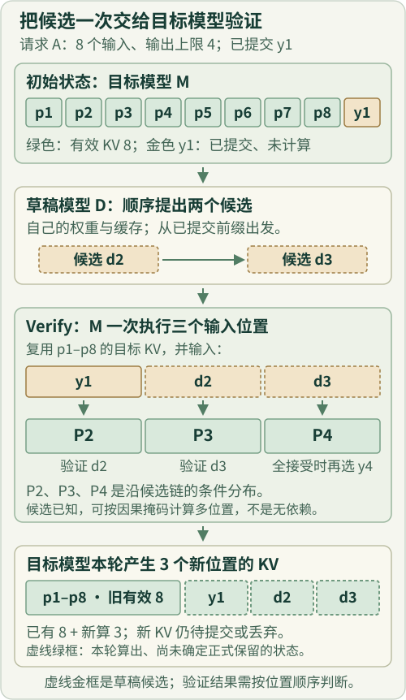
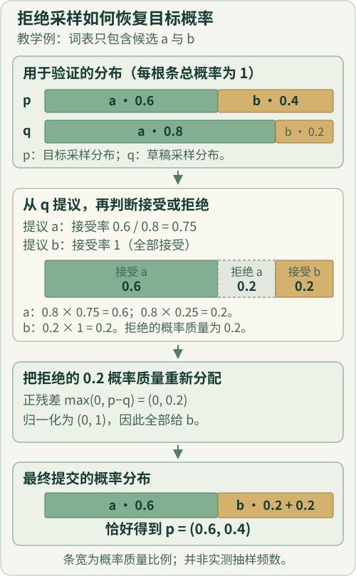
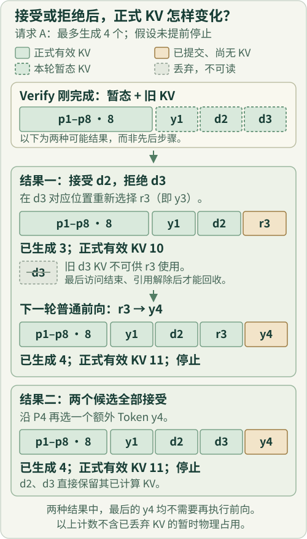

# 一次生成多个候选 Token，怎样验证并提交正确的结果？

在 [G02](g02-prefill-and-decode.md) 中，普通 Decode 每轮只处理一个新位置。模型要等本轮选出新的 Token，才能知道下一轮的输入是什么。

如果一台设备执行一次 Decode 需要读取大量权重，却只推进一个位置，是否可以先猜出后面几个 Token，让目标模型一次检查这些猜测？

**投机解码（Speculative Decoding，也称推测解码）**先用代价较低的方式提出候选，再用目标模型验证候选。验证阶段可以在一次模型前向中处理多个已知位置。如果猜得足够好，就可能用较少的目标模型调用产生相同数量的输出。

但猜出的 Token 还不是正式输出。运行时必须知道哪些候选可以接受，哪些需要替换，哪些已计算的状态可以保留。如果只接受了部分候选，剩余状态怎么办？

本篇以 G01–G04 的请求 A 为基础，使用一条候选链说明 Draft、Verify、提交和回滚。不依赖 KV 分页的具体实现；语法约束只在需要时作为生成状态的一个例子。

## 为什么已经知道几个候选，就可能一次验证它们？ {#draft-and-verify}

沿用请求 A 的基线：8 个输入 Token p1…p8，最多生成 4 个输出 Token y1…y4。仍采用全因果 Attention 的 decoder-only 模型，不考虑前缀复用和提前停止。

假设目标模型 M 已完成 Prefill，并按 [G03](g03-sampling-and-generation.md) 的规则选出 y1。A 已提交一个输出，但目标模型的有效 KV 仍只有 8 个位置。

普通 Decode 接下来输入 y1，产生预测 y2 的 Logits。只有在选出 y2 之后，才知道下一次模型前向的输入。

现在引入一个草稿模型 D（Draft Model）。它通常比 M 更便宜，例如具有更少的参数或计算层。假设两者能使用相同的 Token ID 与序列语义，而且 D 已经建立了所需的草稿状态。

D 根据已经提交的前缀 p1…p8、y1 顺序提出两个候选，记为 d2、d3。第二个候选依赖第一个，因此此时 d3 是在假设 y2=d2 的条件下生成的。

这两个候选已经有具体 Token ID，目标模型可以把它们当作已知输入。和 Prefill 相似，因果掩码允许在一次前向中组织这些位置的计算。

<figure markdown="1">

<figcaption>本例的 Verify 逻辑路径。目标前向输入三个位置，位置 9、10、11 的输出分别用于预测下一位置。草稿状态和目标状态属于不同模型；候选不等于正式生成结果。</figcaption>

</figure>

这里有一个容易混淆的细节。目标 KV 在本例只覆盖前 8 个位置，y1 尚未被模型计算。因此本轮必须将 y1 也一起输入，才能建立它的 KV 和用于验证 d2 的预测分布。

| 新输入位置 | Token | 该位置输出的目标分布 |
| ---: | --- | --- |
| 9 | y1 | P2：在已提交前缀下预测 y2，用来验证 d2 |
| 10 | d2 | P3：在假定接受 d2 的条件下预测 y3，用来验证 d3 |
| 11 | d3 | P4：在假定两个候选都接受的条件下预测 y4 |

上表中的分布来自相应位置的 Logits，经过目标模型的生成策略处理后得到。验证 d3 使用的是位置 10 的输出，而不是 d3 自己所在位置的输出。

例如 vLLM v0.10.2 的 GPUModelRunner 在计算投机验证的输出索引时，会区分验证候选所需的 Logits 和最后一个额外 Token 所需的 Logits。

本轮目标前向可以建立到第 11 个位置的 KV，但其中包含尚未接受的 d2、d3。运行时应先将这些新增状态视为待验证的状态，不能立即把候选追加到用户可见的输出。

这是一个从最后一个已提交但尚未计算的 Token 开始验证的实现方式。其他方案可能已建立最后一个已提交位置的 KV，并保存预测下一位置的目标分布，使用不同的候选布局和输入范围，不要求每次验证必然输入候选数加一个位置。

[Leviathan 等：投机解码原始论文（ICML 2023）](https://proceedings.mlr.press/v202/leviathan23a.html) · [Chen 等：Speculative Sampling](https://arxiv.org/abs/2302.01318)

## 怎样判断哪些候选可以接受？ {#acceptance}

先以贪心解码为例。假设普通目标解码要求在每一步选取最终有效分数最大的 Token，并有确定的并列处理规则。

运行时先在 P2 对应的目标分数上检查 d2。如果 d2 就是正常目标生成会选择的 Token，可以接受它。然后再用 P3 对应的分数检查 d3。

如果 d3 与目标选择不一致，则拒绝 d3，用 P3 对应的目标选择替换它。沿 d3 继续计算的状态必须丢弃，因为它们所依赖的前缀已经改变。

不能仅仅因为后续某个候选碰巧与目标选择相同，就越过第一个错误继续接受。候选链中各位置的条件分布取决于之前的候选。

如果 d2、d3 全部接受，位置 11 的输出 P4 就可以用来再选择一个 Token，无需为选择这个 Token 单独执行目标前向。这枚额外的 Token 常称为 Bonus Token。

在随机采样中，判定方式会不同。不能把目标分布最大概率项以外的所有候选都判错，因为普通目标采样本来就有可能选择它们。我们需要一种保持目标采样分布的验证规则。

### 随机采样为什么还需要草稿概率？

下面采用 Leviathan 等人论文中的接受与残差采样规则。只解释理解运行时验证所需的概率关系，不展开完整序列分布证明。

在一个候选位置，令 p 为目标模型在该历史下的最终采样分布，q 为草稿实际提出候选时的分布。候选 x 已经从 q 中采得，所以 q(x) > 0。

**接受概率 a(x) = min(1, p(x) / q(x))**

例如，如果 q 给某项的概率是 0.8，目标 p 只希望给它 0.6，那么保留四分之三的这类提议，就得到目标要求的 0.6 概率质量。

若候选被拒绝，需要从目标分布尚缺的正残差中选择替换 Token：

**r(v) = max(0, p(v) − q(v)) / Σᵤ max(0, p(u) − q(u))**

求和覆盖同一词表。如果 p=q，拒绝概率为零，不需要执行残差分支。如果 p(x)=0 且 q(x)>0，则该候选必然被拒绝。如果某项 q 为零，它不会作为 q 抽取的候选出现，但可能在残差中获得概率。

<figure markdown="1">

<figcaption>单位置的概率质量示意，不表示一次实际采样同时产生两个 Token。这里使用两个候选，说明为什么补发需要按残差分布选择，而不是无条件重新从原目标分布抽一次。</figcaption>

</figure>

在这个教学例中，若草稿提出 a，目标只以 0.75 的概率接受它。如果被拒绝，残差只支持 b，于是用 b 替换。假如草稿提出 b，则必然接受。

最终得到 a 的总概率为 0.8 × 0.75 = 0.6，得到 b 的总概率为 0.2 + 0.2 = 0.4。两者与目标分布一致。这也解释了为什么不能在拒绝后直接从 p 再随机抽取：接受部分已经贡献了概率质量，需要补的是剩余部分。

对一条候选链，从第一个候选开始检查。只要前面的候选都被接受，当前目标分布就对应真正的已接受前缀。在第一次拒绝处抽取替换 Token 后，本轮不再使用后续候选。

如果全部候选被接受且生成仍需继续，可以从下一位置的目标分布抽取 Bonus Token。本篇的后续状态算例采用这一规则。

### “不改变结果”具体是什么意思？

G03 已经说明，温度、Top-k、Top-p、重复惩罚和允许集合都会参与形成最终采样分布。这里的 p 必须与普通目标生成使用的分布一致，q 必须与实际提出候选时使用的分布一致，两者都对应同一候选位置及其条件历史。

草稿模型可以采用与目标不同的分布。关键是用真实的 q 进行相应验证，而不是假设模型输出的原始 Logits 就是抽样概率。

| 验证性质 | 所要求的条件 |
| --- | --- |
| 与普通贪心结果一致 | 按已接受前缀验证目标的确定性选择，并遵守相同规则 |
| 与普通随机采样的分布一致 | 正确使用条件分布及接受、残差规则 |
| 相同 Seed 得到逐 Token 一致的结果 | 还需要随机数消费、数值实现及执行条件等相容 |
| 任务评测质量接近 | 需要在目标任务及配置下验证，不等同于分布一致 |

例如 Medusa 使用额外的预测头和树形候选，也讨论了 typical acceptance（典型候选接受）的策略。它可以接受某些合理但不一定是普通目标采样结果的候选。不能因其也是投机式生成，就把任务质量接近写成严格的分布保证。

不同方法的候选来源可能是更小的模型、预测头或其他提议机制。需要核对目标模型是否改变、提议方式和接受策略，再判断保证的范围。

例如 vLLM v0.10.2 的 RejectionSampler 包含贪心与随机路径，随机路径支持带草稿概率的规则。该版本 GPUModelRunner 的相应调用传入空草稿概率，验证器把提议按单点分布处理。

这对应确定性提议的特例（提议项概率为 1，其他项为 0），不意味着随机草稿可以随意省去真实的 q。具体后端支持的生成配置与数值精度也需要单独核查。

[vLLM v0.10.2：Rejection Sampler](https://docs.vllm.ai/en/v0.10.2/api/vllm/v1/sample/rejection_sampler.html) · [Medusa 原始论文 §2、§2.3.1](https://arxiv.org/html/2401.10774v3)

## 如果第二个候选被拒绝，哪些状态仍然有效？ {#commit-and-rollback}

现在回到请求 A。假设 d2 被接受，d3 被拒绝，并在该位置选择替换 Token r3。运行时得到了两个新的正式输出 y2=d2 和 y3=r3。

目标模型此前执行 Verify 时已经计算了 y1、d2、d3。哪些结果还能被使用？

- 位置 9 的 KV 对应此前已提交的 y1，仍然有效。
- 位置 10 的 KV 对应现在已接受的 d2，其前缀正确，仍然有效。
- 位置 11 的 KV 对应被拒绝的 d3，不能供 r3 使用。

即使 r3 已经被选出，运行时也还没有执行它对应的前向计算。这里出现了与 G02 相同的区别：已提交 Token 不等于已建立有效 KV。

<figure markdown="1">

<figcaption>两条可发生的分支。假定不提前停止，输出上限为 4。图中回滚的是候选状态的逻辑有效性，实际存储还要遵守设备完成与资源生命周期的条件。</figcaption>

</figure>

把这几种可能的情况写成状态表：

| 事件 | 本轮新提交的输出 | 累计已生成数 | 目标有效 KV 位置数 |
| --- | --- | ---: | ---: |
| Verify 之前 | — | 1 | 8 |
| 首个候选拒绝 | y2=r2 | 2 | 9 |
| 接受 d2，拒绝 d3 | y2=d2、y3=r3 | 3 | 10 |
| 两个候选都接受，并补发 Bonus | y2=d2、y3=d3、y4 | 4 | 11 |

Verify 已临时计算到位置 11，但在接受结果确定前不能按 11 个位置的正式历史推进。表中后三行分别表示不同的可能结果，并非顺序发生的事件。

在第二个候选拒绝的情况下，A 还可以用一次普通 Decode 输入 r3，建立位置 11 的正确 KV，然后选择 y4 并结束生成。

全部接受的情况下，A 已经达到输出上限。此时 y4 来自位置 11 的目标分布，尚未作为输入参与前向，因此不必为了结束请求而再计算 y4。

### 回滚一定要把内存中的数据清零吗？

不需要把“丢弃候选”理解为立即擦除其中所有字节。运行时可以通过缩短有效长度、解除候选引用或标记相应空间不再包含可用历史状态实现逻辑回滚。

只要下次执行不会把失效的 KV 当成正确数据读取，底层存储可以按照实际分配器的机制重新使用。最后一次读取或写入仍在进行时，不能让其他工作覆盖同一空间。

在 [G04](g04-model-state-and-memory-budget.md) 的教学层中，一个位置的 KV 有效载荷为 128 B。Verify 前目标已有 1,024 B，暂态峰值可以达到 1,408 B；第二个候选拒绝后，正式历史的有效载荷为 1,280 B。

少掉的 128 B 对应失效候选。实际分配量不一定下降，例如运行时已保留一整块空间，或相关访问尚未结束。这里不要求采用分页 KV，也不需要移动后续所有数据。采用分块缓存时，参见 [G05：块的分配与回收](g05-paged-kv-cache.md)。

例如 vLLM v0.10.2 的 Scheduler 会在处理投机输出时，把拒绝候选数从已计算位置数中扣除。其 KV Cache Manager 也限制只有已正式确定的 Token 才能进入可供复用的前缀缓存。

[vLLM v0.10.2：Scheduler](https://docs.vllm.ai/en/v0.10.2/api/vllm/v1/core/sched/scheduler.html) · [KV Cache Manager](https://docs.vllm.ai/en/v0.10.2/api/vllm/v1/core/kv_cache_manager.html)

[F02：异步执行与完成语义](../06-execution-runtime/f02-asynchronous-execution.md) · [F03：运行时 Buffer 生命周期](../06-execution-runtime/f03-runtime-buffer-management.md)

## 除了目标模型的 KV，运行时还需要同步什么？ {#generation-state}

草稿模型也有自己的执行状态。即使草稿和目标消费了相同的 Token，它们使用不同的权重和计算结构，得到的 K/V 也可能不同，不能直接把目标模型的缓存作为草稿模型的缓存。

假设草稿模型与普通 Decode 一样，生成 d2 时消费 y1，生成 d3 时消费 d2。完成两个提议后，草稿的有效历史可能只覆盖到 d2 所在的位置。d3 此时可能仍未被草稿模型消费。

因此下一轮继续提议前，需要让草稿状态与最终提交的前缀相容。第二个候选被拒绝时，应使用 r3 而不是 d3；全部接受并补发 y4 时，则需要补齐其未处理的合法前缀。

这可能通过复用正确的已有状态、重新计算缺失位置或者恢复某个状态记录实现。实现不一定沿用普通 KV 缓存的方式。

生成控制也需要区分候选状态与正式状态：

| 状态 | 验证前 | 确定正式输出后 |
| --- | --- | --- |
| Token 序列与长度 | 候选链单独记录 | 只追加接受前缀及合法补发 |
| KV 或其他模型历史状态 | 可以包含候选暂态 | 仅保留相容且需要的历史 |
| 重复惩罚等历史相关统计 | 按候选条件历史计算 | 按正式 Token 推进 |
| 随机状态 | 草稿、接受判定、残差等需要随机数 | 按实际算法维护相应状态 |
| 文本解码和停止状态 | 不对外提交候选文本 | 按正式输出顺序检查和输出 |

如果生成还要求符合指定语法，运行时需要根据候选前缀推进相应的语法状态；拒绝时应回到实际接受的前缀，再处理替换 Token。语法状态如何得到允许集合，见 [G08](g08-constrained-decoding.md)。

随机数生成器状态也不能简单地在每次拒绝后退回某个固定位置。必须遵守具体算法对随机数使用的约定，例如区分草稿提议与接受、补发所使用的随机过程。即使分布一致，也不能无条件保证相同 Seed 与普通生成产生同一序列。

### 如果中间一个 Token 已经触发停止条件呢？

本例中没有提前停止，候选可以按上述规则完整提交。但如果某个已接受的 Token 是 EOS，或使生成达到长度上限、命中停止字符串，就应在规定的输出边界停止后续提交。

与 G03 相同，输出 Token 还要经过增量文本解码及停止串检查。即使一次验证得到多枚可接受 Token，运行时也应沿正式顺序推进停止条件和输出状态，不能先发送整条候选链再处理错误。

已经计算过却超出最终停止位置的 KV 不属于请求的后续有效历史。根据停止时点和保留策略，最终有效 KV 长度不必固定等于已知 Token 数减一。相关资源还需在安全条件下回收。

在真实实现中，目标模型可以提前完成所有候选位置的前向，停止判断在之后发生；也可以采用不同的验证及停止编排。对外可观察的提交结果必须符合既定规则。

## 接受率怎样决定投机解码能否加速？ {#cost-model}

回到 G02 的普通 Decode：每轮目标前向处理一个新位置。投机式验证把多个已知位置一起提交，使线性层有机会复用权重，也有机会减少重复的目标前向启动。

但草稿模型也要计算。目标模型验证的输入变大，Attention 的计算和临时资源需求也可能增加。

假设仍采用 A 的两候选情况，目标 Verify 从已计算的位置 8 开始，新增位置 9、10、11。每层每个查询头的全因果 Attention 有效位置对为 9 + 10 + 11 = 30。若首个候选就被拒绝，计算后两个候选位置的部分工作可能无法继续使用。

因此，比较普通和投机方式，应该同时看目标模型为验证花了多少时间和资源，以及一轮最终能提交多少个 Token。

### 一个用于理解接受率的条件估算

为了分析更一般的情况，下面使用独立的长输出教学配置，不再受 A 最多四个输出 Token 的限制。

假设每轮草稿提出 γ 个候选；全部接受时再选一个 Bonus Token，首次拒绝时补一个替换 Token。忽略 EOS、停止字符串和长度上限带来的提前截断。

如果在前面的候选都接受的条件下，每个候选的接受概率都为 α，那么提交至少 j+1 个 Token，需要前 j 个候选全部被接受，其概率为 αʲ。

因此一轮实际提交的 Token 数 N 的期望为：

**E[N] = 1 + α + α² + … + αᵞ**

当 α ≠ 1 时，可写为 **(1 − αᵞ⁺¹) / (1 − α)**；当 α = 1 时为 γ+1。如果各位置的条件接受率不同，应使用各位置条件接受概率的乘积来计算前缀的存活概率。

这里的 α 是候选在此前均接受条件下的通过概率，不是简单地把已接受候选总数除以已提议候选总数所得的统计量。

如果全接受时不额外选择 Bonus Token，则去掉最后的 αᵞ 项。实际引擎的输出还可能被剩余输出额度和停止条件截断。

沿用旧版的条件算例。设草稿每轮提出 γ=4 个候选，各位置条件接受率 α=0.8，且全接受有 Bonus。则一轮期望提交数为：

**E[N] = 1 + 0.8 + 0.64 + 0.512 + 0.4096 = 3.3616。**

这并不是每轮都提交 3.3616 个 Token，而是这种假设下多轮平均的模型值。

继续假设各阶段串行，并使用以下教学时间，而非硬件实测数据：

| 时间项 | 假设值 |
| --- | ---: |
| 普通目标单步 T_t | 10 ms |
| 草稿单步 T_d | 2 ms |
| 一次目标验证 T_v | 12 ms |
| 其他组织、接受及状态处理 T_o | 1 ms |

本例每轮总成本为 4 × 2 + 12 + 1 = 21 ms。如果用普通方式生成同样数量的 Token，平均需要 3.3616 × 10 ms。因此条件加速比约为：

**S ≈ E[N] × T_t / (γ × T_d + T_v + T_o) = 1.60。**

当 α=0 时，一轮只提交一个 Token，仍需要草稿和验证开销；其余假设不变时，估算加速比仅为 10/21 ≈ 0.48。投机解码反而可能更慢。

若不同接受结果导致执行成本变化，或者草稿与验证之间有流水、资源竞争，则需重新估算整轮时间。这一简单模型只说明接受率、草稿代价和验证代价之间的关系，不预测真实服务性能。

### 为什么还要考虑容量和负载？

回顾 G04：目标模型与草稿模型的权重、缓存和临时工作区都可能额外占用内存。候选尚未验证时，目标 KV 的临时增长也需要预算，不能只为最终预计接受的 Token 留空间。

候选越来越多并不保证越快。验证的 Query 长度、历史长度和候选组织会改变执行形状及内核选择。已经准备好的执行图或变体还要满足 [F04](../06-execution-runtime/f04-execution-graphs-and-replay.md) 与 [F05](../06-execution-runtime/f05-dynamic-shapes-and-specialization.md) 的适用条件。

在多请求、高批量负载下，普通 Decode 可能已经充分利用部分权重读取，额外候选反而增加竞争、工作区和内存压力。实际收益要在目标负载下测量。

一次验证也可能提交多个 Token，产生突发式文本输出。平均每秒生成更多 Token，不代表客户端看到的相邻 Token 间隔或尾部延迟一定同比改善。批组成与资源准入留给 H，测量与性能估算留给 K。

## 从猜测回到正式生成循环

投机解码并没有消除自回归生成的条件依赖。它改变的是计算组织：先以较低代价提出一段候选前缀，再由目标模型处理多个已知位置，验证并提交符合规则的结果。

对运行时来说，需要同时回答三个问题：

- 本次验证使用的是哪一段假设历史？
- 哪些 Token 真正进入正式生成序列？
- 哪些已计算状态能够被下一轮安全复用？

这三者构成了 G02 的执行语义、G03 的生成控制和 G04 的内存管理在投机解码中的交点。理解这些区别后，可以独立阅读后续有关 KV 组织、约束状态和多请求调度的文章。

## 来源与继续阅读

- [Leviathan 等，Fast Inference from Transformers via Speculative Decoding，ICML 2023](https://proceedings.mlr.press/v202/leviathan23a.html)：候选生成、接受规则、额外采样及加速模型。
- [Chen 等，Accelerating Large Language Model Decoding with Speculative Sampling](https://arxiv.org/abs/2302.01318)：草稿及目标验证、保持分布的采样方法。
- [vLLM v0.10.2：GPU Model Runner](https://docs.vllm.ai/en/v0.10.2/api/vllm/v1/worker/gpu_model_runner.html) 与 [Rejection Sampler](https://docs.vllm.ai/en/v0.10.2/api/vllm/v1/sample/rejection_sampler.html)：具体版本的验证结果索引与采样组件。
- [D07：分块 Attention](../04-code-generation/d07-attention-kernels.md)：因果掩码及不同 Query、KV 长度的内核计算。
- [回到 G 专题导读](README.md)。
