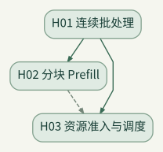

# 请求调度与批处理

推理引擎同时服务多个请求时，每轮计算能够处理哪些工作，取决于当前请求进度、可用算力和缓存资源。

## 贯穿算例与阅读边界

在 G 的请求 A 之外加入 B（3 个输入 Token，最多输出 2 个）及晚到请求 C（6 个输入 Token，最多输出 3 个），比较静态与连续批处理、分块 Prefill 和容量不足时的选择。

先学 H01，再按时间和空间约束深入 H02/H03。Token 预算不是执行时间上限；本路线管理单引擎的执行准入，服务入口、路由和扩缩容归 J。

## 知识关系

<figure class="micro-v2-map" markdown="1">

<figcaption>图中实线表示本专题内的主要前置关系，虚线表示按场景参考；跨专题先修知识见下表。 点击可查看大图。</figcaption>
</figure>

## 阅读顺序 {#计划阅读顺序}

本专题规划 3 篇正文。未发布的条目为阅读计划，标题与范围可在编写时根据认知目标调整。

| 编号 | 文章（暂定标题） | 读完应理解什么 | 主要前置知识 | 状态 |
| --- | --- | --- | --- | --- |
| H01 | [同一批请求长短不一，新请求能不能立即加入？](h01-continuous-batching.md) | 静态批、动态批、Continuous Batching、请求与迭代生命周期、Padding 与 Packed Batch 的工作清单。 | G02、G03；F05 按需 | 已发布 |
| H02 | [一个很长的提示词，怎样避免长时间阻塞正在生成的请求？](h02-chunked-prefill.md) | Chunked Prefill、混合批处理、Token 预算、Prefill 与 Decode 的调度取舍。 | H01、G02 | 已发布 |
| H03 | [KV 空间不足时，应该接纳、等待还是抢占哪个请求？](h03-admission-and-request-scheduling.md) | 引擎准入、资源预算、优先级、公平、抢占、暂停、恢复、重算与避免反复抢占。 | H01、G04、G05；按需 H02、G07 | 待发布核验 |

## 从哪里来，接下来往哪读

主要衔接：[模型执行与生成控制](../07-model-execution/README.md)。

模型计算原理参考[算法与模型](../../workload/README.md)。重构期间也可查阅[旧版推理运行时](../../inference-runtime/README.md)。

后续方向：[分布式执行与通信编排](../09-distributed-execution/README.md)、[推理服务系统](../10-serving/README.md)、[性能分析、建模与验证](../11-performance/README.md)。

更多阅读路线见[编译器与运行时系统系列首页](../README.md)。
