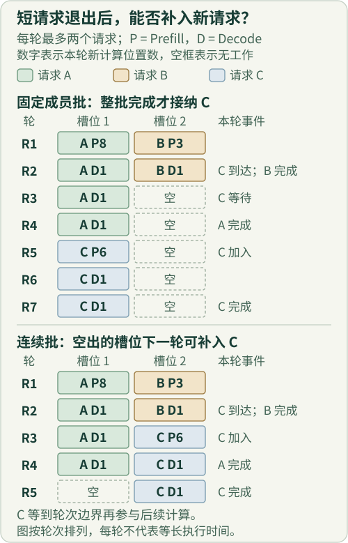

# 同一批请求长短不一，新请求能不能立即加入？

假设两个人同时向语言模型发出请求。模型一起为他们生成文本，其中一人的回答很快结束，另一人仍需要继续生成。这时第三个人发来请求，能否利用已经空出的执行机会，而不必等第一批请求全部结束？

**批处理（Batching）** 是将多个请求的计算组织起来执行。不同请求可以共享相同的模型权重，并为设备提供更多可并行处理的工作。推理引擎不仅要决定一次处理多少请求，还要决定何时改变其中的成员。

普通批处理可以在执行前收集请求，而 **连续批处理（Continuous Batching）** 允许推理引擎在生成过程中重新选择下一轮的请求。它使一条请求的整个生命周期不必绑定到其他请求的生命周期。

本篇继续跟踪 [G02](../07-model-execution/g02-prefill-and-decode.md) 和 [G03](../07-model-execution/g03-sampling-and-generation.md) 中的执行状态，从一批长短不一的请求出发，解释为什么需要改变组批的边界，以及下一轮工作怎样交给执行器。

## 为什么可以一次执行多个请求的计算？ {#why-batch}

在 G02 中，请求 A 有 8 个已知输入 Token，最多生成 4 个输出 Token。首次执行（Prefill）计算 8 个位置，生成第一个输出；之后三次 Decode 各计算一个新位置，依次生成剩余三个输出。

现在让请求 B 和 A 同时到达。B 的输入更短，也更早结束。稍后还有请求 C 到达。

| 请求 | 到达时刻 | 输入 Token 数 | 输出上限 |
| --- | --- | ---: | ---: |
| A | 初始 | 8 | 4 |
| B | 初始 | 3 | 2 |
| C | 第二轮执行中 | 6 | 3 |

假设三个请求使用同一模型实例，每个请求只维护一条序列，均恰好生成上限规定的数量。不考虑前缀复用、分块 Prefill、投机解码、提前停止和输出传输延迟。

为了隔离批成员选择的问题，设引擎每轮最多处理两条序列，不限制本轮 Token 数。KV 容量和工作区足够让其中任意两条请求共同执行，且后端支持同一轮安排完整 Prefill 与 Decode。

为什么要把 A 和 B 一起执行？以模型中的一个线性层为例，假设隐藏宽度为 d，输出宽度为 e。A 和 B 的 Prefill 分别需要计算 [8,d] 和 [3,d] 的输入矩阵，使用同一份 [d,e] 权重。

可以把这 11 行输入组织起来计算。相比两次独立调用，更多行有机会在内核中复用权重、增加并行工作并摊薄启动成本。[D05](../04-code-generation/d05-matrix-multiplication-kernels.md#inference-shapes) 已经解释了这种形状变化怎样影响矩阵乘内核。

不过，计算可以合在一起，不代表两条请求变成了一条序列。Attention 仍然只能读取各自允许的历史位置，生成规则及输出也仍属于各自的请求。

## 如果一批请求必须一起结束，会发生什么？ {#static-batching}

最简单的安排是一次选定 A、B 两个请求，直到这批请求全部完成，再选下一批。这是本文讨论的**静态批处理**基线。

用 P8 表示本轮完整 Prefill 的 8 个输入位置，用 D1 表示普通 Decode 的 1 个输入位置。每轮结束后，模型计算及必要状态更新完成，生成规则选出新的输出 Token。

| 轮次 | 本轮工作 | 新计算位置数 | 新生成及完成 |
| --- | --- | ---: | --- |
| 1 | A P8、B P3 | 11 | A 的第 1 个、B 的第 1 个 |
| 2 | A D1、B D1 | 2 | A 的第 2 个、B 的第 2 个；B 完成 |
| 3 | A D1 | 1 | A 的第 3 个 |
| 4 | A D1 | 1 | A 的第 4 个；A 完成 |
| 5 | C P6 | 6 | C 的第 1 个 |
| 6 | C D1 | 1 | C 的第 2 个 |
| 7 | C D1 | 1 | C 的第 3 个；C 完成 |

第二轮结束时，B 已达到输出上限。根据 G02，B 此时有 5 个已知 Token、2 个已生成 Token，但只有 4 个已计算位置。最后一个输出不需要再送回模型来完成本次请求。

A 则需要再执行两轮。即使执行器跳过 B 已经结束的行，原批的另一份执行机会也未被新的请求使用。若采用必须维持原批形状的实现，还可能执行无效的填充计算。

此时 C 已经在等待队列中。它没有依赖 A 或 B 的任何输出，却必须等 A 完成后才能开始 Prefill。**等待来自人为设定的批次结束条件，而不是模型的计算依赖。**

静态批也可以在 B 完成时立刻将 B 的结果交付给用户；本例不要求延迟返回。真正的问题是它不能在 A 仍然生成时用 C 替换 B。

### 先收集一批请求，能解决这个问题吗？

实际请求通常不会同时到达。引擎可以在执行前观察等待队列，等到积累了足够的请求，或达到可配置的等待时限，再组成一批。这种做法常被称为**动态批处理（Dynamic Batching）**。

它不需要预先确定每批的成员和数量，但如果组成的批仍保持固定，C 依然不能利用本例第二轮后空出的机会。等待收集本身也可能增加首个输出的等待时间。

不同系统对动态批处理的命名不完全相同。这里用它表示派发前的动态组批，用连续批处理表示生成迭代之间可以更换批成员。[Triton Inference Server 2.62.0 的批处理文档](https://docs.nvidia.com/deeplearning/triton-inference-server/archives/triton-inference-server-2620/user-guide/docs/user_guide/batcher.html) 分别介绍了动态组批和迭代序列的连续组批。

## 能否只保留 A，把 B 替换成 C？ {#continuous-batching}

第二轮结束时，对 A 来说，下一步只依赖 A 自己已生成的第二个输出及此前的 KV。对新到达的 C 来说，它的六个输入 Token 也已经知道，具备开始 Prefill 的条件。

如果执行器支持这两种工作共同参与一轮计算，并且内存足够，为什么还要让 C 等待？我们可以把下一轮的成员从 A、B 改为 A、C。

这就是连续批处理的核心变化：把选择下一批工作的时机从一组请求全部结束，提前到一次生成迭代的调度边界。批可以每轮变化，尚未结束的请求则跨越多轮继续推进。

<figure markdown="1">

<figcaption>同一批到达顺序下的两种组批方式。每行表示一次逻辑迭代，不按时间等比例绘制；C 在第二轮进行中到达，只能在随后的调度边界被考虑。</figcaption>

</figure>

按普通自回归生成，每轮工作及输出变为：

| 轮次 | 本轮工作 | 新计算位置数 | 新生成及完成 |
| --- | --- | ---: | --- |
| 1 | A P8、B P3 | 11 | A 的第 1 个、B 的第 1 个 |
| 2 | A D1、B D1 | 2 | A 的第 2 个、B 的第 2 个；B 完成 |
| 3 | A D1、C P6 | 7 | A 的第 3 个、C 的第 1 个 |
| 4 | A D1、C D1 | 2 | A 的第 4 个、C 的第 2 个；A 完成 |
| 5 | C D1 | 1 | C 的第 3 个；C 完成 |

C 不必等到 A 完成。A 和 C 也不必在同一阶段：第三轮为 A 计算一个新位置，同时为 C 处理完整提示。这里的“一轮”是逻辑工作集合，不要求所有操作由同一个 Kernel 完成。

C 仍然不是到达便插入正在运行的设备任务。引擎要等到能够安全选择新工作、满足状态依赖和资源条件的调度机会；即使具备机会，也可能因为其他请求或策略而继续等待。

这种改变由 [Orca（OSDI 2022）](https://www.usenix.org/system/files/osdi22-yu.pdf) 明确提出为迭代级调度（Iteration-level Scheduling）。它还讨论了如何只对适合合并的操作进行批处理（Selective Batching），而各请求保留独立的 Attention。

### 批次变化时，历史状态怎么办？

批次不是请求状态的所有者。引擎需要保留请求 A 自己的已知 Token、生成状态（包括随机状态）及历史 KV 引用。A 在下一轮的批内行号可以变化，但这些状态和执行结果仍须对应 A 的身份。

为验证连续批的状态变化，沿用 G02 的计数方法。下表每格记录“累计已生成 Token 数 / 已计算位置数”；在本例中，完成计算的位置恰好对应有效 KV 的位置数。

| 轮末 | A | B | C | 完成时总有效 KV 位置（回收前 → 后） |
| --- | --- | --- | --- | --- |
| 1 | 1 / 8 | 1 / 3 | 尚未到达 | 11 → 11 |
| 2 | 2 / 9 | 2 / 4（完成） | 等待 | 13 → 9 |
| 3 | 3 / 10 | 已结束 | 1 / 6 | 16 → 16 |
| 4 | 4 / 11（完成） | 已结束 | 2 / 7 | 18 → 7 |
| 5 | 已结束 | 已结束 | 3 / 8（完成） | 8 → 0 |

例如第三轮开始前，A 已生成 2 个 Token，历史有 9 个有效 KV 位置。本轮输入 A 的第二个输出，计算位置 10，再生成第三个输出。同时 C 完成六个输入位置的计算，生成第一个输出。

例如固定批的第四轮结束时 A 也只有 11 个有效位置，但下一轮 C 从空历史开始。连续批第四轮则有 A 的 11 个位置和 C 的 7 个位置同时存在，因而要支持不同的状态组合。

在无提前停止的本例中，输入长度为 P、输出上限为 O 的请求总共要计算 P+O−1 个位置。如果已计算 k 个位置，剩余工作就是 P+O−1−k。第二轮末 A 剩 2 个、B 已完成、C 尚未计算提示，剩 8 个。

表中的回收假设所有相关设备访问及引用已结束，无前缀缓存保留。实际系统要按 [A05](../01-foundations/a05-task-and-resource-lifecycle.md) 和 [F03](../06-execution-runtime/f03-runtime-buffer-management.md) 的契约确认何时资源可以复用。

有效位置数也不等于真实分配容量。块尾空置、预留和元数据等需要另外计入，[G04](../07-model-execution/g04-model-state-and-memory-budget.md) 已经区分了这些量。H03 将讨论容量不再充足时怎样选择请求。

连续批处理需要各请求状态能独立访问，但不要求采用特定的 KV 分配方案。Orca 的原设计为请求预留缓存空间，仍然可以迭代级组批。后来的 [PagedAttention](https://arxiv.org/abs/2309.06180) 改善 KV 内存组织；[vAttention](https://arxiv.org/abs/2405.04437) 则通过分离虚拟地址和物理内存分配，让动态增长的 KV 保持连续的虚拟地址。

## 两条请求究竟要准备多大的输入张量？ {#padding-and-packing}

实现连续批处理后，批次的成员与长度不断变化。现在回到第一轮：A 有 8 个输入位置，B 有 3 个。怎样把两个不同长度的输入交给执行器？

一种方法是将二者放进同一个矩形张量。两个序列都按最长长度 8 表示，B 不足的 5 个位置用占位值补齐。这称为 **Padding（填充）**。

另一种方法是只保存真实的输入行，将 A 的八行和 B 的三行依次连接，形成 [11,d] 的输入矩阵，同时提供序列边界。这称为 **Packed Batch（打包批）**。

<figure markdown="1">

[![A 有八个有效行，B 有三个有效行；矩形批为 [2,8,d]，含五个填充位置；打包批为 [11,d]，以边界数组 [0,8,11] 区分两条请求。](assets/h01-padded-packed.svg)](assets/h01-padded-packed.svg)

<figcaption>两种布局表达同一组真实输入。边界采用从 0 开始的行偏移，区间左闭右开；A 对应 [0,8)，B 对应 [8,11)。行偏移不等于各自序列内的位置。</figcaption>

</figure>

| 方式 | 矩阵形状 | 真实输入行 | 填充行 |
| --- | --- | ---: | ---: |
| 矩形批 | [2,8,d] | 11 | 5 |
| 打包批 | [11,d] | 11 | 0 |

线性层等逐位置计算可以处理所有真实行。Attention 则必须保持序列边界：B 的第一个位置不能因为排在 A 之后，就读取 A 的八个位置。

矩形批需要让实现正确屏蔽填充位置，尤其不能让填充位置参与采样、影响有效结果或被当成有效 KV。

打包批需要携带行归属、各自的序列位置和状态引用，并使用支持相应布局的计算实现。某些变长 Attention 接口用 cu_seqlens 表示这种累积长度边界。查询端的边界（如 cu_seqlens_q）不能代替各请求的历史 KV 长度。

### 哪种布局一定更快？

若内核对填充行也执行相同的线性层计算，则本例矩形批需要处理 16 行，而打包仅需 11 行。Attention 的差别还可能更大。

假设每条 Prefill 都执行完整的方形注意力矩阵乘，两个序列独立、头布局相同，不跳过填充或因果屏蔽区域。按单层单查询头计算查询和键的位置对数：

$$F_{\rm padded}\propto B_{\rm seq}s_{\max}^2,\qquad
F_{\rm packed}\propto\sum_i s_i^2$$

此处 B_seq 为序列数，s_i 是各序列长度。因此 A、B 的方形计算分别对应 2 × 8² = 128 与 8² + 3² = 73 个位置对。旧版长度 3、5 的同口径算例是 50 与 34。

但按照 G02 的因果语义，A、B 真正允许参与 Attention 的位置对只有 36 + 6 = 42。内核能否跳过无效区域、分块方式和访存行为，还会影响实际工作量与耗时。

打包能够减少一些无用位置，却需要变长计算实现和额外的边界信息。规则的矩形形状有时更便于调用高效内核或复用 [F04](../06-execution-runtime/f04-execution-graphs-and-replay.md) 中的设备执行图。

连续批也可以使用 Padding，例如将本轮真实工作量映射到几个支持的容量桶。怎样选择合法的执行变体、何时回退，以及固定地址等重放条件，由 [F05](../06-execution-runtime/f05-dynamic-shapes-and-specialization.md) 负责。

## 调度器到底向执行器交付什么？ {#round-worklist}

如果只告诉执行器“第三轮计算 A 和 C”，信息还不够。A 和 C 的输入长度、历史长度、序列内位置和需要更新的状态都不同，单凭两个请求的 ID 无法执行计算。

回到连续批的第三轮。记 A 已经生成的第二个 Token 为 A 的 y2，C 的输入为 p1 至 p6。工作清单可表达为：

| 请求 | 本轮输入 | 新位置数 q | 原有效历史 h | 序列内计算位置（从 1 开始） |
| --- | --- | ---: | ---: | --- |
| A | y2 | 1 | 9 | 10 |
| C | p1 至 p6 | 6 | 0 | 1 至 6 |

清单还需要关联各请求的 KV 访问与写入引用、生成状态及必要资源。实际实现可以通过已有请求 ID 引用缓存的状态，不必每轮重新传递全部历史。

<figure markdown="1">

[![第三轮工作清单安排 A 的一个新增位置及 C 的六个新增位置；行边界为 [0,1,7]，A 访问自身九个历史位置，C 从自己的位置一开始；完成后 A 生成三、KV 十，C 生成一、KV 六。](assets/h01-round-worklist.svg)](assets/h01-round-worklist.svg)

<figcaption>本轮有两条请求、两条序列、七个新计算位置。打包表示中的行边界和各自的历史访问是不同的信息；无论底层采用何种布局，都不能改变请求之间的隔离关系。</figcaption>

</figure>

本轮新输入一共 7 个 Token，却只新生成 2 个 Token。若一个请求派生多条候选序列，请求数还可能不同于序列数。本篇的一请求一序列只是简化假设。

因此，决定批量线性层有效输入规模的行数是各序列本轮新计算位置之和，而不是请求数。即使同样处理 7 个输入位置，它们对应的历史长度也可能不同。

[D07](../04-code-generation/d07-attention-kernels.md#causal-mask) 已解释全因果 Attention 的位置对计数：有 h 个历史位置及 q 个新增位置时，每层每查询头有 hq + q(q+1)/2 个有效位置对。

第三轮 A 为 9 × 1 + 1 = 10，C 为 0 × 6 + 21 = 21，合计 31 个。这个计数反映数学上的工作范围，不是实际乘加指令条数或设备时间。

在具体实现中，[vLLM v0.10.2 的 SchedulerOutput](https://docs.vllm.ai/en/v0.10.2/api/vllm/v1/core/sched/output.html) 记录请求 ID 对应的调度 Token 数及总数，并区分新请求和已有请求。

该版本 [GPUModelRunner 的输入准备源码](https://docs.vllm.ai/en/v0.10.2/api/vllm/v1/worker/gpu_model_runner.html) 根据各请求的本轮 Token 数构造请求索引、查询边界与各自的计算位置。这提供了工作清单和实际执行输入如何衔接的例子。

### 选择工作、执行工作和提交结果是三件事

可以把上述过程抽象为一个循环：

1. 处理已完成的工作及新到达的请求，更新可运行状态。
2. 根据策略及可用资源选择本轮请求，确定输入范围，准备新增状态所需的资源。
3. 交付工作清单，由执行器准备张量、选择合法的执行实现并提交设备任务。
4. 在各自结果和状态满足就绪条件后，提交新的生成进度，判断停止条件，并回收不再被使用的资源。

这是逻辑上的迭代，不要求 CPU 每次阻塞等待整个设备。异步流水可以有多个已提交任务，但已安排的计算位置不能当作已完成位置，依赖未就绪的下一轮也不能提前消费结果。

这里可以区分三层调度：

| 决策层次 | 决定什么 |
| --- | --- |
| 编译器（[C03](../03-mapping-and-planning/c03-static-execution-planning.md)） | 怎样映射和组织给定计算的任务及数据搬运 |
| 通用运行时（[F02](../06-execution-runtime/f02-asynchronous-execution.md)、F04、F05） | 怎样选择可执行实现、根据真实依赖推进本轮任务 |
| 推理引擎（本篇） | 本轮为哪些请求、哪些位置执行计算 |

[D 专题](../04-code-generation/README.md) 中的内核执行给定工作，G 专题维护每条请求的状态。本篇的调度器使用这些能力来安排多个请求；它不需要重新决定每个内核怎样分块。

## 五轮一定比七轮更快吗？ {#benefit-and-limits}

在上述教学模型中，两种策略都完成 9 个输出 Token，共计算 23 个新位置：A 计算 11 个，B 计算 4 个，C 计算 8 个。连续批只是重新组织这些工作，没有减少模型数学上必须进行的计算。

可以计算一个只描述批成员组织的比例：每轮最多两条序列，真实占用的槽位数由各轮实际参与的序列数决定。

$$\eta_{\rm slot}=\frac{\sum_r b_r}{2R}$$

其中 b_r 是第 r 轮有效序列数，R 是从初始组批到所有请求完成的总轮数。两种策略都需要 4 + 2 + 3 = 9 个有效槽位迭代。

| 策略 | 总轮数 | 可用槽位迭代 | 有效占用比例 |
| --- | ---: | ---: | ---: |
| 固定成员 | 7 | 14 | 9/14 ≈ 64.3% |
| 连续组批 | 5 | 10 | 9/10 = 90% |

同理，旧版三条请求分别需要 2、4、8 次 Decode 的固定三槽算例，在只观察 Decode 的窗口内得到 (2+4+8)/(3×8) ≈ 58.3%。

槽位迭代指一次让一条序列参与执行的机会，不是 GPU 线程、硬件利用率或 Token 数。每轮耗时不同，不能直接用槽位占用比例推算吞吐。

### 给每轮安排一个时间，看看请求会怎样等待

为了比较时间而不仅是轮数，再赋予各轮一组**构造的耗时**。假设请求 A、B 在 0 ms 到达，第一轮耗时 12 ms，第二轮耗时 4 ms，C 在 14 ms 到达。

之后固定批的单请求 Decode 各耗时 3 ms，C 的完整 Prefill 耗时 9 ms。连续批的第三轮混合计算耗时 10 ms，第四轮双请求 Decode 耗时 4 ms，第五轮单请求 Decode 耗时 3 ms。

这里把每轮调度、前向及生成的耗时合在一起，并假设选出的 Token 在轮末立即可观察。只统计引擎内部的生成时间，不包含分词、文本缓冲及网络传输。没有把任何一种 Token 数换算为确定的时间。这些数字不是设备实测或特定框架性能。

| 策略 | 各轮结束时刻（ms） | C 首个输出（ms） | 全部完成（ms） |
| --- | --- | ---: | ---: |
| 固定成员 | 12, 16, 19, 22, 31, 34, 37 | 31 | 37 |
| 连续组批 | 12, 16, 26, 30, 33 | 26 | 33 |

在这个构造事件中，C 的首 Token 时延（TTFT）从 31−14 = 17 ms 降至 26−14 = 12 ms。按从首批到达至最后完成的窗口统计输出吞吐，9/0.037 ≈ 243 Token/s，变成 9/0.033 ≈ 273 Token/s。

但 A 的第二个输出在 16 ms 可见，第三个输出从原来的 19 ms 变成 26 ms。这一对相邻 Token 的间隔（ITL）由 3 ms 增至 10 ms。A 可能因为 C 的 Prefill 而等待更久。

因此，即使有等待请求，能够立即补入也不代表应该立即安排全部工作。连续批减少了必须等待整批结束的限制，却也使不同请求的工作更频繁地竞争执行资源。

KV 容量、批成员、执行形状和轮次耗时会相互影响，不能把内存利用比例、槽位占用比例与延迟目标达标率简单相乘。当没有可接纳的请求或新工作导致轮次耗时大幅增加时，连续批未必提升吞吐。

## 接下来还需要考虑什么？

本篇先建立了批次生命周期与请求生命周期的区别：请求保存自己的生成状态，调度器在各轮之间重新决定哪些工作加入批次。

这个调度过程有三个不同的判断层次：

- 正确性：每条序列只计算可以推进的位置，使用正确的状态，生成与 KV 更新符合依赖。
- 可行性：工作能由支持的执行实现完成，并且具备所需的内存等资源。
- 性能目标：在可行方案之间，选择怎样分配执行机会，平衡首 Token 时延、生成间隔、吞吐和不同请求的等待。

下一篇 [H02：一个很长的提示词，怎样避免长时间阻塞正在生成的请求？](h02-chunked-prefill.md) 将改变 C 的提示长度，引入每轮 Token 预算与分块 Prefill，研究怎样避免一条长提示长时间阻塞 A。H03 再限制可用 KV 容量，讨论何时接纳、等待以及抢占请求。

本篇始终只观察同一个推理引擎。多个模型实例之间如何路由请求归 [J 专题](../10-serving/README.md)，跨设备安排计算与状态交接归 [I 专题](../09-distributed-execution/README.md)，完整性能统计和测量归 [K 专题](../11-performance/README.md)。

## 来源与继续阅读

- [Orca: A Distributed Serving System for Transformer-Based Generative Models（OSDI 2022）](https://www.usenix.org/conference/osdi22/presentation/yu)：迭代级调度与选择性批处理，论文 §3–4。
- [vLLM v0.10.2：Scheduler 源码](https://docs.vllm.ai/en/v0.10.2/api/vllm/v1/core/sched/scheduler.html)：按请求进度和预算产生本轮工作；[Optimization and Tuning](https://docs.vllm.ai/en/v0.10.2/configuration/optimization.html#chunked-prefill) 讨论混合 Prefill/Decode 策略。
- [Transformers v4.57.0：Padding and truncation](https://huggingface.co/docs/transformers/v4.57.0/en/pad_truncation)：矩形输入的填充方式。
- [旧版：朴素推理引擎的三类瓶颈](../../inference-runtime/01-request-and-metrics/03-naive-bottlenecks.md)、[动态形状、数据布局与执行计划](../../inference-runtime/02-model-execution/dynamic-shapes.md) 和 [连续批处理与分块 Prefill](../../inference-runtime/05-batching-and-scheduling/04-dynamic-shape-batching.md)：本篇继承的批尾、变长布局及迭代例子。
- [旧版：延迟、吞吐与 SLO](../../inference-runtime/01-request-and-metrics/02-metrics-slo.md)：指标定义与统计边界。
- [回到 H 专题导读](README.md)。
