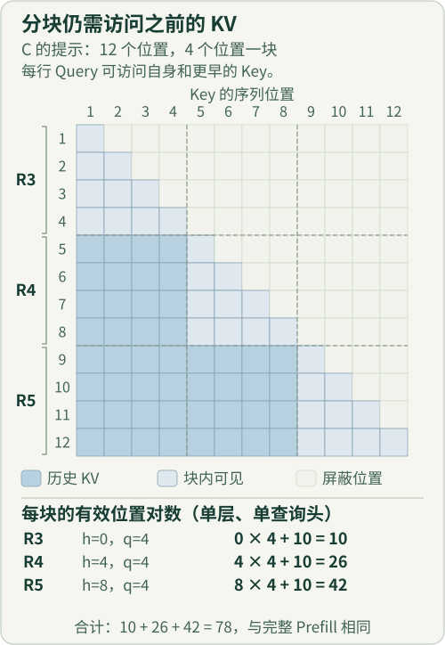
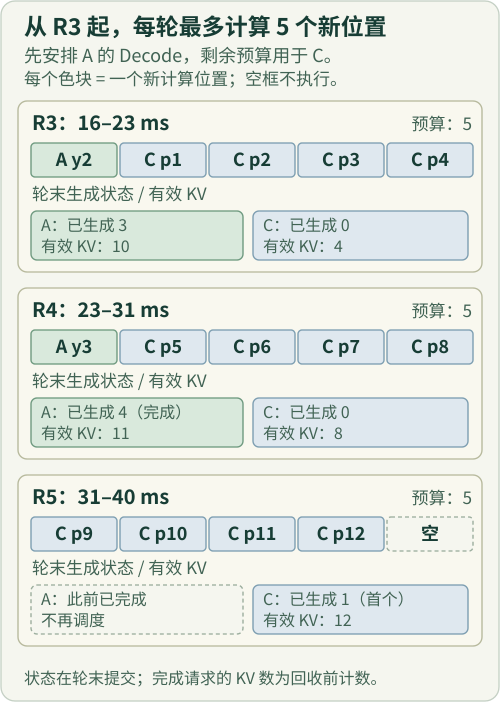
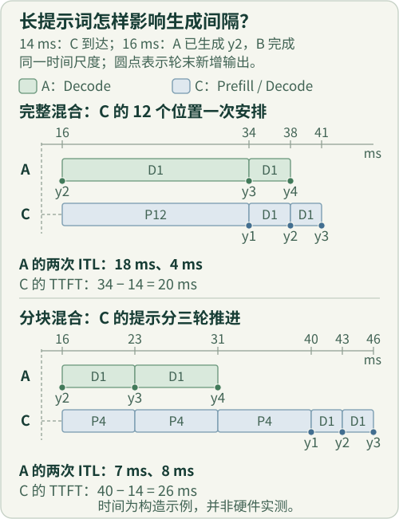

<!-- site-inference-math -->
# 一个很长的提示词，怎样避免长时间阻塞正在生成的请求？

在 [H01](h01-continuous-batching.md) 中，请求 A 仍在生成文本时，新到达的请求 C 就可以进入下一轮计算。但是，如果 C 提供了一段很长的输入，A 会不会因此长时间得不到下一个 Token？

**分块 Prefill（Chunked Prefill）** 是将一个请求的已知输入分成多个连续的位置区间，安排在不同轮次计算。引擎可以在这些轮次之间重新分配执行机会，让正在生成的请求继续 Decode，同时逐步处理新请求的输入。

这解决的是一次安排多少工作的问题。连续批处理允许改变批成员，分块 Prefill 进一步允许只执行某个批成员的一部分输入，而不必一次处理完整的提示词。

本篇通过改变 H01 中请求 C 的输入长度，解释如何选择每轮的工作量，以及分块为何能改善生成间隔、又可能增加首 Token 等待和计算开销。

## 为什么 C 已经能够加入批次，A 还是要等待？ {#prefill-interference}

继续沿用 H01 中请求 A、B、C 的到达顺序、模型和生成上限。唯一改变的是将 C 的输入从 6 个 Token 增加到 12 个 Token。

| 请求 | 到达时刻（ms） | 输入 Token 数 | 输出上限 |
| --- | ---: | ---: | ---: |
| A | 0 | 8 | 4 |
| B | 0 | 3 | 2 |
| C | 14 | 12 | 3 |

仍假设每个请求只有一条序列，使用相同的全因果 Attention 模型，不提前结束，不使用前缀复用或投机解码。每轮至多处理两条序列，KV 及其他工作区足够，不发生内存不足或抢占。

前两轮保持 H01 的执行方式与构造耗时。P8 表示计算 8 个提示位置，D1 表示普通 Decode 的 1 个新输入位置。

| 轮次 | 本轮工作 | 轮末输出 | 结束时刻（ms） |
| --- | --- | --- | ---: |
| 1 | A P8、B P3 | A 第 1 个、B 第 1 个 | 12 |
| 2 | A D1、B D1 | A 第 2 个、B 第 2 个；B 完成 | 16 |

第二轮结束时，A 已生成 2 个 Token、有效 KV 有 9 个位置，B 已达到输出上限。C 在第二轮执行中到达，已知全部 12 个输入 Token，但还没有计算其中任何位置。

若继续采用 H01 中完整 Prefill 与 Decode 混合的方案，第三轮同时计算 A 的一个新位置和 C 的全部 12 个位置。这轮一共要计算 13 个新位置，而不是两条 Decode 序列各计算一个位置。

[G02](../07-model-execution/g02-prefill-and-decode.md) 已解释两个阶段计算量的差别。Prefill 需要为多个新位置执行所有模型层，而普通 Decode 只为每条序列计算一个新位置，共享同一设备时，两类工作可能竞争计算单元及内存带宽。

即使合并线性层能复用权重，较大的混合批仍可能需要更长时间。这里混合只表示两种工作属于同一轮清单，不意味着所有设备任务都同时执行。若本例约定在轮末提交输出，A 的第三个输出就必须等到这一轮结束，才能被观察到。

如果引擎改为先单独执行整个 C 的 Prefill，再恢复 A 的 Decode，问题也可能出现。旧版的构造例中，一次 Decode 耗时 25 ms，串行插入一次 545 ms 的 Prefill，A 两个相邻输出的间隔便可能变为 545 + 25 = 570 ms。

这个数值只表示指定串行执行次序的构造事件，不能直接当作混合批耗时，更不是实测的 p99 延迟。根本问题是长 Prefill 在短时间内占用了较多共享执行机会。

[旧版：朴素推理引擎的三类瓶颈](../../inference-runtime/01-request-and-metrics/03-naive-bottlenecks.md)

## C 的十二个输入必须在同一轮处理吗？ {#chunked-prefill}

回顾 [G02](../07-model-execution/g02-prefill-and-decode.md#why-cache)：在全因果 Attention 中，一个位置只需要自己和更早的 Token。后续提示位置的出现不会改变之前位置的数学结果。

因此，C 的前 4 个已知 Token 可以先完成整个模型前向，并建立这四个位置在各层的有效 KV。C 还没有处理完整提示，不能把位置 4 预测的下一个 Token 当作本次请求的第一个输出。

接下来只把 C 的位置 5 至 8 交给模型计算。每层中新 Query 除了读取本块中允许的位置，还要读取上一块相应的历史 KV。

最后的一块计算位置 9 至 12。完整提示的最后一个位置产生用于选择首个输出的 Logits，生成规则这时才依照请求上下文提交 C 的第一个输出 Token。

具体实现可以计算中间位置的 Logits 或候选，但未完成完整提示前，不能将它们作为请求的生成 Token 提交。

<figure markdown="1">

<figcaption>每块表示一次处理四个新增查询位置的模型工作；浅蓝表示块内可见位置，深蓝表示可见的历史位置。三个块不是独立的短序列，后两块仍需读取前缀 KV。图表示数学可见范围，不规定内核必须物化矩阵。</figcaption>

</figure>

这改变的是**引擎每轮提交给模型的输入范围**，不是把原提示变成多个互不相关的请求。每块都要使用相同的模型参数、序列身份、正确位置和各层历史状态。

在这些条件下，按因果依赖分块可以得到与完整 Prefill 相同的数学结果。实际浮点计算的分块、归约顺序和内核可能不同，不承诺每个 Logits 逐位相同。

这里的分块不同于 [D07](../04-code-generation/d07-attention-kernels.md) 的内核 Tile。Tile 是内核内部如何组织一次给定计算；分块 Prefill 将一个提示的工作分到可重新调度的多轮，每轮可能调用多个 Kernel。

它也不同于 [G05](../07-model-execution/g05-paged-kv-cache.md) 的 KV 存储块。缓存块用于地址映射、分配和回收；本轮计算的输入范围不必等于一个缓存块。

## 怎样决定本轮为每条请求计算几个位置？ {#token-budget}

H01 的调度器限制每轮最多处理两条序列，但不限制本轮计算的新位置数。第三轮虽然只有 A、C 两条序列，新位置数却达到 13。

现在为引擎增加一个 **Token 预算**：从第二轮结束后的这一调度边界开始，每轮最多安排 5 个新计算位置。前两轮是共同的初始条件，并没有采用这一预算。

令 B_tok 为总预算，q_i 为请求 i 在本轮需要计算的新位置数。调度器构造的工作清单须满足：

$$\sum_i q_i\leq B_{\rm tok}$$

这同样包含 Prefill 和 Decode 的新输入。已经存在的历史 KV 位置不计入本轮新位置预算，但计算 Attention 时仍需访问其中允许的位置。

假设采取一种简单策略：先安排已经在生成且可以继续推进的请求，每条普通 Decode 序列使用一个预算单位；再用剩余预算按请求顺序处理尚未完成的 Prefill。

若本轮为 Decode 实际分配了 D 个位置（D≤B_tok），单个 Prefill 请求还有 r 个未计算的提示位置，则在序列槽位及资源也允许时，可以为它安排：

$$q=\min(r,\ B_{\rm tok}-D)$$

第三轮中，A 的普通 Decode 先使用 1 个预算单位，C 剩 12 个提示位置，可以计算 min(12,5−1) = 4 个。此时不必为 C 安排全部 12 个位置。

<figure markdown="1">

<figcaption>每个槽表示一个新输入位置的预算单位，不表示 GPU 计算单元、KV 存储块或固定时间。轮末数字表示已生成 Token 数与有效 KV 位置数。</figcaption>

</figure>

按照这个规则，第三轮及后续执行如下。每轮在前一轮实际结果可用、依赖满足后安排。

| 轮次 | 本轮工作（序列内位置） | 新位置总数 | 轮末输出 |
| --- | --- | ---: | --- |
| 3 | A D1（10）、C P4（1–4） | 5 | A 第 3 个 |
| 4 | A D1（11）、C P4（5–8） | 5 | A 第 4 个；A 完成 |
| 5 | C P4（9–12） | 4 | C 第 1 个 |
| 6 | C D1（13） | 1 | C 第 2 个 |
| 7 | C D1（14） | 1 | C 第 3 个；C 完成 |

第三轮仍然有两条序列，可以采用 H01 的 Packed Batch：本轮新输入共 5 行，查询行的边界为 [0,1,5]。A 使用历史长度 9，C 使用历史长度 0，后续仍要跟踪每条请求各自的有效位置与状态引用。

第四轮开始时 C 已有 4 个有效 KV 位置，因此本轮只能计算位置 5 至 8，不能把它当作从头执行的长度为四的新序列。

第五轮 C 只有 4 个剩余提示位置，计算完成就能产生首 Token。即使预算还剩 1，也不能事先安排 C 的普通 Decode，因为下一步的输入 Token 在这一轮结束前还未知。预算可以不填满。

### 每轮结束后，哪些请求已经可以继续生成？

沿用 H01 中“已生成 Token 数 / 有效 KV 位置数”的记法。B 在共同的第二轮后已完成，下面仅跟踪 A 和 C。第二轮回收前的 13 个位置中仍包含 B 的 4 个有效 KV 位置。

| 轮末 | A | C | 总有效 KV 位置（回收前 → 后） |
| --- | --- | --- | --- |
| 2 | 2 / 9 | 0 / 0（等待） | 13 → 9 |
| 3 | 3 / 10 | 0 / 4 | 14 → 14 |
| 4 | 4 / 11（完成） | 0 / 8 | 19 → 8 |
| 5 | 已结束 | 1 / 12 | 12 → 12 |
| 6 | 已结束 | 2 / 13 | 13 → 13 |
| 7 | 已结束 | 3 / 14（完成） | 14 → 0 |

第四轮结束时，C 尚未生成 Token，但已经完成 8 个提示位置的计算。前缀状态不是失败或无效的工作，下轮能直接复用。

与 H01 一样，表中的回收以依赖已完成、引用释放且没有需保留的前缀为前提。回收前的位置峰值为 19，实际存储占用仍须依据 G04/G05 的分配方式计算，不能直接使用位置计数作为显存预算。

## 将长 Prefill 分块以后，哪些请求会更快？ {#latency-tradeoff}

现在比较两种安排。基线不对第三轮以后设置新位置预算，在第三轮完成 C 的全部 12 个提示位置；另一种使用前面的 5 Token 预算。

为了观察时间，假设完整的 A D1+C P12 混合轮耗时 18 ms，随后 A、C 的双请求 Decode 耗时 4 ms，C 的单请求 Decode 耗时 3 ms。

分块时，第三至五轮的构造耗时分别为 7、8、9 ms，后两轮单请求 Decode 各耗时 3 ms。两种方案的前两轮耗时相同，每轮结束时可以观察相应输出。

这些数值仅用于说明一种可能的耗时关系，没有从 Token 数推算硬件执行时间。各轮包含调度、前向及生成开销，忽略分词、传输和文本缓冲。

<figure markdown="1">

<figcaption>同一条时间轴上的两种方案，时间单位为 ms，条段长度按构造耗时绘制。C 在 14 ms 到达，A 的第二个输出在 16 ms 产生。</figcaption>

</figure>

| 方案 | A 第三个、第四个输出时刻（ms） | C 首个、第二个、第三个输出时刻（ms） | 全部完成（ms） |
| --- | --- | --- | ---: |
| 完整 Prefill | 34、38 | 34、38、41 | 41 |
| 分块 Prefill | 23、31 | 40、43、46 | 46 |

首 Token 时延（TTFT）是请求到达至首个输出的时间。Token 间时延（ITL）是同一请求相邻两个输出时刻的间隔。下面采用引擎内部 Token 可观察时刻，不是客户端端到端测量。

| 指标 | 完整 Prefill | 分块 Prefill |
| --- | ---: | ---: |
| A 第二个至第三个输出的 ITL | 34−16 = 18 ms | 23−16 = 7 ms |
| A 第三个至第四个输出的 ITL | 4 ms | 8 ms |
| C 的 TTFT | 34−14 = 20 ms | 40−14 = 26 ms |
| 全部请求的输出吞吐（Token/s） | 9 / 0.041 ≈ 220 | 9 / 0.046 ≈ 196 |

两种方案都完成 9 个输出 Token 和 29 个新位置的计算。在构造事件中，A 最长的生成间隔从 18 ms 缩短至 8 ms，C 的首 Token 反而更晚生成，整组请求的输出吞吐也降低了。

这是因为 A 不再等待 C 的全部提示工作，而 C 的首 Token 仍依赖所有提示位置完成计算。C 先前所需的一整轮工作被分散到更多轮，轮次组织及数据访问的代价也可能发生变化。

分块的价值不是保证每一条请求更快，而是在允许进行调度选择的粒度上，将计算机会分配给不同请求。真实收益取决于短批次的实际耗时、到达负载、目标延迟和设备资源。

## 限制 Token 数，能否精确限制每轮耗时？ {#budget-is-not-time}

我们已经规定第三轮到第七轮每轮最多计算 5 个输入位置。但是第三、第四轮的新位置数都等于 5，为什么时间仍可能不同？

回到 C 的三个提示块。假设每个 Attention 层具有相同的全因果可见规则，记计算前已有的有效历史位置数为 h，本轮新计算位置数为 q。依据 [D07](../04-code-generation/d07-attention-kernels.md#causal-mask)，每层每查询头新 Query 与有效 Key 的位置对数为：

$$N_{\rm pair}=hq+\frac{q(q+1)}{2}$$

第一个提示块计算 q=4 个位置，h=0，只需 10 个有效位置对。第二块仍计算 4 个位置，但已经有 4 个历史位置，因此还需要 4×4 个跨块位置对。

| C 的提示块 | 历史 h | 新位置 q | 有效位置对 |
| --- | ---: | ---: | ---: |
| 1（位置 1–4） | 0 | 4 | 10 |
| 2（位置 5–8） | 4 | 4 | 26 |
| 3（位置 9–12） | 8 | 4 | 42 |

三个块加起来是 78 个有效位置对，与完整处理 12 个输入时的 12×13/2=78 相同。因此分块并没有减少 C 的有效因果 Attention 计算范围，也不需要重算已完成的旧位置。

在第三轮的混合批中，A 有 9 个历史位置，q=1，产生 10 个有效位置对；C 的第一个块产生 10 个。第四轮同样安排 5 个新位置，却需要为 A、C 分别处理 11 和 26 个，合计 37 个。

也就是说，**相同的新位置预算可以对应不同的模型工作量**。第五轮只有 C 的 4 个新位置，却有 42 个有效位置对。这些量还没有换算为实际内核运算和访存。

更多因素可能改变实际耗时：

- 不同数量的新位置使矩阵乘的形状及权重复用程度改变；过小的批可能难以充分利用计算阵列。
- 长历史需要参与更多 Attention 计算，并可能增加历史 KV 的读取量；不同内核的分块与复用程度不同。
- 多次提交模型前向会增加调度、内核启动等固定成本，还可能重复读取权重或先前的 KV。跨设备场景也有通信成本。

因此，数学上相同的有效计算范围不代表相同的实际执行成本，也不代表真实 HBM 流量相同。内核实现和设备代价的分析参考 [D05](../04-code-generation/d05-matrix-multiplication-kernels.md)、D07 及[存储系统](../../storage/README.md)。

若要控制一次轮次可能持续多久，需要把历史长度、当轮形状、执行变体、设备及并行配置等纳入成本估计。由实测校准的成本模型可以辅助选择预算，并为估计误差留出余量；不能将 Token 预算直接视为时间硬上限。

## 每轮优先执行 Decode，总是最好的策略吗？ {#scheduling-policy}

在第三轮优先给 A 分配一个预算单位，是因为此时 A 已经能够生成下一个 Token。优先保证这些计算机会，可以减轻新请求长 Prefill 对生成间隔的影响。

但如果每轮都有足够多的活跃 Decode，它们可能一直占满预算，甚至占满所有序列槽位。排队的 Prefill 即使已知完整输入、有足够 KV 空间，也得不到执行机会，首 Token 时延便会持续增长。

反过来，如果总是把新请求的 Prefill 提到最前面，已有 Decode 可能经常被推迟。引擎需要在正在生成的请求与等待首 Token 的请求之间分配执行机会。

| 一种可选策略 | 希望改善什么 | 可能的代价 |
| --- | --- | --- |
| 先保证 Decode，剩余预算给 Prefill | 缩短已有请求的生成间隔 | 新请求长时间等待 |
| 给 Prefill 保留一部分预算或定期推进 | 避免新请求一直得不到计算机会 | 部分 Decode 被推迟 |
| 在允许的延迟内增大混合批 | 利用计算并行性与权重复用 | 轮次较长，影响生成间隔 |

这些是可选策略，不是连续批处理的定义。即便采用 Decode 优先，若本轮的资源和预算不足以推进所有 Decode，也需要在它们之间进行选择。

### 真实引擎如何实现这一思路？

原始 [SARATHI（2023）](https://arxiv.org/abs/2308.16369) 研究将一个 Prefill 块与多个 Decode 组织成混合批，利用共同的线性层计算来改善设备利用。Attention 仍然按照各请求的历史与查询独立计算。

[Sarathi-Serve（OSDI 2024）](https://www.usenix.org/system/files/osdi24-agrawal.pdf) 进一步研究动态到达场景中的分块 Prefill 与混合调度。其算法先安排正在生成的请求，再利用剩余 Token 预算推进 Prefill，通过性能测试选择预算。

论文中的 stall-free batching 强调避免为了执行新 Prefill 而暂停已有 Decode 的调度；混合轮仍可能比纯 Decode 轮耗时更久。它不表示任何模型、负载或设备都能实现固定的生成间隔。

以 vLLM v0.10.2 为例，[优化文档](https://docs.vllm.ai/en/v0.10.2/configuration/optimization.html#chunked-prefill) 介绍了采用 Decode 优先及 max_num_batched_tokens 预算的思路，并讨论预算大小与 TTFT、ITL 的取舍。

具体查看同版本 [V1 Scheduler 源码](https://docs.vllm.ai/en/v0.10.2/api/vllm/v1/core/sched/scheduler.html)，在普通生成路径中，调度器按已知与已计算的 Token 数之差安排待计算位置。它先处理运行中的请求，再尝试等待请求，同时考虑预算与缓存资源等约束。

调度器将 max_num_batched_tokens 用作本轮新计算位置总数的上限。同版本 [GPUModelRunner](https://docs.vllm.ai/en/v0.10.2/api/vllm/v1/worker/gpu_model_runner.html) 对未完成的提示分块不提交生成 Token。

因此，实际实现不一定为每个请求严格区分两个调度阶段，也不保证每个 Decode 无条件优先。上面的 A、B、C 只是用来解释机制的一种明确策略。

## 深化阅读：如果从第一轮开始设置 Token 预算？ {#event-model}

前面的主例是在 H01 的共同状态之后引入预算。现在恢复最初的 C 输入长度 6，使用旧版[可运行的事件模型](../../inference-runtime/09-measurement-and-cases/trace-and-event-model.md#一个可运行的最小模型)，从第一轮开始施加 5 个输入位置的预算。

仍使用 A、B、C 的原始输入及输出长度 8/4、3/2、6/3，但 C 的到达时刻改为 5 ms；A、B 在 0 ms 到达。先安排 Decode，剩余预算按到达顺序推进 Prefill，未填满也可提交。

旧模型为各轮赋予如下构造耗时：

$$T_{\rm step}=1+0.1N_{\rm prefill}+0.2N_{\rm decode}
+0.001S_{\rm decode}\quad[\mathrm{ms}]$$

N_prefill、N_decode 为本轮两类新输入位置的数量；S_decode 为本轮参与 Decode 的请求在执行前已有的 KV 位置数之和。式中的系数是教学假设，省略了 Prefill 历史读取成本及具体内核、通信等细节。

| 轮次 | 本轮工作 | 轮末输出 | 结束时刻（ms） |
| --- | --- | --- | ---: |
| 1 | A P5 | 无 | 1.500 |
| 2 | A P3、B P2 | A 第 1 个 | 3.000 |
| 3 | A D1、B P1 | A 第 2 个、B 第 1 个 | 4.308 |
| 4 | A D1、B D1 | A 第 3 个、B 第 2 个 | 5.720 |
| 5 | A D1、C P4 | A 第 4 个 | 7.330 |
| 6 | C P2 | C 第 1 个 | 8.530 |
| 7 | C D1 | C 第 2 个 | 9.736 |
| 8 | C D1 | C 第 3 个 | 10.943 |

例如第三轮开始时，A 已有 8 个有效 KV 位置，因此耗时为 1+0.1+0.2+0.001×8=1.308 ms。C 在第四轮执行中到达，第五轮才开始计算，它的入批等待是 5.720−5=0.720 ms。

将同一模型的预算从 5 改为 6，保持其他规则不变：

| 模型指标 | 5 Token 预算 | 6 Token 预算 |
| --- | ---: | ---: |
| A 的 TTFT（ms） | 3.000 | 3.100 |
| B 的 TTFT（ms） | 4.308 | 3.100 |
| C 的 TTFT（ms） | 3.530 | 3.530 |
| 所有请求结束时刻（ms） | 10.943 | 10.943 |

预算为 6 时，第一轮 A P6，第二轮 A P2、B P3。A 与 B 都在第二轮产生首 Token；因此 B 提早一轮出结果，A 也需要等同一轮多计算一个位置。

两组都执行 8 轮、产生 9 个输出、最终结束时刻相同。只看总吞吐会遗漏 A、B 的等待时间变化。

可以在仓库中使用旧版 [runtime_model.py](https://github.com/microarch-flow/wiki/blob/main/series/inference-runtime/examples/runtime_model.py) 复算：

~~~sh
python3 series/inference-runtime/examples/runtime_model.py --token-budget 5
python3 series/inference-runtime/examples/runtime_model.py --token-budget 6
~~~

这个最小模型用于验证调度、进度与时间统计的因果关系，不足以预测具体设备的服务性能。生产环境的性能建模与压测归 [K 专题](../11-performance/README.md)。

## 接下来还需要考虑什么？

连续批处理决定本轮有哪些请求，分块 Prefill 进一步决定每条请求本轮处理多少输入位置。在满足计算和状态依赖的前提下，引擎可以借助 Token 预算与调度策略，重新分配各个请求的执行机会。

本篇始终假设所需 KV 和工作区足够。即使每轮最多安排 5 个新位置，已经计算完成的历史 KV 仍继续存留；经过多轮后，多个请求的状态可能超出可用容量。

当容量开始限制执行时，光知道这些请求的工作都可以合法推进并不够。下一篇 H03 将沿用 H01 的 A、B、C 请求及 G04/G05 的状态模型，解释为何引擎需要准入、等待、抢占与恢复策略。

## 来源与继续阅读

- [SARATHI: Efficient LLM Inference by Piggybacking Decodes with Chunked Prefills（2023）](https://arxiv.org/abs/2308.16369)：分块与混合批组织。
- [Taming Throughput-Latency Tradeoff in LLM Inference with Sarathi-Serve（OSDI 2024）](https://www.usenix.org/conference/osdi24/presentation/agrawal)：论文 §4 解释分块、调度策略及预算选择。
- [vLLM v0.10.2：Chunked Prefill 优化文档](https://docs.vllm.ai/en/v0.10.2/configuration/optimization.html#chunked-prefill) 与 [Scheduler 源码](https://docs.vllm.ai/en/v0.10.2/api/vllm/v1/core/sched/scheduler.html)：具体引擎的预算与请求状态。
- [旧版：连续批处理与分块 Prefill](../../inference-runtime/05-batching-and-scheduling/04-dynamic-shape-batching.md) 和[延迟、吞吐与 SLO](../../inference-runtime/01-request-and-metrics/02-metrics-slo.md)：算例及指标定义。
- [回到 H 专题导读](README.md)。
