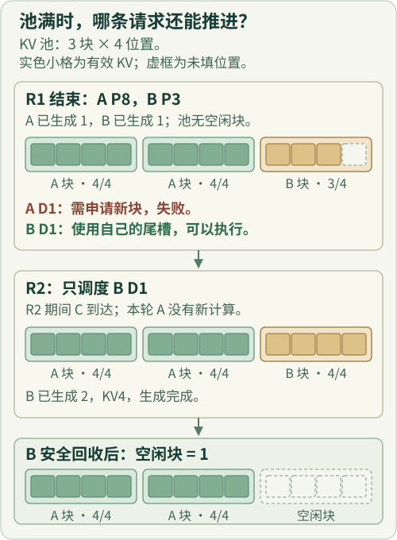
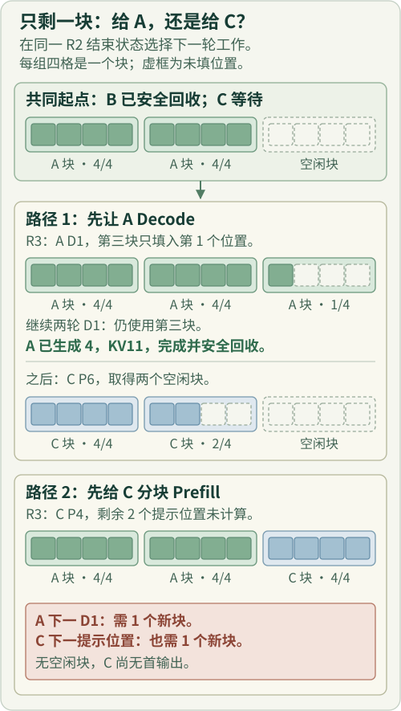
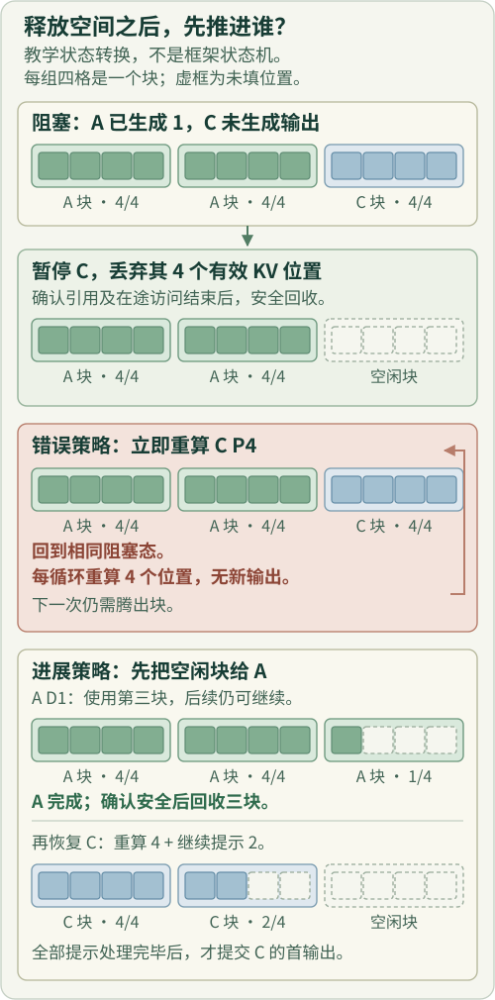

<!-- site-inference-math -->
# KV 空间不足时，应该接纳、等待还是抢占哪个请求？

在 [H01](h01-continuous-batching.md) 中，推理引擎可以在生成迭代之间改变批成员。[H02](h02-chunked-prefill.md) 又限制了每轮执行的新位置数，避免完整的长 Prefill 一次占用过多计算机会。

但已经计算过的历史 KV 会在后续轮次中继续保留。如果池中没有空间保存下一批工作产生的状态，即使设备还有可用算力，也不能按原计划继续执行。

**请求准入（Admission）** 是引擎根据执行条件和资源承诺决定何时允许等待中的请求进入执行。已经进入引擎的请求也需要不断取得资源才能继续推进。

当资源不足时，引擎可以等待其他请求结束，也可以主动暂停某个请求的推进，释放其占用的部分资源，再择机恢复。这类主动中断后续执行安排的方式称为**抢占（Preemption）**。

本篇继续追踪 A、B、C 的输入、输出和 KV 状态，解释为什么只看当前空闲容量还不够，以及选择不同请求会怎样改变等待时间和重复工作。

## KV 池已经满了，还能继续生成 Token 吗？ {#block-pressure}

恢复 H01 的三条请求：A、B 同时到达；C 在第二轮执行中到达。C 的输入重新采用 H01 的 6 个 Token，而不是 H02 中延长后的 12 个。

| 请求 | 输入 Token 数 | 输出上限 |
| --- | ---: | ---: |
| A | 8 | 4 |
| B | 3 | 2 |
| C | 6 | 3 |

仍使用单引擎、全因果 Attention、一请求一序列的教学模型。假设三条序列分别保存自己的 KV，无前缀共享、冷缓存保留、额外候选状态或提前终止。

与 H01 不同，现在只给设备提供三个可分配的 KV 块，每块包含四个位置。沿用 [G05](../07-model-execution/g05-paged-kv-cache.md) 的分配粒度，假设执行所需的其他内存和每轮计算预算足够，最多同时计算两条序列。

按照 G04 的教学层每位置 128 B 计，单层三个块容纳 12 个位置，即 1,536 B。真实模型还需各层对应状态、元数据及其他资源预算。这不是一款设备的显存规格。

本篇不赋予每轮固定的毫秒耗时，仅跟踪调度边界和资源状态。因为第二轮安排会改变，C 的到达仍定义在第二轮进行中，不沿用 H01 的具体到达时间。

### 先让 A、B 一起完成 Prefill

沿用 H01 的按需分配：需要计算的位置必须先取得空间，尚不为未来最大长度额外预留块。

第一轮为 A 的 8 个输入分配两个块，为 B 的 3 个输入分配一个块。两条请求都成功生成首 Token。

| 第一轮末 | 已生成 Token 数 | 有效 KV 位置 | 占有块数 | 自己的尾部空槽 |
| --- | ---: | ---: | ---: | ---: |
| A | 1 | 8 | 2 | 0 |
| B | 1 | 3 | 1 | 1 |
| 合计 | 2 | 11 | 3 | 1 |

池内的三个块已全部归属请求，但还有一个没有写入有效 KV 的位置。这个位置位于 B 的尾块中，不能直接交给 A 使用。

A 为生成第二个输出，需要计算自己的新位置 9（输入为 y1），因此需要第三个块。B 为生成第二个输出，需要计算位置 4，恰好可以使用自己尾块剩余的位置。

<figure markdown="1">

<figcaption>三个块、每块四个位置的教学池。颜色标明物理块当前归属，淡槽表示块内未使用的位置；回收后才出现可重新分配的空闲块。</figcaption>

</figure>

如果只检查空闲块数量，可能错误地认为 A、B 都无法继续。实际上，B 可以在不增加分配块数的情况下执行下一次 Decode。

第二轮只选择 B D1。B 产生第二个输出，达到上限，最后保有 4 个有效 KV 位置。等待相关访问结束并安全回收其块后，池内出现一个空闲块。

这时 A 仍有 8 个有效 KV 位置和一个已生成 Token，C 已到达并等待接纳。

## 现在应该把空闲块交给 A，还是交给 C？ {#admission-choices}

调度器需要知道的不只是本轮处理多少 Token，还要知道这些位置需要增加多少独立分配空间。

设本例块容量为 b，某条序列已有 k 个有效位置、持有 n 个块，本轮计划计算 q 个新位置。在没有共享、额外预留及其他状态的本例中，新增块数为：

$$\Delta n=\max\left(0,\left\lceil\frac{k+q}{b}\right\rceil-n\right)$$

例如第二轮前，A 的 k=8、n=2、q=1，需要增加一个块；B 的 k=3、n=1、q=1，不需要增加块。

如果池当前有 F 个可安全分配的空闲块，所选工作清单在提交前至少要满足：

$$\sum_i\Delta n_i\leq F$$

这只是本例的块数约束。引擎还需核对 H02 的 Token 预算、执行变体、临时工作区，以及实际缓存规格与所有权等条件。

### 方案一：先让已经开始生成的 A 继续

第二轮末有一个空闲块，A D1 需要一个；C 的完整 Prefill（P6）需要两个块，暂时还不能接纳。

把唯一的空闲块交给 A 后，它便可以计算位置 9、生成第二个输出。此时 A 占有三个块，有效位置为 9，但最后一个块还能容纳三个位置。

由于 A 最多只生成四个输出，接下来的两个 Decode 都能使用这个尾块，不需要额外申请 KV。A 完成后，安全回收三个块，就可以为 C 的 P6 提供两个块。

| 轮次 | 实际工作 | A 的生成数 / KV | C 的生成数 / KV | 轮末占有块数（回收后） |
| --- | --- | --- | --- | ---: |
| 2 | B D1（B 完成） | 1 / 8 | 等待 | 2 |
| 3 | A D1 | 2 / 9 | 等待 | 3 |
| 4 | A D1 | 3 / 10 | 等待 | 3 |
| 5 | A D1（完成） | 4 / 11 | 等待 | 0 |
| 6 | C P6 | 已结束 | 1 / 6 | 2 |
| 7 | C D1 | 已结束 | 2 / 7 | 2 |
| 8 | C D1（完成） | 已结束 | 3 / 8 | 0 |

方案一让 C 多等待几轮，却保证已有的 A 可以持续取得下一步所需的空间，并在随后释放更多容量。

### 方案二：让新请求 C 先执行一部分 Prefill

如果不希望 C 一直等待，能否借用 H02 的分块 Prefill？C 的 P6 不能完整容纳，但 C P4 只需要一个块，恰好能够使用池内唯一的空闲块。

假设调度器选择 C P4，而没有先安排 A D1。第三轮末，C 尚未完成提示，所以没有选出首个正式输出 Token。池内状态变为：

| 请求 | 已生成 Token 数 | 有效 KV 位置 | 占有块数 | 下一步最低新增块数 |
| --- | ---: | ---: | ---: | ---: |
| A | 1 | 8 | 2 | 1 |
| C | 0 | 4 | 1 | 1 |

<figure markdown="1">

<figcaption>从同一调度边界出发的两种选择。各次计算均假设已经完成，状态能被后续工作使用；不同路径的轮数不代表等时间间隔。</figcaption>

</figure>

A 必须先取得一个新块才能追加位置 9；C 也必须先取得新块才能计算剩余提示中的位置 5。两者都没有足够的块继续计算，也没有请求可以自然完成并释放容量。

如果没有尚未完成的回收事件、可淘汰的闲置状态或额外的容量可用，单靠等待不能改变这个局面。引擎必须改变资源承诺或调度选择。这是用来说明按需准入风险的教学反例，不是某个实际引擎的默认调度。

这揭示了准入控制的核心矛盾：**能够容纳一条请求当前的工作，并不保证能够容纳它的后续增长，甚至不保证任何一条请求还能继续推进。**

## 应该提前为每个请求保留全部增长空间吗？ {#resource-commitment}

一种办法是在接纳请求之前，先计算这条请求在完整生命周期内最多需要多少块，并为它承诺这部分容量。

回顾 G02，在不提前停止的普通自回归生成中，输入长度为 P、输出上限为 O 的请求总共需要计算 P+O−1 个位置。最后一个输出被选出后，不需要再计算其对应位置来完成请求。

| 请求 | 最大有效 KV 位置 | 完成所需块数 | 初始完整 Prefill 所需块数 |
| --- | ---: | ---: | ---: |
| A | 8+4−1=11 | 3 | 2 |
| B | 3+2−1=4 | 1 | 1 |
| C | 6+3−1=8 | 2 | 2 |

在只有三个块的本例中，如果采用严格的最大长度承诺，先接纳 A 就要保证三个块的预算。B 虽然首轮能与 A 一起计算，仍需等待可承诺额度。

承诺额度不要求立即写入 KV 或提前把所有块挂到块表上。只要还承担这份承诺，引擎就不能将同一份容量再次无条件承诺给其他请求。

这种保守做法可能减少资源不足时的抢占，但在请求较早结束、长度估算偏保守时占用较多可接纳额度。按需分配可以利用请求尚未增长的空间，却需要管理未来增长的风险。

实际引擎还可以采用介于两者之间的策略：给已接纳请求的近期增长保留一定空间，或者设置新请求的**准入水位**。

例如在第二轮末，若策略要求为 A 的近期增长至少保留一个空闲块，就不会将最后一个块交给 C 的 P4。这个保留量是一种调度策略，不是硬件规定，也不要求适用于每一轮和所有请求。

准入时还应检查共享尾块可能需要写时复制（G05）、投机候选所需临时状态（G09）、不同缓存组及临时工作区。从请求退出执行到资源可安全归还，也可能有时间间隔。

因此，真实的 KV 容量预算应由 [G04](../07-model-execution/g04-model-state-and-memory-budget.md) 和 G05 的存储计量提供，而不是简单由请求数乘以最大序列长度得到。

## 已经没有请求能够推进时，应该暂停谁？ {#preemption}

回到方案二第三轮末：A 占两个块、C 占一个块，二者下一步都需要额外的空间。假设这是一次已经确认完成的轮次边界，没有其他使用者或在途访问阻碍本例块的回收。

引擎首先可以暂停一条请求的后续调度。但仅暂停并继续保留其全部设备 KV，不会增加这个已耗尽的池的可用块数。

因此，如果是为了缓解容量不足，还需要选择能够实际释放空间的方式。

| 暂停后如何处置状态 | 设备空间 | 恢复需要做什么 |
| --- | --- | --- |
| 保留驻留 KV | 继续占用原空间 | 确认相关依赖和状态可用后继续 |
| 放弃部分或全部 KV | 安全解除占用后可回收 | 利用仍有效的前缀，重新计算缺失位置 |
| 将 KV 迁移到后备存储 | 完成迁移与安全归还后可回收 | 取得目标空间，搬回需要的状态 |

这些方式的实际支持范围不同。[G07](../07-model-execution/g07-tiered-kv-cache.md) 已经介绍了迁移、重新计算、状态版本和预取机制。本篇关心的是如何选择暂停对象，以及何时为它安排恢复。重算也要占用 H02 的计算预算，迁移则需要传输资源与目标块。

抢占是停止为相关请求安排后续工作，不等于立刻停止已经执行的设备任务。调度器还需按 [F03](../06-execution-runtime/f03-runtime-buffer-management.md) 的资源契约确认最后访问和引用解除，才能重新使用其空间。

G06 中没有活跃引用的前缀也可以被淘汰，且不需要停止任何当前请求。如果 A、C 共享某个块，暂停 A 也未必能释放它的全部逻辑块。这与把活跃请求从执行安排中移出是不同的机制。

### 如果暂停 C，A 能够继续吗？

假设选择丢弃 C 的设备 KV。C 的四个输入位置已经计算，但还没有生成任何输出。引擎保留 C 的全部输入和生成配置，在回收安全后取回一个块。

现在 A 可取得第三个块，执行位置 9，随后通过尾块完成位置 10、11 的计算。A 结束并释放全部块后，C 就能重新执行完整六位置 Prefill，再继续普通 Decode。

C 的前四个位置需要重算，额外重复计算 4 个位置；它原本还没计算的后两个提示位置，则属于必要工作。

### 如果选择暂停 A 呢？

若 C 有较高的服务优先级，或者 C 等待首 Token 的时间比 A 的生成间隔更重要，引擎也可以暂停 A 并安全释放它的两个块。

C 使用其中一个可分配块处理剩余两个提示位置，生成首 Token；之后还可以利用尾块继续 Decode，直到完成。A 恢复时则需要重新建立八个历史位置的 KV。

A 已经正式提交过第一个输出 y1，此时已知 9 个 Token、已计算历史为 8 个位置。必须保留 y1、随机状态及停止控制等相关生成状态。重算八个历史位置只恢复状态，不能重新采样或重复发送 y1。恢复后的下一次普通 Decode 消费这个已知的 y1，产生 y2。

引擎也可以将历史重建和本来就要执行的新位置合并提交，但只有新推进的生成工作才应更新正式输出和停止状态。

假设所有状态都按需丢弃且没有缓存复用，两种抢占路径和直接等待路径的工作量可对比：

| 策略 | 取得的空间 | 需要重算的位置 | A、B、C 总计算位置数（含重算） |
| --- | ---: | ---: | ---: |
| 先让 A 结束，C 等待（方案一） | 无抢占 | 0 | 23 |
| 进入阻塞后暂停 C | 1 块 | 4 | 27 |
| 进入阻塞后暂停 A | 2 块 | 8 | 31 |

各路径最终均生成 9 个正式输出。表中不含填充、投机或内核级重复运算，也未给轮次赋予时间。抢占对象不同，会改变哪条请求等待更久以及额外工作量。

更多地释放空间不一定更好。如果只需要一个块，而且保证 A 取得它后可以完成，暂停 C 的重算量较小。但如果存在服务目标或其他资源条件，选择可能不同。

## 恢复请求时，为什么不能只盯着空闲块？ {#avoid-thrashing}

假设按前一节暂停 C 后，刚刚安全回收了一个块。但是调度器发现 C 已经等待较久，立刻安排它恢复，重新计算其前四个提示位置，再一次占用了这个块。

结果又回到 A 占两个满块、C 占一个满块的阻塞状态。A 和 C 都没有产生新的正式输出。

<figure markdown="1">

<figcaption>反复暂停和恢复的教学反例。图中的回收都已经满足安全条件；重算四个位置再返回阻塞状态不会提交新输出，正确性满足也不代表系统取得了进展。</figcaption>

</figure>

如果反复执行这个过程，C 每次都重算四个位置，却没有推进任何新的正式输出。这类来回迁移、淘汰或重算但有效工作很少的现象称为**抖动（Thrashing）**。

避免这个循环的关键是让释放资源服务于明确的进展目标。既然释放 C 的块是为了让 A 完成，就应为 A 的下一步分配或保留它，而不是立即用其再次恢复 C。

实际策略可以减少新准入、限制同时恢复的请求数、为已选中的恢复工作保留后续增长空间，或在空间达到适当水位后再尝试新的接纳。对于重复进入抢占状态的请求，需要重新考虑优先级和资源承诺。

这些策略不会凭空扩大容量，代价可能是让一部分请求等待更久。应观察抢占和恢复次数、重复计算位置的比例、额外搬运量、请求实际完成和生成间隔，而不仅看池是否一直被占满。

### 重算还是迁移，需要比较哪些成本？

G07 已给出针对缺失状态的恢复成本模型。这里沿用旧版的简化反例，假设完整缺失的历史长度为 s，无可复用前缀，在固定模型与传输路径下近似：

$$T_{\rm recompute}=as+bs^2,\qquad T_{\rm restore}=\alpha+\frac{ks}{BW_{\rm eff}}$$

其中 a、b 是计算成本系数，α 为固定恢复开销，k 是每个位置需要传输的字节数，BW_eff 是有效载荷带宽。两式采用一致的时间单位。

第一式用于描述逐位置工作及完整因果 Attention 随长度变化的成本，第二式仅表示一次恢复传输的简化成本。它们不是适用于所有内核和设备的性能公式。

只有在进一步忽略二次项及固定项（b=0、α=0）等条件下，两式才都与长度成正比。因此不存在普遍的、与序列长度无关的重算和迁移交叉点。

已就绪且可复用的前缀可缩小待恢复范围，已有有效的后备副本可以省去首次写出。若必须先写出再读回，不能只计算单向恢复。真正选择受预计等待、空间、计算及传输资源影响，而不仅是两条公式的比较。

[继续阅读 G07 的成本比较](../07-model-execution/g07-tiered-kv-cache.md#cost-comparison)

## 当多个请求都可以执行时，哪一个应该优先？ {#priority-and-fairness}

H01 说明了批成员可变化，H02 说明了每轮可分配不同数量的工作；本篇进一步说明请求是否能推进，还受它未来需要取得的状态容量限制。

调度器首先需要确定哪些候选工作满足正确性和资源条件。在这个可行集合中，仍可能存在多种选择。排序策略决定哪些请求先取得执行机会，哪些请求承担等待。

| 常见策略 | 希望改善什么 | 需要权衡什么 |
| --- | --- | --- |
| 按到达顺序（FCFS） | 让先到请求优先，容易解释 | 长请求或需要大量块的请求可能阻挡其他请求 |
| 优先较短或预计剩余工作较少的请求（SJF 或近似 SRPT） | 较早完成更多请求及释放容量 | 实际输出长度未知，长请求可能持续被推迟 |
| 优先 Decode | 减少已经在生成的请求等待 | 等待 Prefill 的请求首 Token 可能变慢 |
| 优先缓存命中较多的请求 | 减少重复计算及新增状态需求 | 可能偏向具有热门前缀的请求 |
| 按业务优先级或截止时间 | 优先满足指定的服务目标 | 较低优先级请求可能长时间等待 |

输出上限可用于资源承诺，但不代表真实输出长度或执行时间。短作业策略所用的剩余工作量通常需要估计，Token 数也不能直接当作真实时间。

即使为 A、C 各安排一次计算机会，A 的一个 Decode 位置与 C 的四个 Prefill 位置消耗也可能不同。因此公平性还需要规定服务量单位：例如按请求、客户端、经过加权的输入与输出 Token 或估计资源消耗。

[Fairness in Serving Large Language Models（OSDI 2024）](https://www.usenix.org/conference/osdi24/presentation/sheng) 使用 Virtual Token Counter 研究具有不同请求长度的客户端之间的服务量公平性。这是一种明确选定公平口径的实例。

可通过让等待较久的请求提升优先级、分级队列、为不同类型的工作保留预算或按客户端划分配额，减轻某些请求长期得不到执行机会的现象。

[FastServe](https://arxiv.org/abs/2305.05920) 研究利用生成迭代边界进行抢占与多级队列调度。不同策略需要定义优先级、预计工作量和恢复开销，也应通过负载验证等待时间是否得到改善。

公平策略必须在可行资源约束中选择工作。若一个请求长期无法满足最小执行条件，提升优先级本身仍不能制造空间。具体的资源选择也可以参考[计算微架构中的依赖和调度](../../microarchitecture-v2/01-foundations/a08-dependencies-and-scheduling.md)，但那里选择的是更底层的执行工作。

如果某请求即使独占整个池也无法取得下一步所需空间，等待其他请求结束仍无济于事。引擎需要明确拒绝无法满足的工作，或借助其他实例、分布式执行或存储方案提供足够资源。

### 如果请求不断到达，等待队列能一直增长吗？

即使每次都选到了最适合执行的请求，只要持续到达的工作超过系统可以完成的工作，队列就可能越来越长。

引擎也需要为等待任务自身设置容量约束。达到上限后，可以通过背压让上游暂缓交付，或按照服务约定拒绝无法接纳的请求、处理等待超时。

队列重新排序能够改变谁先得到服务，却无法解决长期供给不足。服务入口的准入、路由到其他副本或调整实例容量属于 [J 专题](../10-serving/README.md)，而不是单引擎的 KV 分配算法。

[Google SRE：Addressing Cascading Failures — Queue Management](https://sre.google/sre-book/addressing-cascading-failures/#queue-management)

## 一轮调度到底需要检查什么？ {#scheduler-loop}

现在可以把 H01 和 H02 的工作清单进一步扩展为带资源承诺的请求计划。每次调度边界上至少需要了解这些信息：

| 输入 | 用途 |
| --- | --- |
| 等待、活跃、暂停的请求与到达时间 | 确定候选及服务顺序 |
| 已处理位置、正式输出和状态引用 | 决定哪些位置可以合法计算 |
| 可分配及待回收的空间、后续增长需求 | 检查准入或恢复是否可行 |
| 本轮执行预算及策略目标 | 构造工作清单并选择请求 |

一种教学用的逻辑循环如下：

~~~text
处理已完成、到达及取消事件，确认可安全回收的空间
依据请求进度和依赖确定可推进工作
检查候选批次的新位置预算、状态分配与临时资源
不足时尝试缩小工作、延后请求或选择抢占对象
确认资源安全可用，为选定工作承诺实际所需空间
提交位置范围、状态引用和相应执行计划
结果就绪后提交进度和输出，继续更新请求状态
~~~

这不是要求主机每轮阻塞等待整个设备的固定实现。根据 F02/F03，异步运行时可以提前安排带依赖的任务；只有状态写入、可见性和资源使用权满足契约，才能执行依赖它们的访问。

一次暂停或恢复也可能跨越多个调度机会。引擎应区分已请求释放、实际可重新分配，以及历史重算或复制已完成，不把这些事件视为同一个状态。

### 具体引擎怎样处理一次块分配失败？

以 [vLLM v0.10.2 的 V1 Scheduler](https://docs.vllm.ai/en/v0.10.2/api/vllm/v1/core/sched/scheduler.html) 为例，调度器先按请求进度安排运行中的请求，并调用 KVCacheManager 取得所需槽位。

该版本的 [KVCacheManager](https://docs.vllm.ai/en/v0.10.2/api/vllm/v1/core/kv_cache_manager.html) 检查预计新增状态等所需块，空间不足时分配调用可能失败。这时运行中请求的调度路径可以选择抢占对象。

V1 的普通抢占路径释放被选请求的 KV 引用，将 num_computed_tokens 重置为 0，标记 PREEMPTED 并重新排队；已知 Token 仍然保留。再次安排时可以查询已有的可复用前缀并补算缺失状态。

启用优先级策略时，该版本按优先级和到达时间选择抢占对象；另一条路径从运行队列末端选择。这只是特定版本的策略，不是抢占机制的固定定义。

同版本调度器在本轮已经发生抢占时，不再继续接纳等待队列中的请求。这是一种避免立即重新消耗本轮释放空间的措施，不能据此推出所有负载下均不会反复抢占。

需要区分具体请求状态、分配失败后的不同路径及版本。等待队列中的新请求分配失败，也可以继续等待，而不是要求无条件抢占现有请求。

[PagedAttention 原论文](https://arxiv.org/abs/2309.06180) §4.5、§7.3 讨论了重算和 CPU 内存交换两条路径。同版本 [V0 的 Scheduler](https://docs.vllm.ai/en/v0.10.2/api/vllm/core/scheduler.html) 支持重算和交换模式，V1 的普通抢占使用重算路径；不能把历史交换策略视为所有版本的默认行为。

### 怎样检查一个调度策略是否真的有效？

首先检查对应的不变量：

- 请求只能在到达及相应依赖满足后执行合法位置。
- 未完成的历史 KV 不得被读取，分配和回收不能违反容量与所有权契约。
- 重算或迁移不能改变已正式提交的生成序列、重复发送旧输出，或错误更新停止状态。
- 取消后不再为它新增工作，在途使用与共享引用结束前不得回收其状态。

然后再观察延迟、吞吐、完成数、重算及搬运成本、内存使用和公平性。只有同时满足资源约束、状态正确性及预期服务目标，才能评价某种策略是否适合当前负载。

完整的 Trace、可校准性能模型和 goodput 等统计口径将在 [K 专题](../11-performance/README.md) 中解释。本篇并未测量任何实际设备的性能。

## 回顾整个 H 专题

| 文章 | 本轮调度需要回答的问题 |
| --- | --- |
| [H01：同一批请求长短不一，新请求能不能立即加入？](h01-continuous-batching.md) | 下一轮为哪些请求执行计算？ |
| [H02：一个很长的提示词，怎样避免长时间阻塞正在生成的请求？](h02-chunked-prefill.md) | 每个请求本轮推进多少位置？ |
| 本篇 | 这些工作能否取得当前和后续所需资源，何时等待、抢占及恢复？ |

三者共同描述同一引擎内部的请求选择和资源承诺。编译器和设备运行时负责怎样执行给定工作，G 专题负责维护模型状态；调度器利用这些能力，为多个请求安排计算机会。

接下来可以进入 [I 专题：分布式执行与通信编排](../09-distributed-execution/README.md)，研究某一轮工作跨越多个设备时的数据与执行依赖；或者进入 J，观察多个引擎之间如何组织持续到达的服务请求。

## 来源与继续阅读

- [vLLM v0.10.2：Scheduler 源码](https://docs.vllm.ai/en/v0.10.2/api/vllm/v1/core/sched/scheduler.html)、[KVCacheManager](https://docs.vllm.ai/en/v0.10.2/api/vllm/v1/core/kv_cache_manager.html) 与 [Preemption 优化文档](https://docs.vllm.ai/en/v0.10.2/configuration/optimization.html#preemption)。
- [Efficient Memory Management for Large Language Model Serving with PagedAttention（2023）](https://arxiv.org/html/2309.06180v1)：原始系统的抢占、交换与重算路径及实验条件。
- [G06：前缀复用](../07-model-execution/g06-prefix-cache.md) 与 [G07：KV 分层存储](../07-model-execution/g07-tiered-kv-cache.md)：状态共享、淘汰、恢复和迁移。
- [旧版：请求调度、准入、选择、抢占与公平性](../../inference-runtime/05-batching-and-scheduling/08-scheduling.md)：本文继承的调度循环与成本比较。
- [回到 H 专题导读](README.md)。
