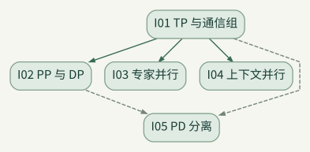

# 分布式执行与通信编排

一个设备无法容纳模型或满足需求时，可以将计算、数据与状态分布到多个设备。切分方式决定需要交换什么数据，以及哪些任务必须等待通信结束。

## 贯穿算例与阅读边界

从两张卡分摊同一个小矩阵乘法入手，继续改变模型层划分与副本数。专家、上下文和 Prefill/Decode 分离分别引入各自的最小算例。

I01 建立 Rank、通信组和数据布局的基础；I03–I05 可在各自必要前置具备后独立阅读。不重复物理协议、路由和链路实现。

## 知识关系

<figure class="micro-v2-map" markdown="1">

<figcaption>图中实线表示本专题内的主要前置关系，虚线表示按场景参考；跨专题先修知识见下表。 点击可查看大图。</figcaption>
</figure>

## 阅读顺序 {#计划阅读顺序}

本专题规划 5 篇正文。 当前均为未发布的阅读计划，标题与范围可在编写时根据认知目标调整。

| 编号 | 文章（暂定标题） | 读完应理解什么 | 主要前置知识 | 状态 |
| --- | --- | --- | --- | --- |
| I01 | 同一次矩阵乘法分给两张卡，哪些数据必须交换？ | Rank、通信组、TP、行列切分、部分和、集合通信接口及通信量。 | A03、A04、F02、矩阵乘法 | 未发布 |
| I02 | 模型太大需要多张卡，还是请求太多需要多个副本？ | PP、DP、流水线并行、微批、气泡、混合 Rank 布局、容量与吞吐。 | I01 的布局/通信基础、G01 | 未发布 |
| I03 | 每个 Token 选择不同专家，怎样将计算送到相应设备？ | EP、MoE Dispatch/Combine、路由矩阵、通信量、容量限制与负载失衡。 | I01、MoE 基础 | 未发布 |
| I04 | 上下文太长，怎样将历史状态分给多张卡？ | CP、KV 头切分与位置切分、Prefill/Decode 上下文并行、Attention 局部计算与归并。 | I01、G04、Attention 基础；按需 D07 | 未发布 |
| I05 | Prefill 和 Decode 分开执行时，KV 怎样完成交接？ | PD 分离、状态交接、数据布局、传输量、两池队列、背压及关键路径。 | G02、G05、H01/H03、F02；按需 I01/I02 | 未发布 |

## 从哪里来，接下来往哪读

主要衔接：[软件执行共同基础](../01-foundations/README.md)、[通用执行运行时](../06-execution-runtime/README.md)、[模型执行与生成控制](../07-model-execution/README.md)。

硬件机制参考[计算微架构](../../microarchitecture-v2/README.md)、[存储系统](../../storage/README.md)和[芯片与系统互连](../../interconnect/README.md)。

模型计算原理参考[算法与模型](../../workload/README.md)。重构期间也可查阅[旧版推理运行时](../../inference-runtime/README.md)。

后续方向：[推理服务系统](../10-serving/README.md)、[性能分析、建模与验证](../11-performance/README.md)。

更多阅读路线见[编译器与运行时系统系列首页](../README.md)。
