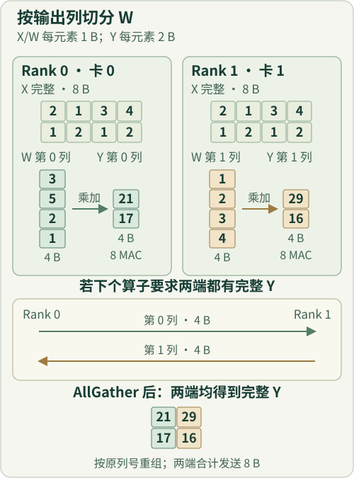
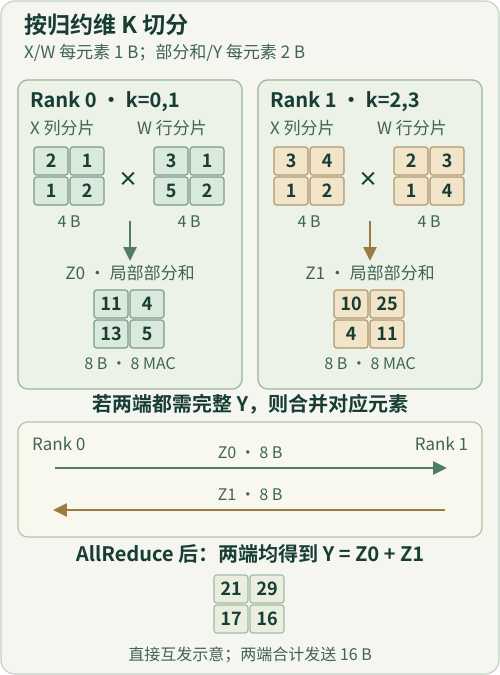
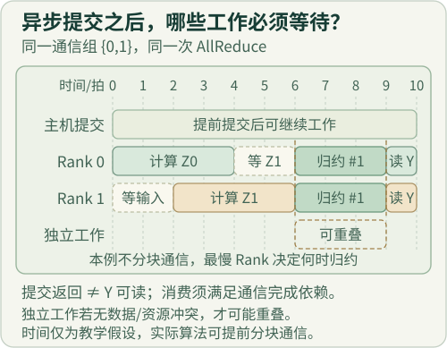

# 同一次矩阵乘法分给两张卡，哪些数据必须交换？

一层模型的权重太大，一张卡无法装下。或者一张卡能装下，但计算时间太长。我们能否让两张卡分担这层的矩阵乘法，再交出与原来相同的结果？

**张量并行（Tensor Parallelism，TP）** 将同一次模型计算所涉及的张量和工作分给多个设备。各设备在本地计算，必要时交换数据，使后续工作能够取得正确的输入。

究竟需要交换什么？这取决于切开了矩阵的哪一维，以及下一项计算需要怎样的数据布局。下面沿用 [C01](../03-mapping-and-planning/c01-tensor-mapping.md) 和 [D05](../04-code-generation/d05-matrix-multiplication-kernels.md) 的小矩阵，把原来的两个计算单元改成两张卡。

## 两张卡各自需要准备什么？ {#distributed-execution}

还是计算 Y=XW。X 有两行、四列，W 有四行、两列。每行 X 可以看成一个位置的四个输入特征，W 将它们变换为两个输出特征。

| X | W | Y |
| --- | --- | --- |
| (2, 1, 3, 4) | (3, 1) | (21, 29) |
| (1, 2, 1, 2) | (5, 2) | (17, 16) |
| | (2, 3) | |
| | (1, 4) | |

例如 Y[0,0] = 2×3 + 1×5 + 3×2 + 4×1 = 21。四个输出各需四次乘加，共 16 次 MAC。前面的计算映射文章已经给出三种分工：沿输出行 i、输出列 j，或者归约维 k 切分。

这次每张卡有自己的显存和计算资源。假设它只能直接访问自己的缓冲区；需要另一张卡的数据时，要安排跨设备传输。这里描述的是软件可见的数据边界，不限定两卡的物理连接方式。

假设两卡分别绑定一个主机进程来提交工作。为了让参与者能在同一个计算中找到彼此，软件为它们建立一个**通信组（Process Group）**，成员在组内分别编号为 Rank 0 和 Rank 1。

| 组内 Rank | 主机进程（教学编号） | 绑定设备 |
| --- | --- | --- |
| 0 | P0 | GPU 0 |
| 1 | P1 | GPU 1 |

进程是运行和提交软件工作的实体，Device 是承载实际计算与存储的设备，Rank 是通信参与者在指定组中的编号。此处采用一进程一卡的简化组织方式。

Rank 不是 GPU 的硬件编号。其他组可以有不同成员及组内编号，也可以跨主机建立。若有四个全局 Rank 0–3，可以建立两个组 {0,1} 和 {2,3}；后一个组的全局 Rank 2、3 在组内分别编号为 0、1。

每个参与者要知道本地持有的张量分片、该做的计算以及要与谁交换数据。通信库再把软件指定的交换映射到实际设备路径。

为便于复算，沿用 D05 的数据格式：X、W 的值为 0–15，各占 1 B（uint8）；局部累加用 uint32；保存部分和及最终 Y 时用 2 B（uint16）。四项乘积之和最大为 900，窄化不会丢失本例的有效值。

以下只统计逻辑数据字节，假设各份输入已经放到指定卡上。初始权重加载、输入分发、对齐、通信额外缓冲及协议开销不计入本轮交换量；实际执行需要另作预算。

## 如果两张卡各算一列输出，会产生什么？ {#column-parallel}

把 W 的第 0 列放在 Rank 0，第 1 列放在 Rank 1。两卡均保留完整 X，因为每一列输出都依赖每行 X 的全部四个输入特征。

| | Rank 0 | Rank 1 |
| --- | --- | --- |
| 本地 X（2×4） | 完整 X，8 B | 完整 X，8 B |
| 本地 W（4×1） | (3,5,2,1)，4 B | (1,2,3,4)，4 B |
| 局部输出（2×1） | Y[:,0] = (21,17)，4 B | Y[:,1] = (29,16)，4 B |
| 计算量 | 8 次 MAC | 8 次 MAC |

每张卡都算出了两个完整的点积。它没有算另一列，但自身结果不需要对方再加任何数。这种沿 W 输出特征维度切分的方案称为**列并行（Column Parallel）**。

如果后续工作能继续使用各自的列，矩阵乘法结束后不必交换 Y。若两个消费者都需要完整 Y，就请两卡互换各自的列。每卡发出 4 B、收到 4 B，两卡合计发送 8 B。

<figure markdown="1">

<figcaption>列并行切开的是完整输出的位置，不是单个输出的求和。图中所示的收集只在下一项工作需要完整输出时发生。</figcaption>
</figure>

这种让每个成员收集所有成员分片的操作称为 **AllGather**。它把数据收集到每个 Rank，不进行求和。若仅 Rank 0 需要完整 Y，则只需 Rank 1 将自己的列送给 Rank 0（Gather 到根或等价的点对点交接）。

还要区分逻辑分片与内存布局。通信库若将两个紧凑列缓冲按 Rank 顺序拼接，得到 (21,17,29,16)，而 D05 的行主序 Y 是 (21,29,17,16)。消费者若要求后者，需要重排；也可以直接使用与分片匹配的布局。

## 如果连一个输出都要由两张卡共同计算呢？ {#row-parallel}

换一种分工，把 W 沿输入特征维度切开。Rank 0 负责 k=0、1，Rank 1 负责 k=2、3。X 也沿同一个 k 切开，才能让各卡读齐对应乘积的两个输入。

| | Rank 0 | Rank 1 |
| --- | --- | --- |
| X 分片（2×2） | (2,1)、(1,2)，4 B | (3,4)、(1,2)，4 B |
| W 分片（2×2） | (3,1)、(5,2)，4 B | (2,3)、(1,4)，4 B |
| 计算量 | 8 次 MAC | 8 次 MAC |

观察 Y[0,0]。Rank 0 得到 2×3+1×5=11，Rank 1 得到 3×2+4×1=10。二者都写出了形状为 2×2 的矩阵，但各自仅含一部分求和贡献。

| 输出位置 | Rank 0 的部分和 Z₀ | Rank 1 的部分和 Z₁ | 最终 Y |
| --- | ---: | ---: | ---: |
| [0,0] | 11 | 10 | 21 |
| [0,1] | 4 | 25 | 29 |
| [1,0] | 13 | 4 | 17 |
| [1,1] | 5 | 11 | 16 |

这就是按 W 输入维度切分的**行并行（Row Parallel）**。它把同一次点积的求和拆到了不同设备。如果直接将 Z₀ 或 Z₁ 交给下一项需要完整数值的计算，结果会出错。必须进行逐元素归约：Y=Z₀+Z₁。

<figure markdown="1">

<figcaption>每卡计算四个不完整的点积。相同位置的两个部分和合并后才是完整输出；图示采用直接双向交换的教学方案。</figcaption>
</figure>

如果只有 Rank 0 需要完整 Y，Rank 1 发出整个 Z₁（8 B），由 Rank 0 相加即可。这是 **Reduce** 到根的语义。若两张卡都需要完整 Y，可令两卡直接交换各自的 Z，再分别相加，每卡发送 8 B，合计发送 16 B。

后者的语义称为 **AllReduce**：组内每个参与者贡献一组同位置的数据，最后每个参与者都取得同一个归约结果。实际通信库不必实现为上述直接互发；它可以选择不同的分块与传输算法。

注意，这里的“列”和“行”是相对于 Y=XW 中 W 的逻辑形状 (K,N) 而言。某些框架按 (N,K) 存储线性层权重。判断切分方式时应追踪输入、输出特征维度，而非仅看存储下标。

如果只沿 X 的行 i 切分，两卡可各取一行 X（4 B）、复制完整 W（8 B），各产生一个完整的输出行（4 B）。这种分工没有切开权重，适合分摊独立位置的计算，但单凭输出按行分布不能判断整个模型采用了哪种并行策略。

## 如果下一次计算只需要一部分 Y 呢？ {#layout-transition}

在 k 切分方案中，假设下一项工作只要求 Rank 0 持有 Y 的第 0 行，Rank 1 持有第 1 行。要先把完整 Y 放到两卡，再各自丢掉不用的行吗？

Rank 0 留下 Z₀ 的第 0 行，把第 1 行 (13,5) 发给 Rank 1；Rank 1 留下 Z₁ 的第 1 行，把第 0 行 (10,25) 发给 Rank 0。两卡各自相加，分别得到 (21,29) 与 (17,16)。

现在每卡仅发送 4 B，合计 8 B。这个先求和、再让各成员只保留指定结果块的操作称为 **ReduceScatter**。若之后确实需要完整 Y，可以再进行 AllGather（各发 4 B）。两步的计算语义与完整 AllReduce 一致。

| 本地结果是什么 | 下游要求什么 | 所需数据操作 |
| --- | --- | --- |
| 完整值的不同列 | 原列分片 | 无需交换 |
| 完整值的不同列 | 两边均有完整 Y | AllGather |
| 同位置的部分和 | 一卡有完整 Y | Reduce |
| 同位置的部分和 | 两边均有完整 Y | AllReduce |
| 同位置的部分和 | 两边各有一块完整值 | ReduceScatter |

由此可以区分三种布局：每卡都有同一份完整数值（Replicate）；每卡持有不同位置的完整数值（Shard）；每卡持有同一位置的一部分贡献（Partial）。从一种布局变到另一种布局，可能需要通信。PyTorch 的 [DTensor](https://docs.pytorch.org/docs/2.7/distributed.tensor.html) 就使用这三类布局表达转换。

表中的名称描述集合通信的输入和输出契约，而不是固定的线缆或通信算法。全组的每个参与者都要按契约贡献数据；即使某个 Rank 不需要最终全部数据，也不能任意省去它的贡献。

能否在设计分片时让相邻算子直接衔接？回到列并行的 Y，接一层 Z=f(Y)V。其中 f 是逐元素函数，如 ReLU，V 是 2×2 的权重。Rank 0 已经有 Y 的第 0 列，Rank 1 已有第 1 列。

若 V 沿输入特征分成两行，每卡使用自己持有的一列 f(Y) 和对应 V 行，直接形成 Z 的部分和。第一层不用 AllGather；只需按下一阶段的要求归并第二层输出。若 f 必须跨特征访问其他数据，就要重新检查这一衔接是否成立。

若第二层还有一份完整偏置 b，只能为最终结果加一次 b，或者将其贡献正确分配。在两个部分和各加完整 b 再 SUM，会把偏置加两次。

经典 [Megatron-LM 论文](https://arxiv.org/abs/1909.08053) 的 MLP 使用类似的列切分与行切分组合，以减少中间通信。在其一种 Transformer 实现中，前向的一层通常有两个 AllReduce；这来自具体算子组合，并非 TP 的定义。

类似地，若下一项工作要求按目标设备重新分发不同子块，而非拼接或求和，可以用 **All-to-All**。每个 Rank 发送不同目标所需的数据，并接收发给自己的数据。I03 将用 Token 发往不同专家的场景继续推导这一需求。

## 通信量究竟该数哪一个字节数？ {#communication-volume}

先看前两种切分的本地数据。单卡保存 X（8 B）、W（8 B）、Y（8 B）需要 24 B 的有效载荷。两卡分工的局部结果如下，假设通信前输入、权重、结果同时保留，且不计累加器和临时缓冲。

| 数据及工作 | 单卡 | 列并行，每 Rank | 行并行，每 Rank |
| --- | ---: | ---: | ---: |
| X | 8 B | 8 B | 4 B |
| W | 8 B | 4 B | 4 B |
| Y 或部分和 | 8 B | 4 B | 8 B |
| 上述载荷小计 | 24 B | 16 B | 16 B |
| 矩阵乘加 | 16 | 8 | 8 |

两卡都减半了每卡的权重与 MAC 数，但每卡有效载荷仅从 24 B 降到 16 B，两卡合计反而为 32 B。若还要为完整 Y、收发缓冲和布局转换留空间，峰值占用还可能增加。[F03](../06-execution-runtime/f03-runtime-buffer-management.md) 的资源生命周期同样适用于跨卡通信缓冲。

再数通信字节。以下仅针对两 Rank、每份结果按 uint16 紧凑存放，并采用前面直接交换或先分片归约再收集的教学传输方式。发送量仅统计跨 Rank 的发送，不重复计入接收。

| 操作与输出要求 | 每 Rank 输入有效载荷 | Rank 0 发送 | Rank 1 发送 | 系统发送量 |
| --- | ---: | ---: | ---: | ---: |
| 列分片不交换 | 4 B | 0 | 0 | 0 |
| 两边收集完整 Y | 4 B | 4 B | 4 B | 8 B |
| 部分和归约到 Rank 0 | 8 B | 0 | 8 B | 8 B |
| 部分和全组归约 | 8 B | 8 B | 8 B | 16 B |
| 部分和归约并分散 | 8 B | 4 B | 4 B | 8 B |

这里完整 Y 的逻辑大小是 8 B，却可能对应系统发送 0、8 或 16 B，取决于前后布局和所选操作。系统发送量是所有 Rank 注入的有效数据字节之和；数据走过多个物理链路时，链路实际累积字节数还取决于路径、转发及协议开销。

对更大的模型，设某次 AllReduce 的逻辑矩阵有 M 行、N 列，通信元素大小为 p B，则每 Rank 的输入有效载荷为 M×N×p B。比如 128 个位置、4096 个特征、每元素 2 B，对应 1 MiB，而不是整个模型权重的大小。

每 Rank 发送多少、用了几轮、哪个方向成为瓶颈，应根据具体通信算法和拓扑再推导。例如 ring 与 tree 的实际路径不同。详细的多卡链路算例见[从计算切分得到通信事件](../../interconnect/SCALEUP/05-workloads-and-performance/parallelism-traffic.md)。

## 软件怎样组织一次跨卡归约？ {#collective-dependencies}

两张卡都有各自的进程、执行流和内存。Rank 0 的局部计算完成，并不会自动让它的结果出现在 Rank 1 的缓冲区。软件需要显式表示此次通信与本地任务之间的依赖。

设两卡采用行并行且都需要完整 Y。运行前为每卡确定本地 X、W、Z、Y 的缓冲区，建立 TP 通信组。每个 Rank 按以下顺序提交自己的工作：

1. 提交本地 Matmul，把计算的部分和写入 Z。
2. 提交此组中的同一次 SUM AllReduce，输入为 Z，输出为 Y。
3. 在 Y 可用后，执行读取 Y 的后续任务。

<figure markdown="1">

<figcaption>这是任务依赖示意，不限定实际通信算法。组内必要贡献到齐且本地归约结果可用后，依赖它的消费者才能执行。</figcaption>
</figure>

这里的 AllReduce 不只是 Rank 0 独自发出的一次普通函数调用。两卡都要提交对应操作。运行时必须确保成员、操作顺序和数据契约匹配；以 NCCL 的等长归约接口为例，两个成员要使用相同 count、datatype 和归约算子。

假如 Rank 0 将请求 A 的部分和当作第一轮归约，Rank 1 却先提交请求 B 的部分和，即使形状相同，配对的数据也可能错位。若某个成员遗漏调用、操作或数量不匹配，还可能出现挂起或错误。

因此，同一次模型执行要有一致的通信计划。比如先确定 Rank 间共享的请求批次或工作编号，再由各成员用相应的本地分片执行。不同通信组可以承担不同协作关系，但不能把它们的调用随意互换。

教学中的 uint16 仅用于计算与数据量推导。如果以 NCCL 2.28.6 的 SUM 为例，其内置归约类型没有 uint16；可使用支持的 uint32 缓冲，则四个部分和在每 Rank 占 16 B，通信量按新类型重算。不能将 uint16 的两个字节分别做 SUM 来替代整数归约。

[F02](../06-execution-runtime/f02-asynchronous-execution.md) 已区分提交与完成。NCCL 常规流调用可在通信操作入队后返回；后续同流任务利用流顺序，跨流任务则建立事件依赖。Host API 返回并不代表 Y 已经可以读取，也不代表 Z 的空间立即可以回收。

浮点模型还需遵守数值契约。改变求和顺序可能改变舍入结果，通信精度也可能不同于局部累加精度。整数算例的精确相等不应推广为所有 TP 实现逐位一致。

## 分成两张卡，计算时间就能减半吗？ {#critical-path}

假设选择行并行，单卡完成这次矩阵乘法需要 8 个时间单位。理想两卡均分后，各自计算需要 4 个单位。若通信耗时 3 个单位，且下一项工作必须读完整 Y、通信需在两份部分和完成后启动，则这段路径需要 4+3=7 个单位。

如果 Rank 1 因数据未就绪，直到时刻 6 才交出部分和，那么按同一整块通信模型，两卡的归约结果最早在时刻 9 可用。即便 Rank 0 在时刻 4 完成，提前完成的计算也不能弥补这段依赖等待。

以上是构造的时间模型，不是两卡实测。对一次给定的传输步骤，可以用 α+D/BW_eff 粗略估算启动和传输时间。D 是该步骤在指定方向的发送字节，BW_eff 是相应方向的有效载荷带宽；集合通信还要考虑轮次、并发、归约、排队等因素。

能否把下一块独立计算与上一块通信重叠？若它不依赖尚未归并的 Y，缓冲区不冲突，设备及传输路径也允许并发，就可能隐藏部分通信时间。若每个下一层操作都必须先获得该 Y，仅仅改用异步 API 不会消除依赖。

TP 可以分担模型容量与计算，也可以跨主机使用；NVLink 并非正确执行的必要条件。节点内外的有效带宽、启动延迟、设备负载和路径竞争会影响收益。真实时间应沿最慢 Rank 和消费依赖分析，而不能直接把卡的峰值性能相加。

## 从一次计算到整个模型 {#next}

现在我们能为一次跨设备执行写出一份分工表：参与组及 Rank 到设备映射、各 Rank 的输入/权重/输出布局、本地计算、必要的通信操作及其完成依赖。这些信息也是后续估算显存和通信负载的起点。

一次矩阵乘法的分工只是模型层内的一种选择。如果模型有很多层，可以让不同设备持有不同层；若模型本来能装下但请求太多，也可以建立更多模型副本。这两者的目的和通信路径不同，下一篇 I02 会比较它们。

I03 将改变 Token 与专家的任务分配，I04 将改变历史状态的分布，I05 将改变 Prefill 与 Decode 的设备组织。无论采用哪种方式，都要先确定数据在哪里、由谁计算，以及下一项工作究竟需要哪些数据。

[返回专题阅读顺序](README.md#计划阅读顺序)

## 来源与继续阅读

- [Megatron-LM，2019，§3 Model Parallelism](https://arxiv.org/abs/1909.08053)：层内张量切分、MLP 中相邻矩阵的分片衔接；原论文是训练实现，本文只引入相关前向计算。
- [Megatron Core v0.12.0：tensor_parallel/layers.py](https://github.com/NVIDIA/Megatron-LM/blob/core_v0.12.0/megatron/core/tensor_parallel/layers.py#L943-L972)：可选收集；[行并行实现](https://github.com/NVIDIA/Megatron-LM/blob/core_v0.12.0/megatron/core/tensor_parallel/layers.py#L1164-L1202) 的归约、分散与偏置处理。
- [vLLM v0.8.5：linear.py](https://github.com/vllm-project/vllm/blob/v0.8.5/vllm/model_executor/layers/linear.py#L1268-L1290)：推理中的输入分片、可选归约及偏置处理。
- [NCCL 2.28.6：Collective Operations](https://docs.nvidia.com/deeplearning/nccl/archives/nccl_2287/user-guide/docs/usage/collectives.html) · [Data Types](https://docs.nvidia.com/deeplearning/nccl/archives/nccl_2287/user-guide/docs/api/types.html) · [CUDA Stream Semantics](https://docs.nvidia.com/deeplearning/nccl/archives/nccl_2287/user-guide/docs/usage/streams.html)：集合通信语义、元素类型及完成语义。
- [PyTorch 2.7：Distributed communication package](https://docs.pytorch.org/docs/2.7/distributed.html)：Process Group、Rank、集合通信与异步接口。
- [vLLM：Parallelism and Scaling](https://docs.vllm.ai/en/stable/serving/parallelism_scaling/)：单机与跨机部署的 TP、PP 组合。
- [计算微架构 F03：把同一块矩阵交给两个计算单元，需要交换哪些数据？](../../microarchitecture-v2/06-resource-cooperation/f03-multiple-compute-units.md) · [集合通信基础](../../interconnect/NOC/06-ai-noc-specifics/collective-communication-basics.md) · [NCCL 与 RCCL 的通信契约](../../interconnect/SCALEUP/04-software-and-collectives/nccl-rccl-contracts.md)：本地资源协作、通信语义及传输实现。
