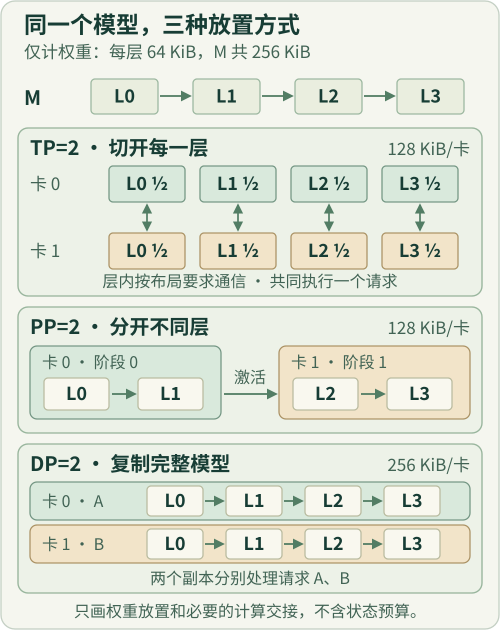
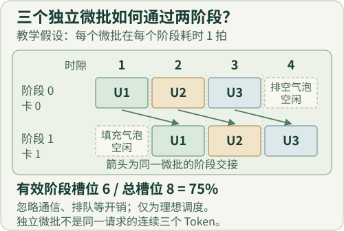
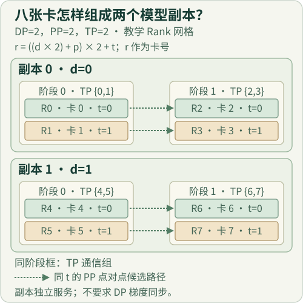

# 模型太大需要多张卡，还是请求太多需要多个副本？

一张卡装不下模型时，我们可以把每层的矩阵分给两张卡。但如果每一层其实都能单独装下，只是很多层的权重放在一起时超出了容量，还需要切开每一个矩阵吗？

另外，假设模型已经能在一张卡上执行，却有大量请求等待处理。再增加一张卡，是应该和第一张卡共同执行一个模型，还是各自执行一个模型？

**流水线并行（Pipeline Parallelism，PP）**将模型划分成多个执行阶段，分别放到不同设备，由不同阶段依次处理同一份输入。**数据并行（Data Parallelism，DP）**在稠密模型推理中通常让多个模型副本分别处理不同请求或批次。

本篇沿用 [I01](i01-tensor-parallelism.md) 的数据布局和执行依赖，观察层、模型实例和请求如何分配。最终我们希望能回答：增加设备是在分担一个模型，还是在增加能够独立工作的模型副本？

## 四层模型能不能分给两张卡？ {#model-placement}

[G01](../07-model-execution/g01-model-loading-and-execution.md) 已经建立模型实例 M。它具有可复用的参数和执行实现。每个请求使用这个实例进行计算，同时保留各自的生成状态。

设 M 有四个顺序连接的完整 Transformer 层 L0–L3。为了观察分工，假设每层需要 64 KiB 权重，合计 256 KiB。这里的权重大小是教学假设，不从某个真实模型的配置推算，暂不计算 embedding、输出头等层外参数。

每张卡留给权重的预算只有 160 KiB，另外为 KV、激活及工作区等留出空间。一张卡无法放下 256 KiB。增加第二张卡，我们有两种分担方式。

第一种是 I01 的 TP。假设各层权重都能精确均分，两卡分别保留每一层的半份权重，各需 128 KiB。在执行 L0 时，两卡共同计算；结果满足 L1 的输入布局之后，两卡继续执行 L1。

第二种是让 Rank 0 保留 L0、L1 的完整权重，Rank 1 保留 L2、L3 的完整权重，同样各需 128 KiB。但 Rank 0 完成 L1 后，只需将边界激活交给 Rank 1，后者继续执行 L2、L3。

后者是 PP 的一种最简单的划分：每组连续的层形成一个**阶段（Stage）**。这里 PP 并行度为 2，每个阶段由一张卡承担。阶段也可以使用多张卡共同工作，甚至一个设备承载多个逻辑阶段；本例暂不采用这些配置。

<figure markdown="1">

<figcaption>假设每层权重64 KiB，TP2、PP2 各卡128 KiB；DP2 各卡256 KiB。图中权重均分仅为教学条件，通信只标出逻辑关系，不表示实际链路。</figcaption>
</figure>

这两种分担方案都能满足本例的权重预算，却产生不同的计算依赖。TP 切分了层内的计算，通信由局部结果和所需布局决定；PP 切分了整个层，通信由不同阶段之间的消费者决定。

如果单独一层的权重都无法装入一个阶段的设备，单纯按层划分也不足以解决问题。反过来，若每层规模很小，增加 TP 并行度可能使每卡计算过小，层内通信开销反而更突出。

## 请求经过一个阶段时，哪些数据需要交给下一个阶段？ {#stage-handoff}

沿用 [G02](../07-model-execution/g02-prefill-and-decode.md) 的请求 A：8 个输入 Token，最多生成 4 个 Token。假设 A 恰好生成四个 Token，不提前停止，不使用投机或分块 Prefill。仍取隐藏宽度 64，阶段边界激活按 FP16 保存，每元素 2 B。

开始 Prefill 时，Stage 0 执行 L0、L1。它计算这八个位置的激活，并建立这两层所需的 KV。Stage 1 无需读取 L0、L1 的权重或 KV，却需要 L1 交出的结果，才能开始执行 L2、L3。

假设阶段边界只有一个紧凑的隐藏特征张量。那么 Prefill 时边界激活的形状为 (8,64)，每次交接的有效载荷为：

**8 × 64 × 2 B = 1,024 B。**

普通 Decode 中，每次只计算 A 的一个新位置。此时交接的激活形状为 (1,64)，有效载荷为 128 B。注意它不是所有历史位置的 KV，也不是本阶段的全部权重。

| 观察时刻 | Rank 0 → Rank 1 的激活 | Rank 0 保留的 KV | Rank 1 保留的 KV |
| --- | ---: | ---: | ---: |
| Prefill 后 | 1,024 B | 2,048 B | 2,048 B |
| Decode 1 后 | 128 B | 2,304 B | 2,304 B |
| Decode 2 后 | 128 B | 2,560 B | 2,560 B |
| Decode 3 后 | 128 B | 2,816 B | 2,816 B |

KV 的计算沿用 [G04](../07-model-execution/g04-model-state-and-memory-budget.md)：每层有两个 KV 头，每头维度16，K/V 都用 FP16，单层每个有效位置128 B。两层就是 256 B/位置。A 达到四个输出时，最后选出的 Token 尚未执行前向，因此有效 KV 位置为11，而非12。

在这个 PP 布局中，后续 Decode 仍让各层在原来的设备上读取自己的 KV。历史状态随所属层分布，不需要每轮在阶段之间传来传去。这里不含前缀共享、分页空余和对齐等额外分配量。

整个 A 在前向阶段边界上的有效载荷总计为 1,024 + 3 × 128 = 1,408 B。这只是 Rank 0 向 Rank 1 的单方向发送量，不含输入分发、控制信息、输出头与采样过程的通信，也不等于实际链路流量。

真实实现可能传递多个张量。例如 vLLM v0.10.2 的 Llama 实现只执行所在阶段的层，并在非末阶段交出 hidden_states 和 residual；应分别统计实际边界张量。

Stage 1 完成最后一层后，还需得到下一个 Token。假设输出头与采样也在 Stage 1，选择出的 Token 和必要控制信息需让请求协调者获知，下一次执行再由入口接到新 Token。实现不一定要把整份 Logits 传回 Stage 0。

[F02](../06-execution-runtime/f02-asynchronous-execution.md) 的异步依赖仍然适用：Stage 0 必须在激活产生并可读后再发送，Stage 1 必须在接收完成后再消费。发送和接收需要匹配请求或工作编号、形状、类型及约定次序；在途发送所用缓冲区也不能提前复用。[F03](../06-execution-runtime/f03-runtime-buffer-management.md) 的资源生命周期仍然适用。

这是一种点对点（Point-to-Point，P2P）交接需求。在 I01 中，AllReduce 需要多个成员贡献同一输出的部分和；在这里，下一阶段只需接收上一阶段的完整输出。TP 与 PP 所需通信不同，并不是因为两者使用的线缆不同。

## 第一张卡算完以后，能否立即开始另一份工作？ {#pipeline-bubbles}

先只考虑 A 的一次前向。Stage 0 没有交出输入时，Stage 1 就无法进行对应计算；Stage 1 工作时，Stage 0 已结束自己的这份计算。如果没有其他工作，两个阶段依然串行。

但现在还有其它独立请求。我们可以把等待执行的工作组织成若干份更小的工作单元，依次送入流水线。这种流水线中的小批次称为**微批（Micro-batch）**。例如把三个不同请求各自的一次 Decode 计算作为 U1、U2、U3。

为了只观察阶段交错，假设两阶段处理任一微批都需要1拍，交接耗时忽略不计，缓冲区足够，没有其他资源冲突。这里的拍是教学时间单位，不是设备时钟，三个微批的真实执行时间也未必相等。

| 时间槽 | Stage 0（Rank 0） | Stage 1（Rank 1） |
| --- | --- | --- |
| 1 | U1 | 空闲 |
| 2 | U2 | U1 |
| 3 | U3 | U2 |
| 4 | 空闲 | U3 |

<figure markdown="1">

<figcaption>假设各阶段及各微批等时。两个阶段共8个可用时间槽，其中6个有计算，占75%。第一拍的填充和最后一拍的排空留下了两个空槽。</figcaption>
</figure>

如果必须等一份微批经过两个阶段后再开始下一份，总共需要 3 × 2 = 6 拍。允许交错后，4 拍即可完成。不过第一份微批仍需经过两个阶段，首次完成时间是2拍。改善的是多份工作的总完成时间，而不是将单份工作的路径缩短一半。

这些因流水线尚未填满或正在排空而出现的空闲槽称为**流水线气泡（Pipeline Bubble）**。扩展到 P 个等时阶段、m 个相互独立的微批，在同样限制条件下，第一份工作经过 P 拍，剩下 m−1 份依次完成。

- 总耗时：m + P − 1 拍。
- 有效阶段槽：m × P；可用阶段槽：P × (m + P − 1)。
- 阶段槽位利用率：m / (m + P − 1)。

P=2、m=3 时，利用率为3/4，按总槽位计算的气泡比例为1/4。增加微批数可以减少理想填排空闲所占比例，但这个量不是实际 GPU 算力利用率。单个时间槽内计算引擎能否被充分利用，仍要看局部 Kernel 与数据量。[计算微架构 A06](../../microarchitecture-v2/01-foundations/a06-pipeline-and-throughput.md) 已建立类似的流水线认知。

### 为什么不能直接把 A 将来生成的三个 Token 当成三个独立微批？

[G02](../07-model-execution/g02-prefill-and-decode.md) 已经说明，下一次 Decode 需要本轮选出的 Token 以及已建立的历史状态。如果 U1 是 A 的第一次 Decode，第二次 Decode 的输入尚未产生，就不能在 Stage 0 与 U1 的后半段直接并行执行。

因此通常要用其他请求的已就绪工作来填补空闲。一个请求的分块 Prefill 也不等同于任意独立微批：同一序列的后续块还要满足历史状态的依赖。引擎怎样选出本轮的工作，属于 [H01](../08-request-scheduling/h01-continuous-batching.md) 和 [H02](../08-request-scheduling/h02-chunked-prefill.md) 的调度问题。

若 Stage 1 较慢，例如 Stage 0 需要1拍、Stage 1 需要2拍，忽略传输且缓冲充足时，三个连续到来的独立微批的完成时刻是3、5、7拍。即使 Stage 0 更快，稳态交付节奏也仍受较慢阶段限制。

实际阶段的工作量还会受不同层、输入形状、输出头、Prefill 与 Decode 的不同计算特性影响。按层数均分权重不保证耗时均等。若待交接的激活填满了缓冲区，生产阶段也必须等待，不能无限积压。

因此简单的气泡公式是理想时间模型。真实推理需要跟踪每个请求的可执行时刻、阶段传输、缓冲容量、阶段失衡及采样反馈路径，而不是把训练论文中的流水线利用率直接当作实际吞吐。

## 如果每张卡已经能装下完整模型，还需要让它们共同计算吗？ {#data-parallel}

现在改一个条件：每卡的权重预算足以容纳全部256 KiB，并且还有空间保存执行资源和请求状态。假设 A、B 两个请求同时到达。

一种方案仍使用 TP2 或 PP2，让两张卡共同执行一个模型实例；另一种方案在两张卡上分别加载相同模型 M，形成两个可独立运行的模型副本。副本0处理A，副本1处理B。

这是稠密模型推理的 DP：不同数据或请求交给不同副本。这次被划分的是请求计算，而不是权重。每个副本保留完整的一份模型（它自身也可以由多张卡构成）。

| 对象 | 副本0 | 副本1 |
| --- | --- | --- |
| 模型参数 | M 的全部权重 | M 的全部权重 |
| 执行请求 | A | B |
| 历史状态 | A 的各层 KV | B 的各层 KV |
| 后续执行 | A 的新 Token | B 的新 Token |

只要每个请求在该副本得到足够的权重、数据和计算资源，A 的前向计算就不需要 B 的激活或 KV。一般的稠密模型推理也没有训练中的反向传播和梯度同步，因此不必每一层在两个独立副本间执行 AllReduce。

假设一张卡执行完整的一份微批需要2拍，且不做其他批处理；两个独立副本也都是2拍。单副本每2拍完成一份，理想 DP2 每2拍完成两份。新增副本主要增加可服务能力，不是自动缩短 A 的模型执行时间。

若前面的 PP 两阶段各1拍，理想稳态也能每拍交出一份微批。两种方案在这个假设下稳态吞吐相同，却有不同权重容量、交接与调度代价。真实的 TP/PP/DP 不能仅凭这个理想模型排序。

在线服务中，如果 A 本来要等待其他请求，更多副本有机会缩短排队时间。但请求分配不均、独立副本的前缀缓存状态及冷启动等都会影响收益。[G06](../07-model-execution/g06-prefix-cache.md) 已说明前缀复用的条件，服务级副本选择与迁移留给 J 专题。

这里讨论的是稠密模型的可独立副本。后面 I03 的 MoE 场景可能将专家通信跨越一些数据并行 Rank，因此不能仅凭 DP 名称就认为这些 Rank 在所有层都完全独立。

## 两张卡都能装下模型，为什么还要考虑容量？ {#capacity-tradeoff}

DP 复制权重，占据了原本可用于请求状态的空间。PP 分担权重与各层 KV，但同一个请求必须在每个阶段都有足够的资源。我们用 G04 的容量例子比较两种方案。

假设两张设备各有 24 GiB 的可用预算，完整模型权重12 GiB；每卡的其它非 KV 同时占用4 GiB。假定 PP 可将层、权重和每条序列的 KV 精确均分，并暂不计附加分配与共享。这个例子不对应前面的四层教学模型。

若每条序列当前的完整 KV 有效载荷均为1 GiB：

| | 两个独立 DP 副本 | 一个 PP2 模型实例 |
| --- | ---: | ---: |
| 每卡权重 | 12 GiB | 6 GiB |
| 每卡其它非 KV 占用 | 4 GiB | 4 GiB |
| 每卡剩余 KV 预算 | 8 GiB | 14 GiB |
| 每条被服务序列在相应卡上的 KV | 1 GiB | 0.5 GiB |
| 理想可保存的序列数 | 8 × 2 = 16 | min(28,28) = 28 |

PP 中的同一个请求要占据两个阶段的空间，不能把两个阶段各能容纳的28条请求相加为56条。若阶段0只容纳20条而阶段1可容纳28条，此布局最多只能容纳20条。

实际还应为 KV 增长、分页粒度、跨阶段收发、缓存复用以及动态工作区预算留出余量。上表仅比较构造的瞬时状态容量，不代表可接纳的请求数或实际 Token 吞吐；并不能由 28/16 直接推断 PP 的性能收益。

## 八张卡上，能不能同时使用 TP、PP 和 DP？ {#mixed-rank-layout}

若模型仍用四层 L0–L3，一张卡保留两层还是太大，可以让每个阶段内部用两张卡做 TP。这样一个模型实例由两个阶段、每阶段两个 Rank 共同执行。再复制这个实例，就得到两个各由四张卡组成的副本。

设 D=2、P=2、T=2，分别表示副本数、流水线阶段数、每阶段的张量并行 Rank 数。为每个 Rank 指定一个坐标 (d,p,t)，并采用以下教学编号规则：

**r = ((d × P) + p) × T + t。**

在这个独立网格中，每个坐标组合占用一张卡，设备数为 D×P×T=8；暂设全局 Rank r 对应卡 r。真实物理放置可以不同，而且进程内的设备编号、组内 Rank 与全局 Rank 也可能不同。

<figure markdown="1">

<figcaption>同一个阶段内的两 Rank 形成 TP 组；同一副本的不同阶段按需要交接激活。图中同 t 的跨阶段箭头只表示一种兼容布局下的 P2P 路径，不代表所有实现都必须如此发送。</figcaption>
</figure>

| 关系 | Rank 集合或交接路径 | 工作 |
| --- | --- | --- |
| 副本0 | {0,1,2,3} | 执行 A |
| 副本1 | {4,5,6,7} | 执行 B |
| TP 组 | {0,1}、{2,3}、{4,5}、{6,7} | 共同执行所在阶段的层内计算 |
| PP 交接 | 0→2、1→3；4→6、5→7 | 例如传递对应的边界激活分片 |
| DP 对应坐标 | (0,4)、(1,5)、(2,6)、(3,7) | 同一阶段和 TP 位置的不同副本；不要求稠密推理做前向归约 |

对 A，Rank 0、1 保存 L0、L1 的权重分片，执行这些层；Rank 2、3 保存 L2、L3 的分片，接收激活后继续执行。TP 组内 Rank 共同提交匹配的集合操作，PP 的发送与接收则满足跨阶段的消费依赖。在教学权重均分假设下，每卡持有两层的一半，共64 KiB。

例如某次 PP 边界的完整激活大小为 S=1,024 B。如果两个源 Rank 各持有一半，两个目标 Rank 也正需要对应的一半，可以各发512 B，系统发送1,024 B。

如果两个源 Rank 都持有完整激活，目标也要求各自完整，而实现选择沿同 t 的两条路径分别发送，则各发1,024 B，合计2,048 B。通信量取决于实际生产与消费布局，而非 PP 并行度本身。

还可以让源 Rank 各发送完整张量的不同半份，目标 Rank 在本阶段通过 AllGather 重建完整张量。vLLM v0.10.2 的跨阶段收发支持这种方式。跨阶段发送量减少了，但增加了阶段内通信。

再看 KV。沿用四层 GQA 教学结构，每层两个 KV 头。PP2 让每个阶段保留两层的状态，TP2 若让两 Rank 各保存一个 KV 头，则单 Rank 每层每位置64 B。A Prefill 建立8位置，每 Rank 两层需要 8×2×64=1,024 B。

但若换成 TP4，四个 Q 头可以各分到一 Rank，两个 KV 头无法均分给四 Rank。在一种常见实现中，每个 KV 头会被两个 Rank 复制。仍按此布局保存展开 K/V 时，每 Rank 的 KV 有效载荷仍是1,024 B，不会降到512 B。

此时仅看一个副本，KV 复制使系统合计有效载荷也随之增加。

因此不能只用模型总权重或总 KV 除以全部 GPU 数。须逐层检查权重哪些切分、哪些复制，KV 头的放置方式，以及是否为多个模型副本分别保存状态。上下文位置如何跨卡切分将在 I04 讨论。

D×P×T 的计算也只适用于这里独立的设备网格。某些 MoE 实现会直接使用已有的 TP、DP Rank 来组成专家组，不能再把 EP 当作独立维度无条件乘一次。[vLLM v0.10.2 的并行配置](https://docs.vllm.ai/en/v0.10.2/configuration/engine_args.html) 即给出这种例子。

## 回到最初的问题，增加一张卡应该做什么？ {#next}

先问当前模型实例能否连同推理所需的状态及工作区一起装下。若不能，需要改变权重或状态的分布，TP 和 PP 都是可能的方案；若已有实例可独立执行，则可以评估复制实例来服务更多请求。

| 方式 | 划分的对象 | 主要代价及限制 |
| --- | --- | --- |
| TP | 层内权重、张量与计算 | 局部布局转换、通信同步、小分片效率、部分数据复制 |
| PP | 模型的层或阶段 | 阶段间激活、依赖等待、气泡、慢阶段与负载失衡 |
| DP（稠密推理） | 不同请求或批次 | 权重复制、请求负载和缓存分布 |

没有哪一种方案的收益能直接由并行度推导。先写清每个 Rank 的任务和状态，再根据通信依赖、可重叠工作及实际资源约束建立时间线。互连如何把这些事件映射为链路传输，见[从计算切分得到通信事件](../../interconnect/SCALEUP/05-workloads-and-performance/parallelism-traffic.md)。

本篇涉及的几种分工可以事先根据模型结构和部署配置建立。下一篇 [I03：每个 Token 选择不同专家，怎样将计算送到相应设备？](i03-expert-parallelism.md) 将改变这个条件：同一层内的不同 Token 可能依据运行时路由结果选择不同专家。我们将从 Token 到专家的分配出发，推导跨设备的派发、计算和返回。

[返回专题阅读顺序](README.md#计划阅读顺序)

## 来源与继续阅读

- [GPipe，Huang 等，2019](https://arxiv.org/abs/1811.06965)：按模型层划分阶段、微批交错与气泡；原论文研究训练，本文只推导指定条件下的前向时间线。
- [Efficient Large-Scale Language Model Training on GPU Clusters Using Megatron-LM，2021](https://arxiv.org/abs/2104.04473)：混合模型并行、阶段通信与流水线调度；训练的反向传播不直接用于本篇推理模型。
- [vLLM v0.10.2：Parallelism and Scaling](https://docs.vllm.ai/en/v0.10.2/serving/parallelism_scaling.html) · [Optimization and Tuning](https://docs.vllm.ai/en/v0.10.2/configuration/optimization.html)：推理的 TP/PP/DP 部署与适用场景。
- [vLLM v0.10.2：Llama 模型层划分与边界张量](https://github.com/vllm-project/vllm/blob/v0.10.2/vllm/model_executor/models/llama.py#L349-L417) · [Stage 收发](https://github.com/vllm-project/vllm/blob/v0.10.2/vllm/v1/worker/gpu_worker.py#L424-L447) · [分片交接与收集](https://github.com/vllm-project/vllm/blob/v0.10.2/vllm/distributed/parallel_state.py#L661-L794) · [在途批次队列](https://github.com/vllm-project/vllm/blob/v0.10.2/vllm/v1/engine/core.py#L308-L359)：具体前向流水线实现。
- [vLLM v0.10.2：并行 Rank 组](https://github.com/vllm-project/vllm/blob/v0.10.2/vllm/distributed/parallel_state.py#L1083-L1162) · [Llama KV 头分片与复制](https://github.com/vllm-project/vllm/blob/v0.10.2/vllm/model_executor/models/llama.py#L122-L135) · [v0.10.0 DP 部署](https://docs.vllm.ai/en/v0.10.0/serving/data_parallel_deployment.html)：Rank 布局、稠密模型副本及 MoE 特例。
- [算法与模型：Attention 与 Transformer](../../workload/01-foundation-model-components/attention-and-transformer.md) · [G04：模型状态与内存预算](../07-model-execution/g04-model-state-and-memory-budget.md)：按层计算和保存状态的语义。
