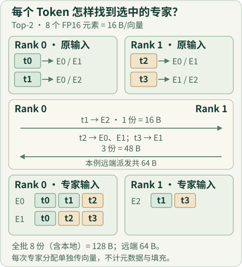
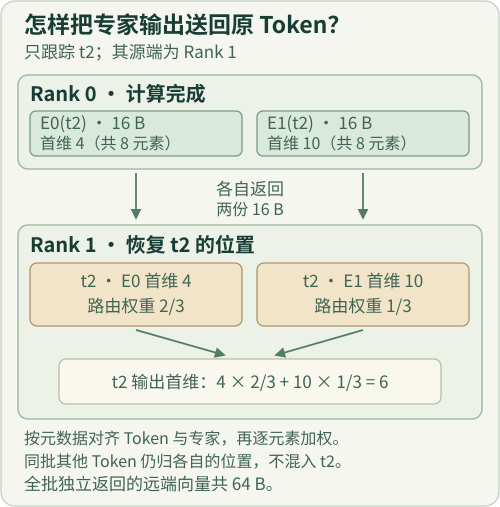
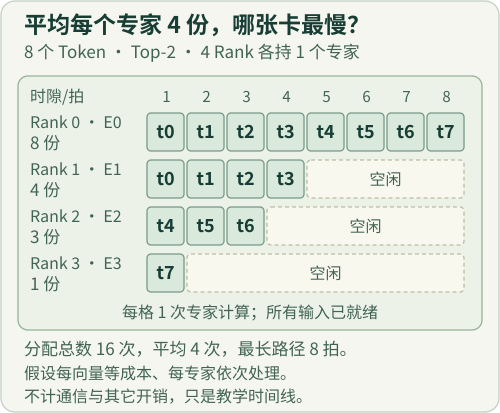

# 每个 Token 选择不同专家，怎样将计算送到相应设备？

在 [I01](i01-tensor-parallelism.md) 中，同一次矩阵乘法怎样分给不同设备，可以提前根据矩阵形状确定。但如果一个模型层有很多组权重，每个 Token 只选择其中几组执行，下一张卡需要计算什么，可能要到本轮执行时才能知道。

**专家并行（Expert Parallelism，EP）**将不同专家的权重与计算分布到多个设备，再根据每个 Token 实际选中的专家，把相应输入交给这些设备，并将计算结果归还给原来的 Token。

它解决的不只是专家权重怎样装进多张卡，还包括随输入变化的任务分配和通信。本篇沿用 I01 的数据布局与 I02 的 Rank 组织，从一个可以手算的 MoE 层追踪每个 Token 的去向。

## 一个 Token 为什么可能要交给两个专家？ {#token-to-experts}

[算法与模型：MoE](../../workload/01-foundation-model-components/mixture-of-experts.md) 已解释，混合专家模型（Mixture of Experts，MoE）的一种常见结构是用多个 FFN 专家代替 Transformer 层中的普通 FFN。路由器根据输入选择需要执行的专家，再合并它们的结果。

沿用[MoE 工作负载](../../workload/06-chip-workload-analysis/moe-workload.md)的例子：本轮有四个 Token，各位置的隐藏向量包含8个 FP16 元素，共16 B；模型有 E0、E1、E2 三个专家，每个 Token 选两个（Top-2）。

这里 t0–t3 是本轮各位置的标记，不是词表中的 Token ID。它们可以来自不同请求或同一请求的不同就绪位置。假定专家选择如下，所有分配都被接纳，暂时忽略共享专家。

| Token | 路由器选中的专家 |
| --- | --- |
| t0 | E0、E1 |
| t1 | E0、E2 |
| t2 | E0、E1 |
| t3 | E1、E2 |

若输入向量为 x，专家 e 的变换为 fₑ(x)，相应路由权重为 gₑ，则这个位置的 MoE 输出就是选中的各专家结果乘权重后相加。Top-2 需要两份专家结果，不是把两个专家的权重拼成一个矩阵再随意切分。

路由器还要为每个分配提供合并权重。选择方法、权重是否重新归一化等由模型定义；本篇不改变这些规则，只跟踪已经产生的选择与权重。

## 专家和输入在不同设备上，谁应该移动？ {#expert-placement}

假设两张卡组成 EP 通信组，设备与 Rank 的对应沿用 I01 的教学约定。Rank 0 常驻专家 E0、E1，Rank 1 常驻专家 E2。四个输入也已经按位置分配：Rank 0 持有 t0、t1，Rank 1 持有 t2、t3。

每个专家都是完整的两层 FFN，尺寸为 d→m→d，其中 d=8、m=16，全部权重用 FP16，忽略偏置和附加参数。单个专家的权重大小为 (8×16+16×8)×2 B=512 B。

| 对象 | Rank 0 | Rank 1 |
| --- | --- | --- |
| 初始输入 | t0、t1，32 B | t2、t3，32 B |
| 常驻专家 | E0、E1，共1,024 B | E2，共512 B |

本层共需1,536 B 的路由专家权重，一个 Token 选择两份专家共涉及1,024 B 的权重，但这不是一次实际内存读取量。多个 Token 可以复用同一专家权重。

路由选择每轮可能变化。如果每次都把选中的专家权重复制到 Token 所在卡上，可能需要重新搬运大量权重。既然专家已经常驻，可换一种分工：将相对小的输入向量交给存有相应专家的设备。

这样，Rank 0 虽然持有 t0、t1，却还需要为来自 Rank 1 的某些 Token 计算专家；Rank 1 也不一定只处理自己的 Token。EP 切分的是专家权重及相应工作，不是将每个请求固定在一张卡上。

注意，路由器选择的是模型中的逻辑专家 E0、E1 等。由哪个 Rank 保存对应权重，由部署时的专家放置决定。至于数据怎样经过网络到达该 Rank，则是互连系统的传输问题。

## 路由结果怎样变成每张卡真正执行的输入？ {#dispatch}

先跟踪 Rank 0 上的 t1。它需要 E0 和 E2 两份结果。E0 在本地，只需安排本地工作；E2 在 Rank 1，必须把 t1 的输入和足够的路由信息送过去。

Rank 1 上的 t2 更特别。它选中 E0、E1，两者都在 Rank 0。即使这次只需要把 t2 送到同一张远端卡，E0 和 E1 仍各要对它执行一次计算。

对四个 Token 逐一处理，运行时可将每个 Token—专家的分配表示为一条工作记录。它至少要保留原始 Token 的身份、目的专家、输入位置以及对应合并权重，或者保存能恢复这些信息的索引。

| 目的专家 | 所在 Rank | 需要执行的 Token | 本地输入张量形状 |
| --- | --- | --- | --- |
| E0 | 0 | t0、t1、t2 | (3,8) |
| E1 | 0 | t0、t2、t3 | (3,8) |
| E2 | 1 | t1、t3 | (2,8) |

四个 Token 变成了八次 Token—专家分配，每个专家获得的输入行数不同。运行时可按目标 Rank 和本地专家对原先混在一起的输入重新分组，让每个专家对相邻的输入行执行自己的矩阵乘法。

这种交付过程称为**派发（Dispatch）**。它包含本地数据组织和跨设备传输，而不只是一次网络通信。各专家接收的行通常不再按照原批次的 Token 顺序排列，需要保存可逆的对应关系。

<figure markdown="1">

<figcaption>采用每个专家分配独立传一份向量的教学方案。两 Rank 之间的跨设备发送分别为16 B、48 B；仅统计激活有效载荷。</figcaption>
</figure>

对 D05 中的矩阵乘法，输入行数原本由上层形状决定。在此处，各专家这一轮的行数取决于路由结果。实现可以把多个大小不同的专家矩阵乘组织为 Grouped GEMM，具体 Kernel 如何处理形状与合并执行属于 D 专题。

实际代码也需要同时维护数据和索引。例如 vLLM v0.10.2 的 MoE permute 实现按专家组织 Token，记录专家输入的边界和反向索引；计算完成后再用这些索引恢复结果的位置。

## 为什么不能直接让每张卡发送相同大小的数据？ {#routing-matrix}

先假设每个专家分配都独立交付一份输入向量。本地专家也接收一份逻辑输入，但不计作跨 Rank 发送。定义 Tᵢⱼ 为来源 Rank i 的 Token 分配到目标 Rank j 上专家的份数。

跟踪派发图得到下面的路由矩阵。每行表示某个来源 Rank 的分配，每列表示相应目标 Rank 上所有专家收到的分配。

| 来源 ↓ / 目标 → | Rank 0（E0、E1） | Rank 1（E2） | 合计 |
| --- | ---: | ---: | ---: |
| Rank 0（t0、t1） | 3 | 1 | 4 |
| Rank 1（t2、t3） | 3 | 1 | 4 |
| 合计 | 6 | 2 | 8 |

两个来源 Rank 都有两个 Token、四次分配，但各自发送到远端的数量不同。Rank 0 只需发 t1 的一份；Rank 1 要发 t2 的两份及 t3 的一份。

| 方向 | 分配份数 | 有效载荷 |
| --- | ---: | ---: |
| Rank 0 → Rank 1 | 1 | 16 B |
| Rank 1 → Rank 0 | 3 | 48 B |
| 系统远端发送合计 | 4 | 64 B |
| 本地交付合计 | 4 | 64 B |

逻辑交付量是8×16=128 B，其中只有64 B 被跨 Rank 发送。这里的逻辑交付是专家收到的输入份数乘其向量大小；它不表示实际内存必然为每份数据分配独立副本。

扩展到 N 个 Token、每个选 k 个专家、向量宽度 d、每元素 p 字节。在所有分配都被接纳、每份向量独立交付时：

**逻辑交付量 = N × k × d × p B**

**跨 Rank 发送量 = d × p × Σᵢ≠ⱼ Tᵢⱼ B**

上式的求和只包括不同源、目标 Rank 的项。行和、列和分别能帮助分析每个设备的源端交付与专家接收工作量；计算远端发送和接收时还要去掉各自的对角项。

要把这个矩阵交给通信运行时，软件必须安排每个来源发往各目标的不同数据块，即 I01 的 **All-to-All** 一类数据交换需求。每个源 Rank 先将不同目标的向量整理入相应缓冲区，再按约定交换。

由于各方向的大小不一定相同，可以采用支持变长分片的接口，如 PyTorch 2.7 的 `all_to_all_single`，分别指定输入、输出切分长度。目的侧必须知道各源发来的数量，才能准备正确的接收区。同一交换中，源 i 发给目标 j 的元素数要与 j 从 i 接收的元素数相匹配。

NCCL 2.28.6 的等长 `ncclAlltoAll` 接口不是任意变长路由矩阵的直接表示。可以使用计数交换与匹配的点对点收发、变长分片接口，或先填充到约定大小。选择哪种方式会改变真实传输和缓冲开销。

运行时还可能先把全部输入 AllGather 到相关设备，再在目标侧选择需要处理的 Token。这同样能实现正确的专家计算，代价却不同：传了多少数据、保留多少副本，都要按实际实现分析。

使用集合通信时，即使某个成员当前没有待交付的 Token，也必须遵守该通信接口约定的参与与调用次序，不能自行跳过对应操作。

这里关注软件为何需要这种数据交换以及各方向的有效载荷。具体路径、链路流量、协议、热点与集合通信算法，见互连系列的 [MoE 分发与回收](../../interconnect/SCALEUP/05-workloads-and-performance/moe-dispatch-and-combine.md)。

## 专家算完了，结果怎样回到原来的 Token？ {#combine}

派发后，E0 对三行输入执行自己的 FFN，E1 对另一组三行执行，E2 对两行执行。若每个专家计算相同的两层矩阵乘，忽略激活和偏置，并将一次乘加计为2 FLOP，则每份分配需要约4×8×16=512 FLOP。

| 计算位置 | 分配次数 | 专家矩阵乘计算量 |
| --- | ---: | ---: |
| Rank 0（E0、E1） | 6 | 3,072 FLOP |
| Rank 1（E2） | 2 | 1,024 FLOP |
| 合计 | 8 | 4,096 FLOP |

这些计算量只包含两个线性变换。专家输入行数不同，实际 Kernel 效率也可能不同，不能直接认为每份分配总耗时相等。

计算完成后，每个专家交出对应输入行的结果。如果直接按专家分组顺序将它们拼起来，就会得到八行数据，而模型下一项工作只需要与原来四个 Token 对应的四行输出。

假设专家结果同样是8个 FP16 元素，一个结果16 B。仍采用每份分配独立发送与返回的例子，四份远端结果被送回它们的来源 Rank，远端回传的有效载荷同为64 B，方向与派发相反。

例如 t2 在 Rank 1，E0、E1 都在 Rank 0。它们需要分别返回 t2 的结果。运行时根据派发时记录的索引，将两份结果指向原来的 t2，并乘以对应的路由权重后相加。

沿用算法与模型中的加权例子。假设 t2 对 E0、E1 的归一化权重是2/3、1/3，返回向量的第一个特征分别为4、10，则该位置的第一个输出特征为：

**(2/3) × 4 + (1/3) × 10 = 6。**

其余七个特征也按相同规则合并。其他 Token 的结果无论何时完成，都不能误加到 t2 上。这种根据记录恢复 Token 位置，并按照模型权重合并专家输出的过程称为 **Combine**。

<figure markdown="1">

<figcaption>只跟踪 t2 的两个专家结果。两个返回向量各16 B；公式仅展示一个特征的加权和。真实计算还要遵守浮点数值契约。</figcaption>
</figure>

这里区别于 I01 的 AllReduce：并不是把不同 Rank 上同一缓冲区下标的所有值直接相加。先要确定各结果属于哪个 Token、哪个专家，再根据路由权重合并。可以利用集合通信完成交换，但语义由派发记录与模型决定。

## 同一个 Token 选中同一张卡的两个专家，需要发送两份向量吗？ {#deduplicated-dispatch}

回到 t2。原先 Rank 1 向 Rank 0 发送两份相同的16 B 输入。由于两个专家位于同一目标 Rank，能否只传一次 t2，再由 Rank 0 局部分发给 E0、E1？

只要接收端获得完整输入和它选择的两个专家的信息，就可以这样做。此时计算次数没有改变，仍是两次专家计算；改变的只是跨设备传输的输入副本数量。

| 方向 | 独立分配发送 | 按 Token 与目标 Rank 去重 |
| --- | ---: | ---: |
| Rank 0 → Rank 1 | 16 B | 16 B |
| Rank 1 → Rank 0 | 48 B | 32 B |
| 系统远端发送 | 64 B | 48 B |

这时 Tᵢⱼ 仍然是专家分配次数，不能直接用来计算上述去重后的字节。需要重新统计每个来源发给各目标 Rank 的不同 Token 数。

返回也可以采用另一种组织方式。例如 Rank 0 在本地就合并 t2 的两个加权结果，再送回一次。如果结果布局与精度不变，且每个路由权重只应用一次，远端返回也可能减少到48 B。

但输入去重不意味着一定同时减少返回字节。专家结果的形状、精度和合并位置可能不同，浮点运算重排还会影响舍入。路由索引、填充、对齐及通信库开销同样需要单独统计。

真实实现中，vLLM v0.10.2 的 DeepEP 高吞吐派发路径会根据选中专家建立每 Rank 的 Token 成员关系，保存此次派发的 Handle；返回时可在目标侧先归并本地专家结果，再将数据交回来源。这是具体实现，而非 EP 必须采用的方式。

## 为什么所有卡的计算量相加，还不能判断这一层何时结束？ {#expert-load}

刚才两张卡各有两个原始 Token，但 Rank 0 实际执行六次专家计算，Rank 1 只执行两次。如果每份计算成本相等、同时开始，后者完成自己的工作后可能仍需要等待对方的结果。

放大这个现象。沿用旧版推理运行时的例子，八个 Token、四个专家、Top-2，每个专家放在一张独立设备上。假设八个 Token 都选 E0，另外四个选 E1、三个选 E2、一个选 E3。

| 专家 | 分配份数 | 假设每份耗时1拍时的计算时间 |
| --- | ---: | ---: |
| E0 | 8 | 8拍 |
| E1 | 4 | 4拍 |
| E2 | 3 | 3拍 |
| E3 | 1 | 1拍 |

总计16次分配，平均每个专家四次。但本轮若要交出全部 Token 的 MoE 输出，必须等待 E0 的最后一份结果。在忽略通信、假设各卡串行执行各自分配、任务等成本且同步开始的条件下，专家计算阶段要到第8拍才完成，而不是4拍。

<figure markdown="1">

<figcaption>构造的任务数量与时间线。均衡分配时各卡本可承担4份；负载偏斜使最慢 Rank 成为这一批结果的关键路径。不是 GPU 实测时间。</figcaption>
</figure>

真实的每份工作成本未必一样。批次越小，专家 GEMM 的数据复用和计算资源利用可能越差；设备还可能同时承担多个专家、共享专家或其他任务。网络上的接收热点和专家计算热点也不是同一个量。

I01 中通信和计算可以在满足依赖、独立缓冲及资源并发条件时重叠。这里也是如此：已经到达的专家输入可以在实现允许时开始计算，独立批次也可能交错执行。但必须等某个 Token 所需的结果都可用，才能交给依赖完整输出的消费者。

[F02](../06-execution-runtime/f02-asynchronous-execution.md) 和 [F03](../06-execution-runtime/f03-runtime-buffer-management.md) 的完成与资源生命周期仍适用。派发索引、发送和接收缓冲直到实际通信与消费结束才能复用。

训练时的负载均衡目标可以影响路由分布，却不能保证每一轮推理的专家负载相同。性能分析应记录实际路由直方图及最慢 Rank 的执行时间，而不是只报告平均分配数。

## 如果一个专家暂时装不下全部输入，应该少算一点吗？ {#expert-capacity}

回到四个 Token、三个专家的主例。三专家分别收到3、3、2次分配。假设某种实现每个专家一次只能接纳两份输入，意味着 E0 和 E1 都有一份需求超过当前容量。

| 专家 | 第一批（按 Token 顺序接纳） | 尚未执行 |
| --- | --- | --- |
| E0 | t0、t1 | t2 |
| E1 | t0、t2 | t3 |
| E2 | t1、t3 | 无 |

若所有被选专家都必须执行，可以保留溢出的工作，等第一批计算与缓冲区使用结束后再安排下一批。最终仍执行原来的八次分配，只是增加等待与调度。也可以采用支持变长专家输入的实现，重新规划实际资源。

另外，有些模型使用容量上限及溢出处理规则。例如 Switch Transformer 的 Top-1 实现中，超过专家容量的分配可以跳过专家计算并通过残差路径继续。这是模型定义的执行行为，不是丢弃整个推理请求。

在 Top-2 场景下，少执行一个选中专家或改选另一个不同专家，都可能改变模型输出。除非符合模型自身规定的溢出语义、权重处理和路由策略，否则软件不能将其当作等价的负载均衡优化。

采用无丢弃（Dropless）执行也不意味着容量无限。运行时仍需要为动态专家输入、结果和通信缓冲区留出空间，必要时等待、分块执行或拒绝超出系统允许范围的工作。具体请求接纳规则留给 H 专题。

## 热门专家能不能同时放在两张卡上？ {#expert-replication}

再看八 Token 的负载偏斜例子。E0 的八份计算成为关键路径，即使 E1、E2、E3 的卡有余力，也不能直接替 E0 计算，因为它们没有 E0 的权重。

一种办法是增加 E0 的一个物理副本，保存相同权重与模型版本。假设增加一张卡，并将原先八份 E0 工作均匀分给两个物理副本。其它专家不变，每个 E0 副本就只承担四份。

在同样的等成本、串行、无通信开销假设下，最慢计算路径可从8拍降到4拍。但是我们也使用了第五张卡并存放第五份专家权重；若各专家等大，这部分专家权重增加了25%。真实系统还要重新计算通信量与容量。

这时路由器仍然选择逻辑专家 E0，执行器只是从两个等价的物理实例中选择一个。不能把 E0 热门直接解释成让模型改选 E3，也不能让两个 E0 副本都计算后再把结果重复加到输出。

如果不增加设备，也可以调整专家放置或在容量允许的其他卡上增加副本。但放置变化会影响每 Rank 的权重、接收工作量以及其它专家的执行，不能假定增加一个副本就总会缩短时间。

运行时可以结合近期路由统计，定期调整冗余专家、物理布局或副本选择。这常被称为专家并行负载均衡（Expert Parallel Load Balancing，EPLB）。权重迁移、映射更新及在途任务的版本一致性都有成本。

vLLM v0.10.2 的 EPLB 就区分逻辑专家与物理实例，根据一段时间的负载统计进行重排，并在逻辑专家选定后选择相应物理实例。它不能保证下一轮分配恰好均匀。

## EP 是否还需要在 TP、PP、DP 之外再增加设备？ {#mixed-parallelism}

I02 建立了 D=2、P=2、T=2 的八卡网格。假设其中某个阶段包含 MoE 层，原来同一阶段内有两份数据并行组，每组两个 TP Rank。我们可以在相同的物理设备上重新组织专家层的合作关系。

| 模型阶段 | Attention 等部分的 TP 组 | 专家层可采用的 EP 组 |
| --- | --- | --- |
| Stage 0 | {0,1}、{4,5} | {0,1,4,5} |
| Stage 1 | {2,3}、{6,7} | {2,3,6,7} |

在此例中，每个 EP 组内四个 Rank 可以分别保存四个专家。不同数据并行组的 Token 可能派发到同一个专家。专家计算及 Combine 后要恢复后续计算所需的输入布局，以便各请求继续执行。

这里必须区分逻辑 Token 与此前 TP 布局中的副本。若 Attention 输出在一个 TP 组内复制，并不意味着凭空多出了一个需要执行的 Token。教学通信量从每个逻辑 Token 一个唯一来源开始算；实际实现需要切分、重排或其它正确的去重组织。

专家层使用了已有的 DP×TP 设备集合，其 EP 大小为4，整个系统仍然是八张卡，而不是再乘以4。此处不是 I02 中两个完整稠密模型副本完全独立的关系：同阶段专家权重分布在跨副本的 EP 组上。

vLLM v0.10.2 的一种配置正是将 DP、TP 维度展平，并在启用 EP 后让专家层采用该组、专家内部 TP 设为1。DeepSeek-V3 技术报告也展示了在 Attention 和专家层分别使用不同并行布局的推理方案。

这只是一种组织方式。专家内部也可以采用 I01 的 TP，模型多个阶段仍可采用 PP，独立的模型副本也可能各自拥有完整 EP 组。设备数取决于实际参与者与各层的分组，不能只将所有并行度机械相乘。

## 从专家选择到本轮执行计划 {#next}

一次 MoE 层的执行，可以沿着下面的过程追踪：路由器为逻辑 Token 选择专家 → 根据专家放置决定目标 Rank → 组织派发及本地专家工作 → 返回并按原 Token 位置加权合并。

总专家权重仍须存放或按需加载，而每个 Token 只执行所选的专家。稀疏激活使总参数量和本次专家计算量分离，但整体推理成本还包含 Attention、共享专家、路由、重排、通信与合并，不能只用参数量乘激活比例推导。

评估 EP 要同时记录各 Rank 的权重与临时容量、专家接纳份数、实际发送矩阵、局部计算及完成依赖。这样才能判断瓶颈来自某个专家的计算，还是数据交付与资源竞争。

I03 改变的是 Token 与专家任务的分配。下一篇 [I04：上下文太长，怎样将历史状态分给多张卡？](i04-context-parallelism.md) 将改变历史状态的存储位置：当完整上下文无法放到一张卡时，怎样让不同设备共同处理仍需要完整历史的 Attention？

[返回专题阅读顺序](README.md#计划阅读顺序)

## 来源与继续阅读

- [Switch Transformer，JMLR 2022](https://www.jmlr.org/papers/v23/21-0998.html)：Top-1 路由、专家容量及溢出处理。（本文的 Top-2 容量例为独立教学假设。）
- [DeepSeek-V3 技术报告，§2.1.2、§3.4](https://arxiv.org/abs/2412.19437)：模型路由、无丢弃执行、专家冗余及推理并行组合。
- [PyTorch 2.7：all_to_all_single](https://docs.pytorch.org/docs/2.7/distributed.html#torch.distributed.all_to_all_single) · [NCCL 2.28.6：AlltoAll](https://docs.nvidia.com/deeplearning/nccl/archives/nccl_2287/user-guide/docs/usage/collectives.html#alltoall)：变长与等长交换的接口契约。
- [vLLM v0.10.2：专家选择](https://github.com/vllm-project/vllm/blob/v0.10.2/vllm/model_executor/layers/fused_moe/layer.py#L1441-L1537) · [Permute/Unpermute](https://github.com/vllm-project/vllm/blob/v0.10.2/vllm/model_executor/layers/fused_moe/moe_permute_unpermute.py#L77-L201)：路由索引、分组与加权恢复。
- [vLLM v0.10.2：DeepEP 派发](https://github.com/vllm-project/vllm/blob/v0.10.2/vllm/model_executor/layers/fused_moe/deepep_ht_prepare_finalize.py#L61-L116) · [归并与返回](https://github.com/vllm-project/vllm/blob/v0.10.2/vllm/model_executor/layers/fused_moe/deepep_ht_prepare_finalize.py#L246-L280) · [EPLB](https://github.com/vllm-project/vllm/blob/v0.10.2/vllm/distributed/eplb/eplb_state.py)：具体实现中的布局转换、通信与物理专家管理。
- [vLLM v0.10.2：MoE 并行配置](https://github.com/vllm-project/vllm/blob/v0.10.2/vllm/model_executor/layers/fused_moe/config.py#L267-L302) · [通信组构建](https://github.com/vllm-project/vllm/blob/v0.10.2/vllm/distributed/parallel_state.py#L1144-L1163)：DP、TP 与 EP 的 Rank 关系。
