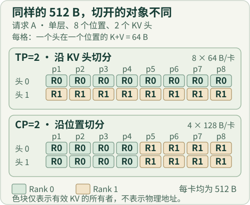
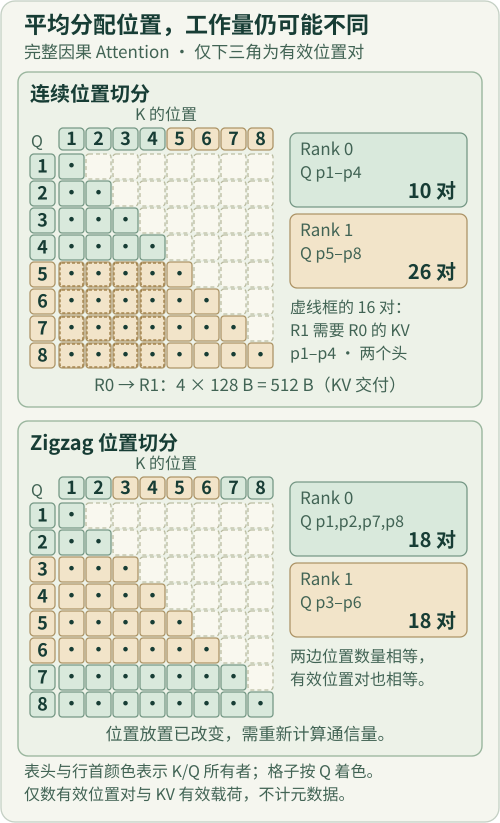
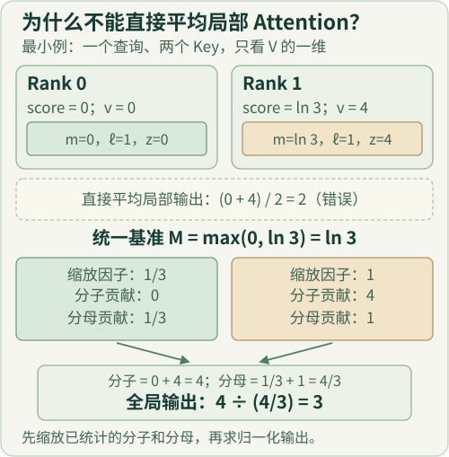
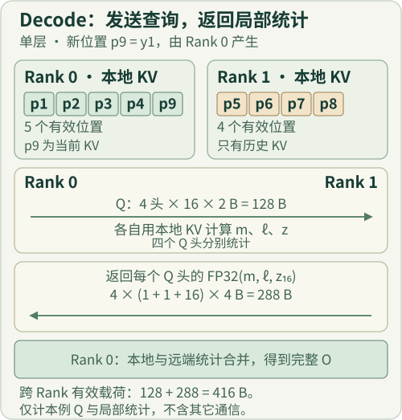

<!-- site-inference-math -->
# 上下文太长，怎样将历史状态分给多张卡？

在 [G04](../07-model-execution/g04-model-state-and-memory-budget.md) 中，我们发现请求越长，需要保留的 KV Cache 越大。如果历史状态已经超过单张卡能够提供的存储空间，能否让两张卡分别保存一部分历史？

但全注意力规定，新位置需要读取之前所有允许的历史位置。若某张卡只保留一半历史，直接用这一半数据执行 Attention，结果就会改变。

**上下文并行（Context Parallelism，CP）**沿序列位置分担状态和计算，并通过适当的跨设备数据交换与结果归并，使每个 Query 仍能访问模型规定的历史范围。下面继续用 I01 的数据布局与通信依赖，分别观察 Prefill 与 Decode 的跨卡执行。

## 把两个 KV 头分给两张卡，和把八个位置分给两张卡有什么不同？ {#kv-layout}

沿用 [G02](../07-model-execution/g02-prefill-and-decode.md) 的请求 A。它有八个输入 Token p1–p8，假设恰好生成四个输出 Token y1–y4，采用全因果 Attention，不使用前缀复用、投机或分块 Prefill。

仍采用 G04 的一层 GQA 教学结构：隐藏宽度64，四个 Q 头、两个 KV 头，每头16维，K、V 用 FP16。一个 KV 头在一个位置上的 K 和 V 共64 B；两头共128 B。

Prefill 完成后，八个位置的本层有效 KV 载荷是 8×128 B=1,024 B。若有两张卡，先考虑 I02 中介绍的按头切分：每张卡保存一个 KV 头的全部八个位置，并计算对应的两个 Q 头。

再换一个分工，让 Rank 0 保存 p1–p4 的全部两个 KV 头，Rank 1 保存 p5–p8 的全部两个 KV 头。这一次没有切开同一位置的 KV 头，而是切开了历史的位置范围。

<figure markdown="1">

<figcaption>每个格子表示指定位置、指定 KV 头的 K/V 有效数据64 B。颜色表示归属设备，不表示物理地址或实际缓存分配空间。</figcaption>
</figure>

| 划分方式 | Rank 0 持有 | Rank 1 持有 | 每 Rank KV 有效载荷 |
| --- | --- | --- | ---: |
| TP2 中的 KV 头切分 | 头0、p1–p8 | 头1、p1–p8 | 512 B |
| CP2 中的位置切分 | 两头、p1–p4 | 两头、p5–p8 | 512 B |

两种分工都让本例的每卡 KV 载荷减半，却导致不同的执行需求。按头切分时，每个 Rank 所负责的 Q 头可以读取该头所需的完整历史；按位置切分时，同一个头的历史分布在两台设备上，需要额外组织通信。

本篇的 CP 指沿上下文位置分担计算与状态的机制，不是改变模型可见历史范围。滑动窗口限制 Query 能读取的位置，属于模型的计算语义；直接截断历史也会改变全注意力结果。

[H02](../08-request-scheduling/h02-chunked-prefill.md) 的分块 Prefill 则把已知输入分成多轮执行，并不自动缩短后续需要保存的历史，也不要求将状态分布在多张卡上。

## Prefill 时每张卡只计算四个 Query，为什么还需要另一张卡的 KV？ {#prefill-context-parallel}

从尚未计算 A 的状态开始。两张卡仍各负责四个输入位置。为便于观察，假设每卡有执行本层所需的完整权重，先分别对自己的四个位置生成 Q、K、V。

K、V 随位置分配，因此产生后可直接保留在所属设备。Attention 也要输出各自负责的四行结果，以便本设备继续计算后续逐位置的线性变换与 FFN。

但 Q 的分工不能让因果依赖消失。处在位置 p1 的 Query 只能访问自己；p4 可以访问 p1–p4；p5 则需要 p1–p5，而这些位置跨越了两张卡。

| 查询所在设备 | 负责的查询位置 | 所需键值范围（取查询的并集） | 从其他卡取得的 KV |
| --- | --- | --- | --- |
| Rank 0 | p1–p4 | p1–p4 | 无 |
| Rank 1 | p5–p8 | p1–p8 | p1–p4 |

如果保持 Query 的执行位置不变，一种符合本例因果依赖的通信计划是只让 Rank 0 向 Rank 1 发送前四个位置的 KV。按两头、FP16 算，每位置128 B，共512 B。

Rank 1 取得远端 KV 后，不必永久保存对方的历史。它可以逐块计算自己负责的四行 Attention，按 [D07](../04-code-generation/d07-attention-kernels.md#online-softmax) 的办法保留每行的归一化状态，再释放不需要继续保留的临时 KV 副本。

另一种简单方案是两张卡各自发送四个位置的 KV，执行一次完整收集（AllGather）。两卡都临时得到完整历史，系统发送1,024 B，其中 Rank 0 收到的后四个位置对其查询全部被因果掩码屏蔽。

两个方案的计算语义相同，数据交付计划不同。若从 CP 布局转换成其他执行布局，还需按照 [I01](i01-tensor-parallelism.md#layout-transition) 的思路检查消费者是否需要额外的布局转换。

### 每张卡都有四个 Query，为什么计算量仍不相等？

在完整因果 Attention 中，每个位置的 Query 可以读取自己及之前的键。G02 已经推导，八个位置共有 1+2+…+8=36 个有效位置对（单层、单查询头）。

现在按照连续位置分工，Rank 0 只有 1+2+3+4=10 对有效计算；Rank 1 有 5+6+7+8=26 对。四个 Q 头合计，在 Rank 0、Rank 1 分别为40和104个有效位置对。相同的查询行数并没有分出相同的 Attention 工作量。

一种改善办法是把前后的位置搭配分配。令 Rank 0 负责 p1、p2、p7、p8，Rank 1 负责 p3–p6，两者都是18个有效位置对。这里的 p1–p8 仍是模型的真实位置，不因为跨设备重排而改变因果掩码或位置编码。

<figure markdown="1">

<figcaption>仅展示每个查询头允许参与的数学位置对数量。改变分配后，KV 的归属与跨设备交付需求亦需重新计算；等位置对数不保证实际耗时相等。</figcaption>
</figure>

若 K、V 也随上述成对位置归属，Rank 0 的后段查询需要 Rank 1 的中间四个 KV 位置；Rank 1 的查询需要 Rank 0 的前两个位置。按定向交付分别发512 B和256 B，合计768 B。

这说明计算负载更平均并不一定同时使通信量更小。如果双方直接整块交换，各发512 B。实际还要考虑 Tile 是否包含被屏蔽的计算、通信启动与等待，不应只按有效位置对数预测时间。

### 必须把所有历史同时收集到每张卡上吗？

对于更长的输入，可以让各 Rank 保持本地 Query，分轮取得其他 Rank 的 KV 块，并依次更新属于各自查询的局部状态。每次只需要容纳当前处理的块、必要缓冲与累计状态。

[Ring Attention](https://arxiv.org/abs/2310.01889) 的一种做法就是让 KV 块按相邻 Rank 循环交换。计算当前块时尝试发送已有块和接收下一块，从而减少一次性收集所需空间，并争取通信计算重叠。

这种重叠取决于本地计算与传输是否具有足够的独立性、缓冲区及资源并发能力，不能保证通信总被隐藏。不同实现也可以选择全收集或通过数据重排转为按头计算，CP 不等同于某一种 Ring 通信算法。

例如 Megatron Core 的 CP 文档区分沿序列位置分配整层激活的 CP，与其 TP 中针对部分激活的 Sequence Parallelism（SP）。不同框架对 SP 的命名有差异，应检查实际 Attention 数据布局，而非仅凭名称判断。

## Decode 时只有一个 Query，怎样让两张卡共同处理历史？ {#decode-context-parallel}

回到连续位置的原始分配。Prefill 已完成，Rank 0 保存 p1–p4，Rank 1 保存 p5–p8；y1 已选出但还没有它的 KV。现在开始第一轮 Decode，输入是 y1，对应序列中的第9个位置。

假设第9个位置在 Rank 0 上执行投影，产生完整 Q、当前 K 和 V，并将该位置的 KV 保存到 Rank 0。于是本轮 Rank 0 有五个有效 KV 位置，Rank 1 有四个。

对于第9个位置，一个 Q 头需要与全部九个允许的键计算分数。若让 Rank 1 仅将历史 KV 送到 Rank 0，后者可以独自完成全部 Attention；但随着历史增长，这个方案需要搬运越来越多的远端状态。

能否换一种做法：历史 KV 仍留在各自所在设备，把新 Query 发送到持有相应历史的设备，让每台卡计算自己那段历史对于同一个 Query 的贡献？

本例新 Q 包含四个头，每头16个 FP16 元素，共4×16×2 B=128 B。Rank 0 发送这份 Q 给 Rank 1；各自根据 Q 及本地 KV 执行 Attention 的局部计算。

| 设备 | 本轮参与位置 | 有效 KV 载荷 | 对每 Q 头的有效位置对数 |
| --- | --- | ---: | ---: |
| Rank 0 | p1–p4、y1 | 640 B | 5 |
| Rank 1 | p5–p8 | 512 B | 4 |

与 G02 的单卡旧状态读取边界一致，Rank 0 本轮需要的旧 KV 载荷为512 B，当前128 B 的 K/V 可直接由本轮计算产生；Rank 1 的旧 KV 载荷为512 B。它们不是实测 HBM 读流量。

这里的 Query 与输出布局是一种教学选择：一台卡产生完整 Q 和当前 KV、最终取得完整 Attention 输出。若 Q 本身按头分布或结果的消费者也分布在其他卡上，就需要依据实际布局调整交接。

## 两段历史的 Attention 结果为什么不能直接平均？ {#softmax-merge}

为了说明归并的必要性，先独立看一个极小的数学例子。某个 Query 只有两个有效键，分别在两张卡上。它们的分数分别是0和 ln 3，对应 Value 的一个分量分别是0和4。

每张卡在本地只看见一个分数，因此局部 Softmax 的概率都是1，局部加权结果分别为0和4。将两个已经归一化的局部结果直接平均，会得到2。

但全部两个位置的真实指数权重是1和3，正确的全局加权结果是：

$$o=\frac{1\times0+3\times4}{1+3}=3$$

局部归一化消除了每段历史在全局中的相对权重。如果只把归一化结果发回来，无法判断两段历史分别应占多大权重。因此需要保留能够恢复这种关系的信息。

回顾 D07 的局部归约状态。设 Rank r 在自己有效的键位置集合 Sᵣ 上计算分数 s：

| 局部状态 | 含义 |
| --- | --- |
| mᵣ | 本地有效分数最大值 |
| ℓᵣ | 按 mᵣ 缩放的指数权重之和 |
| zᵣ | 按同样权重计算的未归一化 Value 加权和向量 |

每个非空分片留有这样的状态，就可以像 D07 的分块归并一样，先确定所有分片共同的最大值 M。对于任意本地分数 s，exp(s−M)=exp(s−mᵣ)×exp(mᵣ−M)。

因此将局部分子与分母都乘以相同的因子，就能在相同的指数基准上相加：

$$
M=\max_r m_r,\qquad
\ell=\sum_r e^{m_r-M}\ell_r
$$

$$
z=\sum_r e^{m_r-M}z_r,\qquad o=\frac{z}{\ell}
$$

在上述两个键的例子中，Rank 0 的 m=0、ℓ=1、z=0，Rank 1 的 m=ln 3、ℓ=1、z=4。共同最大值为 ln 3，第一份状态乘1/3，第二份乘1，最终仍得到3。

<figure markdown="1">

<figcaption>仅跟踪 Value 的一个分量。归并时必须同时缩放局部指数和与加权和，才保持不同分片间正确的相对权重。</figcaption>
</figure>

D07 还用四个键展示了同一计算：分数 (17,16,18,17)，Value 首个分量 (2,4,6,8)，令 r=exp(−1)，把前两项与后两项分给两个设备，各自计算得到以下摘要。

| 分片 | m | ℓ | z 的首分量 |
| --- | ---: | --- | --- |
| Rank 0：前两项 | 17 | 1+r | 2+4r |
| Rank 1：后两项 | 18 | 1+r | 6+8r |
| 归并（共同基准18） | 18 | 1+2r+r² | 6+10r+4r² |

最终结果约为5.462117，直接平均两个局部归一化结果则约为4.537883。这里延续 D07 的数学示例，不使用前面 GQA 教学层的头维度计算通信量。

若某个分片对当前 Query 没有有效键，它对全局分子和分母贡献零；仍按接口约定参与通信。实现应跳过空片或显式处理其状态，避免计算 exp(−∞−(−∞))。若所有分片均无有效键，则按算子的全掩码规则处理，不进行零除法。

另一种等价表示是保存局部归一化输出和 LogSumExp（LSE），用全局 LSE 计算每个局部输出的权重。D07 已给出这两种表示的关系；这里的归并是在不同设备之间执行，数学等价也不保证浮点逐位相同。

## 不搬运全部历史，本轮需要交换多少数据？ {#decode-communication}

回到 A 的第9个位置，并假设局部 Attention 按上述 m、ℓ、z 表示状态。K/V、Q 采用 FP16；为了统计通信，指定 m、ℓ 和 z 的通信格式为 FP32，每元素4 B。

针对一个 Q 头，m、ℓ 各占一个标量，z 是16维 Value 的加权和向量，因此摘要占 (2+16)×4 B=72 B。四个 Q 头的摘要共288 B。这与本地历史有四个位置还是四千个位置无关。

<figure markdown="1">

<figcaption>教学通信边界：一层 Attention、单请求、一个新位置，完整 Q 与最终输出均归 Rank 0。Rank 1 的状态传回后，Rank 0 使用自己的局部状态一起做正确归并。</figcaption>
</figure>

| 直接交付方案 | 跨 Rank 发送量 |
| --- | ---: |
| Rank 0 → Rank 1：Q | 128 B |
| Rank 1 → Rank 0：四头 m、ℓ、z | 288 B |
| 系统发送载荷合计 | 416 B |

相比之下，固定 Rank 0 独自计算并直接获取 Rank 1 的四个 KV 位置，需要收到512 B。随着旧状态变长，传整个远端 KV 的字节数会随其有效位置数增加，而发送本次 Query 及对应摘要的量不随历史长度增加。

这个比较不包括其他算子、输入分发、元数据、临时分配和协议开销，也不代表416 B 的执行方案一定更快。此例仅按 I01 的直接发送有效载荷计算，不采用某个通信库的实测算法。

若下一项工作要求两个 Rank 都取得完整结果，还可组织两个集合通信：先对每头的 m 做 MAX AllReduce 得到共同基准，再在各 Rank 重标度局部 ℓ、z 后做 SUM AllReduce。最后每个 Rank 都能完成除法。

按 FP32 格式，第一次每 Rank 输入四个最大值16 B，第二次输入四个分母和64个向量元素272 B。若两次都用 I01 的两 Rank 直接双向交换模型，每 Rank 发送288 B，统计系统发送576 B；还需另计 Q 的128 B。

实际内核可采用不同表示。例如使用局部归一化输出与 LSE，并进行合适的收集和分散归约，以直接交付下一阶段所需的头分片。根据 [F02](../06-execution-runtime/f02-asynchronous-execution.md) 的依赖，必须等待相应局部状态就绪并完成归并，输出才可被消费。

## 历史不断增长，新的 KV 放在哪张卡上？ {#growing-kv}

在前面的 Decode 例子中，第9个位置放到了 Rank 0。我们还需要一条确定的分配规则，否则下一轮无法知道某个逻辑位置的历史状态由谁持有。

复用 [G05](../07-model-execution/g05-paged-kv-cache.md) 的四位置软件块。作为教学方式，将逻辑块循环分配到两个 Rank：块0归 Rank 0，块1归 Rank 1，块2再归 Rank 0。各 Rank 在自己的缓存池中分配本地存储块。

设位置索引 j 从0开始，逻辑块号为 floor(j/4)，该块的拥有者为逻辑块号 mod 2，块内偏移仍是 j mod 4。这样的映射先决定设备，再由该设备的块表找到实际存储槽。

| 逻辑块 | 所含位置 | 所属 Rank | 例示本地池块号 |
| --- | --- | ---: | ---: |
| 0 | p1–p4 | 0 | 7 |
| 1 | p5–p8 | 1 | 2 |
| 2 | y1–y4（容量） | 0 | 11 |

这里池块号只在所属 Rank 的池中有意义。第3个块容量能容纳 y1–y4，但 A 恰好生成四个输出时只计算过 y1–y3，y4 没有有效 KV。

| 阶段结束时 | Rank 0 有效位置 | Rank 1 有效位置 | Rank 0 / Rank 1 有效载荷 |
| --- | ---: | ---: | --- |
| Prefill | 4 | 4 | 512 B / 512 B |
| Decode 1 | 5 | 4 | 640 B / 512 B |
| Decode 2 | 6 | 4 | 768 B / 512 B |
| Decode 3 | 7 | 4 | 896 B / 512 B |

按 G05 的块容量，每块512 B。Decode 1 前 Rank 0 需要申请第2块，已归属 A 的容量变成1,024 B；Rank 1 仍是512 B。这再次区别了有效载荷和块容量。

若选择更细粒度的位置交错（例如 j mod 2），整个历史有 N 个有效位置时，两卡的有效位置数最多相差一个，有助于均衡增长。但存储页、读写布局及通信方案需要按这种放置重新设计，不能仅改变索引就搬动已经存在的数据。

无论采用何种布局，逻辑位置、模型位置编码、请求身份、有效长度及块的就绪状态都必须一致。新增 KV 要进入正确的设备及本地槽；缓存空间和通信缓冲都须满足 [F03](../06-execution-runtime/f03-runtime-buffer-management.md) 的在途使用与回收条件。

Prefill 的位置分工和 Decode 的历史布局也可以不同。若布局不一致，需要在切换阶段时将有效 KV 重分布到新的拥有者，或者采用从一开始就兼容两阶段的布局。本篇只讨论同一模型实例内的状态分布，执行实例之间的交接留给 I05。

## 已经有 TP，为什么还要考虑 CP？ {#mixed-layout}

再次观察 G04 教学层的两个 KV 头。TP2 可让每卡持有一个头的八个历史位置。但继续提高 TP 并行度时，KV 头已经不够均匀切分。

例如 TP4 让四个 Q 头分给四个 Rank。在一种常见的 GQA 布局中，每两个 Q 头共享同一个 KV 头，因此两个 Rank 保存同一 KV 头的完整历史。这时每卡仍是8×64 B=512 B，四卡总载荷变成2,048 B。

可以在共享同一 KV 头的两个 Rank 内，进一步按历史位置切分：每 Rank 持有一个 KV 头的四个位置，共4×64 B=256 B。同一个头的两段状态共同覆盖完整历史，四卡总载荷恢复为1,024 B。

| 布局 | 单 Rank KV 有效载荷 | 系统 KV 有效载荷 | 设备数 |
| --- | ---: | ---: | ---: |
| TP2，两个 KV 头独立切分 | 512 B | 1,024 B | 2 |
| TP4，两个 KV 头各复制两次 | 512 B | 2,048 B | 4 |
| TP4，在重复 KV 头的组内再切位置 | 256 B | 1,024 B | 4 |

最后一行并非再增加4张卡，而是在已有 TP Rank 中改变 KV 布局。每组的两个 Rank 需要合作提供同一 KV 头的完整历史，并最终输出各自需要的 Q 头结果，因此还需组织 Query 分发和 Attention 归并。

这个 GQA 例子解释的是数学上可行的布局。不同后端的支持范围与分组限制并不相同。

例如 vLLM v0.10.2 引入的 Decode Context Parallelism（DCP）复用 TP Rank，并要求 TP 大小可被 DCP 大小整除。

该版本发布的 DCP 支持针对 MLA，不能直接将上述 GQA 例子当作该版本可用配置。vLLM v0.11.2 的文档则明确介绍了 MLA 与 GQA 的 DCP。

在 vLLM v0.10.2 的 MLA 实现中，KV 按绝对位置交错存放，Decode 时先收集 Query 头，再计算本地 Attention 输出及 LSE。最后交换 LSE，重标度局部输出并做 ReduceScatter，将结果交还各 TP Rank。

MLA 保存的状态可能是联合压缩向量与单独的位置 Key，参见 [G04](../07-model-execution/g04-model-state-and-memory-budget.md#different-model-states)。应按实际状态布局计量，不能简单套用 GQA 的两个 KV 头公式。

还可以采用独立的 CP 设备维度，与 TP、PP、DP 组成网格。例如 TP2×CP2 使用4张卡；每 Rank 持有一个 KV 头的四个位置，共256 B。在相同 TP 坐标的两个 Rank 之间建立 CP 组。这与 TP4 内复用设备的方式不同。

Megatron Core 提供了独立 CP 维度的布局。是否新增设备，取决于实际的通信组如何组织，不能把所有并行度都直接相乘。

## 上下文并行什么时候值得采用？ {#tradeoffs}

如果长上下文的主要问题是 KV 状态容量，在理想均匀切分下，可以降低每卡的常驻历史载荷。如果主要问题是读取和处理较长 KV 的耗时，局部并行也可能缩短最慢设备需要处理的历史长度。

例如 G04 的另一个容量算例：80层、8个 KV 头、头维128、FP16，4,096 个有效位置的总 KV 为1.25 GiB。若采用 CP2 并均匀按位置分担，单 Rank 的有效载荷为0.625 GiB；不含权重、分配粒度、工作区或临时交换数据。

但 CP 不会减少规定的全因果 Attention 位置对总数。Prefill 的通信量受 KV 交换计划影响；Decode 的通信与归并量受 Query 数量、头数、状态格式和消费布局影响。短上下文时，启动和同步开销可能大于所节约的局部计算时间。

因此应同时记录每 Rank 的有效 KV 和实际分配、权重与临时缓冲峰值、局部 Attention 工作量、通信量及关键路径。模型允许的最大位置、位置编码支持和后端功能边界也必须满足；能够分配更长的 KV，不代表模型长上下文能力已经得到验证。

前四篇分别改变了层内张量、层与模型副本、专家任务、上下文位置的分配。下一篇 [I05：Prefill 和 Decode 分开执行时，KV 怎样完成交接？](i05-prefill-decode-disaggregation.md) 将改变阶段的执行实例：当 Prefill 与 Decode 在不同设备池运行时，已经建立的历史状态如何交给新的消费者？

[返回专题阅读顺序](README.md#计划阅读顺序)

## 来源与继续阅读

- [Ring Attention with Blockwise Transformers for Near-Infinite Context，ICLR 2024](https://arxiv.org/abs/2310.01889)：本地 Query 与循环 KV 块的分块 Attention。
- [Striped Attention，ICLR 2024](https://arxiv.org/abs/2311.09431) · [Megatron Core 0.16.1：Context Parallelism](https://docs.nvidia.com/megatron-core/developer-guide/0.16.1/user-guide/features/context_parallel.html)：因果负载问题、CP 与 TP-SP 的关系；Striped 的逐位置交错不同于本文前后块配对例。
- [Megatron Core v0.12.0：前后块配对](https://github.com/NVIDIA/Megatron-LM/blob/core_v0.12.0/megatron/core/utils.py#L1703-L1731) · [CP 通信类型](https://github.com/NVIDIA/Megatron-LM/blob/core_v0.12.0/megatron/core/transformer/transformer_config.py#L458-L472)：位置分配与可选通信计划。
- [Online Normalizer Calculation for Softmax](https://arxiv.org/abs/1805.02867) · [FlashAttention](https://arxiv.org/abs/2205.14135) · [Flash-Decoding](https://pytorch.org/blog/flash-decoding/)：在线归一化、分块与局部状态归并的数值关系，单设备内核见 D07。
- [vLLM v0.11.2：Context Parallel Deployment](https://docs.vllm.ai/en/v0.11.2/serving/context_parallel_deployment/)：较新版本中 GQA/MLA 的 Decode 上下文并行与 TP 复用条件。
- [vLLM v0.10.2 发布说明](https://github.com/vllm-project/vllm/releases/tag/v0.10.2) · [DCP 组构建](https://github.com/vllm-project/vllm/blob/v0.10.2/vllm/distributed/parallel_state.py#L1115-L1130) · [缓存槽映射](https://github.com/vllm-project/vllm/blob/v0.10.2/vllm/v1/worker/block_table.py#L92-L121)：该版本的支持范围、复用 TP Rank 与交错缓存布局。
- [vLLM v0.10.2：MLA Decode DCP](https://github.com/vllm-project/vllm/blob/v0.10.2/vllm/v1/attention/backends/mla/common.py#L1590-L1607) · [LSE 归并](https://github.com/vllm-project/vllm/blob/v0.10.2/vllm/attention/ops/common.py#L116-L139) · [Llama KV 头分片与复制](https://github.com/vllm-project/vllm/blob/v0.10.2/vllm/model_executor/models/llama.py#L122-L135)：具体实现中不同布局的条件。
