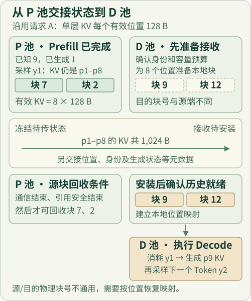
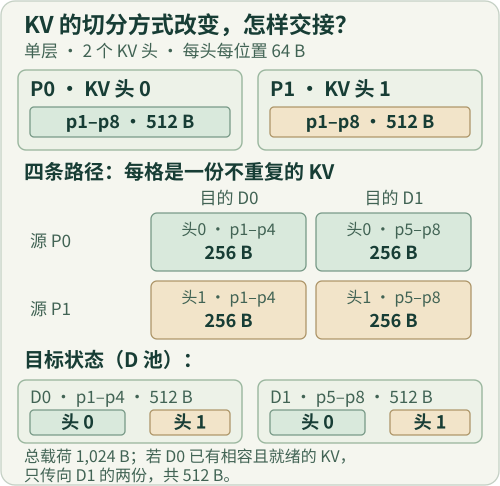
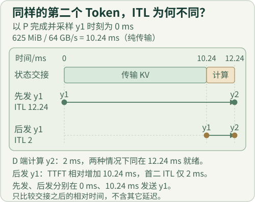
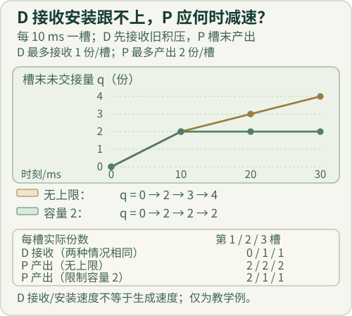

# Prefill 和 Decode 分开执行时，KV 怎样完成交接？

在 [H02](../08-request-scheduling/h02-chunked-prefill.md) 中，一个长提示词可能让正在生成的请求等待更久。分块 Prefill 可以限制一轮安排的工作，但这些请求仍在竞争同一个模型实例的计算和存储资源。

能否让一组设备专门处理输入，另一组设备专门生成后续 Token，让两个阶段分别取得适合自身的资源？这样，第一个阶段已经算出的历史状态怎么办？

**Prefill-Decode 分离（Prefill-Decode Disaggregation，PD 分离）**将请求的不同生成阶段放到不同模型执行实例或资源池中。Prefill 池负责建立输入的历史状态，Decode 池承接后续增量生成；软件需要组织两者之间的状态交接。

本篇沿用 G02 中的请求 A，追踪从 Prefill 完成到第二个输出 Token 生成的过程，再分析不同设备布局、交接时间和队列容量带来的约束。

## 为什么一个请求要由两个不同的池处理？ {#why-disaggregate}

回顾 [G02](../07-model-execution/g02-prefill-and-decode.md)。Prefill 处理一组已知输入位置，可以让许多位置共同使用一份权重。普通 Decode 每轮只计算每条序列的一个新位置，还要读取已经建立的历史状态。

因此，在某些长输入、低并发 Decode 的工作点上，Prefill 更容易受到计算能力限制，Decode 更容易受到权重及 KV 读取能力限制。这不是所有负载的固定结论，实际还取决于形状、并发、布局及设备资源。

在同一个引擎中，长 Prefill 与 Decode 可能竞争计算时间和内存访问资源。H02 已经讨论如何通过调整每轮的 Token 预算减少干扰。PD 分离采取另一种资源组织方式。

| 共置引擎 | 分离后的执行资源 |
| --- | --- |
| 同一组设备既执行 Prefill，也执行 Decode | P 池主要执行 Prefill，D 池主要执行 Decode |
| 两阶段共用调度机会与局部 KV 池 | 两阶段可以采用不同的批次、队列、设备数量或并行布局 |
| Prefill 产生的历史通常可在原实例中继续使用 | D 池需要取得相容且可读的历史状态 |

这里用 P、D 表示两个池中的目标实例。每个实例可能由多个 Rank 组成。即使两端运行同一个模型版本，D 也不会因为权重相同而自动拥有 P 已经产生的 KV。

这也不同于 I02 的 PP：PP 把同一个模型的不同层划给不同阶段；PD 分离改变的是请求不同生成阶段的执行位置。常见方案中 P 和 D 都能执行完整模型的前向，可能各自保存一份模型权重，或者采用不同的并行方式分担权重。

因此，增加专门的池可能减少阶段之间的竞争，但也需要给两端的模型资源、状态交接、通信及队列留出预算。分离本身不保证更低的延迟或更高的吞吐。

## Prefill 完成后，究竟需要交接哪些状态？ {#handoff-state}

还是请求 A：输入 p1–p8 共八个 Token，期望最多生成四个 Token。假设 A 恰好达到输出上限，不使用投机解码。在本篇的第一种执行方式中，P 完成 Prefill 并选择出首个输出 y1。

根据 G02 的生成进度，此时可以观察到：

| 对象 | Prefill 完成并选择 y1 后的状态 |
| --- | --- |
| 已知 Token | p1–p8、y1，共9个 |
| 已生成 Token | y1，共1个 |
| 已建立的历史 KV | p1–p8，共8个有效位置 |
| D 端下一次执行的输入 | y1，对应第9个位置 |

D 不应该再次执行整个八 Token 提示词，也不能把 y1 当成已经具有 KV 的历史。它需要处理 y1，建立第9个位置的 KV，然后选择 y2。

沿用 G04/G05 的一层 GQA 教学结构，每个有效位置保存128 B 的 KV，每块容纳四个位置。P 已为 A 获得两个块，本地块号为7、2，保存有效历史1,024 B。

如果 D 能直接把这些数据安装到自己的块中，后续执行便可以沿着与 G02 相同的计算进度继续。这里转移的是已经完成计算的历史状态，而不是让 D 重新建立同样的历史。

还需要交接或关联生成状态。仅发送 KV 的字节，不足以让另一个执行实例知道当前请求的身份、下一次执行输入和已经提交的输出。

| 交接需要的信息 | 用途 |
| --- | --- |
| 请求身份、交接版本和片段标识 | 将数据关联到正确的请求及本次交接，识别重复或失效的消息 |
| 模型、权重、适配器与位置语义等相容性信息 | 确认历史状态适用于 D 的执行 |
| 有效位置范围、层及头的布局、数据格式 | 确定传输的内容和目标写入位置 |
| 已知 Token、生成进度、下一输入及已提交输出 | 让请求继续推进，不重复生成或漏发 Token |
| 采样、停止及其他模型特定状态 | 保持 G03 所定义的生成契约 |

这些信息不一定全部随 KV 一起发送。请求协调者可以保存一部分生成及输出状态，向 P、D 分别提供所需信息。关键是接管后仍满足同一请求的计算语义与输出顺序。

[G03](../07-model-execution/g03-sampling-and-generation.md) 已分别解释采样随机状态、已知 Token、停止条件和文本解码进度。[G06](../07-model-execution/g06-prefix-cache.md) 则说明为什么模型版本等身份必须与可复用的历史状态相容。

## 数据送过去，就等于 D 已经可以继续执行了吗？ {#handoff-contract}

P 的本地块号7、2 只表示 P 自己的缓存池中的位置。D 需要在自己的池中分配或引用可用块，例如取本地块9、12，再将 p1–p4、p5–p8 的历史分别安装到对应位置。

D 显存中有空闲字节，并不等于它有适合本次状态的空闲块或格式。还需考虑接收缓冲、后续增长及其它已接纳请求将要使用的空间。

下面按一种教学交接协议观察 A，P 和 D 是相同模型、布局及精度的两个实例。目标选择既可以在 Prefill 之前确定，也可以在执行过程中完成；这里先让 D 确认接收条件。

<figure markdown="1">

<figcaption>一层、两块的状态交接示意。两侧的块号只在各自池中有意义。y1 已选择但尚无 KV；D 确认历史就绪后才处理 y1 的计算。</figcaption>
</figure>

| 关键事件 | 必须满足的条件 |
| --- | --- |
| 1. 确定接收端 | D 的模型身份、布局相容；取得实际接收资源或相应额度 |
| 2. 产生可传输状态 | P 已完成相应状态片段的写入，并确定有效范围、版本及在途引用 |
| 3. 传输与安装 | 按逻辑位置、层和头传递数据；必要时重排并写入 D 的本地块 |
| 4. 确认就绪 | D 确认对应消费者所需的全部片段已安装且可读 |
| 5. 移交与释放 | 按协议确定后续执行者，P 在通信及必要引用结束后回收不再需要的资源 |

例如在 D07 的 Attention 内核启动前，必须获得正确的块表、有效长度和数据可见性。D 已经申请块9、12，并不代表其中保存了可安全读取的历史；P 的发送操作提交返回，也不等于 D 已完成接收和安装。

[F02](../06-execution-runtime/f02-asynchronous-execution.md) 和 [F03](../06-execution-runtime/f03-runtime-buffer-management.md) 的执行与资源生命周期仍然适用。交接期间 P 与 D 可能同时持有 A 的历史。P 需要保留发送缓冲直到实际访问结束，而不是在提交传输后立即释放。

实际实现可以按层或块提前交付已经就绪的片段，不必等整个 Prefill 完成才发出第一份数据。D 也可以按依赖提前安排工作，但每个消费者只能在它所需的状态完整可读之后执行。

如果传输失败或超时，应根据请求与交接版本识别已安装片段，不把仅部分完成的历史标记为完整。重试应能安全识别重复片段；若更换接收端，还需重新满足接收及状态一致性条件。

移交后不能让两个实例各自推进同一个正式请求的生成进度。源端若保留已经传出的 KV 用于前缀复用，需要与仍在途的引用及后续回收策略分别管理。完整的取消、超时、重试和服务级请求生命周期见 [J02](../10-serving/j02-request-and-resource-lifecycle.md)。

## 如果 D 已经拥有一部分历史，还要发送全部数据吗？ {#partial-handoff}

在 G06 中，相同且有效的前缀可以复用。假设 D 自己已经保存了与 A 相容的 p1–p4，且该部分在交接时实际可用。现在只需要安装尚缺失的 p5–p8。

这时完整历史仍有八个位置，但本层缺失载荷只有 4×128 B=512 B，而不是1,024 B。D 还需要取得对已有前缀的有效引用，并为新增位置准备空间。

应该确认的是 D 端实际可用的状态，而非目录里记录的缓存命中。即使其他实例有匹配的缓存，也不代表 D 的对应历史已经可访问。[J01](../10-serving/j01-request-routing.md) 讨论服务为何会基于缓存局部性和负载选择实例；此处只分析选定实例的交接需求。

## 两个池的并行配置不同，能不能直接复制一段显存？ {#layout-redistribution}

前面的教学方案让 P、D 都保存同样布局。在真实部署中，Prefill 和 Decode 可能因为工作特点不同而选择不同的 TP、PP 或 CP 方案。状态的逻辑含义相同，持有这些数据的 Rank 却可能不同。

复用 [I04](i04-context-parallelism.md#kv-layout) 的两种 KV 布局。假设 P 使用 TP2，P0 持有头0的全部八个位置，P1 持有头1的全部八个位置；D 使用 CP2，D0 持有前四位置的两个头，D1 持有后四位置的两个头。

每个位置的单个 KV 头（K 和 V）占64 B。两侧的 Rank 仅是各自池中的编号，四张设备互不相同。假设数据格式相同、无额外复制、压缩或填充，D 暂无有效历史。

<figure markdown="1">

<figcaption>从头切分转换为位置切分。每条路径仅统计一个 KV 头、四个位置的 K/V 有效载荷；逻辑通信关系不表示物理拓扑。</figcaption>
</figure>

| 发送 Rank | 接收 Rank | 需要交付的数据 | 有效载荷 |
| --- | --- | --- | ---: |
| P0 | D0 | 头0、p1–p4 | 256 B |
| P0 | D1 | 头0、p5–p8 | 256 B |
| P1 | D0 | 头1、p1–p4 | 256 B |
| P1 | D1 | 头1、p5–p8 | 256 B |

两端每 Rank 都只保存512 B，但没有任何一个 P Rank 的本地完整分片能够直接成为某个 D Rank 的完整输入。软件需要构造这四次逻辑交付，并按 D 的状态布局安装。

如果 D0 已持有正确的前四个位置的两个 KV 头且状态就绪，则只剩发给 D1 的两条路径，跨池有效发送量为512 B。若 D 需要额外复制同一份状态，实际发送量又可能增加。

不同 PP 阶段划分也会改变每个 Rank 持有的层。状态交接应按层、位置、头等实际索引确定各发送方与接收方。若缓存格式不同，还要确认允许转换的数值契约和临时空间，不能把不同精度无条件视为等价。

这是用于推导状态归属的教学布局，不代表任意框架都支持 TP 到 CP 的交接。例如 vLLM v0.10.2 的 NIXL Connector 对异构 TP 的支持要求 D 的 TP 大小为 P 的整数倍，并有 Attention 后端与块格式等限制。

这种多对多布局转换与 I01 的张量交付思路相同，只不过传递的对象变成了会跨生成步骤持续存在的模型状态。具体 P2P 路径、传输算法及链路开销仍由互连系统解释。

## 传输一份 KV 到底需要多少时间？ {#transfer-cost}

先按实际缺失范围计算有效数据。对具有相同 K/V 格式和完整历史保留规则的标准 Attention 模型，若每个有效位置在所有层的 KV 有效载荷为 k_kv 字节，需要交接 s 个位置，且只传一份完整状态：

**D_KV = s × k_kv（B）**

k_kv 已经包含层数，不再额外乘一次。异构层、MLA 或窗口 Attention 应按 G04 的实际状态布局逐层计算；目标复制、分片重排、元数据及必要填充也要按实际计划另外核算。

使用 [G07](../07-model-execution/g07-tiered-kv-cache.md#cost-comparison) 中的另一个教学配置：模型80层、8个 KV 头、每头128维、FP16，全部层每位置320 KiB。假设有2,000个缺失位置，仅发送一份无填充的有效数据。

**2,000 × 320 KiB = 625 MiB = 655,360,000 B。**

设这次跨池数据交付的单向有效带宽为64 GB/s，即每秒64×10⁹ B。不考虑其它操作，纯传输项为：

**655,360,000 B / (64 × 10⁹ B/s) = 10.24 ms。**

MiB 是二进制容量单位，GB/s 在此按十进制计算。这里的带宽是观察到的指定方向的数据交付能力假设，不是某一链路的标称双向聚合带宽，也不是实测的一次 PD 交接时间。

与 G07 类似，还要考虑提交启动、等待可用路径和接收预算、布局转换及安装完成。它们是否可以重叠，取决于实际任务依赖、缓冲和资源条件。若多条路径并发传输，也不能拿任意一条链路的带宽直接除系统总发送量。

G07 的分层存储主要解决状态暂停期间保存在哪里、以后怎样恢复；PD 分离要把状态交给另一个继续执行请求的实例。两者可以组合，也都可能发生 KV 搬运，但交接的目的、时间约束与资源生命周期需要分别考虑。

## 首个 Token 是应该立即返回，还是等交接完成再返回？ {#first-token-timing}

我们已经跟踪了 P 完成 Prefill 并采样 y1 的情况。设这一时刻为0，P 端的 y1 已经可用。使用上一节10.24 ms 的传输时间，假设它全部落在 D 执行的关键路径上。

再假设接收端就绪后，恰好花2 ms 计算并选出 y2。先忽略其它排队、启动、安装、文本缓冲和网络送达延迟。现在有两种服务输出方式。

<figure markdown="1">

<figcaption>同一次构造的计算及传输时间线，两种策略只改变首 Token 的返回时刻。它们的第二个 Token 同时就绪；所有时刻相对 Prefill 完成并采样 y1 计。</figcaption>
</figure>

| 输出策略 | 客户端看到 y1（相对时间） | 客户端看到 y2（相对时间） | 首段 Token 间隔 |
| --- | ---: | ---: | ---: |
| P 选出 y1 后立即返回 | 0 ms | 12.24 ms | 12.24 ms |
| 等到交接就绪再返回 y1 | 10.24 ms | 12.24 ms | 2 ms |

前者将交接等待暴露在第一段 Token 间隔中，后者让首 Token 延迟增加10.24 ms，但没有让第二个 Token 提前产生。

K01 已定义 TTFT、ITL 等用户侧指标，实际 TTFT 应从客户端发起请求开始计时，而不是从这里的相对时刻0开始。引擎选出 Token 也不必然等于客户端立即收到它。[K01：Token 延迟的测量边界](../11-performance/k01-performance-metrics.md#token-latency)

本例假设 P 选择首 Token，这并不是 PD 分离的定义。若让 D 选择首 Token，必须提供最后输入位置生成 Logits 所需的数据或按协议重算该位置，不能认为仅收到历史 KV 就能直接读出 y1。

例如一种方案让 D 取得前七个位置的有效 KV，再消费第八个输入 p8，完成该位置的前向并选择 y1。这样生成进度与前面的方案不同，传输量、计算量和首 Token 时间也应重新计算。

Splitwise 采用 P 产生首 Token 的方式。vLLM v0.10.2 的 NIXL 示例则让代理把交接参数和原请求交给 D，客户端只取得 D 的生成结果。全输入 KV 命中时，D 的调度器仍安排最后一个输入位置重算，以产生首 Token。

因此比较 PD 分离时，要先确定采样、状态交接与输出提交分别在哪里发生，再沿真实请求的关键路径统计等待，而不能只报告其中较短的一段时间。

## P 池处理得比 D 池接收得快，会发生什么？ {#pool-backpressure}

假设我们增加了 P 池的计算资源，使它能更快完成输入。但 D 池已有许多正在生成的请求，KV 池剩余空间不足，或者跨池传输路径暂时无法接受更多交接。

这时 P 的新历史不是完成的请求，而是等待后续执行的中间状态。若不断将它们留在 P 的 KV 池中，待交接状态会占用越来越多的资源，最终连 P 也难以接纳新工作。

构造一个只观察交接队列的离散例子。每个时间槽10 ms，所有待交接请求大小相同。假设槽开始时 D 能从已有积压中收取并完成最多一份交接，随后 P 在槽末最多产出两份。初始队列为空。

| 时间槽结束 | 无队列上限时待交接份数 | 如果待交接容量上限为2，P 本槽实际产出 | 有上限时待交接份数 |
| --- | ---: | ---: | ---: |
| 初始 | 0 | — | 0 |
| 第1槽 | 2 | 2 | 2 |
| 第2槽 | 3 | 1 | 2 |
| 第3槽 | 4 | 1 | 2 |

<figure markdown="1">

<figcaption>构造的槽末待交接数量，不代表实际推理速度或 GPU 利用率。假定 D 取出的交接已完成对应资源交还，P 在安排生产前就取得剩余额度。</figcaption>
</figure>

无上限时，第一槽末得到两份；第二槽 D 消费一份、P 又生产两份，积压变成三份。持续下去，积压会一直增长。限制待交接量为两份后，P 必须随 D 的接收能力减少新产出。

这就是跨池的**背压（Backpressure）**：不仅 P 自己的执行资源决定它何时可以开始更多 Prefill，还需要考虑后续传输与 D 接纳状态的机会。

真实系统不能只按请求份数限制。长请求可能占用更多 KV 块；在途状态会同时占据源端与目标端资源。接收端应根据实际块预算、传输缓冲以及已接纳请求的后续增长需求授予适当额度。

这里 D 的每槽接收能力不是它生成 Token 的速率，也不等于它每槽能完成一条请求。D 接纳后，仍须按 [H03](../08-request-scheduling/h03-admission-and-request-scheduling.md) 的资源与执行条件调度增量生成。

如果 D 没有足够额度，可以让新请求在有限的上游队列中等待、选择其它合适的接收实例，或者按照服务约定暂缓或拒绝接纳。怎样路由多个实例、扩缩容量和管理请求生命周期，属于 J 专题。

P 和 D 能按各自的负载配置不同数量的设备，有助于改变两个阶段的容量配比。但两阶段仍通过请求依赖和状态传递相连，不能将 P 的峰值请求率、D 的峰值 Token 速率当作整个系统的独立性能保证。

## 什么时候分离值得采用？ {#tradeoffs}

共置时，Prefill 可能干扰 Decode；分离后，这些计算资源可以更独立地安排。但每条需要跨池继续生成的请求增加了状态交接与协调，两个池的负载也可能不均衡。一侧已经饱和、另一侧仍闲置时，增加闲置侧资源也不能解决瓶颈。

因此要在相同的模型、质量要求、请求到达过程、输入输出长度分布和服务目标下比较执行方案。具体而言，可以固定设备预算，比较满足联合 SLO 的请求率或达标完成速率；也可以固定 SLO 与负载，比较所需资源。

[K01](../11-performance/k01-performance-metrics.md#goodput-and-slo) 已说明如何区别吞吐、延迟与有效完成速率。在 DistServe 的论文中，Goodput 用满足目标 SLO 达标比例的最大可服务请求率评价资源分配，并按 GPU 数量归一化。它不同于单个观测窗口内直接数出的达标请求数。

不应直接将吞吐提升的 Token/s 与增加的毫秒延迟相减。需要把各方案放在可比较的测量边界内，再判断用户关心的延迟、达标率、整体吞吐与资源成本是否改善。

[DistServe](https://www.usenix.org/system/files/osdi24-zhong-yinmin.pdf) 和 [Splitwise](https://arxiv.org/abs/2311.18677) 都研究了两阶段分开配置资源与状态传递的方案；Mooncake 进一步将 KV 及其放置纳入调度。它们的实际效果依赖模型、网络及负载条件，而不是任意工作点的保证。

例如 vLLM v0.10.2 的实验性 Disaggregated Prefilling 提供跨实例 KV Connector 接口：调度侧管理传输相关决策，Worker 侧组织实际加载与保存操作。

在该版本的 NIXL 实现中，D 先分配目标块，异步拉取时进入 WAITING_FOR_REMOTE_KVS 状态；远端 KV 尚未就绪时，调度器可以推进其他请求。接收完成后才更新可用状态。

这是把 F02 的完成依赖和 H03 的调度约束应用于跨实例执行的一个实例。不同 Connector 的异步性、布局及数据位置可以不同，不能仅凭“启用了 PD 分离”推断交接路径。

## 回到整个 I 专题 {#summary}

现在我们可以统一理解前五篇的分布式执行方式。它们改变的首先是计算、数据或状态的分配，而不是某个物理链路的名称。

| 方式 | 首先要追踪什么 | 典型跨设备需求 |
| --- | --- | --- |
| [TP](i01-tensor-parallelism.md) | 层内张量分片、部分和 | 收集、归约或转换布局 |
| [PP / DP](i02-pipeline-and-data-parallelism.md) | 层的归属、模型副本及请求 | 阶段间激活交接；独立稠密副本无强制前向同步 |
| [EP](i03-expert-parallelism.md) | Token 实际选择的专家 | 派发、结果返还与原位置归并 |
| [CP](i04-context-parallelism.md) | 历史的位置及查询依赖 | KV 交换或局部 Attention 结果归并 |
| PD 分离 | 请求生成进度、已建立的状态、后续执行者 | KV 与必要生成状态交接 |

这些方式能够组合。判断组合是否正确，先写清每个 Rank 持有的权重、输入、输出和状态；再查后续计算需要哪些数据、它们何时就绪以及能否满足容量约束，最后根据实际通信和资源竞争分析关键路径。

I 专题到此结束。接下来 [J 专题：推理服务系统](../10-serving/README.md) 将从单个执行计划扩展到模型实例与请求的服务级组织，[K 专题：性能分析、建模与验证](../11-performance/README.md) 将建立可比较的性能证据。

[返回专题阅读顺序](README.md#计划阅读顺序)

## 来源与继续阅读

- [DistServe，OSDI 2024](https://www.usenix.org/system/files/osdi24-zhong-yinmin.pdf)：PD 分离、通信成本、独立资源配置和满足延迟目标的 Goodput。
- [Splitwise，ISCA 2024](https://arxiv.org/abs/2311.18677)：两阶段的工作特征、专门资源池和请求状态传递。
- [Mooncake 技术报告](https://arxiv.org/abs/2407.00079)：KVCache 中心的分离式架构、调度与过载处理。
- [vLLM v0.10.2：Disaggregated Prefilling（实验性）](https://docs.vllm.ai/en/v0.10.2/features/disagg_prefill.html)：跨实例传输相关接口及按层加载/保存的实现组织。
- [vLLM v0.10.2：ConnectorBase](https://github.com/vllm-project/vllm/blob/v0.10.2/vllm/distributed/kv_transfer/kv_connector/v1/base.py#L151-L225) · [NIXL 调度侧](https://github.com/vllm-project/vllm/blob/v0.10.2/vllm/distributed/kv_transfer/kv_connector/v1/nixl_connector.py#L256-L335) · [调度器接收状态](https://github.com/vllm-project/vllm/blob/v0.10.2/vllm/v1/core/sched/scheduler.py#L474-L507)：加载、依赖就绪、缺失历史及接收预算。
- [vLLM v0.10.2：NIXL Proxy](https://github.com/vllm-project/vllm/blob/v0.10.2/tests/v1/kv_connector/nixl_integration/toy_proxy_server.py#L149-L233) · [调度器完成处理](https://github.com/vllm-project/vllm/blob/v0.10.2/vllm/v1/core/sched/scheduler.py#L1233-L1287) · [异构 TP 条件](https://github.com/vllm-project/vllm/blob/v0.10.2/vllm/distributed/kv_transfer/kv_connector/v1/nixl_connector.py#L850-L940)：首 Token 契约、完成后更新与具体布局限制。
