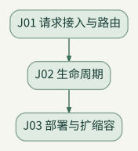

# 推理服务系统

推理服务要把外部请求送到可用实例，在出现取消、拥塞、故障或负载变化时继续提供服务。服务级决策和单引擎内部调度处于不同层次。

## 贯穿算例与阅读边界

延续 A/B/C 请求，增加两个模型副本、共享前缀、取消事件与负载增长，跟踪路由、资源状态及扩缩容过程。

从路由到生命周期再到容量管理。I 的分布式执行只在需要时补充。容器、网络协议等只介绍推理服务需要的接口。

## 知识关系

<figure class="micro-v2-map" markdown="1">

<figcaption>图中实线表示本专题内的主要前置关系，虚线表示按场景参考；跨专题先修知识见下表。 点击可查看大图。</figcaption>
</figure>

## 阅读顺序 {#计划阅读顺序}

本专题规划 3 篇正文。 当前均为未发布的阅读计划，标题与范围可在编写时根据认知目标调整。

| 编号 | 文章（暂定标题） | 读完应理解什么 | 主要前置知识 | 状态 |
| --- | --- | --- | --- | --- |
| J01 | 一个请求到达，服务怎样决定将它交给哪个模型副本？ | 请求入口、服务级准入、路由、模型版本、实例选择、缓存局部性与负载。 | G01–G03、H01；缓存路由按需 G06 | 未发布 |
| J02 | 用户取消请求之后，为什么不能立即回收资源？ | 请求生命周期、取消、超时、失败、重试、在途任务、模型及适配器生命周期。 | J01、F02、F03、G04/G05、H03 | 未发布 |
| J03 | 请求量突然增加，为什么扩容不能立即解决拥塞？ | 部署、预热、就绪、排空、弹性伸缩、容量管理、资源配额、多租户及 SLO 策略。 | J01、J02；分布式场景参考 I | 未发布 |

## 从哪里来，接下来往哪读

主要衔接：[模型执行与生成控制](../07-model-execution/README.md)、[请求调度与批处理](../08-request-scheduling/README.md)。

模型计算原理参考[算法与模型](../../workload/README.md)。重构期间也可查阅[旧版推理运行时](../../inference-runtime/README.md)。

后续方向：[性能分析、建模与验证](../11-performance/README.md)。

更多阅读路线见[编译器与运行时系统系列首页](../README.md)。
