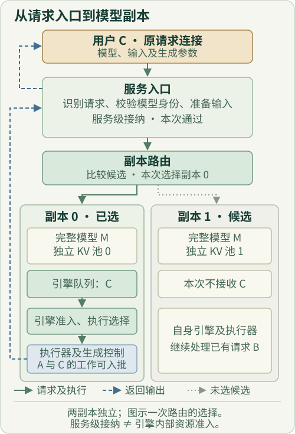
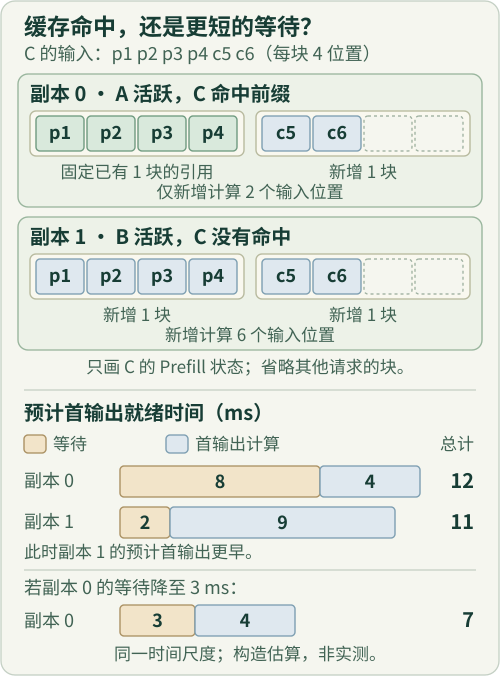

# 一个请求到达，服务怎样决定将它交给哪个模型副本？

假设我们向一个语言模型服务发送请求。另一个用户正在等待回答，服务还有一份相同的模型可以执行。应该把新请求交给较空闲的那份模型，还是继续交给正在工作的模型？

在 [H01](../08-request-scheduling/h01-continuous-batching.md) 中，推理引擎已经能够在每轮计算之间选择请求、组织批次。但当系统中有多个引擎时，还需要先决定由哪一个引擎处理这次请求。

**推理服务（Inference Serving）** 将一个或多个能够执行模型的实例组织起来，对外提供统一的请求入口，并持续管理请求流转、服务能力与异常。**请求路由（Request Routing）** 是其中的一个决策：为某个请求选择符合要求的模型副本。

本篇沿用 G、H 专题的 A、B、C 三个请求以及 [I02](../09-distributed-execution/i02-pipeline-and-data-parallelism.md) 的两个独立副本，跟踪晚到的 C 怎样进入系统、获得执行资源并收到输出。

## 为什么需要在两个模型副本前设置一个入口？ {#multiple-replicas}

原来只有一个模型实例 M。在增加请求量后，可以复制一份相同的模型，让两个实例分别处理不同请求。这里沿用 I02 中稠密模型的数据并行（DP）组织方式。

设副本 0 和副本 1 都已经就绪，运行同一版本的 M。各自有完整的模型执行能力、推理引擎及独立的 KV Cache 池。A 已交给副本 0，B 已交给副本 1。现在 C 到达。

| 请求 | 输入 Token | 输出上限 | 当前去向 |
| --- | ---: | ---: | --- |
| A | 8 | 4 | 副本 0 |
| B | 3 | 2 | 副本 1 |
| C | 6 | 3 | 尚未路由 |

本例每个请求只生成一条序列，恰好达到输出上限，不使用投机解码。与 H01 不同，现在 A、B 可以在两个副本上独立推进。

副本是一份可以独立处理模型请求的执行单元，不一定只有一张卡。如果一份模型采用 TP、PP 等方式分布在多张卡上，路由仍将请求交给这一整组协作的设备。

对于本例的稠密模型，请求 A 不需要使用副本 1 的权重或 KV 来完成计算。副本 0 的缓存也不会因为权重相同就自动出现在副本 1。

用户只想请求 M，并不希望先查询哪张卡有空、哪些设备共同组成实例，再将输入发过去。因此系统需要一个服务入口，将用户看到的模型与实际负责执行的副本联系起来。

<figure markdown="1">

<figcaption>图示一种逻辑组织方式，示例路径经副本 0 返回；路径中的框表示职责，不要求各自独立成进程。就绪副本也可能正在工作，路由成功不代表立即执行。</figcaption>

</figure>

[模型文件与实例：G01](../07-model-execution/g01-model-loading-and-execution.md) · [vLLM v0.10.2：Data Parallel Deployment](https://docs.vllm.ai/en/v0.10.2/serving/data_parallel_deployment.html)

## 服务接到的究竟是什么？ {#request-identity}

对于在线文本生成，客户端可以通过 HTTP 等接口提交一段对话，选择模型并指定生成要求。入口看到的是服务请求，而不是可以直接交给设备执行的命令。

以 C 为例，在将它送往引擎之前，系统至少需要确定以下信息。

| 信息 | 用途 |
| --- | --- |
| 请求标识 | 将计算结果、输出及后续取消信号关联到 C |
| 模型名与实际版本 | 确定允许此次请求使用哪份模型定义及权重 |
| 适配器与输入处理规则 | 确定适配参数、聊天模板、分词等实际计算条件 |
| 输入及生成要求 | 建立输入 Token、输出上限、采样及停止规则等 |
| 租户、权限与服务要求 | 检查访问资格、限额、优先级或截止时间 |
| 响应方式 | 确定一次性返回，还是在生成过程中分段返回 |

服务接口上的模型名可能是稳定的别名。例如用户请求 M，服务将其解析为版本 v1。随后系统只在能满足这次调用契约的副本中选择，避免把两份不同权重仅因为名称相同就当成相同模型。

模型版本、Tokenizer 版本和适配器的身份也会影响实际输入及历史状态。对于需要缓存感知路由的服务，路由器必须获得相容的 Token 前缀或其身份表示；具体的输入处理可以由入口或其他模块完成。

请求身份则回答另一个问题：谁应收到这份计算结果？引擎可能使用自己的局部标识，所以服务还需维护对应关系，例如 C →（副本 0，局部请求标识 c0）。请求标识本身不用于证明 KV 可以复用。

一条服务请求还可以要求多个候选答案，此时引擎可能需要维护多条生成序列。为避免混淆，本篇仍使用一请求一序列。服务请求数、引擎中的序列数和本轮参与计算的 Token 数不是同一个量。

例如 vLLM v0.10.2 的兼容 API 为请求提供标识；引擎参数分别定义对外服务模型名、模型版本和 Tokenizer 版本。服务中这些身份的解析和保存方式可以不同。

[vLLM v0.10.2：兼容 API](https://docs.vllm.ai/en/v0.10.2/serving/openai_compatible_server.html) · [引擎参数](https://docs.vllm.ai/en/v0.10.2/configuration/engine_args.html)

## 接收 C 之后，为什么不直接保证它能够执行？ {#admission}

假设两个副本都在处理其他人的请求。如果入口将所有新请求不断送入它们的队列，设备的处理能力却没有改变，那么尚未完成的工作就会持续积累。

等待队列也需要资源：例如保存输入、请求状态和连接；即使没有开始执行模型，也会增加等待时间。请求可能已经超过其约定的截止时间，却还在消耗系统资源。

因此，服务可以在接入阶段进行**服务级接纳控制（Admission Control）**。除了验证输入是否合法及权限，还按服务的队列上限、预计负载和策略确定是否允许 C 进入、暂缓接纳或明确拒绝。

暂缓意味着有界等待或向上游反馈背压，而不是无限增加队列。即使输入本身合法，当服务无法承担更多积压时，也可以返回明确的繁忙结果，让调用者知道本次请求未被正常接纳。

这与 H03 中引擎内部的准入不同。假设 C 已经被允许进入服务队列，并且路由到了副本 0。副本 0 此时可能没有足够的 KV 容量供 C 继续计算。它仍需根据实际资源及执行机会决定何时开始。

| 决策 | 决策对象 | 决策结果 |
| --- | --- | --- |
| 服务级接纳 | C 能否进入服务 | 接纳、有限等待或拒绝 |
| 副本路由 | C 应交给哪个就绪且相容的副本 | 目标副本，或暂不分发 |
| 引擎内部准入及调度 | C 能否取得实际资源，下一轮计算哪些位置 | 等待、取得资源及执行计划等 |

这些是不同层次的决定，不一定由三套独立的软件实现，也可以联合决策。服务可以提前根据引擎状态限流，但路由器的预测不能取代引擎实际获得资源的确认。

例如 [Dynamo v1.0.0 的路由配置](https://docs.nvidia.com/dynamo/v1.0.0/user-guides/kv-cache-aware-routing) 可以在候选 Worker 都达到指定负载阈值时暂缓分发。引擎内部的 KV 分配条件则由实际执行系统决定。

[H03：引擎内资源准入与进展](../08-request-scheduling/h03-admission-and-request-scheduling.md)

## 应该把 C 交给看起来较空闲的副本吗？ {#load-and-locality}

先采用一种简单的路由方法：轮询，在相容的副本之间依次分发。这样不需要知道设备上的执行进度，但长短不同的请求可能使两个副本逐渐变得不一样忙。

也可以选择活跃请求最少的副本。然而 A 与 B 都只占一个活跃请求；它们需要处理的输入、后续输出及历史状态并不相同。只数请求，无法直接知道还剩多少计算工作。

现在加入 G06 中的前缀复用条件：C 的六个输入为 p1、p2、p3、p4、c5、c6，前四个与 A 相同。假设副本 0 已完成 A 的 Prefill，副本 1 已完成 B 的 Prefill；二者都尚未结束。

两份模型采用 G04/G05 中的教学 KV 组织。每层每个位置为 128 B，每块容纳四个位置，即 512 B。为观察路由的影响，假设每个副本各有四个可用池块的总容量。这里不包含工作区等其他资源，它们另有足够余量。

| C 到达时 | 副本 0 | 副本 1 |
| --- | --- | --- |
| 活跃请求 | A，已生成 1 个 Token | B，已生成 1 个 Token |
| 已计算的历史 | A：8 个位置，占 2 块 | B：3 个位置，占 1 块 |
| 可用于 C 的连续相容前缀 | 4 个位置（A 的第一块） | 0 |
| 当前尚未被活跃请求引用的池块 | 2 | 3 |

假设 C 与 A 的模型、输入、适配器及复用域等条件相容，并且该前缀在实际准入时仍可被引用。以下池块数只统计不同物理块，不考虑该时点之后的新请求。

如果把 C 交给副本 0，C 的第一个块可以引用 A 的公共历史，不需要重复写入。C 只需要计算 c5、c6 并申请一个私有块。如果交给副本 1，C 要计算全部六个输入位置并申请两个块。

[G06](../07-model-execution/g06-prefix-cache.md) 已经说明，后缀 Query 仍需要读取前面的历史。按全因果 Attention 的有效位置对计算，两种路径分别涉及 5+6=11 和 1+2+…+6=21 个位置对（每层每查询头）。因此新增位置减少不等于所有工作同比例减少。

两种选择还会改变后续资源占用。若不提前结束，C 共计算 6+3−1=8 个历史位置，从 Prefill 完成到生成结束都需要两块来表示。A 最多需要三块，并且与 C 共享一块，两条请求最多同时需要四个不同的块。

在副本 1 上，B 最多需要一块，C 需要两块，共三块。两条候选路径都符合本例的容量条件。但在各自最大同时占用时，副本 0 没有剩余块，副本 1 仍有一块余量。

注意：这里只在已有活跃 A 的共享引用仍在时计算 C 的新增块数。如果命中的是原本可被淘汰的空闲缓存，C 取得它的引用也会减少可供其他请求重新分配的容量。

## 有命中的副本为什么仍可能不是最好的选择？ {#routing-cost}

虽然副本 0 可以少计算四个输入位置，但 C 还可能需要等待。在路由时，我们想知道的是 C 多久可以获得第一个输出，而不只是它有多少输入命中。

先在一个简化的时间模型中比较两种候选路径。以 C 已完成入口准备、即将分发为起点，以它的第一个 Token 在引擎内生成并可交给输出通道为终点。

假设两副本的执行实现相同，忽略分发和其他相同开销。每条候选路径的等待与首输出计算不重叠，且以下时间均为构造的预计值，不是硬件实测或从 Token 数线性推算的时间。

| 预计时间及工作 | 副本 0：有命中 | 副本 1：无命中 |
| --- | ---: | ---: |
| 开始 C 的 Prefill 前的等待 | 8 ms | 2 ms |
| C 的首输出所需新输入位置 | 2 | 6 |
| C 的新增私有 KV 块 | 1 | 2 |
| 从开始 C 的 Prefill 到首 Token 就绪 | 4 ms | 9 ms |
| 合计 | 12 ms | 11 ms |

尽管副本 0 少了 5 ms 的预计首输出计算时间，它却多等待 6 ms。所以如果只追求本次 C 的预计首输出时间，应该选择副本 1。

现在把副本 0 的预计等待改成 3 ms，其余条件不变。则它预计需要 3+4=7 ms，短于副本 1 的 11 ms。路由结果发生改变，而缓存内容并没有改变。

<figure markdown="1">

<figcaption>两组条件下的候选路由比较。时间条是本文构造的估算，不是实际执行时间线。各路径的块数为 C 的新增私有块，不包含共享块。</figcaption>

</figure>

旧版推理运行时还有一个更长输入的反例：一个副本缓存了 2,000 个可复用 Token，但预计等待 100 ms、剩余首输出计算 10 ms；另一个无命中，分别需要 5 ms 和 60 ms。结果是 110 ms 对 65 ms。

这组数值同样是教学估算，却说明了即使前缀很长，也不能推断将具有长前缀的请求送到热缓存所在副本一定合适。

更一般地，候选成本可以考虑预计等待、未复用部分的执行以及必要的传输成本；还要满足资源容量、身份及服务策略等约束。若其中工作存在重叠，应按实际依赖估计路径时间，而不是无条件相加。

[Preble（ICLR 2025），§3.1–3.3](https://arxiv.org/html/2407.00023v2) 从多实例共享提示的场景出发，联合考虑负载与缓存复用，并区分全局请求分发与实例内的迭代级调度。

### 为什么做决定时的信息可能已经过时？

假设路由器看到副本 0 有空闲块和四位置前缀，便将 C 发给它。这条信息可能来自副本先前的周期性上报或缓存变更事件。在 C 真正获得引用之前，其他请求也可能已分配新块或淘汰旧缓存。

因此路由器可以**估计**命中与可用容量；实际接纳 C 时，引擎仍要确认缓存身份、取得并维护有效引用，再分配块。如果状态已改变，可能要等待或重新计算部分提示。不能直接用过期的地址引用 KV。

例如 vLLM v0.10.2 的内部 DP 负载均衡在未指定目标 Rank 时，DPLBAsyncMPClient 使用 waiting×4+running 的启发式评分选择 EngineCore，并记录请求对应的目标引擎。它还会在上报间隔更新本地等待计数。这不是用真实时间或前缀命中进行计算的模型。

该版本的 Scheduler 收到请求后仍需实际申请 KV 槽位；分配失败时不能按原计划推进请求。服务层选择与执行层资源确认是两个不同的事件。

另一个实例是 Dynamo v0.8.0 的 KV Router。它可利用 Worker 的 KV 事件跟踪缓存，并将预计新增 Prefill 块与预计活跃 Decode 块纳入加权成本。其评分是块数相关的启发式量，不是本文的毫秒公式。

[vLLM v0.10.2：Core Client](https://docs.vllm.ai/en/v0.10.2/api/vllm/v1/engine/core_client.html) · [Scheduler](https://docs.vllm.ai/en/v0.10.2/api/vllm/v1/core/sched/scheduler.html) · [Dynamo v0.8.0：KV Router](https://docs.nvidia.com/dynamo/v-0-8-0/components/router)

如果副本 1 可以从副本 0 取得 KV，系统还有另一条候选路径：将请求交给副本 1，并先传输所需的状态。这不同于把请求发给已有本地缓存的副本。需要考虑状态传输、安装、可用性及资源占用，不能将远端命中当作免费本地命中。

同样，如果采用 Prefill/Decode 分离部署，还可能要分别选择两个阶段的副本。此时服务路由与 I 专题的跨设备状态交接共同作用；本篇仍假设一个副本完成 C 的整个生成过程。

## C 到了目标副本之后，怎样获得回答？ {#request-path}

沿用上面的第二组条件，假设服务选择了副本 0，并将 C 的身份及输入准备信息交给其引擎。C 此时进入该副本的等待队列，还没有立即占用一轮设备计算。

接下来的内部过程已经由 G、H 专题建立。我们只追踪 C 在整个系统中怎样流转。

| 阶段 | C 的状态或事件 | 主要决定者 |
| --- | --- | --- |
| 接收 | 已识别请求身份和版本，等待接纳 | 服务入口 |
| 接纳及路由 | 已选副本 0，提交给目标引擎 | 服务 |
| 引擎准入 | 确认四位置前缀、取得使用权和私有块 | 引擎及状态管理器 |
| 首轮选中 | 处理 c5、c6，建立六个位置的有效历史 | 调度器与执行器 |
| 生成第一个 Token | 使用末位置 Logits、采样及输出规则 | 生成控制 |
| 后续迭代 | Decode 两次，累计生成三个 Token，历史达到八位置 | 引擎 |
| 响应结束 | 上报结束原因，完成该请求的输出 | 输出通道与入口 |

副本内，调度器可以像 H01 一样将 C 的 Prefill 与 A 的 Decode 组成一轮。C 也可能继续等待其他请求。**路由选择了在哪个副本内竞争执行机会，而不是替该副本决定下一批工作。**

执行器按 [F02](../06-execution-runtime/f02-asynchronous-execution.md) 的任务依赖组织设备计算；生成控制按 [G03](../07-model-execution/g03-sampling-and-generation.md) 管理 C 的输出。若服务支持流式响应，输出通道可以在每段文本就绪后将其送回 C 原有的连接，而无需等三个 Token 全部生成。

流式传输中的文本片段不一定与模型每个 Token 一一对应。生成、文本解码、数据发送及客户端收到是不同事件。采用非流式接口时，可以等生成完成后再统一返回。

这里的预计首输出时间从路由时刻算到引擎生成首 Token；它不含此前服务入口、网络以及实际对外可见输出的耗时。因此它不能当作客户端测得的 TTFT（Time to First Token）。

当 C 达到输出上限时，引擎停止安排新的生成工作。服务返回正常结束原因；如果还有设备访问、传输或其他引用尚未结束，相关资源仍不能立即复用，见 [F03](../06-execution-runtime/f03-runtime-buffer-management.md)。A 与 C 的公共历史及模型权重也可在满足生命周期条件时继续保留。

## 只降低 C 的首输出时间，是否就能改善整个服务？

假设此后所有带 p1…p4 前缀的请求都选择副本 0。复用可能减少整个系统的计算和重复状态，但副本 0 的队列可能不断增长，副本 1 却还有处理余量。

反过来，如果仅追求每个副本的请求数量相等，可能把大量重复输入分散到冷缓存副本，增加 Prefill 工作，降低整个系统的处理能力。

路由不仅影响当前请求，也会改变下一次请求到达时的队列、缓存分布和资源余量。因此策略需要权衡等待、计算、未来可复用状态和服务质量，而不是把缓存命中率或活跃请求数作为唯一目标。

此外，不能为了热门前缀的收益无限推迟不容易命中的请求。策略可为服务类别或租户设定等待、资源或优先级约束。具体的系统容量及服务质量目标留给 J03，指标定义与测量留给 K 专题。

## 接下来需要解决什么问题？

现在 C 已经具备从服务入口到引擎执行再到输出的完整路径。我们已经区分了三件事：能否接纳、交给哪个副本，以及下一轮在哪些实际资源上执行。

假设 C 正在执行时，用户关闭连接，或者等待太久发来取消信号。服务能识别这个请求，却无法仅凭连接状态知道设备是否已经停止使用 C 的 KV。

J02 将在这个双副本系统上改变请求的生命周期，继续跟踪取消、超时、故障及跨层资源回收。

## 来源与继续阅读

- [G01：模型实例](../07-model-execution/g01-model-loading-and-execution.md)、[G03：生成控制](../07-model-execution/g03-sampling-and-generation.md)、[G05：分页 KV Cache](../07-model-execution/g05-paged-kv-cache.md) 与 [G06：前缀复用](../07-model-execution/g06-prefix-cache.md)：请求状态、Cache Identity、实际引用及块分配。
- [I02：流水线并行与数据并行](../09-distributed-execution/i02-pipeline-and-data-parallelism.md)：完整模型副本与跨设备协作的区别。
- [vLLM v0.10.2：DP 部署](https://docs.vllm.ai/en/v0.10.2/serving/data_parallel_deployment.html) 及 [引擎端架构](https://docs.vllm.ai/en/v0.10.2/api/vllm/v1/engine/core_client.html)：独立副本路由的一种具体实现。
- [Preble（ICLR 2025）](https://proceedings.iclr.cc/paper_files/paper/2025/hash/5bc342f48de8264779952fac378f96dc-Abstract-Conference.html)：多副本提示共享与负载联合优化。
- [Dynamo v0.8.0：KV Router](https://docs.nvidia.com/dynamo/v-0-8-0/components/router)：缓存感知选择的实现与评分。
- [旧版：完整请求路径](../../inference-runtime/01-request-and-metrics/request-path.md) 与 [副本路由及扩缩容](../../inference-runtime/08-serving-lifecycle/routing-and-scaling.md)：历史正文与原算例。
- [回到 J 专题导读](README.md)。
