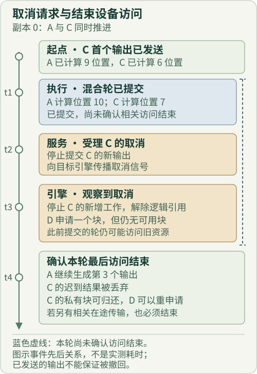
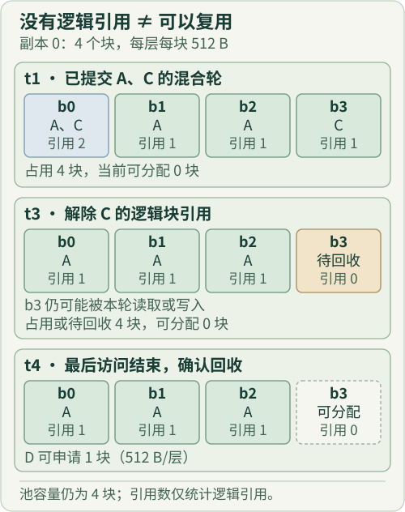

# 用户取消请求之后，为什么不能立即回收资源？

假设语言模型已经开始回答一个问题，用户点击停止生成。界面不再出现新的文字。但此时，加速器可能还在处理刚才提交的一轮计算。

如果服务认为这条请求已经结束，立即将它占用的 KV Cache 交给另一个请求，会发生什么？

**请求生命周期管理**负责协调请求从接入、执行到结束的完整过程。当用户取消、等待超时或执行失败时，服务既要停止不再需要的工作，也要确保已经提交的工作不再使用待回收资源。

本篇延续 [J01](j01-request-routing.md) 的双副本系统。先追踪 C 的正常生成，再改变它的结束原因，观察服务、引擎、模型状态和设备任务怎样分别发生变化。

## 一个请求结束时，究竟有什么东西需要结束？ {#request-and-resource-state}

在 J01 中，服务将 C 交给副本 0。引擎获得实际资源后，为 C 安排 Prefill 与后续 Decode，并将生成结果返回给用户。

如果 C 正常达到输出上限，引擎会停止为它安排新的生成工作，并报告结束原因。输出通道还可能有尚未发送的文本，需要按正常结束的协议完成返回。

此时，一条服务请求涉及多种不同状态，而不是只有一个“完成”标记。

| 跟踪对象 | 需要了解的状态 |
| --- | --- |
| 服务请求 | 接收、等待分发、执行中、已结束及结束原因 |
| 引擎请求 | 等待准入、可以调度、已有工作提交、停止新增工作 |
| 生成状态 | 已知及已计算位置、已提交的输出、采样与停止状态 |
| 设备及传输任务 | 尚未提交、在途、访问安全结束或异常待处理 |
| 资源 | 有请求引用、仍被任务访问、待回收、可重新使用 |
| 输出通道 | 已准备、待发送、已发送、流已结束 |

这些状态不要求严格一一对应。例如用户已经收到正常结束标记，模型权重依然保存在副本中；C 的某些有效前缀也可能继续留在缓存池中。

反过来，用户关闭连接后，某项设备任务可能仍未结束。**请求的逻辑结束回答的是还要不要继续服务；资源的安全结束回答的是谁还能访问这份资源。**

[A05](../01-foundations/a05-task-and-resource-lifecycle.md#task-states) 与 [F03](../06-execution-runtime/f03-runtime-buffer-management.md#ownership-and-last-use) 已经建立了任务状态与资源使用权的区别。这里将这一关系扩展到整个服务请求。

## C 正在生成时，副本 0 中保存了什么？ {#before-cancel}

沿用 J01 中的第二组路由条件，C 被送到副本 0。A 已经在副本 0 运行，B 则由独立的副本 1 处理。

A 的输入长度为 8，输出上限为 4；C 的输入长度为 6，输出上限为 3。C 与 A 有四个相容的公共输入位置。仍假设每个副本有四个池块，每块四位置，单层每位置的 KV 有效载荷为 128 B。

现在设副本 0 已完成一轮 A 的 Decode 与 C 的 Prefill（复用四位置，仅新算两位置）。这轮结束后，A 已生成第二个 Token，C 已生成第一个 Token。为区分两条输出序列，记 A 的输出为 y1、y2…，C 的输出为 z1、z2…。

为简化输出边界，假设 z1 已形成稳定文本并提交给网络发送；不保证客户端已经收到。本例的下一观察点如下。

| 请求 | 已生成 Token 数 | 有效 KV 位置数 | 块表 |
| --- | ---: | ---: | --- |
| A | 2 | 9 | [b0, b1, b2] |
| C | 1 | 6 | [b0, b3] |

b0 存放双方相同的首四位置；b1 存放 A 的第 5 至第 8 个位置；b2 存放 A 的第 9 个位置；b3 存放 C 的第 5、6 个位置。

A 与 C 的逻辑块表合计有五项，但实际只占用四个不同的物理块。所有四个块均有活跃请求引用，没有可以立即分配给新请求的块。

沿用 [G02](../07-model-execution/g02-prefill-and-decode.md) 的计数方法，A 的 y2 与 C 的 z1 此时已经选出，但对应的 KV 还没有建立。下一轮将分别计算 A 的位置 10 与 C 的位置 7。

引擎从两条请求的块表取得访问引用，将这一混合批提交给设备。由于池块内部仍有空位，这轮无需增加池块。但执行记录已经持有访问 b0、b1、b2、b3 所需的资源使用权。

## 如果用户现在取消 C，会发生什么？ {#cancellation}

假设这轮计算已经提交，但尚未结束。在等待第二个输出时，C 的用户发来取消请求。

### 首先停止不再需要的服务

入口根据 J01 保存的请求标识找到 C 及其目标副本。如果服务协议支持显式取消确认，可以告诉用户取消已经被接收，同时禁止输出通道提交该请求的新结果。

这里的确认只说明服务接受了取消，不代表目标引擎已经收到消息。入口还需要将信号传播到副本 0，防止它一直为 C 计算到输出上限。

调度器收到信号时，将 C 标记为终止待清理，并停止选择 C 的后续工作。对于尚未提交的任务，可以撤销其调度计划。已经提交的混合批则可能仍在运行。

### 为什么不直接停止整个混合批？

这轮中 A 与 C 共享同一次执行机会。它们的部分操作可能已经合并为一个 Kernel；设备收到的任务未必能按服务请求粒度立即终止。

如果停止整个批，A 的有效工作也可能受到影响。即使硬件或执行器支持某种单任务中止，也需要确认它能否安全实施，以及何时不再访问相关资源。

因此，本例采用一种简单的语义：不再为 C 提交新增工作，但允许这一已提交的迭代安全完成。A 的结果仍然有效，C 的晚到结果不再提交给已取消的请求。

<figure markdown="1">

<figcaption>一次取消的跨层事件顺序。t1 至 t4 只是事件序号，不代表固定延迟或真实设备测量；服务输出停止、引擎停止新增工作与最后一次访问结束是不同的边界。</figcaption>

</figure>

这个过程与 [F02](../06-execution-runtime/f02-asynchronous-execution.md#failure-and-cancellation) 中“不再需要向量加法的结果”类似。取消改变的是后续工作及结果的使用条件，已经交给设备的访问仍要按执行契约收尾。

## 为什么已经解除 C 的引用，还是不能把它的块给别人？ {#safe-reclamation}

现在暂时加入一个新请求 D。它与 B 一样有三个输入、最多生成两个 Token，但输入与已有前缀不相容。假设服务已接纳 D 并将它送到副本 0；它正常生成至上限只需一个四位置块。

当引擎收到 C 的取消时，D 尝试获得资源。这时能否直接使用 C 原来的私有块 b3？

先跟踪每个块的逻辑引用与在途访问。本例选择在引擎观察取消时解除 C 的逻辑引用，但由执行记录继续保留已经接纳任务的使用权。有些实现也可以推迟逻辑解除，直到任务结束。

| 池块 | 取消前的逻辑引用 | 解除 C 逻辑引用后 | 是否可立即交给 D |
| --- | --- | --- | --- |
| b0 | A、C（2） | A（1） | 否，A 仍需此历史 |
| b1 | A（1） | A（1） | 否 |
| b2 | A（1） | A（1） | 否 |
| b3 | C（1） | 无（0），但旧任务仍可能读写 | 否，待回收 |

如果现在将 b3 还给池，并让 D 写入自己的 KV，C 的旧 Decode 可能读取已经被覆盖的历史；或者 C 的旧写操作可能覆盖 D 的数据。这两种情况都会违反执行的资源使用约定。

因此，这组四块的池中仍有三个被 A 持有的块和一个待回收块。此时 D 必须等待，或按引擎策略采取其他合法处理。副本 1 的空闲块也不是副本 0 可以直接使用的本地容量。

<figure markdown="1">

<figcaption>四个物理池块及其使用权。图中的引用只统计请求逻辑引用，任务的使用权另外跟踪；假设没有其他请求完成或释放空间，也没有额外的传输任务尚未结束。</figcaption>

</figure>

等该轮的最后一次合法访问已经结束，引擎可以正常提交 A 的第三个 Token。A 的有效历史增加到 10 个位置，仍需三个块。

C 的位置 7 即使完成了某些 KV 写入，本例也不再提交其第二个输出；这些临时结果不成为继续 C 生成的正式状态。b3 在确认无其他持有者后可以清除旧归属，重新分配给 D。

| 观察点 | A 持有块（含共享 b0） | C 或 D 的私有块 | 待回收块 | 可重新分配块 |
| --- | ---: | ---: | ---: | ---: |
| 引擎观察取消前 | 3 | C：1 | 0 | 0 |
| 解除 C 引用、旧任务仍在途 | 3 | 0 | 1 | 0 |
| 最后访问结束，D 尚未取得块 | 3 | 0 | 0 | 1 |
| D 取得 b3 | 3 | D：1 | 0 | 0 |

共享块只计一次。所有时刻的池总容量均为四块，即单层 4×4×128 B = 2,048 B。D 得到的是单层 512 B 的池内容量，不意味着设备向系统归还了这部分物理内存。

[G05](../07-model-execution/g05-paged-kv-cache.md#reclamation) 解释了块回收条件；[G06](../07-model-execution/g06-prefix-cache.md#cache-lifecycle) 则说明，即使没有活跃请求引用，已经有效且适合复用的前缀也可以保留身份，成为可淘汰缓存。

本例假设 b3 不作为前缀保留。即使采取保留策略，也必须先满足最后访问结束、旧状态有效及身份相容等条件，才能按缓存池规则管理它。

### 如果最后结束的不是设备计算呢？

前面的主例没有额外传输。现在考虑一个独立变体：在 C 的下一轮提交前，系统已经安排将 b3 中有效的位置 5、6 复制到另一个存储位置。

复制只读取这两个已经就绪的位置；本变体假设实际布局和任务依赖允许该读取与位置 7 的新写入并行，不存在访问冲突。若不满足这些条件，则必须先建立正确的执行顺序。

即使模型计算先完成，只要该复制任务尚未结束对 b3 的读取，b3 就不能被 D 覆盖。真正需要确认的是**所有旧的合法访问均已结束，而且没有其他持有者**，而不是某个指定的 Kernel 已结束。

对于跨节点 KV 交接，还要区分传输结束、接收方完整获得状态、安装可用，以及使用权交接。若中途失败，应依靠请求和传输身份协调源端与目标端，不能仅凭服务连接关闭推断它们已经清理。

[CUDA 13.2 的流有序内存分配](https://docs.nvidia.com/cuda/archive/13.2.0/cuda-programming-guide/04-special-topics/stream-ordered-memory-allocation.html) 提供了一种底层例证：跨流访问必须在释放生效之前结束；主机可以提前安排释放与依赖，而不必全设备同步。

## 如果 C 的计算结果比取消信号更晚到达呢？ {#late-outputs}

取消必须处理两个方向的消息：入口向引擎发送终止信号，引擎向入口发送生成结果。两类消息可能以不同顺序到达。

以 C 为例，它的第二个 Token 可能已经被生成控制选出，但结果尚未交给服务。入口接受取消后到达的这项结果，是否应该继续发给用户？

服务与引擎可以用请求标识、执行计划标识以及生成位置维护关联，并对结果的提交设置明确的终止边界。取消生效后，不再接受属于该次执行的新输出。

已经提交给网络的内容可能仍在传输，也可能已经被用户看见，服务无法撤回它。因此“停止提交新输出”不同于保证客户端在取消确认后不会收到任何先前已发送的字节。

同一个取消信号也可能重复到达。例如客户端显式取消后又关闭连接。系统应让同一执行尝试的重复终止操作不再产生新的状态变化，避免重复解除引用或让连接重复结束。

如果请求已经正常结束，取消与完成竞争时，应依据约定的状态转换顺序确定唯一的最终原因。不能既向调用方报告正常成功，又让同一执行被当作一个新的失败请求处理。

### 一个实际实现怎样连接这些职责？

以 vLLM v0.10.2 的 V1 引擎为例，API 入口可监听客户端断开。AsyncLLM 的 generate 在收到协程取消时会调用 abort，通过 OutputProcessor 移除输出状态，再将取消消息送到 EngineCore。

EngineCore 调用 Scheduler.finish_requests，由 Scheduler 从运行或等待队列移除相应请求并标记为 FINISHED_ABORTED。OutputProcessor 也会忽略已没有相应请求状态的迟到输出。调用 abort 返回并不能单独证明加速器已经停止访问全部相关资源。

该版本 Scheduler 的资源释放路径还会询问 KV Connector 是否需要延迟释放块，例如状态仍在异步发送；在相应的发送完成通知（finished_sending）到达后，再进行释放。

这是固定版本的具体软件分工。它不要求所有引擎都提供独立的终止状态或相同的设备事件，也不能把软件内部返回 KV 池的操作直接理解成底层显存释放。

[vLLM v0.10.2：AsyncLLM](https://docs.vllm.ai/en/v0.10.2/api/vllm/v1/engine/async_llm.html) · [OutputProcessor](https://docs.vllm.ai/en/v0.10.2/api/vllm/v1/engine/output_processor.html) · [EngineCore](https://docs.vllm.ai/en/v0.10.2/api/vllm/v1/engine/core.html) · [Scheduler](https://docs.vllm.ai/en/v0.10.2/api/vllm/v1/core/sched/scheduler.html)

## 如果用户没有点击取消，只是等待太久呢？ {#timeouts-and-backpressure}

用户没有明确发出停止请求，也可能不再需要这次结果。例如客户端只愿意等待一段时间，超出后断开；或者服务自己设定了请求截止时间。

截止时间（Deadline）约定的是一次请求应在什么时间前完成特定目标。客户端、入口及引擎需要通过协议或配置知道各自承担的时限；单个接收操作的超时不总是整条请求的截止时间。

当入口发现 C 已不可能按约定时间完成时，可以按服务策略提前拒绝或结束它，避免继续积压。预计剩余时间存在误差，因此这样的预测不是硬实时证明。

若超时发生在服务队列内，并且 C 尚未取得引擎资源，只需撤销未发出的工作与清理相应服务状态。如果已经提交设备任务，则仍需传播取消并遵守前面的回收边界。

如果只是客户端等待超时，而服务端未获得结束信号，设备仍可能继续执行。连接中断也可能要经过网络与代理才能被服务察觉。不能仅根据客户端的等待结果推断服务器的任务状态。

例如 [gRPC 的 Deadline](https://grpc.io/docs/guides/deadlines/) 与[取消机制](https://grpc.io/docs/guides/cancellation/)明确区分调用取消与应用程序停止派生工作；后者需要服务配合处理。

### 为什么慢客户端也会影响设备资源？

考虑 C 以流式方式生成。生成控制和文本解码已经提供新内容，但客户端读取很慢，导致待发送内容不断累积。

如果允许无界缓冲，网络发送速度不足可能转化为服务端内存压力。若一直允许生成，C 的 KV 也可能继续增长。

因此输出通道可以限定排队字节量，并按策略暂停 C 的后续调度、限制输出或终止请求。暂停生成期间仍可能需要保留它的 KV；若要释放状态，则需要 H03、G07 中的暂停恢复或迁移策略。

正常结束也要处理尚未发送的内容，按协议返回结束原因。取消或失败则可能丢弃未提交的内容。无论采取哪种策略，都需分别考虑输出缓冲和设备状态的实际使用期限。

[H03：准入、暂停与恢复](../08-request-scheduling/h03-admission-and-request-scheduling.md) · [G07：分层 KV 状态](../07-model-execution/g07-tiered-kv-cache.md)

## 执行失败时，能不能直接换另一个副本继续？ {#failure-and-retry}

回到取消之前的观察点。假设 C 已经发送 z1，但这次不是用户取消，而是副本 0 的设备执行失败。

与正常完成不同，失败意味着某些结果或状态可能无效。引擎应向服务报告失败范围，停止依赖无效结果的后续工作，并明确哪些请求必须结束。若故障影响整个设备上下文，同批的 A 也可能失败。

如果某个设备不再响应，正常完成通知可能永远不会出现。此时不能将“等了很久”作为安全回收的证据。底层驱动可能需要停止提交、使设备及 DMA 访问静止、隔离失效上下文，或者重新建立执行环境。

[E04](../05-device-driver/e04-completion-and-error-handling.md#reset-and-recovery) 解释了异常恢复和底层回收条件。J 专题关心的是服务如何停止向不再具备服务能力的副本分发，并处理受影响请求；具体复位机制归 E04。

副本 1 运行同一版本模型 M，也许还能正常提供服务。但它没有 C 在副本 0 上的请求状态。能否让 C 在副本 1 继续生成 z2、z3，取决于系统能够恢复什么。

| 恢复所需的信息 | 为什么需要它 |
| --- | --- |
| 模型、适配器与输入身份 | 保证重建历史的计算条件相容 |
| Prompt、引擎正式接受的 Token 与计算位置 | 区分已知历史、有效 KV 及尚待计算位置 |
| 有效的 KV 或其他模型状态 | 通过相容的状态交接或从已知历史重算 |
| 采样随机状态、生成配置及约束状态 | 恢复后续选择的语义 |
| 文本解码、停止判定与输出进度 | 保证返回的内容不重复且符合协议 |

在本例中，C 已知六个输入及 z1，有效 KV 只有六位置。如果有相容的历史状态和其他必要信息，可在新副本上建立六位置 KV 后继续计算 z1 对应的位置 7；也可以从已知历史重算。

这只是一种可实现的恢复路径。如果需要延续原来的随机生成过程，还需恢复相容的随机进度及执行语义，单有 KV 并不能保证输出完全相同。不同后端的数值行为也可能影响结果。

更重要的是，服务端记得自己已经发送 z1，并不保证客户端已经收到。如果协议没有定义可恢复的输出边界与双方确认机制，就不能知道应从哪段文本继续发送。

因此应区分两种行为：

- **恢复原请求**：保持其正式历史，并依据约定的输出位置接续。在确有恢复能力时执行。
- **重新发起一次请求**：建立新的执行尝试，从约定输入生成一个新结果。旧请求已经发送的内容不能自动与新结果拼接。

服务可以为同一逻辑请求维护独立的尝试标识，使已失败尝试的晚到结果不会误交给新的尝试。重试次数、适用的失败原因和剩余截止时间也需要受限。

即使用户尚未收到任何输出，重新发送的调用也不一定没有副作用，例如配额、计费或工具调用可能已经发生。是否允许自动重试，由服务接口的幂等性与错误语义决定，而不是由连接是否断开决定。

[RFC 9110 §9.2.2](https://www.rfc-editor.org/rfc/rfc9110.html#section-9.2.2) 区分 HTTP 请求的幂等语义及自动重试条件。应用层的生成恢复能力仍需服务自己定义。

## 当模型或适配器不再需要时，能立即卸载吗？ {#model-lifetime}

前面取消的是 C 的生成，但副本 0 的模型 M 仍在为 A 和 D 提供执行能力。因此不能因为 C 结束，就卸载它曾使用的模型。

[G01](../07-model-execution/g01-model-loading-and-execution.md#model-instance) 中的模型实例除权重外，还包含执行环境、代码或模型入口及相关资源。一条设备任务可能在这些资源上持有引用。适配器也是这样，例如 LoRA 的附加权重可能被多个请求共同使用。

设服务准备将模型从版本 v1 更新到 v2。它可以先让新的请求不再路由至旧副本，仍允许已经接纳的 v1 请求完成；或者按明确策略终止、迁移尚未完成的旧请求。

在旧请求不再新增工作之后，还要确认设备及传输访问已安全结束，处理相关权重、适配器、缓存和执行产物的引用，再按生命周期约定归还资源。

前缀索引不能仅根据显示名称匹配。新旧模型或不同适配器产生的状态可能不相容；旧缓存应从新版本的可命中范围中隔离或失效。如有合法的恢复需求，也可在资源预算内继续保留明确版本身份。

例如 [vLLM v0.10.2 的 OpenAIServingModels](https://docs.vllm.ai/en/v0.10.2/api/vllm/entrypoints/openai/serving_models.html) 中，卸载 LoRA 的入口方法移除服务侧适配器条目。这一操作本身不能证明设备上的权重已经释放。

服务层停止分发、实例排空和底层卸载是不同的步骤。一个模型加载完成不代表一定就绪，同样一个模型不再接收新请求也不代表已经停止使用设备。

## 怎样验证这些行为没有引入新的错误？ {#invariants}

回看 C 的取消例子：测试可以先占满四个块，在取消被引擎观察后、设备访问结束前后分别尝试让 D 取得 b3。

在我们这个教学状态模型中，第一次应等待，第二次可以在归还条件成立后取得块。若追加独立复制任务，则要等待该任务的使用权也结束。

可以进一步改变事件的顺序，例如：

- 在等待队列内取消，确保没有新任务提交。
- 对已提交的请求重复取消，确保引用只归还一次。
- 在输出、取消与正常完成竞争时，保证结束原因和提交边界明确。
- 在客户端停止读取、KV 传输中断、设备异常及模型卸载时，检查关联资源是否得到正确处理。

需要验证的不仅是服务是否返回错误，还包括是否存在晚到输出、覆盖在途数据、共享引用泄漏，或者将一个旧尝试的结果交给新尝试。

这类测试属于请求及资源状态的正确性验证。实际故障注入、观测和性能统计方法将在 K 专题继续展开。

## 接下来需要解决什么问题？

我们已经看到，请求结束后，设备资源可能还要等待最后访问才能重新进入可用集合。因此服务不能仅凭已经结束的请求数判断还剩多少实际容量。

假设服务突然涌入大量请求，已有副本开始拥塞。即使能再增加一个模型副本，新副本从加载资源到能够接收请求仍需要时间；旧副本退出也要处理尚在运行的请求。

[J03](j03-serving-scaling.md) 将继续沿用这组副本，解释模型实例启动、就绪、排空及服务容量变化为什么不是瞬时发生的。

## 来源与继续阅读

- [A05：任务与资源生命周期](../01-foundations/a05-task-and-resource-lifecycle.md)、[E04：完成与异常](../05-device-driver/e04-completion-and-error-handling.md) 与 [F03：运行时内存管理](../06-execution-runtime/f03-runtime-buffer-management.md)：任务完成、错误及实际资源复用。
- [G03：生成控制](../07-model-execution/g03-sampling-and-generation.md)、[G06：前缀共享](../07-model-execution/g06-prefix-cache.md)：生成状态、输出边界及共享引用。
- [vLLM v0.10.2：入口请求取消](https://docs.vllm.ai/en/v0.10.2/api/vllm/entrypoints/utils.html) · [CoreClient](https://docs.vllm.ai/en/v0.10.2/api/vllm/v1/engine/core_client.html) · [KVConnectorBase_V1](https://docs.vllm.ai/en/v0.10.2/api/vllm/distributed/kv_transfer/kv_connector/v1/base.html)：取消传播、请求路由身份及异步传输释放契约。
- [旧版：取消、超时、故障与资源回收](../../inference-runtime/08-serving-lifecycle/request-resource-lifecycle.md)：原有知识范围与故障验证场景。
- [旧版：PD 分离与 KV 交接](../../inference-runtime/07-distributed-execution/12-pd-disaggregation.md)：跨执行者状态交接。
- [回到 J 专题导读](README.md)。
