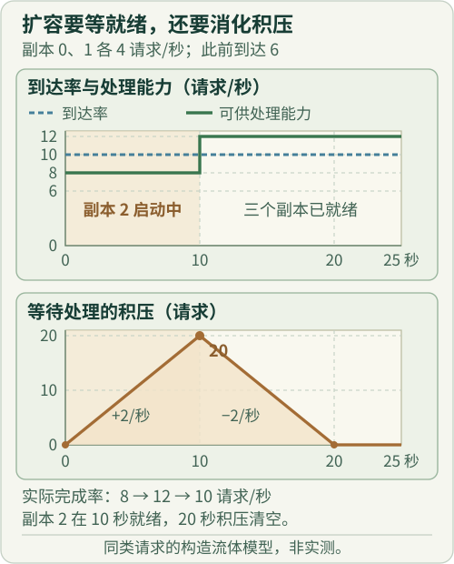
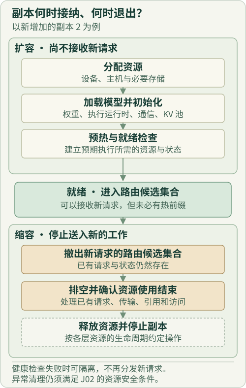
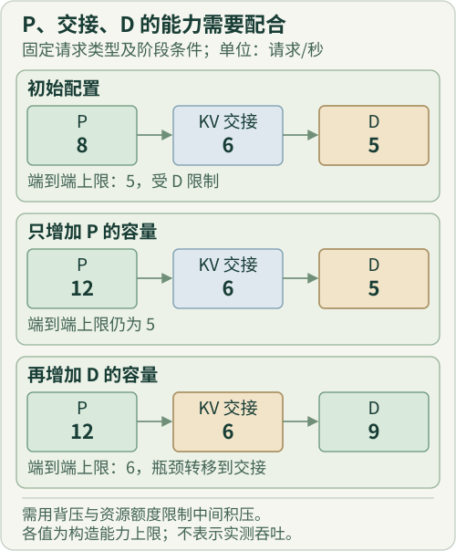

# 请求量突然增加，为什么扩容不能立即解决拥塞？

假设一个语言模型服务原本能够及时回答用户的问题。突然有大量新请求到达，等待第一个输出的时间越来越长。此时服务决定增加一份模型副本，但用户仍然需要等待。

在 [J01](j01-request-routing.md) 中，我们已经能够在不同副本之间分配请求。在 [J02](j02-request-and-resource-lifecycle.md) 中，我们也知道了请求结束与实际资源归还之间的区别。现在，系统需要在更长的时间范围内决定保留多少副本。

**弹性扩缩容（Elastic Scaling）** 根据负载及服务目标增加或减少可服务的执行资源。目的不是让设备数量随着请求数量机械变化，而是使系统的实际处理能力能够适应需求，同时控制资源成本。

本篇沿用 J01–J02 的双副本系统，从排队的变化出发，观察新副本何时真正增加容量，以及已有副本退出时需要满足什么条件。

## 为什么请求量增加后，等待会越来越长？ {#load-and-capacity}

J01 中，副本 0 与副本 1 分别运行一份完整的稠密模型 M，拥有各自的执行资源和 KV 池。它们能独立处理请求。

如果接下来的请求仍然只是 A、B、C，路由器可以为每条请求选择合适的副本。但如果越来越多的请求到达，两个副本都无法在新请求到达的速度下完成工作，路由就不能单独解决问题。

现在将观察尺度从一次生成迭代改为较长时间内的请求流。假设输入、输出长度、采样规则和复用条件的负载结构固定，例如反复到达具有 A、B、C 请求特征的工作。

对这个教学负载，构造以下能力与需求。数字只是为了分析容量变化，不能由 J01 的单次计算时间或四块 KV 池直接推出。

| 观察量 | 数值 |
| --- | ---: |
| 副本 0 的可持续处理能力 | 4 请求/s |
| 副本 1 的可持续处理能力 | 4 请求/s |
| 两副本合计处理能力 | 8 请求/s |
| 原有到达速率 | 6 请求/s |
| 突增后的到达速率 | 10 请求/s |

假设两个副本可以得到均衡的工作，共用入口、网络及其他资源没有形成瓶颈。这样，它们的可持续处理能力可以相加。

原来每秒到达六份请求，而系统有处理八份请求的能力。突增后，每秒到达十份，系统最多处理八份。其余两份只能留到以后处理，等待量便不断增长。

这里用 **到达速率** 表示单位时间内进入观察范围的新请求量，用 **处理能力** 表示在指定负载条件下每单位时间内可持续完成的请求量。后者并不等于每一秒实际完成的数量。

实际语言模型请求长短不同，批组成与前缀缓存也会改变处理成本。每秒十个长输入请求与每秒十个短输入请求可能完全不同，不能将请求数当作固定大小的硬件工作量。

例如不启用复用、提前停止和投机时，A 最多需要计算 8+4−1=11 个位置，B 只需 3+2−1=4 个位置。即使新计算位置数相同，Attention 历史长度和内核形状也可能不同。

因此，本例的固定负载结构是比较处理能力的必要条件。实际系统还要关注等待的工作量、输入输出长度、KV 容量和可执行资源，而不能只看请求数。

[I02：独立模型副本与并行执行](../09-distributed-execution/i02-pipeline-and-data-parallelism.md#capacity-tradeoff) · [K01：吞吐的统计边界](../11-performance/k01-performance-metrics.md#throughput)

## 新副本启动后，原来的积压到什么时候才会消失？ {#scale-up-backlog}

现在设服务在负载变化的时刻 t=0 就决定启动副本 2。假设从发出扩容决定到新副本就绪需要 10 s，在此之前只有原来的两个副本能处理实际请求。

暂不限制等待队列，也没有拒绝、取消或故障。把同一类负载近似为连续的请求等价工作量，不单独模拟已在设备上运行的任务和每条请求的完成时刻。

设 Q 为等待处理的积压工作量，λ 为到达速率，μ 为当前可持续处理能力。在一段速率恒定的时间 Δt 内，可以用以下近似更新它：

**Q(结束) = max(0, Q(开始) + (λ − μ) × Δt)**

Q 以固定负载结构下的请求等价量计，λ、μ 的单位为请求/s，Δt 的单位为 s。这一模型只用于理解积压变化，不直接给出单个请求的等待时间或 TTFT。

在 t=0 时假设 Q=0。由于副本 2 尚未就绪，前 10 s 内系统仍以最多 8 请求/s 的速率处理工作。积压增加：

**(10 − 8) × 10 = 20 份请求等价量。**

现在先假设副本 2 在就绪后立即具有与原副本相同的 4 请求/s 能力。系统总能力变为 12，请求仍以 10 请求/s 到达。

系统每秒可以多处理 2 份旧工作，要再经过 10 s 才能消化原先积累的 20 份工作。

<figure markdown="1">

<figcaption>教学队列模型。副本 2 从 t=10 s 起立即提供 4 请求/s，且负载与其他条件保持不变；图中容量和积压不代表实际设备测量。</figcaption>

</figure>

| 观察时段 | 到达速率 | 可持续处理能力 | 期末积压 |
| --- | ---: | ---: | ---: |
| 0–10 s：副本 2 启动 | 10/s | 8/s | 20 |
| 10–20 s：副本 2 已就绪 | 10/s | 12/s | 0 |
| 20 s 以后 | 10/s | 12/s | 0 |

20 s 以后虽然系统有 12 请求/s 的能力，实际完成速率在这一模型下只有 10 请求/s，因为没有更多待处理工作。

如果新副本就绪后系统的总能力恰好等于到达速率，则已有积压不会减少；如果仍小于到达速率，积压还会增长。**扩容不仅要满足新的需求，还要考虑能否消化过去的积压。**

### 如果负载突增只持续几秒呢？

使用相同的启动时间，假设 10 请求/s 只持续前 5 s，随后负载恢复为 6 请求/s。

到 t=5 s，积压为 (10−8)×5=10。之后原来的两个副本即可每秒多处理 2 份工作，到 t=10 s 积压已经消失。新副本也恰好在这一时刻就绪。

所以这次扩容没有增加本次突发期间的处理能力。它可能有助于后续负载，却无法逆转已经发生的等待。

若要减少短时间突发的影响，可以选择预先准备空闲副本，或根据负载趋势在突发前扩容。但提前准备的权重、KV 池和设备即使暂时没有请求，也会产生资源成本。

实际队列不会无限增长。若等待量或预计等待已超过服务上限，应结合 J01 的接纳策略及时暂缓、拒绝或限制新工作，而不是假设未来扩容一定能救回所有已积压请求。

## 为什么新副本需要这么长时间才能开始处理请求？ {#deployment-readiness}

前面假设新副本需要 10 s 就绪。现在逐步观察这段时间内需要做的事情。

[G01](../07-model-execution/g01-model-loading-and-execution.md#cold-start) 已经说明，一份模型文件要变成可反复执行的实例，需要建立实际设备资源、准备权重和执行环境。扩容是为服务建立另一份这样的实例。

副本 2 的模型身份、版本、适配器支持范围和执行配置也需要满足路由要求。若一份实例由多张卡组成，还要为整个执行组取得足够的设备与相容的通信条件。

| 准备工作 | 为什么需要 |
| --- | --- |
| 分配设备与主机资源 | 为实例提供满足要求的执行及存储环境 |
| 加载模型权重与必要数据 | 让执行器真正能够访问模型参数 |
| 初始化设备运行时及通信组 | 建立执行上下文、多设备任务及交接条件 |
| 建立 KV 池与工作区 | 为实际请求预留或分配必要的状态存储 |
| 选择、编译或加载执行产物 | 准备与模型、设备及支持形状相容的实现 |
| 预热与就绪检查 | 减少首次执行的额外工作，确认可接纳约定范围的请求 |

这些工作不一定全部串行，也不意味着每种部署都需要重新编译。例如已有编译产物可以复用，加载和初始化也可以重叠。

但只要还缺少真正执行请求的必要条件，即使进程已经启动、端口可以响应，也不应将该实例计入正常的可服务容量。

在实际部署中，服务可以定义一个 **就绪（Ready）** 条件：实例能够接收并处理其声明范围的请求。这个条件可以包括正确版本、设备和执行组正常、状态资源可用、必要的运行时初始化完成等。

预热可以提前执行一些支持的输入形状，触发必要的编译、Kernel 初始化或执行图捕获，减少真实请求首次进入时的准备成本。但实际请求出现的新形状仍可能触发额外准备。

例如 vLLM v0.10.2 的 GPUWorker 提供模型加载和按配置进行编译或预热的过程，EngineCore 负责组织 KV Cache 初始化。是否捕获执行图、怎样估计内存余量等取决于该版本的实际配置。

[vLLM v0.10.2：GPUWorker](https://docs.vllm.ai/en/v0.10.2/api/vllm/v1/worker/gpu_worker.html) · [EngineCore](https://docs.vllm.ai/en/v0.10.2/api/vllm/v1/engine/core.html)

<figure markdown="1">

<figcaption>实例启动与退出的逻辑生命周期，不要求准备工作全部串行。就绪表示满足接入条件，并不保证所有形状已预热或真实请求的前缀已缓存。</figcaption>

</figure>

控制器希望系统有三个副本，是扩容的目标；已经分配三份设备资源，是部署过程中的状态；三个副本都满足就绪条件，才表明它们都可以参与新的请求路由。

例如 Kubernetes v1.32 的 Readiness Probe 可以影响实例是否通过 Service 接收常规流量。具体推理服务仍要定义怎样确认自身模型、引擎与设备状态就绪。

[Kubernetes v1.32：Pod Lifecycle](https://v1-32.docs.kubernetes.io/docs/concepts/workloads/pods/pod-lifecycle/)

### 就绪的新副本，处理能力一定和原副本一样吗？

回到 J01。A 与 C 能共享前四个输入位置，是因为副本 0 已经有相容的历史状态。新副本 2 即使完成预热，也未必拥有这些实际请求的前缀。

[G06](../07-model-execution/g06-prefix-cache.md#cache-lifecycle) 说明，有效缓存可在请求结束后继续保留身份。副本 0 和 1 的前缀缓存是在已有负载及保留策略下逐步形成的，不会因复制权重自动出现在副本 2。

构造另一个条件：副本 2 已在 t=10 s 就绪，但前缀较冷，在接下来的 4 s 内只能为同一请求结构提供约 2 请求/s 的能力。

此时三个副本合计只能处理 10 请求/s，恰好满足新到达的工作，积压仍为 20。若 t=14 s 后它才达到 4 请求/s，则还需要 10 s 清空积压，即到 t=24 s 才完成。

这些是改变容量假设后的教学结果，并不意味着前缀变热一定需要 4 s，或冷副本的能力一定减半。

服务可以逐步向新副本分配流量，并根据实际执行与缓存状态更新容量估计。也可预热常见输入，但要考虑其复用身份、资源占用、隐私隔离及缓存污染，不能假定任何准备好的前缀都可被其他请求使用。

## 请求量降低之后，为什么不能直接关闭一个副本？ {#drain-and-scale-down}

假设上面的积压已经清空。如果负载仍然是 10 请求/s，那么直接把三个副本缩为两个，就会再次使负载超过 8 请求/s 的能力。

如果后来负载长期恢复为 6 请求/s，两个副本的预计能力为 8，才有考虑缩容的空间。现在选择退出副本 2。

关闭副本之前，需要先停止向它分发新请求。否则旧请求快要完成时，新的请求又进入实例，它就不能自然退出。

这称为 **排空（Draining）**：停止接纳新的工作，允许已经接纳的工作按约定完成或进入明确的迁移、终止流程。

继续沿用 J02 的执行语义。假设副本 2 仍在处理一条与 C 同类的新请求，即使入口已停止新分发，这条请求的 KV 仍可能被已有设备任务读取。缩容决定不能取代这些任务的结束及资源归还条件。

因此一次安全的退出包含以下事件：

1. 使副本不再成为新请求的可选候选，并处理已经发出但尚未被接纳的请求。
2. 继续推进已接纳的请求，或者按照服务约定迁移、取消或失败结束。
3. 等待相关设备及传输访问结束，处理共享历史、模型、适配器和执行产物的引用。
4. 再释放或重新配置原来分配给它的资源，并停止实例。

如果必须迁移活跃的生成请求，不能仅重新分配它们的请求标识。J02 已说明，需要能够恢复相容的已计算状态、生成进度与输出边界。迁移也需要源端和目标端同时取得必要资源。

即使有排空时限，也要明确超出时限时采取的取消、故障处理或设备隔离策略。外部进程结束信号并不自动证明原来的设备、通信或 DMA 访问均已经安全结束。

例如 Dynamo v0.9.1 的 Graceful Shutdown 支持从服务接入中撤出端点，等待在途请求，并按配置执行关闭过程。不同平台的排空与强制终止并不具有相同的应用语义。

[Dynamo v0.9.1：Graceful Shutdown](https://docs.nvidia.com/dynamo/v-0-9-1/user-guides/fault-tolerance/graceful-shutdown) · [J02：模型及资源生命周期](j02-request-and-resource-lifecycle.md#model-lifetime)

### 应该选择关闭哪个副本呢？

不再有活跃请求，不代表该副本没有价值。某个空闲副本还可能保留许多高复用前缀，退出后相似请求就需要在其他副本重新计算。

因此缩容除了需要判断剩余实例的处理能力，也要比较退出对象的排空时间、缓存价值、资源成本与故障恢复能力。短时保留一个热副本，有时可能比反复关闭和重新加载更合适。

滚动更新模型时，也可以先建立新版本的就绪实例、切换新请求，再排空旧版本。这期间两份资源可能同时存在，还应遵守 G06 中模型及适配器的缓存相容性条件。

## 服务怎样决定什么时候扩容、什么时候缩容？ {#scaling-policy}

前面是人在观察负载变化并决定副本数量。自动扩缩容系统则可以周期性观察状态、估计未来需求、确定目标容量并检查调整结果。

这一反馈过程需要知道部署的目标数量、正在启动的数量、实际能够接纳请求的实例、正在排空的实例，以及故障导致不可用的实例。否则连续几次观察到拥塞，可能重复要求启动尚未完成的副本。

应观察的量取决于真正限制服务能力的资源。

| 观察信息 | 可以帮助判断什么 |
| --- | --- |
| 到达速率、长度分布与预计工作量 | 需求是否增加，增加的是哪类工作 |
| 队列积压、等待时间、拒绝率 | 现有能力是否能够及时接纳需求 |
| 实例就绪状态、在途工作、KV 余量 | 有多少能力真正可用 |
| 缓存命中和路由倾斜 | 当前容量估计是否仍成立 |
| CPU、设备及链路的忙碌与等待 | 哪一部分路径限制了处理能力 |
| 请求延迟及服务达标情况 | 是否满足实际服务目标 |

仅凭 GPU 利用率无法判断扩容是否有效。例如 GPU 看起来较空闲，可能是主机准备、通信或内存访问在限制执行；也可能是队列没有足够工作。增加同样的设备未必解决前一种瓶颈。

反过来，设备持续忙碌也不一定表示服务质量已经下降。若等待量有限、延迟仍满足目标，进一步扩容可能只增加闲置成本。

### 为什么需要不同的扩容和缩容条件？

假设系统在负载接近容量上限时立即扩容，负载稍稍下降就缩容。若负载频繁波动，副本可能反复启动和退出。

每次启动都要重新准备模型与运行时；退出会损失已有状态。这种反复调整不仅消耗资源，还可能让服务长期处于准备与排空的非稳定状态。

因此可以设置不同的扩容和缩容条件，也称为 **滞回（Hysteresis）**。例如本教学系统在持续出现超过 8 请求/s 的需求时考虑扩为三副本，但只有需求持续低于或等于 6、且剩余两个副本能够满足质量目标时才考虑缩回。

也可结合最小驻留时间、连续观察窗口、调整速率限制和正在进行的调整状态。具体阈值需要根据启动耗时、负载变化、容量评估误差及资源成本设定，不是普遍适用的常数。

例如 Kubernetes v1.32 的 Horizontal Pod Autoscaler 提供扩容和缩容的不同策略、变化速率及稳定窗口。推理服务还需要通过合适的指标与容量估计将这些控制能力用于实际模型负载。

[Kubernetes v1.32：Horizontal Pod Autoscaling](https://v1-32.docs.kubernetes.io/docs/tasks/run-application/horizontal-pod-autoscale/)

## 如果多个租户同时使用服务，应该怎样分配有限的容量？ {#multi-tenant}

回到只有两个就绪副本的时刻。假设同一服务由租户 X 与 Y 共用，且二者的请求结构与之前的教学负载相同。

X 突然每秒发送 8 份请求，Y 每秒仍发送 2 份请求。系统合计只能处理 8 份。若不加限制，X 的工作可能占据大部分队列，使 Y 也无法及时获得服务。

一种教学策略是为 Y 保留 2 请求/s 的处理预算，让 X 使用剩余的 6 请求/s。对应的到达与处理量如下。

| 租户 | 到达速率 | 教学分配预算 | 每秒超额工作量 |
| --- | ---: | ---: | ---: |
| X | 8/s | 6/s | 2 |
| Y | 2/s | 2/s | 0 |
| 合计 | 10/s | 8/s | 2 |

X 的超额工作仍需等待或被拒绝，并没有因设置配额而消失。若 Y 暂时只需要 1 请求/s，可以按服务策略允许 X 借用未用的预算，在 Y 恢复需求时再调整后续接纳；这不意味着立即撤销 X 已提交的设备工作。

**资源配额（Quota）** 是对某类使用者的资源用量或承诺设置约束。它可以限制请求速率、在途请求数、预计 Token 工作量、KV 占用或设备资源等。

不同约束解决的问题不同。例如限制请求速率并不能防止某个长请求占用大量 KV；为某租户提供接纳额度也不代表它已经在副本中取得实体 KV 块。

真实系统通常需要在入口接纳和引擎调度之间协调这些预算。必要时可以为租户保留独立容量或隔离资源；共享时则要考虑未用额度的利用与其他租户的公平。

根据服务类型，公平也可以有不同定义。相同的请求数未必对应相同的 Token 工作量，更不一定对应相同的设备时间。

[VTC（OSDI 2024）](https://www.usenix.org/conference/osdi24/presentation/sheng) 就从输入输出 Token 的服务成本讨论 LLM 服务中的公平性。

本篇关心服务级的资源和接纳承诺。引擎在每一轮怎样确定优先级、分配执行机会及在容量不足时保证进展，仍由 [H03](../08-request-scheduling/h03-admission-and-request-scheduling.md) 负责。

## 服务的目标是尽量多处理请求，还是让更多请求及时完成？ {#slo-and-capacity}

我们已经看到，扩容、路由、接纳与租户预算都可以改变等待量。但等待量只是服务状态，用户真正关心的是自己的请求是否按要求完成。

**SLO（Service Level Objective，服务级目标）** 描述服务期望满足的质量条件。对于文本生成，可以关注首 Token 延迟、后续生成间隔、成功率及满足一组目标的请求比例。

例如可以为某类多 Token 请求设定教学目标：在明确的观察窗口内，至少 99% 的有效提交请求同时满足三项条件：成功完成、客户端 TTFT 不超过 1 s、TPOT 不超过 100 ms。

这是构造的服务质量目标，不是通用指标阈值。拒绝、超时、失败等应按约定纳入统计；客户端主动取消、仅一个输出 Token 等特殊情况也需要定义统计口径。

即使平均首 Token 延迟很低，也可能存在一些请求等待很久。即使两个指标分别大多达标，也不能直接推断同一批请求同时满足全部目标。[K01](../11-performance/k01-performance-metrics.md#goodput-and-slo) 已说明这些指标及其统计边界。

因此服务控制的目标可以不是无限接纳，而是在资源预算内满足约定的服务质量。吞吐相同的两个系统，若一个积压更多、超时更多或让某些租户长期等待，其有效完成能力就可能不同。

容量管理需要回答：对指定模型、请求负载结构和质量目标，应该准备多少资源？达到质量目标时的可持续服务能力通常要通过代表性负载测量或经过校准的模型估计，而非直接按峰值算力换算。

固定负载下，若两副本最多能稳定满足要求的请求率低于 8 请求/s，那么上面的纯容量算例即使队列最终清空，也无法保证延迟达标。用服务目标约束可接受的负载，和用最大完成速率描述极限能力是两件事。

例如限制新请求进入速度、预留一些容量应对突发、调整缓存路由或为重要服务类别保留预算，都可能提高目标达标率，但也可能造成闲置、拒绝或其他类别的等待。

具体如何测量指标、分析尾延迟、评估容量与验证模型，归 K 专题。J03 关注的是服务系统根据这些证据作出的决策。

## Prefill 与 Decode 分离后，应该扩哪一部分？ {#pd-capacity}

前面假设每个独立副本执行完整的生成过程。现在沿用 [I05](../09-distributed-execution/i05-prefill-decode-disaggregation.md#pool-backpressure) 中的分离式系统，将 Prefill 与 Decode 放入两个资源池。

这时增加一个 Prefill 副本，只能直接增加输入处理能力。输入处理完成的请求还要交接 KV 等状态，并由 Decode 池继续生成，才能完成整个服务过程。

为避免将 Prefill 的 Token/s 与 Decode 的 Token/s 混在一起，假设所有请求具有固定且相同的工作结构、都需要经过两个阶段及状态传输。把各阶段的持续能力换算为这一类请求每秒可处理的数量。

| 阶段 | 原有能力 | 仅增加 P | 同时增加 D |
| --- | ---: | ---: | ---: |
| Prefill 池 P | 8/s | 12/s | 12/s |
| KV 交接路径 | 6/s | 6/s | 6/s |
| Decode 池 D | 5/s | 5/s | 9/s |
| 完成请求率的上限 | 5/s | 5/s | 6/s |

每条请求必须经过这些阶段，所以在稳定、无提前终止的条件下，整体完成率不会超过最慢阶段的持续能力。这里假设各阶段能力给定；实际耦合、通信竞争、等待及不均衡仍可能让完成率更低。

<figure markdown="1">

<figcaption>三个串联阶段的构造容量上限。所有数值已按同一请求结构换算为请求/s，不是实际设备的 Token 吞吐。状态传输和接收资源仍必须满足 I05 的背压条件。</figcaption>

</figure>

单独增加 P 的能力并不能提高本例的完成率上限。如果没有 I05 中的接收额度或队列限制，更多已完成 Prefill 的状态还可能堆积在交接路径上，占住 KV 和传输资源。

因此扩缩容时除了观察两个池的负载，还要检查状态交接能力及下游接纳预算。不能只以 P 的高负载为理由增加 P，也不能只用 D 的输出速度评价整个端到端服务。

[DistServe（OSDI 2024）](https://www.usenix.org/conference/osdi24/presentation/zhong-yinmin) 研究了针对 Prefill、Decode 不同延迟目标分开配置资源及并行策略，并考虑跨池状态传输成本的方案。

一个具体控制实现是 Dynamo v0.8.0 的 SLA Planner。它根据负载预测、请求长度等信息，结合阶段的离线性能资料和运行时观测校正估计，分别决定 P/D 副本需求。

该版本文档中的校正使用平均 TTFT、ITL 等观测量；这些平均值不能替代实际请求的联合 SLO 达标率。控制周期还需考虑非阻塞扩缩容尚未结束的情况。

[Dynamo v0.8.0：SLA-based Planner](https://docs.nvidia.com/dynamo/v-0-8-0/components/planner/sla-based-planner)

## 回到整个 J 专题 {#summary}

从 J01 到 J03，我们一直追踪同一类对象：用户提出的请求、实际执行它的模型副本，以及每次服务决策之后发生的执行与资源变化。

| 文章 | 主要决策对象 | 需要保持的区别 |
| --- | --- | --- |
| [J01](j01-request-routing.md) | 新请求及候选副本 | 服务接纳、实例路由、引擎实际准入 |
| [J02](j02-request-and-resource-lifecycle.md) | 请求的状态、输出及资源使用权 | 逻辑结束、任务完成、安全回收 |
| J03 | 实例生命周期及系统供给 | 目标副本数、就绪容量、有效服务能力 |

现在可以解释开篇的问题：扩容决定需要转化为真正就绪的执行资源，积压还要通过额外能力消化，新副本的缓存和共享资源也可能限制实际收益。

推理服务并不只是将模型引擎接到对外接口。它需要跨越请求、模型状态、设备执行与系统容量这些不同时间尺度，使新工作持续进入，并让已结束的工作及资源安全退出。

接下来，[K 专题：性能分析、建模与验证](../11-performance/README.md) 将提供可比较的性能指标、正确性检查、观测和建模方法，从而检验前面各层的方案是否真的有效。

[返回专题阅读顺序](README.md#计划阅读顺序)

## 来源与继续阅读

- [G01：模型加载与执行](../07-model-execution/g01-model-loading-and-execution.md)、[G06：Prefix Cache](../07-model-execution/g06-prefix-cache.md)：预热、模型身份及缓存状态。
- [I05：PD 分离与状态交接](../09-distributed-execution/i05-prefill-decode-disaggregation.md)、[K01：性能指标](../11-performance/k01-performance-metrics.md)：跨池背压、吞吐、服务指标及 SLO 边界。
- [vLLM v0.10.2：GPUWorker](https://docs.vllm.ai/en/v0.10.2/api/vllm/v1/worker/gpu_worker.html) · [EngineCore](https://docs.vllm.ai/en/v0.10.2/api/vllm/v1/engine/core.html)：模型加载、KV 初始化与预热。
- [Kubernetes v1.32：Pod Lifecycle](https://v1-32.docs.kubernetes.io/docs/concepts/workloads/pods/pod-lifecycle/) · [Resource Quotas](https://v1-32.docs.kubernetes.io/docs/concepts/policy/resource-quotas/)：部署、就绪、终止及资源配额的一种实现；设备数量配额不同于推理 Token 预算。
- [Dynamo v0.8.0：SLA-based Planner](https://docs.nvidia.com/dynamo/v-0-8-0/components/planner/sla-based-planner) 与 [v0.9.1：Graceful Shutdown](https://docs.nvidia.com/dynamo/v-0-9-1/user-guides/fault-tolerance/graceful-shutdown)：具体的容量控制与排空机制。
- [旧版：副本路由、缓存局部性与动态扩缩容](../../inference-runtime/08-serving-lifecycle/routing-and-scaling.md)：旧版知识迁移来源。
