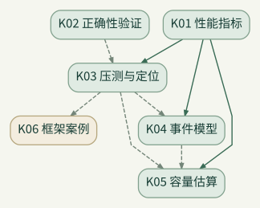

# 性能分析、建模与验证

执行得快与执行得对都需要证据。先明确观察边界与指标，再比较参考结果、测量关键路径、构造和校准模型。

## 贯穿算例与阅读边界

通用执行指标沿用 F02 的两组异步向量任务及 C05 的小矩阵候选方案。请求指标沿用 H01 的 A/B/C 固定批与连续批时间线；K04 再继承旧版请求 Trace 与可复算事件模型，明确不同构造时间线的边界。

K05 保留 Llama 3 70B 与 H100 的条件算例；固定版本走读 vLLM 与 SGLang 作为 K06 综合案例。K02 沿 B03/B06 的矩阵与 F03 的共享输出 Buffer 验证结构、数值和状态契约，再扩展至模型与请求状态。

K 横跨所有路线。K01/K02 可早期开展，K03–K05 按被分析的机制进入；K06 为综合深化案例。教学模型、条件估算与实测必须分开。

## 知识关系

<figure class="micro-v2-map" markdown="1">

<figcaption>图中实线表示本专题内的主要前置关系，虚线表示按场景参考；跨专题先修知识见下表。 点击可查看大图。</figcaption>
</figure>

## 阅读顺序 {#计划阅读顺序}

本专题规划 6 篇正文，其中 1 篇为深化或案例。未发布的条目为阅读计划，标题与范围可在编写时根据认知目标调整。

| 编号 | 文章（暂定标题） | 读完应理解什么 | 主要前置知识 | 状态 |
| --- | --- | --- | --- | --- |
| K01 | [怎样定义可以公平比较的延迟和吞吐量？](k01-performance-metrics.md) | 计时边界、利用率、TTFT、TPOT、ITL、Goodput、SLO、分位数及失败统计。 | 按测量对象补充机制知识 | 已发布 |
| K02 | [怎样验证编译优化和运行时实现仍然符合预期？](k02-correctness-and-validation.md) | IR Verifier、参考实现、差分测试、数值容差、状态不变量、故障注入、回归测试。 | 被验证的相关机制 | 已发布 |
| K03 | 系统变慢了，怎样找到真正的瓶颈？ | 压测、Microbenchmark、开环与闭环负载、暖机与稳态、Profiler、Trace、关键路径。 | K01、对应执行机制 | 未发布 |
| K04 | 知道请求何时到达，怎样预测它们何时完成？ | Trace、排队、事件模型、成本模型、模型校准、敏感性分析。 | K01、F 或 H；实测校准参考 K03 | 未发布 |
| K05 | 一套模型和设备配置究竟能够服务多少请求？ | 容量预算、计算及通信时间下界、吞吐估算、Goodput、灵敏度分析、实测闭环。 | K01、G04、H；按需 I、K03/K04 | 未发布 |
| K06 | 沿着同一个请求，怎样读懂 vLLM 和 SGLang 的源码执行路径？ | 固定版本源码走读、调度、设备调用、采样及状态更新的综合对照，不作无证据排名。 | G、H；按需 F、J、K03 | 未发布 |

## 从哪里来，接下来往哪读

可结合任何已掌握的机制直接进入相应分析文章。

模型计算原理参考[算法与模型](../../workload/README.md)。重构期间也可查阅[旧版推理运行时](../../inference-runtime/README.md)。

更多阅读路线见[编译器与运行时系统系列首页](../README.md)。
