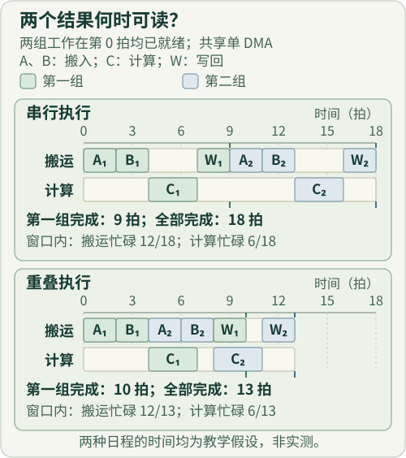
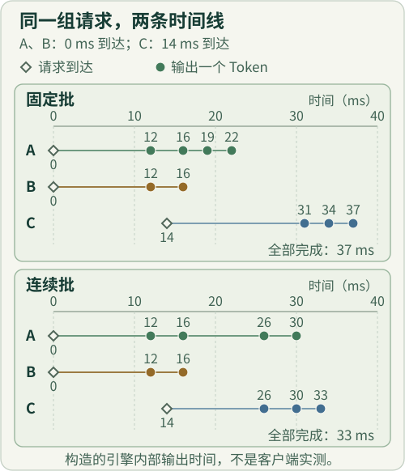

<!-- site-inference-math -->
# 怎样定义可以公平比较的延迟和吞吐量？

一次向量加法在第 9 拍完成。将两组向量的搬运和计算重叠后，第一组反而要到第 10 拍才能完成，但两组总共只需要 13 拍，而不是 18 拍。哪种执行方式更快？

**性能指标**把我们关心的执行现象转换成可比较的量。延迟描述一项工作等待了多久，吞吐量描述一段时间完成了多少工作，利用率描述特定资源的使用情况。

不同指标可能给出不同的答案。只有先明确计时起点、终点、工作量和统计对象，才能判断性能差异来自执行方式，还是来自测量口径。

本篇先沿用 [F02 的向量任务](../06-execution-runtime/f02-asynchronous-execution.md#overlap)，再将相同的观察方法用于 [H01 的三个生成请求](../08-request-scheduling/h01-continuous-batching.md)。

## 从哪一刻开始计时，到哪一刻结束？ {#measurement-boundary}

回顾 F02：每组向量加法需要搬入 A、搬入 B、计算 C、写回 W。假设结果在写回结束时便可被规定的消费者读取。三项搬运各需 2 拍，计算需 3 拍；两组数据独立，共享一个串行搬运引擎和一个独立的计算引擎。

假设两组工作在第 0 拍均已具备提交条件。从第 0 拍开始观察，不计主机提交和完成通知开销。下面比较逐组串行执行与 F02 的流水日程。

<figure markdown="1">

<figcaption>构造的设备时间线，横轴为拍；两组均在第 0 拍开始等待，结果写回完毕后才算该组完成。图中重叠不代表真实设备一定能达到这份日程。</figcaption>

</figure>

设一项工作的观察起点为 a、完成时刻为 c。二者的差是该观察边界下的**延迟（Latency）**：$L=c-a$。

若只测第二组的设备执行过程，起点可能是第一次搬入开始；若从两组同时准备完成的时刻计时，第二组的延迟还包含等待前一组工作占用资源的时间。两种计时回答的是不同的问题。

| 观察对象（从第 0 拍计） | 串行 | 流水 |
| --- | ---: | ---: |
| 第一组延迟 | 9 拍 | 10 拍 |
| 第二组延迟 | 18 拍 | 13 拍 |
| 两组均完成所需时间 | 18 拍 | 13 拍 |

为什么不能直接测一次设备 API 调用花了多少时间？在异步接口中，提交返回只说明主机完成了某个提交动作，不代表设备完成了计算，更不代表结果已经可供主机访问。

[F02](../06-execution-runtime/f02-asynchronous-execution.md) 区分了提交、依赖就绪、执行及完成，[E02](../05-device-driver/e02-device-memory-mapping.md#visibility) 则解释了结果可见性。根据要回答的问题，可以使用不同的观测边界：

| 想了解什么 | 起点 → 终点 |
| --- | --- |
| 编译耗时 | 开始编译指定输入 → 目标产物可用 |
| 主机提交延迟 | 调用提交接口 → 接口返回 |
| 设备执行时间 | 设备上的起始事件 → 相关设备工作完成事件 |
| 一次软件调用的响应时间 | 调用者发起工作 → 正确结果按接口约定可用 |

例如 CUDA 的设备 Event 可以在流到达相应位置时记录时间。用主机单调时钟测量异步工作完成时间，则需要等待所测工作的完成。计时前的遗留任务、跨流依赖和同步操作本身都可能改变被测区间。

隔离单个 Kernel 时，可以先清空相关在途工作，再提交、等待、记录时间。但测异步流水的整体吞吐时，不能在每项工作的末尾额外插入同步，破坏原本可以发生的重叠。

不同设备或主机的时间戳也不能直接相减，除非已经建立可靠的时钟对应关系。更具体的计时和 Trace 收集方法留给 K03。

[CUDA C++ Best Practices Guide 13.0：Timing](https://docs.nvidia.com/cuda/archive/13.0.0/cuda-c-best-practices-guide/index.html#timing)

## 一项工作延迟更长，为什么整个系统反而更快？ {#throughput}

若每组向量加法算一项工作，串行方案 18 拍完成两组，流水方案 13 拍完成两组。把完成的工作量除以同一观察窗口的长度，就得到**吞吐量（Throughput）**。

$$R=\frac{W_{\rm done}}{\Delta t}$$

这里 $W_{\rm done}$ 是在所选口径下完成的工作量。若 W 是向量任务组数，吞吐量分别为 2/18 和 2/13 组/拍。流水方案的吞吐量是串行的 18/13 倍，但第一组的延迟增加了 1 拍。

只有在一次处理一项、每项无间隙接续且观察边界一致等条件下，持续吞吐量才能简单地由单项服务时间取倒数。排队、组批或任务重叠都会改变这种关系。

如果把相同运算交给编译器优化，还可以用相同的测量语言比较方案。在 [C05](../03-mapping-and-planning/c05-cost-model-and-search.md) 中，X 为 2×4、W 为 4×2，两种合法方案都完成 16 次有效乘加（MAC）。

从第一列权重开始装入到两列结果均写回可读，原方案 A 需 16 拍，方案 D 需 12 拍。因此在构造模型内延迟减少 25%，等效有效乘加吞吐从 1 增至 4/3 MAC/拍，速度比为 16/12。

这两种方案的 X 都已驻留，权重也已经按规定布局排列。若只有新方案需要事先变换权重，比较一次完整调用的延迟时也要计入相应代价。比较长期重复执行时则应说明转换与编译成本是否只发生一次。

这里没有把实测吞吐混入代价模型，也没有把 C05 中违反容量约束的候选 E 当作有效结果。首先确认返回的结果和可观察行为符合约定，才有资格比较两种实现的速度；验证方法由 K02 讨论。

## 吞吐量提高，资源利用率也一定提高吗？ {#utilization}

仍以两组向量加法为例。两种方案完成的工作相同：搬运引擎共服务 6 项任务，每项 2 拍；计算引擎服务 2 项，每项 3 拍。

可以用某个资源有工作在执行的时长除以整个观察窗口长度，得到该资源的**忙碌时间利用率**。

$$U_{\rm busy}=\frac{T_{\rm busy}}{\Delta t}$$

| 资源 | 忙碌时长 | 串行（18 拍） | 流水（13 拍） |
| --- | ---: | ---: | ---: |
| 搬运引擎 | 12 拍 | 66.7% | 92.3% |
| 计算引擎 | 6 拍 | 33.3% | 46.2% |

两种资源的忙碌时间可以重叠，所以不能把流水中的两个百分比相加，当作一个设备的利用率。对于多个同类资源，可用所有成员的忙碌时间之和除以成员数量与观察时间的乘积，明确这是成员等权的忙碌比例。

忙碌只是一个口径。假如算术单元正在执行但每拍只完成少量有效运算，忙碌比例可能很高，单位时间完成的有效工作仍然很少。

### 另一种利用率：实际完成的工作离峰值有多远？

假设设备提供指定精度的峰值计算能力 $P_{\rm peak}$（FLOP/s）。如果根据模型计算定义估算出窗口内完成的模型工作量 F（FLOP），可定义模型算力利用率（Model FLOPs Utilization，MFU）：

$$\mathrm{MFU}=\frac{F/\Delta t}{P_{\rm peak}}$$

例如模型 FLOP 按指定精度的一次乘加计 2 FLOP，需要明确是否包括重复计算、Attention 等项。这里的分子是模型工作量的估算，不是硬件实际执行的全部指令计数，也不是计算单元忙碌的时间比例。

类似地，可以用估算的逻辑数据搬运量 Q（Byte）和指定接口峰值带宽 $B_{\rm peak}$（Byte/s）定义一种模型带宽利用率（Model Bandwidth Utilization，MBU）：

$$\mathrm{MBU}=\frac{Q/\Delta t}{B_{\rm peak}}$$

如果要报告实际 HBM 带宽，应使用能够观察对应接口的硬件计数器，明确读写统计边界、缓存和时间窗口。逻辑字节不是一定到达 HBM 的字节；[存储系统](../../storage/README.md) 已解释多个存储层次之间的差异。

低 MBU 可能来自计算、通信、等待、内核启动或批组成，不能直接认定访存实现有问题。一项优化若减少了不必要的物理流量，也可能让实测 HBM 带宽占峰值比例下降，却让执行变快。

[PaLM（JMLR 2023，附录 B）](https://www.jmlr.org/papers/volume24/22-1144/22-1144.pdf) 在训练场景中定义了 MFU；本文借用模型有效工作量与理论峰值的比值，不沿用其训练工作量估算。

标称峰值、可持续的资源服务能力和整条软件路径的完成速率是三个不同概念。[计算微架构 H01](../../microarchitecture-v2/08-performance/h01-task-time-and-bottlenecks.md) 已解释资源服务时间下界为什么不是实际完成时间。

## 对于不断生成文本的请求，什么才算完成？ {#token-latency}

向量任务通常在结果完整可用时结束。语言模型不同：根据 [G02](../07-model-execution/g02-prefill-and-decode.md)，请求在 Prefill 后得到首个输出，随后逐步生成更多 Token。用户不必等全部结果生成完才开始阅读。

如果只测最后一个输出的时间，就可能忽视用户等待第一个词的时间，以及生成过程中是否出现长时间停顿。于是需要在每次有效输出时留下时间戳。

假设客户端使用同一个单调时钟，t₀ 为发出请求的时刻，$t_1,\ldots,t_N$ 为依次观察到 N 个有效输出 Token 的时刻。下面先假设可以确切观测每个 Token 的到达，不把空响应头当作首 Token。

| 指标 | 本文定义 | 回答的问题 |
| --- | --- | --- |
| TTFT（Time To First Token） | $t_1-t_0$ | 等多久才见到第一个输出？ |
| ITL（Inter-Token Latency） | $t_j-t_{j-1}$，j=2,…,N | 相邻输出之间停顿多久？ |
| TPOT（Time Per Output Token） | $(t_N-t_1)/(N-1)$，N>1 | 首个输出之后，每个新增输出平均耗时多久？ |
| E2E（End-to-End Latency） | $t_N-t_0$ | 从发出请求到最后一个输出等待多久？ |

为什么 TPOT 除以 N−1？收到第一 Token 后，只剩 N−1 个相邻间隔。把这些间隔依次相加，恰好等于最后一个 Token 与第一个 Token 的时间差。因此，当 N>1 时：

$$\mathrm{E2E}=\mathrm{TTFT}+\sum_{j=2}^{N}\mathrm{ITL}_j
=\mathrm{TTFT}+(N-1)\mathrm{TPOT}$$

这里 E2E 以最后一个有效 Token 为终点；若客户端还需等待结束标记或处理完整响应，可以另外报告到协议结束的延迟。输出只有一个 Token 时，没有任何 ITL，TPOT 不适用，不能填 0 去参与平均；零输出时也没有首 Token 延迟可供测量。

例如旧版的客户端构造例，在请求发出后的 100、120、160 ms 收到三个 Token。TTFT 为 100 ms，ITL 为 20、40 ms，TPOT 为 30 ms，E2E 为 160 ms。只看 TPOT 便看不到后一个较慢的间隔。

### 引擎产生 Token 与客户端收到它，是同一个时刻吗？

不是。[G03](../07-model-execution/g03-sampling-and-generation.md) 已区分采样结果、正式提交的 Token、解码后的文本与交付给用户的输出。服务端可记录正式生成时刻，客户端则可记录收到输出的时刻。入口处理、网络、排队、缓冲等都会影响计时。[J01](../10-serving/j01-request-routing.md) 解释了入口、路由和引擎准入之间的边界。

一些流式接口一次交付一个包含多个 Token 的片段，也可能因停止条件或文本解码而暂缓显示。只有片段（Chunk）的到达时刻，就应报告片段间隔或明示归一化的近似值，不能反推出片段内每个 Token 的真实到达时间。

工具术语也不完全统一。例如 vLLM v0.10.2 的 benchmark 将请求级 TPOT 与 ITL 样本分别统计；NVIDIA AIPerf v0.12.0 的 ITL 指标则是请求级的平均间隔。比较数据前应检查工具版本、起止事件及样本定义，不仅对齐指标名字。

具体而言，vLLM v0.10.2 的 OpenAI 流式测试记录的是响应片段到达间隔；单输出请求的 Goodput 判定还采用 TPOT=0 的工具约定。这不是本文的 TPOT 定义。

[vLLM v0.10.2：calculate_metrics](https://docs.vllm.ai/en/v0.10.2/api/vllm/benchmarks/serve.html#vllm.benchmarks.serve.calculate_metrics) · [NVIDIA AIPerf：Metrics Reference](https://docs.nvidia.com/aiperf/v0.12.0/reference/ai-perf-metrics-reference)

## 沿用同一批请求，计算两种组批方式的指标 {#request-example}

回到 H01 的 A、B、C。A 和 B 在 0 ms 到达，C 在 14 ms 到达。输入分别为 8、3、6 个 Token，三者实际输出 4、2、3 个 Token。这里不使用提前停止、前缀复用、分块 Prefill 或投机解码。

假设每轮末正式生成的输出立刻在引擎内可观察，忽略分词、传输及文本缓冲；最后一个 Token 也表示请求成功完成。沿用 H01 的构造轮次耗时，不将此图当作任何真实框架的测量结果。

<figure markdown="1">

<figcaption>同一请求集合与同一引擎内部观察边界。每个输出点表示一个正式生成的 Token，横轴为 ms；C 虽然较晚到达，但在连续批中较早开始输出。具体执行轮次见 H01。</figcaption>

</figure>

| 组批方式 | 请求 | 输出时刻（ms） | TTFT（ms） | ITL（ms） | TPOT（ms） | E2E（ms） |
| --- | --- | --- | ---: | --- | ---: | ---: |
| 固定批 | A | 12, 16, 19, 22 | 12 | 4, 3, 3 | 10/3 | 22 |
| 固定批 | B | 12, 16 | 12 | 4 | 4 | 16 |
| 固定批 | C | 31, 34, 37 | 17 | 3, 3 | 3 | 23 |
| 连续批 | A | 12, 16, 26, 30 | 12 | 4, 10, 4 | 6 | 30 |
| 连续批 | B | 12, 16 | 12 | 4 | 4 | 16 |
| 连续批 | C | 26, 30, 33 | 12 | 4, 3 | 3.5 | 19 |

例如连续批中的 C 在 t=14 ms 到达，到 t=26 ms 才生成首 Token，所以 TTFT 为 12 ms，不是 26 ms。A 却因混合轮的耗时增加，将第二到第三个输出的 ITL 从 3 ms 延长到 10 ms。

### 每条请求的延迟与整体吞吐怎样联系？

在两个方案中，分别取从最早到达 t=0 到所有请求完成（包括最后一个输出事件）的完整观察窗口。三条请求都成功结束，输入一共 17 个、输出一共 9 个 Token。统计结果为：

| 指标及工作量 | 固定批（0.037 s） | 连续批（0.033 s） |
| --- | ---: | ---: |
| 完成请求吞吐：3 个请求 | 81.08 请求/s | 90.91 请求/s |
| 输出吞吐：9 个 Token | 243.24 Token/s | 272.73 Token/s |
| 输入及输出总吞吐：26 个 Token | 702.70 Token/s | 787.88 Token/s |

三种指标都有合理用途，但不能混称为 TPS。总 Token 吞吐按逻辑输入和交付的输出计数，并不等于模型实际计算了多少位置；最后一个输出不必计算进下一轮，复用与重算也会改变实际工作量。

H01 中两种方案的序列槽位迭代占用比例是 9/14 与 9/10，衡量的是组批机会，不是按时间统计的硬件忙碌比例。不同轮耗时和每个槽中的工作不同，不能直接从槽位占用率推算 Token 吞吐。

如果在持续服务中只观察一个固定时间段，窗口开始时可能已有在途请求，结束时也可能仍有请求等待。请求吞吐可以按照成功完成事件归属窗口；输出吞吐可以按实际输出事件归属。

也可以对按完成时刻归入窗口的请求统计其全部输入和输出，但这样会计入窗口之外发生的 Token 事件。两种 Token 统计回答不同的问题，不能混在同一个比较中。本例覆盖完整过程，因此二者相同。

## 怎样统计一群请求的延迟？ {#latency-distribution}

如果系统处理的是连续批，三条请求的 TPOT 分别为 6、4、3.5 ms。先对每条请求计算 TPOT，再对三条请求等权求平均，得到 (6+4+3.5)/3=4.5 ms。

若把全部六个 ITL 样本（4、10、4、4、4、3 ms）一起平均，则得到 29/6≈4.83 ms。A 输出更多，占三个间隔；B 只有一个间隔，因此在后一种统计中 A 的影响更大。

两种统计都可以有意义。前者让每条有 TPOT 的请求具有同等权重，后者让每个相邻输出间隔具有同等权重。对于固定批，这两个均值分别约为 3.44 ms 和 3.33 ms，也不能混用。

### 平均值能说明最慢的用户体验吗？

要观察较慢的部分，可以把同一类延迟样本从小到大排序，使用**分位数（Percentile）**描述延迟分布。本文使用最近秩法：设 n 个有效样本依次为 $x_{(1)},\ldots,x_{(n)}$，p 为 0 到 1 之间的比例（不含 0）。

$$Q_p=x_{(\lceil pn\rceil)}$$

它选择排序后至少覆盖 p 比例样本的最小观测值。例如 1,000 个 ITL 样本中 999 个为 25 ms、一个为 570 ms，则 p99 是第 990 个值，即 25 ms，而不是 570 ms。这个构造例保留自旧版；单个异常停顿不能直接称为 p99。

中位数（p50）描述分布中间，p95 或 p99 常用于观察尾部。不要用三个请求宣称获得稳定的 p99，也不要对每个批次的 p99 再取平均来代表整个请求集合的 p99。

分位数还可以按其他插值方式估计。报告时说明方法、样本量、窗口、请求与间隔的样本类型，以及失败、超时、取消或无输出的数量。有观测到延迟的成功请求的分布，不代表所有发出的请求。

[NIST Engineering Statistics Handbook：Percentiles](https://www.itl.nist.gov/div898/handbook/prc/section2/prc262.htm)

## 吞吐量更高，就表示更多用户获得了满意的结果吗？ {#goodput-and-slo}

假设一个应用希望请求既能够快速给出首 Token，也能够持续生成。可以先给单个请求设定判定条件：成功结束、TTFT ≤ 17 ms 且 TPOT ≤ 4 ms。这个阈值是教学假设，只针对本例三个多输出请求。

实际服务还可以规定 E2E 或最长 ITL，约定单 Token 请求不考核 TPOT、还是采取其他判定方式。未成功完成的请求不会因为缺少延迟样本就自动视为达标。

**SLO（Service Level Objective，服务级目标）**描述在规定的观测条件下，希望达到的服务水平。例如要求一段时间内至少 99% 的请求同时满足给定的延迟与成功条件。单条请求阈值是判定规则，99% 则是总体目标。

衡量服务是否达到目标的量化指标称为 SLI（Service Level Indicator）。

假设观察窗口内纳入统计的请求集合有 M 项。令满足全部条件的请求 i 对应 $I_i=1$，否则为 0。按完成事件统计时，本例窗口中的三项请求都已经结束。

$$A_{\rm SLO}=\frac{\sum_i I_i}{M}$$

达标比例描述接受评估的请求中有多少符合要求。**Goodput（有效吞吐量）**进一步把达标的工作量除以窗口长度。例如：

$$G_{\rm req}=\frac{\sum_i I_i}{\Delta t},\qquad
G_{\rm tok}=\frac{\sum_i I_iN_i}{\Delta t}$$

其中 $N_i$ 是该请求的实际输出 Token 数；前者以达标请求数计，后者以这些请求的全部输出 Token 数计。需要统一工作单位及归属窗口，尤其不能把部分达标或未成功请求的 Token 算入这里的 Goodput。

| 指标（TTFT≤17 ms 且 TPOT≤4 ms） | 固定批 | 连续批 |
| --- | ---: | ---: |
| 达标请求 | A、B、C | B、C |
| 联合达标比例 | 3/3=100% | 2/3≈66.7% |
| 请求 Goodput（请求/s） | 3/0.037≈81.08 | 2/0.033≈60.61 |
| 输出 Token Goodput（Token/s） | 9/0.037≈243.24 | 5/0.033≈151.52 |

连续批缩短了整体完成时间，但在这个判定规则下，A 的生成速度不符合要求。整体吞吐变高，不等于达标请求吞吐变高。

如果改用 TTFT≤15 ms、TPOT≤5 ms，固定批为 A、B 达标（6 个输出），连续批为 B、C 达标（5 个输出），二者达标比例均为 2/3。

请求 Goodput 约 54.05 增至 60.61 请求/s，但 Token Goodput 约 162.16 降至 151.52 Token/s。

这是因为后一种统计赋予长输出请求更多权重。优化目标应根据应用需求选择，而不是找到一个数字后就将它当成系统性能的总分。

### 两项指标各自达标，联合达标比例是多少？

假设同一集合中的 100 个请求全部可以观测 TTFT、TPOT，各有 99 个满足相应阈值。如果两项指标分别由不同的一条请求超限，只有 98 条同时达标；若是同一条超限，则有 99 条同时达标。

不应把两个比例直接相乘作为实测联合达标率，因为排队、共享资源、长 Prefill 与 Decode 的相互影响都可能使两类延迟相关。即使两个阶段分离部署，到达过程、KV 交接和资源配比仍可能造成耦合。

实际压测也不能只对成功请求统计 SLO 达标率。需要规定统计群体，例如所有发出的请求在停止测试后继续等待至结束或超时，失败、拒绝或超时计入分母，取消依据事先约定的服务目标处理，未决请求单独记录。

DistServe 原论文使用满足总体 SLO 达标目标的最大可服务请求率，并按 GPU 数量归一化评价 goodput。本篇计算的是指定小样本窗口内实测或构造事件的达标完成速率；还不能据此推断满足 SLO 的最大持续服务能力。K05 将继续讨论后者。

[DistServe（OSDI 2024）](https://www.usenix.org/system/files/osdi24-zhong-yinmin.pdf) · [Google SRE Book：Service Level Objectives](https://sre.google/sre-book/service-level-objectives/)

## 开始比较之前，应当记录什么？ {#comparison-contract}

从向量加法到模型服务，计算指标的原则相同：先规定完成的是何种正确工作，以及该工作的计时与统计边界，再观察延迟、速率和资源状态。

| 需要记录的条件 | 例子 |
| --- | --- |
| 工作语义及单位 | 同一矩阵、数值约束；同一模型、Tokenizer、输入和输出计数规则 |
| 执行方案及资源 | 编译器版本、优化配置、设备数量、精度、模型实例数及缓存状态 |
| 计时边界和时钟 | 编译/执行/整次调用、引擎或客户端、设备事件或主机时钟 |
| 负载条件 | 输入形状、到达顺序、请求长度及并发；是否包含初始化与预热 |
| 统计规则 | 时间窗口、完成或输出事件归属、样本及失败数、分位数估计方法、联合达标条件 |

不同实验可以有不同目标，但若用不同的工作单位、计时边界或负载作比较，就要说明所得结论的适用范围。小样本的短暂吞吐增长也不能直接推断长期可持续吞吐。

本文的构造数字可以通过仓库中的 [K01 复算测试](https://github.com/microarch-flow/wiki/blob/main/website/tests/test_compiler_runtime_k01.py) 核查；旧版的延迟、联合达标与分位数例也保留在[原公式复算程序](https://github.com/microarch-flow/wiki/blob/main/series/inference-runtime/examples/verify_examples.py) 中。

复算验证算术一致性，不代表测量了真实设备。

## 接下来怎么读

本篇回答怎样定义和比较性能。即使一个方案更快，也需要确认它遵守原程序和运行时接口的语义；K02 将建立正确性验证方法。K03 则从本篇的测量契约出发，讨论怎样通过压测、微基准和 Trace 定位耗时所在。

- [C05：许多方案都能正确执行，怎样找到更好的一个？](../03-mapping-and-planning/c05-cost-model-and-search.md)：代价估计与方案选择。
- [计算微架构 H01：执行单元增加一倍，为什么任务不一定提前一半结束？](../../microarchitecture-v2/08-performance/h01-task-time-and-bottlenecks.md)：资源服务能力与时间下界。
- [H01：同一批请求长短不一，新请求能不能立即加入？](../08-request-scheduling/h01-continuous-batching.md)：本文请求时间线的来源。
- [旧版：延迟、吞吐与 SLO：先确定测量边界](../../inference-runtime/01-request-and-metrics/02-metrics-slo.md)：原指标定义和统计例。
- [性能分析、建模与验证专题导读](README.md)：完整阅读顺序。
