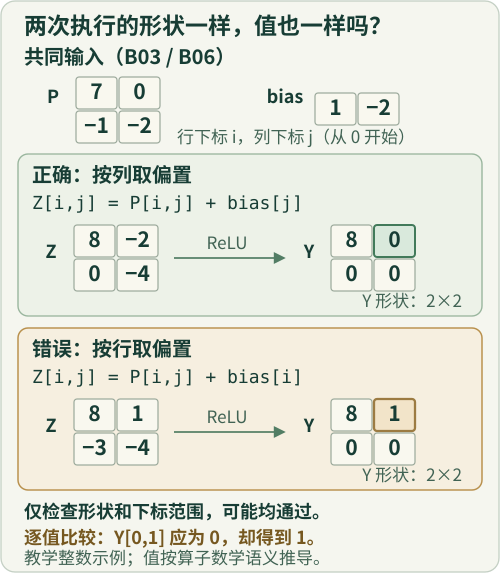
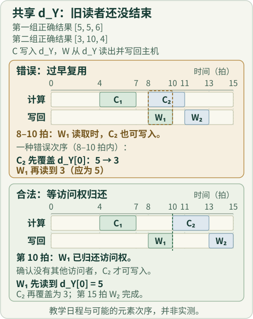

<!-- site-inference-math -->
# 怎样验证编译优化和运行时实现仍然符合预期？

在 K01 中，我们比较了不同编译方案的执行时间，也看到了异步执行可以提高整组任务的吞吐量。但如果为了减少一次中间写回而融合两个算子，或者为了节省内存而让两个任务复用同一块 Buffer，怎样知道最终交出的结果还是正确的？

**正确性验证**要做的是根据程序、设备接口及服务约定，建立可以检查的预期，再用不同层次的证据判断实现是否满足预期。检查 IR 的结构、比较计算结果、检查任务状态及验证异常路径，回答的是不同的问题。

本篇沿用 [B06 的小矩阵计算](../02-frontend-and-optimization/b06-legal-transformation.md) 与 [F03 的两组向量加法](../06-execution-runtime/f03-runtime-buffer-management.md)，最后将相同方法用于模型生成与请求调度。先验证完成的是正确工作，才有意义比较 [K01 的性能指标](k01-performance-metrics.md)。

## 一份 IR 能够被编译，是否说明优化是正确的？ {#ir-verification}

回到 [B03](../02-frontend-and-optimization/b03-graph-capture.md#operator-graph) 的小模型：X 与 W 相乘得到 P，加偏置得到 Z，再通过 ReLU 得到 Y。仍采用其二维 float32 输入，偏置沿列广播。具体值如下，所有这次计算中的小整数均可精确表示。

$$X=\begin{bmatrix}1&2\\-1&0\end{bmatrix},\quad W=\begin{bmatrix}1&2\\3&-1\end{bmatrix},\quad b=[1,-2]$$

$$P=XW=\begin{bmatrix}7&0\\-1&-2\end{bmatrix}$$

原图先产生 Z，再逐元素计算 Y。假设只要求返回 Y，可以将 Add 和 ReLU 融合成一项计算。正确的融合仍须使用每个输出列对应的偏置：$Y[i,j]=\max(0,P[i,j]+b[j])$。

现在假设编译器在重写中把 b[j] 写成了 b[i]。由于 M=N=2，两种索引都在范围内，乘法、加法、ReLU 的数据类型也没有改变，输出仍是一个 2×2 矩阵。

<figure markdown="1">

<figcaption>沿用 B06 的索引错误。形状相同不代表数值相同；错误路径是教学用的错误改写，并非某个编译器发生过的实际故障。</figcaption>

</figure>

编译器需要先检查自己的表示有无破坏。比如矩阵乘法的归约维是否匹配、操作使用的值是否已定义、返回值的类型是否符合接口。这类检查通常由 **IR Verifier** 承担。

例如 LLVM 的 Verifier 检查 IR 是否良构，包括 SSA 中定义与使用的约束。MLIR 可以针对不同 Dialect，检查操作的结构、操作数与结果、类型和属性，以及特定操作的约束。

如果 IR 违反了能够在编译期检查的这些约定，应该在相应编译阶段报告错误，而不是继续生成可能无法解释的目标代码。但是，上面两个形状正确的图可以同时满足这些结构约束。Verifier 不必知道这个偏置索引是从哪一份旧图改写来的。

| 需要回答的问题 | 可以取得什么证据？ |
| --- | --- |
| 当前 IR 自身是不是合法表示？ | Verifier 检查结构、类型、形状、定义与使用等约束 |
| 从原 IR 到新 IR 的替换是否合法？ | B04–B06 的依赖、别名、数值语义及变换条件；在适用范围内的语义论证 |
| 某次变换和最终实现是否确实按约定工作？ | 对照计算、测试具体输入和状态；在支持范围内检查变换语义 |

编译器可以在多个 Pass 边界运行结构检查，尽早发现哪一步破坏了 IR。即使每一步都产生合法 IR，也还需要独立的语义证据。

[LLVM Language Reference：Well-Formedness](https://releases.llvm.org/20.1.0/docs/LangRef.html#well-formedness) · [MLIR：Verification Ordering](https://mlir.llvm.org/docs/DefiningDialects/Operations/#verification-ordering) · [B06：变换合法性](../02-frontend-and-optimization/b06-legal-transformation.md)

## 如果有两份实现，怎样确定哪一份结果符合预期？ {#reference-and-differential}

在这个小模型中，可以用最直接的方式计算预期结果：先对每个 i、j 逐项求矩阵点积，得到完整的 P；再按列加偏置保存 Z；最后逐格计算 Y。

这类实现称为**参考实现（Reference Implementation）**。它不一定快，但应尽量简单、易于检查，且独立于想验证的优化路径。小算例还能直接用数学计算逐项核对参考实现。

在 B03 的输入下，参考实现得到 Z=[[8,−2],[0,−4]]，Y=[[8,0],[0,0]]。错误的融合则得到 Y=[[8,1],[0,0]]。只需比较同一输入下的四个输出元素，便可以发现第一行第二列的错误。

把同一合法输入交给参考实现与待测实现，比较它们的可观察结果，这是一种**差分测试（Differential Testing）**。也可比较关闭与启用某项优化后的程序，或比较两种后端的实现。

差分测试首先说明两份实现不一致，不能自动判定哪一份错误。若二者复制了同一个索引错误，还可能同时给出相同的错误结果。因此参考路径最好不依赖待验证的布局转换、索引生成或优化 Kernel。

### 多测几组输入，是否就能证明变换合法？

假设此前只使用偏置 [1,1] 进行比较。按行和按列取到的偏置相同，错误实现可能通过全部输出比较。更有针对性的输入才会暴露差异。

| 仍是同一小模型 | 希望观察什么？ |
| --- | --- |
| b=[1,1] | 一个可能掩盖索引错误的对照 |
| b=[1,−2] | 不同列必须取到不同偏置；Y[0,1] 应为 0 |
| X 增加第三行 [0,0] | 正确结果增加 [1,0]；错误按行索引会越界 |
| 交换 X 的两行 | 在本例无跨行依赖时，Y 也应只交换对应两行 |
| X、W 归约维不匹配 | 依接口拒绝该输入，而不是安静地返回另一份结果 |

这些输入应与实际接口的适用条件一致。例如 B03 的形状专门化版本只支持已声明的范围，就需要分别验证范围内的结果、边界和范围外的拒绝或回退；不能把超出合法范围的计算结果当作变换错误证据。

交换输入行的例子不需要事先手算所有输出，只需要知道新旧调用之间必须保持某种关系。这是一种属性测试或变形测试的思路。测试还可以遍历边界、Tile 尾部、步长、非连续布局和随机输入，以覆盖不同的执行路径。

[D07](../04-code-generation/d07-attention-kernels.md) 的变长 Attention 还需要短/长 Query、KV、不同批量、头布局和数据类型的测试；逐位置核查矩形因果掩码、有效历史与填充边界，再比较数值。这些是算子自身的契约，不能只检查输出形状。

但输出相同并不总是程序等价。比如 B06 中函数同时返回 Y 和 Z，ReLU 后的 0 不能代替 Z 原有的 −2。对于 [A01 的 history](../01-foundations/a01-program-semantics.md) 或 [B04 的别名依赖](../02-frontend-and-optimization/b04-dependency-and-alias-analysis.md)，还要比较规定的状态变化、输入是否被修改及其他可观察效果。

对于确定性程序，在双方具有明确语义且输入契约一致时，一组反例足以推翻等价结论。有限样例全部通过，只说明已观察的情况符合预期，并不能证明对所有输入都成立。

这也是 Csmith（PLDI 2011）生成随机 C 程序并进行差分测试时刻意避免未定义行为及影响输出确定性的未指定行为的原因：只有双方应有相容的可观察语义，输出差异才有明确的解释空间。

还有一种不同层次的证据。例如 Alive2 用 SMT 求解器检查一对 LLVM IR 函数是否保持规定的语义关系。它针对具体变换作有界翻译验证，循环展开、支持的操作和资源上限等都会限制其覆盖范围；超时或未找到反例不能视为一般性证明。

[Csmith（PLDI 2011）](https://www.flux.utah.edu/paper/yang-pldi11/) · [Alive2（PLDI 2021）](https://web.ist.utl.pt/nuno.lopes/pubs/alive2-pldi21.pdf)

## 对于浮点结果，一点数值差异算不算错误？ {#numeric-tolerance}

回顾 [B06](../02-frontend-and-optimization/b06-legal-transformation.md#numeric-semantics)，约定每次 FP32 加法按最近偶数舍入。相同的三个数 A=2²⁴、1、−A，先算前两项得到最终结果 0，先算后两项则得到 1。

若原程序明确规定原来的加法及舍入顺序，换一种顺序得到 1 就不满足这个契约。不能因为最终差异可以被某种容差接受，就倒过来认为编译器获得了随意改变数值语义的许可。

但是，如果算子或应用的契约允许在规定误差内近似实现，我们就需要事先选择可以检查的数值条件。对于有限实数，设参考值为 r、待测值为 x。一种常用的逐元素比较方式是：

$$|x-r|\leq \mathrm{atol}+\mathrm{rtol}\cdot |r|$$

atol 是绝对误差容限，与 x、r 具有相同单位；rtol 是相对容限，无量纲。之所以同时使用二者，是因为参考值较大时允许的绝对偏差可以随数值规模变化，而参考值接近 0 时仍需要有明确的绝对误差边界。

沿用 [D08 的 W4A16 内核](../04-code-generation/d08-low-precision-kernels.md#weight-only-kernel)，第 0 行、第 0 列的参考输出是 3.875。若此接口允许近似，假设预先设定 atol=rtol=0.001，则容许误差是 0.004875。

| 教学参考值 r | 假设得到 x | 绝对误差 | 容许误差 | 判定 |
| ---: | ---: | ---: | ---: | --- |
| 3.875 | 3.876 | 0.001 | 0.004875 | 通过 |
| 3.875 | 3.900 | 0.025 | 0.004875 | 不通过 |
| 0 | 0.0005 | 0.0005 | 0.001 | 通过 |

这只是容差计算的构造例，不是 D08 的实测误差，也不推荐将这一阈值用于所有模型。真实容差需要考虑类型、计算规模、算法精度和消费者对结果的要求；不能在看完待测结果后不断放宽阈值直到测试通过。

对于张量，需要同时核对形状、类型、必要的布局与值。逐元素误差是否达标，以及最大误差、误差分布，有助于发现少数损坏元素。只比较平均误差可能漏掉局部的大错误。

NaN、正负无穷等非有限值需要单独约定。比如 PyTorch 2.8 的 assert_close 默认不把 NaN 与 NaN 视为接近；同号无穷可通过相应比较。若程序要求保留有符号零或特定位模式，需另外验证这些属性。

[PyTorch 2.8：torch.testing.assert_close](https://docs.pytorch.org/docs/2.8/testing.html#torch.testing.assert_close) · [Numerical Accuracy](https://docs.pytorch.org/docs/2.8/notes/numerical_accuracy.html) · [计算微架构：浮点运算与低精度](../../microarchitecture-v2/01-foundations/a04-floating-point-and-low-precision.md)

### 如果主动降低模型精度，应该与哪个结果比较？

D08 中采用 INT4：尺度 s=0.25、零点 z=0，较高精度的原值 0.76 被量化成编码 3，反量化得到 0.75；原值 2 因编码饱和到 7，反量化得到 1.75。二者有损，但只要符合规定的 Q/DQ 规则，就未必是内核实现错误。

因此应区分两次比较。用已确定的量化编码、Scale、零点等按规定的数值语义构建参考实现，比较目标内核，检查它有没有正确解码和计算。再以原精度模型为基线，比较量化之后模型的目标任务质量。

例如 D08 中两个整数点积为 11、10，相应乘积尺度为 0.125、0.25，正确结果是 3.875。若把两段相加后只使用第一组的尺度，得到 2.625。这里出错的是实现，即使量化本身已获允许。

第一项检验的是低精度执行是否符合契约；第二项检验的是选择近似方案所付出的质量代价。即便低精度内核与其参考实现完全一致，模型效果仍可能不满足应用要求。

在质量评测时固定模型修订、Tokenizer、量化产物、生成配置和测试输入，分别观察长上下文、结构化输出等任务相关子集。同时记录加载后及峰值内存、冷/热状态性能、失败率和回退路径，才能将质量与资源、速度收益联系起来。

[旧版：量化质量与性能的成对验证](../../inference-runtime/03-kernels-and-precision/10-quantization.md#质量与性能要成对验证) · [D08：低精度内核](../04-code-generation/d08-low-precision-kernels.md)

## 算出的数据正确，为什么最终读出的结果仍然可能错误？ {#runtime-invariants}

前面的例子检查一项计算本身是否符合语义。但 [F03](../06-execution-runtime/f03-runtime-buffer-management.md#reuse-conflict) 中，两组向量加法的计算都可能正确，数据却因为过早复用而交给了错误的消费者。

回忆这两组数据：第一组结果是 [5,5,6]，第二组结果是 [3,10,4]。每组各有 12 B 输出，我们只准备一块设备输出 d_Y。第一组 C₁ 在第 4–7 拍计算，W₁ 在第 8–10 拍读取 d_Y 并写回主机。

若第二组 C₂ 仍在第 8 拍开始，它可能在 W₁ 尚未读出第一个元素时把 5 覆盖成 3。即使两个加法的算术完全正确，第一组主机结果的第一个元素仍可能变成 3。

<figure markdown="1">

<figcaption>沿用 F03 的教学日程；图中的覆盖、读取先后只是一种可能的内部访问顺序。重叠不必然产生某个固定错误值，但缺少访问依赖时不能保证原数据正确。</figcaption>

</figure>

仅比较 C₁ 单独运行的输出，无法发现这种错误。它由两项工作的访问次序及同一资源的使用期限共同决定。我们需要增加一种检查：不论调度次序怎样变化，只要系统正常运行，都必须满足哪些条件？

这类始终需要保持的条件称为**不变量（Invariant）**。在本例中，若使用同一输出区域，旧数据最后一次读访问结束之前，新计算不能覆盖该区域。

例如在运行时的状态记录中关联 Buffer 分配标识、任务及计划标识、生产者和消费者引用、访问结束事件。每次准备归还、复用 Buffer 时检查这些引用是否已经按接口安全结束。

| 观察的状态变化 | 需要检查的条件 |
| --- | --- |
| C₁ 开始实际读取输入 | 本次 L_A 与 L_B 的正确输出均已对 C₁ 可见 |
| W₁ 读取 d_Y | 第一组正确结果已对 W₁ 可见 |
| C₂ 开始覆盖共享 d_Y | W₁ 及其他使用旧分配的访问者已结束相应访问 |
| 返回第一组结果 | 本次 W₁ 成功，且结果已按接口交接给主机 |
| 归还分配 | 旧的任务与引用已收束，不会再次访问该分配 |

断言应检查被接口真正保证的事件，而不是只看一个名字叫 done 的标记。例如已提交的任务可以在尚未就绪时等待依赖，但实际读写不能提前发生。[E04](../05-device-driver/e04-completion-and-error-handling.md) 也区分了 CQE、任务成功与主机结果可见。

对于上述构造模型，只要要求 W₁ 的访问结束在第 10 拍，就能发现第 8 拍启动 C₂ 的重用安排不合法。在第 10 拍 W₁ 已安全归还后开始 C₂，于第 13 拍计算结束，再于第 15 拍完成 W₂，是 F03 中可验证的一种合法日程。

### 怎样让偶尔出现的错误变成可重复的测试？

如果只在真实机器上反复跑两组加法，访问冲突未必每次都发生。可以用可控制的教学执行器、模拟后端或测试钩子，明确安排 W₁ 仍持有旧数据的状态，然后尝试启动 C₂。

测试预期是复用被推迟，或者选择另一个可用分配。再允许 W₁ 完成并解除引用，检查 C₂ 能取得可用存储、两组主机结果分别正确。如果先人为令 C₂ 覆盖第一格再让 W₁ 读取，则独立参考比较应发现 3 与 5 不一致。

真实设备还可以采用专门的动态检查工具。例如 CUDA Compute Sanitizer 12.9 提供越界访问、未初始化全局内存访问、共享内存访问冲突和同步原语误用等不同类别的检查。但这些工具只覆盖各自支持的事件及实际执行路径，不代替软件层的引用、请求状态与跨流依赖验证。

[F03：资源依赖](../06-execution-runtime/f03-runtime-buffer-management.md#resource-dependency) · [CUDA Compute Sanitizer 12.9](https://docs.nvidia.com/cuda/archive/12.9.0/compute-sanitizer/index.html)

## 如果一项工作失败了，怎样验证清理过程也正确？ {#fault-injection}

正常路径中的不变量只覆盖成功执行时的状态变化。回到 E04，如果 L_B 搬运失败，C₁ 不能把尚未成功交接的 d_B 当作本次输入；也不能把 W₁ 标记成成功交付第一组结果。

我们需要观察错误如何传播、在途工作怎样收束、什么时候才允许回收资源。[A05](../01-foundations/a05-task-and-resource-lifecycle.md#failure-and-cancellation) 已明确区分失败、取消与访问终止；报告失败不能直接证明所有旧访问都已结束。

**故障注入（Fault Injection）**是在可控制的实验或测试环境中，主动让指定操作失败、延迟或进入某种事件交错，以检查系统是否仍然履行接口约定。本例可以通过模拟提交、通知和资源分配控制事件，而不需要让真实设备损坏。

| 在哪一刻注入事件？ | 希望观察到什么？ |
| --- | --- |
| L_B 报告失败 | C/W 不会沿成功依赖路径消费无效输入；向调用者报告明确错误 |
| W₁ 未停止访问，等待者超时 | 不把超时当成可安全复用 d_Y 的事件 |
| 完成通知延迟或重复 | 任务身份保持正确；同一生命周期不会重复归还资源 |
| 新分配失败 | 没有错误的地址交付，已经取得的部分资源按契约清理 |
| 旧工作确认停止访问 | 检查所需交接、其他引用和相关软件处理，再允许回收 |

重试也需要验证。若失败前已发生部分写入或其他可观察效果，重放命令可能重复这些效果；只有已知的接口语义允许时，才安全重试。恢复后的新任务及其完成记录也需要与旧工作区分。

实际工具接口中也有这种区别，例如 Linux DMA Engine 的异步终止调用可以在传输和回调尚未完全收束时返回，还需按规范确认终止完成。测试应以接口保证为依据，而不是以固定等待若干毫秒判断资源已安全。

[Linux DMA Engine API：Further APIs](https://docs.kernel.org/driver-api/dmaengine/client.html#further-apis) · [E04：设备复位与恢复](../05-device-driver/e04-completion-and-error-handling.md#reset-and-recovery)

## 怎样把这些检查扩展到生成请求？ {#request-validation}

一个生成请求可以安排很多次前向计算、保存模型状态并持续提交输出。测试除了核对单次计算，还要在请求推进和资源变化过程中验证状态之间的关系。

继续沿用 H01 中的 A、B、C。A 有 8 个输入，恰好产生 4 个输出。根据 [G02](../07-model-execution/g02-prefill-and-decode.md)，普通自回归生成、无缓存命中和提前结束时，Prefill 完成后 A 已有 1 个正式输出，8 个有效 KV 位置；最后得到 4 个输出和 11 个有效 KV 位置。

因此，记录请求已知 Token 数、正式输出数、已经计算的位置和可用 KV 引用，不能只看一个含糊的“Token 进度”。同样也不能把每轮安排的计算位置直接记为已经完成的有效位置。

| 要验证的执行性质 | 一种可复现的检查 |
| --- | --- |
| 调度尊重到达及依赖 | C 未到达前不实际执行；普通 Prefill 未处理完成前不提交首输出 |
| 本轮工作与资源约束一致 | 新位置数不超过本轮预算，新增 KV 与临时空间满足容量条件 |
| 正式输出与历史对应 | 输出关联正确请求和执行计划，不重复提交已完成的 Token |
| KV 有效且安全 | 读取的是符合模型与输入身份的有效历史；有共享引用或在途访问的块不得归入空闲池、重新分配覆盖 |
| 终止与资源生命周期一致 | 结束后不安排新工作；已提交的工作按约定处理，安全后再归还资源 |

旧版的 [runtime_model.py](https://github.com/microarch-flow/wiki/blob/main/series/inference-runtime/examples/runtime_model.py) 是一个可控的教学事件模型；其 [verify_examples.py](https://github.com/microarch-flow/wiki/blob/main/series/inference-runtime/examples/verify_examples.py) 已经检查预算、到达时间、Prefill 与输出数量、单输出无需多安排一次 Decode、空请求、空闲时钟推进及非法输入等条件。

该模型在普通单步生成下，还检查每条请求的输出时刻严格递增。这并非所有系统的通用不变量：一次投机验证可以同时提交多个 Token，重算也可能使有效 KV 进度暂时回退。每增加一种执行机制，都需重新核对测试条件。

有些错误不表现为违反容量或输出值，而是系统无法继续推进。例如 [H03](../08-request-scheduling/h03-admission-and-request-scheduling.md) 的三块 KV 池中，A 与 C 可能各自等待新块，没有请求能释放下一步所需的空间。

前一类不变量关注安全性；后一类问题关注进展。测试除了检查“不发生不允许的事情”，还应在规定条件下检查“允许的工作能够推进”。例如有限请求集合、可执行资源、设备终能完成工作及既定公平/拒绝策略下，验证请求不会陷入无限等待或反复抢占。没有这些条件，不能要求所有请求必然成功结束。

### 怎样检验一次取消不会把别的请求的数据一起回收？

沿用旧版请求生命周期中的例子：A 的设备任务和在途传输都在读同一个 KV 块，其他块全被占用，B 又需要一个块。测试器先送入 A 的取消事件，再控制设备和传输完成的时刻。

| 输入的事件 | 检查结果 |
| --- | --- |
| A 的取消生效，B 申请 | 不新增 A 的工作；原块仍在途，B 等待或按约定失败 |
| A 的设备访问结束，但传输仍在读 | B 仍不能使用该块 |
| 全部访问结束、所有引用解除 | 块可安全回收，若 B 重新申请且策略接纳它，则可分配 |
| 重复取消、迟到的 A 输出 | 不重复归还；不把迟到输出当作新的有效输出提交 |

还有排队中取消、传输中断、慢客户端不读取、模型退出与请求完成竞争等情况。均可选择明确的事件顺序，检查已发送内容不被重复发送、在途引用最终安全释放，以及服务声明的终止原因正确。已经交付的文本不能被回收操作撤回。

同一检查也适用于 [J02 中 C 被取消的四块池](../10-serving/j02-request-and-resource-lifecycle.md#invariants)：D 不应在最后一次访问结束前取得 C 的私有块 b3，A 仍引用的共享块 b0 也不得被错误归还。此处特意保留旧 A/B 算例，以单独测试两类在途访问的先后关系。

[旧版：用故障注入验证不变量](../../inference-runtime/08-serving-lifecycle/request-resource-lifecycle.md#用故障注入验证不变量) · [G05：分页 KV Cache](../07-model-execution/g05-paged-kv-cache.md) · [H03：调度与准入](../08-request-scheduling/h03-admission-and-request-scheduling.md)

### 两次推理的 Token 不同，是否一定是错误？

需要先定义比较目标。例如贪心解码使用相同模型、配置和确定性选择时，可以比较每个位置的结果。随机采样则需要判断目标是否是逐 Token 完全复现、保持指定分布，还是任务质量达到要求。相同种子并不足以保证不同实现消耗随机数的顺序相同。[PyTorch 2.8：Reproducibility](https://docs.pytorch.org/docs/2.8/notes/randomness.html)

以 [G09](../07-model-execution/g09-speculative-decoding.md) 的教学分布为例，目标概率 p=(0.6,0.4)，草稿 q=(0.8,0.2)。正确接受与残差采样得到的单步分布仍是 (0.6,0.4)。旧版复算程序已检验这个小例；真实实现还需验证各位置相应历史、概率、停止规则及回滚状态。

沿 G09 的请求 A，Verify 可临时建立 11 个位置；若接受第一个候选、拒绝第二个并提交替换 Token，累计正式输出应为 3，目标有效 KV 应为 10 而不是 11。被拒绝位置不能被后续读取或作为可共享前缀；逻辑失效不要求立即擦除物理字节。

可以对简单分布计算期望概率，再在受控试验中比较多次独立输出的频数和统计不确定性。少量样本相同或不同，均不能证明两种采样算法的条件分布是否完全相同。

约束生成也类似：[G08](../07-model-execution/g08-constrained-decoding.md) 说明应独立解析实际交付的完整文本，检查语法和 Schema，而不是只验证内部 Mask。格式合法不代表任务答案、字段含义或事实正确。

例如应分别验证空输出、嵌套与转义、跨 Token 的语法元素、EOS、长度截断和候选回滚等边界；仅满足合法前缀条件不能代替对完整输出的检查。

## 怎样让一次发现的问题不在下次修改中重新出现？ {#regression-testing}

假设差分测试发现了偏置索引错误，或者模拟执行器发现 W₁ 在读取时 Buffer 已被第二组覆盖。修复后，不应只留下“已解决”的文字结论，而应把触发问题的最小输入、条件和预期结果保留为可以再次执行的测试。

这就是**回归测试（Regression Testing）**的目的：后续修改即使没有碰到原来的函数，也可以再次运行已知条件，确认这些行为没有被破坏。应先确认测试确实能发现原来的错误，再验证修复后的结果。

| 测试层次 | 适合保存的证据 |
| --- | --- |
| IR 与变换规则 | 一个最小合法/非法 IR；变换后的结构与必要语义条件 |
| 算子和 Kernel | 输入、布局、类型、参考输出、数值容差及异常输入 |
| 通用执行与资源管理 | 提交/完成/错误事件序列、Buffer 身份、可见性与引用断言 |
| 模型和请求服务 | 模型版本、输入/输出约束、调度或故障交错、终止与回收结果 |

实际测试可从最容易隔离的单元开始，再组合验证组件间接口，最后在真实设备和完整服务中检验集成行为。模拟后端通过意味着其测试契约成立，不代表真实驱动、硬件或通信路径已经验证。

例如 I 专题的分布式执行还需要在实际通信组中检查参与者、顺序、张量形状及布局，比较分片归并的结果与未切分参考。任一设备超时也不证明其他设备已经停止访问相关状态。

为了能够复现失败，一次实验应记录输入或随机种子、源码及依赖版本、目标设备、精度、执行配置、调度的关键事件次序和故障注入位置。随机测试找到问题后，尽量缩小到仍能触发错误的最小样例。

测试覆盖率可以帮助发现尚未执行的路径和未覆盖的功能条件，但代码行覆盖率高也不意味着每种输入、交错和状态都验证过。可参考[芯片开发中的验证方法](../../chip-development/process/02_frontend_design_and_verification/03_verification_methodology.md)的验证计划与断言思路。

真实异步系统中的事件次序可能变化，应覆盖允许的不同交错，而不是只依赖一次运行或任意 sleep。测试工具也可能改变执行次序；必要时结合真实目标、不同负载与反复实验，明确尚未覆盖的条件。

[LLVM：Testing Guide](https://llvm.org/docs/TestingGuide.html) · [MLIR：Testing Guide](https://mlir.llvm.org/getting_started/TestingGuide/) · [Google SRE Book：Testing for Reliability](https://sre.google/sre-book/testing-reliability/)

本文的矩阵、舍入、容差与资源日程可用 [K02 教学复算测试](https://github.com/microarch-flow/wiki/blob/main/website/tests/test_compiler_runtime_k02.py) 独立检查。它用于重现本文假设及不变量，而非证明任何实际编译器或运行时已经正确实现全部功能。

## 接下来怎么读

本篇关注如何确认测得的工作正确、如何保留验证证据。K01 定义了比较性能的计量边界；K03 将继续说明，在被测实现与工作量明确后，怎样通过微基准、压测和 Trace 定位瓶颈。

- [K01：怎样定义可以公平比较的延迟和吞吐量？](k01-performance-metrics.md)
- [B06：看起来等价的两种计算，编译器为什么不能任意替换？](../02-frontend-and-optimization/b06-legal-transformation.md)
- [F03：两项任务需要使用同一块 Buffer，什么时候才能安全复用？](../06-execution-runtime/f03-runtime-buffer-management.md)
- [G09：一次生成多个候选 Token，怎样验证并提交正确的结果？](../07-model-execution/g09-speculative-decoding.md)
- [性能分析、建模与验证专题导读](README.md)
