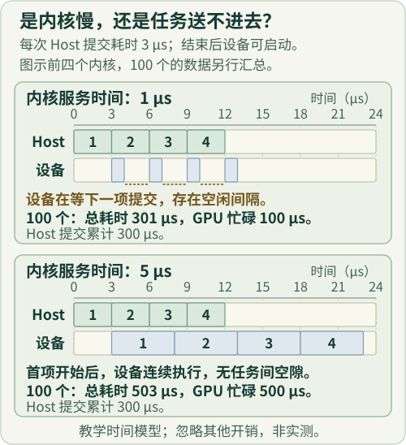
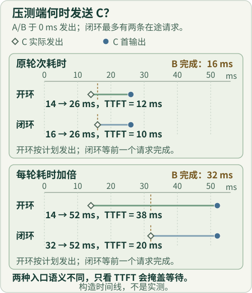
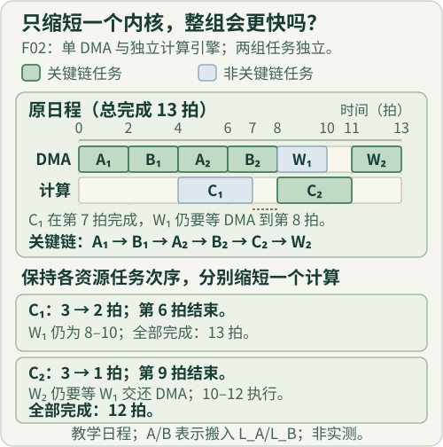

<!-- site-inference-math -->
# 系统变慢了，怎样找到真正的瓶颈？

在 F04 中，主机花 300 μs 提交了一百个 Kernel。当每个 Kernel 执行 1 μs 时，设备在第 301 μs 完成所有工作；当每个 Kernel 执行 5 μs 时，全部工作反而在第 503 μs 完成。同样的主机提交开销，在两种情况下都应该优先优化吗？

**性能定位**要回答的不只是系统花了多少时间，还包括工作为什么不能更快完成，以及改变哪个条件可能改善我们关心的指标。瓶颈是相对于特定工作、资源和性能目标而言的限制，而不是设备的一个固定标签。

要找到这样的限制，需要先构造可以复现问题的测量条件，再观察执行过程、提出原因并进行对照实验。本篇沿用 K01 的计时边界和 K02 的正确性条件，分别跟踪设备任务和模型服务。

## 为什么不能只看设备在一段时间内有多忙？ {#launch-gap}

继续 [F04 的教学例](../06-execution-runtime/f04-execution-graphs-and-replay.md#submission-overhead)。假设主机只有一个提交线程，提交每个 Kernel 需要 3 μs；提交结束后对应任务才可由设备执行。一百个 Kernel 在同一有序流内依次执行，忽略其他开销。

令第 i 个 Kernel 的实际开始和完成时刻分别为 $a_i$、$c_i$，单次设备执行耗时为 s，单位都是 μs。第 i 次提交在 $3i$ 时结束，前一个 Kernel 又必须结束，因此：

$$a_i=\max(3i,c_{i-1}),\qquad c_i=a_i+s,\qquad c_0=0$$

若前一项很快完成，设备仍需等待下一次提交；若前一项较慢，下一项即使已经提交，也只会在队列里等待设备。

<figure markdown="1">

<figcaption>构造执行时间线；前四项按同一 μs 尺度绘制，未画出剩余 96 项。设备空闲和等待提交在本例中有确定的因果关系，并非实际 GPU Trace。</figcaption>

</figure>

| 构造耗时 | 主机累计提交 | 设备忙碌 | 起始等待 | 内核之间空隙 | 全部完成 |
| --- | ---: | ---: | ---: | ---: | ---: |
| 每项 1 μs | 300 μs | 100 μs | 3 μs | 99×2=198 μs | 301 μs |
| 每项 5 μs | 300 μs | 500 μs | 3 μs | 0 μs | 503 μs |

表中的忙碌时间只统计这个教学模型的有序流，没有其他设备任务；它不代表真实 GPU 的全局利用率。

现在提出一个假设：减少主机提交耗时，可以让设备更早得到工作。如果只将提交间隔从 3 μs 改为 1 μs，并保持设备每项服务时间不变，那么两种情况分别在第 101 μs 和 501 μs 完成。

前者消除了内部空隙，后者只让第一个 Kernel 提前 2 μs。主机累计提交工作都减少了 200 μs，但对整轮完成时刻的作用不同。当然，这仍只是在指定假设下的推导；实际改变提交方式也可能影响设备工作。

在真实系统里，空隙可能来自主机没有提交、同步等待、数据未就绪或其他资源。设备空闲只是一种观察结果，不能直接认定主机提交就是根因。怎样得到上面这种可检验的证据？

## 怎样将一个问题变成可重复的实验？ {#benchmark-design}

**基准测试（Benchmark）**规定一组工作及测量方法，在明确的条件下观察性能。如果两次测试的工作本身变了，性能差异就可能来自输入或执行机制，而不是想比较的那个因素。

例如 [C05](../03-mapping-and-planning/c05-cost-model-and-search.md) 的不同候选执行方案完成相同矩阵乘法。比较它们之前，首先要按 [K02](k02-correctness-and-validation.md) 检查计算语义、输入和输出都符合约定。

### 先测一段明确的工作，还是直接测整个系统？

**微基准（Microbenchmark）**用于隔离具体操作或较小的执行路径。例如单独测一个 Kernel、一次设备间复制、一次分配，或一百次已准备好的短任务提交。

对于前面的 F04 现象，可以分别测主机调用提交接口的时间、有序设备流上的实际执行和完整调用完成时间。只测 API 返回不能得到异步工作完成时间；每次都等待设备又会破坏原流水。

| 测试范围 | 例子 | 主要回答的问题 |
| --- | --- | --- |
| 单项 Kernel | D05 的一个矩阵乘法形状及实现 | 指定形状与配置下的执行时间及资源使用 |
| 任务序列 | F04 的 100 个 Kernel | 主机准备、启动、依赖与设备执行如何组合 |
| 端到端请求 | H01 的生成请求进入模型服务直至输出 | 实际工作量在调度和服务规则下的延迟、吞吐和失败情况 |

隔离单项工作时，可先清理与本次测量无关的在途工作，再通过设备事件取得规定区间的耗时。若需要测主机调用至任务完成，则使用同一单调时钟，并按接口等待相关完成条件。

测试重复执行开销很小的操作时，可以在一个测量区间内执行多次，再按次数归一化，以减弱计时器本身的影响。但必须说明得到的是单次隔离耗时，还是一批连续执行的平均时间。

重复、预热、合理的时间窗口、相同的主机线程配置有助于减少偶然差异。比如 [PyTorch 2.8 Benchmark Timer](https://docs.pytorch.org/docs/2.8/benchmark_utils.html#torch.utils.benchmark.Timer) 会处理延迟初始化所需的预热、线程数和必要的异步设备同步。

[CUDA 13.0：Timing](https://docs.nvidia.com/cuda/archive/13.0.0/cuda-c-best-practices-guide/index.html#timing) · [加速器互连：Collective 基准测试](../../interconnect/SCALEUP/05-workloads-and-performance/benchmarking.md)

### 微基准中的一次执行，能代表每个生成请求吗？

不一定。以矩阵乘法为例，D05 已说明 Prefill 一次可能处理许多位置，Decode 通常每条序列新增一个位置。H01 中同一轮还可能同时包含两类工作，历史长度也会影响 Attention。

因此，测量内核需要记录实际形状、数据类型、布局、目标后端、并行方式和数据所在的位置。对于 Attention，还需要 Query 长度、历史 KV 长度及头组织等。这样的测量才能对应真实 Trace 中的工作。

孤立测量通常不包含队列等待、其他 Kernel 的资源竞争、流间重叠以及网络交接。它适合检查某段工作的代价或给出参考能力，不应直接将微基准耗时相加来推断整个服务的完成时间。

## 怎样为模型服务构造可以比较的负载？ {#load-generation}

**压测**通过规定请求输入和到达过程，观察服务如何响应不同的负载。它不仅关心一个 Kernel 是否快，还关心相同资源在请求不断进入、排队和离开时能否正常工作。

继续 [H01](../08-request-scheduling/h01-continuous-batching.md) 与 K01 中的 A、B、C。三条请求输入分别为 8、3、6 个 Token，实际输出分别为 4、2、3 个 Token。引擎每轮最多安排两条序列。

仍采用 H01 的连续批构造时间线：A、B 在 0 ms 到达，前两轮分别在 12、16 ms 完成，B 在第二轮结束。C 在 14 ms 到达，因此等到第 16 ms 才参与第三轮；第三轮在 26 ms 结束，C 在此时产生首个 Token。

### C 应该什么时候发出？

如果外部需求在 14 ms 到达，无论 A、B 是否结束都按计划发出 C，这就是 **开环（Open-loop）** 负载的一个简单例子。到达不由服务完成事件触发；服务仍可以按资源限制排队或拒绝。

另一种实验保持两个客户端工作槽，每个槽至多有一条未完成请求。服务完成一条就立即补充一条，假定不需思考时间。B 在第 16 ms 完成，然后客户端才生成并发送 C。这是 **闭环（Closed-loop）** 的一个例子。

这里再假设完成通知、发送和接收不耗时；若 C 在轮末同一时刻到达，它的到达事件先于下一轮调度选择。

在上述假设下，两种方式都能让 C 从第三轮开始执行，首输出都是第 26 ms。但 C 从实际发出至首输出的时间不同。闭环的两个槽限制客户端在途请求数，不等于开环中最多只有两条未完成请求。引擎每轮序列槽位仍是 2。

再构造一个对照：所有轮的耗时扩大一倍，假设仍采用原批成员及顺序。前两轮在 24、32 ms 完成，此时 B 结束；第三轮在 52 ms 结束。开环仍在 14 ms 发出 C（此时第一轮执行中），而闭环等到 32 ms 才产生 C。

<figure markdown="1">

<figcaption>同一请求执行顺序在正常与构造慢速条件下的两种负载生成方式。时间从 A/B 发出开始，忽略网络与客户端文本缓冲；不是实际服务测量。</figcaption>

</figure>

| 轮次耗时及负载方式 | C 发出时刻（ms） | C 首输出（ms） | C 从实际发出计的 TTFT（ms） |
| --- | ---: | ---: | ---: |
| 原耗时、开环 | 14 | 26 | 12 |
| 原耗时、闭环 | 16 | 26 | 10 |
| 加倍、开环 | 14 | 52 | 38 |
| 加倍、闭环 | 32 | 52 | 20 |

闭环会随着服务速度下降而降低新请求产生的速率，因此适合研究指定并发下的工作点。开环适合研究外部到达不会因服务变慢而自动减少的情况。例如在线服务过载时，等待可能持续增长。

两种实验回答的问题不同，没有一种天然正确或错误。也存在带思考时间的闭环、受外部速率与并发约束共同影响的混合负载。关键是描述真实需求来自哪里。[Open Versus Closed（NSDI 2006）](https://www.usenix.org/conference/nsdi-06/open-versus-closed-cautionary-tale)

### 如果本来想做开环测试，客户端却发不出请求呢？

假设慢速方案的压测器本来计划在 14 ms 发出 C，但由于客户端线程或并发信号量阻塞，到 32 ms 才真正发送。如果只记录实际发送到首输出，看到的是 20 ms，而原计划到首输出等待了 38 ms。

两者相差的 18 ms 并非服务端执行时间，而是客户端迟发造成的等待。原耗时例中的差值则是 2 ms。如果目标是模拟独立到达，却让服务变慢时减少施压或遗漏这些等待，结果会偏向较好的延迟。这类统计偏差常被称为 **Coordinated Omission**。

因此记录计划发送、实际发送、首输出和结束时刻，同时记录迟发、未发送、拒绝、超时或取消。按实际发送计的指标仍可用于分析服务响应，但不能无声地代替计划到达口径。真正的闭环没有预定的 C=14 ms，不需要伪造本来就不存在的请求。

例如 vLLM v0.10.2 的 benchmark 在有限 `--request-rate`、`--burstiness=1` 时使用 Poisson 到达过程；`inf` 时立即产生请求任务。

但 `--max-concurrency` 会在实际请求调用前限制并发，逐请求计时不含取该信号量之前的等待。需要核对实际发送率与计划条件。

[wrk2：Coordinated Omission](https://github.com/giltene/wrk2#readme) · [vLLM v0.10.2：Benchmark CLI](https://docs.vllm.ai/en/v0.10.2/cli/bench/serve.html) · [对应实现](https://docs.vllm.ai/en/v0.10.2/api/vllm/benchmarks/serve.html)

## 同样的负载，为什么第二次测量可能更快？ {#working-point}

真实模型服务首次加载权重、第一次编译特殊形状、首次准备执行图，都可能产生启动开销。G06 的前缀缓存还会使第二次请求少做计算。F04 也已说明：图准备与重放承担不同成本。

若目标是测经常发生的重复执行策略，可以在规定条件下预热后开始计时。但若目标是冷启动时的响应，就应包含相应初始化。预热清除部分一次性成本，并不保证队列、缓存和资源已经进入稳定状态。

| 实验条件 | 如何使比较有解释力 |
| --- | --- |
| 模型和软件 | 固定实际权重/分词器版本、量化产物、框架、编译器、驱动 |
| 资源与执行方式 | 记录硬件拓扑、频率/功耗配置、并行布局、后端、调度预算、生成策略 |
| 输入与到达 | 固定请求集合、输入/输出长度分布、到达过程及其相关性；共享前缀、模型/适配器分布另记 |
| 初始与结束状态 | 指明模型是否加载、是否已编译或捕获、缓存冷/热、预热期、观察窗口、末尾未完成请求的排空规则 |

不能让一种实现获得大量热前缀命中、另一种始终冷缓存，却将差异全部归因给 Kernel。也不能让一种方案提前截断回答，另一种完成原任务，却只比较 Token/s。[K02](k02-correctness-and-validation.md) 的质量与输出验证应对应性能配置。

若为持续服务设计开环测试，可以在多个到达速率下观察，检查完成速率、队列长度变化和失败比例。假设同一入口统计中所有发出工作均有唯一身份、已完成/拒绝/失败/取消等终止事件只计一次，则窗口内未终止请求数量的变化等于进入数减去终止数。

如果一段时间内未终止请求持续积累，可能存在供给不足、阻塞或资源限制；如果队列有界但拒绝率升高，单看队列长度可能漏掉过载。吞吐平台和短时峰值也不能直接推出满足 SLO 的长期容量。

应按 K01 的定义报告完成、失败、拒绝、超时、取消和未决数，输入/输出 Token 数，以及同口径的延迟分布、Goodput 和达标率。分位数应说明样本量和方法；重要结果应有独立重复实验、变动范围或不确定性，并按长度/请求类型分组观察。

工具报告的指标仍需要核对计算方法。例如 K01 已区分不同工具对 ITL 的命名和统计对象；可对照 [NVIDIA AIPerf v0.12.0 的指标定义](https://docs.nvidia.com/aiperf/v0.12.0/reference/ai-perf-metrics-reference)。

对完整作业可以从首个到达计到最后完成；对稳态窗口可以分别统计完成及输出归属。若还要等待窗口外请求排空，必须说明是否计入统计时间与工作量。[K01：吞吐与窗口归属](k01-performance-metrics.md#request-example)

## 怎样追踪一个请求从等待到真正执行的过程？ {#profiling-and-trace}

上述测试帮助我们复现问题。但仅知道 C 的 TTFT 增大，还不知道时间到底花在哪里。需要进一步记录执行活动和资源的实际使用情况。

**Profiler** 可以采集某段执行的时间、调用路径或资源活动等信息。输出有时是一张耗时与计数汇总表，另一种常见形式是 **Trace（事件记录/时间线）**：每项活动何时开始、何时结束，属于哪项工作，依赖哪个事件。

为了追踪同一请求，运行时应在相应位置保存身份关系，而不是只观察 GPU 整体是否忙碌：

| 层次 | 应观察的事件与关系 |
| --- | --- |
| 服务入口与输出 | 请求标识、到达、准入、路由、输出入队/发送、客户端接收与结束 |
| 调度器 | 请求被选中的轮次、计划标识、批成员、输入/历史长度、等待及抢占原因 |
| 主机与驱动 | 计划对应的任务调用、提交时间、同步/等待、完成与错误记录 |
| 设备及互连 | 相应 Stream、Kernel、复制/通信活动的开始结束、依赖与资源使用 |

例如 [Nsight Systems](https://docs.nvidia.com/nsight-systems/UserGuide/index.html#cuda-trace) 可以显示主机 CUDA 调用、设备 Stream、Kernel 和复制活动。CUPTI 13.0 的活动记录可用 correlation ID 关联发起调用与设备活动。业务请求和执行批身份仍需要服务或运行时提供，不能从时间邻近自动推断。

来自不同进程、设备或主机的时间戳需要有可信的时钟映射，才能计算它们之间的间隔。Trace 记录可能异步交付、乱序或丢失；如果某段活动没有被采到，不能直接认定那段时间没有工作。

[CUPTI 13.0：Activity API](https://docs.nvidia.com/cupti/13.0.0/main/main.html#cupti-activity-api) · [Kernel Activity 的关联标识](https://docs.nvidia.com/cupti/13.0.0/api/structCUpti__ActivityKernel9.html)

### 回到 H01，怎样解释 A 和 C 的延迟？

A 的第二、第三个输出分别在 16、26 ms，中间的 10 ms 刚好对应 A Decode 与 C 的完整 Prefill 组成的混合轮。C 从 14 ms 到 16 ms 等待入批，接下来用 10 ms 获得首输出。

这个构造例中可先定位到该轮。但真实测量即使看到类似时间线，也不能把 10 ms 全部记为 C 的 Prefill Kernel：其中可能含主机准备、多个 Kernel、复制、同步、生成等工作。

可以建立一个受控对照：在相同 A 历史状态、缓存准备、模型及设备条件下，分别测只运行 A 的 Decode 和加入相同 C 工作的混合轮。再看计划、内核、设备等待是否符合“混合轮干扰”假设，以及其成本如何变化。

这与 [H02 的分块 Prefill](../08-request-scheduling/h02-chunked-prefill.md#latency-tradeoff) 相衔接。H02 另将 C 输入增至 12 个位置；在其构造时长下，分块让 A 的最慢 ITL 从 18 ms 降至 8 ms，却令 C 的 TTFT 从 20 增至 26 ms，全组完成从 41 增至 46 ms。

这些并非某个策略的实测收益。验证真实策略时，在相同负载下同时观察两类请求、完成速率与 Goodput，而不是只选择改善的那项指标。

输出路径也会影响所见延迟。[I05 的首 Token 交接例](../09-distributed-execution/i05-prefill-decode-disaggregation.md#first-token-timing) 中，等待 10.24 ms 的 KV 交接再发送首 Token，可将第一段 ITL 从 12.24 ms 变为 2 ms，但并没有让第二个 Token 更早就绪；TTFT 增加了 10.24 ms。

[J02](../10-serving/j02-request-and-resource-lifecycle.md#timeouts-and-backpressure) 中的慢客户端还可能形成输出积压和生成背压。因而 Trace 需要区分设备生成、服务输出提交和客户端实际收到，不能仅用 GPU 时间线解释所有尾延迟。

## 耗时最长的任务，就是需要优先优化的任务吗？ {#critical-path}

回到 [F02 的两组异步向量加法](../06-execution-runtime/f02-asynchronous-execution.md#overlap)。在 K01 中，两组工作都在 0 拍具备提交条件，有一个串行搬运引擎和一个独立计算引擎，使用独立输出 Buffer。流水日程在第 13 拍结束。

第一组 C₁ 在第 7 拍完成，但 W₁ 从第 8 拍才开始。这一拍是在等待什么？看日程即可知道：搬运引擎还在执行第二组的 L_B2，虽然它并不是第一组计算的数据前置任务，却占用了 W₁ 需要的资源。

<figure markdown="1">

<figcaption>构造时间线，横轴为拍；深色任务标示在本实际日程及固定资源顺序下决定全部完成时刻的一条关键链。缩短某项任务后，关键链可能改变。</figcaption>

</figure>

要解释完成时间，可以将任务及依赖整理成图：每项任务有一个服务时间，某项工作要等依赖完成后才能开始。对于当前日程，不仅要保留数据依赖，还要保留共享资源形成的顺序，例如单个 DMA 上前一搬运到后一搬运的约束。

这里固定资源次序，假设每项工作在全部前置条件满足时尽早开始，也没有额外等待。从起点沿依赖边累加任务耗时，一条决定目标最早完成时刻的最长依赖链称为**关键路径（Critical Path）**。

从第 0 拍到全部完成，第一个搬入、第二个搬入、第二组的两项搬入串行花 8 拍；第二组 C₂ 等输入后计算 3 拍；W₂ 在 C₂ 完成且 DMA 空闲后写回 2 拍。得到 8+3+2=13 拍。

若只关心第一组的结果，目标是 W₁ 完成，需要等 DMA 在第 8 拍可用，再写回 2 拍，因此第一组第 10 拍完成。在这个日程下，第二组的搬入也限制了第一组的延迟。

尝试分别改变两个计算时间，保持其余服务时间与资源顺序不变：

| 对照 | 完成时间 | 原因 |
| --- | ---: | --- |
| 原日程 | 13 拍 | C₂ 在 8–11 拍执行，W₂ 在 11–13 拍 |
| 只将 C₁ 的 3 拍缩短为 2 拍 | 13 拍 | W₁ 仍要等搬运引擎；全组路径未缩短 |
| 只将 C₂ 的 3 拍缩短为 1 拍 | 12 拍 | C₂ 在第9拍结束，但 W₂ 还要等 W₁ 至第10拍结束 |

最终一行的关键路径变成四项搬入、W₁、W₂，整个搬运引擎恰好服务 12 拍。即使进一步缩短 C₂，在该资源顺序下也不会使 W₂ 更早开始。

因此，某项工作耗时减少，不代表整条路径必然同样缩短。并行工作可能重叠；两个候选瓶颈也会在改变实施方案后互相转移。宏观的瓶颈归因应以目标完成事件和实际约束为依据。真实系统的时间线可能有隐含等待，需要补充相应原因、资源或到达事件；单个时间线不是全部合法日程的最优性证明。

[计算微架构 H01：资源和依赖下界](../../microarchitecture-v2/08-performance/h01-task-time-and-bottlenecks.md#lower-bound) · [C03：执行规划与就绪条件](../03-mapping-and-planning/c03-static-execution-planning.md#plan-and-readiness)

## 已经找到耗时的 Kernel，怎样确定它在等待什么？ {#resource-evidence}

Trace 告诉我们某项工作什么时候开始或结束，通常不足以解释它内部为什么花了这些时间。这时可以再用资源计数、采样和相应的受控微基准取得更细的证据。

例如 [D06](../04-code-generation/d06-fused-kernels.md) 的两个小内核需要对中间 P 写入和读回，共 16 B 逻辑有效数据。融合可以省去这两次逻辑访问及一次独立内核启动。但实际物理 HBM 流量可能已被缓存减少，融合也可能增加片上资源占用。

要验证真实加速来自哪里，可对比两份实现的实际 Kernel 数、指定存储接口流量、工作区、资源驻留情况及执行耗时。不能直接把 16 B 看作 HBM 实测节省量，也不能将模型带宽利用率等同于接口忙碌比例。

[计算微架构 H01](../../microarchitecture-v2/08-performance/h01-task-time-and-bottlenecks.md) 与[存储系统：存储与计算瓶颈](../../storage/01-memory-hierarchy/03-performance/memory-bound-vs-compute-bound.md) 已解释 Roofline。它按指定数据类型的算力上限、给定层级的流量和带宽能力约束计算性能。

如果内核的计算强度落在 Roofline 的带宽约束区域，只提高算力峰值而不改变其他条件，不能提高这一资源上界。它不证明当前内核已经饱和该接口：串行访存的等待、并发不足、同步或其他层级也可能限制执行。应同时核查观测到的工作量和资源活动，并用对照实验检验。

| 观察到的现象 | 下一步先核查 | 一种待检验的原因 |
| --- | --- | --- |
| TTFT 变大 | 到达、排队、预处理、实际开始 | 准入等待、Prefill、前缀未命中、KV 交接 |
| ITL 长尾 | 请求参与轮次、输出提交与收到 | 混合批、抢占、通信、主机空隙、输出缓冲 |
| 内存峰值变大 | 活跃状态、已保留/可用内存和工作区 | KV 尾块、执行图池、复制、适配器 |
| 吞吐不再增长 | 到达/完成率、积压、资源就绪与占用 | 算力、内存、互连、入口或输出受限 |

这些是排查方向，不是一一对应的诊断。例如低 GPU 忙碌率可能是上游供数不足，低 HBM 平均带宽也可能是内存请求的等待而不是算力不足。PCIe 的主机与设备瓶颈定位还需要沿[真实数据路径](../../interconnect/PCIE/05-performance-debug/host-device-bottleneck-breakdown.md)收集相应证据。

### 为什么不能直接使用 Profiler 中的耗时作为验收结果？

工具本身可能改变执行。采集大量活动会占用主机和存储资源；某些硬件计数器不能在同一轮全部采集，工具可能重放 Kernel、保存恢复内存、改变缓存或时钟条件，或者使原先重叠的执行串行化。

例如 Nsight Compute 的 Profiling Guide 解释不同 metric collection 与 replay 模式的额外开销及约束。因此应先在不开 profiler 的情况下测端到端基线，再采集具有代表性的短窗口，说明跟踪范围，最后关闭工具验证改动的整体收益。

[Nsight Compute：Profiling Guide](https://docs.nvidia.com/nsight-compute/ProfilingGuide/index.html) · [Roofline 原始技术报告](https://www2.eecs.berkeley.edu/Pubs/TechRpts/2008/EECS-2008-134.html)

## 找到一个可疑原因之后，怎样验证它？ {#controlled-comparison}

回到一百个短 Kernel 的例子：看到设备空隙是观察到的现象；而“等待主机提交”是一个需要验证的解释。调整提交间隔、使用已准备的执行图，或减少主机准备工作，都可以用来检验这一方向，但实际改动可能同时改变多个因素。

要隔离原因，最好构造能够尽量单独改变该因素的实验。例如固定工作量、版本、初始状态与负载，先检查提交开销下降是否使预期空隙减少，再观察整个任务完成时间。若没有出现预期变化，就回到实际依赖及资源记录重新提出假设。

| 步骤 | 应保留的证据 |
| --- | --- |
| 复现慢的工作点 | 配置、可复现入口/命令、请求输入、实际到达及失败情况、无 profiler 基线 |
| 定位时间段 | 关联请求、计划及活动的 Trace，计时和时钟口径 |
| 检验原因 | 选定资源的计数与微基准、保持其他条件的对照结果 |
| 核对实际收益 | 在对应工作点重新运行正确性检查、端到端性能与重复实验，记录副作用 |

例如减少启动空隙可能使 GPU 更忙，随后新的限制转向计算或搬运；提升单个 Kernel 性能也可能没有改善服务延迟。改变条件后应重新分析，而不是保留原瓶颈名称作为结论。

最终报告应说明配置、输入来源、负载规则、测量窗口、统计方法和样本量、错误处理、资源与请求指标、原始记录位置及复现方式。没有获得目标硬件或服务实测数据的结果，应标记为分析、教学模型或条件估算。

本篇的提交空隙、开闭环例及关键路径可以通过[独立教学复算测试](https://github.com/microarch-flow/wiki/blob/main/website/tests/test_compiler_runtime_k03.py)核查。这些测试确认的是给定时刻和假设的因果关系，不是对实际设备性能的验证。

## 接下来怎么读

K03 以实际观察、微基准和对照实验建立性能定位证据。下一篇 [K04：知道请求何时到达，怎样预测它们何时完成？](k04-trace-and-event-model.md) 将从观察到的请求和执行事件出发，构建可复算的模型；再用这些测量校准成本并用独立负载验证预测，不把拟合结果当作预测能力。

- [K01：怎样定义可以公平比较的延迟和吞吐量？](k01-performance-metrics.md)
- [K02：怎样验证编译优化和运行时实现仍然符合预期？](k02-correctness-and-validation.md)
- [F04：多次执行相同的任务序列，怎样减少每轮提交开销？](../06-execution-runtime/f04-execution-graphs-and-replay.md)
- [旧版：压测、统计与性能定位](../../inference-runtime/09-measurement-and-cases/benchmarking-and-profiling.md)
- [性能分析、建模与验证专题导读](README.md)
