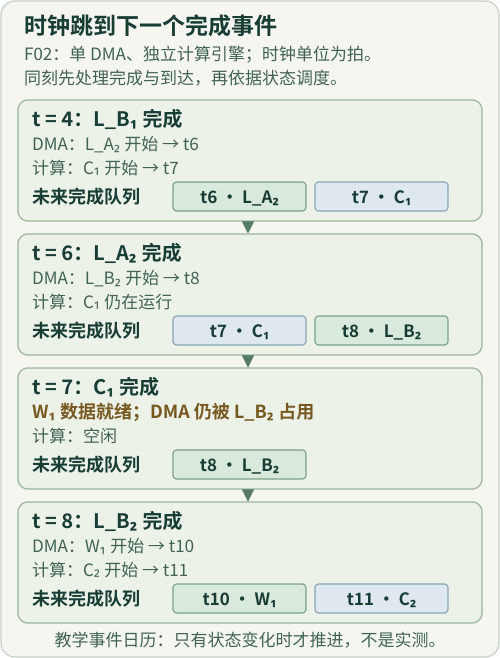
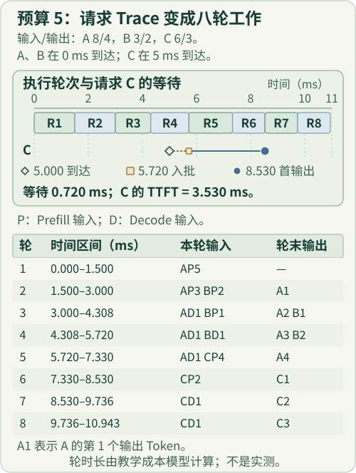
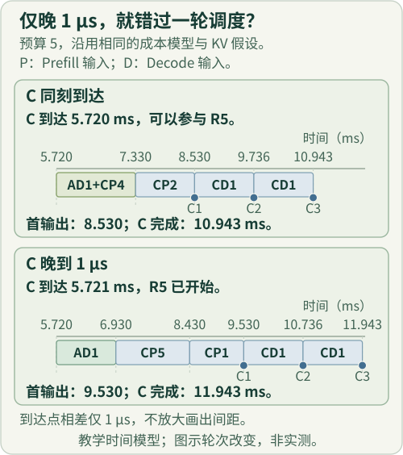

<!-- site-inference-math -->
# 知道请求何时到达，怎样预测它们何时完成？

K03 通过测量与 Trace 解释已经发生的执行过程。现在假设系统尚未运行，只知道请求什么时候到达、需要处理多少输入，以及采用什么调度策略。能否先预测哪个请求先收到结果，哪个请求需要等待？

**性能模型**是对系统行为的抽象。它根据输入、执行规则、资源约束和服务时间，预测不同条件下的状态变化与性能指标。只知道某个 Kernel 的执行时间还不够，因为它何时能够获得执行机会，也会受其他工作影响。

本篇先用 F02 的异步向量任务建立事件推进的认识，再完整复算 H02 中的 A、B、C 请求模型。最后讨论怎样利用 K03 的测量校准成本，并用未参加校准的负载验证预测能力。

## 知道到达率和处理速率，就能知道每个请求何时完成吗？ {#queue-model}

在 [J03](../10-serving/j03-serving-scaling.md#scale-up-backlog) 中，系统到达速率为 10 请求/s，扩容前最多处理 8 请求/s。连续十秒内积压增加 20 份请求等价工作量，增加副本后才逐渐消化。

这种总体队列模型能够预测积压的变化，但它不区分每个请求的实际到达时刻、工作长度及服务次序。因此不能从这些平均速率直接得到某个请求的完成时间或尾延迟。

考虑一个更简单的模型。沿用 F02 的两组向量加法，假设传入两组工作时都只能独占设备完成整组运算，服务时间各为 9 拍，不允许跨组重叠。到达时刻非负，按先到先服务（FCFS）执行。

令第 i 组工作的到达时刻为 $a_i$、开始服务时刻为 $s_i$、完成时刻为 $c_i$、独占服务时间为 $d_i$。队列初始为空，按到达顺序处理：

$$s_i=\max(a_i,c_{i-1}),\qquad c_i=s_i+d_i,\qquad c_0=0$$

只有这组工作已经到达、且上一组已归还服务资源，才能开始执行本组。于是等待时间为 $s_i-a_i$，从到达到完成的驻留时间为 $c_i-a_i$，即等待与服务时间之和。

| 请求（任务组） | 到达（拍） | 开始（拍） | 完成（拍） | 等待（拍） |
| --- | ---: | ---: | ---: | ---: |
| 第一组 | 0 | 0 | 9 | 0 |
| 第二组 | 0 | 9 | 18 | 9 |

这是一个独占服务的队列模型。若各组服务时间或到达时刻不同，逐项替换这些输入即可推导新的结果。但 F02 实际允许两组任务使用不同资源同时推进，H01 的生成请求也可以动态组批。此时无法为每条请求指定一个互不重叠的独占服务区间。

因此需要更细的执行状态：每项工作有哪些依赖，哪个资源已经空出，哪些工作正在执行，以及完成时能够使哪些后继工作就绪。

## 怎样让模型中的时间随任务推进？ {#discrete-event}

回顾 [F02](../06-execution-runtime/f02-asynchronous-execution.md#overlap)：两组向量任务在 0 拍都已经具备提交条件，设备使用一个串行搬运引擎和一个独立计算引擎。每次搬入或写回需 2 拍，计算需 3 拍，使用独立数据缓冲区，不计主机提交开销。

第一组的 L_A1、L_B1 依次占用搬运引擎，于第 2、4 拍完成。到第 4 拍，系统可以同时启动第一组计算 C₁ 和第二组搬入 L_A2。应该把时钟一下推进到第 7 拍吗？

不能。C₁ 需要到第 7 拍才完成，但 L_A2 在第 6 拍便会结束。此时搬运引擎可以继续处理 L_B2。模型若忽略这个中间事件，就会错误地让搬运继续空闲。

**离散事件模型（Discrete-event Model）**记录会改变系统状态的事件及其时间。在两次相关事件之间，若没有需要更新的状态，可以直接跳到下一事件的时刻，而不必逐拍检查整个系统。

<figure markdown="1">

<figcaption>图中时刻为 F02 的构造值，未来事件日历记录模型将在何时处理对应完成事件。登记完成时间不表示任务当前已经完成；资源在其服务区间内仍被占用。</figcaption>

</figure>

| 模拟时刻（拍） | 当下处理的事件 | 可以开始的工作 | 新登记的未来完成事件 |
| --- | --- | --- | --- |
| 4 | L_B1 完成 | C₁、L_A2 | L_A2 于 6；C₁ 于 7 |
| 6 | L_A2 完成 | L_B2 | L_B2 于 8 |
| 7 | C₁ 完成 | W₁ 数据就绪，但 DMA 忙 | 无 |
| 8 | L_B2 完成 | W₁、C₂ | W₁ 于 10；C₂ 于 11 |
| 10 | W₁ 完成 | W₂ 数据尚未就绪 | 无 |
| 11 | C₂ 完成 | W₂ | W₂ 于 13 |
| 13 | W₂ 完成 | 两组任务已全部结束 | 无 |

需要注意，表中只列出新登记的事件。第 6 拍增加一个第 8 拍完成的事件时，第 7 拍 C₁ 完成的事件仍在日历里。因此下一次应先处理第 7 拍而不是第 8 拍。

在第 7 拍，W₁ 已满足数据依赖，但尚未获得搬运引擎。将“可执行的工作”和“正在占用资源的工作”分开记录，就能解释这一拍等待的来源。

如果改用 [F03 的共享输出 Buffer](../06-execution-runtime/f03-runtime-buffer-management.md#resource-dependency)，第 8 拍 C₂ 还不能覆盖原输出；必须等 W₁ 于第 10 拍结束访问并安全交还后才能开始 C₂。整个日程变为第 15 拍完成。事件机制没变，改变的是资源依赖条件。

### 事件模型怎样组织这些状态？

一个支持并行任务的模型至少需要保存当前模拟时刻、在途任务、资源占用、就绪条件以及未来事件日历。任务开始时取得资源，并根据成本模型登记完成事件；处理完成事件时才更新数据就绪和资源状态。

下面是一种适用于本文教学条件的推进方式：

1. 在事件日历中登记初始请求到达等外部事件。
2. 取出时间最早的事件，时钟推进到对应时刻。
3. 同刻先处理完成、安全归还等状态变化，再接收该时刻的到达，最后根据已更新状态选择可执行工作。
4. 对每项被实际派发的工作记录占用资源、登记未来完成时刻，再推进到下一事件。

这是一种明确的同刻处理规则，并非所有仿真器的固定语义。若有立即触发的后继事件，模型也需要处理同一时刻的新事件，直到相关状态收束，而不能跳过它们。

如果还有等待工作，但没有在途任务，模型可以跳到下一次到达或其他可能解除阻塞的事件。若没有任何未来事件可使未完成工作推进，就应报告不可进展的状态，而不是不断生成空轮。

离散事件描述的是时间推进方式，并不规定服务时间一定来自什么模型。可以用解析公式、查表，甚至调用较细粒度的模拟器给工作赋予耗时。[计算微架构 H01：解析、周期与事件模型](../../microarchitecture-v2/08-performance/h01-task-time-and-bottlenecks.md#modeling)

[SimPy 4.1.1：Time and Scheduling](https://simpy.readthedocs.io/en/4.1.1/topical_guides/time_and_scheduling.html) 说明了事件按时间推进及同刻排序；[gem5：事件驱动编程](https://www.gem5.org/documentation/learning_gem5/part2/events/) 则展示登记未来事件的实际实现方式。

## 怎样将一批生成请求变成可执行的模型输入？ {#request-trace}

接下来把已经掌握的事件机制用于请求。首先需要一份记录外部工作何时进入系统的 **请求 Trace**。它与 K03 的执行 Trace 不同：前者作为模型输入，后者记录实际执行过程，可用于校准与验证。

对于在线生成，一个最小请求记录包括请求身份、到达时刻、输入长度、输出长度或停止规则，以及模型身份。若有多模型、Adapter、缓存复用或取消，还应保存相应身份及必要事件条件。

只有输入长度无法判断前缀命中。如果研究缓存，需要能重现真实前缀共享关系的 Token 或受控身份信息；生产采集只保存所需数据，也可以用保留相关相等关系的受控标识替代敏感文本。

如果研究开环负载，还应明确到达是客户端计划发送、实际发送还是引擎收到的时刻。若研究闭环负载，后续请求由完成事件触发，不能直接把某次运行形成的全部到达时刻固定下来再声称模拟闭环行为。计量边界沿用 [K03](k03-benchmarking-and-profiling.md#load-generation)。

### 复用已经认识的 A、B、C

采用 [H02 深化阅读](../08-request-scheduling/h02-chunked-prefill.md#event-model) 及旧版已有的教学模型。请求输入/输出长度沿用 H01，但 C 的到达时刻改为 5 ms，从第一轮即施加 Token 预算。

| 请求 | 到达（ms） | 输入长度（Token） | 实际输出长度（Token） |
| --- | ---: | ---: | ---: |
| A | 0 | 8 | 4 |
| B | 0 | 3 | 2 |
| C | 5 | 6 | 3 |

这与 H01/K01 中 C 于 14 ms 到达的时间线，以及 H02 主例中 C 长度为 12 的时间线都不同。下面所有结果仅对应这份请求 Trace 和本节规定的成本、调度规则。

假设采用同一个模型实例，输出长度预先给定、不提前结束；普通自回归生成，无前缀复用、投机、抢占、取消、额外内存与序列槽位限制，也不模拟多卡通信和网络。每轮独占一个逻辑执行引擎，不能在已开始的轮次中途插入新工作。

## 怎样根据各请求的状态选择下一轮？ {#scheduler-state}

对每条请求记录提示长度 P、输出长度 O，并维护已处理的提示位置 p、正式生成的输出数量 g 及各次输出时刻。模型开始时 p=g=0。

根据 [G02](../07-model-execution/g02-prefill-and-decode.md)，处理完全部 P 个输入位置时便可以生成首个 Token；下一轮若还需输出，再将最后生成的 Token 作为 Decode 的新输入。普通完整 Prefill 后且 g≥1 时，已经计算的逻辑位置数为 $P+g-1$。

在提示尚未完成时，g=0，已计算的逻辑位置数为 p。这里仅跟踪生成依赖需要的有效历史长度。它不表示物理分配的 KV Cache 块数；已结束请求保留的历史记录也不表示其资源还驻留。

每轮开始时，模型只考虑已经到达且未结束的请求。先按到达顺序安排已经完成 Prefill、仍需要输出的请求，每条最多执行一个普通 Decode 位置，预算用尽则停止；再按到达顺序用剩余预算处理未完成的 Prefill。同一时刻到达的请求按 Trace 输入次序选择。

预算限制的是本轮新计算的输入位置总数，不是总历史长度。令每轮的 Token 预算为 B，安排的 Prefill、Decode 新位置数分别为 $N_{\rm prefill}$、$N_{\rm decode}$，二者需要满足：

$$N_{\rm prefill}+N_{\rm decode}\le B$$

允许未填满预算。比如本轮没有更多就绪工作，就不必为了凑足 B 个位置而重复计算。Prefill 的最后一块在轮末产生首输出；直到该轮真的结束，才允许相应请求继续 Decode。

计划确定后，模型根据成本计算轮末时刻，等到该时刻才更新 p、g 和输出记录。轮内到达的请求在下一轮才有机会加入。这里按完成更新后接纳到达时刻不晚于当前时钟的请求，因此同一轮末时刻到达的请求也可参与下一轮选择。

这是一种简化的单引擎事件模型。由于轮内没有改变执行的中间事件，可以直接从当前轮开始推进到轮末，并根据各到达时刻判断就绪集合。多引擎模型若允许独立任务完成，则应像 F02 一样选取最早的相关事件。

### 怎样给本轮工作赋予服务时间？

如果只知道本轮处理几个输入位置，还不知道需要花多少时间。成本模型根据本轮执行的工作内容和给定资源条件，给出一个与这些工作相对应的耗时。

继承旧版构造式：

$$T_{\rm step}=1+0.1N_{\rm prefill}+0.2N_{\rm decode}+0.001S_{\rm decode}\quad[\mathrm{ms}]$$

其中 $S_{\rm decode}$ 是本轮参与 Decode 的请求在执行前已有的有效历史位置数之和。它不包括本轮新计算的位置，也不是物理 HBM 读字节数。根据前面的状态，每个普通 Decode 请求贡献 P+g−1 个历史位置。

| 成本项 | 教学假设 |
| --- | --- |
| 每个非空轮次固定成本 | 1 ms/轮 |
| Prefill 新输入位置 | 0.1 ms/位置 |
| Decode 新输入位置 | 0.2 ms/位置 |
| 本轮 Decode 的既有历史 | 0.001 ms/历史位置 |

公式只是为了看清工作量与事件时间的关系，并非任何硬件实测或适用于所有形状的解析规律。它省略了 Prefill 与已有历史长度相关的 Attention 成本，也未模拟具体 Kernel、资源重叠、通信和采样的细节。

## 从第一轮开始，怎样得到每条请求的输出时间？ {#budget-five}

设置 B=5。第一个轮次开始时，A、B 都已经到达，二者尚未完成 Prefill，没有普通 Decode 工作。先处理 A 的 5 个提示位置，使用完预算。本轮耗时 1+0.1×5=1.500 ms。

轮末 A 的 p=5，仍缺三个提示位置，不能输出 Token。第二轮先处理 A 剩余 3 个位置，再安排 B 的 2 个提示位置。两者合计 5 个新位置，轮末时钟变为 3.000 ms。

A 的全部提示此时算完，输出 y₁。A 的状态为 p=8、g=1，已计算位置数仍为 8。B 的提示尚差一个位置，不能输出。

<figure markdown="1">

<figcaption>旧版可运行事件模型的预算 5 时间线，单位 ms。竖线表示轮次边界，首输出在完成整段提示的轮末产生；C 在第 4 轮中间到达，只能从第 5 轮开始参与。所有耗时是教学模型结果。</figcaption>

</figure>

第三轮先安排 A 的 Decode，B 使用剩余预算计算最后一个提示位置。由于 A 在执行前已有 8 个有效历史位置，本轮耗时为 1+0.1+0.2+0.001×8=1.308 ms。

因此第三轮于 4.308 ms 结束：A 生成第二个 Token，B 首次生成 Token。此时 A、B 的有效历史分别为 9、3 个位置，第四轮的 $S_{\rm decode}=12$。继续逐轮更新，得到：

| 轮次 | 开始–结束（ms） | 本轮执行工作 | P 新位置 / D 新位置 / Decode 历史 | 轮末输出 |
| ---: | --- | --- | --- | --- |
| 1 | 0.000–1.500 | A P5 | 5 / 0 / 0 | 无 |
| 2 | 1.500–3.000 | A P3、B P2 | 5 / 0 / 0 | A1 |
| 3 | 3.000–4.308 | A D1、B P1 | 1 / 1 / 8 | A2、B1 |
| 4 | 4.308–5.720 | A D1、B D1 | 0 / 2 / 12 | A3、B2 |
| 5 | 5.720–7.330 | A D1、C P4 | 4 / 1 / 10 | A4 |
| 6 | 7.330–8.530 | C P2 | 2 / 0 / 0 | C1 |
| 7 | 8.530–9.736 | C D1 | 0 / 1 / 6 | C2 |
| 8 | 9.736–10.943 | C D1 | 0 / 1 / 7 | C3 |

表中 P5 表示本轮处理 5 个新的提示位置，D1 表示处理一个普通 Decode 输入位置；A1 表示 A 的第一个输出，以此类推。

C 在 5 ms 到达，当时第四轮正在运行。第五轮开始时 B 已结束，先让 A 使用一个位置，剩余四个用于 C 的 Prefill。第六轮完成 C 的剩余两个提示位置，首输出在 8.530 ms 可用。

这一过程同时得到工作量、状态变化与端到端事件时刻。按 [K01](k01-performance-metrics.md) 的定义计算：

| 请求 | 输出时刻（ms） | TTFT（ms） | E2E（ms） | TPOT（ms） |
| --- | --- | ---: | ---: | ---: |
| A | 3.000、4.308、5.720、7.330 | 3.000 | 7.330 | 1.44333 |
| B | 4.308、5.720 | 4.308 | 5.720 | 1.412 |
| C | 8.530、9.736、10.943 | 3.530 | 5.943 | 1.2065 |

例如 C 初次等待入批为 5.720−5.000=0.720 ms；从初次执行到首输出是 8.530−5.720=2.810 ms，包含共享轮次耗时。因此 C 的 TTFT 为 3.530 ms，而不是 8.530 ms 或仅一次内核的执行时间。

这些都是引擎内部到达至输出事件的指标，未模拟网络和文本缓冲。全组输出 9 个 Token，从 t=0 至最后完成时共 10.943 ms，输出吞吐为 9/0.010943≈822.44 Token/s。它不是稳态服务能力或真实压测值。

旧版模型可以直接运行。仓库根目录执行：

~~~sh
python3 series/inference-runtime/examples/runtime_model.py --token-budget 5
~~~

[旧版 runtime_model.py](https://github.com/microarch-flow/wiki/blob/main/series/inference-runtime/examples/runtime_model.py) 输出每轮工作、历史项、时间及请求指标；本文采用同一模型，不改动其代码。

### 怎样由这些事件得到平均积压和驻留时间？

如果关心所有尚未完成的请求，而不仅是等待队列，记 N(t) 为已经到达且尚未完成的请求数。0–5 ms 有 A、B 两条；5–5.720 ms 有三条；5.720–7.330 ms 有 A、C；最后仅 C。

注意各轮长短不同，因此不能直接对每个事件时刻的 N 做算术平均。应对每段驻留时间加权，这里只需把四段矩形的面积相加。

$$\int_0^{10.943}N(t)\,{\rm d}t=2\times5+3\times0.720+2\times1.610+1\times3.613=18.993\quad[\text{请求}\cdot\mathrm{ms}]$$

把同一面积换成按请求累计，A、B、C 分别在系统驻留 7.330、5.720、5.943 ms，三者合计也是 18.993 请求·ms。观察区间从空系统开始到全部完成，平均在途请求数为 18.993/10.943≈1.7356。

在这个完整窗口内，完成率为 3/0.010943≈274.15 请求/s，平均驻留时间为 18.993/3=6.331 ms。二者先统一为秒再相乘，仍得到 1.7356。

这体现了 **Little 定律**的关系 $\overline N=\lambda\overline W$。长期稳定运行时可以用同一边界的有限长期平均值；本例则直接来自空到空的有限窗口面积恒等式。

若只统计等待队列，就应使用对应的等待时间和进入/离开速率，而不是系统驻留时间；若窗口两端有未完成工作，还要正确计入跨窗口的驻留。不能简单将拒绝前到达率代入内部队列，也不能由均值关系推断 p99 或可持续吞吐。

[Little 原论文（1961）](https://doi.org/10.1287/opre.9.3.383) · [计算微架构 H01：在途请求数与带宽](../../microarchitecture-v2/08-performance/h01-task-time-and-bottlenecks.md#in-flight-and-little)

## 如果改变一个参数，怎样判断预测结果对它有多敏感？ {#sensitivity}

**敏感性分析**是在明确的输入和假设下改变某个参数，重新计算关心的输出，观察结果对它的变化程度。模型能够在真实系统尚未更换配置时先进行这类对照。

### 将每轮预算从 5 增加到 6

保持相同的请求 Trace、成本和 Decode 优先策略，只将 B 改为 6。第一轮 A P6，第二轮 A P2、B P3，A 与 B 均完成 Prefill。前两轮结束于 3.100 ms，因此 B 提前产生首输出，而 A 稍晚。

第三轮 A、B 各 Decode 一次，B 结束；第四轮仅 A Decode。第五轮 A Decode 与 C P5 混合，第六轮 C P1，最后两轮 C Decode。这些选择都可以从相同的状态更新和预算规则复算。

~~~sh
python3 series/inference-runtime/examples/runtime_model.py --token-budget 6
~~~

| 结果 | 预算 5 | 预算 6 |
| --- | ---: | ---: |
| A 的 TTFT（ms） | 3.000 | 3.100 |
| B 的 TTFT（ms） | 4.308 | 3.100 |
| C 的 TTFT（ms） | 3.530 | 3.530 |
| A 完成（ms） | 7.330 | 7.430 |
| B 完成（ms） | 5.720 | 4.511 |
| 全部完成（ms） | 10.943 | 10.943 |

为什么两种预算最终完成时刻竟然相同？逐项累计模型成本即可得到解释：两种日程均有 8 轮，共 17 个 Prefill 新位置、6 个 Decode 新位置，所有轮的 Decode 历史项总和都是 43。

$$T=8\times1+17\times0.1+6\times0.2+43\times0.001=10.943\ \mathrm{ms}$$

两种日程均无轮间空闲，因而把各轮耗时相加便是全组完成时刻。相同的总时间不表示延迟分布相同。改变预算，可改变轮数、形状、入批等待及实际资源占用；在非线性的真实成本下也不会普遍得到相同总时长。

### 如果到达时刻只差 0.001 ms，会有很大影响吗？

再将预算恢复为 5，固定其他条件，只改变 C 的到达时刻。假设 C 在 5.720 ms，也就是第四轮完成的同一时刻到达。按照本文同刻事件语义，它能被第五轮选择。

若 C 晚到 0.001 ms，即在 5.721 ms 才到达，第五轮的计划已经确定，只会执行 A 的 Decode。A 在 6.930 ms 完成，这时 C 才能使用预算；两轮 Prefill 分别处理 5 和 1 个位置。

<figure markdown="1">

<figcaption>从第 4 轮结束开始的两个构造日程，C 的到达只差 1 μs，但跨过轮次选择的边界。图中的短间隔通过标注说明，时间条按相同尺度绘制。</figcaption>

</figure>

| C 到达（ms） | C 第一次获执行（ms） | 首输出（ms） | TTFT（ms） | A 完成（ms） | 全部完成（ms） |
| ---: | ---: | ---: | ---: | ---: | ---: | ---: |
| 5.720 | 5.720 | 8.530 | 2.810 | 7.330 | 10.943 |
| 5.721 | 6.930 | 9.530 | 3.809 | 6.930 | 11.943 |

后一种安排需要 9 轮而不是 8 轮，仍计算相同数量的新位置与 Decode 历史项。这一构造模型的总时间增加了一个 1 ms 固定轮次成本。这不是实际系统的一般延迟规律，而是指定同刻规则与不允许轮内插队的结果。

成本参数也可能改变轮末与到达的先后关系。例如恢复 C 在 5 ms 到达，保持预算 5，只将 Prefill 系数由 0.1 改为 0.2 ms/位置，第三轮结束从 4.308 移至 5.408 ms。C 因而可在第四轮参与。

重新推进事件得到 7 轮、总时长 11.643 ms；若冻结旧的 8 轮日程，只增加 17×0.1 ms，则会得到错误的 12.643 ms。成本变化可能影响调度，不能固定旧 Trace 再对时间做简单缩放。此对照也仅为教学模型。

## 怎样让教学假设变成有证据的成本模型？ {#calibration}

上述事件模型已经能推导时刻，但其中 1、0.1、0.2 和 0.001 都是教学假设。程序可以正确复算这些结果，却仍可能完全不能预测真实设备的执行耗时。

需要把成本参数与 K03 中的微基准对应起来。**模型校准（Calibration）**是根据在指定条件下得到的测量数据，依据选定的模型形式确定其参数。它与选择什么调度策略是两个问题。

假设希望对相同逻辑引擎拟合一个简化线性式，用 α、β、γ、δ 分别代表每轮固定成本、每个 Prefill 新位置、每个 Decode 新位置和每个 Decode 历史位置的耗时系数：

$$\widehat T=\alpha+\beta N_{\rm prefill}+\gamma N_{\rm decode}+\delta S_{\rm decode}$$

下面使用一组**人为构造的校准数据**演示如何从不同工作条件区分系数，并不是实际 GPU 测量，也不声称存在这种线性规律。

| 合成校准样本 | Prefill 新位置 | Decode 新位置 | Decode 历史 | 给定耗时（ms） |
| --- | ---: | ---: | ---: | ---: |
| 1 | 3 | 0 | 0 | 1.300 |
| 2 | 5 | 0 | 0 | 1.500 |
| 3 | 0 | 1 | 6 | 1.206 |
| 4 | 0 | 1 | 8 | 1.208 |

前两项的差为 0.200 ms，来自新增两个 Prefill 位置，所以 β=0.100 ms/位置。再代入第一个样本便得 α=1.000 ms。

类似地，后两项只改变两个历史位置，故 δ=(1.208−1.206)/2=0.001 ms/位置。代入第三项便得 γ=0.200 ms/位置。

这些数据被特意构造成恰好满足原式。若不同成本项总是一起变化，即使能将总时间拟合得很准，也可能无法区分各自的贡献。实际校准通常需要更多覆盖不同条件的样本、重复测量和误差检查。

### 真实成本表需要知道哪些条件？

对于 AI Kernel，同样数量的新 Token 可能对应不同的 Query 形状、历史长度分布、精度、缓存状态及内核后端。对于通信，相同的数据量也可能因为并行布局、通信组和拓扑而产生不同的时间。

因此可以建立由这些信息索引的成本表，或在覆盖范围内训练一个预测函数。在未测得的形状上采用插值、外推或回退时，应明确处理规则；超出测量范围或实现发生切换时，原模型的误差可能很大。

若事件模型将计算和通信分别当作可重叠的任务，应使用与该任务边界一致的测量，而不能再把已包含整个重叠过程的端到端耗时加到各任务上。若真实负载有资源竞争，仅用孤立服务时间也可能不够。

例如 [Vidur（MLSys 2024）](https://arxiv.org/html/2405.05465v2) 将算子实测与性能预测器连接到事件驱动调度模拟。[LLMServingSim](https://arxiv.org/html/2408.05499v1) 则将调度选择、计算及通信仿真联系起来，为迭代提供时间。模型粒度及误差取决于实际配置和验证范围。

还可参考 [Efficiently Scaling Transformer Inference](https://arxiv.org/abs/2211.05102) 对推理工作量与性能权衡的分析。

## 算得与样例相符，就可以用于预测新负载了吗？ {#validation}

不能。对于一个可用的模型，要回答三个不同的问题：模型是否按照定义正确运行，定义是否足以描述目标系统，以及预测结果是否与未用于校准的真实观察相符。

### 第一层：执行语义与复算

对于本文的小模型，可以依据 K02 的方法建立不变量：

| 每轮检查 | 对应约束 |
| --- | --- |
| 时间及到达 | 不能早于请求到达执行；时钟不回退，非空轮需正耗时 |
| 资源与执行预算 | 本轮新输入不超过 B；并行扩展时还要验证独占资源与引用 |
| 状态推进 | 提示未完成不产生首输出；本轮工作真正结束后才提交进度 |
| 终止 | 输出数不越界，已结束请求不再进入批次，不为最后一个输出增加不必要的 Decode |

本例一次普通生成迭代只会给同一请求增加一个输出，因此它的输出时刻严格递增。这一约束不能推广到一次验证可提交多枚 Token 的投机解码。

例如要求单个输出 Token 的请求只需完成 Prefill，在队列空闲时需要跳到下一到达；非法输入如非正预算、重复请求标识等应该报告错误。旧版复算程序已验证这些条件，新增机制则应补充相应不变量。

~~~sh
python3 series/inference-runtime/examples/verify_examples.py
PYTHONPATH=website/tests python3 -m unittest test_compiler_runtime_k04
~~~

[原公式和事件复算程序](https://github.com/microarch-flow/wiki/blob/main/series/inference-runtime/examples/verify_examples.py) · [本篇独立复算测试](https://github.com/microarch-flow/wiki/blob/main/website/tests/test_compiler_runtime_k04.py)。这些测试检验事件和算术是否满足教学定义；网站相关测试需先完成网站构建。

### 第二层：用留出的观测检查成本预测

回到人为构造的四条样本，额外留出一个混合轮，P 新位置 1、D 新位置 1、历史长度 8。其假想观测耗时另给为 1.340 ms，未用于求系数。使用已校准的参数预测为 1.308 ms。

预测少了 0.032 ms（32 μs）；绝对相对误差为 0.032/1.340≈2.39%。这里两组都是教学数据，只用于区分校准与验证的操作。不能由这个反例或百分比推断任何真实硬件精度。

实际验证需要保留未参加拟合的形状、负载 Trace 或测量轮次。先检查对应工作清单及每轮耗时残差，再检查预测调度是否符合实际事件和依赖，不能通过对同一批服务数据重复调整系数来冒充独立预测。

### 第三层：验证完整系统预测的适用范围

例如即使平均轮次耗时误差很小，少量误差也可能让请求落到不同的组批边界，最终使尾延迟产生较大偏差。还需要将模型预测与未参与校准的实际请求 Trace 对照。

| 待比较的观察量 | 有助于发现什么问题？ |
| --- | --- |
| 本轮形状与执行耗时误差 | 成本表、Kernel 选择、重叠/通信假设是否合适 |
| 请求到达、开始、输出和结束时刻 | 队列、准入、调度及状态依赖是否得到正确表达 |
| 资源占用及峰值 | 在已建模资源范围内检查容量、共享、回收是否符合实现 |
| TTFT/TPOT/ITL、Goodput/SLO | 指标分布和联合达标比例是否接近同口径实测 |

应提前规定目标系统、负载范围、需要的误差容限，并报告误差在不同请求长度、资源配置、并发和工作点下的变化。若模型未模拟 KV 容量、抢占等限制，就不能用它来宣称生产内存峰值或 SLO 能力已经通过验证。

校准用于选择参数，独立验证用于检查预测。如果验证结果又被用于调整模型，需要另留未参与调整的数据再次验证。这样的过程才能为后续架构探索提供可追溯的证据。

[Sargent：Verification and Validation of Simulation Models（WSC 2003）](https://www.informs-sim.org/wsc03papers/006.pdf) · [NIST：Model Validation](https://itl.nist.gov/div898/handbook/pmd/section4/pmd44.htm)

## 接下来怎么读

本篇将输入 Trace、调度和状态规则、服务时间与事件推进分开，使我们能够改变条件并预测完成过程。K03 为成本和验证提供测量手段，K02 为模型实现提供正确性检查；[C05](../03-mapping-and-planning/c05-cost-model-and-search.md) 可以利用经核查的成本或预测结果选择执行方案。

K05 将从另一种角度出发：给定模型和设备的参数，计算容量、计算与数据服务约束以及满足服务目标的条件估算，再结合实际测量判断哪些假设成立。

- [K01：怎样定义可以公平比较的延迟和吞吐量？](k01-performance-metrics.md)
- [K02：怎样验证编译优化和运行时实现仍然符合预期？](k02-correctness-and-validation.md)
- [K03：系统变慢了，怎样找到真正的瓶颈？](k03-benchmarking-and-profiling.md)
- [H02：一个很长的提示词，怎样避免长时间阻塞正在生成的请求？](../08-request-scheduling/h02-chunked-prefill.md)
- [旧版：从请求 Trace 到可校准的事件模型](../../inference-runtime/09-measurement-and-cases/trace-and-event-model.md)
- [性能分析、建模与验证专题导读](README.md)
