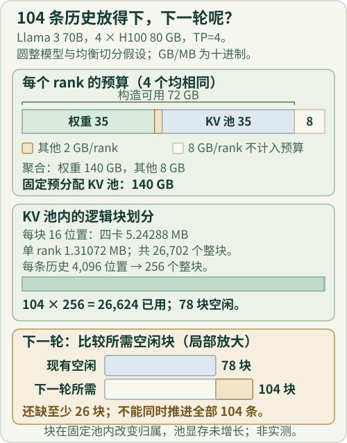
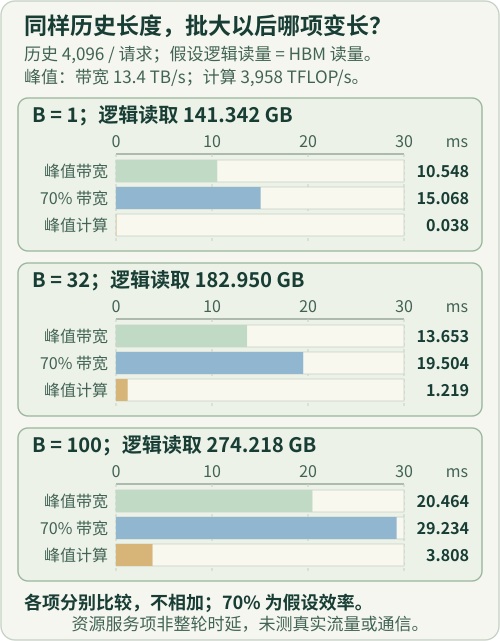
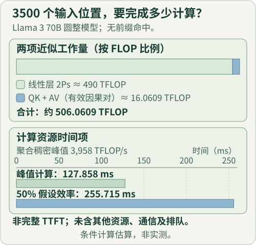

<!-- site-inference-math -->
# 一套模型和设备配置究竟能够服务多少请求？

假设将一个 70B 参数的语言模型部署到四张 H100 上。估算发现设备可以同时保存 104 条、已有 4,096 个 KV 位置的序列。这是否意味着下一轮能让这 104 条序列一起生成？系统每秒又能完成多少请求？

这是三个不同的问题：资源能同时容纳多少状态，一轮工作需要消耗多少时间，以及在指定请求负载与延迟目标下，系统能够持续完成多少有效工作。前两项可以通过容量及资源服务模型估算，第三项还需要调度、到达和完成过程。

本篇继承旧版 Llama 3 70B 与 H100 的条件算例，沿 G04/G05 的资源预算、G02 的工作量、I01 的通信模型和 K04 的事件预测，建立一套可以复算并用真实测量检验的估算方法。文中所有性能数字都是条件估算，非 H100 实测。

## 在计算之前，需要先固定哪些参数？ {#configuration}

采用 2024 年 4 月发布的原始 **Llama 3 70B**，而不是后续扩展上下文的 Llama 3.1。该模型采用具备 GQA 的稠密 Decoder，原始上下文长度为 8,192。模型基本结构见下表。

| 参数 | 取值 | 性质 |
| --- | ---: | --- |
| 层数 L | 80 | 官方结构 |
| 隐藏宽度 d | 8,192 | 官方结构 |
| 查询头数、KV 头数 | 64、8 | 官方结构 |
| 每头维度 | 128 | 8,192/64 |
| FFN 中间宽度 m | 28,672 | 官方结构计算所得 |
| 词表大小 V | 128,256 | 官方结构 |
| 主算例参数量 P | 70×10⁹ | 沿用旧版圆整值 |
| 权重、KV 元素大小 | 2 B、2 B | 16 bit 存储假设 |

来源为 Meta [原始模型卡](https://github.com/meta-llama/llama3/blob/a0940f9cf7065d45bb6675660f80d305c041a754/MODEL_CARD.md)、[固定修订的模型结构](https://github.com/meta-llama/llama-models/blob/0e0b8c519242d5833d8c11bffc1232b77ad7f301/models/sku_list.py) 和 [Llama 3 实现](https://github.com/meta-llama/llama3/blob/a0940f9cf7065d45bb6675660f80d305c041a754/llama/model.py)。这些不是对权重文件的实测统计。

模型所需的运算及参数结构还可参考[算法与模型：语言模型](../../workload/language-and-multimodal/language-models.md)。

然后指定设备与布局。假设四张 H100 SXM 构成一个 TP=4 的模型实例，矩阵及 KV 均衡切分，KV 无额外复制，能够使用相应通信路径。这个布局需要支持重分片的运行时，不代表 Meta 的原始参考加载程序直接采用 TP=4。

| 设备参数 | 单张 H100 SXM | 四卡合计或本例配置 |
| --- | ---: | ---: |
| 名义显存 | 80 GB | 320 GB |
| 标称 HBM 带宽 | 3.35 TB/s | 13.4 TB/s |
| FP16/BF16 稠密 Tensor Core 峰值 | 约 989.5 TFLOP/s | 约 3,958 TFLOP/s |
| 可用预算（假设） | 72 GB | 288 GB |
| 其他常驻、工作区等额度（假设） | 2 GB | 8 GB |

厂商 [H100 数据表](https://resources.nvidia.com/en-us-gpu-resources/h100-datasheet-24306?download=1) 的 SXM 规格列明 80 GB、3.35 TB/s、FP16/BF16 Tensor Core 1,979 TFLOP/s（带结构化稀疏的规格），这里用其一半换算稠密峰值，不把稀疏峰值用于稠密权重。

本篇所有 GB、TB、MB 和 FLOP 前缀均采用十进制，KiB、MiB、GiB 为二进制。名义设备容量不是进程实际可分配内存；聚合资源也是理想均衡利用的参考。[芯片架构实例：H100 SXM](../../chip-architectures/nvidia-h100-sxm/README.md) 介绍其片上供数路径。

### 为什么 70B 不是恰好 700 亿个权重元素？

可以按实际结构数一遍参数。令 K/V 投影的输出宽度为 $d_{kv}=8\times128=1024$。每层包含 Q/K/V/O 四个投影、SwiGLU 的三个矩阵和两组 RMSNorm 参数，另有模型输入 Embedding、输出词表投影及末层归一化。

| 模型中的参数 | 参数元素数 |
| --- | ---: |
| 80 层 Q/K/V/O：80×(2d²+2d×1,024) | 12,079,595,520 |
| 80 层 FFN：80×3dm | 56,371,445,760 |
| 所有 RMSNorm： (2L+1)d | 1,318,912 |
| 输入 Embedding 与未共享输出投影：2Vd | 2,101,346,304 |
| 合计 | 70,553,706,496 |

以上按官方无偏置矩阵、独立词表输出权重、RMSNorm 元素数推导。若每个参数占 2 B，理论权重载荷为 141.107412992 GB，而旧版用的 140 GB 少约 1.107 GB。实际存储还受切分、复制、布局、对齐及其他运行时分配影响。

为了与旧版公式和例子一致，下面主算例继续使用 P=70×10⁹ 与 140 GB。需要比较精确元素数的影响时再单独替换，不能混用两个预算。

## 能保存多少条序列，和能推进多少条序列一样吗？ {#capacity-budget}

首先考察 KV Cache。按照 [G04](../07-model-execution/g04-model-state-and-memory-budget.md#kv-per-position) 的公式，一条序列每新增一个已计算位置，在所有 80 层共增加：

$$k_{kv}=2\times L\times h_{kv}\times d_h\times p_{kv}=2\times80\times8\times128\times2$$

即 327,680 B/位置，也就是 320 KiB/位置。因子 2 对应 K、V；这里使用 KV 头数 8，而不是查询头数 64。采用理想 TP=4，每 Rank 保存两个 KV 头，因此每位置保存 81,920 B（80 KiB）。

一个序列已经计算了 4,096 个位置，其聚合 KV 有效载荷是 4,096×327,680=1,342,177,280 B，即 1.25 GiB；每 Rank 320 MiB。这里的 4,096 是已计算并保留的历史位置，不是额外生成 4,096 个 Token 的承诺。

### 按哪个范围记账？

沿旧版构造预算，288 GB 可用额度中先扣除 140 GB 权重和 8 GB 其他用途，剩 140 GB 的 KV Cache 池。理想均衡情况下每 Rank 的账如下。

| 用途 | 每 Rank | 四 Rank 合计 |
| --- | ---: | ---: |
| 可用额度（假设） | 72 GB | 288 GB |
| 权重（圆整） | 35 GB | 140 GB |
| 其他额度（假设） | 2 GB | 8 GB |
| KV 池 | 35 GB | 140 GB |

假设采用 [G05 分页 KV](../07-model-execution/g05-paged-kv-cache.md)，每个逻辑块容纳 16 个位置，物理状态分布在四个 Rank 上，不共享前缀。一个逻辑块的聚合有效容量为 16×327,680=5,242,880 B，每 Rank 1,310,720 B。

池有 140,000,000,000÷5,242,880 向下取整，即 26,702 个完整逻辑块。每条 4,096 位置的序列恰占 256 块，因此当前驻留数上限为 26,702÷256 向下取整，得到 104。

<figure markdown="1">

<figcaption>理想均衡切分的构造预算；逻辑块跨四个 Rank，空闲块与已用块均属于已预分配的池。图中空间分项不表示真实设备分配比例或实际内存池规格。</figcaption>

</figure>

104 条序列都已将末块填满，下一轮如果每条均需计算一个新位置，就要新取 104 块。但池只剩 26,702−104×256=78 块，至少缺 26 块。若无其他请求回收、共享或空闲变化，调度器不能让这些请求全部在同一轮继续。

若希望所有 4,096 位置的同长序列都有容量再处理一个位置，则每条需要 257 个块。该瞬时条件下上限为 26,702÷257 向下取整，即 103 条。这也只是再推进一个位置的资源条件，而不是支持所有请求完成生成的承诺。

### 为什么新增有效载荷小，分配量却可能很大？

若接纳 100 条，当前有效 KV 载荷占 134.217728 GB，恰好用满这些请求的末块。每条计算一个位置，新增正常有效载荷只有 100×327,680=32.768 MB；但需要新取 100 个完整块，占用池的空闲块容量 524.288 MB。

对预分配的池而言，这只是将空闲块转为已用块，不意味着进程因此新增 524.288 MB 的显存占用。内存碎片、块尾空置、预留、引用及回收条件的详细机制已由 G04/G05 和 H03 介绍。

若按上述结构精确权重载荷 141.107412992 GB 替换圆整值，并仍假设全部均匀分片、其他分项不变，则聚合池容量为 138.892587008 GB，可提供 26,491 个整块，最多 103 条 4,096 位置的序列，剩 123 块。圆整误差使当前驻留容量跨过了一个整数阈值。

其他额度还需覆盖同时活跃的临时张量、通信缓冲、执行图资源及必要工作区。真实 Rank 可能有复制的 Norm、词表填充、不同工作区，KV 头也可能额外复制。所以应分别对每 Rank 建立预算，在需要同时分配的逻辑块中按最少可用 Rank 作判断；不能只看聚合剩余显存。

## 同一轮让 100 条请求执行 Decode，需要做多少工作？ {#decode-work}

容量判定了当前能否保存和增长状态，却没有决定本轮耗时。回到 [G02](../07-model-execution/g02-prefill-and-decode.md) 的普通生成语义，每条请求已有 h=4,096 个 KV 位置，本轮计算一个新的输入位置，得到下一个输出；新位置可见历史与自己，共 s=h+1=4,097 个位置。

假设 B 条序列各进行一次 Decode，无投机、无前缀复用，均能参与此轮。对全注意力 GQA，保留旧版近似线性层工作量 2P/新位置，再加 QK 与 AV 的工作量。一次 MAC 计为两次浮点运算。

$$F_{\rm decode}\approx B\left(2P+4Lh_qd_hs\right)$$

这里 Attention 项因子 4 来自 QK 和 AV 各有一次长度为 d_h 的点积（2 FLOP/元素），并跨各查询头和各层累计。KV 头共享减少保存的数据，但并没有消除每个 Query 头的计算。

当 s=4,097 时，每条请求的 Attention 项约为 10.74003968 GFLOP，线性项近似 140 GFLOP。两项合计约 150.74004 GFLOP/条/轮。仅计算资源项就可按 K03 的口径与四卡稠密峰值比较。

不过 2P 是沿用旧版的粗略工作模型。输入 Embedding 通常是查表，不把整个词表乘一次；RMSNorm 也不是一组全连接权重。按上节的结构精算，应按实际矩阵、激活位置及输出投影计算，不能把所有参数统一当作每位置一次 MAC。

若只计各层矩阵、完整词表输出投影及 QK/AV，有效线性矩阵元素数为 68,451,041,280+1,050,673,152，当前 Decode 每条合计约 149.74347 GFLOP。下文仍使用旧版粗略 150.74004 GFLOP 口径。

### 工作量之外，需要读多少数据？

为保持旧版可复算口径，再作一个明确假设：整个轮次理想复用权重，读入一次圆整的 140 GB 权重载荷；每条请求的旧 KV 有效载荷也读一次。得到逻辑读取量：

$$D_{\rm logical}=140\times10^9+B\times4096\times327680\quad[\mathrm B]$$

这不是实际流经 HBM 的字节数。权重读取、Embedding 查表、缓存复用、布局和访问放大均可能不同；公式还没计入新 KV 写入、激活、临时状态等其他读写。比如 B=100 时，新增 KV 有效写入另有 32.768 MB。

现在假设这些逻辑读取量恰好需要经过四卡 HBM，并且均衡利用其带宽。进一步沿用旧版未校准的有效带宽比例 0.7，用 0.7×13.4=9.38 TB/s 做一个带宽时间估计。

| B | 近似计算量（TFLOP） | 逻辑读取（GB） | 计算峰值项（ms） | HBM 峰值项（ms） | HBM 0.7 假设（ms） |
| ---: | ---: | ---: | ---: | ---: | ---: | ---: |
| 1 | 0.150740 | 141.342 | 0.038 | 10.548 | 15.068 |
| 32 | 4.823681 | 182.950 | 1.219 | 13.653 | 19.504 |
| 100 | 15.074004 | 274.218 | 3.808 | 20.464 | 29.234 |

<figure markdown="1">

<figcaption>各资源时间项按同一 ms 尺度比较而非叠加，依据上述逻辑流量与均衡假设。0.7 是假定效率，不是实测值；结果均未包含完整执行路径。</figcaption>

</figure>

批量增加时，权重读取量在这个假设下不随 B 增加，可以由更多输出共同承担；KV 的逻辑读取量却随请求数和历史长度增长。与此同时，执行的算术工作量也随 B 增加，所以组批会改变不同资源的相对压力。

这解释为什么要比较不同批大小下的实际资源使用，而不是按阶段名称预先断言瓶颈。这里在给定逻辑读量下 HBM 项较大，只能提出相应假设，尚不能断言真实设备一定受 HBM 带宽饱和限制。参见[存储系统：存储与计算瓶颈](../../storage/01-memory-hierarchy/03-performance/memory-bound-vs-compute-bound.md)。

## 一次 Prefill 的计算量为什么不等于一次 Decode？ {#prefill-work}

接下来仍用四卡配置，构造一个独立测试点：单条请求有 3,500 个已知输入位置，没有前缀命中。所有提示位置都需要计算，最后产生首个输出 Token。

按旧版 2P×s_p 粗略线性项，$s_p=3500$。Prefill 中因果 Attention 的每个 Query 只读取自身和此前位置，因此允许参与的 Query-Key 对总数为 1+2+…+s_p=s_p(s_p+1)/2。

对每个允许位置对，QK 与 AV 的工作量共约 4×d_h FLOP，跨查询头和层数相加：

$$F_{\rm prefill}\approx2Ps_p+2Lh_qd_hs_p(s_p+1)$$

| 项目 | 工作量（TFLOP） |
| --- | ---: |
| 近似线性项 | 490.000 |
| Attention 的有效 QK/AV 项 | 16.06090752 |
| 合计 | 506.06090752 |

将此工作量除以四卡 3,958 TFLOP/s 的稠密峰值，得约 127.858 ms。若进一步假定有效计算率为峰值的一半，便得到旧版计算项估算 255.715 ms。

<figure markdown="1">

<figcaption>只比较此工作量的计算服务项。0.5 是构造参数；未计入其他算子、实际流量、通信、等待和输出路径，因此不能作为实测 TTFT。</figcaption>

</figure>

可以更贴近实际结构来修正粗估。设 80 层矩阵参数合计为 68,451,041,280（不含 RMSNorm、Embedding 和末层词表输出）。若服务只对最后一个提示位置计算完整词表 Logits，线性项就应按各层位置的矩阵及一次输出投影计数。

保留相同的 Attention 有效位置对，此时两项合计约 495.2203 TFLOP，对应半峰值计算率下约 250.238 ms。Meta 原始参考实现计算所有输入位置的输出投影，优化服务可以不同；应核对实际运行时执行哪些 Logits。

即使按结构细分，也还未计入归一化、RoPE、Softmax、激活等其他工作。实际注意力实现可能计算额外掩码区域。它们的时间也不都由同一 Tensor Core 峰值决定。

首 Token 时延还可能包含输入处理、排队、分块调度、通信、采样和输出。上述 255.715 ms 是给定条件的计算项，不是空载实测 TTFT，也无法直接用于 p99 或 SLO 验收。

## 多卡共同执行同一轮，通信时间怎样计算？ {#communication-budget}

聚合计算能力和 HBM 容量还没有计入多卡依赖。按照 [I01](../09-distributed-execution/i01-tensor-parallelism.md#communication-volume)，经典张量并行的一种 Transformer 前向实现，在 Attention 输出以及 MLP 输出处各进行一次 AllReduce。本例假定采用这样的布局，80 层共 160 次归约；这不是 TP 的固定定义。

假设本轮处理 M 个新位置，每个 Rank 的归约输入是一个 M×8,192 的 16 bit 激活矩阵。每次逻辑消息大小为 $Q=M\times8192\times2$ B。

若采用均匀的四 Rank Ring AllReduce，先分段归约（ReduceScatter），再分段收集（AllGather），总共 2×(4−1) 个传输步骤，每次发送 Q/4。因此每 Rank 每次发送 1.5Q（接收同量），不将收发重复计作发送量。

在 B=100 的 Decode 轮中 M=100，每次逻辑消息为 1.6384 MB，每 Rank 发送 2.4576 MB；160 次合计发送 393.216 MB。四 Rank 合计发送 1.572864 GB。这些是选定算法下 Rank 注入的有效数据量，并非所有物理链路累积流量。

对单条 3,500 位置的完整 Prefill，M=3,500，每 Rank 每次归约的逻辑消息为 57.344 MB；按相同算法与次数，累计发送 13.76256 GB。具体词表、并行布局、归约精度及其他通信另计。

| 对照工作点 | 每 Rank 单次逻辑输入 | 每 Rank 累计发送 | 450 GB/s 单向理想上限下的时间项 | 假设有效单向 200 GB/s 的纯传输项 |
| --- | ---: | ---: | ---: | ---: |
| 100 条普通 Decode | 1.6384 MB | 393.216 MB | 0.873813 ms | 1.96608 ms |
| 单条 3,500 位置 Prefill | 57.344 MB | 13.76256 GB | 30.583467 ms | 68.8128 ms |

这里 200 GB/s 是人为设定的有效发送服务率，不是 H100/NCCL 的实测。

[Hopper 调优指南](https://docs.nvidia.com/cuda/archive/13.0.0/hopper-tuning-guide/index.html#fourth-generation-nvlink) 说明单卡 NVLink 为双向合计 900 GB/s。只有在所需连接均可用的理想条件下，才能按 450 GB/s 单向上限计算相应时间项。实际通信服务能力由拓扑、算法、消息大小、并发和争用共同决定。

对照实测时，NCCL Tests 把逻辑输入大小除以时间记为 algbw；其 AllReduce 的 busbw 对 TP4 乘以 1.5。应按对应的计数口径比较，busbw 不是任意一条物理链路的实测流量。

如果还假定每次完整 collective 有独立的 5 μs 固定开销，160 次串行合计 0.8 ms。这个假设换成每个 Ring 步骤或采用重叠执行时结果就不同。估算也不包含归约计算等其他成本。

[经典 Megatron-LM](https://arxiv.org/abs/1909.08053) · [NCCL Tests：AllReduce 带宽计数](https://github.com/NVIDIA/nccl-tests/blob/826b3e67e00e479cba37196806a5e310bf1adb20/doc/PERFORMANCE.md) · [芯片与系统互连：并行布局与通信量](../../interconnect/SCALEUP/05-workloads-and-performance/parallelism-traffic.md)

还有一种不同的传输需求是 Prefill/Decode 分池时的 KV 交接。复用 [I05](../09-distributed-execution/i05-prefill-decode-disaggregation.md)：假设有 2,000 个缺失位置，需发送一份 625 MiB（655,360,000 B）有效 KV，单向有效带宽 64 GB/s 时纯传输项 10.24 ms。分池容量、安装完成及依赖另计。

### 计算、访存、通信的时间应怎样组合？

参考 [计算微架构 H01](../../microarchitecture-v2/08-performance/h01-task-time-and-bottlenecks.md#lower-bound)，如果已经确定某个工作在资源 r 上必须完成的实际服务量 $W_r$，且 $R_r$ 是该条件下的可用服务速率上限，那么整个工作至少需要相应服务时间：

$$T\ \ge\ \max_r\left(\frac{W_r}{R_r}\right)$$

这是资源时间下界，还需考虑数据与任务依赖给出的约束。若不同资源可以重叠，不能直接相加；只有实际依赖证明相应服务区间必须串行时才能将那些区间相加。串行与重叠都需要结合 K04 的事件模型和 K03 的 Trace 来检查。

前面的 `2P` 工作量、逻辑读取量与 Ring 通信载荷有各自假设。因此只有当对应工作量确实是必须经过该资源的需求时，峰值服务时间项才构成该模型的条件下界；不能把假设效率后的时间一概称为严格下界。

## 估算出了每轮时间，就知道每秒能服务多少请求了吗？ {#service-throughput}

如果额外假定 B=100 条请求每轮均生成一个 Token，且完整迭代时间恰好等于旧版 29.2343 ms 带宽估计，则这一个工作点的输出速率为：

$$\frac{100}{0.0292343}\approx3421\quad[\mathrm{Token/s}]$$

它只说明在这个生成工作点下有条件的输出吞吐。把该带宽项当作迭代时间是一项额外假设；前面已经看到计算、通信及调度也可能影响迭代时间。

即使某个请求每轮都参与，也只有输出立即提交、相邻迭代边界符合 K01 口径时，才能由完整迭代时间推导该请求的平均生成间隔。真实历史会增长，批成员也会变化，不能假定 4,096 位置、100 条请求的迭代无限重复。

### 用整个请求的工作量估算服务需求

考虑另一个明确的假想负载：每条请求输入 3,500 个 Token，恰好生成 100 个输出，无前缀共享、抢占重算或投机。在普通生成中，Prefill 已产生第一个输出，剩下需要 99 次 Decode，共计算 3,599 个新位置。

沿用上述圆整计算模型，先计入一次 Prefill 的因果 Attention，再对 99 次 Decode 的可见长度（3,501 至 3,599）逐项累加。因为历史长度会增长，它不能全部按 4,096 位置固定记账。

$$F_{\rm req}\approx 2P\times3599+2Lh_qd_h\times3500\times3501+4Lh_qd_h\sum_{s=3501}^{3599}s$$

计算得到：线性项 503.86 TFLOP，Prefill Attention 16.06090752 TFLOP，Decode Attention 0.921305088 TFLOP，合计约 520.842212608 TFLOP/请求。

若同一实例持续只处理这种请求，且把该近似工作量作为计算资源需求，四卡提供的聚合稠密峰值为 3,958 TFLOP/s。在此粗略模型中，仅从计算预算考虑，请求完成速率的峰值基准为：

$$\lambda_{\rm compute}\approx\frac{3958}{520.842212608}\approx7.60\quad[\mathrm{请求/s}]$$

这不是实际服务能力，也不是对真实实现无条件成立的严格上界。它说明把 3421 Token/s 直接除以每请求 100 Token 并不能得到同一服务负载的请求吞吐：纯 Decode 速率没有包含每条请求的 Prefill 工作。真实估算需用相符的逐算子工作量及完整调度模型。

类似地，长期 HBM 与通信的工作量取决于批组成、历史、实际数据复用和布局。不能仅从单轮逻辑读取量直接算出整个负载的每请求物理流量。K04 的事件模型可根据每轮动态工作量积累成本和输出，再沿窗口计算请求完成率。

### 如果还要求某个延迟目标呢？

由 K01，Goodput 取决于成功且联合满足 TTFT、TPOT 等规定的请求数（或对应有效 Token 数）与观察时间。系统也可能需要达到预设总体达标比例，如 90% 或 99%。

驻留容量、上述条件速率和 Goodput 各对应不同问题。即使某工作点的平均迭代时间低于阈值，也不能说明请求在所有队列和阶段上的尾部延迟都达标。

实际需要以具体输入/输出分布和到达过程做 K03 的开环负载对照，观察成功率、排队和联合达标比例；在稳定或有明确排空规则的窗口内计算。区分指定负载下的达标完成速率，以及满足总体 SLO 的最大持续到达速率。[DistServe（OSDI 2024）](https://www.usenix.org/system/files/osdi24-zhong-yinmin.pdf) 采用后者一类归一化指标。

## 改变模型精度、上下文或设备数，结果怎样变化？ {#sensitivity}

在旧圆整的 140 GB KV 池中，只改变每条请求当前实际缓存的历史长度，或只改变 KV 元素字节数。仍假设均衡切分、16 位置整块、无共享及元数据开销。

| 变体 | 每位置 KV | 每序列已有位置 | 当前载荷容量上限 |
| --- | ---: | ---: | ---: |
| 原 16 bit KV | 320 KiB | 4,096 | 104 |
| 16 bit、长度增至 8,192 | 320 KiB | 8,192 | 52 |
| 8 bit KV（仅有效字节减半） | 160 KiB | 4,096 | 208 |
| 8 bit KV、8,192 位置 | 160 KiB | 8,192 | 104 |

这些是容量敏感性而不是吞吐结论。8,192 已达本模型原始上下文边界，不应再无条件追加可计算位置。低精度实际还要算 Scale 与元数据、实现支持，以及按照 K02 验证模型任务质量。

若改变权重精度、设备数量、TP 和 Kernel，必须重新计算每 Rank 权重、KV 池及资源服务时间、通信和调度条件。不能直接将原四卡有效带宽、计算效率等假设复制给两卡，就推出相同性能。

### 为什么不能将若干效率因子直接相乘？

旧版朴素推理引擎列出了三个不同类型的反例，前面 G/H 专题已经解释过对应机制。现在从估算的角度再看它们的统计口径。

| 教学例 | 结果 | 只说明什么 |
| --- | --- | --- |
| 4 条请求各预留 8,192 位置，仅使用 1,024 | 有效载荷比例 12.5% | 预留区的空间占用比例 |
| 静态批 3 条分别需要 2、4、8 次 Decode | 有效槽位迭代 14/24≈58.3% | 批的槽位利用比例 |
| 在两个 Decode 轮之间串行插入 545 ms 的 Prefill，普通 Decode 25 ms | 可能出现 570 ms 的 ITL | 一次特定事件的间隔，不是 p99 |

让空闲内存容纳更多请求会改变批组成；批组成又会改变算术效率、各轮成本与请求等待；Prefill 选择影响 KV 增长及后续 Decode。所以“理想 Goodput×空间利用率×批效率×SLO 通过率”不是通用性能公式，这些量的分母不同且存在耦合。

更有证据的方式是先核算内存能否准入，再按调度策略选择批及其形状，用成本模型估计本轮时间，再沿事件推进记录输出，最后在同一窗口累积服务指标。这正是 K04 将状态、调度和成本分开的原因。

[旧版：朴素推理引擎的三类瓶颈](../../inference-runtime/01-request-and-metrics/03-naive-bottlenecks.md) · [PagedAttention](https://arxiv.org/abs/2309.06180) · [Orca](https://www.usenix.org/conference/osdi22/presentation/yu)

## 怎样把以上估算接到真实测试中？ {#measurement-loop}

这组计算的价值不在于给 H100 一个没有实验依据的性能排名，而在于让我们明确下一步应测量哪些量，并能通过差异定位模型中尚不成立的假设。

| 顺序 | 需要取得的证据 | 如何使用 |
| --- | --- | --- |
| 核对模型与设备 | 结构/权重修订、量化、设备型号、拓扑、驱动/运行时版本 | 形成实际载荷及可用资源预算 |
| 逐 Rank 容量测试 | 加载后/峰值、已分配/保留内存、KV 空闲块、工作区及回收 | 校准可用池与增长限制 |
| 按形状测量 | 批大小、Query 与历史长度、精度、内核、实际 HBM 流量、通信与轮次时长 | 建立 K04 成本表并验证资源与依赖假设 |
| 端到端测试 | 同质量负载、实际到达、队列与失败、输出事件及分布 | 检查联合 SLO 和可持续 Goodput |

这里没有运行任何 GPU 或推理服务实验；288 GB、8 GB、效率 0.7/0.5、有效通信速率等都只是教学参数。若进行实际实验，应记录具体软件版本及配置；例如前面讨论的 vLLM v0.10.2 只能作为某个可复现的实现版本，不能据此假定上述布局与耗时一定成立。

旧版公式与教学事件模型可以直接在仓库中复算：

~~~sh
python3 series/inference-runtime/examples/verify_examples.py
PYTHONPATH=website/tests python3 -m unittest test_compiler_runtime_k05
~~~

[旧复算程序](https://github.com/microarch-flow/wiki/blob/main/series/inference-runtime/examples/verify_examples.py) · [本篇独立复算](https://github.com/microarch-flow/wiki/blob/main/website/tests/test_compiler_runtime_k05.py)。新测试还核查精确结构、通信与请求工作量；其中网页测试需先构建网站。算术通过不代表效率参数已经校准，也不代替未参与校准的实际负载验证。

[Efficiently Scaling Transformer Inference](https://arxiv.org/abs/2211.05102) 展示了将模型工作量与设备、分片策略连接的解析分析；[Vidur](https://arxiv.org/html/2405.05465v2) 则展示利用实测和事件模型预测服务行为的方法。其结论均有特定设备、模型与配置边界。

## 接下来怎么读

本篇建立从模型规格、逐 Rank 容量、每轮计算/数据/通信需求到完整请求吞吐的条件估算，并指出哪些条件需要真实测量。理解这些边界后，K06 将沿真实框架源码追踪一次请求如何被组织、执行、更新并回收。

- [K01：怎样定义可以公平比较的延迟和吞吐量？](k01-performance-metrics.md)
- [K03：系统变慢了，怎样找到真正的瓶颈？](k03-benchmarking-and-profiling.md)
- [K04：知道请求何时到达，怎样预测它们何时完成？](k04-trace-and-event-model.md)
- [模型状态与内存预算](../07-model-execution/g04-model-state-and-memory-budget.md)
- [旧版：容量与性能估算——Llama 3 70B 与 H100 条件算例](../../inference-runtime/09-measurement-and-cases/15-quantitative-estimation.md)
- [性能分析、建模与验证专题导读](README.md)
