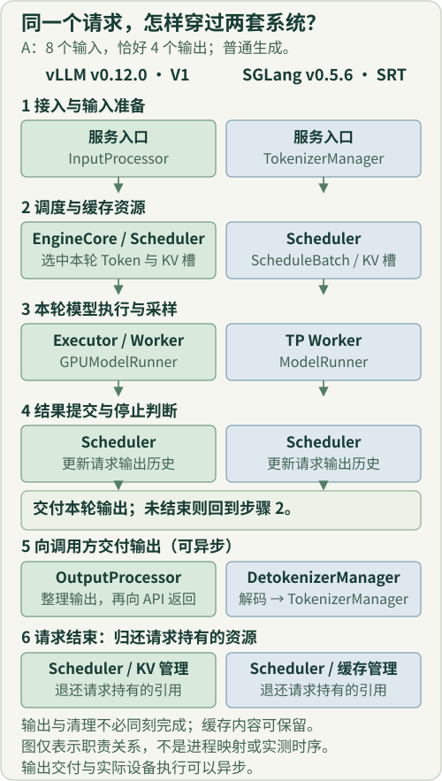
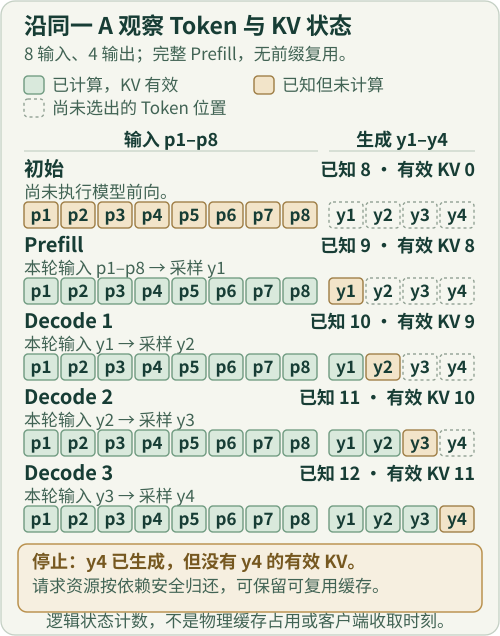

# 沿着同一个请求，怎样读懂 vLLM 和 SGLang 的源码执行路径？

一次文本生成请求进入推理服务后，用户只看到一段文字不断增长。但在服务内部，输入 Token 被记录为请求，调度器为它选择计算机会，执行器组织模型前向，采样器选出新 Token，服务再将结果返回给用户。

那些已经理解的机制，在真实软件中由谁实现？例如，知道 Decode 需要读取历史 KV 还不够。如果要修改引擎、定位一次异常或建立性能模型，就需要找到谁分配了缓存、谁把序列位置转换成设备地址，以及谁确认本轮结束。

**源码走读**就是沿着一个具体执行对象追踪这些职责。我们不按目录顺序学习框架，也不试图读完所有类。先找出请求每次改变状态的原因，再沿调用关系寻找产生变化的代码与证据。

本篇以两套真实框架为例，将 [G02](../07-model-execution/g02-prefill-and-decode.md)、[H01](../08-request-scheduling/h01-continuous-batching.md)、[J02](../10-serving/j02-request-and-resource-lifecycle.md) 已建立的状态与执行契约对应到源码，并用 K01–K05 的方法说明怎样验证这一认识。

## 先决定跟踪哪条请求、哪条执行路径 {#scope}

继承旧版走读的两个阅读版本。以下结论只针对选中的配置与执行分支，而不是项目所有版本或所有模型的共同实现。

| 框架 | 固定阅读版本 | 本篇采用的引擎 |
| --- | --- | --- |
| [vLLM](https://github.com/vllm-project/vllm/tree/v0.12.0) | v0.12.0 | V1 |
| [SGLang](https://github.com/sgl-project/sglang/tree/v0.5.6) | v0.5.6 | SRT |

下文的源码链接固定到这两个 Release Tag 解析出的提交：vLLM `4fd9d6a85c00ac0186aa9abbeff73fc2ac6c721e`、SGLang `7ae368efde14f0b2abe769a5fbb99b8154b2a9b7`。

其他篇章引用的 vLLM v0.10.2 等版本可以帮助建立概念，但不能直接当作本篇调用关系的证据。

选择单 GPU、单实例、普通文本生成，使用可在该设备上驻留的同一 Llama 类自回归模型与分词器。只观察一个请求 A，不引入其他并发请求。模型已加载，缓存没有可命中的前缀；Token 预算与 KV 池足以让 A 一轮完成 Prefill。

不启用投机解码、约束生成、跨实例 KV 交接、重叠及异步调度，本例的预算也足以不发生分块 Prefill。vLLM 走普通 `EngineCore.step`，SGLang 走 `event_loop_normal`。

模型前向以非 CUDA Graph 路径为例，采用兼容的未量化模型及各自指定的 Attention 后端。

这里的 A 就是 G02 的 A：实际送入模型的 8 个输入 Token（含可能的特殊 Token）为 p1 至 p8，输出上限为 4 个 Token，假设没有提前 EOS 或其他停止条件，依次得到 y1 至 y4。

两套框架内分别建立 A，符号 y1 等表示各自的生成位置，不预设两个实现会选择逐位相同的 Token。

<figure markdown="1">

<figcaption>职责及数据流对照，不是进程拓扑、实际时间线或性能排名。每一轮完成后，请求可以继续参加调度，也可以进入结束处理；输出与资源清理不必在同一时刻完成。</figcaption>

</figure>

实际运行时，不同职责可能通过进程间通信传递，也可能由同一进程中的不同对象完成。阅读时先追问数据由谁产生、谁消费，之后才确定通信方式。

### 先写下应当观察到的状态

由 G02，Prefill 把八个输入位置全部计算完，同时选择 y1；下一轮才把 y1 送入模型，计算该位置的 KV。用这一关系得到下面的预期。这里按成功完成计算和采样后的逻辑状态观察，末行在释放之前计数。

<figure markdown="1">

<figcaption>教学状态序列，非设备 Trace。已知 Token、已生成 Token 与有效 KV 位置分别计数；KV 的物理分配容量与可见的客户端文本均是另外的量。</figcaption>

</figure>

| 观察点 | 本轮实际计算的输入 | 已知 Token 数 | 已生成 Token 数 | 有效 KV 位置数 |
| --- | --- | ---: | ---: | ---: |
| 接入后 | 尚未计算 | 8 | 0 | 0 |
| Prefill 后 | p1 至 p8 | 9 | 1 | 8 |
| Decode 1 后 | y1 | 10 | 2 | 9 |
| Decode 2 后 | y2 | 11 | 3 | 10 |
| Decode 3 后（释放前） | y3 | 12 | 4 | 11 |

这张表是本篇的验证参照。如果源码看起来在开始计算之前就增加了“已计算长度”，就需要找到该字段究竟表示已经完成的状态，还是这轮已经安排的工作。不能仅根据字段名称推断设备执行完成。

## 一条 API 请求怎样变成引擎中的 A？ {#admission}

外部请求可以是一段文本与生成参数。引擎真正需要的是 Token ID、生成规则及请求的身份，例如本例要求只生成一条序列，最多追加四个 Token。入口还需要知道结果应该返回给哪一个调用者。

两侧均以 OpenAI 兼容的文本补全接口 `/v1/completions` 的流式响应为例。使用相同 Tokenizer 的相同八个提示 Token；不引入 Chat Template 对输入长度的改变。

### vLLM：从 Completion 到 EngineCoreRequest

1. API Server 的 `create_completion` 将请求交给 `OpenAIServingCompletion.create_completion`。

   后者准备输入及 `SamplingParams`，并通过 `_process_inputs` 调用 `InputProcessor.process_inputs` 形成 `EngineCoreRequest`。其中包括请求 ID、提示 Token ID 和生成参数。
2. `AsyncLLM.generate` 接收该对象。`_add_request` 先在 `OutputProcessor` 登记与请求 ID 对应的输出状态，再调用 `CoreClient.add_request_async`，将 ADD 消息发给 EngineCore。

   这样未来的结果能够找到等待它的输出通道。
3. `EngineCoreProc` 接收请求并将 `EngineCoreRequest` 转为引擎内部 `Request`。`EngineCore.add_request` 最终调用 `Scheduler.add_request`，把 A 纳入等待队列，等待下一次调度。

源码入口：[API Server](https://github.com/vllm-project/vllm/blob/4fd9d6a85c00ac0186aa9abbeff73fc2ac6c721e/vllm/entrypoints/openai/api_server.py#L733-L779) · [Completion](https://github.com/vllm-project/vllm/blob/4fd9d6a85c00ac0186aa9abbeff73fc2ac6c721e/vllm/entrypoints/openai/serving_completion.py#L168-L241) · [服务输入处理](https://github.com/vllm-project/vllm/blob/4fd9d6a85c00ac0186aa9abbeff73fc2ac6c721e/vllm/entrypoints/openai/serving_engine.py#L1200-L1227) · [InputProcessor](https://github.com/vllm-project/vllm/blob/4fd9d6a85c00ac0186aa9abbeff73fc2ac6c721e/vllm/v1/engine/input_processor.py#L385-L524) · [AsyncLLM](https://github.com/vllm-project/vllm/blob/4fd9d6a85c00ac0186aa9abbeff73fc2ac6c721e/vllm/v1/engine/async_llm.py#L346-L450) · [CoreClient](https://github.com/vllm-project/vllm/blob/4fd9d6a85c00ac0186aa9abbeff73fc2ac6c721e/vllm/v1/engine/core_client.py#L945-L952) · [内部 Request 构造](https://github.com/vllm-project/vllm/blob/4fd9d6a85c00ac0186aa9abbeff73fc2ac6c721e/vllm/v1/engine/core.py#L532-L554) · [EngineCore 循环](https://github.com/vllm-project/vllm/blob/4fd9d6a85c00ac0186aa9abbeff73fc2ac6c721e/vllm/v1/engine/core.py#L855-L911)

### SGLang：从 Completion 到 TokenizedGenerateReqInput

1. HTTP Server 的 `/v1/completions` 入口通过 OpenAI Serving 的 `handle_request` 校验并转换输入。

   `_convert_to_internal_request` 形成 `GenerateReqInput`，其中包括文本或 Token ID、采样参数、请求标识等。
2. `TokenizerManager.generate_request` 准备输入。单请求路径调用 `_tokenize_one_request` 和 `_create_tokenized_object`，构造 `TokenizedGenerateReqInput`。

   `_send_one_request` 将它送给调度进程，并建立按 `rid` 关联的 `ReqState`（等待状态）。
3. `Scheduler.event_loop_normal` 接收新请求。`handle_generate_request` 建立内部 `Req`，将其放进 `waiting_queue`。调度器随后才会为它决定一轮工作。

源码入口：[HTTP Server](https://github.com/sgl-project/sglang/blob/7ae368efde14f0b2abe769a5fbb99b8154b2a9b7/python/sglang/srt/entrypoints/http_server.py#L1125) · [Completion 转换](https://github.com/sgl-project/sglang/blob/7ae368efde14f0b2abe769a5fbb99b8154b2a9b7/python/sglang/srt/entrypoints/openai/serving_completions.py#L59) · [TokenizerManager](https://github.com/sgl-project/sglang/blob/7ae368efde14f0b2abe769a5fbb99b8154b2a9b7/python/sglang/srt/managers/tokenizer_manager.py#L429) · [内部输入创建](https://github.com/sgl-project/sglang/blob/7ae368efde14f0b2abe769a5fbb99b8154b2a9b7/python/sglang/srt/managers/tokenizer_manager.py#L844-L898) · [发送与响应状态](https://github.com/sgl-project/sglang/blob/7ae368efde14f0b2abe769a5fbb99b8154b2a9b7/python/sglang/srt/managers/tokenizer_manager.py#L1001) · [调度器创建 Req](https://github.com/sgl-project/sglang/blob/7ae368efde14f0b2abe769a5fbb99b8154b2a9b7/python/sglang/srt/managers/scheduler.py#L1272-L1483)。

注意，接入时已经确立了生成上限，但此时只是把 A 注册为一条有待执行的请求。API 层的输出状态也不是设备 KV 缓存。查找这些对象之间的 ID 关联，才能把服务 Trace 与引擎 Trace 接起来。

## 调度器怎样决定第一轮要计算八个位置？ {#prefill-schedule}

已有请求对象还不够。执行器需要知道这一轮计算哪几个位置，并且必须有可写入对应 KV 的资源。回顾 [H01 的工作清单](../08-request-scheduling/h01-continuous-batching.md#round-worklist) 与 [H02 的 Token 预算](../08-request-scheduling/h02-chunked-prefill.md)，现在看两边怎样产生这份工作清单。

### vLLM：使用待计算位置数安排本轮工作

`Scheduler.schedule` 在处理等待队列时，通过 `KVCacheManager.get_computed_blocks` 查找可复用的前缀。A 没有命中，所以需要新计算八个位置。调度器依据 Token 预算、剩余 KV 块和模型长度等条件决定可安排的工作。

`KVCacheManager.allocate_slots` 为选中的请求分配所需块；本例资源充足，A 转为运行状态。

调度器生成 `SchedulerOutput`，其中包括首次选中的请求数据 `scheduled_new_reqs`、每请求的 `num_scheduled_tokens`（A 为 8），以及已结束的请求 ID 等。

本轮开始处的已计算位置数是 0。**调度结束时 `_update_after_schedule` 已将 `num_computed_tokens` 增至 8。** 这是引擎的计划进度，随后仍要真正完成设备计算。如果设备失败，就不能把这个字段作为有效 KV 就绪的证据。

源码：[Scheduler.schedule](https://github.com/vllm-project/vllm/blob/4fd9d6a85c00ac0186aa9abbeff73fc2ac6c721e/vllm/v1/core/sched/scheduler.py#L465-L633) · [KVCacheManager.allocate_slots](https://github.com/vllm-project/vllm/blob/4fd9d6a85c00ac0186aa9abbeff73fc2ac6c721e/vllm/v1/core/kv_cache_manager.py#L206-L331) · [SchedulerOutput 定义](https://github.com/vllm-project/vllm/blob/4fd9d6a85c00ac0186aa9abbeff73fc2ac6c721e/vllm/v1/core/sched/output.py#L160) · [计划完成后的进度更新](https://github.com/vllm-project/vllm/blob/4fd9d6a85c00ac0186aa9abbeff73fc2ac6c721e/vllm/v1/core/sched/scheduler.py#L773-L802)

### SGLang：构造 Extend 批

`event_loop_normal` 调用 `get_next_batch_to_run`。这一路径会尝试 `get_new_batch_prefill`，选择符合预算和缓存条件的新工作。`Req.init_next_round_input` 准备已知序列、匹配前缀，剩余未匹配部分成为待计算后缀。

A 无缓存命中，`ScheduleBatch.prepare_for_extend` 为它准备 Extend（扩展已有序列）批。这里要计算全部八个提示位置。`alloc_for_extend` 获得请求池索引和可写 KV 位置，并将它们记录在请求到 Token 槽位的映射内。

批中记录输入 `input_ids`、序列长度 `seq_lens`、请求池索引 `req_pool_indices`、缓存写入位置 `out_cache_loc` 等。`kv_committed_len` 等字段在准备批时也会更新；同样不能用此刻的记录推断设备已经写完 KV。

源码：[get_next_batch_to_run](https://github.com/sgl-project/sglang/blob/7ae368efde14f0b2abe769a5fbb99b8154b2a9b7/python/sglang/srt/managers/scheduler.py#L1633) · [get_new_batch_prefill](https://github.com/sgl-project/sglang/blob/7ae368efde14f0b2abe769a5fbb99b8154b2a9b7/python/sglang/srt/managers/scheduler.py#L1712-L1880) · [Req.init_next_round_input](https://github.com/sgl-project/sglang/blob/7ae368efde14f0b2abe769a5fbb99b8154b2a9b7/python/sglang/srt/managers/schedule_batch.py#L765) · [prepare_for_extend](https://github.com/sgl-project/sglang/blob/7ae368efde14f0b2abe769a5fbb99b8154b2a9b7/python/sglang/srt/managers/schedule_batch.py#L1303-L1378) · [alloc_for_extend](https://github.com/sgl-project/sglang/blob/7ae368efde14f0b2abe769a5fbb99b8154b2a9b7/python/sglang/srt/mem_cache/common.py#L321)

在 A 这一轮，已知八个输入位置全部被选中，实际执行尚未完成。如果只满足部分预算，就需要考虑另一次 Prefill；这属于 H02 的其他分支，不是本例的额外 Decode。调度器选择的 Token 数与新生成的 Token 数也不能相加混为一种工作量。

## 一份调度结果怎样变成设备能够执行的输入？ {#device-execution}

调度结果表达“计算 A 的哪些位置”，而模型前向需要具体 Tensor。对 A 的 Prefill，执行器要准备八个 Token ID、对应的序列位置、历史长度和新 KV 写入映射，以及最后需要用来产生 Logits 的位置。

### vLLM：GPUModelRunner 怎样准备输入并调用模型？

`EngineCore.step` 先调用 `scheduler.schedule()`，再将 `SchedulerOutput` 交给执行器的 `execute_model`。

普通路径等待执行结果；如果此调用返回的模型结果为 `None`，再调用 `sample_tokens`。最后把得到的结果交给 `scheduler.update_from_output`。

本例选单进程执行器 `UniProcExecutor`，它经 `collective_rpc` 调用 driver worker 的方法；`Worker.execute_model` 与 `sample_tokens` 将工作交给模型 runner。[执行器](https://github.com/vllm-project/vllm/blob/4fd9d6a85c00ac0186aa9abbeff73fc2ac6c721e/vllm/v1/executor/uniproc_executor.py#L58-L112) · [GPU Worker](https://github.com/vllm-project/vllm/blob/4fd9d6a85c00ac0186aa9abbeff73fc2ac6c721e/vllm/v1/worker/gpu_worker.py#L537-L595)

在 worker 侧，`GPUModelRunner._update_states` 根据本轮计划维护自己的持久批状态。`_prepare_inputs` 使用请求的已计算起点与本轮安排的 Token 数，准备 Token ID、位置、块表及 `slot_mapping`，即新位置的缓存槽位映射。

`GPUModelRunner.execute_model` 准备模型输入与 Attention Metadata，在 `set_forward_context` 范围内调用 `_model_forward`。

对于单卡 Llama 类模型，`LlamaForCausalLM.forward` 进入 `LlamaModel.forward`，从 Embedding 经各层到末尾归一化。

源码：[GPUModelRunner._update_states](https://github.com/vllm-project/vllm/blob/4fd9d6a85c00ac0186aa9abbeff73fc2ac6c721e/vllm/v1/worker/gpu_model_runner.py#L743) · [_prepare_inputs](https://github.com/vllm-project/vllm/blob/4fd9d6a85c00ac0186aa9abbeff73fc2ac6c721e/vllm/v1/worker/gpu_model_runner.py#L1286) · [execute_model 中的前向](https://github.com/vllm-project/vllm/blob/4fd9d6a85c00ac0186aa9abbeff73fc2ac6c721e/vllm/v1/worker/gpu_model_runner.py#L2983-L3030) · [LlamaModel.forward](https://github.com/vllm-project/vllm/blob/4fd9d6a85c00ac0186aa9abbeff73fc2ac6c721e/vllm/model_executor/models/llama.py#L416-L446)

以选定的兼容 FlashAttention 后端为一个具体例子。Llama 模型的 `LlamaAttention.forward` 计算 Q、K、V 和位置变换，再调用 `Attention`。

模型 runner 通过 `set_forward_context` 提供 Attention Metadata，`Attention.forward` 从上下文取得它以及本层 KV Cache，并调用后端（或注册的 custom op）。

`FlashAttentionImpl.forward` 中，`reshape_and_cache_flash` 根据 `slot_mapping` 写入当前 K/V。

在普通 Decoder 分支中，`flash_attn_varlen_func` 使用 `block_table` 和 `seq_lens` 等数据访问缓存。这样逻辑序列位置就对应到了真正的缓存 Tensor。

源码：[EngineCore.step](https://github.com/vllm-project/vllm/blob/4fd9d6a85c00ac0186aa9abbeff73fc2ac6c721e/vllm/v1/engine/core.py#L331-L354) · [LlamaAttention.forward](https://github.com/vllm-project/vllm/blob/4fd9d6a85c00ac0186aa9abbeff73fc2ac6c721e/vllm/model_executor/models/llama.py#L237-L249) · [Attention.forward](https://github.com/vllm-project/vllm/blob/4fd9d6a85c00ac0186aa9abbeff73fc2ac6c721e/vllm/attention/layer.py#L310-L384) · [FlashAttentionImpl.forward](https://github.com/vllm-project/vllm/blob/4fd9d6a85c00ac0186aa9abbeff73fc2ac6c721e/vllm/v1/attention/backends/flash_attn.py#L625-L708)

### SGLang：ModelRunner 怎样取得同样的状态？

`Scheduler.run_batch` 从 `ScheduleBatch` 得到 `ModelWorkerBatch`，交给 `TpModelWorker.forward_batch_generation`。单卡也可进入该 worker；名字中的 TP 不表示本例一定进行了多卡通信。

worker 通过 `ForwardBatch.init_new` 进一步组织位置、缓存池引用和 Attention 后端，再调用 `ModelRunner.forward`。

本例进入 `_forward_raw` 的非 Graph 分支，Prefill 调用 `forward_extend`，普通 Decode 调用 `forward_decode`。它们准备后端元数据，然后调用模型。

源码：[run_batch](https://github.com/sgl-project/sglang/blob/7ae368efde14f0b2abe769a5fbb99b8154b2a9b7/python/sglang/srt/managers/scheduler.py#L1952-L2044) · [get_model_worker_batch](https://github.com/sgl-project/sglang/blob/7ae368efde14f0b2abe769a5fbb99b8154b2a9b7/python/sglang/srt/managers/schedule_batch.py#L1885) · [TpModelWorker](https://github.com/sgl-project/sglang/blob/7ae368efde14f0b2abe769a5fbb99b8154b2a9b7/python/sglang/srt/managers/tp_worker.py#L354) · [ForwardBatch](https://github.com/sgl-project/sglang/blob/7ae368efde14f0b2abe769a5fbb99b8154b2a9b7/python/sglang/srt/model_executor/forward_batch_info.py#L358) · [ModelRunner](https://github.com/sgl-project/sglang/blob/7ae368efde14f0b2abe769a5fbb99b8154b2a9b7/python/sglang/srt/model_executor/model_runner.py#L2546-L2710)

[Llama 模型前向](https://github.com/sgl-project/sglang/blob/7ae368efde14f0b2abe769a5fbb99b8154b2a9b7/python/sglang/srt/models/llama.py#L316-L357)同样从 Embedding 进入各层；`LlamaAttention.forward` 得到 Q/K/V，并调用 `RadixAttention.forward`。后者调用选中的 Attention Backend。

`RadixAttention` 是模型 Attention 层的接口，而 `RadixCache` 是前缀索引及缓存管理对象。两者通过缓存池与元数据协作，不能因名称相似就假定同一职责。

在兼容设备上选择 FlashInfer 后端为例。无前缀的 Extend 可走 Ragged（变长输入）分支，直接对本轮 K/V 计算 Attention，再通过 `set_kv_buffer` 保存新状态。

Decode 的分支则先将当前 K/V 写入 `out_cache_loc` 对应槽位，再调用 `decode_wrapper.forward` 访问本层缓存。

源码：[LlamaAttention](https://github.com/sgl-project/sglang/blob/7ae368efde14f0b2abe769a5fbb99b8154b2a9b7/python/sglang/srt/models/llama.py#L188) · [RadixAttention](https://github.com/sgl-project/sglang/blob/7ae368efde14f0b2abe769a5fbb99b8154b2a9b7/python/sglang/srt/layers/radix_attention.py#L95) · [后端分派](https://github.com/sgl-project/sglang/blob/7ae368efde14f0b2abe769a5fbb99b8154b2a9b7/python/sglang/srt/layers/attention/base_attn_backend.py#L79) · [FlashInfer Extend 与 Decode](https://github.com/sgl-project/sglang/blob/7ae368efde14f0b2abe769a5fbb99b8154b2a9b7/python/sglang/srt/layers/attention/flashinfer_backend.py#L698-L841)

这也解释了为什么 G02 用“本轮完成后建立有效 KV”描述状态，而不强行规定每个框架都先写全部 K/V、再从 HBM 读一遍。上述两种后端只是可阅读的实现分支，不是框架名称与某一设备 Kernel 的固定对应。

### 设备调用的边界在哪里？

这两条源码路径都把 Token 与相应的 KV 地址映射送入具体的模型和 Attention 实现，而不仅仅向模型传一个长为 8 的数组。实际执行还包含投影、归一化、MLP 及采样等相关算子。

例如 SGLang 的非量化线性层在相应 CUDA 分支中可调用 PyTorch 的 `F.linear`，实现进一步委派给设备后端。[线性层调用](https://github.com/sgl-project/sglang/blob/7ae368efde14f0b2abe769a5fbb99b8154b2a9b7/python/sglang/srt/layers/linear.py#L424-L436) · [未量化实现](https://github.com/sgl-project/sglang/blob/7ae368efde14f0b2abe769a5fbb99b8154b2a9b7/python/sglang/srt/layers/quantization/unquant.py#L123-L143)

这些函数向张量框架、编译生成的实现或自定义设备算子委派工作。函数体中看到一次 `forward` 不代表设备只运行一个 Kernel；也不能因为主机函数返回，就把它当作所有设备访问结束的时刻。[D 专题](../04-code-generation/README.md) 与 [F02](../06-execution-runtime/f02-asynchronous-execution.md) 解释了这里更低层的机制。

我们已经找到了设备输入的生产者、缓存寻址的消费者以及模型执行入口。若要定位真实耗时，下一步是在所选运行配置中以 Profiler 验证实际 Kernel 与执行依赖，不把某个后端的 Python 代码直接当成 GPU 时间线。

## 本轮模型给出 Logits，谁将 y1 写入请求？ {#sampling-and-commit}

模型已经计算了 A 的八个输入位置。如果只要求生成下一个 Token，不需要返回每个提示位置的 Logits，就只需要最后一个输入位置对应的词表分数。采样器根据请求规则选择 y1。

### vLLM：模型执行与采样结果提交分开

`GPUModelRunner.execute_model` 从前向结果按 `logits_indices` 选择需要的隐藏向量，并调用模型的 `compute_logits`。

普通生成路径将执行中间状态保存在 `ExecuteModelState`，由随后调用的 `sample_tokens` 使用。

`_sample` 将 Logits 交给 [Sampler](https://github.com/vllm-project/vllm/blob/4fd9d6a85c00ac0186aa9abbeff73fc2ac6c721e/vllm/v1/sample/sampler.py#L67-L201)，按生成参数走贪心选择或温度、Top-k/Top-p 等采样路径。

采样的结果不需要经 API 层返回设备作为下一轮输入。worker 的 `_bookkeeping_sync` 在本例的非异步路径中按请求批索引保存选出的 Token，包括写入 worker 的 `token_ids_cpu` 和本地请求输出历史。

随后 `sample_tokens` 将结果封装为 `ModelRunnerOutput`。

调度器的 `update_from_output` 根据请求 ID 找到本轮样本，将 y1 加入 A 的生成历史，并通过停止条件检查决定是否还需要继续。输出对象 `EngineCoreOutput` 携带新增 Token ID 等结果，供上游消费。

源码：[Logits 选择及 sample_tokens](https://github.com/vllm-project/vllm/blob/4fd9d6a85c00ac0186aa9abbeff73fc2ac6c721e/vllm/v1/worker/gpu_model_runner.py#L3029-L3116) · [_sample](https://github.com/vllm-project/vllm/blob/4fd9d6a85c00ac0186aa9abbeff73fc2ac6c721e/vllm/v1/worker/gpu_model_runner.py#L2541-L2555) · [_bookkeeping_sync](https://github.com/vllm-project/vllm/blob/4fd9d6a85c00ac0186aa9abbeff73fc2ac6c721e/vllm/v1/worker/gpu_model_runner.py#L2566-L2674) · [ModelRunnerOutput 封装](https://github.com/vllm-project/vllm/blob/4fd9d6a85c00ac0186aa9abbeff73fc2ac6c721e/vllm/v1/worker/gpu_model_runner.py#L3207-L3223) · [update_from_output](https://github.com/vllm-project/vllm/blob/4fd9d6a85c00ac0186aa9abbeff73fc2ac6c721e/vllm/v1/core/sched/scheduler.py#L1028)

### SGLang：模型 worker 产生 GenerationBatchResult

Llama 模型将隐藏向量交给 `LogitsProcessor`。在本例不要求提示位置 Logprob 的情况下，Prefill 只取各请求的末位置隐藏向量做词表投影；普通 Decode 对应每请求的当前位置。

`TpModelWorker.forward_batch_generation` 经 `ModelRunner.sample` 应用相关 Logits 处理和 Sampler，结果 `GenerationBatchResult` 包含 `next_token_ids`。

例如贪心生成可选择最大分数的 Token；其他采样配置会走不同分支，见 [G03](../07-model-execution/g03-sampling-and-generation.md)。

`process_batch_result` 按本轮的执行模式分派。第一次 Prefill 对应 `process_batch_result_prefill`，其中将结果 Token ID 加入 `req.output_ids` 并调用 `check_finished`。

A 尚未结束，前缀缓存状态也可由 `cache_unfinished_req` 维护。

源码：[LogitsProcessor](https://github.com/sgl-project/sglang/blob/7ae368efde14f0b2abe769a5fbb99b8154b2a9b7/python/sglang/srt/layers/logits_processor.py#L377-L430) · [worker 采样](https://github.com/sgl-project/sglang/blob/7ae368efde14f0b2abe769a5fbb99b8154b2a9b7/python/sglang/srt/managers/tp_worker.py#L438) · [ModelRunner.sample](https://github.com/sgl-project/sglang/blob/7ae368efde14f0b2abe769a5fbb99b8154b2a9b7/python/sglang/srt/model_executor/model_runner.py#L2734) · [Sampler](https://github.com/sgl-project/sglang/blob/7ae368efde14f0b2abe769a5fbb99b8154b2a9b7/python/sglang/srt/layers/sampler.py#L64-L116) · [Prefill 结果处理](https://github.com/sgl-project/sglang/blob/7ae368efde14f0b2abe769a5fbb99b8154b2a9b7/python/sglang/srt/managers/scheduler_output_processor_mixin.py#L64-L119)

SGLang 的 `Req.seqlen` 统计输入与输出 ID 的总数，批的 `seq_lens` 则服务于本轮计算及 KV 寻址。两者的观察对象并不完全相同。[Req.seqlen](https://github.com/sgl-project/sglang/blob/7ae368efde14f0b2abe769a5fbb99b8154b2a9b7/python/sglang/srt/managers/schedule_batch.py#L694)

此时回到本文最初的状态表：A 已知 9 个 Token、已生成 1 个 Token、8 个位置具有有效 KV。y1 已经选出，但还没有作为模型的输入被计算。用户也未必已经收到由 y1 解码得到的文本。

## 已经有 y1，第一次 Decode 怎样得到 y2？ {#first-decode}

旧版走读从这个时刻开始。现在已有完整的 Prefill 上下文，可以解释本轮工作清单为什么变短，为什么输入不是 p1 至 p8，也不是新生成的 y2。

### vLLM：待计算位置 = 已知位置 − 已计算位置

`Scheduler.schedule` 先处理运行中的请求。V1 这条路径不靠固定的 Prefill/Decode 阶段字段选择 Token 数；A 的已知长度是 9，上一轮完成的位置数是 8，因此还需计算 1 个位置。预算允许时，`num_scheduled_tokens[A]` 为 1。

A 已经在 worker 中登记，`scheduled_cached_reqs` 传递此轮开始处的进度 8，以及块表有变化时的相应信息。调度器再次提前将自己的计算计数推进至 9。worker 使用工作清单中的旧起点 8 来准备这一轮。

对本例单请求批，0 起始的位置索引是 `[8]`，输入 Token 是 `[y1]`，目标序列长度是 `[9]`，Query 起点数组为 `[0, 1]`。这些值与 A 的缓存块表共同确定本轮一个新位置的 KV 写入槽位，以及历史访问范围。

如果块大小为 b，本轮写入槽位可由对应的物理块编号乘 b，再加上位置在块内的偏移得到。实际 b 由配置决定，这里不将 G05 的教学块大小当作框架默认值。

沿上一节的模型与采样路径，`sample_tokens` 选出 y2，`update_from_output` 将它追加到历史，A 现在有 10 个已知 Token、9 个有效 KV 位置。下一轮才会计算 y2。

源码：[运行中请求的调度](https://github.com/vllm-project/vllm/blob/4fd9d6a85c00ac0186aa9abbeff73fc2ac6c721e/vllm/v1/core/sched/scheduler.py#L205-L268) · [CachedRequestData](https://github.com/vllm-project/vllm/blob/4fd9d6a85c00ac0186aa9abbeff73fc2ac6c721e/vllm/v1/core/sched/scheduler.py#L804-L849) · [输入准备](https://github.com/vllm-project/vllm/blob/4fd9d6a85c00ac0186aa9abbeff73fc2ac6c721e/vllm/v1/worker/gpu_model_runner.py#L1286-L1461) · [块表的槽位映射](https://github.com/vllm-project/vllm/blob/4fd9d6a85c00ac0186aa9abbeff73fc2ac6c721e/vllm/v1/worker/block_table.py#L179-L194)

### SGLang：从 Extend 批转换到 Decode 批

`get_next_batch_to_run` 将上一次 Extend 后仍需要继续的请求纳入 `running_batch`。

本例没有其他 Prefill 工作，`update_running_batch` 选择运行中的 Decode 工作，并调用 `prepare_for_decode`。

这一步把上一轮 `batch.output_ids` 中的 y1 作为新的 `input_ids`，通过 `alloc_for_decode` 取得新 KV 写入位置，将请求池中位置 8 的映射更新为这个槽位。然后增加批的序列长度等计划进度。

[`ForwardBatch.init_new`](https://github.com/sgl-project/sglang/blob/7ae368efde14f0b2abe769a5fbb99b8154b2a9b7/python/sglang/srt/model_executor/forward_batch_info.py#L455-L470)根据本轮长度 9 计算 Decode 的位置索引 8。

之后进入 `run_batch`、`forward_batch_generation` 和模型的 `forward_decode`，使用上一节的 Attention 及采样路径。设备实际输入同样是 y1，而非全部九个已知位置。

`process_batch_result_decode` 将选择出的 y2 添加至 A 的 `output_ids` 并检查停止条件。A 未结束，后续会使用 y2 作为输入。成功提交后，逻辑进度与 vLLM 本例一致，不说明两边的 Kernel 或性能一致。

源码：[选择下一批](https://github.com/sgl-project/sglang/blob/7ae368efde14f0b2abe769a5fbb99b8154b2a9b7/python/sglang/srt/managers/scheduler.py#L1633) · [update_running_batch](https://github.com/sgl-project/sglang/blob/7ae368efde14f0b2abe769a5fbb99b8154b2a9b7/python/sglang/srt/managers/scheduler.py#L1900) · [prepare_for_decode](https://github.com/sgl-project/sglang/blob/7ae368efde14f0b2abe769a5fbb99b8154b2a9b7/python/sglang/srt/managers/schedule_batch.py#L1699) · [alloc_for_decode](https://github.com/sgl-project/sglang/blob/7ae368efde14f0b2abe769a5fbb99b8154b2a9b7/python/sglang/srt/mem_cache/common.py#L421) · [Decode 结果处理](https://github.com/sgl-project/sglang/blob/7ae368efde14f0b2abe769a5fbb99b8154b2a9b7/python/sglang/srt/managers/scheduler_output_processor_mixin.py#L314)

两条实现的缓存管理对象与调度表示不同：vLLM 通过块表和块管理器组织物理块；SGLang 可通过请求池索引找到 Token 槽位，并用 Radix Cache 等实现管理可复用前缀。单纯对比某个类的名字不足以判断是否提供同一种功能。

## 生成结果怎样返回调用者？ {#stream-output}

在上述四轮中，每轮都会产生一个输出 Token。调度器已将这个 Token 记入请求的生成历史，但服务端还必须把它转换成协议层可以返回的结果。

### vLLM：OutputProcessor 将引擎输出交给等待中的请求

EngineCore 将 `EngineCoreOutputs` 放入输出队列。`AsyncLLM._run_output_handler` 所启动的后台处理循环通过 CoreClient 获得这些输出，再交给 `OutputProcessor.process_outputs`。

`OutputProcessor` 按请求 ID 找到前端状态，对新 Token 进行增量反分词（Detokenization），处理文本停止条件等，并将生成的 `RequestOutput` 放入对应的输出通道。

若前端发现停止字符串而引擎尚未结束，输出处理循环还会将终止信号送回引擎。`AsyncLLM.generate` 取出结果交给上层生成器。

`completion_stream_generator` 将这些结果转换为 OpenAI 兼容的 SSE（Server-Sent Events）数据，其中带增量文本等字段；结束时还会发送 `[DONE]`。API Server 的 `StreamingResponse` 负责响应客户端。

源码：[AsyncLLM 输出处理](https://github.com/vllm-project/vllm/blob/4fd9d6a85c00ac0186aa9abbeff73fc2ac6c721e/vllm/v1/engine/async_llm.py#L480-L531) · [OutputProcessor](https://github.com/vllm-project/vllm/blob/4fd9d6a85c00ac0186aa9abbeff73fc2ac6c721e/vllm/v1/engine/output_processor.py#L441-L545) · [增量反分词](https://github.com/vllm-project/vllm/blob/4fd9d6a85c00ac0186aa9abbeff73fc2ac6c721e/vllm/v1/engine/detokenizer.py#L94-L166) · [Completion SSE](https://github.com/vllm-project/vllm/blob/4fd9d6a85c00ac0186aa9abbeff73fc2ac6c721e/vllm/entrypoints/openai/serving_completion.py#L320-L505)

### SGLang：经过独立的反分词管理器

调度器处理批结果后调用 `stream_output`，其中 `stream_output_generation` 根据输出间隔和停止条件等决定是否向上游发送结果。它把待输出的 Token 信息和请求标识组织成 `BatchTokenIDOutput`。

`DetokenizerManager.handle_batch_token_id_out` 维护每条请求的解码状态，执行增量反分词，将 `BatchStrOutput` 发给 TokenizerManager。

后者的 `_handle_batch_output` 更新按 `rid` 关联的状态，并唤醒正在等待响应的任务。

原先 `TokenizerManager.generate_request` 中的 `_wait_one_response` 因此可以交付新结果。Completion 的 `_generate_completion_stream` 生成 SSE 增量数据，并在结束时发出 `[DONE]`。

源码：[stream_output_generation](https://github.com/sgl-project/sglang/blob/7ae368efde14f0b2abe769a5fbb99b8154b2a9b7/python/sglang/srt/managers/scheduler_output_processor_mixin.py#L734-L962) · [DetokenizerManager](https://github.com/sgl-project/sglang/blob/7ae368efde14f0b2abe769a5fbb99b8154b2a9b7/python/sglang/srt/managers/detokenizer_manager.py#L151-L250) · [TokenizerManager._handle_batch_output](https://github.com/sgl-project/sglang/blob/7ae368efde14f0b2abe769a5fbb99b8154b2a9b7/python/sglang/srt/managers/tokenizer_manager.py#L1566-L1680) · [Completion SSE](https://github.com/sgl-project/sglang/blob/7ae368efde14f0b2abe769a5fbb99b8154b2a9b7/python/sglang/srt/entrypoints/openai/serving_completions.py#L172-L334)

### 一次模型生成是否一定等于一次用户可见输出？

不一定。框架可能根据流式间隔合并多个输出；反分词需要等待可稳定解码的字符；停止字符串也可能跨 Token。网络传输和客户端处理还会引入额外等待。这些都是 [K01](k01-performance-metrics.md) 要区分引擎 Token 事件与客户端文本 Chunk 的原因。

例如 vLLM 的 `RequestOutputCollector` 能聚合待交付结果；SGLang 的 `stream_output_generation` 决定当前是否发送。因此即使四轮恰好各选择一个 Token，也不能从源码推断客户端必然收到四个间隔均等的文本 Chunk。

[vLLM 输出聚合](https://github.com/vllm-project/vllm/blob/4fd9d6a85c00ac0186aa9abbeff73fc2ac6c721e/vllm/v1/engine/output_processor.py#L33-L81) · [G03 的增量反分词与停止字符串](../07-model-execution/g03-sampling-and-generation.md#incremental-detokenization)

## y4 生成之后，哪些资源会被回收？ {#completion-and-reclamation}

继续执行两次普通 Decode：用 y2 生成 y3，再用 y3 生成 y4。达到四个输出的上限后，不需要安排下一轮。此时一共有 12 个已知 Token、11 个有效 KV 位置；无需为 y4 计算 KV。

### vLLM：引擎回收与 worker 状态清理

`update_from_output` 在追加 Token 时调用 `check_stop`，在正常达到输出上限后确定结束状态，并调用 `_free_request`。本例没有需要延迟释放的 KV Connector，它通过 `KVCacheManager.free` 回收请求的块引用。

块池在块引用计数降到零等条件满足时将块放回空闲队列。若启用前缀缓存，已完成的匹配块还可以保留其缓存身份以供复用。请求结束并不要求设备 KV 池整体释放显存。

引擎还将该请求加入 `finished_req_ids`。之后传给 worker 的调度输出会带上结束 ID，`GPUModelRunner._update_states` 据此移除请求的缓存状态和持久批中的条目。前端则根据结束原因结束输出通道并清理请求状态。

源码：[停止检查](https://github.com/vllm-project/vllm/blob/4fd9d6a85c00ac0186aa9abbeff73fc2ac6c721e/vllm/v1/core/sched/utils.py#L42-L72) · [_free_request](https://github.com/vllm-project/vllm/blob/4fd9d6a85c00ac0186aa9abbeff73fc2ac6c721e/vllm/v1/core/sched/scheduler.py#L1353-L1373) · [KVCacheManager.free](https://github.com/vllm-project/vllm/blob/4fd9d6a85c00ac0186aa9abbeff73fc2ac6c721e/vllm/v1/core/kv_cache_manager.py#L323-L331) · [BlockPool.free_blocks](https://github.com/vllm-project/vllm/blob/4fd9d6a85c00ac0186aa9abbeff73fc2ac6c721e/vllm/v1/core/block_pool.py#L384-L398) · [worker 清理](https://github.com/vllm-project/vllm/blob/4fd9d6a85c00ac0186aa9abbeff73fc2ac6c721e/vllm/v1/worker/gpu_model_runner.py#L743-L765)

### SGLang：请求结束时退出活跃缓存引用

`process_batch_result_decode` 在追加 y4 后调用 `req.check_finished`，判断生成上限等停止条件。确认结束后，调用 `release_kv_cache`，随后按输出策略交付结果；已结束的请求会被从待继续执行的批中滤除。

`release_kv_cache` 通过缓存实现的 `cache_finished_req` 等操作清理资源。以 Radix Cache 为例，无需保留的槽位可以归还，适合复用的有效前缀可能保留在树中；请求索引及前缀引用按相应规则解除。

因此，“A 不再拥有活动请求资源”不等于“所有 11 个历史位置的数据都被立即清零”。可保留多少有效位置取决于缓存身份、页边界及实现策略。在普通成功路径上，反分词管理器删除解码状态，TokenizerManager 也从 `rid_to_state` 中删除已完成的请求。

源码：[check_finished](https://github.com/sgl-project/sglang/blob/7ae368efde14f0b2abe769a5fbb99b8154b2a9b7/python/sglang/srt/managers/schedule_batch.py#L960) · [Decode 结束处理](https://github.com/sgl-project/sglang/blob/7ae368efde14f0b2abe769a5fbb99b8154b2a9b7/python/sglang/srt/managers/scheduler_output_processor_mixin.py#L314) · [release_kv_cache](https://github.com/sgl-project/sglang/blob/7ae368efde14f0b2abe769a5fbb99b8154b2a9b7/python/sglang/srt/mem_cache/common.py#L466) · [RadixCache.cache_finished_req](https://github.com/sgl-project/sglang/blob/7ae368efde14f0b2abe769a5fbb99b8154b2a9b7/python/sglang/srt/mem_cache/radix_cache.py#L429-L473)

### 如果请求在运行期间被取消呢？

现在改变 A 的结束条件：客户端在等待 y2 时关闭连接。此时可能已有本轮工作提交给设备。源码中的取消接口需要先传播消息，再由引擎在恰当的执行边界清理资源。[J02](../10-serving/j02-request-and-resource-lifecycle.md) 已建立这一生命周期契约。

vLLM 的 `AsyncLLM.generate` 处理取消异常时调用 `abort`，清理前端输出请求并向 EngineCore 发出 ABORT。普通引擎循环在处理输入消息时调用 `finish_requests`；已不存在的前端请求不会再接受迟到的引擎输出。

SGLang 的流式响应注册了断开后清理的后台任务；它可通过 `TokenizerManager.abort_request` 将 `AbortReq` 送往调度器。

对于等待队列中的请求，调度器可以移除它；在选定的普通运行路径中，运行中的请求可能被标记 `to_finish`，继续执行到结果处理处再结束，不能假定取消后立即停止 GPU。

源码：[vLLM abort](https://github.com/vllm-project/vllm/blob/4fd9d6a85c00ac0186aa9abbeff73fc2ac6c721e/vllm/v1/engine/async_llm.py#L455-L459) · [vLLM finish_requests](https://github.com/vllm-project/vllm/blob/4fd9d6a85c00ac0186aa9abbeff73fc2ac6c721e/vllm/v1/core/sched/scheduler.py#L1309-L1351) · [SGLang 流式响应注册](https://github.com/sgl-project/sglang/blob/7ae368efde14f0b2abe769a5fbb99b8154b2a9b7/python/sglang/srt/entrypoints/openai/serving_completions.py#L178-L183) · [SGLang 断开后的任务](https://github.com/sgl-project/sglang/blob/7ae368efde14f0b2abe769a5fbb99b8154b2a9b7/python/sglang/srt/managers/tokenizer_manager.py#L1366-L1378) · [SGLang abort_request](https://github.com/sgl-project/sglang/blob/7ae368efde14f0b2abe769a5fbb99b8154b2a9b7/python/sglang/srt/managers/tokenizer_manager.py#L1253) · [SGLang Scheduler.abort_request](https://github.com/sgl-project/sglang/blob/7ae368efde14f0b2abe769a5fbb99b8154b2a9b7/python/sglang/srt/managers/scheduler.py#L2344-L2424)

这里说明的是所选普通循环的具体处理方式，不是对所有故障和异步分支的安全性证明。开启重叠调度或 KV 交接后，需重新检查在途执行、传输和迟到结果是否都已满足释放条件。

## 能否按模块的名字直接比较两个框架？ {#responsibility-comparison}

现在回头把 A 中重要的跨层交接整理为一张表。关注的是每一步需要提供什么信息，而不是寻找一组完全等价的类或进程。

| A 中要完成的职责 | vLLM V1 本例 | SGLang SRT 本例 |
| --- | --- | --- |
| 请求变成引擎输入 | `InputProcessor`、`EngineCoreRequest` | `TokenizerManager`、`TokenizedGenerateReqInput` |
| 选择本轮工作 | `Scheduler`、`SchedulerOutput` | `Scheduler`、`ScheduleBatch` |
| 保存与定位历史 | `KVCacheManager`、BlockTable | 请求至 Token 槽位映射、缓存管理器（如 `RadixCache`） |
| 准备并执行模型 | `GPUModelRunner` | `ModelWorkerBatch`、`ForwardBatch`、`ModelRunner` |
| 生成并提交本轮 Token | `sample_tokens`、`update_from_output` | `forward_batch_generation`、`process_batch_result` |
| 交付输出 | `OutputProcessor`、`AsyncLLM` | `DetokenizerManager`、`TokenizerManager` |

注意，表中模块不一定一一对应，也不构成框架间固定的进程拓扑。例如不同运行配置可能选用不同的缓存管理器、设备后端或进程间通信方式。

[PagedAttention（2023）](https://arxiv.org/abs/2309.06180) 与 [SGLang / RadixAttention（2023）](https://arxiv.org/abs/2312.07104) 是理解两项目历史的重要入口，而不是其当前全部功能的互斥分类。两边都实现了更广的调度和执行机制，SGLang 也不仅是生成程序的前端 DSL。

类似地，ONNX Runtime 的 [Execution Provider](https://onnxruntime.ai/docs/execution-providers/) 和 [TensorRT](https://docs.nvidia.com/deeplearning/tensorrt/latest/architecture/how-trt-works.html) 的执行引擎主要帮助理解后端执行层；[Triton Inference Server](https://docs.nvidia.com/deeplearning/triton-inference-server/user-guide/docs/user_guide/architecture.html) 还涉及服务与模型管理。比较它们前需要定义参与比较的层次与路径。

## 怎样把源码走读变成可以验证和测量的认识？ {#verification-and-measurement}

目前得到的证据是固定版本的源码与 G02 的逻辑状态推导。它们可以解释 A 为什么需要一次 Prefill 和三次 Decode，但不能告诉我们一次 Prefill 具体需要几毫秒，也不能证明两个实现返回的数值相同。

### 先验证状态，再分析性能

假设在运行环境中为消息、调度结果、前向和输出增加带请求 ID 的记录。应保存请求与批的关联，以及单调时间戳、Token 位置和资源身份。以下是可以直接由本篇读出的检查点，而不是已经采集的 Trace。

| 需要回答的问题 | 记录或检查什么 |
| --- | --- |
| 是否处理了同一条输入？ | 模型与分词器修订、请求 ID、8 个提示 ID、生成参数 |
| 是否正确建立有效 KV？ | 每轮安排的新位置数、旧计算起点、缓存映射、对应执行完成；有效位置 0 → 8 → 9 → 10 → 11 |
| 是否正确提交结果？ | 每轮采样结果、请求输出 ID 与停止原因；输出数 0 → 1 → 2 → 3 → 4 |
| 是否正确解除资源引用？ | 完成/取消事件、请求条目、活跃引用和可回收池容量；区分缓存保留与泄漏 |
| 用户什么时候收到输出？ | 引擎 Token 事件、服务返回、客户端接收与终止事件各自的时间戳 |

第一组、第二组证据也适用于编译器及通用设备执行：计划有正确的输入、计算遵守相应语义，实际结果写到合法位置且在消费者使用前能够被访问。不能以计划字段代替执行验证，也不能以一种成功输入证明所有路径正确。

用 K02 的参考实现、数值容差和状态不变量检查模型结果；随机采样的结果还取决于随机状态、浮点误差及采样实现。必要时分别验证 Logits 与固定条件下的生成规则、内存引用和故障处理，不要求所有实现在随机生成时输出完全相同。

### 从关键路径到事件模型

如果用户感到第一个 Token 迟迟未到，不能只测 `forward` 耗时。按照 K01/K03，需要从客户端到达、输入准备、调度排队、Prefill、结果处理和客户端首次可见输出建立边界，逐项寻找关键路径上的等待。

如果首个输出很快、后面间隔较长，则继续对照每轮 Decode 的新位置数、历史长度、实际批组成、Kernel 与通信的关键路径，以及反分词和输出队列。测得某个 Kernel 慢只是一个现象，需采用有控制变量的实验验证归因。

建立 K04 事件模型时，源码提供请求状态转换及依赖关系，实际测量提供每类批形状的服务成本。用该模型在已知到达 Trace 上推进时钟，再用未参与校准的负载检查预测。源码不提供固定的轮次时间。

K05 中估算的 KV 容量、计算量和通信量可以用来解释或约束这些成本，但需依据实际缓存布局、可持续带宽、算子选择和调度条件校准。本文的单卡教学请求也不能直接继承 K05 四卡 Llama 3 70B 的条件速率。

### 怎样公平比较两套系统的速度？

进行真实实验时，至少固定模型和分词器版本、权重精度与质量约束、设备及拓扑、并行度、输入输出长度分布、工作到达过程、缓存冷热和生成参数。记录软件版本及所选后端，明确测量窗口与 SLO。

同时按照 K01 报告延迟分布、请求与 Token 吞吐、Goodput、失败率及内存情况。默认配置差异可以作为产品体验的一部分，但如果要把差异归因到某一机制，就需要控制其他变量。没有这类证据，不推荐某一框架“普遍更快”。

本篇未部署这两个 Release、未执行真实 GPU 前向或性能压测。可在仓库内用如下测试独立复算 A 的状态序列（网页测试需先构建网站），并按固定源码链接复查执行分支。

~~~sh
PYTHONPATH=website/tests python3 -m unittest test_compiler_runtime_k06
~~~

[本篇测试与状态复算](https://github.com/microarch-flow/wiki/blob/main/website/tests/test_compiler_runtime_k06.py) · [旧版：沿请求路径阅读 vLLM 与 SGLang](../../inference-runtime/09-measurement-and-cases/14-framework-comparison.md)

## 接下来怎么读

一个完整请求将程序语义、模型与 Kernel、设备执行、缓存、调度、服务生命周期贯穿起来。源码走读能够把每条抽象约束对应到产生状态变化的实现；正确性测试、实测与模型验证则回答这些实现是否真的满足预期。

- [K01：怎样定义可以公平比较的延迟和吞吐量？](k01-performance-metrics.md)
- [K02：怎样验证编译优化和运行时实现仍然符合预期？](k02-correctness-and-validation.md)
- [K03：系统变慢了，怎样找到真正的瓶颈？](k03-benchmarking-and-profiling.md)
- [K04：知道请求何时到达，怎样预测它们何时完成？](k04-trace-and-event-model.md)
- [K05：一套模型和设备配置究竟能够服务多少请求？](k05-capacity-and-performance-estimation.md)
- [性能分析、建模与验证专题导读](README.md)
- [编译器与运行时系统系列首页](../README.md)
