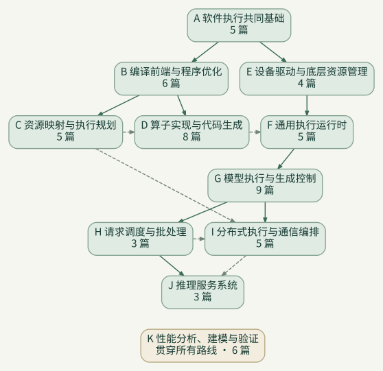

# 编译器与运行时系统

编译器把程序和模型所描述的计算转成可执行的代码与计划，运行时利用这些产物组织真实执行。设备驱动连接软件和硬件，推理服务则进一步管理模型状态、用户请求和多设备协作。

假设一个模型需要执行矩阵乘法。软件怎样选择分块、放置数据、生成内核？设备准备好之后，谁提交工作，又怎样确定数据已经可以使用？如果另一个请求到达，推理引擎下一轮应该计算什么？

## 从共同基础到三条软件主线

先理解程序语义、IR、张量表示和执行契约，再选择编译器、设备运行时或推理服务方向。后面的专题按各自必要知识衔接，不要求读者先掌握所有软件层次。

## 十一个专题的知识关系

<figure class="micro-v2-map micro-v2-map-wide" markdown="1">

<figcaption>实线表示主要认知衔接，虚线表示按场景补充的知识。K 是贯穿各路线的方法论，不是统一的最后一站。各篇主要前置知识见专题导读。 点击可查看大图。</figcaption>
</figure>

新版规划 **59 篇正文**，其中 53 篇常规文章、6 篇深化与案例。各专题导读同时记录文章计划与完成状态，未发布的条目不是已完成正文；实际写作可按内容密度调整篇数。

| 专题 | 核心问题 | 建议先了解 | 规划篇数 |
| --- | --- | --- | ---: |
| A · [软件执行共同基础](01-foundations/README.md) | 软件怎样表达计算，并和硬件建立执行契约？ | 基本编程；硬件接口按需补充 | 5 |
| B · [编译前端与程序优化](02-frontend-and-optimization/README.md) | 怎样把程序转成 IR，并在保持语义的前提下优化？ | A 中程序与张量表示 | 6 |
| C · [资源映射与执行规划](03-mapping-and-planning/README.md) | 怎样选择资源映射、数据布局和静态执行方案？ | A、B 中的依赖分析和硬件契约 | 5 |
| D · [算子实现与代码生成](04-code-generation/README.md) | 怎样生成目标指令、任务或可执行内核？ | A、B；AI 内核参考 C | 8 |
| E · [设备驱动与底层资源管理](05-device-driver/README.md) | 软件怎样取得设备、映射内存和提交命令？ | A 中执行契约；存储和互连接口 | 4 |
| F · [通用执行运行时](06-execution-runtime/README.md) | 怎样加载任务、管理异步依赖和动态资源？ | A、E 中的设备接口和完成语义 | 5 |
| G · [模型执行与生成控制](07-model-execution/README.md) | 怎样运行模型、维护状态并控制生成？ | F01–F03 的执行语义、模型计算需求 | 9 |
| H · [请求调度与批处理](08-request-scheduling/README.md) | 多个请求同时到达，下一轮应该执行哪些工作？ | G 中单请求执行、生成与状态 | 3 |
| I · [分布式执行与通信编排](09-distributed-execution/README.md) | 怎样把模型计算与状态分布到多个设备？ | A、F、相关模型和 G 状态；按场景补充 H | 5 |
| J · [推理服务系统](10-serving/README.md) | 怎样组织副本、请求流转和持续服务？ | G、H；分布式场景参考 I | 3 |
| K · [性能分析、建模与验证](11-performance/README.md) | 怎样用可复现的证据验证正确性与分析性能？ | 按要分析的机制选择 | 6 |

## 按学习目标选择

- **通用编译器**：A → B → D01–D04；按需读 K02。
- **AI 编译器**：A → B → C → D01、D05–D08，按需补充机器代码生成。
- **芯片系统软件与设备运行时**：A → E → F；可只了解编译产物接口，不必先学完整编译器。
- **单机推理引擎**：A 的必要基础 → F01–F03 → G → H；前缀、分层、约束及投机按需深化。
- **多设备推理与在线服务**：在模型执行和请求调度基础上选择 I、J。
- **性能与系统建模**：结合相关机制随时进入 K。

## 与相邻系列的分工

[算法与模型](../workload/README.md)解释模型所要执行的计算；[计算微架构](../microarchitecture-v2/README.md)解释指令、数据通路与硬件执行；[存储系统](../storage/README.md)解释物理数据保存与访问；[芯片与系统互连](../interconnect/README.md)解释数据传输。本系列负责软件表示、选择和组织执行方案，利用这些硬件机制完成计算。

## 版本说明

本页是独立建设中的新系列导读。旧版 29 篇[推理运行时资料](../inference-runtime/README.md)仍可正常阅读，重构期间保持旧版源码与公开地址。新版稳定后再评估迁移、归档和链接兼容。

完整知识域、文章基线、迁移清单与协作进度见[重构计划书（仓库）](https://github.com/microarch-flow/wiki/blob/main/docs/compiler-runtime-plan.md)。
