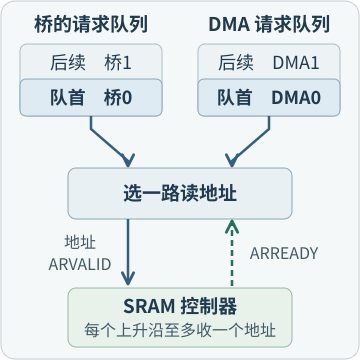

# 两个模块同时访问同一目标，谁先走？

上级：[基础对象与事务语义](./README.md)

[上一篇](../03-on-chip-protocol-families/axi-five-channels-handshake.md)里，桥向加速卡的 SRAM 连写了 42、43、44、45。现在假设这四个数都已写进 SRAM。桥想读回前两个字，卡内还有一个负责搬运数据的模块 DMA，想读走后两个字。两边读的是不同地址，互不修改对方的数据。为什么还会有一边要等？

## 四个地址，为什么要排两支队？

设桥和 DMA 各有一个入口队列，每笔都是单拍、4 字节对齐读。桥的队首是“桥0”，要读 `0x4000_0120` 的 42，后面跟着“桥1”，要读 43。DMA 的队首是“DMA0”，要读 `0x4000_0128` 的 44，后面跟着“DMA1”，要读 45。四笔请求在第 0 个上升沿之前都已经排好。每一支队都按先入先出取请求。

把观察点移到 **SRAM 控制器的读地址入口**。两条队列都接到这里，但控制器面前只有一组读地址信号。一拍里，这组线可以摆出桥的地址，也可以摆出 DMA 的地址，控制器最多收下其中一个。决定哪支队来用这组线的逻辑，就叫**仲裁器**。如果 DMA 改读另一个目标，而且互连给那个目标配了独立出口，两笔地址就可能同拍交付。可见，共用同一块芯片本身并不会让它们排队，真正要找的是哪项资源被两边同时需要。

## DMA 已经被选中，为什么地址还在原地？

给这个仲裁器定一条具体规则。两边都有合格请求时轮流服务，第一轮从桥开始。每当控制器实际收走一笔，就把下一次优先机会留给另一边。如果优先的一边没有请求，另一边可以直接用。这样的策略叫**轮询**（round-robin）。本例的仲裁器把选中的队首直接摆在出口，出口后没有额外的缓冲。

读地址通道叫 AR。互连给出 `ARVALID=1` 表示地址有效，控制器给出 `ARREADY=1` 表示能收。只有两个信号在上升沿同为 1，控制器才收下地址，这支队才能移走队首。表里每行都是一个上升沿采到的值，数字是教学假设。再加一个条件：控制器恰好在第 1、2 沿没有空位。

| 上升沿 | 出口摆着谁 | 有效／就绪 | 控制器收下谁 |
| ---: | --- | :---: | --- |
| 0 | 桥0 | 1／1 | 桥0 |
| 1 | DMA0 | 1／0 | 无 |
| 2 | DMA0 | 1／0 | 无 |
| 3 | DMA0 | 1／1 | DMA0 |
| 4 | 桥1 | 1／1 | 桥1 |
| 5 | DMA1 | 1／1 | DMA1 |

盯住第 2 沿的两个队首。同样都在等，**DMA0 等控制器收地址，桥1 等同一个出口腾出来**。如果仲裁器误以为每过一个沿就该换人，把 DMA0 换成桥1，控制器还没接过 DMA0，线上的有效地址就变了。AXI 要求发送端一旦给出有效地址，在握手前保持地址和随行属性稳定。因此本例在第 1 沿摆出 DMA0，第 2 沿仍摆 DMA0，到第 3 沿才把它从队里移走。第 3 沿交付的是地址，数值 44 还要等读数据通道 R 送回。[Arm AXI4 规范 A3.2，握手与信号稳定](https://developer.arm.com/-/media/Arm%20Developer%20Community/PDF/IHI0022H_amba_axi_protocol_spec.pdf?hash=6325311012DDADF238C35A6C0FD734E520754F82&la=en&revision=71bd7c57-2ed7-487b-bc3e-68c4ab56fa5f#page=42) · [沿一笔读跟到数据返回](./transaction-address-data-response.md)

试着把第 1、2 沿的 `ARREADY` 都改成 1，别的条件照旧。四笔地址会依次在第 0、1、2、3 沿交付，顺序仍是桥0、DMA0、桥1、DMA1。DMA0 比原来早了两个周期，因为被选中后不用再等控制器。可即使控制器一直能收，DMA0 也得等桥0用完第 0 沿。这里能分开量出两种等待：**有资格但没轮到**，以及**已经轮到但下游接不走**。

## 如果每次都让桥先走，会发生什么？

回到原表，让控制器仍在第 1、2 沿停收。只把轮询改成**桥固定优先**：两边都有合格请求时选桥，桥没请求时才选 DMA。第 0 沿还是桥0。到了第 1 沿，桥1 和 DMA0 都在队首，这次出口摆出桥1，并把它保持到第 3 沿握手。于是四个真正交付的沿仍是 0、3、4、5，但控制器收到的变成了 **桥0、桥1、DMA0、DMA1**。总量一样，桥1 提前一个周期，DMA0 晚了一个周期。

如果桥能一直补进新请求，即使控制器每一拍都能收，固定低优先级的 DMA 也可能无限期等待，这叫**饥饿**。轮询给出的保证有条件：两边要持续具备服务资格，出口要继续推进，每次授权也要在有限时间内结束。在这两个队首、一次只收一个地址的模型里，只要两边都合格，DMA 最多让桥先用一次成功的机会。把控制器停收的时间拉长十倍，这个“让一次”仍成立，换算成时钟周期却可以很长。

真实互连还得先判断谁有资格。比如 AMD 的 AXI Interconnect 在入口的在途事务数或目标出口的发出数达到上限时，会把对应请求暂时移出候选集合。在它的一种配置中，符合条件且优先级都为零的入口才一起轮询。其他设计也可以按权重分配服务机会，或者让久等的请求逐渐提高优先级。AXI 的 `AxQOS` 可以传递服务优先级信息，实际选择算法和能否满足时限取决于互连实现。[AMD PG059 的仲裁规则](https://docs.amd.com/r/en-US/pg059-axi-interconnect/Transaction-Arbitration) · [Arm AXI4 规范 A8.1，QoS](https://developer.arm.com/-/media/Arm%20Developer%20Community/PDF/IHI0022H_amba_axi_protocol_spec.pdf?hash=6325311012DDADF238C35A6C0FD734E520754F82&la=en&revision=71bd7c57-2ed7-487b-bc3e-68c4ab56fa5f#page=102)

## 轮到 DMA 一次，究竟占几拍？

刚才争的是地址口，一次授权交一笔地址。把观察点再往里移，改看控制器内部一个**读写共用的物理服务端口**。假设处理一份 4 字节数据要占一个时隙。DMA 有 16 份写数据，CPU 有一次只需一个时隙的短读。第 0 沿两者都已准备好，控制器先选 DMA。第 1 沿开始服务，下游一直就绪，切换读写也不花额外周期。

| 时钟沿 | 整段服务完再换 | 每个时隙可重新选 |
| ---: | --- | --- |
| 1 | DMA 第 1 份 | DMA 第 1 份 |
| 2 | DMA 第 2 份 | **CPU 短读** |
| 3～15 | DMA 第 3～15 份 | DMA 第 2～14 份 |
| 16 | DMA 第 16 份 | DMA 第 15 份 |
| 17 | **CPU 短读** | DMA 第 16 份 |

两种做法都在 17 个时隙服务完全部工作。只改授权的**粒度**，短读取得端口就从第 17 沿提前到第 2 沿。整段占用减少了重新选择的次数；细粒度切换给短请求留出机会，但真实存储器的读写转换可能有代价。这里的数字只算内部服务机会，CPU 拿到读结果还要走返回路径。AXI4 同一接口上的写数据要按写地址发出次序传送，不能从这张内部调度表推出不同写突发的 W 拍可以交错。[回看四拍写入和 W 的次序](../03-on-chip-protocol-families/axi-five-channels-handshake.md)

## 为什么 SRAM 先给出结果，桥却可能后收到？

现在看返回方向。设桥按先后发出两笔独立的单拍读：R0 去慢外设，R1 去 SRAM。两笔已分别送到目标，互连有空间保存先到的结果。固定两个时刻：R1 的结果最早在第 3 沿可交给桥，R0 的结果要到第 20 沿才可交。桥一直愿意收，但它只有一个 R 口，每沿只能收一份。

如果两笔在桥的同一 AXI4 接口上用了**相同的读事务标识** `ARID`，桥必须按发出顺序收到响应。即便 R1 已经准备好，也只能暂存在互连里。第 20 沿先交 R0，第 21 沿才轮得到 R1。若换成不同的 ID，并且系统允许重排、两笔之间也没有其他依赖，互连就可以在第 3 沿交 R1，第 20 沿交 R0。桥通过返回的 `RID` 分辨结果属于哪一笔。前一种情况下，继续提高 R1 的仲裁优先级也不能让它越过 R0。[Arm AXI4 规范 A6.6，响应顺序](https://developer.arm.com/-/media/Arm%20Developer%20Community/PDF/IHI0022H_amba_axi_protocol_spec.pdf?hash=6325311012DDADF238C35A6C0FD734E520754F82&la=en&revision=71bd7c57-2ed7-487b-bc3e-68c4ab56fa5f#page=89) · [ID 与在途事务](../03-on-chip-protocol-families/axi-channel-id-outstanding.md)

这条同 ID 规则分别约束读响应和写响应，读与写之间的依赖还要另看。例如软件准备好 DMA 描述符之后，再写门铃寄存器通知设备开工，设备必须能看到先前写好的描述符。所需的内存屏障（fence）与缓存同步操作取决于平台。屏障约束指定访问的顺序；锁或原子操作则用来协调多个执行者对共享状态的更新。仅仅让“写门铃”赢得总线仲裁，无法替这些机制完成工作。

## 出口停了，为什么入口还能再收三笔？

回到开头的地址口。若想让桥和 DMA 在 SRAM 偶尔忙时还能继续交地址，可以在仲裁器与控制器之间加一个按先入先出工作的缓冲（FIFO）。现在一定要区分两个观察点：入口仲裁选中的请求可以先进入 FIFO，控制器以后才从 FIFO 的另一端取走。向上游表示“我暂时收不下”的反馈叫**回压**。

设 FIFO 有 4 个槽，第 0 沿前已有 1 笔。上游每拍都有一笔有效请求。控制器在第 0 沿收一笔，第 1～4 沿停收，第 5 沿恢复。采用满时允许同一沿出一笔、入一笔的 FIFO。按“沿后占用 = 沿前占用 + 入队 − 出队”，可以直接数出回压何时传到入口。

| 上升沿 | 出队给控制器 | 从上游入队 | 沿后占用 |
| ---: | :---: | :---: | :---: |
| 0 | 1 | 1 | 1／4 |
| 1 | 0 | 1 | 2／4 |
| 2 | 0 | 1 | 3／4 |
| 3 | 0 | 1 | 4／4 |
| 4 | 0 | 0 | 4／4 |
| 5 | 1 | 1 | 4／4 |

第 1 沿出口已经停了，可入口还有三个空位，能在第 1、2、3 沿各收一笔。到第 4 沿，上游才第一次看到有请求却进不去。第 5 沿结束时占用仍为 4，但这一沿实实在在送走了一笔、收进了一笔。如果 FIFO 只根据沿前是否已满决定接收，第 5 沿就只出不进，沿后占用变成 3，下一沿才恢复入队。更深的缓冲能吸收更长的短暂停顿，也要多付面积和功耗，并容许更多请求排队；当长期到达速率大于出口服务速率时，空位终究会用尽。

把返回顺序和容量连起来，还能解释一种看似奇怪的波形。假设互连接新读前要预留返回槽。R1 因为在等更早的 R0，一直占着自己的槽；其余槽也被在途请求占着。下一笔 SRAM 地址即使独占出口，仍可能因为分不到槽而没有资格发出。调试时先问“这个请求在等哪一个槽，谁能释放它”，就有机会从地址口一路追回返回口。一次短暂停顿会随着队列排空而解除；要判定死锁，还须找出一圈互相等待的资源，并确认没有任何一方能先前进。[争用、QoS 与可观测性](../05-performance-debug/contention-qos-observability.md)

## 建模启示

只复现开头的六个沿，一个模型至少要记住两支队列的队首、下一次优先哪边、出口当前保持的是谁，以及控制器是否就绪。每沿先判断谁合格，再检查已摆出的请求是否被接收；真正交接才出队、记一次服务并更新轮询顺序。若加入 FIFO，把“被选中”“进入 FIFO”“被控制器接收”“桥收下返回”分别记为事件，按各自的交接点释放相应资源。

做性能分析，除了数每拍交付量，还应分别累计每个请求**等仲裁、等下游、等前序响应**的时间，跟踪授权粒度、优先级、队列容量和在途上限。采用信用流控的路径，则记剩余 credit（下游可用位置的额度）何时耗尽、何时归还。做功能检查时，还要核对停顿时载荷稳定、每笔请求只被接受一次、响应按 ID 匹配且顺序合法。这样才能解释为什么上面两套策略的总带宽相同，CPU 取得一次端口服务却相差 15 个周期。[带宽、延迟与利用率](../05-performance-debug/bandwidth-latency-utilization.md)

如果桥与 SRAM 之间隔着几跳路由器，读地址怎样穿过片上网络？桥同时在等两笔读，又怎样认出哪一笔返回了 42？下一篇进入片上网络专题，跟着两端的网络接口走一个来回。[《一次读取怎样变成 NoC 里的请求包和返回包？》](../../NOC/05-system-integration/ni-network-interface-design.md)
