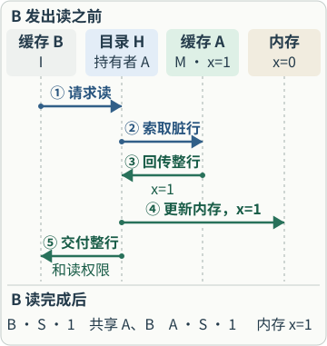

# 内存里还是 0，为什么 B 能读到 A 写的 1？

核心 A 和核心 B 都读过变量 `x`，读到的都是 0。接着 A 把 `x` 写成 1。假设此刻能同时看见三处硬件：A 的缓存里已经是 1，内存里还是 0，B 的缓存阵列里甚至也可能留下了原来代表 0 的那些位。现在 B 再读一次，哪一份可以用？

[上一篇的跨芯粒读取](../../D2D/ucie-pcie-read.md)有一个固定目标，地址选中哪个寄存器，就由哪个寄存器给数。这次地址始终相同，能回答它的硬件却会变化。我们就盯住 `x`，一直看到 B 第二次拿到数据。

## 一行数据为什么需要一份权限记录？ {#model}

设 `x` 占 4 字节，地址是 `0x1008`。机器按 64 字节一行管理缓存，所以控制器登记的是覆盖 `0x1000–0x103F` 的一整行。数据阵列保存这 64 字节，旁边的标签和状态记录说明它们属于哪一行，以及核心现在可以怎样使用它们。同一行在 A、B 的私有缓存各有一份，就有两组独立的存储位。改写 A 的四个字节，并不会沿导线顺便改写 B 的四个字节。[存储系统里一条缓存行怎样填入、怎样命中](../../../storage/01-memory-hierarchy/02-access-paths/cache-hit-lookup.md#first-fill)

两端采用写回缓存：核心可以先修改取得写权限的本地行，稍后再把整行的新内容交回下层。已经在缓存中修改、还欠下层一次更新的行，称为**脏行**。每行还有一个归属节点 H（Home），其中的目录负责记下谁可能持有可读副本，或者谁独自持有写权限。**H 掌握的是该去问谁，内存保存的是上次同步至此的行内容。** 它们在本例中是两个角色。

先把规则定具体。H 对这一行每次处理一笔权限事务，其他请求排队。需要撤销权限时，由 H 收确认；需要取回脏行时，数据经 H 转交。事务接收端完成安装或升级后通知 H，再放行同一行的下一笔。假设消息可靠，B 的第二次读排在 A 把 1 写进缓存之后。下面的编号是观察事件的顺序，两颗核心不必共用一个时钟。

## A 和 B 第一次读，为什么都能在本地留下 0？ {#shared}

刚开始，两边都没有可用的这行数据，只有内存保存着 `x=0`。A 第一次读缺失，向 H 发出“我要一份可读副本”的请求，记作 `GetS`。H 从内存取行、登记 A，把整行和读权限交给 A。接着 B 也发 `GetS`。此时内存仍有正确数据，H 可以同样为 B 服务。两次填充完成后，目录的共享者是 A、B，两边都可以直接读本地的 0。

MSI 的三个字母正好能记下接下来会发生什么。**S（Shared）** 表示本地可以读，写之前要另外申请权限。**I（Invalid）** 表示不能用这一槽的数据回答新的访问，硬件无需为了失效而把 64 字节逐位擦除。**M（Modified）** 表示本地独占读写权限，并负责保全这行的最新内容。M 时内存可以落后；即使数值碰巧相等，写权限仍由状态和协议决定。这三个字母描述稳定状态，请求和确认在路上时，控制器还须记住正在等什么。

## A 已经有了 0，究竟还缺什么才能写？ {#write-permission}

如果 A 直接把本地 0 改成 1，B 下一次命中自己的 S 行就会直接返回 0，H 连这次读取发生过都不知道。所以 A 先向 H 发 `GetM`，申请独占写权限。H 查到另一个共享者 B，向它发失效请求 `Inv`。B 处理这条请求，把本地状态改为 I，确保新的本地读取不能再取用旧副本，然后向 H 返回 `Ack`。在这个模型里，Ack 的含义是 **B 已经撤销了这份读权限**。

H 收齐所需的确认后，才给 A 发写授权 `GrantM`。A 原先缓存的整行仍然有效，这次升级可以只传权限消息。**A 收到并落实授权的那一刻，就可以写；执行写入的那一刻，四个字节才从 0 变成 1。** 如果 A 起初连这一行都没有，它还需要取得行数据，才能修改其中四字节并保留其余内容。

下面是整次实验的记录。缓存格中的字母表示权限，数字是其中的 `x`；“等”表示控制器还有未完成的事务。内存列只记后备内存里的 `x`。

| 观察时刻或在等的消息 | A 的缓存 | B 的缓存 | 内存 |
| --- | --- | --- | ---: |
| 1. 两次初读前 | I | I | 0 |
| 2. 两边都已读到 0 | S，0 | S，0 | 0 |
| 3. H 发失效，等 B 确认 | 等写权，0 | 仍可读 0，直到处理失效 | 0 |
| 4. B 已撤权，确认仍在路上 | 等写权，0 | I | 0 |
| 5. A 收到写授权，还没改值 | M，0 | I | 0 |
| 6. A 写入 1 | M，1 | I | 0 |
| 7. B 再读，H 正等 A 交回整行 | M，1（尚未处理探查） | 等行和读权 | 0 |
| 8. H 已接手新行并更新内存，向 B 供数 | 已交回，退出独占 | 等行和读权 | 1 |
| 9. B 收到数据并安装，事务收尾 | S，1 | S，1 | 1 |

可以只改一个条件检验这张表。假设 B 在第 4 步准时撤销权限，而返回 H 的确认晚了三拍。此时就算站在 B 旁边已经看见 I，站在 A 旁边仍只会看见一笔等待写权的操作。H 没有收到确认，无法据此发出授权。在其他耗时不变的情况下，第 5、6 步也晚三拍。协议允许这段时间没人能写；如果 H 在发送 `Inv` 时就授权，A 的写入却可能与 B 按旧权限读 0 重叠。

## 内存还是 0，B 的新读究竟从哪里取数？ {#read-again}

把时间停在第 6 步。B 读的是同一个地址，标签里即使还残留相同的地址，状态 I 也会阻止它用本地的旧位回答。B 向 H 发起新的 `GetS`。H 查目录，记录指向独占持有者 A。既然 A 可以在取得 M 后自行写入，H 就不能拿内存里的 0 作答，也不必靠比较两份数据来猜哪一份更新。它直接向 A 索取这一行。下图把总表第 7 至 9 步放大成五步，沿箭头可以分别找到请求和数据的来源。

A 收到探查后停止以 M 身份继续写，交出含 `x=1` 的整行。交接途中仍有人负责保管它，直到 H 接手。本例让 H 先用这份行数据把内存更新为 1，再把同一份数据和读权限交给 B。B 装好行，这次读才返回 1。**发出读请求时，内存确实是 0；B 最终拿到的 1 来自 A 写过的缓存行。** 在选定的这条路径上，到 B 收到答案时，内存也已更新。真实协议也可以让缓存直接向请求者供数；gem5 的目录式 MSI 教学实现就采用这种路径。[经 Home 转交的目录协议示例，UC Davis 讲义](https://www.ece.ucdavis.edu/~jowens/171/lectures/tlp4.pdf#page=60) · [gem5 的 MSI 示例](https://www.gem5.org/documentation/learning_gem5/part3/cache-intro/)

回看这个例子，缓存一致性要同时守住两件事。第一件是**单写者或多读者**。允许 A 写时，B 不能还拿着有效权限读自己的旧副本，这解释了第 3 至 5 步的等待。第二件是**数据值连续**。权限换手后，新的读取者必须继承上一个写阶段留下的值。即使失效确认一步不漏，若 H 在第 7 步把内存的 0 发给 B，仍然会读错。两条约束针对同一行上的有序访问。[《A Primer on Memory Consistency and Cache Coherence》第二版，第 2 章与第 6 章](https://pages.cs.wisc.edu/~markhill/papers/primer2020_2nd_edition.pdf)

## A 急着腾出缓存槽，能把那份 1 直接丢掉吗？ {#evict}

再回到第 6 步。这次 B 暂时没有读，A 却要用这个槽装入另一行。如果 A 丢掉 M 行，系统就只剩内存中的 0，下一次读取将无法还原 1。A 的控制器可以把旧行放进写回缓冲，先给阵列腾出位置，但必须继续保存行数据、跟踪写回，直到下一方按约定确认接手；若此时 H 的探查抵达，还得找到缓冲里的那份行。对干净的 S 行，内存已有有效数据，回收时按目录策略处理共享者记录即可。[存储系统中的填充与脏行写回](../../../storage/01-memory-hierarchy/02-access-paths/cache-dram-coordination.md#4-数据返回是否就算完成) · [写回与探查交叉时控制器等什么](../02-protocols/transient-states-and-races.md)

另一种设计允许 B 已经共享读到 1，而内存继续停在 0。它必须留下一个明确负责提供最新行的持有者。MOESI 用 O（Owned）表示这种脏共享责任；此时持有者若想再次写，仍要先收回其他副本的读权限。[MESI 与 MOESI 增加的状态](../02-protocols/mesi-moesi-extensions.md)

## 从同一个地址走向下一个问题 {#next}

本例把 B 的新读排在 A 写入之后；若它在 B 处理失效前已经按协议完成，读到 0 完全合理。如果改成 A 先写数据、再写位于另一行的标志，B 看见标志后能否安全地读数据，就需要说明内存顺序和软件同步。涉及不同地址时，可以从[两行数据的顺序与原子性](coherence-consistency-atomicity.md)接着读。

想把教学消息换成真实接口，可以沿 [CHI 的读取与写权限](../03-chi/chi-read-and-ownership.md)分别找请求、探查和数据；想看设备内存怎样进入主机地址空间，可以沿 [CXL Type 3 的地址转换](../04-cxl/cxl-type3-address-path.md)跟踪地址。系列下一篇把发起方和目标换成两张 GPU：A 凭什么能读 GPU B 的缓冲区，B 又要等到什么时候才能复用它？[GPU A 能访问 GPU B 的地址，什么时候才能读？](../../SCALEUP/01-access-semantics/address-mapping-and-permissions.md)
