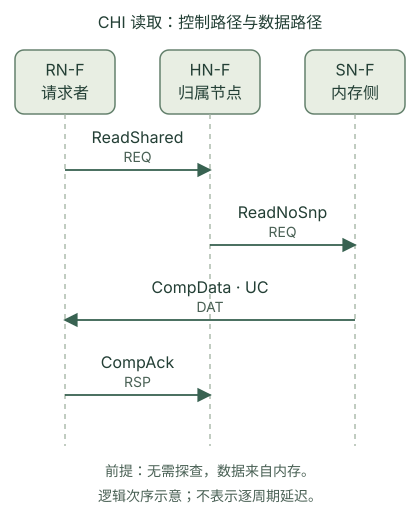

# CHI 的读取与写权限：数据到达和事务完成怎样区分？

本页采用 IHI 0050E.b 的事务语义。先看内存供数，再看缓存供数，最后比较写权限获取。图中省略链路信用、分拍和错误处理，不表示逐周期时序。

## ReadShared 不等于“结果一定为 Shared”

采用规范第 5.1.1 节的 DMT（Direct Memory Transfer）情形：请求者为 RN-F，目录判断无需探查，数据来自 SN-F 后面的内存。

该示例允许返回 Unique Clean（UC），因为请求读共享能力不意味着系统里已经存在其他共享者。请求者应按返回的状态和权限处理数据，不能只根据请求操作码决定本地状态。

CompAck 回到 HN-F，而数据直接来自 SN-F。这个例子说明：供数节点、协调节点和完成确认目标可以不同。接收端还必须收齐所需数据，不能把第一个数据拍到达等同于整笔事务完成。

## 另一个缓存供数时

规范第 5.1.3 节给出 DCT（Direct Cache Transfer）例子。初始另一个 RN-F 持有 UC 副本，HN-F 向它发转发探查。它降低权限，直接给请求者供数，并另外向 HN-F 报告处理结果。数据与探查响应经过不同通道，二者到达先后不能由图上上下位置推定。

对读者更有用的检查方法是分别列出两条义务：请求者拿到了什么数据和权限；HN-F 是否已经得到足够信息结束该行的冲突跟踪。请求者收到数据，不表示 HN-F 已收到所有相关响应。

## 写缺失需要数据和独占权限

构造一个无竞争场景：R 起初没有副本，其他节点只持有干净共享副本，R 发 ReadUnique。协调节点需要按所选流程撤销冲突副本，并向 R 提供数据和独占权限。R 获得这些条件后才能修改；这不是“先读任意副本，再直接本地写”。

若 R 已有有效数据，只缺写权限，则可考虑 CleanUnique 等无数据事务，但适用条件和探查竞争不同。不能机械地把所有 S→M 都翻译为 CleanUnique：过程中若副本丢失，还可能需要重新取数。

| 观察点 | 能确认什么 | 不能直接确认什么 |
| --- | --- | --- |
| 请求发出 | 请求已进入传输流程 | 目标已接受、权限已获得 |
| 读数据到达 | 已收到某部分或全部数据 | 所有失效义务均完成 |
| 所需权限成立 | 可以执行相应本地访问 | 其他地址的软件同步已成立 |
| 协议完成条件满足 | 可按规则结束事务跟踪 | 数据已持久化 |

具体操作码与完成依赖可查 [IHI 0050E.b，第 2.8 节、第 4 章及第 5.1 节](https://documentation-service.arm.com/static/6295e03db334256d9ea8ae86)。本页的教学归纳不替代字段级实现检查。下一篇解释[信用、重试和完成响应](chi-flow-control-retry-completion.md)。
